# 《计算机通信与网络》第3章 数据链路层（课件）

原件的每一页，下面附识别出的文字。

### 第 3 章 数据链路层

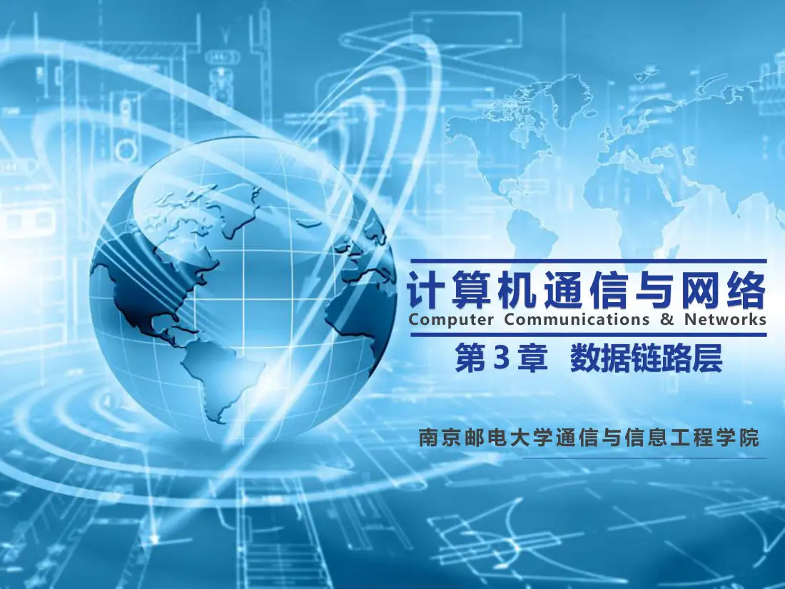

原文：

计算机通信与网络 Computer Communications & Networks

第 3 章 数据链路层

南京邮电大学通信与信息工程学院大纲要求R e q u i r e m e n t s

### 01 掌握数据链路层的基本概念；了解数据链路的功能

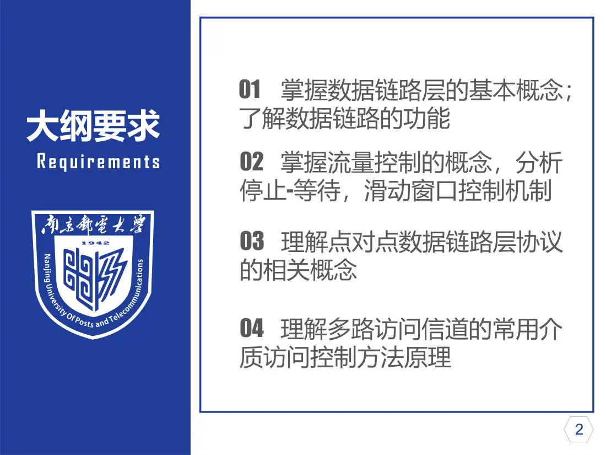

原文：

01 掌握数据链路层的基本概念；了解数据链路的功能

02 掌握流量控制的概念，分析停止-等待，滑动窗口控制机制

03 理解点对点数据链路层协议的相关概念

04 理解多路访问信道的常用介质访问控制方法原理

2

### 内容纲要C o n t e n t s P a g e

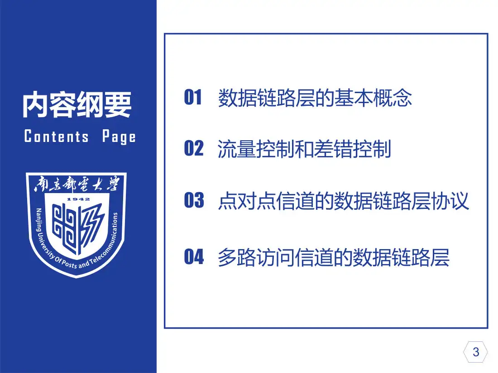

原文：

内容纲要C o n t e n t s P a g e

01 数据链路层的基本概念
02 流量控制和差错控制
03 点对点信道的数据链路层协议
04 多路访问信道的数据链路层

3

### 过渡页 T r a n s i t i o n P a g e

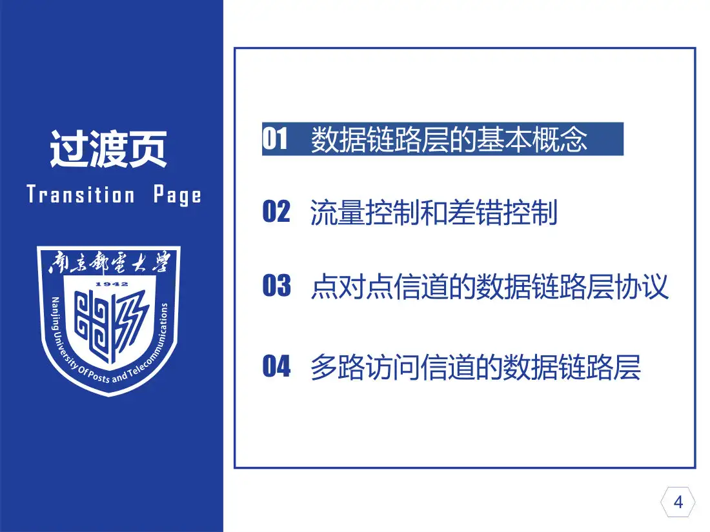

原文：

过渡页 T r a n s i t i o n P a g e

01 数据链路层的基本概念
02 流量控制和差错控制
03 点对点信道的数据链路层协议
04 多路访问信道的数据链路层

4

### 数据电路、数据链路

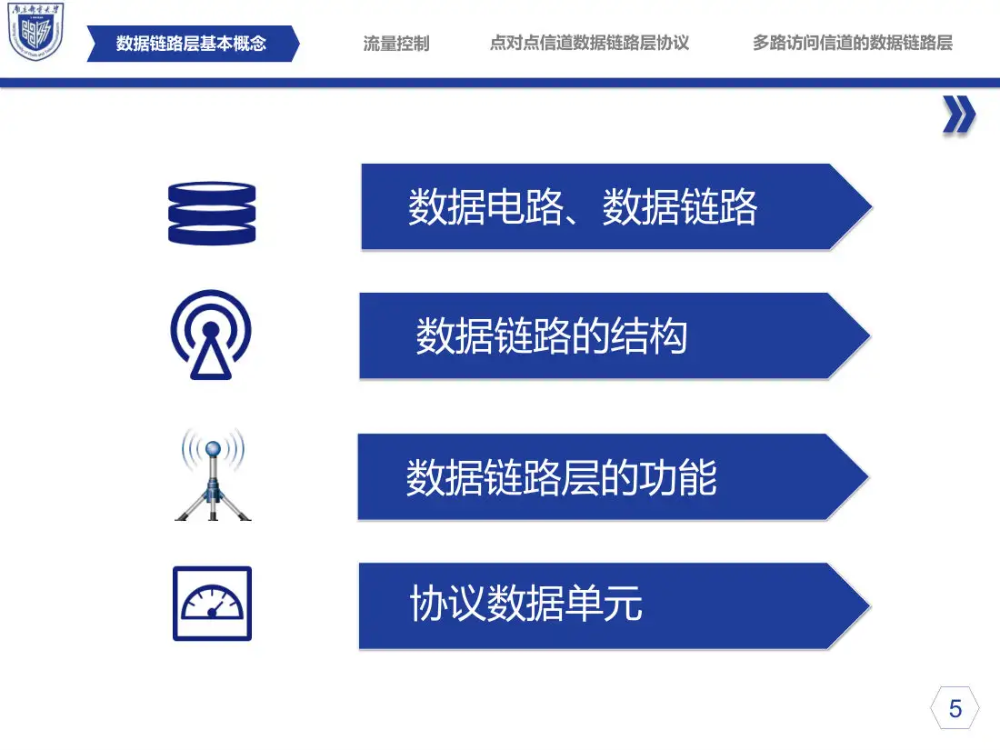

原文：

数据电路、数据链路

数据链路的结构

数据链路层的功能

协议数据单元

南志郵電大學Nanjing Un

数据链路层基本概念

流量控制

点对点信道数据链路层协议

多路访问信道的数据链路层

5

### 基本概念

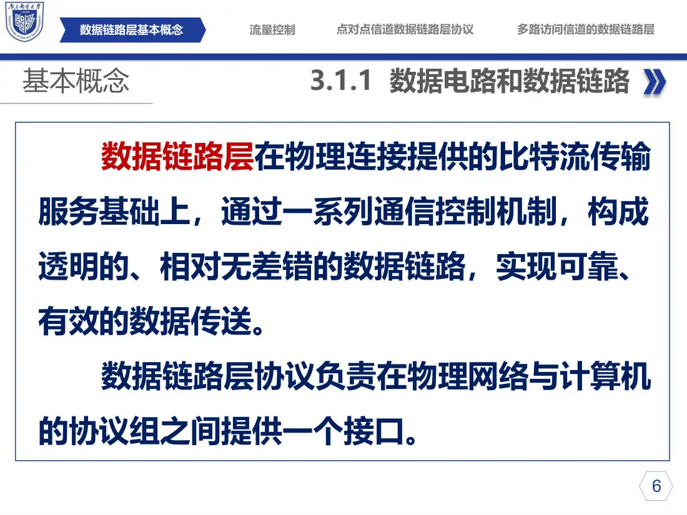

原文：

基本概念

3.1.1 数据电路和数据链路

数据链路层在物理连接提供的比特流传输服务基础上，通过一系列通信控制机制，构成透明的、相对无差错的数据链路，实现可靠、有效的数据传送。

数据链路层协议负责在物理网络与计算机的协议组之间提供一个接口。

南志郵電大學Nanjing Un

数据链路层基本概念

流量控制

点对点信道数据链路层协议

多路访问信道的数据链路层

6

### 基本概念

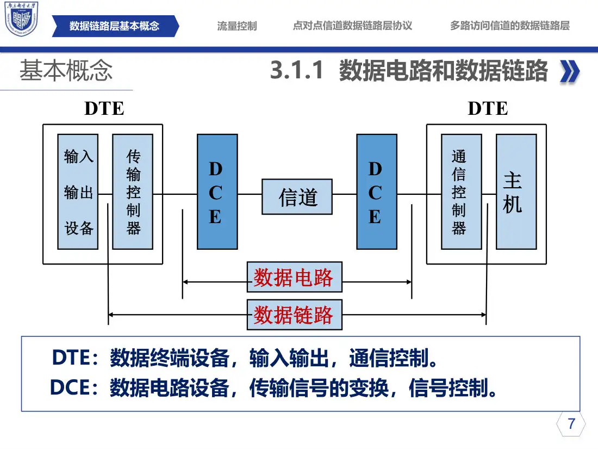

原文：

基本概念

3.1.1 数据电路和数据链路

DTE

DTE

DTE：数据终端设备，输入输出，通信控制。

DCE：数据电路设备，传输信号的变换，信号控制。

南志郵電大學Nanjing Un

数据链路层基本概念

流量控制

点对点信道数据链路层协议

多路访问信道的数据链路层

7

### 基本概念

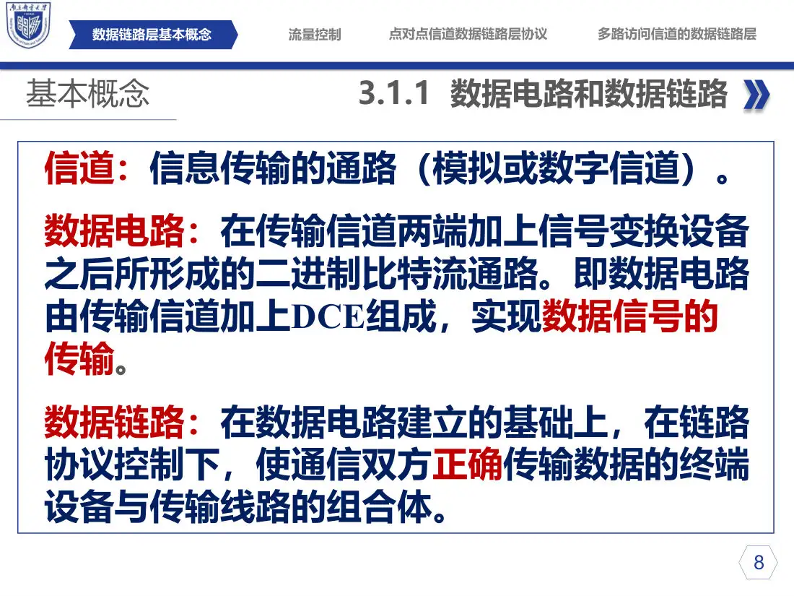

原文：

基本概念

3.1.1 数据电路和数据链路

信道：信息传输的通路（模拟或数字信道）。

数据电路：在传输信道两端加上信号变换设备之后所形成的二进制比特流通路。即数据电路由传输信道加上DCE组成，实现数据信号的传输。

数据链路：在数据电路建立的基础上，在链路协议控制下，使通信双方正确传输数据的终端设备与传输线路的组合体。

南志郵電大學Nanjing Un

数据链路层基本概念

流量控制

点对点信道数据链路层协议

多路访问信道的数据链路层

8

### 基本概念

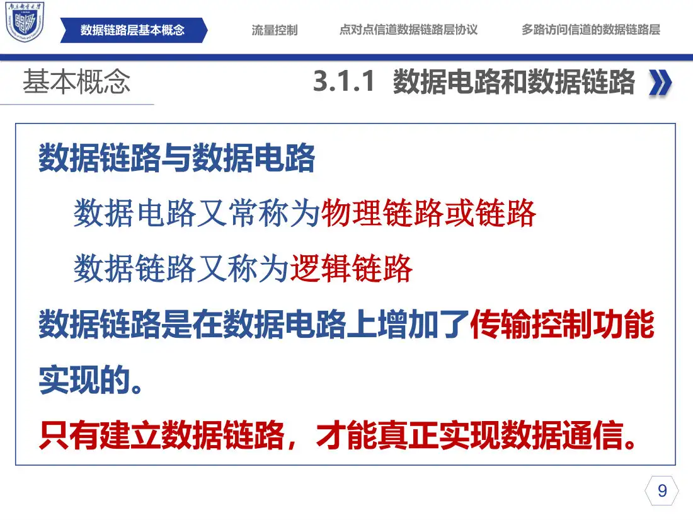

原文：

基本概念

3.1.1 数据电路和数据链路

数据链路与数据电路

数据电路又常称为物理链路或链路

数据链路又称为逻辑链路

数据链路是在数据电路上增加了传输控制功能实现的。

只有建立数据链路，才能真正实现数据通信。

南志郵電大學Nanjing Un

数据链路层基本概念

流量控制

点对点信道数据链路层协议

多路访问信道的数据链路层

9

### 基本概念

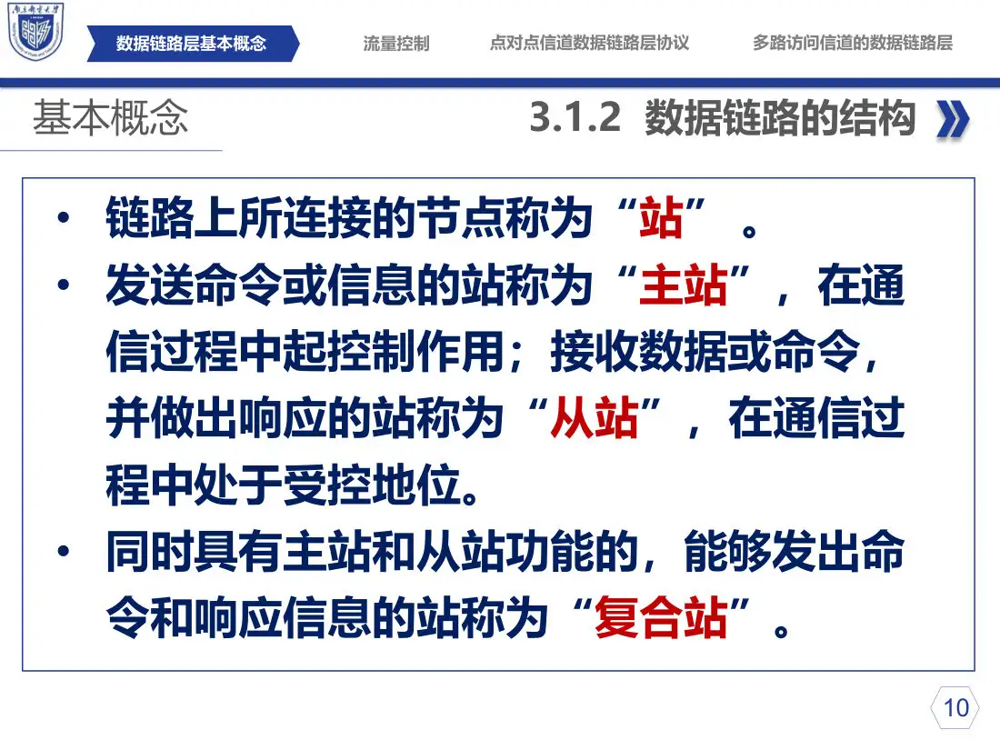

原文：

基本概念

3.1.2 数据链路的结构

• 链路上所连接的节点称为“站” 。

发送命令或信息的站称为“主站”，在通信过程中起控制作用；接收数据或命令，并做出响应的站称为“从站”，在通信过程中处于受控地位。

• 同时具有主站和从站功能的，能够发出命令和响应信息的站称为“复合站”。

南志郵電大學Nanjing Un

数据链路层基本概念

流量控制

点对点信道数据链路层协议

多路访问信道的数据链路层

10

### 基本概念

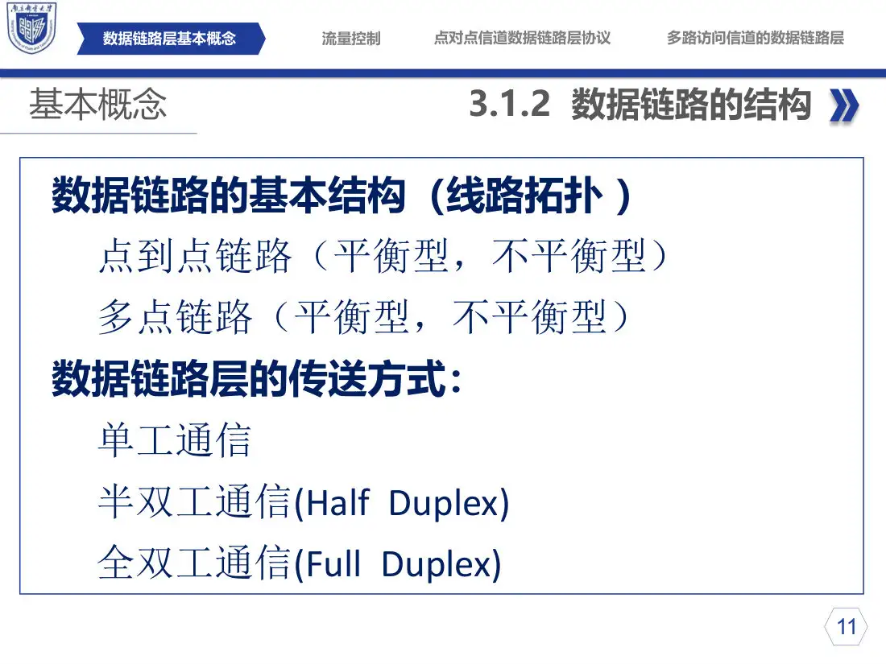

原文：

基本概念

3.1.2 数据链路的结构

数据链路的基本结构（线路拓扑 ）

点到点链路（平衡型，不平衡型）

多点链路（平衡型，不平衡型）

数据链路层的传送方式：

单工通信

半双工通信(Half Duplex)

全双工通信(Full Duplex)

南志郵電大學Nanjing Un

数据链路层基本概念

流量控制

点对点信道数据链路层协议

多路访问信道的数据链路层

11

### 基本概念

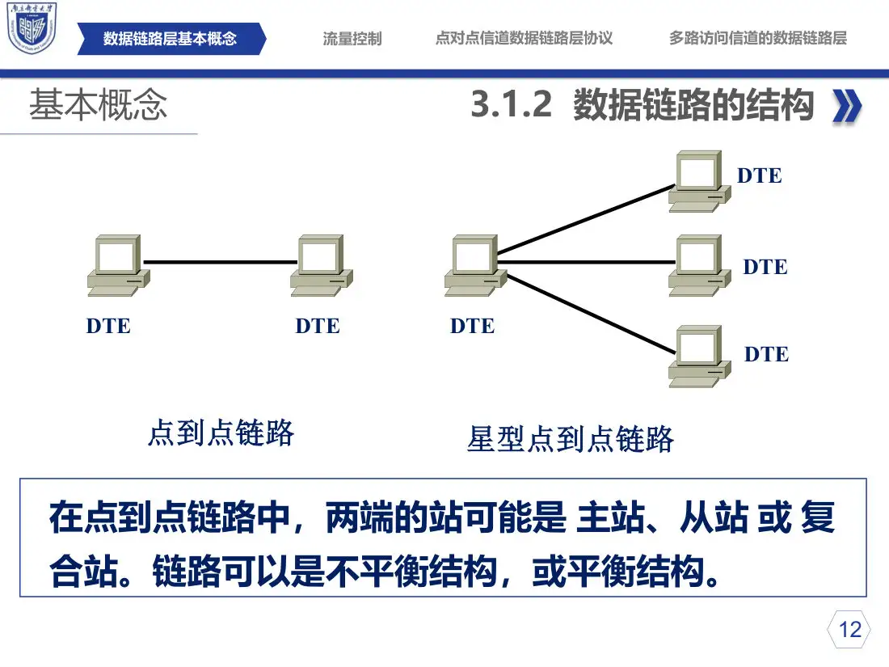

原文：

基本概念

3.1.2 数据链路的结构

在点到点链路中，两端的站可能是 主站、从站 或 复合站。链路可以是不平衡结构，或平衡结构。

南志郵電大學Nanjing Un

数据链路层基本概念

流量控制

点对点信道数据链路层协议

多路访问信道的数据链路层

12

### 基本概念

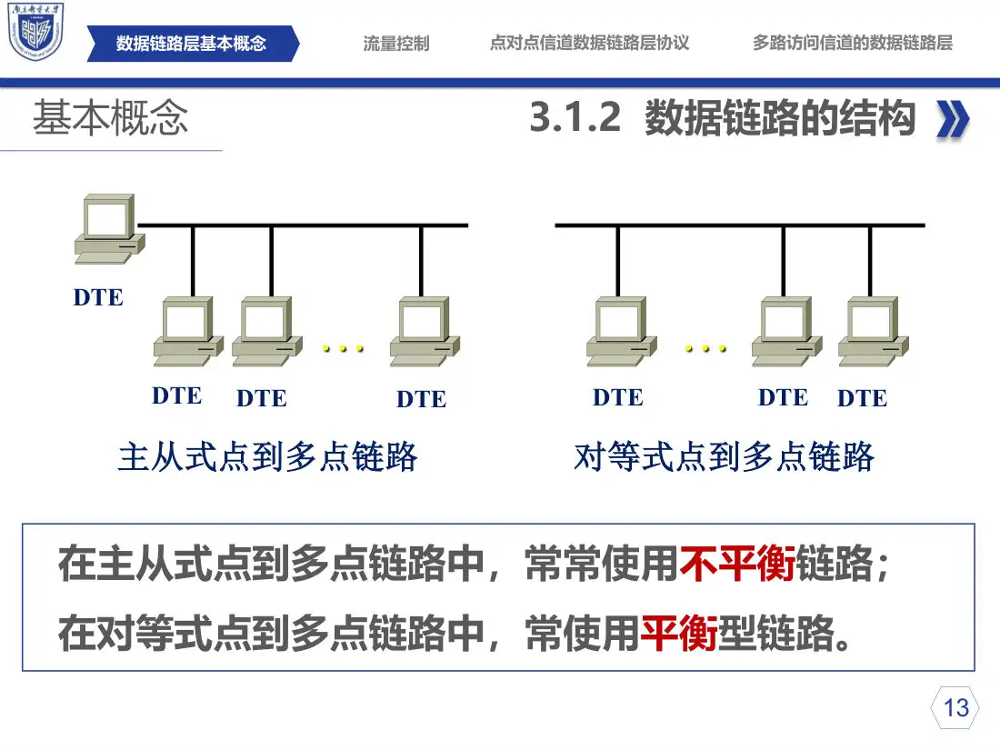

原文：

基本概念

3.1.2 数据链路的结构

在主从式点到多点链路中，常常使用不平衡链路；在对等式点到多点链路中，常使用平衡型链路。

南志郵電大學Nanjing Un

数据链路层基本概念

流量控制

点对点信道数据链路层协议

多路访问信道的数据链路层

13

### 基本概念

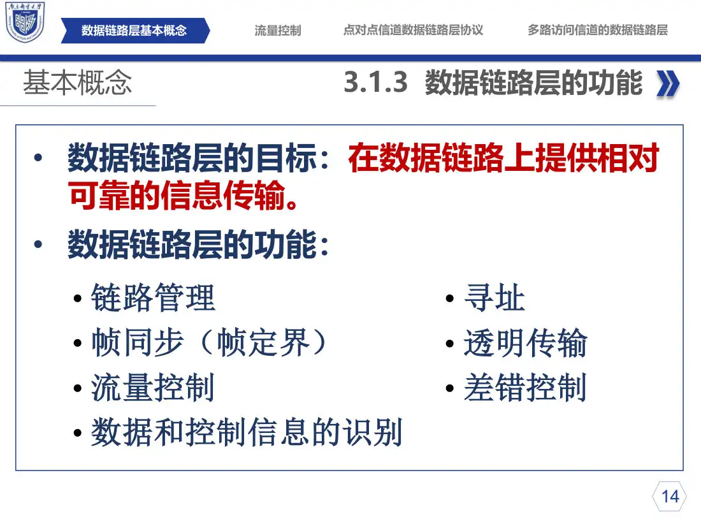

原文：

基本概念

3.1.3 数据链路层的功能

数据链路层的目标：在数据链路上提供相对可靠的信息传输。

• 数据链路层的功能：

• 链路管理

• 帧同步（帧定界）

• 流量控制

• 寻址

• 透明传输

• 差错控制

• 数据和控制信息的识别

南志郵電大學Nanjing Un

数据链路层基本概念

流量控制

点对点信道数据链路层协议

多路访问信道的数据链路层

14

### 基本概念

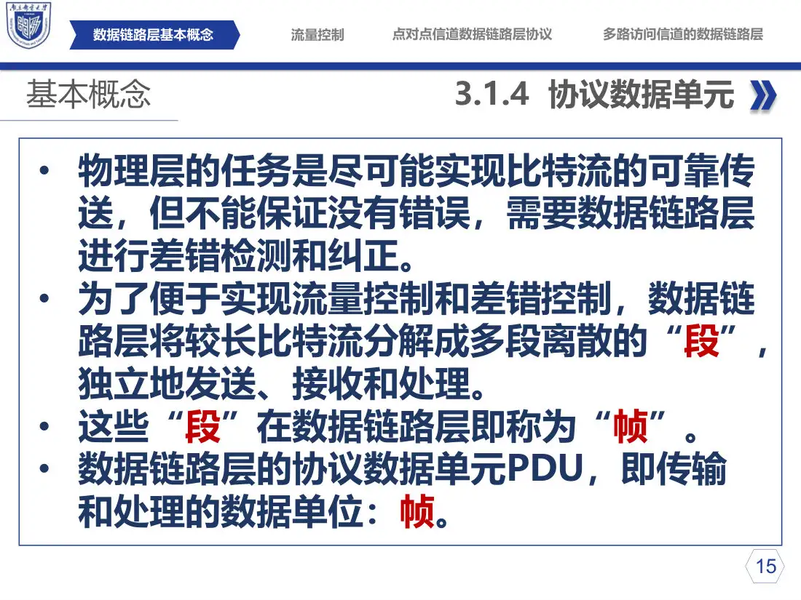

原文：

基本概念

3.1.4 协议数据单元

物理层的任务是尽可能实现比特流的可靠传送，但不能保证没有错误，需要数据链路层进行差错检测和纠正。

为了便于实现流量控制和差错控制，数据链路层将较长比特流分解成多段离散的“段”，独立地发送、接收和处理。

• 这些“段”在数据链路层即称为“帧”。

• 数据链路层的协议数据单元PDU，即传输和处理的数据单位：帧。

南志郵電大學Nanjing Un

数据链路层基本概念

流量控制

点对点信道数据链路层协议

多路访问信道的数据链路层

15

### 基本概念

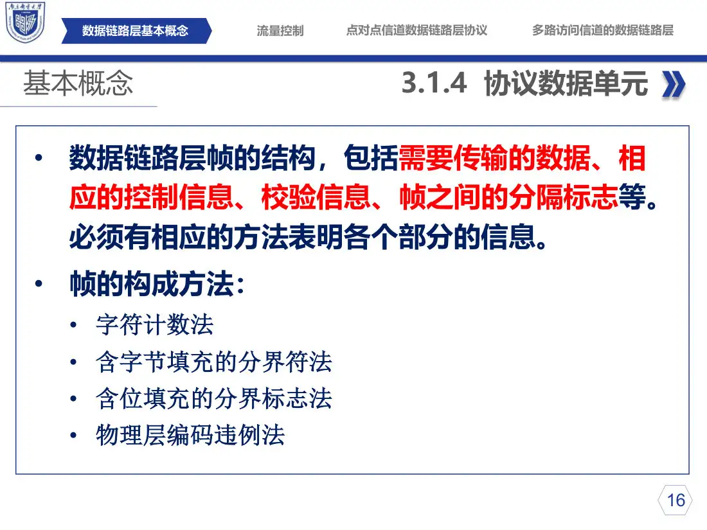

原文：

基本概念

3.1.4 协议数据单元

数据链路层帧的结构，包括需要传输的数据、相应的控制信息、校验信息、帧之间的分隔标志等。必须有相应的方法表明各个部分的信息。

• 帧的构成方法：

• 字符计数法

• 含字节填充的分界符法

• 含位填充的分界标志法

• 物理层编码违例法

南志郵電大學Nanjing Un

数据链路层基本概念

流量控制

点对点信道数据链路层协议

多路访问信道的数据链路层

16

### 基本概念

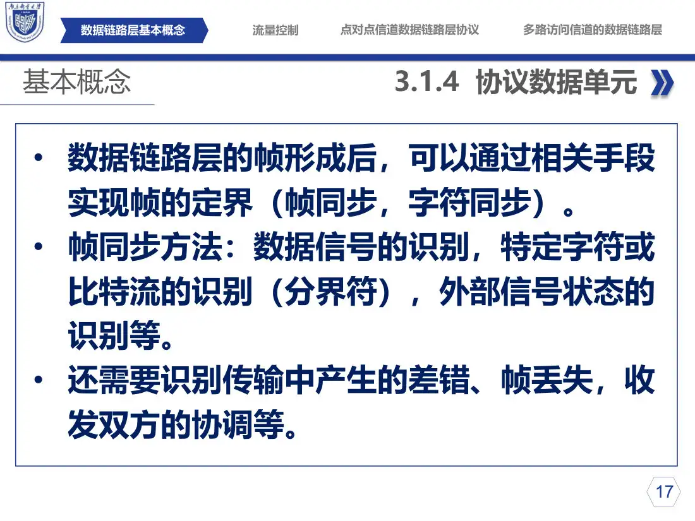

原文：

基本概念

3.1.4 协议数据单元

• 数据链路层的帧形成后，可以通过相关手段实现帧的定界（帧同步，字符同步）。

• 帧同步方法：数据信号的识别，特定字符或比特流的识别（分界符），外部信号状态的识别等。

• 还需要识别传输中产生的差错、帧丢失，收发双方的协调等。

南志郵電大學Nanjing Un

数据链路层基本概念

流量控制

点对点信道数据链路层协议

多路访问信道的数据链路层

17

### 过渡页 T r a n s i t i o n P a g e

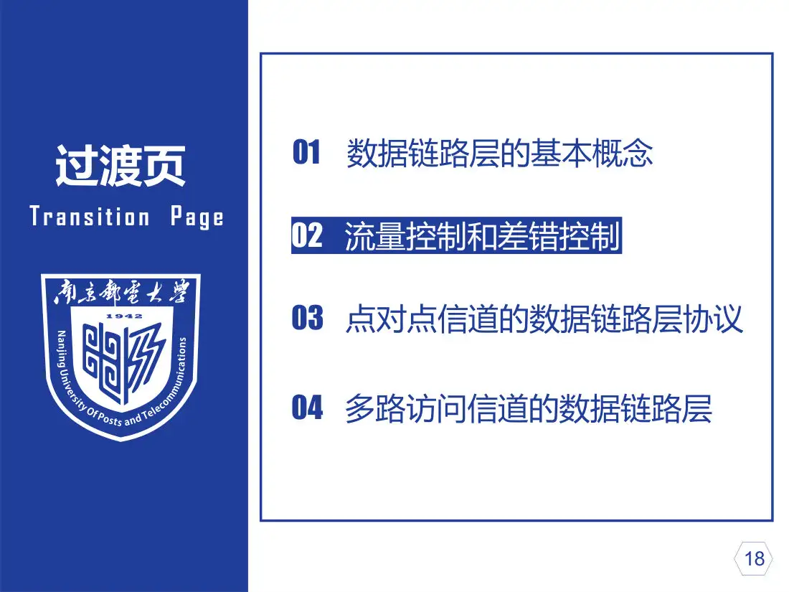

原文：

过渡页 T r a n s i t i o n P a g e

01 数据链路层的基本概念
02 流量控制和差错控制
03 点对点信道的数据链路层协议
04 多路访问信道的数据链路层

18

### 流量控制的基本概念

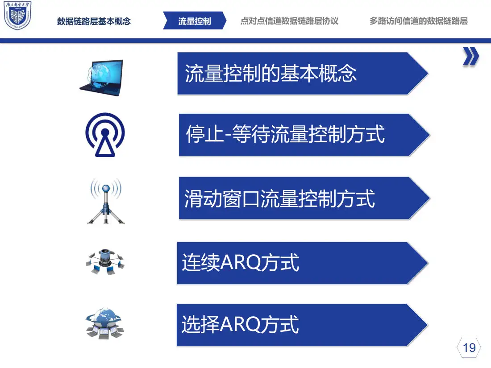

原文：

流量控制的基本概念

停止-等待流量控制方式

滑动窗口流量控制方式

连续ARQ方式

选择ARQ方式

南志郵電大學Nanjing Un

数据链路层基本概念

流量控制

点对点信道数据链路层协议

多路访问信道的数据链路层

19

### 流量控制

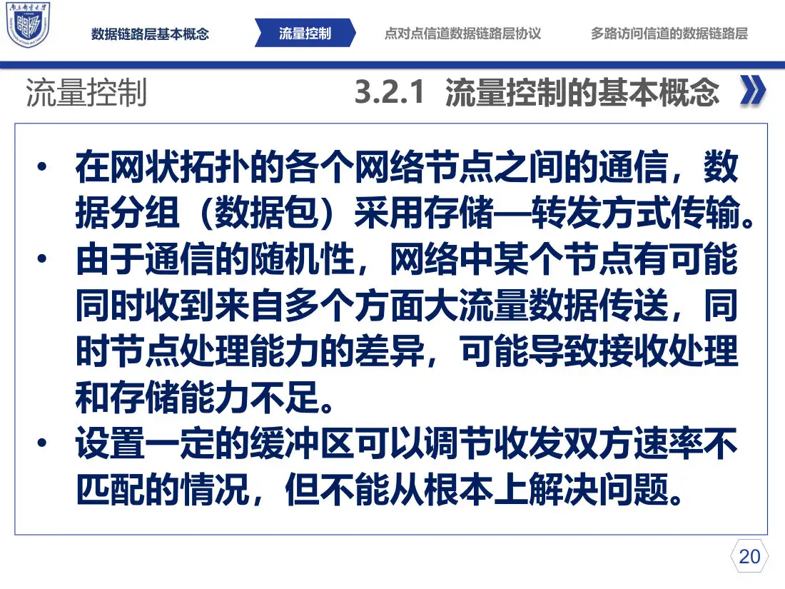

原文：

流量控制

3.2.1 流量控制的基本概念

• 在网状拓扑的各个网络节点之间的通信，数据分组（数据包）采用存储—转发方式传输。

由于通信的随机性，网络中某个节点有可能同时收到来自多个方面大流量数据传送，同时节点处理能力的差异，可能导致接收处理和存储能力不足。

• 设置一定的缓冲区可以调节收发双方速率不匹配的情况，但不能从根本上解决问题。

南志郵電大學Nanjing Un

数据链路层基本概念

流量控制

点对点信道数据链路层协议

多路访问信道的数据链路层

20

### 流量控制

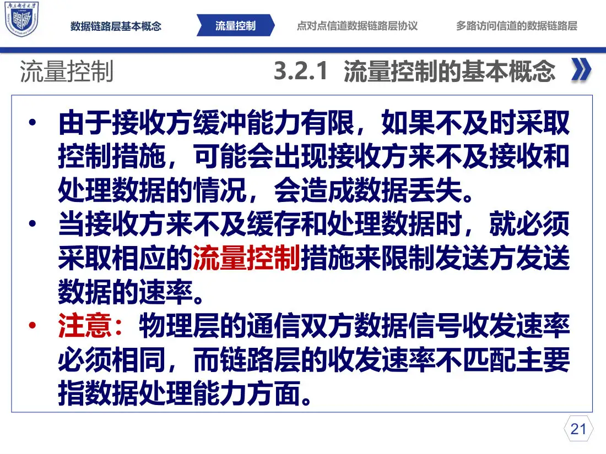

原文：

流量控制

3.2.1 流量控制的基本概念

• 由于接收方缓冲能力有限，如果不及时采取控制措施，可能会出现接收方来不及接收和处理数据的情况，会造成数据丢失。

• 当接收方来不及缓存和处理数据时，就必须采取相应的流量控制措施来限制发送方发送数据的速率。

• 注意：物理层的通信双方数据信号收发速率必须相同，而链路层的收发速率不匹配主要指数据处理能力方面。

南志郵電大學Nanjing Un

数据链路层基本概念

流量控制

点对点信道数据链路层协议

多路访问信道的数据链路层

21

### 流量控制

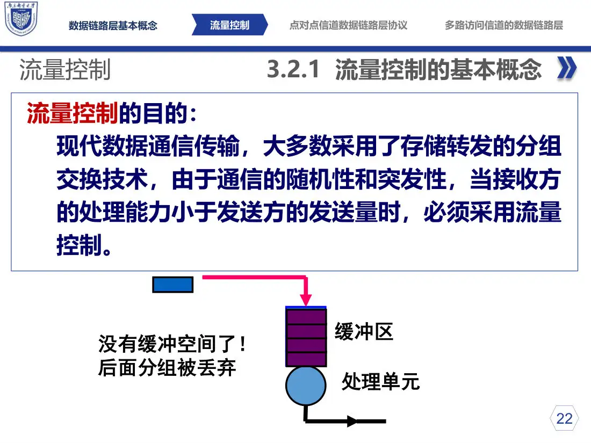

原文：

流量控制

3.2.1 流量控制的基本概念

流量控制的目的：

现代数据通信传输，大多数采用了存储转发的分组交换技术，由于通信的随机性和突发性，当接收方的处理能力小于发送方的发送量时，必须采用流量控制。

没有缓冲空间了！后面分组被丢弃

南志郵電大學Nanjing Un

数据链路层基本概念

流量控制

点对点信道数据链路层协议

多路访问信道的数据链路层

22

### 流量控制

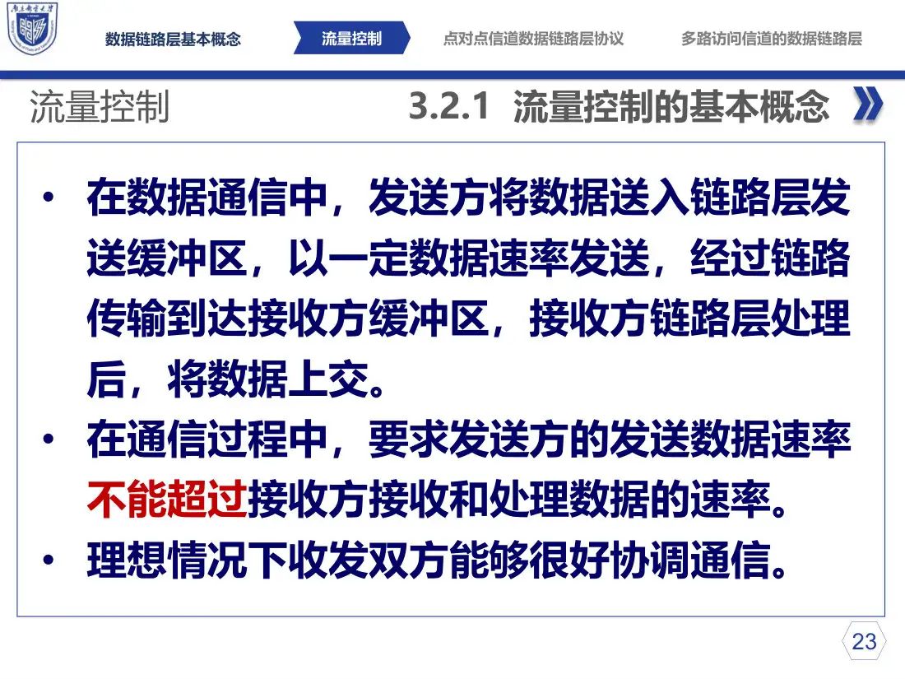

原文：

流量控制

3.2.1 流量控制的基本概念

• 在数据通信中，发送方将数据送入链路层发送缓冲区，以一定数据速率发送，经过链路传输到达接收方缓冲区，接收方链路层处理后，将数据上交。

• 在通信过程中，要求发送方的发送数据速率不能超过接收方接收和处理数据的速率。

• 理想情况下收发双方能够很好协调通信。

南志郵電大學Nanjing Un

数据链路层基本概念

流量控制

点对点信道数据链路层协议

多路访问信道的数据链路层

23

### 流量控制

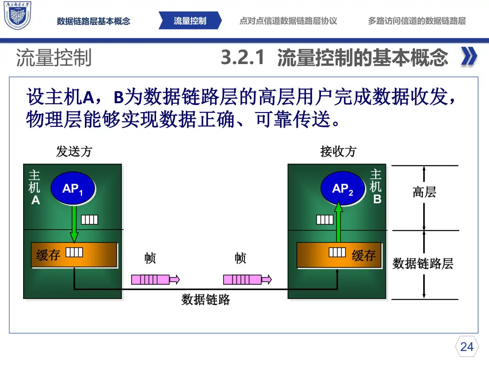

原文：

流量控制

3.2.1 流量控制的基本概念

设主机A，B为数据链路层的高层用户完成数据收发，物理层能够实现数据正确、可靠传送。

南志郵電大學Nanjing Un

数据链路层基本概念

流量控制

点对点信道数据链路层协议

多路访问信道的数据链路层

24

### 流量控制

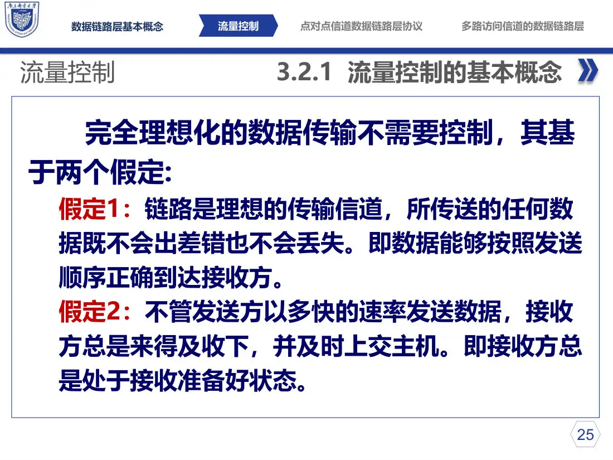

原文：

流量控制

3.2.1 流量控制的基本概念

完全理想化的数据传输不需要控制，其基于两个假定:

假定1：链路是理想的传输信道，所传送的任何数据既不会出差错也不会丢失。即数据能够按照发送顺序正确到达接收方。

假定2：不管发送方以多快的速率发送数据，接收方总是来得及收下，并及时上交主机。即接收方总是处于接收准备好状态。

南志郵電大學Nanjing Un

数据链路层基本概念

流量控制

点对点信道数据链路层协议

多路访问信道的数据链路层

25

### 流量控制

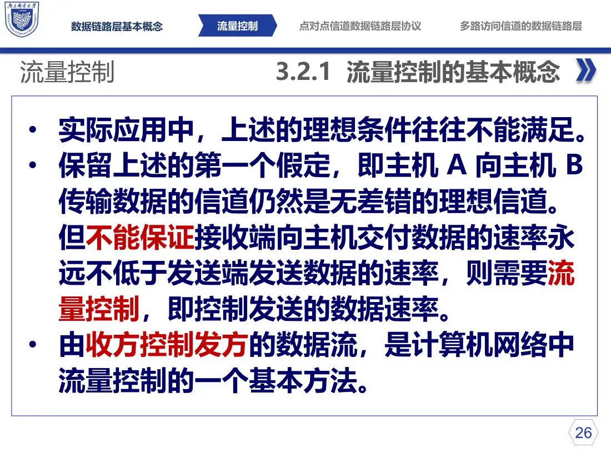

原文：

流量控制

3.2.1 流量控制的基本概念

• 实际应用中，上述的理想条件往往不能满足。

保留上述的第一个假定，即主机 A 向主机 B传输数据的信道仍然是无差错的理想信道。但不能保证接收端向主机交付数据的速率永远不低于发送端发送数据的速率，则需要流量控制，即控制发送的数据速率。

• 由收方控制发方的数据流，是计算机网络中流量控制的一个基本方法。

南志郵電大學Nanjing Un

数据链路层基本概念

流量控制

点对点信道数据链路层协议

多路访问信道的数据链路层

26

### 流量控制

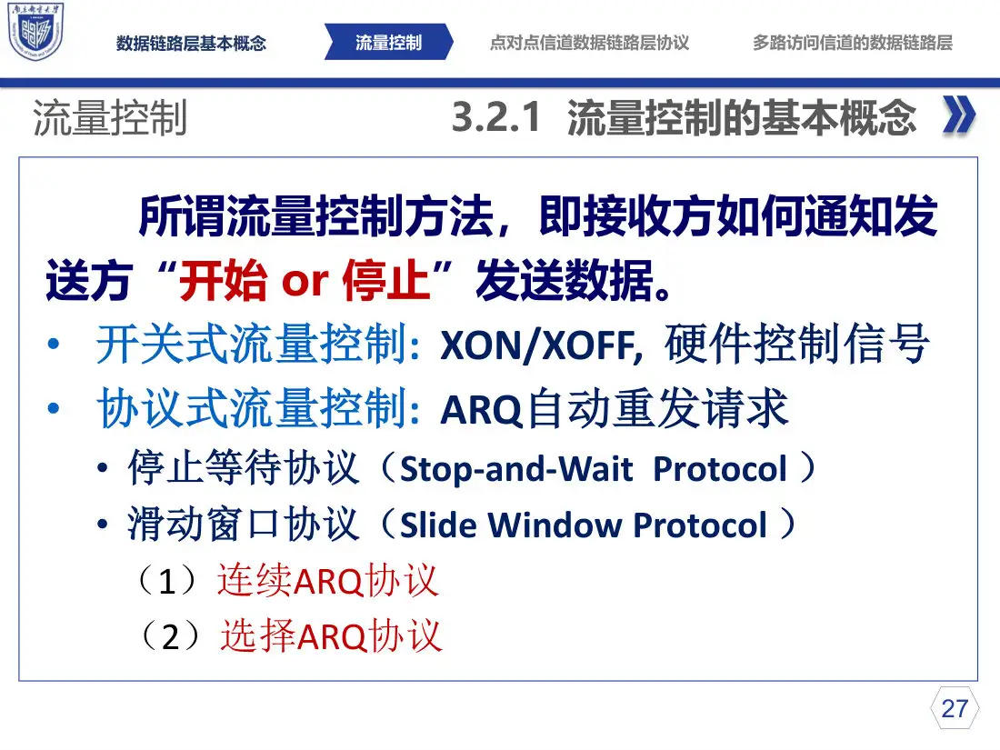

原文：

流量控制

3.2.1 流量控制的基本概念

所谓流量控制方法，即接收方如何通知发送方“开始 or 停止”发送数据。

• 开关式流量控制: XON/XOFF, 硬件控制信号

• 协议式流量控制: ARQ自动重发请求

• 停止等待协议（Stop-and-Wait Protocol ）

• 滑动窗口协议（Slide Window Protocol ）

（1）连续ARQ协议

（2）选择ARQ协议

南志郵電大學Nanjing Un

数据链路层基本概念

流量控制

点对点信道数据链路层协议

多路访问信道的数据链路层

27

### 流量控制

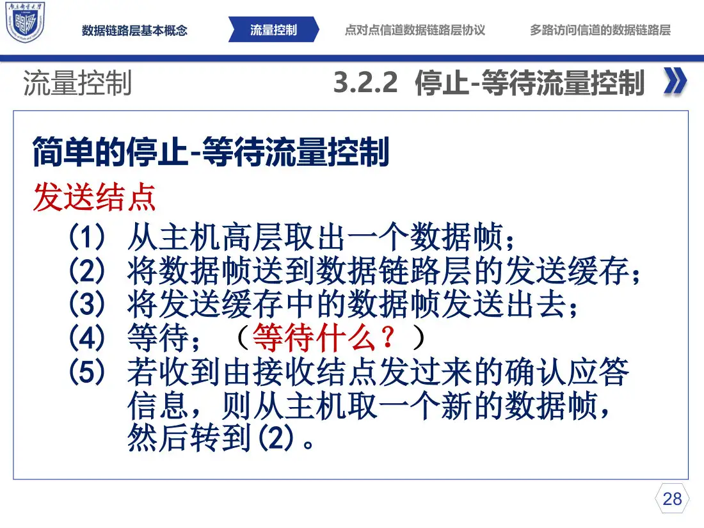

原文：

流量控制

3.2.2 停止-等待流量控制

简单的停止-等待流量控制

发送结点

(1) 从主机高层取出一个数据帧；

(2) 将数据帧送到数据链路层的发送缓存；

(3) 将发送缓存中的数据帧发送出去；

(4) 等待； （等待什么？）

(5) 若收到由接收结点发过来的确认应答信息，则从主机取一个新的数据帧，然后转到(2)。

南志郵電大學Nanjing Un

数据链路层基本概念

流量控制

点对点信道数据链路层协议

多路访问信道的数据链路层

28

### 流量控制

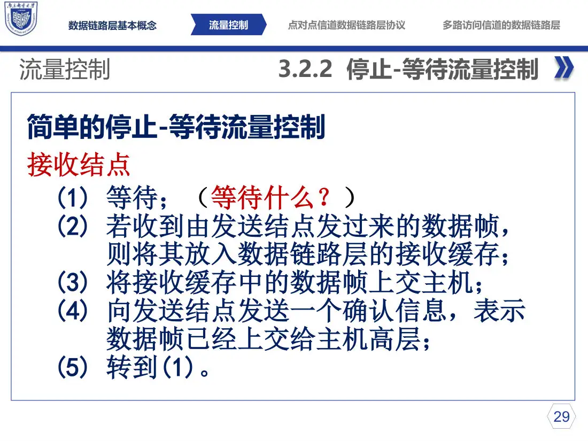

原文：

流量控制

3.2.2 停止-等待流量控制

简单的停止-等待流量控制

接收结点

(1) 等待； （等待什么？）

(2) 若收到由发送结点发过来的数据帧，则将其放入数据链路层的接收缓存；

(3) 将接收缓存中的数据帧上交主机；

(4) 向发送结点发送一个确认信息，表示数据帧已经上交给主机高层；

(5) 转到(1)。

南志郵電大學Nanjing Un

数据链路层基本概念

流量控制

点对点信道数据链路层协议

多路访问信道的数据链路层

29

### 3.2.2 停止-等待流量控制

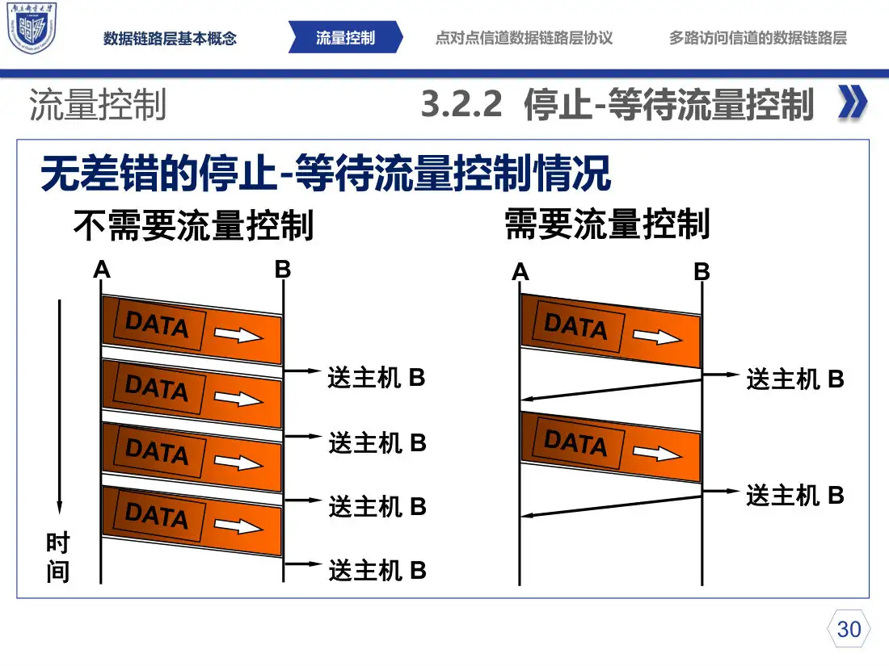

原文：

3.2.2 停止-等待流量控制

流量控制

无差错的停止-等待流量控制情况

不需要流量控制

送主机 B

送主机 B

送主机 B

送主机 B

需要流量控制

送主机 B

送主机 B

南志郵電大學Nanjing Un

数据链路层基本概念

流量控制

点对点信道数据链路层协议

多路访问信道的数据链路层

30

### 流量控制

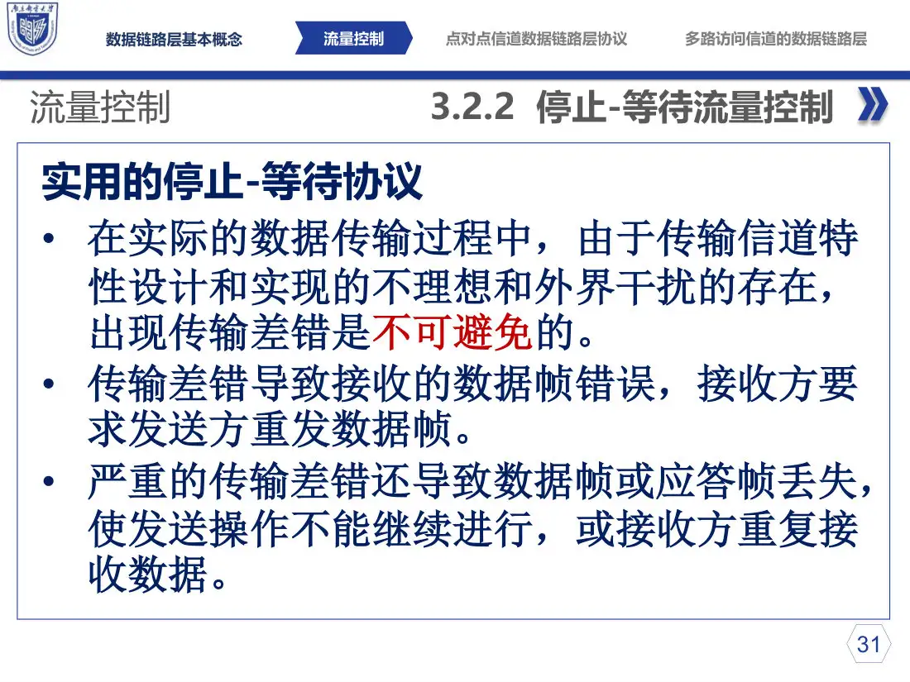

原文：

流量控制

3.2.2 停止-等待流量控制

实用的停止-等待协议

在实际的数据传输过程中，由于传输信道特性设计和实现的不理想和外界干扰的存在，出现传输差错是不可避免的。

• 传输差错导致接收的数据帧错误，接收方要求发送方重发数据帧。

• 严重的传输差错还导致数据帧或应答帧丢失，使发送操作不能继续进行，或接收方重复接收数据。

南志郵電大學Nanjing Un

数据链路层基本概念

流量控制

点对点信道数据链路层协议

多路访问信道的数据链路层

31

### 3.2.2 停止-等待流量控制

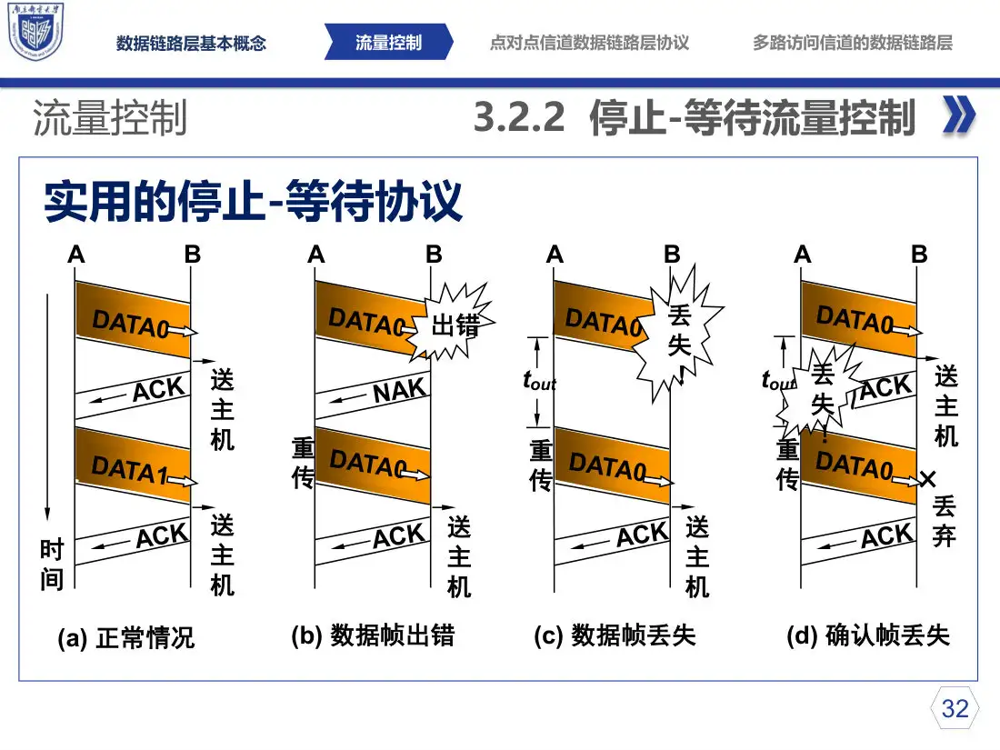

原文：

3.2.2 停止-等待流量控制

流量控制

实用的停止-等待协议

南志郵電大學Nanjing Un

数据链路层基本概念

流量控制

点对点信道数据链路层协议

多路访问信道的数据链路层

32

### 流量控制

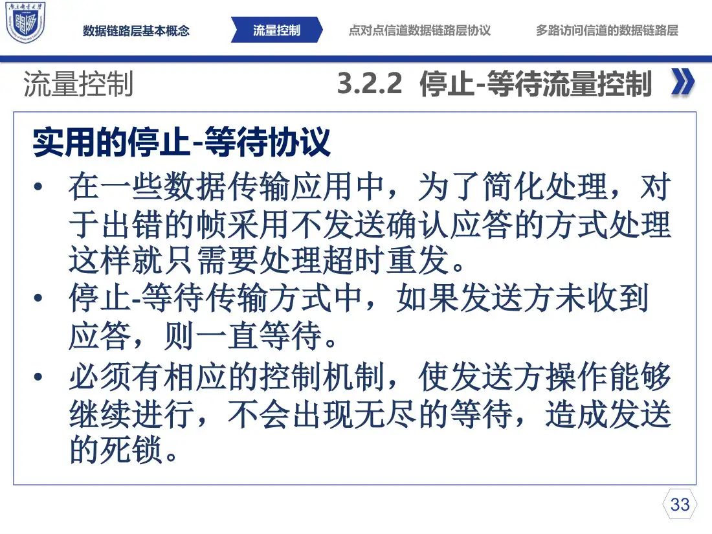

原文：

流量控制

3.2.2 停止-等待流量控制

实用的停止-等待协议

• 在一些数据传输应用中，为了简化处理，对于出错的帧采用不发送确认应答的方式处理这样就只需要处理超时重发。

• 停止-等待传输方式中，如果发送方未收到应答，则一直等待。

必须有相应的控制机制，使发送方操作能够继续进行，不会出现无尽的等待，造成发送的死锁。

南志郵電大學Nanjing Un

数据链路层基本概念

流量控制

点对点信道数据链路层协议

多路访问信道的数据链路层

33

### 流量控制

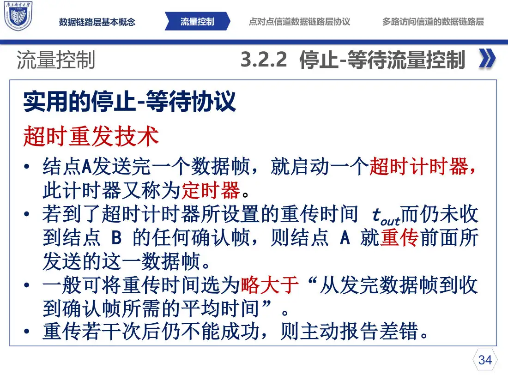

原文：

流量控制

3.2.2 停止-等待流量控制

实用的停止-等待协议

超时重发技术

• 结点A发送完一个数据帧，就启动一个超时计时器，此计时器又称为定时器。

若到了超时计时器所设置的重传时间 $t _ { o u t }$ 而仍未收到结点 B 的任何确认帧，则结点 A 就重传前面所发送的这一数据帧。

一般可将重传时间选为略大于“从发完数据帧到收到确认帧所需的平均时间”。

• 重传若干次后仍不能成功，则主动报告差错。

南志郵電大學Nanjing Un

数据链路层基本概念

流量控制

点对点信道数据链路层协议

多路访问信道的数据链路层

34

### 流量控制

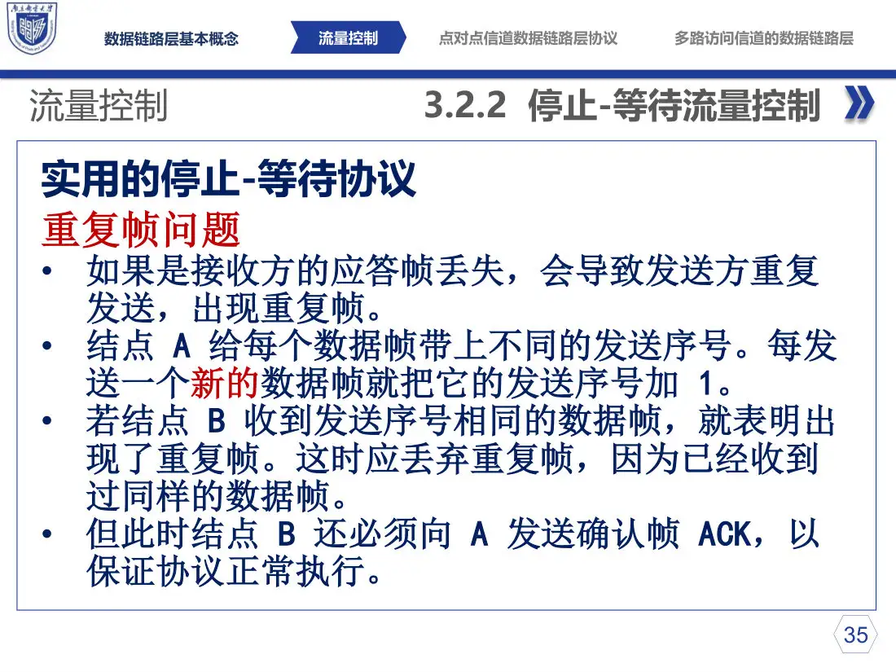

原文：

流量控制

3.2.2 停止-等待流量控制

实用的停止-等待协议

重复帧问题

• 如果是接收方的应答帧丢失，会导致发送方重复发送，出现重复帧。

• 结点 A 给每个数据帧带上不同的发送序号。每发送一个新的数据帧就把它的发送序号加 1。

若结点 B 收到发送序号相同的数据帧，就表明出现了重复帧。这时应丢弃重复帧，因为已经收到过同样的数据帧。

但此时结点 B 还必须向 A 发送确认帧 ACK，以保证协议正常执行。

南志郵電大學Nanjing Un

数据链路层基本概念

流量控制

点对点信道数据链路层协议

多路访问信道的数据链路层

35

### 流量控制

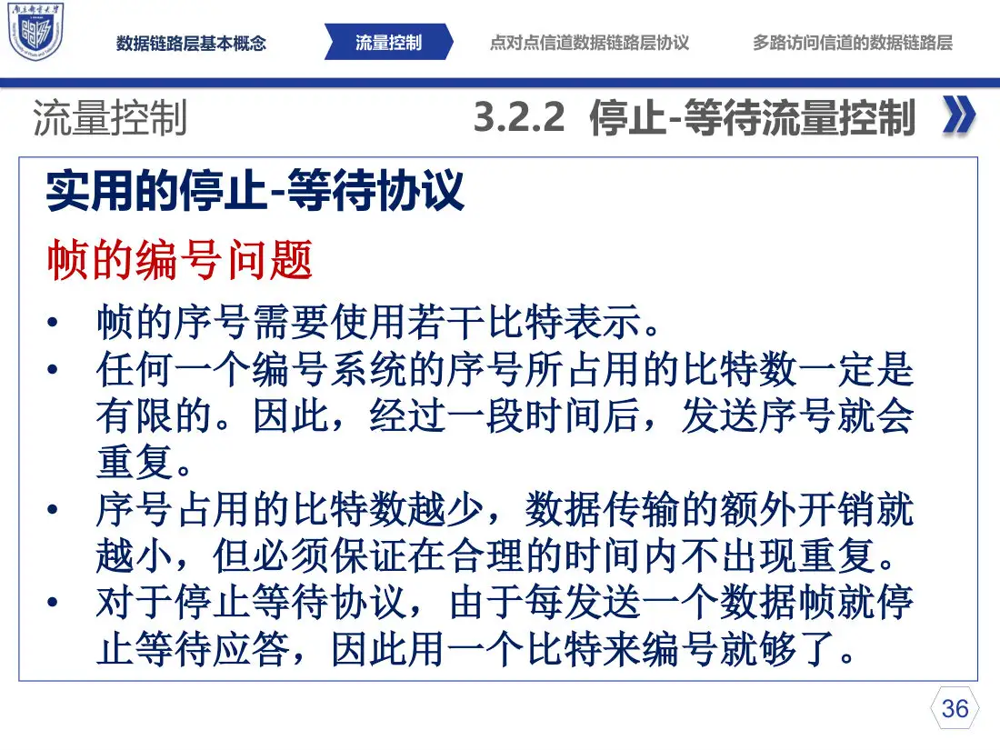

原文：

流量控制

3.2.2 停止-等待流量控制

实用的停止-等待协议

帧的编号问题

• 帧的序号需要使用若干比特表示。

• 任何一个编号系统的序号所占用的比特数一定是有限的。因此，经过一段时间后，发送序号就会重复。

• 序号占用的比特数越少，数据传输的额外开销就越小，但必须保证在合理的时间内不出现重复。

• 对于停止等待协议，由于每发送一个数据帧就停止等待应答，因此用一个比特来编号就够了。

南志郵電大學Nanjing Un

数据链路层基本概念

流量控制

点对点信道数据链路层协议

多路访问信道的数据链路层

36

### 流量控制

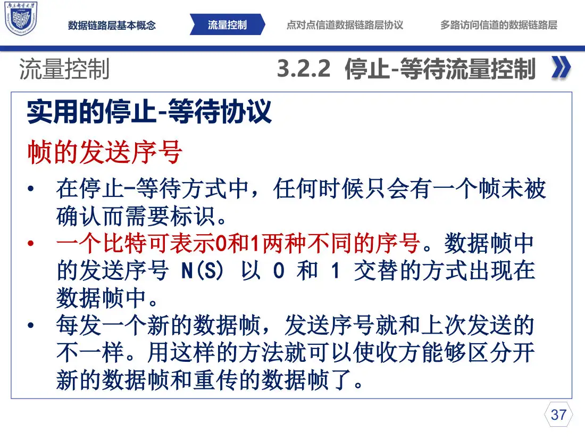

原文：

流量控制

3.2.2 停止-等待流量控制

实用的停止-等待协议

帧的发送序号

• 在停止-等待方式中，任何时候只会有一个帧未被确认而需要标识。

• 一个比特可表示0和1两种不同的序号。数据帧中的发送序号 N(S) 以 0 和 1 交替的方式出现在数据帧中。

每发一个新的数据帧，发送序号就和上次发送的不一样。用这样的方法就可以使收方能够区分开新的数据帧和重传的数据帧了。

南志郵電大學Nanjing Un

数据链路层基本概念

流量控制

点对点信道数据链路层协议

多路访问信道的数据链路层

37

### 流量控制

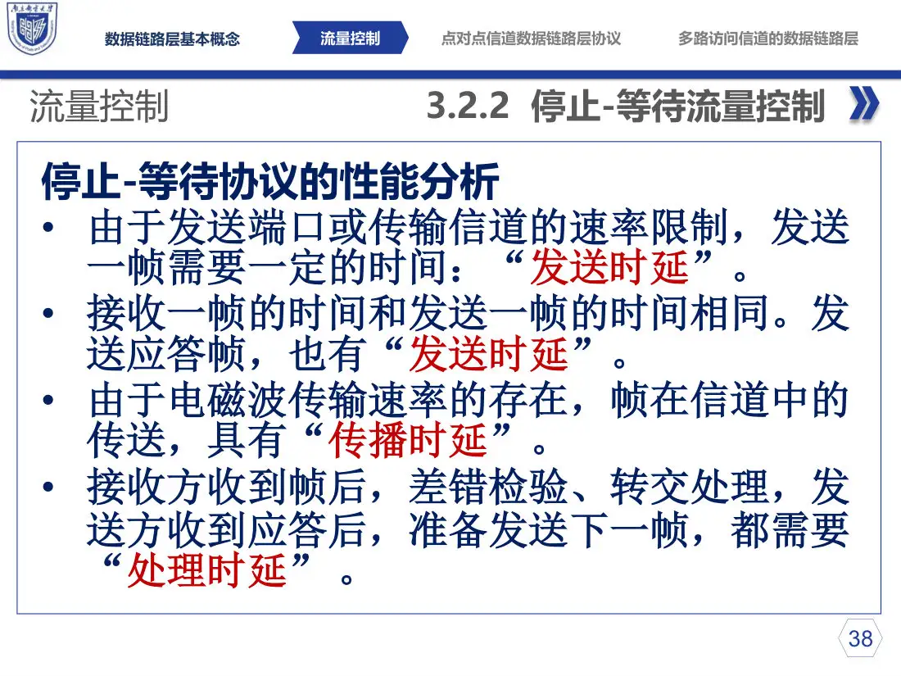

原文：

流量控制

3.2.2 停止-等待流量控制

停止-等待协议的性能分析

• 由于发送端口或传输信道的速率限制，发送一帧需要一定的时间：“发送时延”。

接收一帧的时间和发送一帧的时间相同。发送应答帧，也有“发送时延”。

• 由于电磁波传输速率的存在，帧在信道中的传送，具有“传播时延”。

• 接收方收到帧后，差错检验、转交处理，发送方收到应答后，准备发送下一帧，都需要“处理时延”。

南志郵電大學Nanjing Un

数据链路层基本概念

流量控制

点对点信道数据链路层协议

多路访问信道的数据链路层

38

### 流量控制

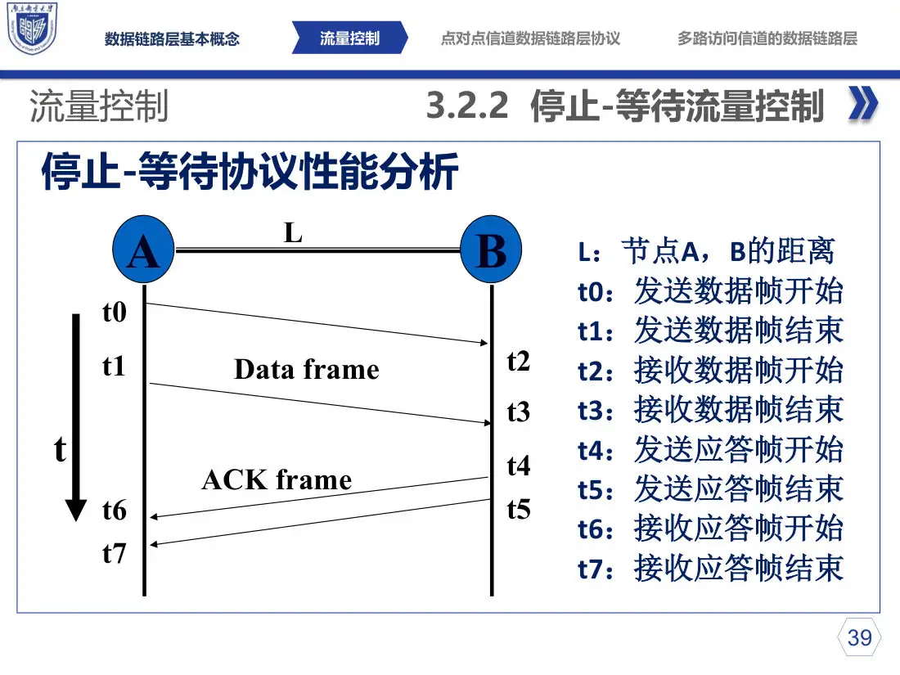

原文：

流量控制

3.2.2 停止-等待流量控制

停止-等待协议性能分析

L：节点A，B的距离

t0：发送数据帧开始

t1：发送数据帧结束

t2：接收数据帧开始

t3：接收数据帧结束

t4：发送应答帧开始

t5：发送应答帧结束

t6：接收应答帧开始

t7：接收应答帧结束

南志郵電大學Nanjing Un

数据链路层基本概念

流量控制

点对点信道数据链路层协议

多路访问信道的数据链路层

39

### 流量控制

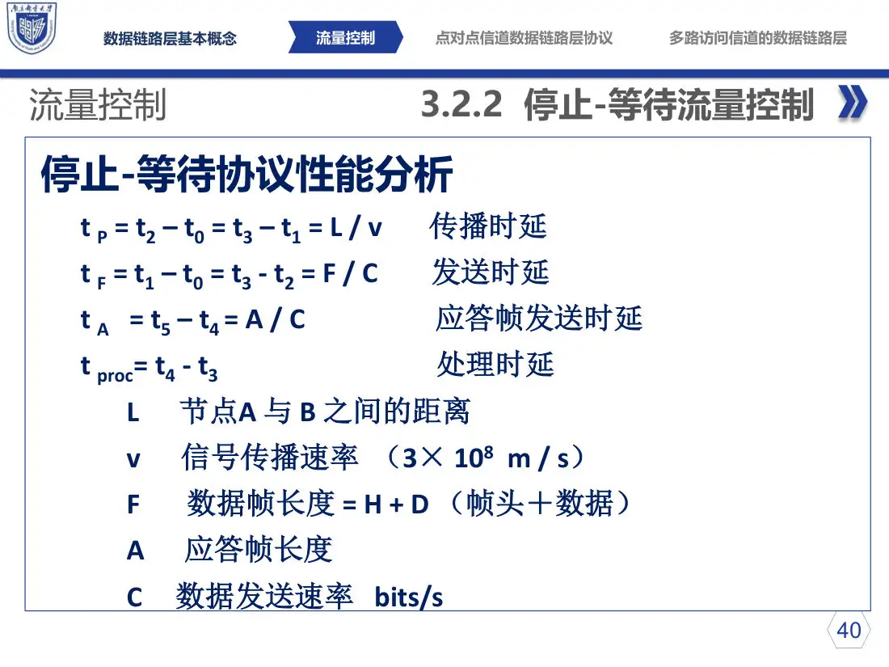

原文：

流量控制

3.2.2 停止-等待流量控制

停止-等待协议性能分析

$$
\mathbf {t} _ {\mathrm{P}} = \mathbf {t} _ {2} - \mathbf {t} _ {0} = \mathbf {t} _ {3} - \mathbf {t} _ {1} = \mathsf {L} / \mathsf {v}
$$

$$
\mathbf {t} _ {\mathrm{F}} = \mathbf {t} _ {1} - \mathbf {t} _ {0} = \mathbf {t} _ {3} - \mathbf {t} _ {2} = \mathbf {F} / \mathbf {C}
$$

传播时延

发送时延

$$
\mathbf {t} _ {\mathrm{A}} = \mathbf {t} _ {5} - \mathbf {t} _ {4} = \mathbf {A} / \mathbf {C}
$$

应答帧发送时延

$$
\mathbf {t} _ {\text { proc }} = \mathbf {t} _ {4} - \mathbf {t} _ {3}
$$

处理时延

L 节点A 与B 之间的距离

v 信号传播速率 （3× 108 m / s）

F 数据帧长度= H + D （帧头＋数据）

A 应答帧长度

C 数据发送速率 bits/s

南志郵電大學Nanjing Un

数据链路层基本概念

流量控制

点对点信道数据链路层协议

多路访问信道的数据链路层

40

### 流量控制

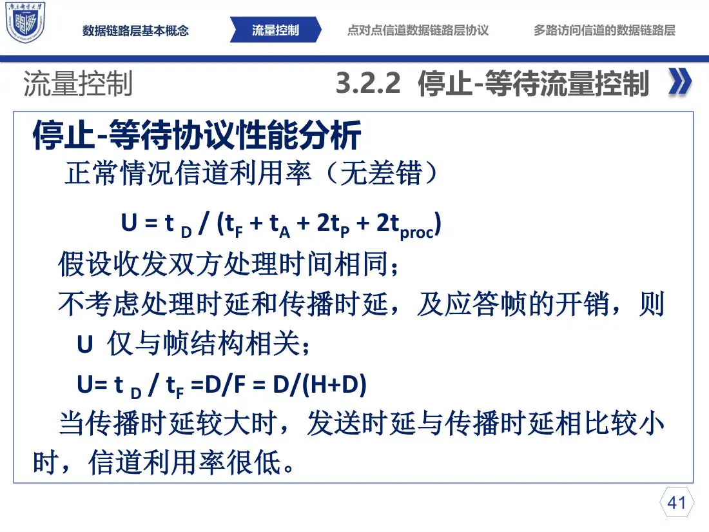

原文：

流量控制

3.2.2 停止-等待流量控制

停止-等待协议性能分析

正常情况信道利用率（无差错）

$$
U = t _ {D} / \left(t _ {F} + t _ {A} + 2 t _ {P} + 2 t _ {\text { proc }}\right)
$$

假设收发双方处理时间相同；

不考虑处理时延和传播时延，及应答帧的开销，则

U 仅与帧结构相关；

$$
U = t _ {D} / t _ {F} = D / F = D / (H + D)
$$

当传播时延较大时，发送时延与传播时延相比较小时，信道利用率很低。

南志郵電大學Nanjing Un

数据链路层基本概念

流量控制

点对点信道数据链路层协议

多路访问信道的数据链路层

41

### 流量控制

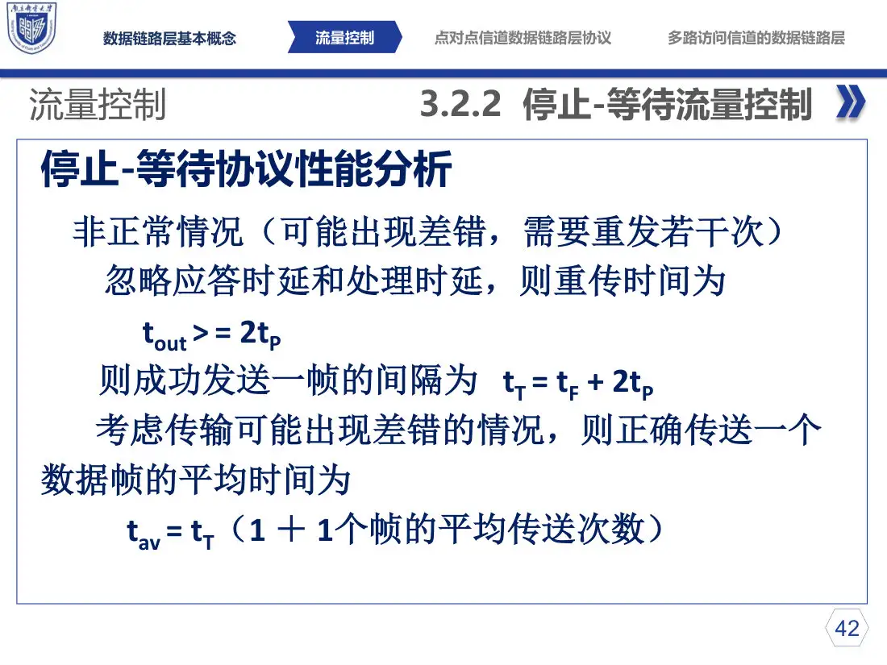

原文：

流量控制

3.2.2 停止-等待流量控制

停止-等待协议性能分析

非正常情况（可能出现差错，需要重发若干次）忽略应答时延和处理时延，则重传时间为

$$
\mathbf {t} _ {\text { out }} > = 2 \mathbf {t} _ {\mathrm{P}}
$$

则成功发送一帧的间隔为 $t _ { \mathsf { T } } = t _ { \mathsf { F } } + 2 t _ { \mathsf { P } }$

考虑传输可能出现差错的情况，则正确传送一个数据帧的平均时间为

t = t （1 ＋1个帧的平均传送次数）

南志郵電大學Nanjing Un

数据链路层基本概念

流量控制

点对点信道数据链路层协议

多路访问信道的数据链路层

42

### 流量控制

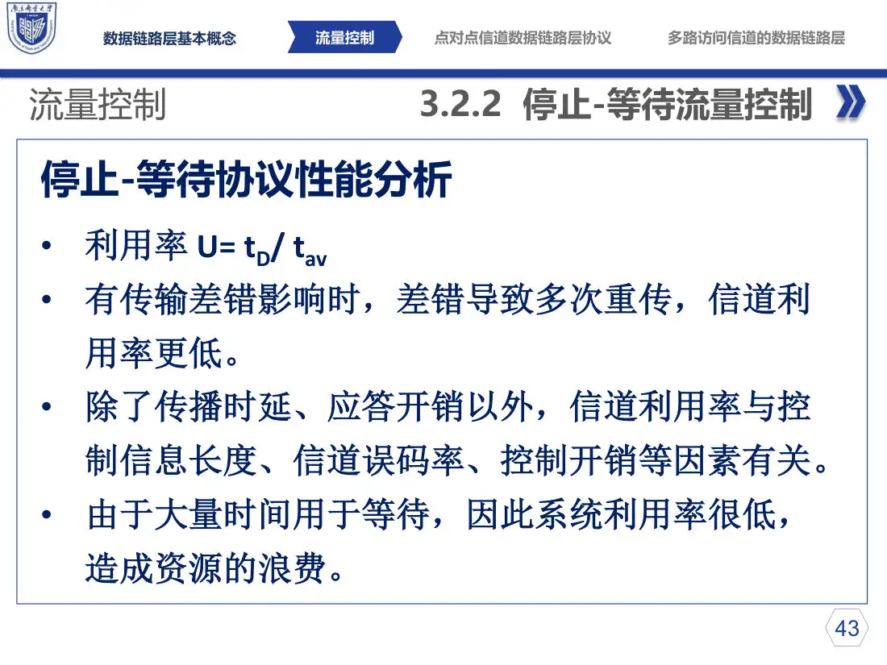

原文：

流量控制

3.2.2 停止-等待流量控制

停止-等待协议性能分析

• 利用率 $\mathsf { U } = \mathsf { t } _ { \mathsf { D } } / \mathsf { t } _ { \mathsf { a v } }$

• 有传输差错影响时，差错导致多次重传，信道利用率更低。

• 除了传播时延、应答开销以外，信道利用率与控制信息长度、信道误码率、控制开销等因素有关。

由于大量时间用于等待，因此系统利用率很低，造成资源的浪费。

南志郵電大學Nanjing Un

数据链路层基本概念

流量控制

点对点信道数据链路层协议

多路访问信道的数据链路层

43

### 流量控制

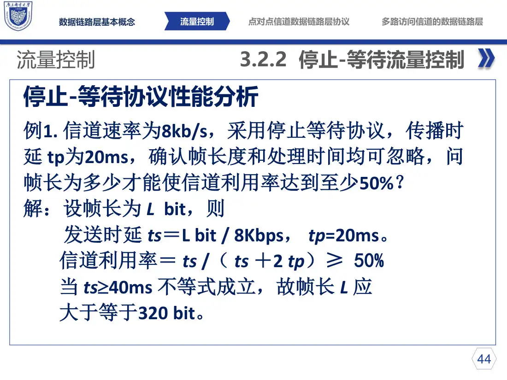

原文：

流量控制

3.2.2 停止-等待流量控制

停止-等待协议性能分析

例1. 信道速率为8kb/s，采用停止等待协议，传播时延tp为20ms，确认帧长度和处理时间均可忽略，问帧长为多少才能使信道利用率达到至少50%？

解：设帧长为L bit，则

发送时延 ts＝L bit / 8Kbps， tp=20ms。信道利用率＝ ts /（ ts ＋2 tp）≥ 50%当ts40ms 不等式成立，故帧长 L 应大于等于320 bit。

南志郵電大學Nanjing Un

数据链路层基本概念

流量控制

点对点信道数据链路层协议

多路访问信道的数据链路层

44

### 流量控制

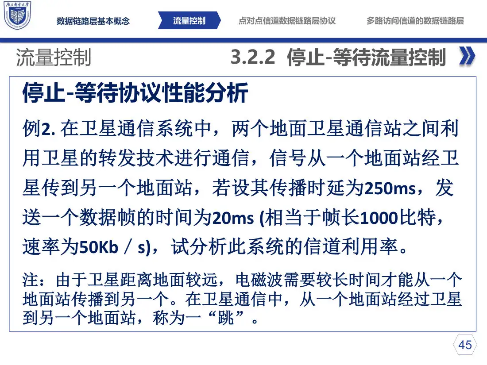

原文：

流量控制

3.2.2 停止-等待流量控制

停止-等待协议性能分析

例2. 在卫星通信系统中，两个地面卫星通信站之间利用卫星的转发技术进行通信，信号从一个地面站经卫星传到另一个地面站，若设其传播时延为250ms，发送一个数据帧的时间为20ms (相当于帧长1000比特，速率为50Kb／s)，试分析此系统的信道利用率。

注：由于卫星距离地面较远，电磁波需要较长时间才能从一个地面站传播到另一个。在卫星通信中，从一个地面站经过卫星到另一个地面站，称为一“跳”。

南志郵電大學Nanjing Un

数据链路层基本概念

流量控制

点对点信道数据链路层协议

多路访问信道的数据链路层

45

### 流量控制

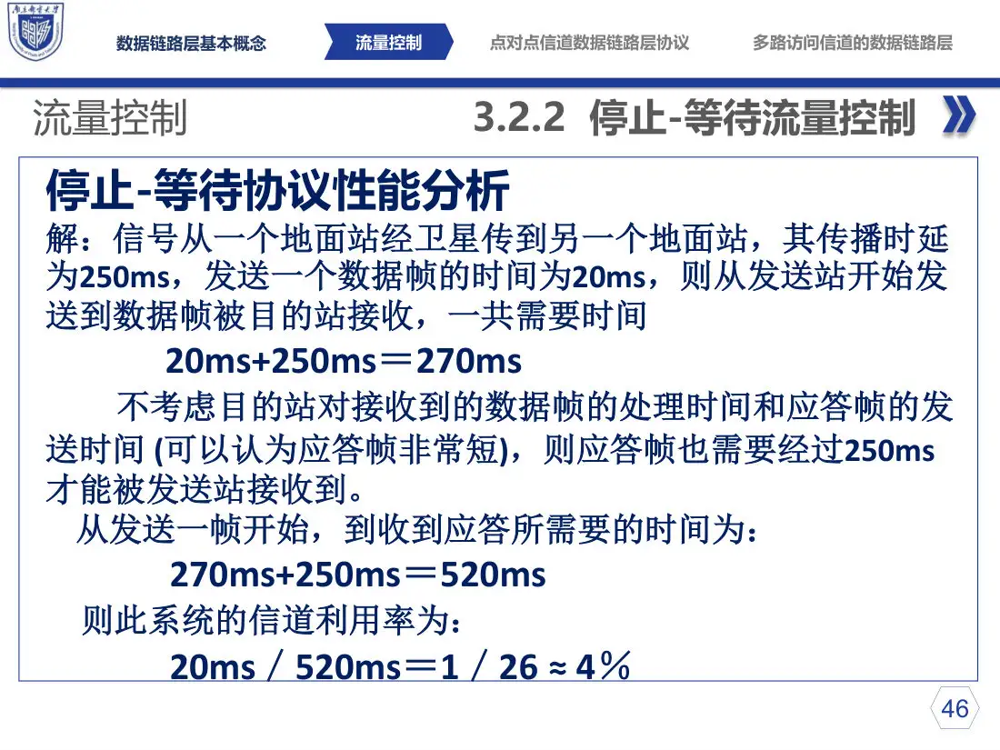

原文：

流量控制

3.2.2 停止-等待流量控制

停止-等待协议性能分析

解：信号从一个地面站经卫星传到另一个地面站，其传播时延为250ms，发送一个数据帧的时间为20ms，则从发送站开始发送到数据帧被目的站接收，一共需要时间

$$
2 0 \mathrm{ms} + 2 5 0 \mathrm{ms} = 2 7 0 \mathrm{ms}
$$

不考虑目的站对接收到的数据帧的处理时间和应答帧的发送时间(可以认为应答帧非常短)，则应答帧也需要经过250ms才能被发送站接收到。

从发送一帧开始，到收到应答所需要的时间为：

$$
2 7 0 \mathrm{ms} + 2 5 0 \mathrm{ms} = 5 2 0 \mathrm{ms}
$$

则此系统的信道利用率为：

$$
20 \mathrm{ms} / 520 \mathrm{ms} = 1 / 26 \approx 4 \%
$$

》

南志郵電大學Nanjing Un

数据链路层基本概念

流量控制

点对点信道数据链路层协议

多路访问信道的数据链路层

46

### 流量控制

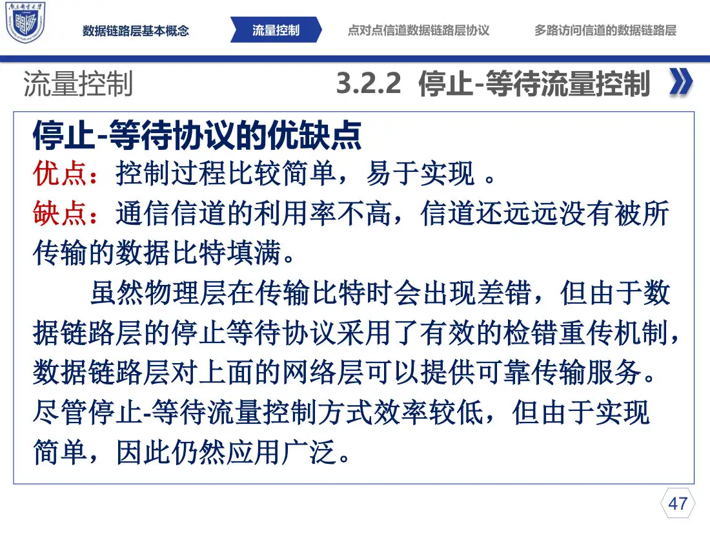

原文：

流量控制

3.2.2 停止-等待流量控制

停止-等待协议的优缺点

优点：控制过程比较简单，易于实现 。

缺点：通信信道的利用率不高，信道还远远没有被所传输的数据比特填满。

虽然物理层在传输比特时会出现差错，但由于数据链路层的停止等待协议采用了有效的检错重传机制，数据链路层对上面的网络层可以提供可靠传输服务。尽管停止-等待流量控制方式效率较低，但由于实现简单，因此仍然应用广泛。

南志郵電大學Nanjing Un

数据链路层基本概念

流量控制

点对点信道数据链路层协议

多路访问信道的数据链路层

47

### 流量控制

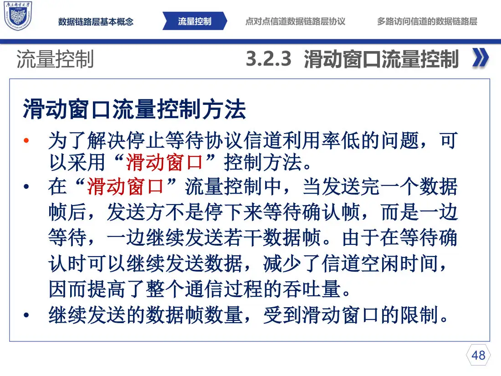

原文：

流量控制

3.2.3 滑动窗口流量控制

滑动窗口流量控制方法

为了解决停止等待协议信道利用率低的问题，可以采用“滑动窗口”控制方法。

• 在“滑动窗口”流量控制中，当发送完一个数据帧后，发送方不是停下来等待确认帧，而是一边等待，一边继续发送若干数据帧。由于在等待确认时可以继续发送数据，减少了信道空闲时间，因而提高了整个通信过程的吞吐量。

• 继续发送的数据帧数量，受到滑动窗口的限制。

南志郵電大學Nanjing Un

数据链路层基本概念

流量控制

点对点信道数据链路层协议

多路访问信道的数据链路层

48

### 流量控制

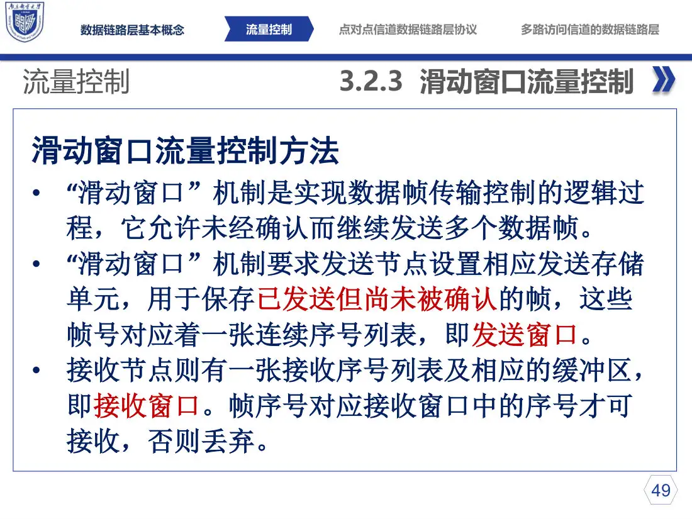

原文：

流量控制

3.2.3 滑动窗口流量控制

滑动窗口流量控制方法

• “滑动窗口”机制是实现数据帧传输控制的逻辑过程，它允许未经确认而继续发送多个数据帧。

“滑动窗口”机制要求发送节点设置相应发送存储单元，用于保存已发送但尚未被确认的帧，这些帧号对应着一张连续序号列表，即发送窗口。

• 接收节点则有一张接收序号列表及相应的缓冲区，即接收窗口。帧序号对应接收窗口中的序号才可接收，否则丢弃。

南志郵電大學Nanjing Un

数据链路层基本概念

流量控制

点对点信道数据链路层协议

多路访问信道的数据链路层

49

### 流量控制

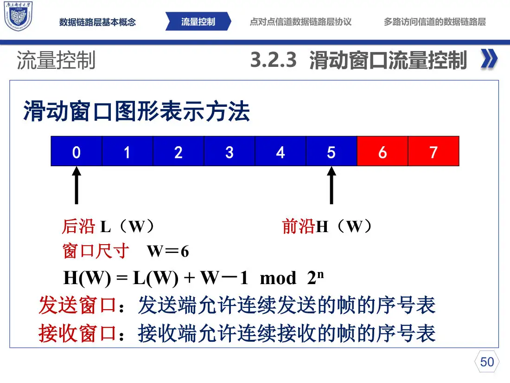

原文：

流量控制

3.2.3 滑动窗口流量控制

滑动窗口图形表示方法

后沿 L（W）

前沿H（W）

窗口尺寸 W＝6

$$
\mathbf {H} (\mathbf {W}) = \mathbf {L} (\mathbf {W}) + \mathbf {W} - 1 \mod 2 ^ {\mathrm{n}}
$$

发送窗口：发送端允许连续发送的帧的序号表

接收窗口：接收端允许连续接收的帧的序号表

南志郵電大學Nanjing Un

数据链路层基本概念

流量控制

点对点信道数据链路层协议

多路访问信道的数据链路层

50

### 流量控制

原文：

流量控制

3.2.3 滑动窗口流量控制

发送窗口

• 发送窗口尺寸 ${ \boldsymbol { \mathsf { W } } } _ { \mathsf { T } }$ ：发送端可以不等待应答到来而允许继续发送的帧数；

• 发送窗口后沿L(W)：发送端最先发出而尚未收到应答的帧序号；

• 发送窗口前沿H(W)：发送端最后发出而尚未收到应答的帧序号；

• 发送指针：指向正在发送的帧序号；

${ \sf W } _ { \sf T }$ 的设置既要考虑传输效率，也要考虑流量控制功能和可能出现差错的处理。

南志郵電大學Nanjing Un

数据链路层基本概念

流量控制

点对点信道数据链路层协议

多路访问信道的数据链路层

51

### 流量控制

原文：

流量控制

3.2.3 滑动窗口流量控制

接收窗口

• 接收窗口尺寸：接收端允许接收的帧数；

• 在接收端只有当所收到的数据帧的发送序号落入接收窗口内才允许将该数据帧收下。

• 若接收到的数据帧序号是落在接收窗口之外，则一律将其丢弃。

• 接收窗口也具有流量控制作用。

南志郵電大學Nanjing Un

数据链路层基本概念

流量控制

点对点信道数据链路层协议

多路访问信道的数据链路层

52

### 流量控制

原文：

流量控制

3.2.3 滑动窗口流量控制

滑动窗口控制规则

• 发送窗口：

• 每发送一帧数据，发送指针顺序向前移动一格，到达窗口前沿序号后停止；

• 每接收一帧应答，窗口向前移动一格；

• 接收窗口：

• 每接收一帧数据，检验正确后上交高层；

• 发送一帧应答，窗口向前移动一格；

• 窗口自左向右滑动，实现流量控制。

南志郵電大學Nanjing Un

数据链路层基本概念

流量控制

点对点信道数据链路层协议

多路访问信道的数据链路层

53

### 流量控制

原文：

流量控制

3.2.3 滑动窗口流量控制

滑动窗口

只有接收窗口向前滑动时（与此同时也发送了确认），发送窗口才有可能向前滑动。即由接收方主导流量控制。

• 收发两端的窗口按照以上规律不断地向前滑动，因此这种协议又称为滑动窗口协议。

• 当发送窗口和接收窗口的大小都等于1 时，就等效于停止等待协议。

南志郵電大學Nanjing Un

数据链路层基本概念

流量控制

点对点信道数据链路层协议

多路访问信道的数据链路层

54

### 3.2.3 滑动窗口流量控制发送窗口控制

原文：

3.2.3 滑动窗口流量控制发送窗口控制

南志郵電大學Nanjing Un

数据链路层基本概念

流量控制

点对点信道数据链路层协议

多路访问信道的数据链路层

55

### 流量控制

原文：

流量控制

3.2.3 滑动窗口流量控制

接收窗口控制

南志郵電大學Nanjing Un

数据链路层基本概念

流量控制

点对点信道数据链路层协议

多路访问信道的数据链路层

56

### 流量控制

原文：

流量控制

3.2.4 连续ARQ方式

滑动窗口控制方式

• 在滑动窗口流量控制方式中，根据通信双方对于出现差错和需要流量控制过程时所采用的处理方法不同，分为：

连续 ARQ 和选择 ARQ。

ARQ，Automatic Repeat-reQuest，自动重 发请求，自动请求重发

南志郵電大學Nanjing Un

数据链路层基本概念

流量控制

点对点信道数据链路层协议

多路访问信道的数据链路层

57

### 流量控制

原文：

流量控制

3.2.4 连续ARQ方式

连续ARQ方式

• 当发送完一个数据帧后，不是停下来等待确认帧，而是继续发送若干数据帧；

• 如果收到了接收方发来的确认帧，则发送方可以继续发送数据帧；

• 如果出现差错，则从出现差错的数据帧开始全部重发。

• 重发的帧序号是连续的。

南志郵電大學Nanjing Un

数据链路层基本概念

流量控制

点对点信道数据链路层协议

多路访问信道的数据链路层

58

### 流量控制

原文：

流量控制

3.2.4 连续ARQ方式

连续ARQ方式

出错丢弃

南志郵電大學Nanjing Un

数据链路层基本概念

流量控制

点对点信道数据链路层协议

多路访问信道的数据链路层

59

### 流量控制

原文：

流量控制

3.2.4 连续ARQ方式

连续ARQ方式

1. 接收端只按序接收数据帧。虽然在有差错的2号帧之后接着又收到了正确的4 个数据帧，但接收端都必须丢弃这些帧，因为这些帧前面有一个2 号帧还没有收到。虽然丢弃了这些不按序的无差错帧，但可能重复发送已发送过的最后一个确认帧（防止确认帧丢失）。

南志郵電大學Nanjing Un

数据链路层基本概念

流量控制

点对点信道数据链路层协议

多路访问信道的数据链路层

60

### 流量控制

原文：

流量控制

3.2.4 连续ARQ方式

连续ARQ方式

2. ACK0 表示确认 DATA0 帧，并期望下次收到DATA1 帧；ACK1 表示确认 DATA1帧 ，期望下次收到DATA2 帧；依次类推。

在协议式流量控制方式中，确认序号N(R)一般表示接收方希望接收的下一帧的序号，实际上也表示对N(R)－1 帧及其以前各帧的确认。

• 在实际应用中常常使用ACK1 确认DATA0帧。

南志郵電大學Nanjing Un

数据链路层基本概念

流量控制

点对点信道数据链路层协议

多路访问信道的数据链路层

61

### 流量控制

原文：

流量控制

3.2.4 连续ARQ方式

连续ARQ方式

3. 结点A 在每发送完一个数据帧时都要设置该帧的超时计时器。如果在超时时间内收到确认帧，就立即将超时计时器清零，继续发送后续的数据帧。但若在所设置的超时时间到了而未收到确认帧，就要重传相应的数据帧（仍需重新设置超时计时器）。

南志郵電大學Nanjing Un

数据链路层基本概念

流量控制

点对点信道数据链路层协议

多路访问信道的数据链路层

62

### 流量控制

原文：

流量控制

3.2.4 连续ARQ方式

连续ARQ方式

4. 在重传2 号数据帧时，虽然结点A 已经发完了6 号帧，但仍必须将2号帧及其以后的各帧全部进行重传。连续ARQ 又称为Go-back-N ARQ，即“返回N帧的ARQ”，意思是当出现差错必须重传时，要向回退N 个帧，然后再开始重传。

南志郵電大學Nanjing Un

数据链路层基本概念

流量控制

点对点信道数据链路层协议

多路访问信道的数据链路层

63

### 流量控制

原文：

流量控制

3.2.4 连续ARQ方式

连续ARQ方式

只有接收窗口向前滑动时（正确接收并发送了确认），发送窗口才可能向前滑动，流量控制主要由接收方实施。

• 发送窗口尺寸一般大于1，需要多位编码来表示已发送但未被确认的帧序号。

• 发送窗口大小的理想值：即将发送完窗口中最后一帧时，收到了窗口中第一帧的确认。

• 接收窗口尺寸等于 1。

南志郵電大學Nanjing Un

数据链路层基本概念

流量控制

点对点信道数据链路层协议

多路访问信道的数据链路层

64

### 流量控制

原文：

流量控制

3.2.4 连续ARQ方式

连续ARQ方式

• 当用n 个比特进行编号时，则只有在发送窗口的大小 $W _ { \top } \leq 2 ^ { n } - 1$ 时，连续ARQ 协议才能正确运行（模－1）。

当采用3 bit 编码时，发送窗口的最大值是 7 ，而不是 8。

在实际应用中，有模8 和模128 两种编码方式。模8 采用3 位编码，一般用于地面链路通信；模128 采用7 位编码，一般用于卫星链路通信（卫星通信中往返传播时延较大）。

南志郵電大學Nanjing Un

数据链路层基本概念

流量控制

点对点信道数据链路层协议

多路访问信道的数据链路层

65

### 流量控制

原文：

流量控制

3.2.5 选择ARQ方式

选择ARQ方式

• 连续ARQ方式实现相对比较简单，但如果出现传输差错会使效率降低。

在连续ARQ协议中，如果某个数据帧发生差错，后续的数据帧即使被正确地接收到，也要被丢弃，造成网络资源浪费。

• 为进一步提高信道的利用率，可设法只重传出错的数据帧或计时器超时的数据帧。

南志郵電大學Nanjing Un

数据链路层基本概念

流量控制

点对点信道数据链路层协议

多路访问信道的数据链路层

66

### 流量控制

原文：

流量控制

3.2.5 选择ARQ方式

选择ARQ方式

• 由于差错或帧丢失，发送方按照顺序发送的帧到达接收方时，可能会缺少某些序号的帧。使得按照顺序接收帧的方法不能实现。

• 扩大接收窗口，先暂且收下发送序号不连续但仍处在接收窗口中的那些数据帧，等到所缺序号的数据帧收到后，再一并送交主机，发送应答。

选择ARQ 协议可避免重复传送那些本来已经正确到达接收端的数据帧。

需要付出的代价是在接收端要设置具有相当容量的缓存空间且控制更加复杂。

南志郵電大學Nanjing Un

数据链路层基本概念

流量控制

点对点信道数据链路层协议

多路访问信道的数据链路层

67

### 流量控制

原文：

流量控制

3.2.5 选择ARQ方式

选择ARQ方式

超时时间 重发

缓冲暂存

将2～5帧送至高层

南志執電大學NanjingU

数据链路层基本概念

流量控制

点对点信道数据链路层协议

多路访问信道的数据链路层

68

### 流量控制

原文：

流量控制

3.2.5 选择ARQ方式

选择ARQ方式

选择ARQ 方式，接收方允许接收多个不严格按照顺序的帧。若用 n比特进行编号，为避免编号混乱，接收窗口的最大值受下式的约束

$$
W _ {R} \le 2 ^ {n} / 2
$$

• 当接收窗口为最大值 $W _ { R } = 2 ^ { n } / 2$ 时，选择ARQ方式发送窗口

$$
W _ {T} = 2 ^ {n} / 2
$$

南志郵電大學Nanjing Un

数据链路层基本概念

流量控制

点对点信道数据链路层协议

多路访问信道的数据链路层

69

### 过渡页 T r a n s i t i o n P a g e

原文：

过渡页 T r a n s i t i o n P a g e

01 数据链路层的基本概念
02 流量控制和差错控制
03 点对点信道的数据链路层协议
04 多路访问信道的数据链路层

70

### 数据链路层协议概述

原文：

数据链路层协议概述

面向比特的数据链路层协议

面向字符的数据链路层协议

南志郵電大學Nanjing Un

数据链路层基本概念

流量控制

点对点信道数据链路层协议

多路访问信道的数据链路层

》

71

### 数据链路控制协议的作用：

原文：

数据链路控制协议的作用：

在数据通信技术中，数据链路层协议往往又称为数据链路控制规程。数据链路层控制功能的具体体现，是使通信变得比较可靠。

数据链路控制规程的作用：

帧控制

透明传送

流量控制

链路管理

差错控制

异常状态的恢复

》

南志郵電大學Nanjing Un

数据链路层基本概念

流量控制

点对点信道数据链路层协议

多路访问信道的数据链路层

3.3.1 数据链路层协议概述

72

### 根据协议所处理的对象不同，分为：

原文：

根据协议所处理的对象不同，分为：

• 面向字符的数据链路控制规程

• 基本型（如BSC，二进制同步通信）

• 高级（DDCMP，数字数据通信报文规程）

• SLIP 和 PPP

• 面向比特的数据链路控制规程

• IBM SDLC，同步数据链路控制规程

• ISO HDLC，高级数据链路控制规程

• CCITT（ITU-T）LAPB，平衡型链路接入规程

》

南志郵電大學Nanjing Un

数据链路层基本概念

流量控制

点对点信道数据链路层协议

多路访问信道的数据链路层

3.3.1 数据链路层协议概述

73

### 3.3.2 面向比特的链路控制规程

原文：

3.3.2 面向比特的链路控制规程

HDLC（高级数据链路控制规程）是ISO参考相关厂家标准，制定的一种面向比特流的数据链路规程，即它所识别和处理的是比特流及其组合。

• HDLC是一个内容规模较大的协议集，适用于多种同步通信应用。

• LAPB 是 HDLC 的一个子集。

南志郵電大學Nanjing Un

数据链路层基本概念

流量控制

点对点信道数据链路层协议

多路访问信道的数据链路层

74

### 3.3.2 面向比特的链路控制规程

原文：

3.3.2 面向比特的链路控制规程

HDLC的相关概念

站的定义（通信站）：

主站：发送控制报文的站

从站：在主站控制下操作，仅回复响应的站

复合站：具有主、从站双重功能的站链路配置：

不平衡型：用于点－点或点－多点链路

平衡型：用于点－点链路

南志郵電大學Nanjing Un

数据链路层基本概念

流量控制

点对点信道数据链路层协议

多路访问信道的数据链路层

75

### 3.3.2 面向比特的链路控制规程

原文：

3.3.2 面向比特的链路控制规程

HDLC的工作模式

• NRM 正常响应模式

只有主站才能发起向从站的数据传输，从站只能响应主站的询问。

• ARM 异步响应模式

允许从站发起向主站的数据传输，但主站仍然负责全过程的初始化。

• ABM 异步平衡模式

任一复合站均可发送、接收命令/响应。

南志郵電大學Nanjing Un

数据链路层基本概念

流量控制

点对点信道数据链路层协议

多路访问信道的数据链路层

76

### 3.3.2 面向比特的链路控制规程

原文：

3.3.2 面向比特的链路控制规程

HDLC的帧结构

短帧

长帧

F A C FCS F

FCS F

F 帧标志 01111110

A 地址字段

C 控制字段

I 信息字段

FCS 帧校验序列

南志郵電大學Nanjing Un

数据链路层基本概念

流量控制

点对点信道数据链路层协议

多路访问信道的数据链路层

77

### 3.3.2 面向比特的链路控制规程

原文：

3.3.2 面向比特的链路控制规程

南志郵電大學Nanjing Un

数据链路层基本概念

流量控制

点对点信道数据链路层协议

多路访问信道的数据链路层

78

### 3.3.2 面向比特的链路控制规程

原文：

3.3.2 面向比特的链路控制规程

标志字段 F

标志字段F (Flag) 为6 个连续“1 ” 加上两边各一个“0 ”，共8 bit（01111110），表示帧开始和结束，具有同步作用。接收端根据标志字段就可确定一个帧的范围。

南志郵電大學Nanjing Un

数据链路层基本概念

流量控制

点对点信道数据链路层协议

多路访问信道的数据链路层

79

### 3.3.2 面向比特的链路控制规程

原文：

3.3.2 面向比特的链路控制规程

HDLC的帧结构

• HDLC帧中存在多种 0/1 比特组合。

• 5个或5个以内连续1，或其他组合：正常数据。

• 01111110：帧标志 F，帧开始和结束标志，帧间填充，帧同步。

• 7\~15个连续“1”：异常终止，丢弃此帧。

• 多于15个连续“1”：链路空闲，停止工作。

• 必须采取措施，实现 HDLC 帧中任意比特组合的传输，而不会造成误判。

南志郵電大學Nanjing Un

数据链路层基本概念

流量控制

点对点信道数据链路层协议

多路访问信道的数据链路层

80

### 3.3.2 面向比特的链路控制规程

原文：

3.3.2 面向比特的链路控制规程

HDLC的透明传输

• 采用“零比特自动插入/删除法”使一帧的两个 F字段之间不会出现 6 个或6个以上连续 “1”。

• 在发送端，当一串比特流数据中有 5 个连续 1 时，就立即自动插入一个 “0”。

• 在接收帧时，先找到 F 字段以确定帧的边界。接着再对比特流进行扫描。每当发现 5 个连续 1 时，就将其后的一个 0 删除，以还原成原来的比特流。

南志郵電大學Nanjing Un

数据链路层基本概念

流量控制

点对点信道数据链路层协议

多路访问信道的数据链路层

81

### 3.3.2 面向比特的链路控制规程

原文：

3.3.2 面向比特的链路控制规程

标志字段 F

数据中某一段比特组合恰好出现和 F 字段一样的情况

发送端在 5 个连 1 之后插入 0 比特再发送出去

在接收端将 5 个连 1 之后的 0 比特删除，恢复原样

0 1 0 0 1 1 1 1 1 1 0 0 0 1 0 1 0

会被误认为是 F 字段

0 1 0 0 1 1 1 1 1 0 1 0 0 0 1 0 1 0个自动插入 0 比特

0 1 0 0 1 1 1 1 1 0 1 0 0 0 1 0 1 0在此位置删除填入的 0 比特

南志郵電大學Nanjing Un

数据链路层基本概念

流量控制

点对点信道数据链路层协议

多路访问信道的数据链路层

82

### 3.3.2 面向比特的链路控制规程

原文：

3.3.2 面向比特的链路控制规程

HDLC的透明传输

• 采用零比特插入/删除法可传送任意组合的比特流，即实现数据链路层的透明传输。

• 当连续传输两个帧时，前一个帧的结束标志字段 F可以兼作后一帧的起始标志字段。

• 当暂时没有信息传送时，可以连续发送标志字段，使收端可以一直和发端保持同步，同时表示链路处于工作状态。

南志郵電大學Nanjing Un

数据链路层基本概念

流量控制

点对点信道数据链路层协议

多路访问信道的数据链路层

83

### 3.3.2 面向比特的链路控制规程

原文：

3.3.2 面向比特的链路控制规程

HDLC的帧结构

• 信息字段 I

• 高层信息，如 IP 报文或其它信息

• 长度可变，且无字段长度说明

• 某些控制类帧可能无此字段

• 帧校验序列 FCS

• 差错控制，使用CRC校验

• 长度16bit，也属于透明传输范围

南志郵電大學Nanjing Un

数据链路层基本概念

流量控制

点对点信道数据链路层协议

多路访问信道的数据链路层

84

### 信息帧 （I帧）

原文：

信息帧 （I帧）

<table><tr><td>D7</td><td>D6</td><td>D5</td><td>D4</td><td>D3</td><td>D2</td><td>D1</td><td>D0</td></tr><tr><td></td><td>N(R)</td><td></td><td>P/F</td><td></td><td>N(S)</td><td></td><td>0</td></tr></table>

• LSB 为0 表明该帧是信息帧。

• N(S) 号表明该帧的发送一个帧号。

• N(R)号表明该帧的发送者期望接收的下一个帧号。（对N(R) －1 及以前各帧的确认）

• 3比特编码表示为模8 方式。

• 利用信息帧携带确认信息可提高传送效率。

》

南志郵電大學Nanjing Un

数据链路层基本概念

流量控制

点对点信道数据链路层协议

多路访问信道的数据链路层

3.3.2 面向比特的链路控制规程

85

### 3.3.2 面向比特的链路控制规程

原文：

3.3.2 面向比特的链路控制规程

监视帧（S帧）

• 监视帧，又称监督帧，监控帧，用于数据传送阶段。实现流量控制和差错控制，保证数据传输的正常进行。

• 根据传输控制的需要，S帧有以下类型：

南志郵電大學Nanjing Un

数据链路层基本概念

流量控制

点对点信道数据链路层协议

多路访问信道的数据链路层

86

### 3.3.2 面向比特的链路控制规程

原文：

3.3.2 面向比特的链路控制规程

监视帧（S帧）

<table><tr><td>RR</td><td>N(R)</td><td>P/F</td><td>0 0</td><td>0 1</td></tr><tr><td>RNR</td><td>N(R)</td><td>P/F</td><td>0 1</td><td>0 1</td></tr><tr><td>REJ</td><td>N(R)</td><td>P/F</td><td>1 0</td><td>0 1</td></tr><tr><td>SREJ</td><td>N(R)</td><td>P/F</td><td>1 1</td><td>0 1</td></tr></table>

N(R) 用于向发送方确认接收端所收到帧的序号。 N(R)表示该帧的发送者期望接收的下一个帧的序号，同时对 N(R) －1及以前各帧确认。

南志郵電大學Nanjing Un

数据链路层基本概念

流量控制

点对点信道数据链路层协议

多路访问信道的数据链路层

87

### 3.3.2 面向比特的链路控制规程

原文：

3.3.2 面向比特的链路控制规程

HDLC的监视帧的作用

• RR帧：一种确认应答，确认已收到的帧，并表示接收端已作好准备，发送方可继续发送信息帧。

• RNR 帧：也是确认应答，确认前面已接收的帧。同时进行流量控制，通知对方停止发送任何帧，直到再发送RR帧，才可继续发送。

• REJ 帧：在连续ARQ中用于拒绝收到出错的帧。

• SREJ帧：在选择ARQ中要求选择重发出错的帧。

南志郵電大學Nanjing Un

数据链路层基本概念

流量控制

点对点信道数据链路层协议

多路访问信道的数据链路层

88

### 3.3.2 面向比特的链路控制规程

原文：

3.3.2 面向比特的链路控制规程

无编号帧（ U帧）

<table><tr><td></td><td>D7</td><td>D6</td><td>D5</td><td>D4</td><td>D3</td><td>D2</td><td>D1</td><td>D0</td></tr><tr><td>SABM</td><td>0</td><td>0</td><td>1</td><td>P</td><td>1</td><td>1</td><td>1</td><td>1</td></tr><tr><td>DM</td><td>0</td><td>0</td><td>0</td><td>F</td><td>1</td><td>1</td><td>1</td><td>1</td></tr><tr><td>FRMR</td><td>1</td><td>0</td><td>0</td><td>F</td><td>0</td><td>1</td><td>1</td><td>1</td></tr><tr><td>UA</td><td>0</td><td>1</td><td>1</td><td>F</td><td>0</td><td>0</td><td>1</td><td>1</td></tr><tr><td>DISC</td><td>0</td><td>1</td><td>0</td><td>P</td><td>0</td><td>0</td><td>1</td><td>1</td></tr></table>

LSB 为11 表明该帧是无编号帧（U帧）

南志郵電大學Nanjing Un

数据链路层基本概念

流量控制

点对点信道数据链路层协议

多路访问信道的数据链路层

89

### 3.3.2 面向比特的链路控制规程

原文：

3.3.2 面向比特的链路控制规程

无编号帧

• 无编号帧的控制字段中没有N(S) 、N(R) 序号，因此不能提供确认、流量控制等功能。

• 无编号帧的控制字段中有5位，可以实现32种编码，用来表示帧的功能，实际只使用了十几种。

• 无编号帧一般用于链路建立、拆除控制和异常情况处理。

• 无编号帧没有编号，可以不受接收顺序影响，优先处理。

南志郵電大學Nanjing Un

数据链路层基本概念

流量控制

点对点信道数据链路层协议

多路访问信道的数据链路层

90

### 3.3.3 面向字符的链路控制规程

原文：

3.3.3 面向字符的链路控制规程

• 在TCP/IP 协议族中，串行线路网际协议（SLIP）和点到点协议（PPP）是专门用于调制解调器或其它设备直接专线连接的，它不需要进行介质访问控制，能够提供完整的数据链路层功能。

• 用户使用拨号电话线接入因特网时，一般都是使用 SLIP 或 PPP 协议。

• SLIP 和 PPP 协议都是面向字符的协议。

南志郵電大學Nanjing Un

数据链路层基本概念

流量控制

点对点信道数据链路层协议

多路访问信道的数据链路层

91

### 3.3.3 面向字符的链路控制规程

原文：

3.3.3 面向字符的链路控制规程

• 由于SLIP在协议识别和差错控制等方面的不足，已逐渐退出应用。现在使用得最多的是点到点协议 PPP ( Point-to-Point Protocol )。

• 1992 年制订了 PPP 协议。经过 1993 年和1994 年的修订，现在的PPP协议已成为因特网的正式标准 RFC 1661。

• PPP目前不仅用于拨号或专线接入，也广泛用于路由器连接、以太网应用PPPoE。

南志郵電大學Nanjing Un

数据链路层基本概念

流量控制

点对点信道数据链路层协议

多路访问信道的数据链路层

92

### 3.3.3 面向字符的链路控制规程

原文：

3.3.3 面向字符的链路控制规程

点到点协议是为在两个对等实体间传输数据包建立简单连接而设计的。这种连接提供了全双工操作，并且假定数据包是按顺序投递的。PPP连接提供了一种广泛的解决办法。

PPP包含三个组成部分

• 将 IP 数据报封装到串行链路的方法。

• 链路控制协议 LCP (Link Control Protocol)。

• 网络控制协议 NCP (Network Control Protocol)。

南志郵電大學Nanjing Un

数据链路层基本概念

流量控制

点对点信道数据链路层协议

多路访问信道的数据链路层

93

### 3.3.3 面向字符的链路控制规程

原文：

3.3.3 面向字符的链路控制规程

为了在点到点连接中建立通信，PPP连接的每一端都必须首先发送LCP数据包来配置和测试数据连接。在连接建立后，对等实体还有可能需要认证。

建立数据连接后，PPP必须发送NCP数据包来选择一种或多种网络层协议来配置。一旦被选中的网络层协议被配置好后，该网络层的数据报就可以在链路上传送了。

• 链路将保持可配置的状态直到有LCP数据包和NCP数据包终止连接，或有其他外部事件发生。

南志郵電大學Nanjing Un

数据链路层基本概念

流量控制

点对点信道数据链路层协议

多路访问信道的数据链路层

94

### 3.3.3 面向字符的链路控制规程

原文：

3.3.3 面向字符的链路控制规程

PPP 协议的帧格式

• PPP 的帧格式和 HDLC 的相似。

• 标志字段F仍为0x7E （符号“0x”表示后面的字符是用十六进制表示。十六进制的7E的二进制表示是 01111110）。

• 地址字段A只置为 0xFF。地址字段实际上并不起作用。

• 控制字段C通常置为0x03。

南志郵電大學Nanjing Un

数据链路层基本概念

流量控制

点对点信道数据链路层协议

多路访问信道的数据链路层

95

### 3.3.3 面向字符的链路控制规程

原文：

3.3.3 面向字符的链路控制规程

PPP的帧格式

• PPP 是面向字符的，所有的 PPP 帧的长度都是整数字节。

南志郵電大學Nanjing Un

数据链路层基本概念

流量控制

点对点信道数据链路层协议

多路访问信道的数据链路层

96

### 3.3.3 面向字符的链路控制规程

原文：

3.3.3 面向字符的链路控制规程

PPP 协议的帧格式

• PPP 有一个 2 个字节的协议字段，用于指示帧的信息字段中所携带的内容。

• 当协议字段为0x0021 时，PPP 帧的信息字段就是IP 数据报。

• 若为0xC021, 则信息字段是PPP 链路控制数据。

• 若为0x8021，则表示是网络控制数据。

• 信息字段无特别要求，其内容由协议字段说明，长度不超过1500字节。

• 使用16位帧校验。

南志郵電大學Nanjing Un

数据链路层基本概念

流量控制

点对点信道数据链路层协议

多路访问信道的数据链路层

97

### 3.3.3 面向字符的链路控制规程

原文：

3.3.3 面向字符的链路控制规程

PPP 的透明传输

PPP帧在传输过程中，同样需要考虑透明传输问题。即帧标志之间的比特组合。

当PPP 用在同步传输链路时，协议规定采用硬件来完成比特填充（和HDLC 的做法一样，零比特自动插入/删除）。

• 当PPP 用在异步传输时，就使用一种特殊的字符填充法。

南志郵電大學Nanjing Un

数据链路层基本概念

流量控制

点对点信道数据链路层协议

多路访问信道的数据链路层

98

### 3.3.3 面向字符的链路控制规程

原文：

3.3.3 面向字符的链路控制规程

PPP 的透明传输

• 将信息字段中出现的每一个0x7E 字节转变成为 2 字节序列（0x7D, 0x5E）。

• 若信息字段中出现一个0x7D的字节, 则将其转变成为 2 字节序列（0x7D, 0x5D）。

若信息字段中出现ASCII 码的控制字符（即数值小于0x20 的字符），则在该字符前面要加入一个0x7D 字节，同时将该字符的编码加以改变。

南志郵電大學Nanjing Un

数据链路层基本概念

流量控制

点对点信道数据链路层协议

多路访问信道的数据链路层

99

### 3.3.3 面向字符的链路控制规程

原文：

3.3.3 面向字符的链路控制规程

PPP 的透明传输

PPP字符填充应用

一个PPP帧的数据部分（十六进制）是7D 5E FE 27 7D 5D 7D 5D 65 7D 5E，问真正的数据是什么？

7D 5E FE 27 7D 5D 7D 5D 65 7D 5E 7E FE 27 7D 7D 65 7E

南志郵電大學Nanjing Un

数据链路层基本概念

流量控制

点对点信道数据链路层协议

多路访问信道的数据链路层

100

### 3.3.3 面向字符的链路控制规程

原文：

3.3.3 面向字符的链路控制规程

PPP 的传输

• PPP是面向连接的协议

• PPP 不使用序号和确认机制

• 在数据链路层出现差错的概率不大时，使用比较简单的 PPP 协议较为合理。

• 在因特网环境下，PPP 的信息字段放入的数据是 IP 数据报。数据链路层的可靠传输并不能够保证网络层的传输也是可靠的。

• 帧检验序列 FCS 字段可保证无差错接受。

南志郵電大學Nanjing Un

数据链路层基本概念

流量控制

点对点信道数据链路层协议

多路访问信道的数据链路层

101

### 3.3.3 面向字符的链路控制规程

原文：

3.3.3 面向字符的链路控制规程

PPP 的工作状态

当用户拨号接入 ISP 时，路由器的调制解调器对拨号做出确认，并建立一条物理连接。

• 用户向路由器发送一系列 LCP 分组，建立链路。

用户发送分组及其响应选择一些 PPP 参数，进行网络层配置，NCP 给新接入的 PC机分配一个临时的 IP 地址，使 PC 机成为因特网上的一个主机。

通信完毕时，NCP 释放网络层连接，收回原来分配出去的 IP 地址。接着，LCP 释放数据链路层连接。最后释放的是物理层的连接。

南志郵電大學Nanjing Un

数据链路层基本概念

流量控制

点对点信道数据链路层协议

多路访问信道的数据链路层

102

### 3.3.3 面向字符的链路控制规程

原文：

3.3.3 面向字符的链路控制规程

PPP 的工作状态图

南志郵電大學Nanjing Un

数据链路层基本概念

流量控制

点对点信道数据链路层协议

多路访问信道的数据链路层

103

### 过渡页 T r a n s i t i o n P a g e

原文：

过渡页 T r a n s i t i o n P a g e

01 数据链路层的基本概念
02 流量控制和差错控制
03 点对点信道的数据链路层协议
04 多路访问信道的数据链路层

### 信道共享技术

原文：

信道共享技术

竞争系统介质访问控制

环型网络介质访问控制

令牌总线介质访问控制

南志郵電大學Nanjing Un

数据链路层基本概念

流量控制

点对点信道数据链路层协议

多路访问信道的数据链路层

105

### 3.4.1 信道共享技术

原文：

3.4.1 信道共享技术

在网络通信应用中，为了提高通信资源的利用率，广泛采用了信道共享技术。即如何分配使用公共信道传输资源的方法和策略，有静态和动态的信道分配方案。

⚫ 静态分配方案：预先申请，一旦分配资源，则保持本次通信过程内资源拥有情况不变。控制简单，但不够灵活，可能利用率不高。

动态分配方案：能够根据数据源对传输资源的随机需求而动态分配、调整。资源利用率高，但控制机制比较复杂。

南志郵電大學Nanjing Un

数据链路层基本概念

流量控制

点对点信道数据链路层协议

多路访问信道的数据链路层

106

### 3.4.1 信道共享技术

原文：

3.4.1 信道共享技术

常见的信道共享技术：

• 基于信道划分的信道共享技术，一般是静态共享。如频分复用，时分复用，码分复用，波分复用等，属于受控访问，一般是集中控制。

• 基于轮询的信道共享技术，可采用集中或分布控制机制，各个站点轮流获得信道使用权限。

• 基于随机访问的信道共享技术，是一种动态分配资源方法，由于所有的用户是随机地使用公共资源，需要通过竞争获得。

南志郵電大學Nanjing Un

数据链路层基本概念

流量控制

点对点信道数据链路层协议

多路访问信道的数据链路层

107

### 3.4.1 信道共享技术

原文：

3.4.1 信道共享技术

⚫ 动态信道分配的主题是如何在多个随机竞争的用户之间分配单个共享的公共信道，并避免和解决可能出现的竞争冲突。

⚫ 所有站点都连接到一个共享信道上，所用的接入和共享信道的技术称为多点接入控制方法（多路访问技术），又称为介质访问控制方法，媒体接入控制，媒体访问控制。

⚫ Medium Access Control，MAC

南志郵電大學Nanjing Un

数据链路层基本概念

流量控制

点对点信道数据链路层协议

多路访问信道的数据链路层

108

### 3.4.1 信道共享技术

原文：

3.4.1 信道共享技术

• 所谓“访问”指的是在两个实体之间建立联系并交换数据信息。

• 访问方式一般指系统为通信实体分配传输介质使用权限的机理、策略和算法。

多路访问技术分为受控访问和随机访问。

受控访问：各个用户不能任意接入到信道而必须服从一定的控制。又分为集中式控制和分散式（分布式）控制。

随机访问：所有的用户都可以根据自己的意愿随机地发送信息，又称为争用接入。

南志郵電大學Nanjing Un

数据链路层基本概念

流量控制

点对点信道数据链路层协议

多路访问信道的数据链路层

109

### 3.4.2 竞争系统的介质访问控制

原文：

3.4.2 竞争系统的介质访问控制

竞争系统的介质访问控制方法

ALOHA

• 纯ALOHA 、时隙ALOHA

CSMA

• 非坚持，1－坚持，P－坚持

改进的CSMA

• CSMA/CD， CSMA/CA

南志郵電大學Nanjing Un

数据链路层基本概念

流量控制

点对点信道数据链路层协议

多路访问信道的数据链路层

110

### 3.4.2 竞争系统的介质访问控制

原文：

3.4.2 竞争系统的介质访问控制

ALOHA是一种完全随机发送数据的无线局域网，最初应用于夏威夷大学。

• 纯ALOHA：用于局域网无线公用信道上，集中控制，仅使用两个频率，上行传输（争用）为407.35MHz, 下行传输（广播）为413.475 MHz， 信道利用率最高为18.4％。

时隙ALOHA：将时间分为等长的时隙，只能在每个时隙的开始才发送分组，目的是减少冲突。信道利用率最高为36.8%。

南志郵電大學Nanjing Un

数据链路层基本概念

流量控制

点对点信道数据链路层协议

多路访问信道的数据链路层

111

### 3.4.2 竞争系统的介质访问控制

原文：

3.4.2 竞争系统的介质访问控制

ALOHA：网络中多个站点随机发送数据，在公共信道中可能产生相互干扰，称为“冲突”。

南志郵電大學Nanjing Un

数据链路层基本概念

流量控制

点对点信道数据链路层协议

多路访问信道的数据链路层

112

### 3.4.2 竞争系统的介质访问控制

原文：

3.4.2 竞争系统的介质访问控制

时隙ALOHA：网络中站点只在时隙开始时发送数据，减少了冲突的可能性。

南志郵電大學Nanjing Un

数据链路层基本概念

流量控制

点对点信道数据链路层协议

多路访问信道的数据链路层

113

### 3.4.2 竞争系统的介质访问控制

原文：

3.4.2 竞争系统的介质访问控制

• 在ALOHA方式中，每个站点不关心网络忙闲状态，随机发送数据，因此容易产生信号冲突，降低了通信效率。

• 如果发送前检测网络状态，则可减少冲突。

CSMA, Carrier Sense Multiple Access 即是所作出的改进。

• 每个站点在发送分组前，监听公共信道上其它站点是否在发送分组。如果信道忙，就暂不发送。如果信道空闲，则进入发送处理（先听后说）。

114

南志郵電大學Nanjing Un

数据链路层基本概念

流量控制

点对点信道数据链路层协议

多路访问信道的数据链路层

### 3.4.2 竞争系统的介质访问控制

原文：

3.4.2 竞争系统的介质访问控制

• 非坚持CSMA

• 发现信道忙则不再持续侦听，等待一个随机长的时间后，再重新开始侦听/发送过程。

• 1－坚持CSMA

• 发现信道忙则持续侦听，直至信道空闲；

• 等到信道空闲后发送数据（概率为1）。

• P－坚持CSMA

• 发现信道忙则持续侦听，直至信道空闲；

• 等到信道空闲后，以概率 P 发送数据，或以（1－P）概率推迟发送。

南志郵電大學Nanjing Un

数据链路层基本概念

流量控制

点对点信道数据链路层协议

多路访问信道的数据链路层

115

### 3.4.2 竞争系统的介质访问控制

原文：

3.4.2 竞争系统的介质访问控制

尽管有发送前载波监听，但由于通信的随机性和信道忙造成多个站点发送“同步”，仍然可能发生冲突。

南志郵電大學Nanjing Un

数据链路层基本概念

流量控制

点对点信道数据链路层协议

多路访问信道的数据链路层

116

### 3.4.2 竞争系统的介质访问控制

原文：

3.4.2 竞争系统的介质访问控制

由于传播时延影响，一个站点开始发送后的一段时间内，仍然可能发生冲突，这个时间段称为“争用期”。

南志郵電大學Nanjing Un

数据链路层基本概念

流量控制

点对点信道数据链路层协议

多路访问信道的数据链路层

117

### 3.4.2 竞争系统的介质访问控制

原文：

3.4.2 竞争系统的介质访问控制

• CSMA机制仍然不能完全避免多个站点发送数据的冲突。

CSMA的缺点：当两(多)个站发生冲突后，各冲突站并不知道，仍继续发送已遭破坏的数据帧。应答超时后才能确认冲突。若帧很长，则信道的浪费相当大。

• CSMA的改进：增加了“冲突检测”的功能，即改为“CSMA/CD”（边说边听）。

南志郵電大學Nanjing Un

数据链路层基本概念

流量控制

点对点信道数据链路层协议

多路访问信道的数据链路层

118

### 3.4.2 竞争系统的介质访问控制

原文：

3.4.2 竞争系统的介质访问控制

CSMA/CD (Carrier Sense Multiple Access / Collision Detection)

CSMA/CD的工作原理

• 载波监听

• 冲突检测

• 多路访问（多次访问）

CSMA/CD 在发送过程中继续检测信道。如果发现冲突，立即停止发送，并通知全网。等待随机时间后重新监听和发送。有效提高了网络传输效率。

南志執電大學Nanjing and Te

数据链路层基本概念

流量控制

点对点信道数据链路层协议

多路访问信道的数据链路层

119

### 3.4.3 环型网的介质访问控制

原文：

3.4.3 环型网的介质访问控制

⚫ 竞争型网络中，随着用户数量的增加，或者网络中各个站点通信数据量的增加，即网络整体负荷增加，将导致网络中各个站点之间传输冲突可能性增加。

⚫ 网络冲突导致发送无效，造成资源浪费，发送时延增加，而且无法预测。甚至通信失败。

⚫ 环型网采用无冲突的介质访问控制方法，属于分布式轮询控制方式。

南志郵電大學Nanjing Un

数据链路层基本概念

流量控制

点对点信道数据链路层协议

多路访问信道的数据链路层

120

### 3.4.3 环型网的介质访问控制

原文：

3.4.3 环型网的介质访问控制

⚫ 环型网中各个站点和传输链路依次相连接，构成一个闭合的环。

⚫ 环型网通过逐站转发帧实现传输介质共享，不是广播方式，但具有广播的效果。

⚫ 主要的介质访问方法有令牌环、时隙环及寄存器插入环。

⚫ 时隙环以环上时间片分割来控制帧的发送和接收。寄存器插入环通过移位寄存器实现帧的接收和发送。

南志郵電大學Nanjing Un

数据链路层基本概念

流量控制

点对点信道数据链路层协议

多路访问信道的数据链路层

121

### 3.4.3 环型网的介质访问控制

原文：

3.4.3 环型网的介质访问控制

• IEEE 802.5 令牌环 （标记环）

Token Ring， IBM公司

IEEE 802.5 令牌环介质访问方式的特点

• 将各个站点、链路依次串成闭合环路

• 令牌沿环循环，同一时刻环中只有一个令牌。

• 环内令牌、数据单向传输，站点获得空闲令牌才能发送数据帧。

• 分散控制，无冲突

• 传输介质：屏蔽双绞线，4Mbit/s，16Mbit/s

南志郵電大學Nanjing Un

数据链路层基本概念

流量控制

点对点信道数据链路层协议

多路访问信道的数据链路层

122

### 3.4.3 环型网的介质访问控制

原文：

3.4.3 环型网的介质访问控制

• 终端通过收发器接入网络，构成环型。

IEEE 802.5令牌环介质访问控制使用一个令牌沿着环单向循环，且应确保令牌在环中唯一。

• 获得空令牌才能发送数据帧。

南志郵電大學Nanjing Un

数据链路层基本概念

流量控制

点对点信道数据链路层协议

多路访问信道的数据链路层

123

### 3.4.3 环型网的介质访问控制

原文：

3.4.3 环型网的介质访问控制

• 网上站点要求发送帧，必须等待空令牌。

当获取空令牌，则将它改为忙状态，后随数据帧；环内其它站点不能发送数据。

• 环上站点接收、移位数据，并进行检测。如果与本站地址相同，则在转发同时接收数据，接收完成后，设置相应标记。

该帧在环上循环一周后，回到发送站，发送站检测相应标记后，将此帧移去。

将忙令牌改成空令牌，继续向下一个站点传送，供后续站发送帧。

南志郵電大學Nanjing Un

数据链路层基本概念

流量控制

点对点信道数据链路层协议

多路访问信道的数据链路层

124

### 3.4.3 环型网的介质访问控制

原文：

3.4.3 环型网的介质访问控制

南志郵電大學Nanjing Un

数据链路层基本概念

流量控制

点对点信道数据链路层协议

多路访问信道的数据链路层

125

### 3.4.3 环型网的介质访问控制

原文：

3.4.3 环型网的介质访问控制

⚫ 环型网中各个站点只有获得空闲令牌才能发送数据，因此不会出现竞争。

⚫ 网络中只能有一个令牌。传输数据时令牌成为忙状态，只能传送一个帧

⚫ 环型网上站点数量一定，如果每个站持有令牌发送数据的时间确定，则任意站点最大等待时间是可以预计的。

⚫ 随着网络负荷的增加，环型网总传输利用率提高。而竞争类型的总线网络随着负荷增加，竞争加剧，冲突增加，效率下降。

南志郵電大學Nanjing Un

数据链路层基本概念

流量控制

点对点信道数据链路层协议

多路访问信道的数据链路层

126

### 3.4.3 环型网的介质访问控制

原文：

3.4.3 环型网的介质访问控制

在令牌环网络中，令牌或数据帧在网络中单向传送，必须识别帧的正确接收，保证令牌的唯一和正确。

◼ 如何防止数据帧在环上无休止循环？

• 设置监控器

• 在帧结构上留一个标识

如何监测令牌出错？

• 无令牌

• 多个令牌

• 忙令牌死循环

南志郵電大學Nanjing Un

数据链路层基本概念

流量控制

点对点信道数据链路层协议

多路访问信道的数据链路层

127

### 3.4.3 环型网的介质访问控制

原文：

3.4.3 环型网的介质访问控制

令牌和帧的检测方法

• 集中式检测

• 设置监控站（超时计数器），检测令牌丢失。

• 在帧结构上检测忙标记，发现死循环。

• 分布式检测

每站设置定时器：当站有数据要发且等待令牌的时间超限，认为令牌丢失。

南志郵電大學Nanjing Un

数据链路层基本概念

流量控制

点对点信道数据链路层协议

多路访问信道的数据链路层

128

### 3.4.4 令牌总线介质访问控制

原文：

3.4.4 令牌总线介质访问控制

令牌总线网络：

1. 令牌法优点事无冲突访问，信道利用率高，尤其是重负载时，各占公平，性能对传输距离不敏感；缺点是环形网络结构复杂，存在检错和可靠性问题。

2. 总线型网络优点是结构简单，在轻负载时网络延迟小，但是CSMA/CD访问是竞争型有冲突方法，在重载下通途概率增加，性能下降。

南志郵電大學Nanjing Un

数据链路层基本概念

流量控制

点对点信道数据链路层协议

多路访问信道的数据链路层

129

### 3.4.4 令牌总线介质访问控制

原文：

3.4.4 令牌总线介质访问控制

令牌总线网络的拓扑结构

总线型物理结构，环型逻辑结构。

南志郵電大學Nanjing Un

数据链路层基本概念

流量控制

点对点信道数据链路层协议

多路访问信道的数据链路层

130

### 3.4.4 令牌总线介质访问控制

原文：

3.4.4 令牌总线介质访问控制

令牌总线（Token Bus）网络工作原理

• 令牌总线网络在物理总线上建立逻辑环。

• 逻辑环上，令牌是站点可以发送数据的必要条件。

• 令牌和数据帧在逻辑环中按某种设定的顺序传送到下一站点。

• 从物理上看，含DA的令牌或帧广播到BUS上，所有站点按DA = 本站地址判断收否。

• 当站点加入或退出网络时，需要按照设定的规则初始化，重新构成逻辑环。

南志郵電大學Nanjing Un

数据链路层基本概念

流量控制

点对点信道数据链路层协议

多路访问信道的数据链路层

131

### 3.4.4 令牌总线介质访问控制

原文：

3.4.4 令牌总线介质访问控制

令牌总线网络的特点

• 局域网标准 IEEE 802.4。

• 无冲突，令牌环的信息帧长度可按需而定。

• 具有总线网络的可靠性。

• 具有令牌网络的优点，如公平性、站点等待Token的时间确知。

• 算法复杂，维护难度较大。

南志郵電大學Nanjing Un

数据链路层基本概念

流量控制

点对点信道数据链路层协议

多路访问信道的数据链路层

132

### 本章小结

原文：

本章小结

• 数据电路与数据链路

• 流量控制的基本概念

• 停止-等待方式和滑动窗口流量控制

• 高级数据链路控制规程HDLC

• 点到点协议PPP

• 信道共享与介质访问控制技术

• 竞争系统的介质访问控制

• 环型网络的介质访问控制

南志郵電大學Nanjing Un

数据链路层基本概念

流量控制

点对点信道数据链路层协议

多路访问信道的数据链路层

》

133

### Thank You

原文：

Thank You

H a v e A N i c e D a y

南京邮电大学通信与信息工程学院
