# 《计算机通信与网络》第4章 局域网与广域网（课件）

原件的每一页，下面附识别出的文字。

### 第 4 章 局域网与广域网

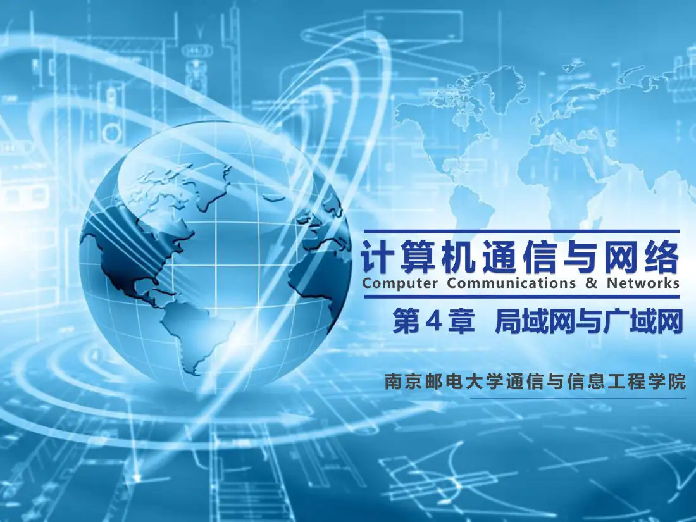

原文：

计算机通信与网络 Computer Communications & Networks

第 4 章 局域网与广域网

南京邮电大学通信与信息工程学院大纲要求R e q u i r e m e n t s

### 01 了解局域网相关标准、组成和拓扑结构，以及局域网技术的发展等

原文：

01 了解局域网相关标准、组成和拓扑结构，以及局域网技术的发展等

02 掌握以太网介质访问控制方法、虚拟局域网的原理

03 了解高速局域网、无线局域网技术

04 了解广域网技术，包括分组交换X.25 建议标准及帧中继、ATM的概念

2

### 内容纲要C o n t e n t s P a g e

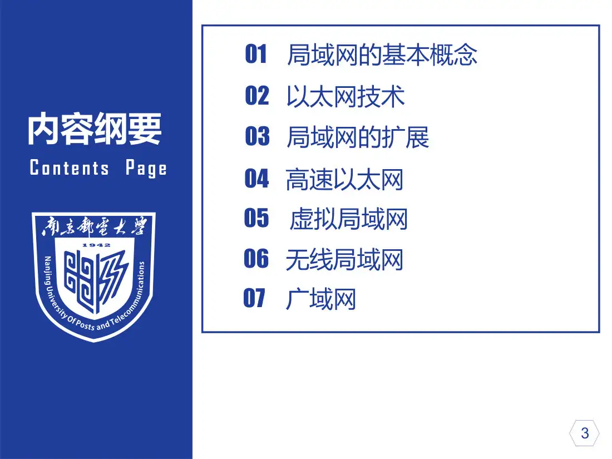

原文：

内容纲要C o n t e n t s P a g e

01 局域网的基本概念
02 以太网技术
03 局域网的扩展
04 高速以太网
05 虚拟局域网
06 无线局域网
07 广域网

3

### 过渡页 T r a n s i t i o n P a g e

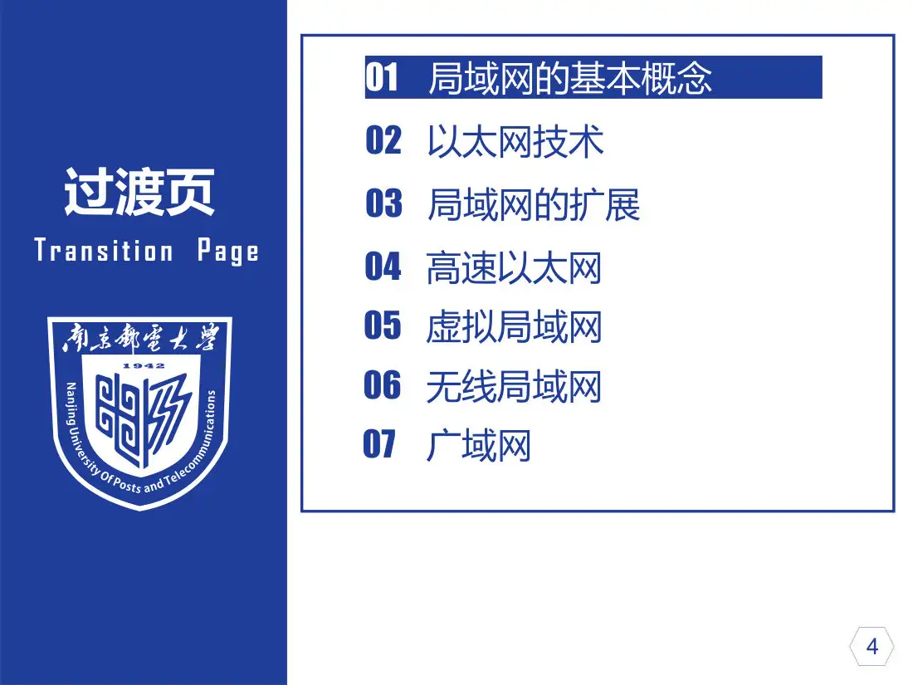

原文：

过渡页 T r a n s i t i o n P a g e

01 局域网的基本概念
02 以太网技术
03 局域网的扩展
04 高速以太网
05 虚拟局域网
06 无线局域网
07 广域网

4

### 局域网的定义

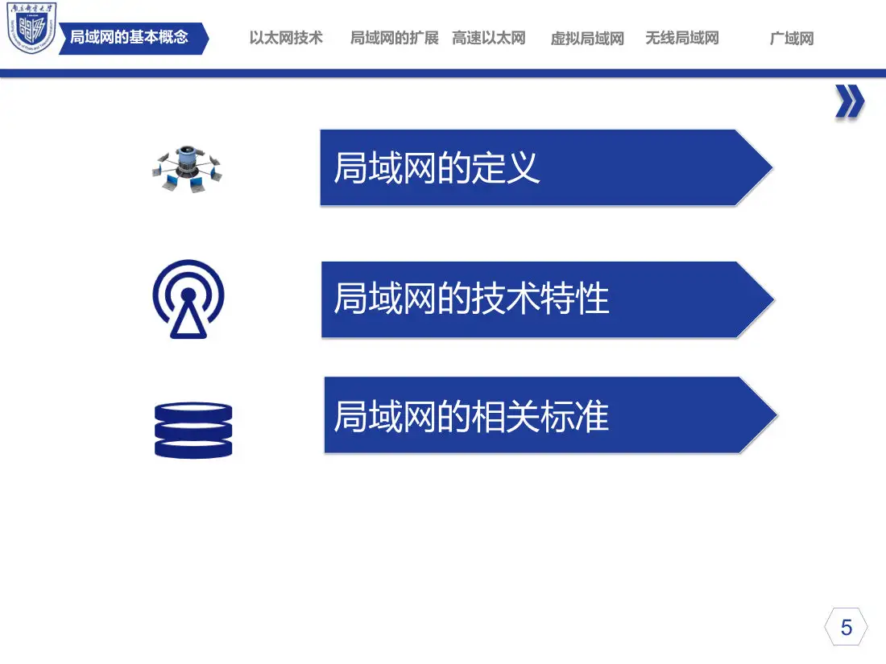

原文：

局域网的定义

局域网的技术特性

局域网的相关标准

南志郵電大學Nanjing U

局域网的基本概念

以太网技术 局域网的扩展 高速以太网 虚拟局域网 无线局域网 广域网

5

### 基本概念

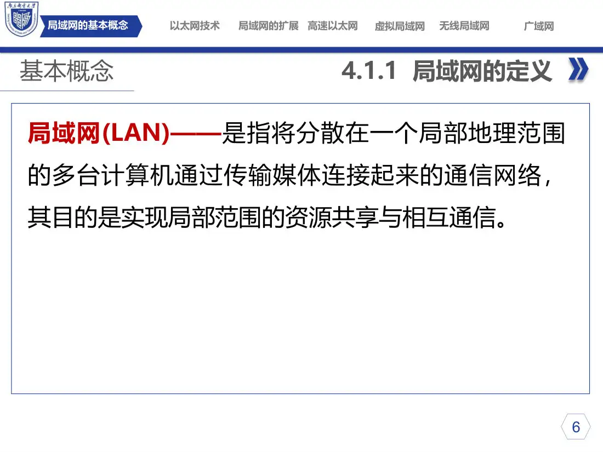

原文：

基本概念

4.1.1 局域网的定义

局域网(LAN)——是指将分散在一个局部地理范围的多台计算机通过传输媒体连接起来的通信网络，其目的是实现局部范围的资源共享与相互通信。

南志郵電大學Nanjing Ur

局域网的基本概念

以太网技术 局域网的扩展 高速以太网 虚拟局域网 无线局域网 广域网

6

### 局域网特点

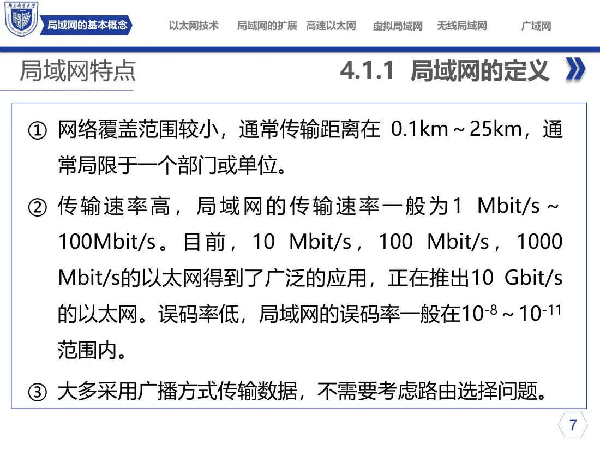

原文：

局域网特点

4.1.1 局域网的定义

① 网络覆盖范围较小，通常传输距离在 0.1km～25km，通常局限于一个部门或单位。

② 传输速率高，局域网的传输速率一般为1 Mbit/s～100Mbit/s 。 目 前 ， 10 Mbit/s ， 100 Mbit/s ， 1000Mbit/s的以太网得到了广泛的应用，正在推出10 Gbit/s的以太网。误码率低，局域网的误码率一般在10-8～10-11范围内。

③ 大多采用广播方式传输数据，不需要考虑路由选择问题。

南志郵電大學Nanjing Ur

局域网的基本概念

以太网技术 局域网的扩展 高速以太网 虚拟局域网 无线局域网 广域网

7

### 4.1.2 局域网的技术特性

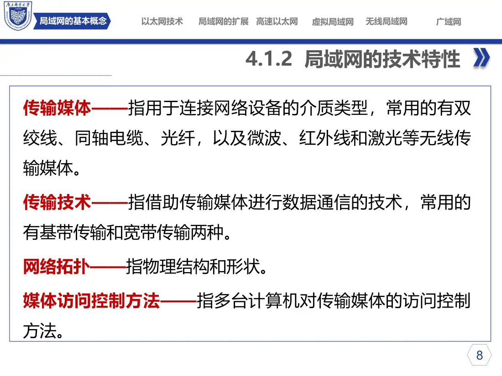

原文：

4.1.2 局域网的技术特性

传输媒体——指用于连接网络设备的介质类型，常用的有双绞线、同轴电缆、光纤，以及微波、红外线和激光等无线传输媒体。

传输技术——指借助传输媒体进行数据通信的技术，常用的有基带传输和宽带传输两种。

网络拓扑— 指物理结构和形状。

媒体访问控制方法——指多台计算机对传输媒体的访问控制方法。

南志郵電大學Nanjing Ur

局域网的基本概念

以太网技术 局域网的扩展 高速以太网 虚拟局域网 无线局域网 广域网

8

### 传输媒体

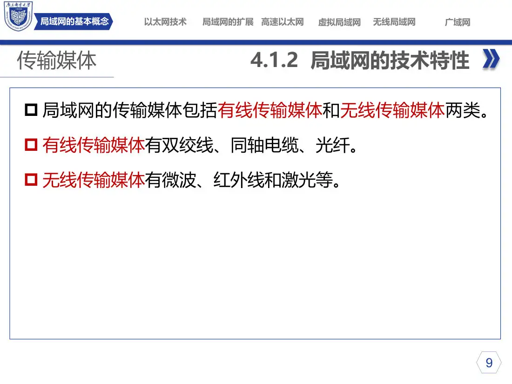

原文：

传输媒体

4.1.2 局域网的技术特性

局域网的传输媒体包括有线传输媒体和无线传输媒体两类。

有线传输媒体有双绞线、同轴电缆、光纤。

无线传输媒体有微波、红外线和激光等。

南立都電大學Naning

局域网的基本概念

以太网技术 局域网的扩展 高速以太网 虚拟局域网 无线局域网 广域网

9

### 传输技术

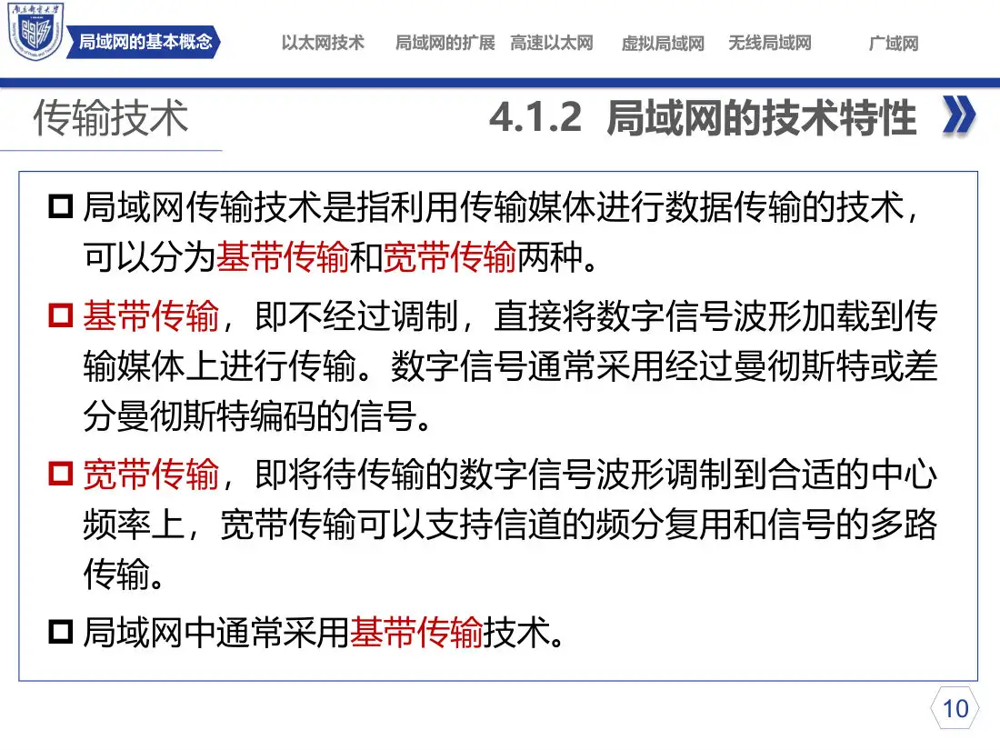

原文：

传输技术

4.1.2 局域网的技术特性

局域网传输技术是指利用传输媒体进行数据传输的技术，可以分为基带传输和宽带传输两种。

基带传输，即不经过调制，直接将数字信号波形加载到传输媒体上进行传输。数字信号通常采用经过曼彻斯特或差分曼彻斯特编码的信号。

宽带传输，即将待传输的数字信号波形调制到合适的中心频率上，宽带传输可以支持信道的频分复用和信号的多路传输。

局域网中通常采用基带传输技术。

南志郵電大學Nanjing Ur

局域网的基本概念

以太网技术 局域网的扩展 高速以太网 虚拟局域网 无线局域网 广域网

10

### 拓扑结构

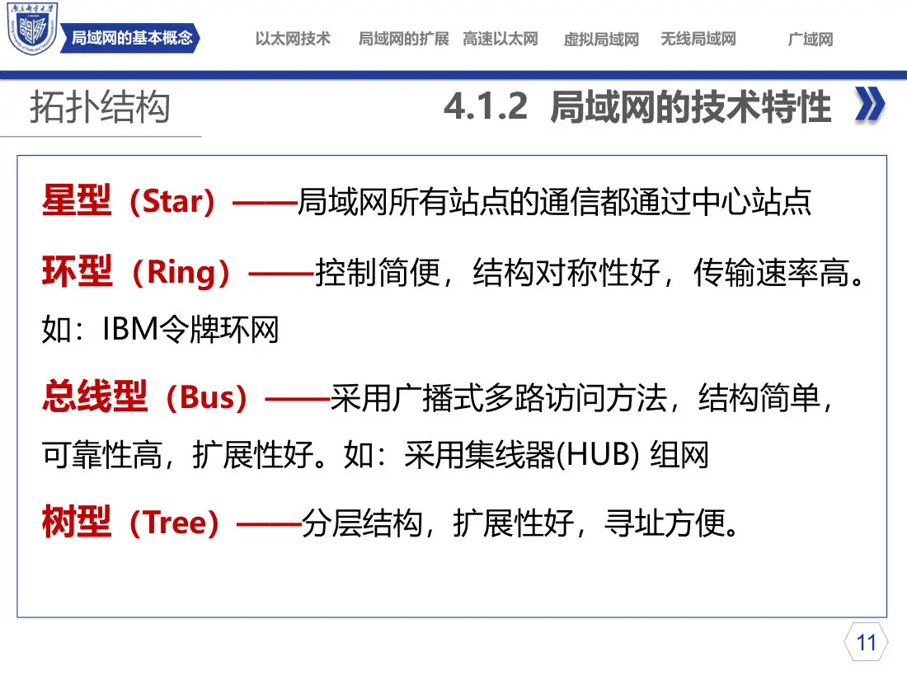

原文：

拓扑结构

4.1.2 局域网的技术特性

星型（Star）——局域网所有站点的通信都通过中心站点

环型（Ring）——控制简便，结构对称性好，传输速率高。

如：IBM令牌环网

总线型（Bus）——采用广播式多路访问方法，结构简单，可靠性高，扩展性好。如：采用集线器(HUB) 组网

树型（Tree）——分层结构，扩展性好，寻址方便。

南志郵電大學Nanjing Ur

局域网的基本概念

以太网技术 局域网的扩展 高速以太网 虚拟局域网 无线局域网 广域网

11

### 拓扑结构

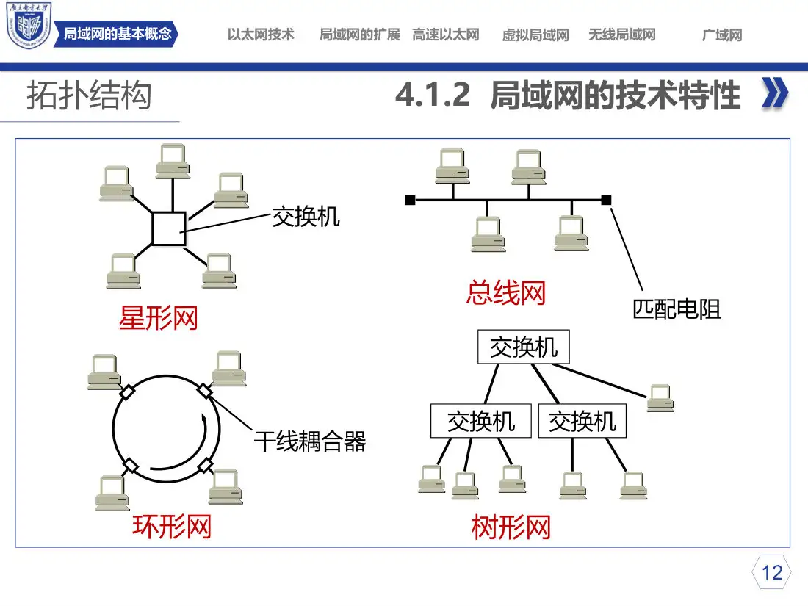

原文：

拓扑结构

4.1.2 局域网的技术特性

南志郵電大學Nanjing Ur

局域网的基本概念

以太网技术 局域网的扩展 高速以太网 虚拟局域网 无线局域网 广域网

12

### 媒体访问控制技术

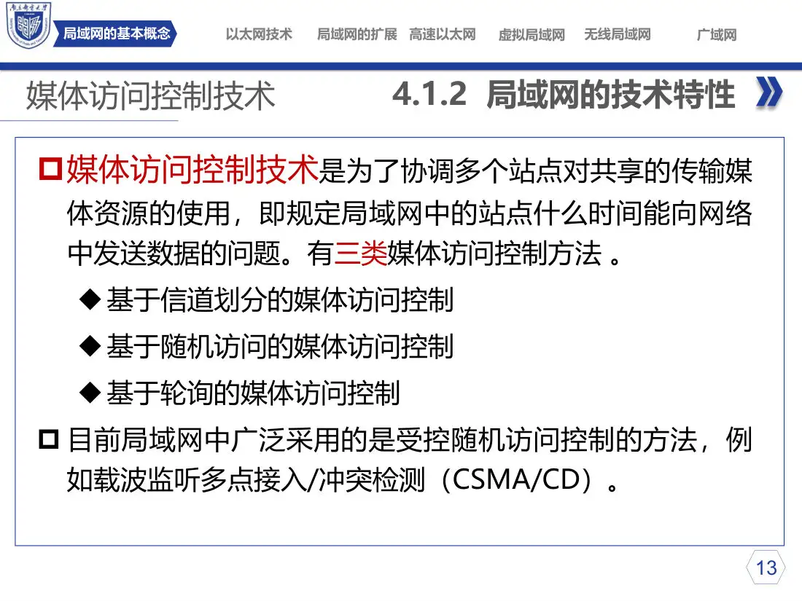

原文：

媒体访问控制技术

4.1.2 局域网的技术特性

媒体访问控制技术是为了协调多个站点对共享的传输媒体资源的使用，即规定局域网中的站点什么时间能向网络中发送数据的问题。有三类媒体访问控制方法 。

◆基于信道划分的媒体访问控制

◆基于随机访问的媒体访问控制

◆基于轮询的媒体访问控制

 目前局域网中广泛采用的是受控随机访问控制的方法，例如载波监听多点接入/冲突检测（CSMA/CD）。

南志郵電大學Nanjing Ur

局域网的基本概念

以太网技术 局域网的扩展 高速以太网 虚拟局域网 无线局域网 广域网

13

### 体系标准

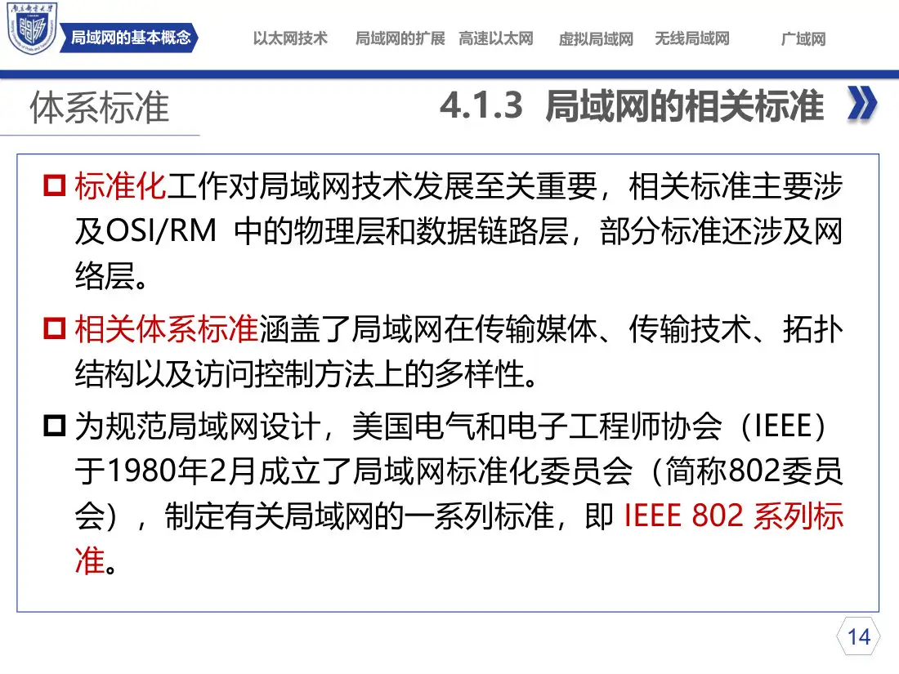

原文：

体系标准

4.1.3 局域网的相关标准

标准化工作对局域网技术发展至关重要，相关标准主要涉及OSI/RM 中的物理层和数据链路层，部分标准还涉及网络层。

相关体系标准涵盖了局域网在传输媒体、传输技术、拓扑结构以及访问控制方法上的多样性。

 为规范局域网设计，美国电气和电子工程师协会（IEEE）于1980年2月成立了局域网标准化委员会（简称802委员会），制定有关局域网的一系列标准，即 IEEE 802 系列标准。

南志郵電大學Nanjing Ur

局域网的基本概念

以太网技术 局域网的扩展 高速以太网 虚拟局域网 无线局域网 广域网

14

### 体系标准

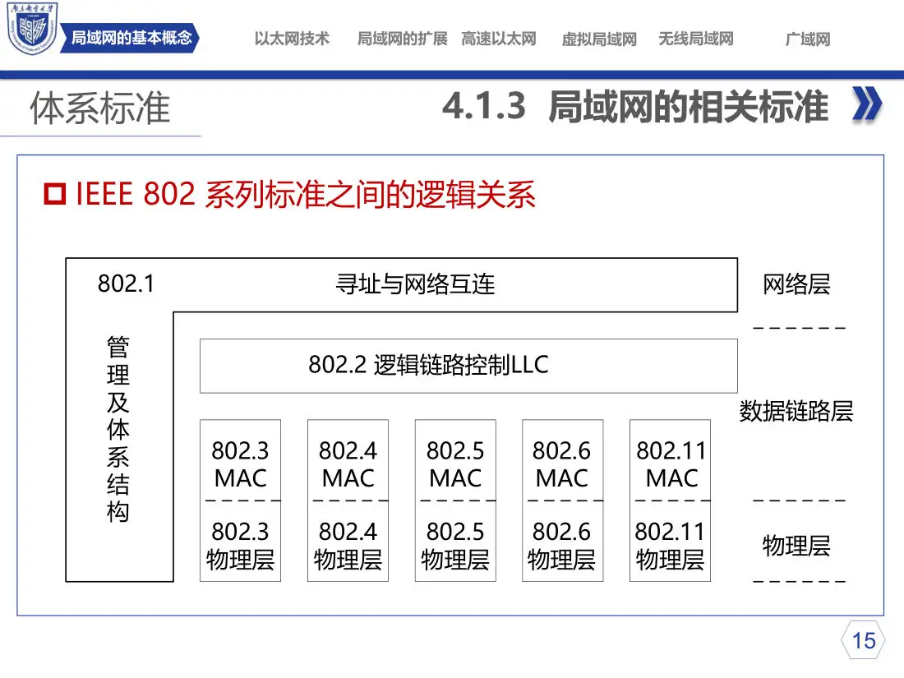

原文：

体系标准

4.1.3 局域网的相关标准

IEEE 802 系列标准之间的逻辑关系

802.1

寻址与网络互连

网络层

802.2 逻辑链路控制LLC

802.3 MAC

802.3物理层

802.4 MAC

802.4物理层

802.5 MAC

802.5 物理层

802.6 MAC

802.6物理层

802.11 MAC

802.11物理层数据链路层

物理层

南志郵電大學Nanjing Ur

局域网的基本概念

以太网技术 局域网的扩展 高速以太网 虚拟局域网 无线局域网 广域网

》

15

### 体系标准

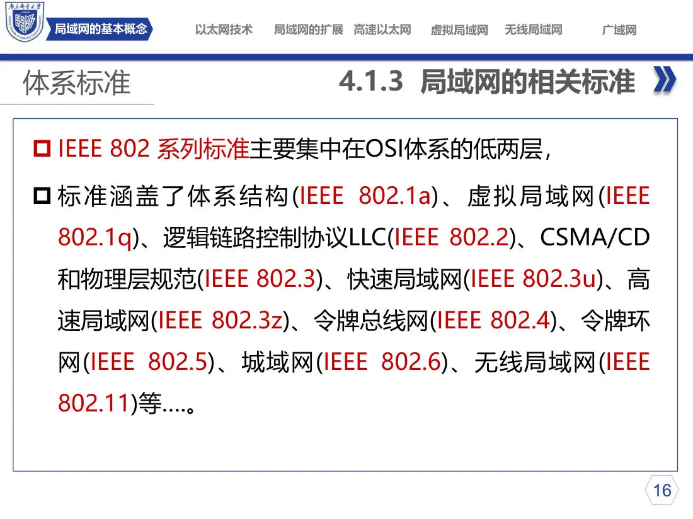

原文：

体系标准

4.1.3 局域网的相关标准

 IEEE 802 系列标准主要集中在OSI体系的低两层，

 标准涵盖了体系结构(IEEE 802.1a)、虚拟局域网(IEEE802.1q)、逻辑链路控制协议LLC(IEEE 802.2)、CSMA/CD和物理层规范(IEEE 802.3)、快速局域网(IEEE 802.3u)、高速局域网(IEEE 802.3z)、令牌总线网(IEEE 802.4)、令牌环网(IEEE 802.5)、城域网(IEEE 802.6)、无线局域网(IEEE802.11)等….。

南志郵電大學Nanjing Ur

局域网的基本概念

以太网技术 局域网的扩展 高速以太网 虚拟局域网 无线局域网 广域网

16

### 体系标准

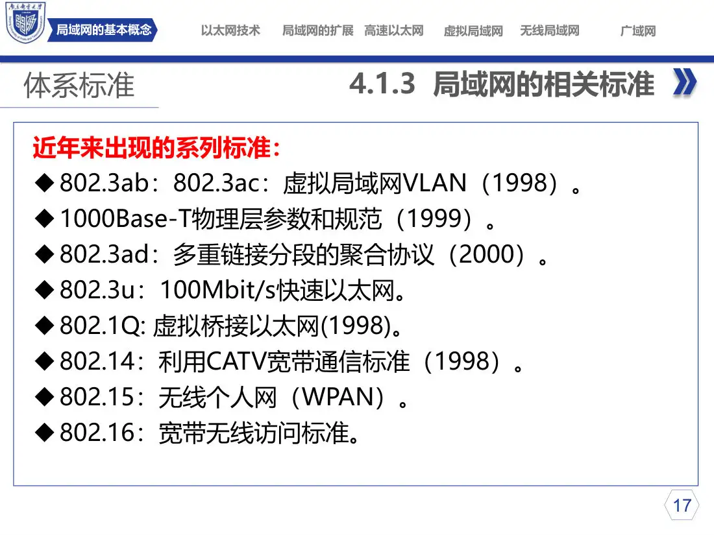

原文：

体系标准

4.1.3 局域网的相关标准

近年来出现的系列标准：

◆802.3ab：802.3ac：虚拟局域网VLAN（1998）。

◆1000Base-T物理层参数和规范（1999）。

◆802.3ad：多重链接分段的聚合协议（2000）。

◆802.3u：100Mbit/s快速以太网。

◆802.1Q: 虚拟桥接以太网(1998)。

◆802.14：利用CATV宽带通信标准（1998）。

◆802.15：无线个人网（WPAN）。

◆802.16：宽带无线访问标准。

南志郵電大學Nanjing Ur

局域网的基本概念

以太网技术 局域网的扩展 高速以太网 虚拟局域网 无线局域网 广域网

17

### 过渡页 T r a n s i t i o n P a g e

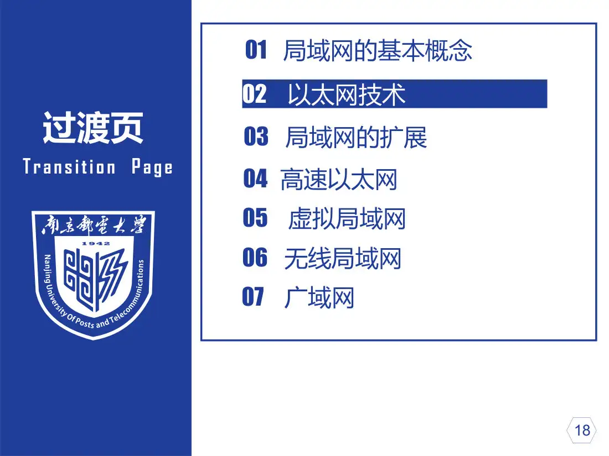

原文：

过渡页 T r a n s i t i o n P a g e

01 局域网的基本概念
02 以太网技术
03 局域网的扩展
04 高速以太网
05 虚拟局域网
06 无线局域网
07 广域网

18

### G川

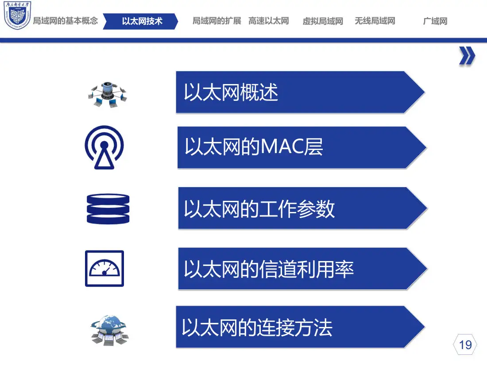

原文：

G川

以太网概述
以太网的MAC层
以太网的工作参数
以太网的信道利用率
以太网的连接方法

南志郵電大學Nanjing U

局域网的基本概念

以太网技术

局域网的扩展 高速以太网 虚拟局域网 无线局域网 广域网

19

### 基本概念

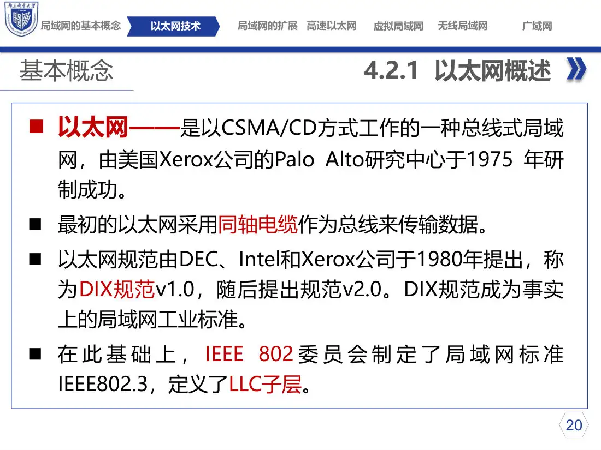

原文：

基本概念

4.2.1 以太网概述

◼ 以太网——是以CSMA/CD方式工作的一种总线式局域网，由美国Xerox公司的Palo Alto研究中心于1975 年研制成功。

◼ 最初的以太网采用同轴电缆作为总线来传输数据。

◼ 以太网规范由DEC、Intel和Xerox公司于1980年提出，称为DIX规范v1.0，随后提出规范v2.0。DIX规范成为事实上的局域网工业标准。

◼ 在此基础上，IEEE 802委员会制定了局域网标准IEEE802.3，定义了LLC子层。

南志郵電大學Nanjing U

局域网的基本概念

以太网技术

局域网的扩展 高速以太网 虚拟局域网 无线局域网 广域网

20

### 基本概念

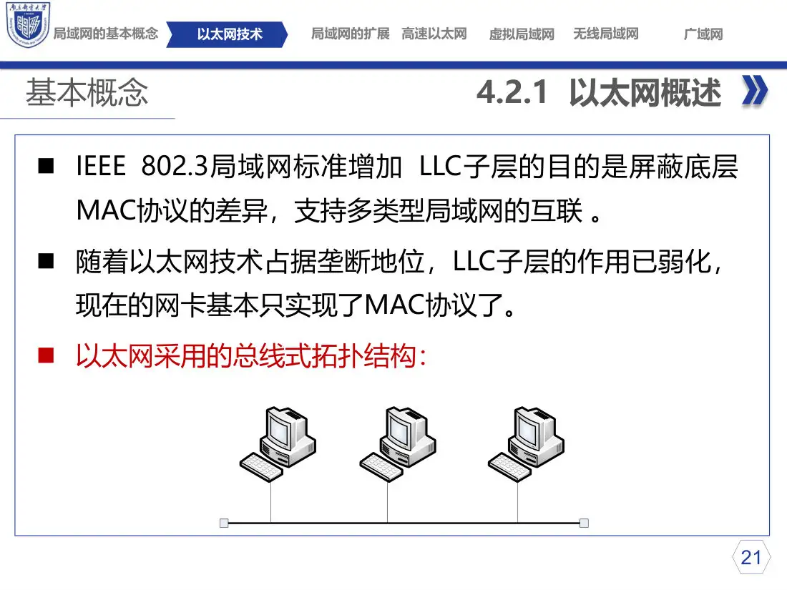

原文：

基本概念

4.2.1 以太网概述

◼ IEEE 802.3局域网标准增加 LLC子层的目的是屏蔽底层MAC协议的差异，支持多类型局域网的互联 。

◼ 随着以太网技术占据垄断地位，LLC子层的作用已弱化，现在的网卡基本只实现了MAC协议了。

◼ 以太网采用的总线式拓扑结构：

南志郵電大學Nanjing U

局域网的基本概念

以太网技术

局域网的扩展 高速以太网 虚拟局域网 无线局域网 广域网

21

### 基本概念

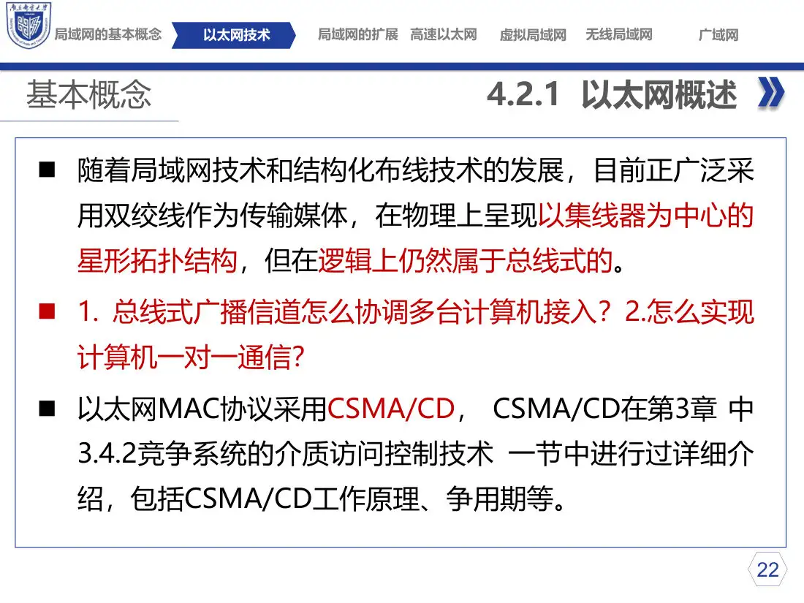

原文：

基本概念

4.2.1 以太网概述

◼ 随着局域网技术和结构化布线技术的发展，目前正广泛采用双绞线作为传输媒体，在物理上呈现以集线器为中心的星形拓扑结构，但在逻辑上仍然属于总线式的。

◼ 1. 总线式广播信道怎么协调多台计算机接入？2.怎么实现计算机一对一通信？

以太网MAC协议采用CSMA/CD， CSMA/CD在第3章 中3.4.2竞争系统的介质访问控制技术 一节中进行过详细介绍，包括CSMA/CD工作原理、争用期等。

南志郵電大學Nanjing U

局域网的基本概念

以太网技术

局域网的扩展 高速以太网 虚拟局域网 无线局域网 广域网

22

### CSMA/CD工作原理 回顾

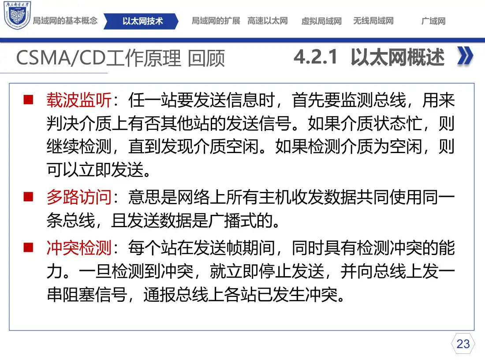

原文：

CSMA/CD工作原理 回顾

4.2.1 以太网概述

◼ 载波监听：任一站要发送信息时，首先要监测总线，用来判决介质上有否其他站的发送信号。如果介质状态忙，则继续检测，直到发现介质空闲。如果检测介质为空闲，则可以立即发送。

◼ 多路访问：意思是网络上所有主机收发数据共同使用同一条总线，且发送数据是广播式的。

◼ 冲突检测：每个站在发送帧期间，同时具有检测冲突的能力。一旦检测到冲突，就立即停止发送，并向总线上发一串阻塞信号，通报总线上各站已发生冲突。

南立都電大學Naning

局域网的基本概念

以太网技术

局域网的扩展 高速以太网 虚拟局域网 无线局域网 广域网

23

### 4.2.2 以太网的MAC层

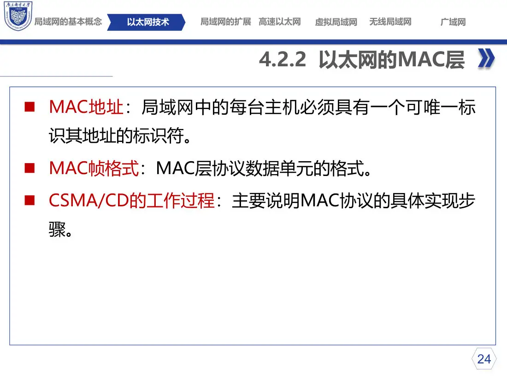

原文：

4.2.2 以太网的MAC层

◼ MAC地址：局域网中的每台主机必须具有一个可唯一标识其地址的标识符。

◼ MAC帧格式：MAC层协议数据单元的格式。

◼ CSMA/CD的工作过程：主要说明MAC协议的具体实现步骤。

南志郵電大學Nanjing U

局域网的基本概念

以太网技术

局域网的扩展 高速以太网 虚拟局域网 无线局域网 广域网

24

### MAC地址

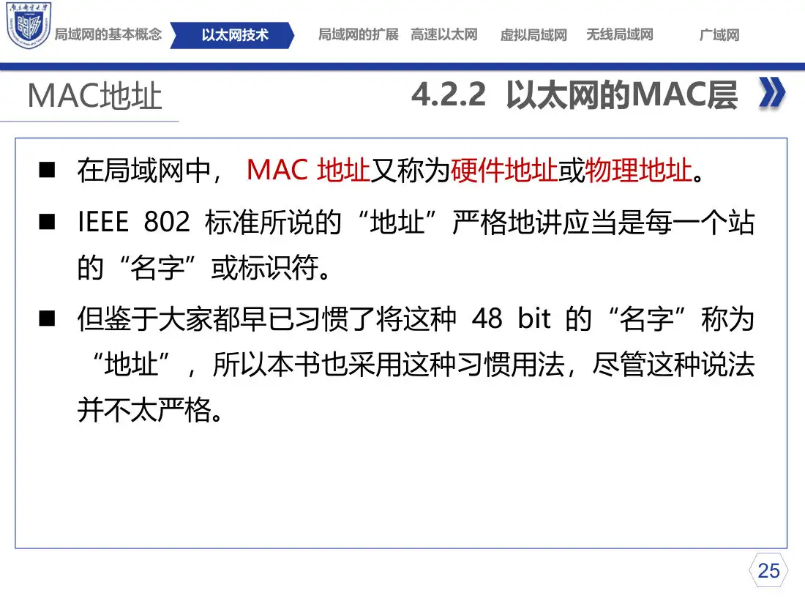

原文：

MAC地址

4.2.2 以太网的MAC层

◼ 在局域网中， MAC 地址又称为硬件地址或物理地址。

◼ IEEE 802 标准所说的“地址”严格地讲应当是每一个站的“名字”或标识符。

但鉴于大家都早已习惯了将这种 48 bit 的“名字”称为“地址”，所以本书也采用这种习惯用法，尽管这种说法并不太严格。

南志郵電大學Nanjing U ayofpe

局域网的基本概念

以太网技术

局域网的扩展 高速以太网 虚拟局域网 无线局域网 广域网

25

### MAC地址

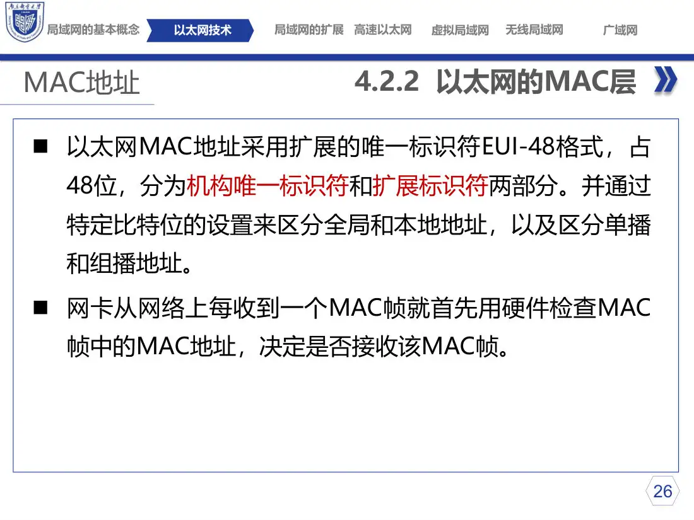

原文：

MAC地址

4.2.2 以太网的MAC层

以太网MAC地址采用扩展的唯一标识符EUI-48格式，占48位，分为机构唯一标识符和扩展标识符两部分。并通过特定比特位的设置来区分全局和本地地址，以及区分单播和组播地址。

◼ 网卡从网络上每收到一个MAC帧就首先用硬件检查MAC帧中的MAC地址，决定是否接收该MAC帧。

南志郵電大學Nanjing U

局域网的基本概念

以太网技术

局域网的扩展 高速以太网 虚拟局域网 无线局域网 广域网

26

### MAC地址

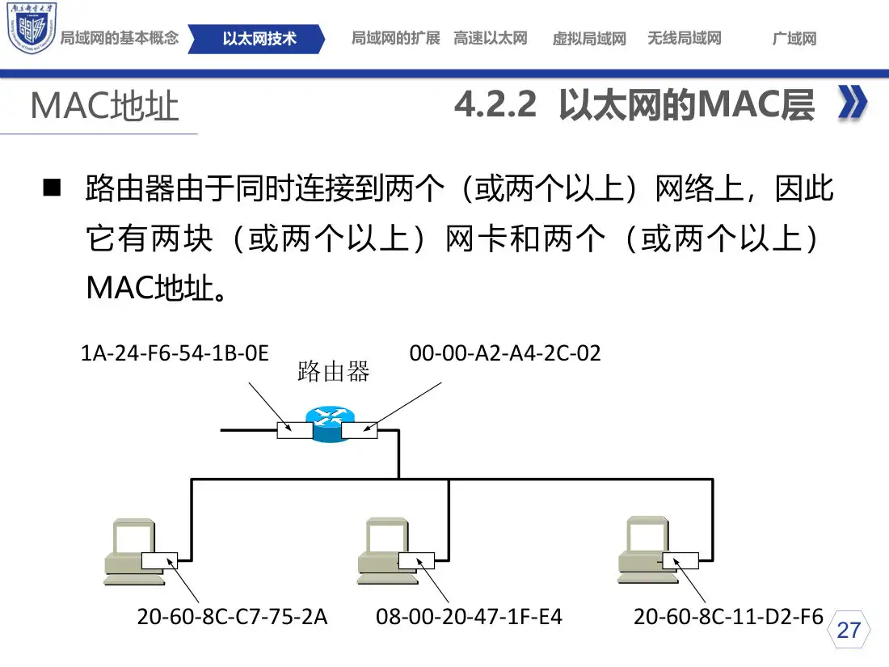

原文：

MAC地址

4.2.2 以太网的MAC层

◼ 路由器由于同时连接到两个（或两个以上）网络上，因此它有两块（或两个以上）网卡和两个（或两个以上）MAC地址。

南志郵電大學Nanjing U

局域网的基本概念

以太网技术

局域网的扩展 高速以太网 虚拟局域网 无线局域网 广域网

27

### 网卡检查MAC地址

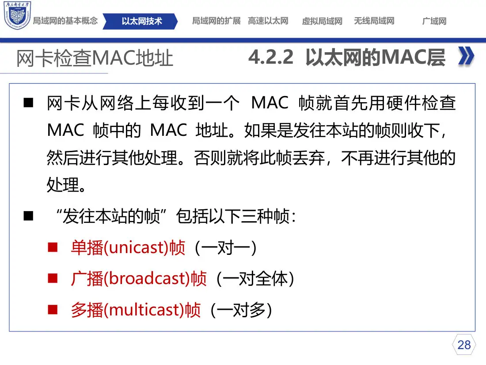

原文：

网卡检查MAC地址

4.2.2 以太网的MAC层

◼ 网卡从网络上每收到一个 MAC 帧就首先用硬件检查MAC 帧中的 MAC 地址。如果是发往本站的帧则收下，然后进行其他处理。否则就将此帧丢弃，不再进行其他的处理。

◼ “发往本站的帧”包括以下三种帧：

单播(unicast)帧（一对一）

◼ 广播(broadcast)帧（一对全体）

◼ 多播(multicast)帧（一对多）

南志郵電大學Nanjing U

局域网的基本概念

以太网技术

局域网的扩展 高速以太网 虚拟局域网 无线局域网 广域网

28

### MAC帧格式

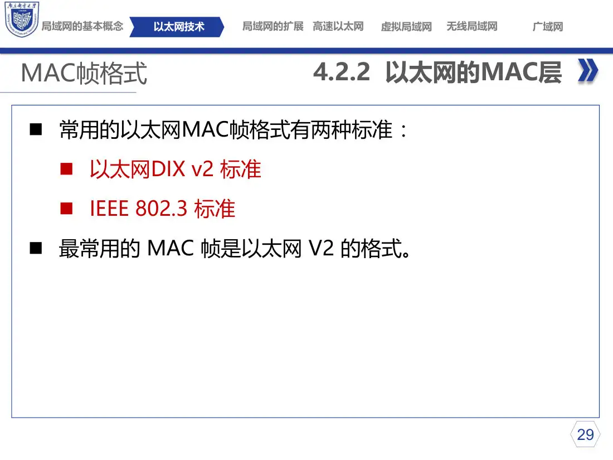

原文：

MAC帧格式

4.2.2 以太网的MAC层

◼ 常用的以太网MAC帧格式有两种标准 ：

◼ 以太网DIX v2 标准

IEEE 802.3 标准

◼ 最常用的 MAC 帧是以太网 V2 的格式。

南立都電大學Naning

局域网的基本概念

以太网技术

局域网的扩展 高速以太网 虚拟局域网 无线局域网 广域网

29

### MAC帧格式

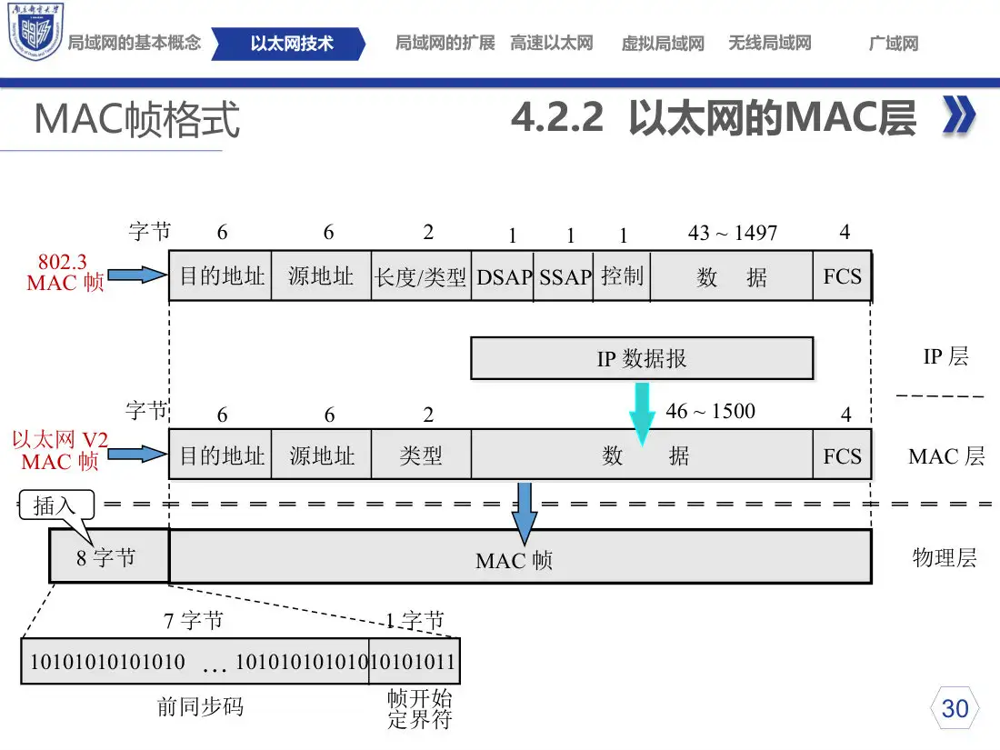

原文：

MAC帧格式

4.2.2 以太网的MAC层

30

南志郵電大學Nanjing U

局域网的基本概念

以太网技术

局域网的扩展 高速以太网 虚拟局域网 无线局域网 广域网

### 以太网DIX v2帧格式

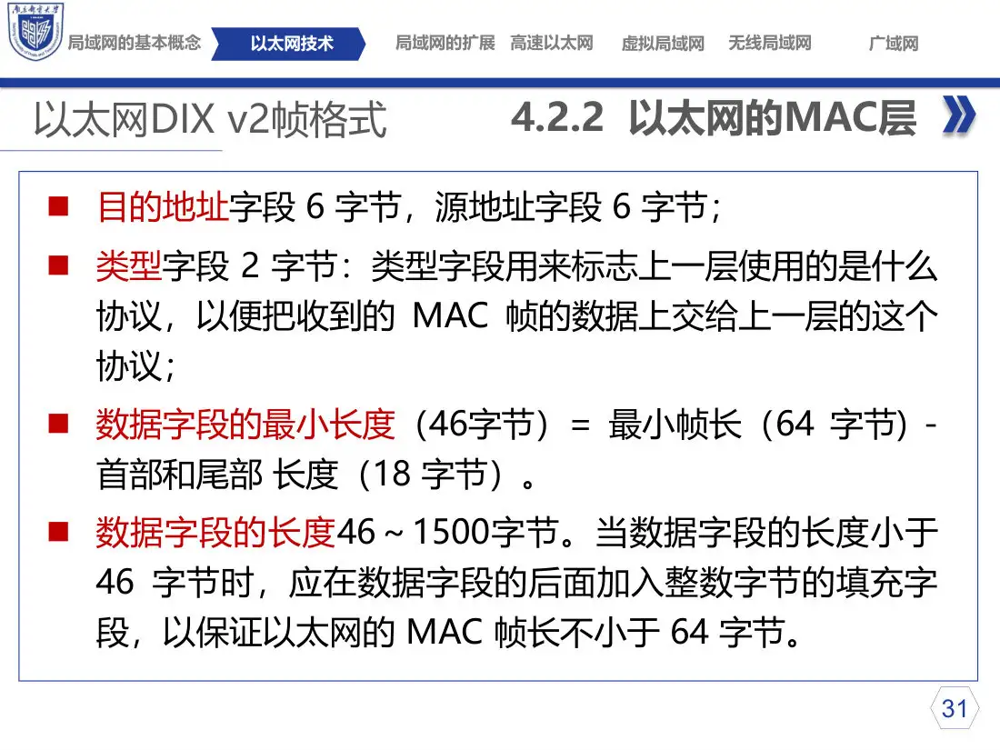

原文：

以太网DIX v2帧格式

4.2.2 以太网的MAC层

◼ 目的地址字段 6 字节，源地址字段 6 字节；

◼ 类型字段 2 字节：类型字段用来标志上一层使用的是什么协议，以便把收到的 MAC 帧的数据上交给上一层的这个协议；

◼ 数据字段的最小长度（46字节）= 最小帧长（64 字节) -首部和尾部 长度（18 字节）。

◼ 数据字段的长度46～1500字节。当数据字段的长度小于46 字节时，应在数据字段的后面加入整数字节的填充字段，以保证以太网的 MAC 帧长不小于 64 字节。

南立都電大學Naning

局域网的基本概念

以太网技术

局域网的扩展 高速以太网 虚拟局域网 无线局域网 广域网

31

### 以太网DIX v2帧格式

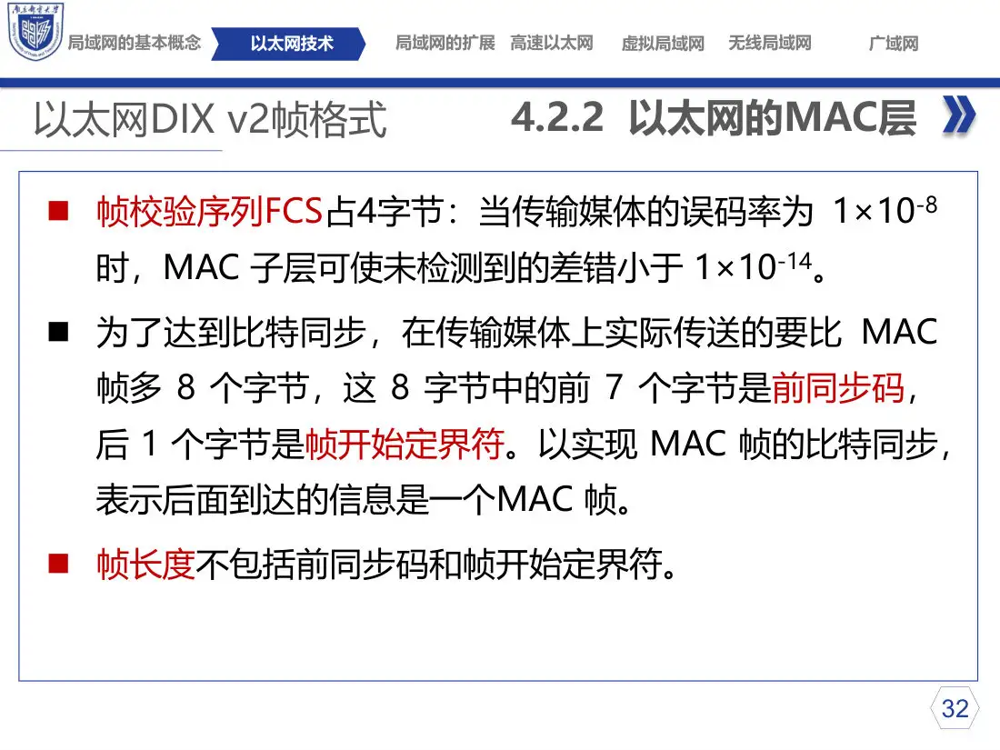

原文：

以太网DIX v2帧格式

4.2.2 以太网的MAC层

◼ 帧校验序列FCS占4字节：当传输媒体的误码率为 1×10-8时，MAC 子层可使未检测到的差错小于 1×10-14。

◼ 为了达到比特同步，在传输媒体上实际传送的要比 MAC帧多 8 个字节，这 8 字节中的前 7 个字节是前同步码，后 1 个字节是帧开始定界符。以实现 MAC 帧的比特同步，表示后面到达的信息是一个MAC 帧。

◼ 帧长度不包括前同步码和帧开始定界符。

南志郵電大學Nanjing U

局域网的基本概念

以太网技术

局域网的扩展 高速以太网 虚拟局域网 无线局域网 广域网

32

### CSMA/CD的工作过程

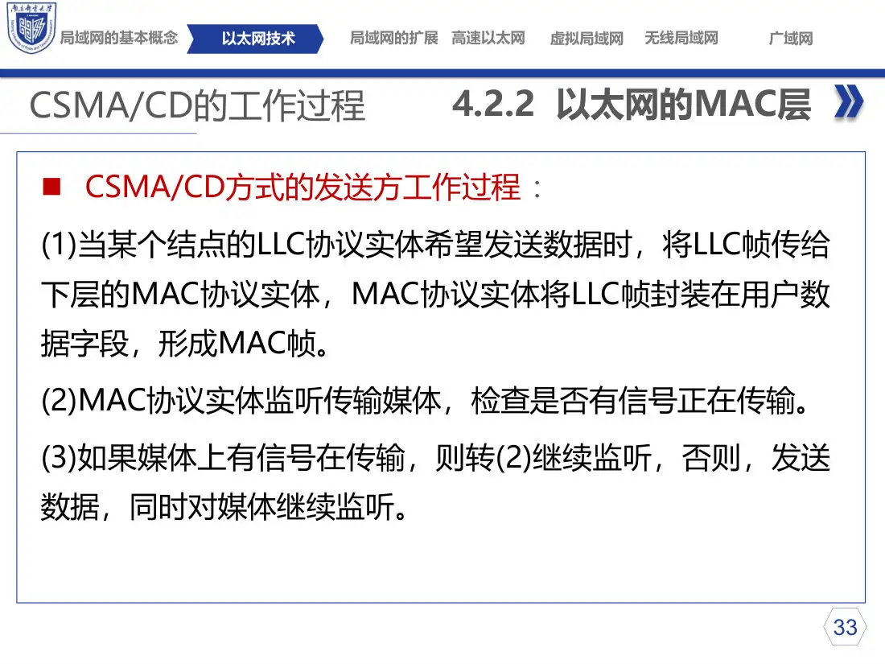

原文：

CSMA/CD的工作过程

4.2.2 以太网的MAC层

◼ CSMA/CD方式的发送方工作过程 ：

(1)当某个结点的LLC协议实体希望发送数据时，将LLC帧传给下层的MAC协议实体，MAC协议实体将LLC帧封装在用户数据字段，形成MAC帧。

(2)MAC协议实体监听传输媒体，检查是否有信号正在传输。

(3)如果媒体上有信号在传输，则转(2)继续监听，否则，发送数据，同时对媒体继续监听。

南志郵電大學Nanjing U ayofpe

局域网的基本概念

以太网技术

局域网的扩展 高速以太网 虚拟局域网 无线局域网 广域网

33

### CSMA/CD的工作过程

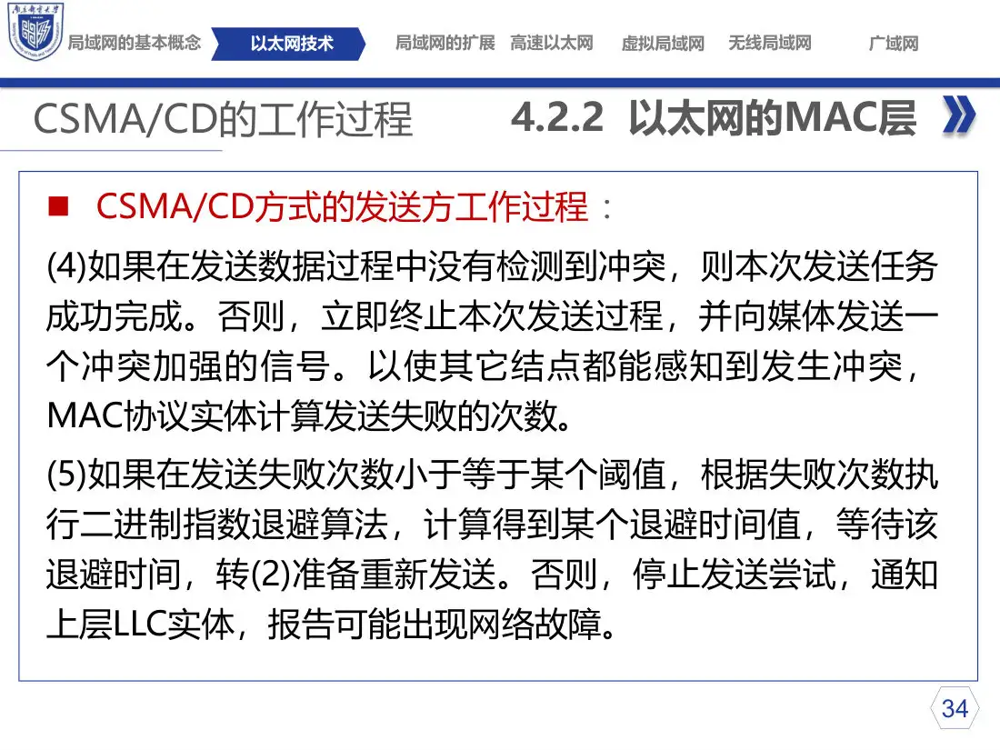

原文：

CSMA/CD的工作过程

4.2.2 以太网的MAC层

◼ CSMA/CD方式的发送方工作过程 ：

(4)如果在发送数据过程中没有检测到冲突，则本次发送任务成功完成。否则，立即终止本次发送过程，并向媒体发送一个冲突加强的信号。以使其它结点都能感知到发生冲突，MAC协议实体计算发送失败的次数。

(5)如果在发送失败次数小于等于某个阈值，根据失败次数执行二进制指数退避算法，计算得到某个退避时间值，等待该退避时间，转(2)准备重新发送。否则，停止发送尝试，通知上层LLC实体，报告可能出现网络故障。

南志郵電大學Nanjing U

局域网的基本概念

以太网技术

局域网的扩展 高速以太网 虚拟局域网 无线局域网 广域网

34

### CSMA/CD的工作过程

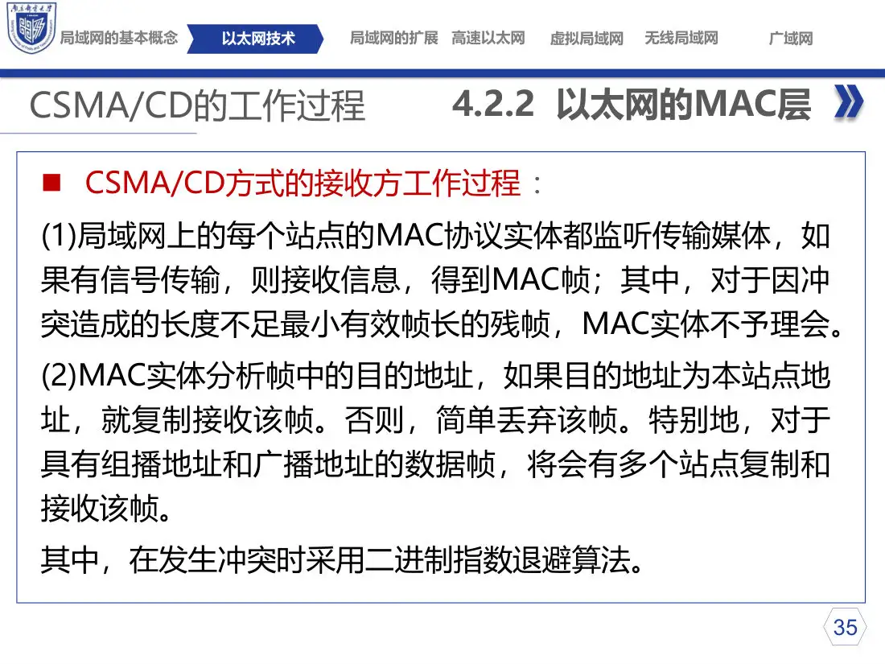

原文：

CSMA/CD的工作过程

4.2.2 以太网的MAC层

◼ CSMA/CD方式的接收方工作过程 ：

(1)局域网上的每个站点的MAC协议实体都监听传输媒体，如果有信号传输，则接收信息，得到MAC帧；其中，对于因冲突造成的长度不足最小有效帧长的残帧，MAC实体不予理会。

(2)MAC实体分析帧中的目的地址，如果目的地址为本站点地址，就复制接收该帧。否则，简单丢弃该帧。特别地，对于具有组播地址和广播地址的数据帧，将会有多个站点复制和接收该帧。

其中，在发生冲突时采用二进制指数退避算法。

南志郵電大學Nanjing U ayofpe

局域网的基本概念

以太网技术

局域网的扩展 高速以太网 虚拟局域网 无线局域网 广域网

35

### CSMA/CD的工作过程

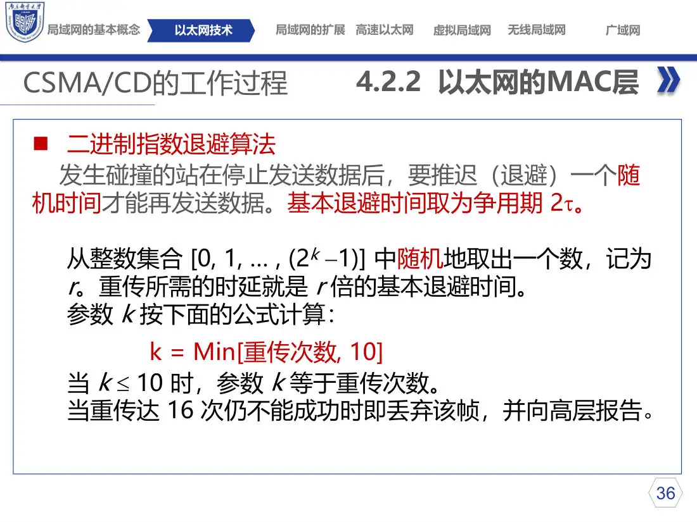

原文：

CSMA/CD的工作过程

4.2.2 以太网的MAC层

◼ 二进制指数退避算法

发生碰撞的站在停止发送数据后，要推迟（退避）一个随机时间才能再发送数据。基本退避时间取为争用期 $2 \tau$ 。

从整数集合 $[ 0 , 1 , \ldots , ( 2 ^ { k } { - } 1 ) ]$ 中随机地取出一个数，记为。重传所需的时延就是 倍的基本退避时间。

参数 k 按下面的公式计算：

k = Min[重传次数, 10]

当 $k \leq 1 0$ 时，参数 k 等于重传次数。

当重传达 16 次仍不能成功时即丢弃该帧，并向高层报告。

南志郵電大學Nanjing U

局域网的基本概念

以太网技术

局域网的扩展 高速以太网 虚拟局域网 无线局域网 广域网

36

### 4.2.3 以太网的工作参数

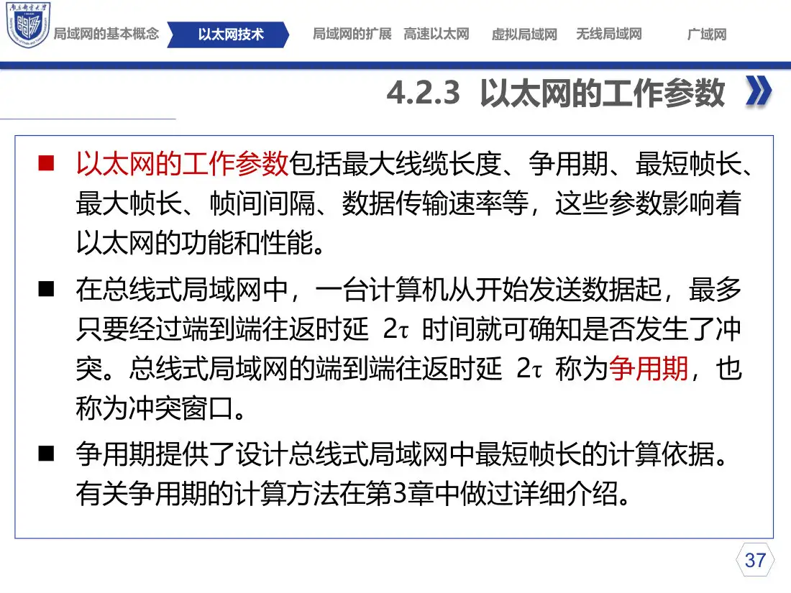

原文：

4.2.3 以太网的工作参数

◼ 以太网的工作参数包括最大线缆长度、争用期、最短帧长、最大帧长、帧间间隔、数据传输速率等，这些参数影响着以太网的功能和性能。

◼ 在总线式局域网中，一台计算机从开始发送数据起，最多只要经过端到端往返时延 $2 \tau$ 时间就可确知是否发生了冲突。总线式局域网的端到端往返时延 $2 \tau$ 称为争用期，也称为冲突窗口。

◼ 争用期提供了设计总线式局域网中最短帧长的计算依据。有关争用期的计算方法在第3章中做过详细介绍。

南志郵電大學Nanjing U

局域网的基本概念

以太网技术

局域网的扩展 高速以太网 虚拟局域网 无线局域网 广域网

37

### 4.2.3 以太网的工作参数

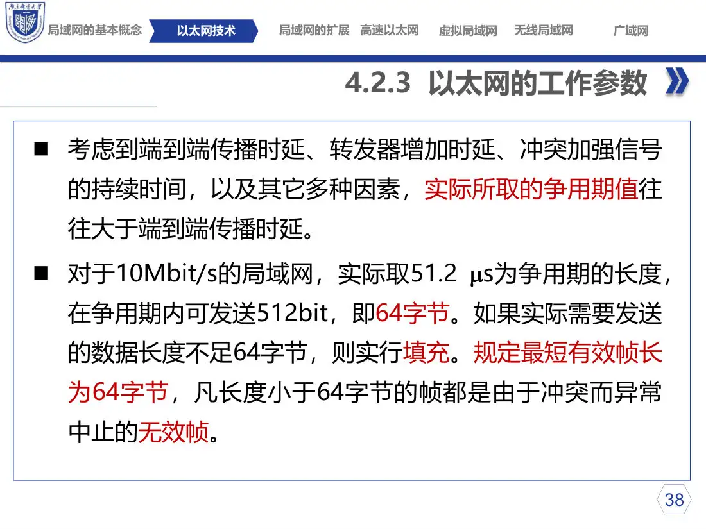

原文：

4.2.3 以太网的工作参数

◼ 考虑到端到端传播时延、转发器增加时延、冲突加强信号的持续时间，以及其它多种因素，实际所取的争用期值往往大于端到端传播时延。

◼ 对于10Mbit/s的局域网，实际取51.2 s为争用期的长度，在争用期内可发送512bit，即64字节。如果实际需要发送的数据长度不足64字节，则实行填充。规定最短有效帧长为64字节，凡长度小于64字节的帧都是由于冲突而异常中止的无效帧。

南志郵電大學Nanjing U ayofpe

局域网的基本概念

以太网技术

局域网的扩展 高速以太网 虚拟局域网 无线局域网 广域网

38

### 4.2.3 以太网的工作参数

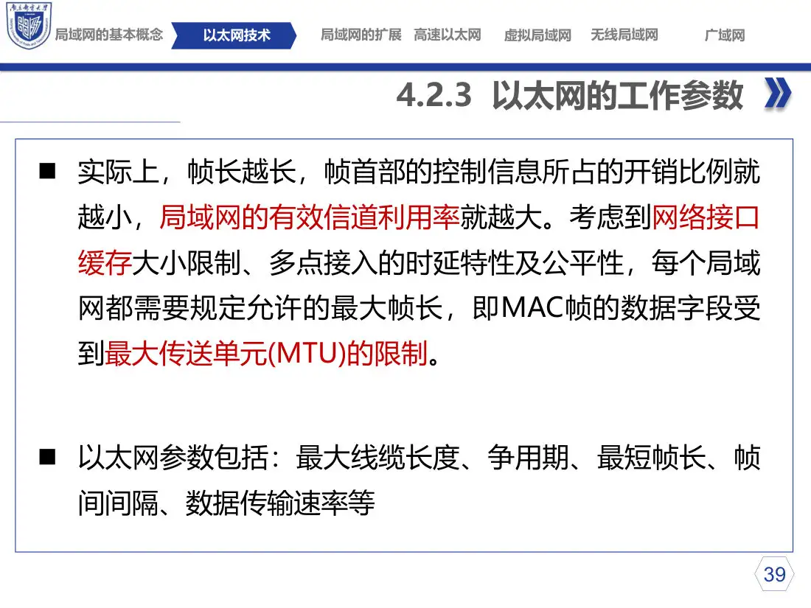

原文：

4.2.3 以太网的工作参数

◼ 实际上，帧长越长，帧首部的控制信息所占的开销比例就越小，局域网的有效信道利用率就越大。考虑到网络接口缓存大小限制、多点接入的时延特性及公平性，每个局域网都需要规定允许的最大帧长，即MAC帧的数据字段受到最大传送单元(MTU)的限制。

◼ 以太网参数包括：最大线缆长度、争用期、最短帧长、帧间间隔、数据传输速率等

南志郵電大學Nanjing U

局域网的基本概念

以太网技术

局域网的扩展 高速以太网 虚拟局域网 无线局域网 广域网

39

### 信道利用率问题

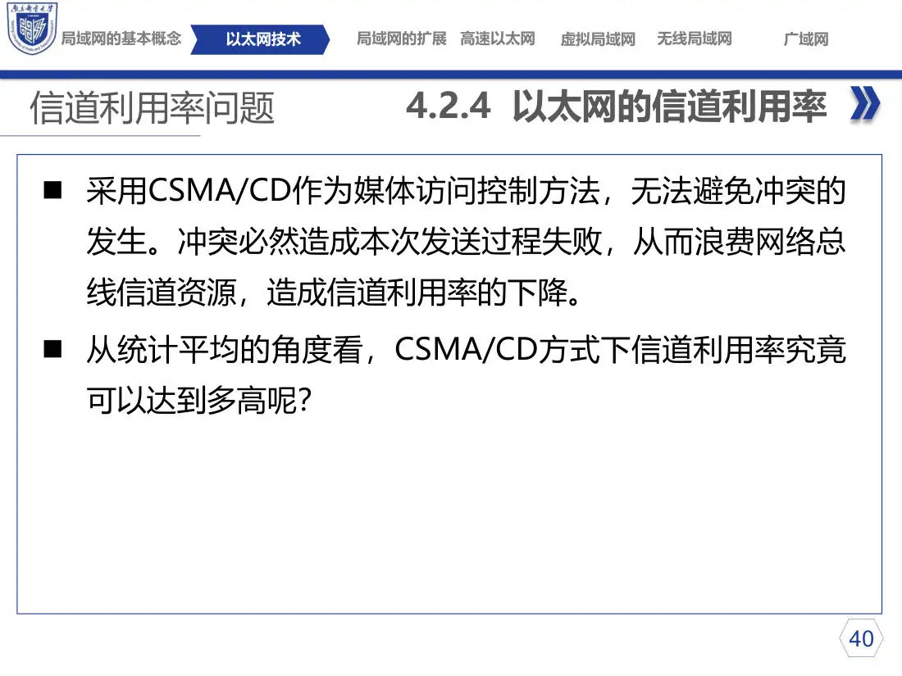

原文：

信道利用率问题

4.2.4 以太网的信道利用率

◼ 采用CSMA/CD作为媒体访问控制方法，无法避免冲突的发生。冲突必然造成本次发送过程失败，从而浪费网络总线信道资源，造成信道利用率的下降。

◼ 从统计平均的角度看，CSMA/CD方式下信道利用率究竟可以达到多高呢？

南立都電大學Naning

局域网的基本概念

以太网技术

局域网的扩展 高速以太网 虚拟局域网 无线局域网 广域网

40

### 4.2.4 以太网的信道利用率

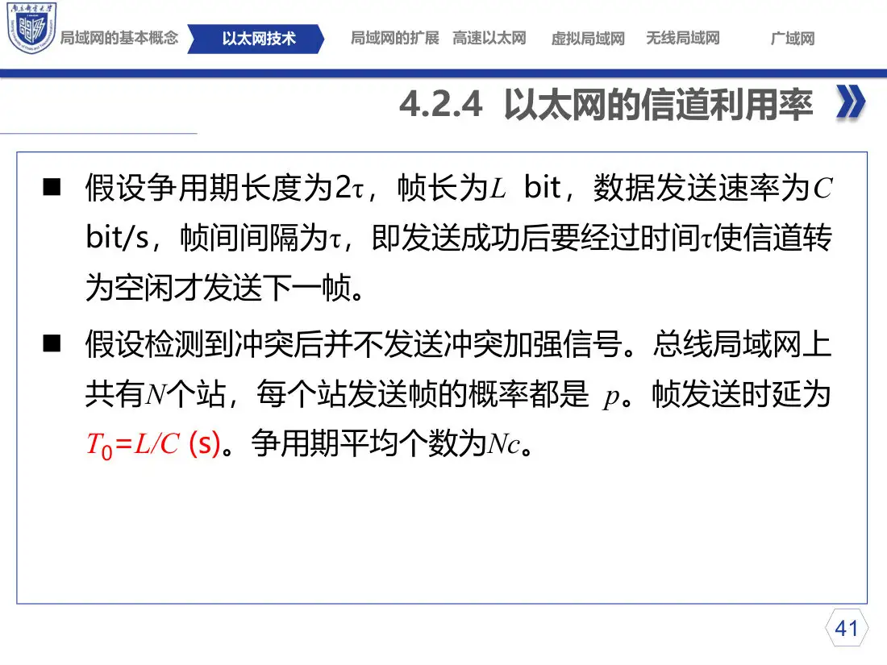

原文：

4.2.4 以太网的信道利用率

◼ 假设争用期长度为 $2 \tau$ ，帧长为L bit，数据发送速率为Cbit/s，帧间间隔为τ，即发送成功后要经过时间τ使信道转为空闲才发送下一帧。

◼ 假设检测到冲突后并不发送冲突加强信号。总线局域网上共有N个站，每个站发送帧的概率都是 p。帧发送时延为${ \cal T } _ { 0 } { = } L / C \left( \varsigma \right)$ 。争用期平均个数为Nc。

南志郵電大學Nanjing U ayofpe

局域网的基本概念

以太网技术

局域网的扩展 高速以太网 虚拟局域网 无线局域网 广域网

41

### 4.2.4 以太网的信道利用率

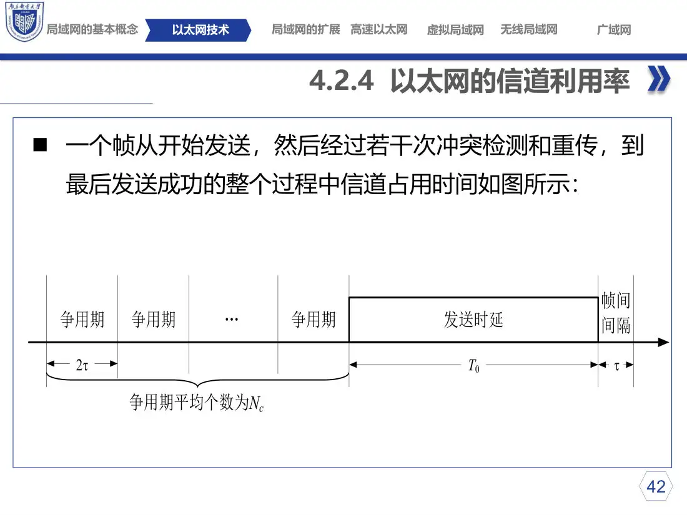

原文：

4.2.4 以太网的信道利用率

◼ 一个帧从开始发送，然后经过若干次冲突检测和重传，到最后发送成功的整个过程中信道占用时间如图所示：

<table><tr><td>争用期</td><td>争用期</td><td>...</td><td>争用期</td><td>发送时延</td><td>帧间间隔</td></tr><tr><td>2τ</td><td></td><td></td><td></td><td>T0</td><td>τ</td></tr><tr><td colspan="6">争用期平均个数为Nc</td></tr></table>

南志郵電大學Nanjing U

局域网的基本概念

以太网技术

局域网的扩展 高速以太网 虚拟局域网 无线局域网 广域网

42

### 4.2.4 以太网的信道利用率

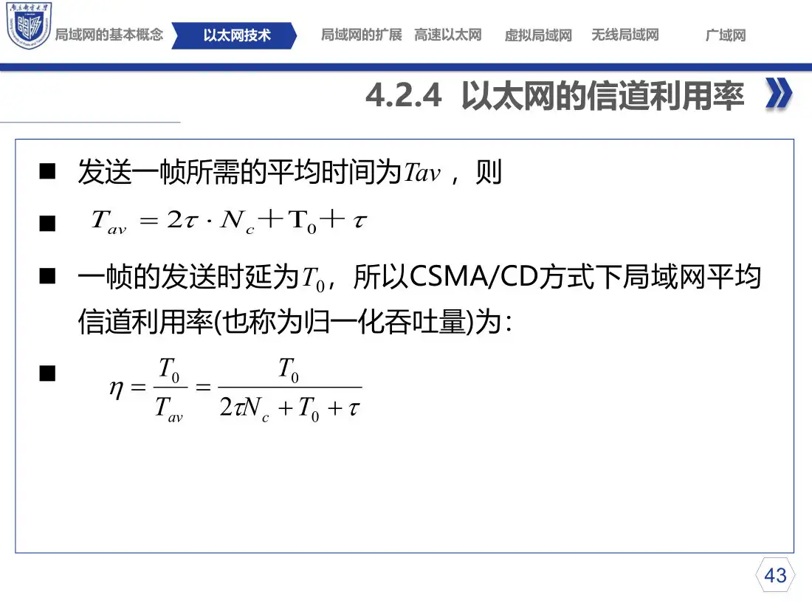

原文：

4.2.4 以太网的信道利用率

◼ 发送一帧所需的平均时间为 $T a \nu$ ，则

◼ $T _ { a \nu } = 2 \tau \cdot N _ { c } { + \mathrm { T } _ { 0 } } { + \tau }$

◼ 一帧的发送时延为 $T _ { 0 }$ ，所以CSMA/CD方式下局域网平均信道利用率(也称为归一化吞吐量)为：

$$
\eta = \frac {T _ {0}}{T _ {a v}} = \frac {T _ {0}}{2 \tau N _ {c} + T _ {0} + \tau}
$$

南志郵電大學Nanjing U

局域网的基本概念

以太网技术

局域网的扩展 高速以太网 虚拟局域网 无线局域网 广域网

43

### 4.2.4 以太网的信道利用率

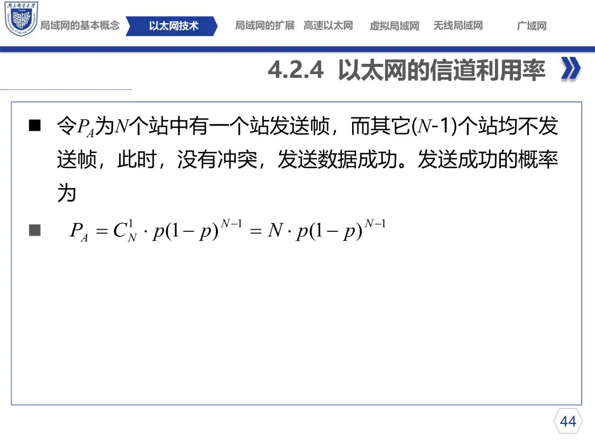

原文：

4.2.4 以太网的信道利用率

◼ 令 $P _ { A }$ 为N个站中有一个站发送帧，而其它(N-1)个站均不发送帧，此时，没有冲突，发送数据成功。发送成功的概率为

◼ $P _ { \cal A } = C _ { \cal N } ^ { 1 } \cdot p ( 1 - p ) ^ { N - 1 } = N \cdot p ( 1 - p ) ^ { N - 1 }$

南志郵電大學Nanjing U

局域网的基本概念

以太网技术

局域网的扩展 高速以太网 虚拟局域网 无线局域网 广域网

44

### 4.2.4 以太网的信道利用率

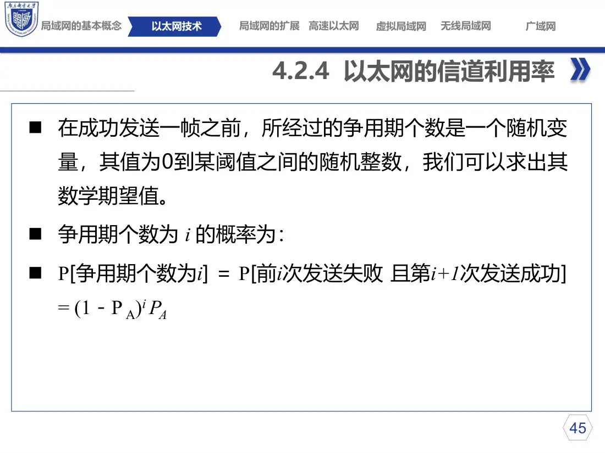

原文：

4.2.4 以太网的信道利用率

◼ 在成功发送一帧之前，所经过的争用期个数是一个随机变量，其值为0到某阈值之间的随机整数，我们可以求出其数学期望值。

争用期个数为 i 的概率为：

◼ P[争用期个数为i] = P[前i次发送失败 且第i+1次发送成功] $= ( 1 - \mathrm { \bf P } _ { \mathrm { \tiny ~ A } } ) ^ { i } P _ { A }$

南志郵電大學Nanjing U

局域网的基本概念

以太网技术

局域网的扩展 高速以太网 虚拟局域网 无线局域网 广域网

45

### 4.2.4 以太网的信道利用率

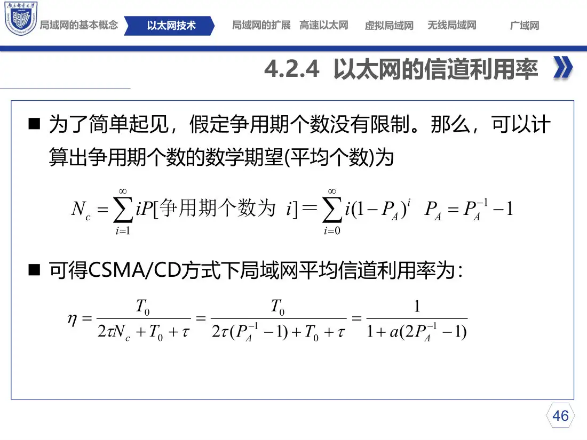

原文：

4.2.4 以太网的信道利用率

◼ 为了简单起见，假定争用期个数没有限制。那么，可以计算出争用期个数的数学期望(平均个数)为

$N _ { c } = \sum _ { i = 1 } ^ { \infty } i P [$ 争用期个数为 $i ] = \sum _ { i = 0 } ^ { \infty } i ( 1 - P _ { _ A } ) ^ { i } P _ { _ A } = P _ { _ A } ^ { - 1 } - 1$

◼ 可得CSMA/CD方式下局域网平均信道利用率为：

$$
\eta = \frac {T _ {0}}{2 \tau N _ {c} + T _ {0} + \tau} = \frac {T _ {0}}{2 \tau (P _ {A} ^ {- 1} - 1) + T _ {0} + \tau} = \frac {1}{1 + a (2 P _ {A} ^ {- 1} - 1)}
$$

南志郵電大學Nanjing U

局域网的基本概念

以太网技术

局域网的扩展 高速以太网 虚拟局域网 无线局域网 广域网

46

### 4.2.4 以太网的信道利用率

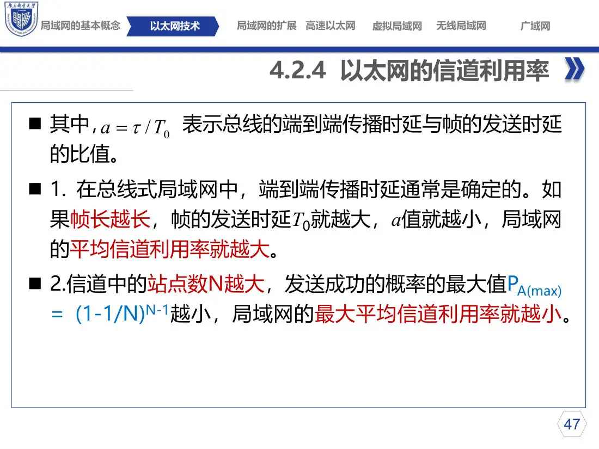

原文：

4.2.4 以太网的信道利用率

◼ 其中， $a = \tau / T _ { 0 }$ 表示总线的端到端传播时延与帧的发送时延的比值。

◼ 1. 在总线式局域网中，端到端传播时延通常是确定的。如果帧长越长，帧的发送时延 $T _ { 0 }$ 就越大，a值就越小，局域网的平均信道利用率就越大。

◼ 2.信道中的站点数N越大，发送成功的概率的最大值 $\mathsf { P } _ { \mathsf { A ( m a x ) } }$ $= ( 1 - 1 / \mathsf { N } ) ^ { \mathsf { N } - 1 }$ 越小，局域网的最大平均信道利用率就越小。

南志郵電大學Nanjing U

局域网的基本概念

以太网技术

局域网的扩展 高速以太网 虚拟局域网 无线局域网 广域网

47

### 4.2.4 以太网的信道利用率

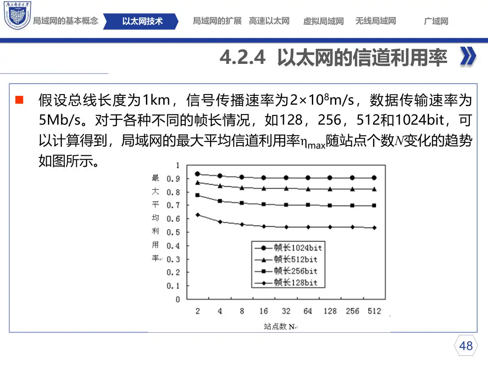

原文：

4.2.4 以太网的信道利用率

◼ 假设总线长度为1km，信号传播速率为 $2 \times 1 0 ^ { 8 } \mathsf { m } / s$ ，数据传输速率为5Mb/s。对于各种不同的帧长情况，如128，256，512和1024bit，可以计算得到，局域网的最大平均信道利用率 $\boldsymbol \eta _ { \mathrm { m a x } }$ 随站点个数N变化的趋势如图所示。

南志郵電大學Nanjing U

局域网的基本概念

以太网技术

局域网的扩展 高速以太网 虚拟局域网 无线局域网 广域网

48

### 4.2.5 以太网的连接方法

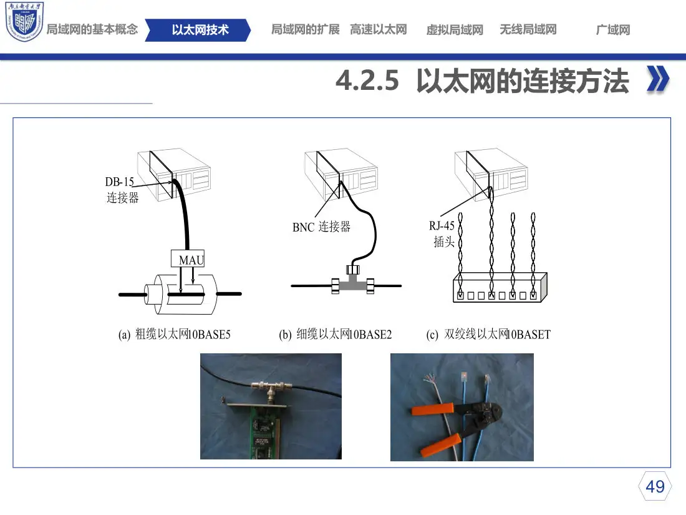

原文：

4.2.5 以太网的连接方法

南志郵電大學Nanjing U ayofpe

局域网的基本概念

以太网技术

局域网的扩展 高速以太网 虚拟局域网 无线局域网 广域网

49

### 4.2.5 以太网的连接方法

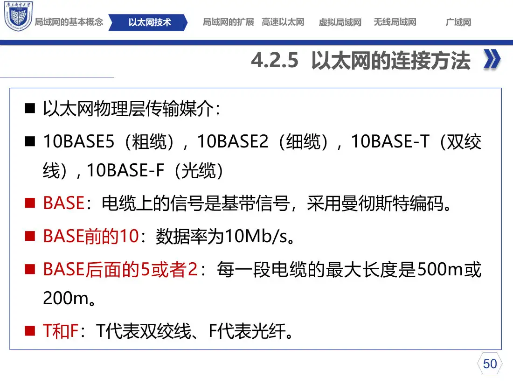

原文：

4.2.5 以太网的连接方法

◼ 以太网物理层传输媒介：

◼ 10BASE5（粗缆）, 10BASE2（细缆）, 10BASE-T（双绞线）, 10BASE-F（光缆）

◼ BASE：电缆上的信号是基带信号，采用曼彻斯特编码。

◼ BASE前的10：数据率为10Mb/s。

◼ BASE后面的5或者2：每一段电缆的最大长度是500m或200m。

◼ T和F：T代表双绞线、F代表光纤。

南志郵電大學Nanjing U ayofpe

局域网的基本概念

以太网技术

局域网的扩展 高速以太网 虚拟局域网 无线局域网 广域网

50

### 过渡页 T r a n s i t i o n P a g e

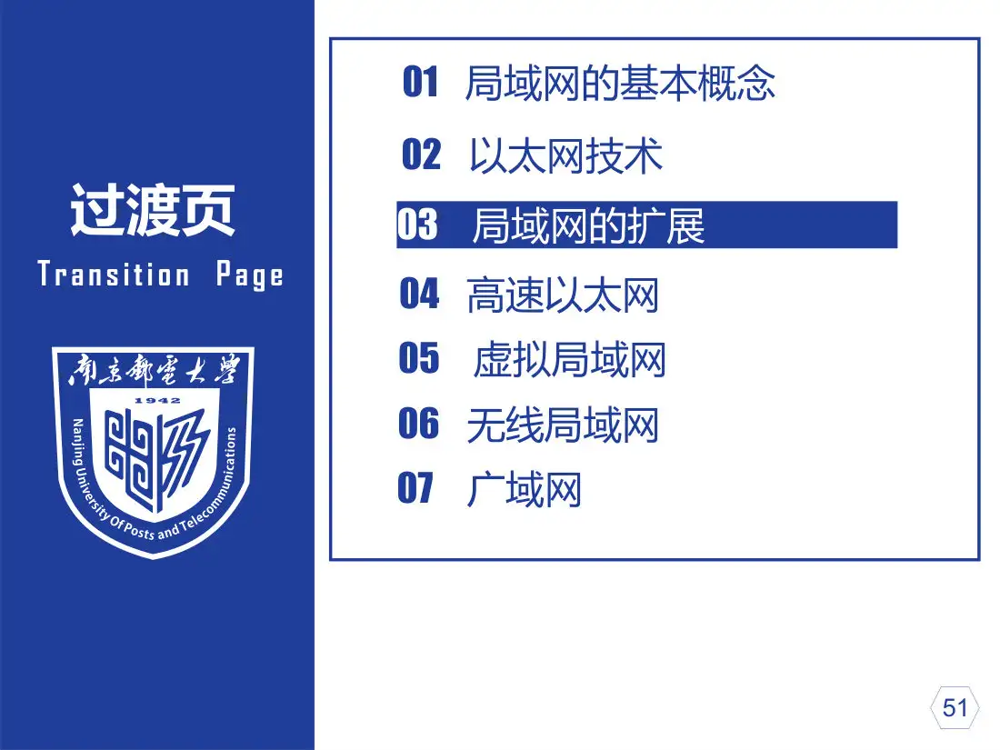

原文：

过渡页 T r a n s i t i o n P a g e

01 局域网的基本概念
02 以太网技术
03 局域网的扩展
04 高速以太网
05 虚拟局域网
06 无线局域网
07 广域网

51

### 在物理层扩展局域网

原文：

在物理层扩展局域网

在数据链路层扩展局域网

南立都電大學Naning

局域网的基本概念 以太网技术

局域网的扩展 高速以太网 虚拟局域网 无线局域网 广域网

》

52

### 4.3 局域网的扩展

原文：

4.3 局域网的扩展

◼ 一个单位可能拥有多个局域网，当需要实现局域网之间的通信时，要将局域网进行连接或扩展。这种扩展的局域网在网络层看来仍然是一个网络。

◼ 当期望将多个局域网连接成一个更大的局域网时，就需要对局域网进行扩展。可以在物理层扩展，也可以在数据链路层扩展。

南志郵電大學Nanjing U ayofpe

局域网的基本概念 以太网技术

局域网的扩展 高速以太网 虚拟局域网 无线局域网 广域网

53

### 物理层扩展

原文：

物理层扩展

4.3.1 在物理层扩展局域网

◼ 用集线器在物理层扩展局域网，扩大了局域网覆盖的地理范围，使不同部门局域网的计算机可以相互通信。但需要注意的是，用集线器连接起来的局域网构成了一个更大的冲突域，最大总吞吐量并没有提高。

南志郵電大學Nanjing U ayofpe

局域网的基本概念 以太网技术

局域网的扩展

高速以太网 虚拟局域网 无线局域网 广域网

54

### 链路层扩展

原文：

链路层扩展

4.3.2 在数据链路层扩展局域网

◼ 当连接多个不同类型的局域网时，就需要在数据链路层扩展局域网，使用的设备为网桥。

◼ 网桥工作在数据链路层，它根据 MAC 帧的目的地址对收到的帧进行转发。

◼ 网桥具有过滤帧的功能。当网桥收到一个帧时，并不是向所有的端口转发此帧，而是先检查此帧的目的 MAC 地址，然后再确定将该帧转发到哪一个端口。

南立都電大學Naning

局域网的基本概念 以太网技术

局域网的扩展

高速以太网 虚拟局域网 无线局域网 广域网

55

### 网桥的原理

原文：

网桥的原理

4.3.2 在数据链路层扩展局域网

◼ 最简单的网桥有两个端口。网桥的每个端口与一个局域网网段相连。

◼ 网桥的工作原理图：

南立都電大學Naning

局域网的基本概念 以太网技术

局域网的扩展

高速以太网 虚拟局域网 无线局域网 广域网

56

### 网桥的原理

原文：

网桥的原理

4.3.2 在数据链路层扩展局域网

◼ 图中，网桥有两个端口，端口1与网段A连接，端口2与网段B连接。

◼ 网桥从端口接收网段上传送的各种帧。每当收到一个帧时，就先暂存在其缓存中。若此帧未出现差错，且欲发往的目的站MAC地址属于另—个网段，则通过查找转发表，将收到的帧送往对应的端口转发出去。若该帧出现差错，则丢弃此帧。

南志郵電大學Nanjing U ayofpe

局域网的基本概念 以太网技术

局域网的扩展

高速以太网 虚拟局域网 无线局域网 广域网

57

### 链路层扩展

原文：

链路层扩展

4.3.2 在数据链路层扩展局域网

使用网桥扩展局域网的优点：

◼ 过滤通信量。网桥工作在链路层的MAC子层，可以使局域网各网段成为隔离开的冲突域，从而减轻了扩展的局城网上的负荷。

◼ 扩大了物理范围，因而也增加了整个局域网上工作站的最大数目。

◼ 提高了可靠性。当网络出现故障时，一般只影响个别网段。

◼ 可互连不同物理层、不同MAC子层和不同速率(如10Mb/s和100Mb/s以太网)的局域网。

南立都電大學Naning

局域网的基本概念 以太网技术

局域网的扩展 高速以太网 虚拟局域网 无线局域网 广域网

58

### 链路层扩展

原文：

链路层扩展

4.3.2 在数据链路层扩展局域网

使用网桥扩展局域网的缺点：

◼ 由于网桥对接收的帧要先存储和查找转发表，导致转发时延增加。

◼ 在MAC子层没有流量控制功能。当负荷很重时，会产生帧丢失的现象。

◼ 具有不同MAC子层的网段桥接在一起时，协议转换增加处理时延。

◼ 网桥只适合于规模不太大的局域网，否则有时还会因传播过多的广播信息而产生网络拥塞。

南立都電大學Naning

局域网的基本概念 以太网技术

局域网的扩展 高速以太网 虚拟局域网 无线局域网 广域网

59

### 透明网桥

原文：

透明网桥

4.3.2 在数据链路层扩展局域网

◼ 目前使用得最多的网桥是透明网桥。

◼ “透明”是指局域网上的站点并不知道所发送的帧将经过哪几个网桥，因为网桥对各站来说是看不见的。

◼ 透明网桥是一种即插即用设备，其标准是 IEEE 802.1D。

◼ 网桥在刚刚连接到局域网上时，其转发表是空的。若网桥收到一个帧，它将按照以下算法处理该帧和建立起自己的转发表：

南立都電大學Naning

局域网的基本概念 以太网技术

局域网的扩展 高速以太网 虚拟局域网 无线局域网 广域网

60

### 透明网桥

原文：

透明网桥

4.3.2 在数据链路层扩展局域网

(1) 从端口x收到无差错的帧(如有差错即丢弃)，在转发表中查找目的站MAC地址。

(2) 如有，则查找出到此MAC地址应当走的端口d，然后进行(3)，否则转到(5)。

(3) 如到这个MAC地址去的端口d=x，则丢弃此帧(因为这表示不需要经过网桥进行转发)。否则从端口d转发此帧。

(4) 转到(6)。

南志郵電大學Nanjing U

局域网的基本概念 以太网技术

局域网的扩展 高速以太网 虚拟局域网 无线局域网 广域网

61

### 透明网桥

原文：

透明网桥

4.3.2 在数据链路层扩展局域网

(5) 向网桥除x以外的所有端口转发此帧(这样做可保证找到目的站)。

(6) 如源站不在转发表中，则将源站MAC地址加入到转发表，登记该帧进入网桥的端口号，设置计时器。然后转到(8)。如源站在转发表中，则执行(7)。

(7) 更新计时器。

(8) 等待新的数据帧。转到(1)。

南志郵電大學Nanjing U

局域网的基本概念 以太网技术

局域网的扩展 高速以太网 虚拟局域网 无线局域网 广域网

62

### 透明网桥

原文：

透明网桥

4.3.2 在数据链路层扩展局域网

◼ 网桥在转发表中登记以下三个信息：

① 站地址：登记收到的帧的源 MAC 地址。

② 端口：登记收到的帧进入该网桥的端口号。

③ 时间：登记收到的帧进入该网桥的时间。

◼ 转发表中的 MAC 地址是根据源 MAC 地址写入的，但在进行转发时是将此 MAC 地址当作目的地址。

◼ 原理：如果网桥现在能够从端口 x 收到从源地址 A 发来的帧，那么以后就可以从端口 x 将帧转发到目的地址 A。

南志郵電大學Nanjing U ayofpe

局域网的基本概念 以太网技术

局域网的扩展 高速以太网 虚拟局域网 无线局域网 广域网

63

### 透明网桥

原文：

透明网桥

4.3.2 在数据链路层扩展局域网

◼ 为了实现负载平衡，通常使用多个透明网桥将两个局域网连接起来，这会形成闭合回路。

◼ 为了避免转发的帧在网络中不断地兜圈子，透明网桥采用支撑树算法，使得互连在一起的网桥在进行彼此通信后，就能找出原来的网络拓扑的一个子集，在这个子集里整个连通的网络中不存在回路。

南志郵電大學Nanjing U ayofpe

局域网的基本概念 以太网技术

局域网的扩展

高速以太网 虚拟局域网 无线局域网 广域网

64

### 源路由网桥

原文：

源路由网桥

4.3.2 在数据链路层扩展局域网

◼ 源路由网桥是一种由发送帧的源站负责路由选择的网桥。

◼ 源站在发送帧时将详细的路由信息放在帧的首部中。源站以广播方式向欲通信的目的站发送一个发现帧，以找到合适的路由。

◼ 发现帧将在整个扩展的局域网中沿着所有可能的路由传送。在传送过程中，每个发现帧都记录所经过的路由。当这些发现帧到达目的站时，就沿着各自的路由返回源站。源站在得知这些路出后，从所有可能的路由中选择出一个最佳路由。

南立都電大學Naning

局域网的基本概念 以太网技术

局域网的扩展

高速以太网 虚拟局域网 无线局域网 广域网

65

### 源路由网桥

原文：

源路由网桥

4.3.2 在数据链路层扩展局域网

◼ 源路由网桥的缺点：缺乏透明性。主机必须知道网桥的标识以及连接到哪一个网段上。

◼ 优点：使用源路由网桥可以利用最佳路由。若在两个局域网之间使用并联的源路由网桥，则可使通信量较平均地分配给每一个网桥，从而能在不同的链路中进行负载均衡。

南立都電大學Naning

局域网的基本概念 以太网技术

局域网的扩展

高速以太网 虚拟局域网 无线局域网 广域网

66

### 多端口网桥

原文：

多端口网桥

4.3.2 在数据链路层扩展局域网

◼ 多端口的网桥也称为以太网交换机、交换式集线器、第二层交换机。工作在数据链路层，与集线器相比可明显地提高局域网的性能。

◼ 每个端口都直接与主机或另一个集线器相连，并且一般都工作在全双工方式。当主机需要通信时，交换机能同时连通许多对的端口，进行无冲突地传输数据。由于使用了专用的交换结构芯片，因此，以太网交换机具有较高的吞吐率。

南志郵電大學Nanjing U ayofpe

局域网的基本概念 以太网技术

局域网的扩展

高速以太网 虚拟局域网 无线局域网 广域网

67

### 多端口网桥

原文：

多端口网桥

4.3.2 在数据链路层扩展局域网

◼ 对于普通 10 Mb/s 的共享式以太网，若共有 N 个用户，则每个用户占有的平均带宽只有总带宽(10 Mb/s)的 N 分之一。

◼ 使用以太网交换机时，虽然在每个端口到主机的带宽还是10 Mb/s，由于一个用户在通信时是独占而不是和其他网络用户共享传输媒体的带宽，因此对于拥有 N 对端口的交换机总容量为 2N×10 Mb/s。这正是交换机的最大优点。

南志郵電大學Nanjing U

局域网的基本概念 以太网技术

局域网的扩展

高速以太网 虚拟局域网 无线局域网 广域网

68

### 多端口网桥

原文：

多端口网桥

4.3.2 在数据链路层扩展局域网

◼ 以太网交换机的工作方式有三种，即：直通交换方式，存储转发方式，和无碎片交换方式。

◼ （1）直通交换方式不必将整个数据帧先缓存后再进行处理，而是在接收数据帧的同时就立即按数据帧的目的MAC地址决定该帧的转发端口，因而提高了帧的转发速度。如果在这种变换机的内部采用基于硬件的交叉矩阵，交换时延非常小。缺点是它不检查差错就直接将帧转发出去，因此有可能转发一些差错帧或碎片帧。

高速以太网 虚拟局域网 无线局域网 广域网

南志郵電大學Nanjing U ayofpe

局域网的基本概念 以太网技术

局域网的扩展

69

### 多端口网桥

原文：

多端口网桥

4.3.2 在数据链路层扩展局域网

◼ （2）存储转发方式需要将帧完全接收和缓存下来，进行帧校验，然后根据帧头部的目的MAC地址进行转发。

◼ 利用存储转发机制，网管员可以定义过滤算法来控制交换机的通信量，实现速率不同两个端口间信息传输。

◼ 缺点：传输延迟大（随帧的长度而变化），缓存是有限的，当负荷增大时会引起阻塞现象。

局域网的扩展 高速以太网 虚拟局域网 无线局域网 广域网

南志郵電大學Nanjing U ayofpe

局域网的基本概念 以太网技术

70

### 多端口网桥

原文：

多端口网桥

4.3.2 在数据链路层扩展局域网

◼ （3）无碎片交换方式实际上是直通方式的一种改进，要求交换机只有在收到64字节（最短帧长）以后才开始以直通方式转发帧，从而避免转发碎片帧。

◼ 缺点：有可能会转发差错帧（未检查FCS）

南志郵電大學Nanjing U

局域网的基本概念 以太网技术

局域网的扩展 高速以太网 虚拟局域网 无线局域网 广域网

71

### 过渡页 T r a n s i t i o n P a g e

原文：

过渡页 T r a n s i t i o n P a g e

01 局域网的基本概念
02 以太网技术
03 局域网的扩展
04 高速以太网
05 虚拟局域网
06 无线局域网
07 广域网

72

### 100BASE-T以太网

原文：

100BASE-T以太网

千兆以太网

万兆以太网

虚拟局域网 无线局域网 广域网

南志郵電大學Nanjing U

局域网的基本概念 以太网技术 局域网的扩展

高速以太网

》

73

### 4.4 高速局域网

原文：

4.4 高速局域网

◼ 随着技术的发展，以太网支持的数据传输速率越来越高，速率在100Mb/s及以上的以太网一般称为高速以太网，如：

◼ 100BASE-T以太网

◼ 千兆以太网

◼ 万兆以太网（10Gbit/s以太网）

南志郵電大學Nanjing U

局域网的基本概念 以太网技术 局域网的扩展

高速以太网

虚拟局域网 无线局域网 广域网

74

### 基本概念

原文：

基本概念

4.4.1 100BASE-T 以太网

◼ 100BASE-T是在双绞线上传送100Mb/s基带信号的星型拓扑以太网，仍使用IEEE 802.3的CSMA/CD协议，它又称为快速以太网(Fast Ethernet)。

◼ 1995年IEEE将100BASE-T的快速以太网制定为正式的国际标准 IEEE 802.3u，是对现行的802.3标准的补充。快速以太网的标准得到了所有的主流网络厂商的支持。

◼ 100BASE-T以太网交换式集线器可以全双工方式工作，而无冲突发生。

高速以太网 虚拟局域网 无线局域网 广域网

南志郵電大學Nanjing U

局域网的基本概念 以太网技术 局域网的扩展

75

### 特点

原文：

特点

4.4.1 100BASE-T 以太网

◼ 100BASE-T以太网可以由10BASE-T以太网直接升级，方法是将原有的网卡和集线器更换为100Mb/s速率的，而不必改变网络的拓扑结构。

◼ 性能是10BASE-T的10倍，帧间间隔缩短到原来的1/10，由9.6us改为0.96us。

◼ 为了保持最短帧长64字节不变，将最大电缆长度减小到100m。

◼ 快速以太网标准只支持双绞线和光缆连接，不支持同轴电缆。规定了三种物理层标准。

高速以太网 虚拟局域网 无线局域网 广域网

南志郵電大學Nanjing U ayofpe

局域网的基本概念 以太网技术 局域网的扩展

76

### 三种物理层标准

原文：

三种物理层标准

4.4.1 100BASE-T 以太网

◼ 100Base-TX，使用 2 对 5类UTP电缆，其中一对用于发送，另一对用于接收，信号采用多电平编码方法（例如MLT-3）；

◼ 100Base-FX，使用2根光纤，其中一根用于发送，另一根用于接收，信号采用4B/5B-NRZI编码，单模光纤最大传输距离10km,多模光纤的最大传输距离是2km;

◼ 100Base-T4，使用4对3类或5类UTP电缆，信号采用8B6T-NRZ的编码方法。

高速以太网 虚拟局域网 无线局域网 广域网

南志郵電大學Nanjing U ayofpe

局域网的基本概念 以太网技术 局域网的扩展

77

### 基本概念

原文：

基本概念

4.4.2 千兆以太网

◼ 千兆以太网又称为吉比特以太网，于1996年问世。

◼ IEEE在1997年通过了吉比特以太网的标准 IEEE 802.3z，在1998年成为正式标准。特点是：

✓ 允许在1Gb/s下全双工和半双工两种方式工作；

✓ 使用IEEE 802.3 规定的帧格式；

✓ 在半双工方式下使用CSMA/CD协议(全双工方式不需要使用CSMA/CD协议)；

✓ 向后兼容10BASE-T和100BASE-T技术。

◼ 吉比特以太网规定了两个物理层标准。

南志郵電大學Nanjing U

局域网的基本概念 以太网技术 局域网的扩展

高速以太网

虚拟局域网 无线局域网 广域网

78

### 1000Base-X

原文：

1000Base-X

4.4.2 千兆以太网

◼ 1000Base-X 即 IEEE 802.3z，是基于光纤通道的物理层，即FC-0和FC-1。使用的媒体有三种：

① 1000BASE-SX SX表示短波长 (使用850nm激光器)。使用纤芯直径为62.5μm和50μm的多模光纤时，传输距离分别为275m和550m。

② 1000BASE-LX LX表示长波长(使用1300nm激光器)。使用纤芯直径为62.5μm和50μm的多模光纤时，传输距离为550m。使用纤芯直径为10μm 的单模光纤时，传输距离为5km。

③ 1000BASE-CX CX表示铜线。使用两对短距离的屏蔽双绞线电缆，传输距离为25m。

南志郵電大學Nanjing U

局域网的基本概念 以太网技术 局域网的扩展

高速以太网

虚拟局域网 无线局域网 广域网

79

### 1000Base-T

原文：

1000Base-T

4.4.2 千兆以太网

◼ 1000Base-T 即 IEEE 802.3ab，使用4对5类无屏蔽双绞线UTP，传输距离为100m。

◼ 吉比特以太网工作在半双工方式时，必须进行冲突检测，采用CSMA/CD控制方式。由于数据率提高了，因此只有减小最大电缆长度或增大帧的最小长度，才能使参数a保持为较小的数值，以保持较好的工作效率。

南志郵電大學Nanjing U ayofpe

局域网的基本概念 以太网技术 局域网的扩展

高速以太网

虚拟局域网 无线局域网 广域网

80

### 1000Base-T

原文：

1000Base-T

4.4.2 千兆以太网

◼ 在半双工方式时，吉比特以太网仍然保持一个网段的最大长度为100m，但采用了“载波延伸”(carrier extension)的办法，使最短帧长仍为64字节，以保持兼容性，同时将争用期长度增大为512字节。凡发送的MAC帧长不足512字节时，就用一些特殊字符填充在帧的后面，使MAC帧的发送长度增大到512字节。

◼ 在短MAC帧后面加上载波延伸：

<table><tr><td>前同步码</td><td>目地地址</td><td>源地址</td><td>数据长度</td><td>数据</td><td>FCS</td><td>载波延伸</td></tr><tr><td rowspan="2"></td><td colspan="6">MAC 帧的最小值=64 字节</td></tr><tr><td colspan="6">加上载波延伸使MAC 帧长度=争用期长度512字节</td></tr></table>

南志郵電大學Nanjing U

局域网的基本概念 以太网技术 局域网的扩展

高速以太网

虚拟局域网 无线局域网 广域网

81

### 1000Base-T

原文：

1000Base-T

4.4.2 千兆以太网

◼ 接收端在收到以太网的MAC帧后，删除填充字符并交付。当原来仅64字节长的短帧填充到512字节时，所填充的448字节就造成了很大的开销。

◼ 为此，吉比特以太网还增加一种功能称为分组突发(packetbursting)。当很多短帧要发送时，第一个短帧用载波延伸填充。随后的短帧之间只需留有必要的帧间最小间隔。

南志郵電大學Nanjing U

局域网的基本概念 以太网技术 局域网的扩展

高速以太网

虚拟局域网 无线局域网 广域网

82

### 1000Base-T

原文：

1000Base-T

4.4.2 千兆以太网

◼ 当吉比特以太网工作在全双工下方式时，不需要使用冲突检测，也不使用载波延伸和分组突发。

南志郵電大學Nanjing U

局域网的基本概念 以太网技术 局域网的扩展

高速以太网 虚拟局域网 无线局域网 广域网

83

### 特点

原文：

特点

4.4.3 万兆以太网

◼ 万兆以太网又称10吉比特以太网、10GE，由 IEEE 802.3ae委员会在2002年6月完成标准制定。特点如下：

◼ 帧格式与10Mb/s、100 Mb/s 和千兆以太网的帧格式完全相同。并且保留了IEEE 802.3标准规定的以太网最小和最大帧长，具有较好的向后兼容性。

◼ 只使用光纤作为传输媒体。使用支持长距离(超过40km，可工作在广域网和城域网的范围)的光收发器与单模光纤接口。也可使用较便宜的多模光纤，但传输距离为65～300m。

◼ 只工作在全双工方式，因此不存在争用问题，也不使用CSMA/CD协议。传输距离不再受进行冲突检测的限制而大大提高了。

南志郵電大學Nanjing U

局域网的基本概念 以太网技术 局域网的扩展

高速以太网

虚拟局域网 无线局域网 广域网

84

### 过渡页 T r a n s i t i o n P a g e

原文：

过渡页 T r a n s i t i o n P a g e

01 局域网的基本概念
02 以太网技术
03 局域网的扩展
04 高速以太网
05 虚拟局域网
06 无线局域网
07 广域网

85

### 虚拟局域网的概念

原文：

虚拟局域网的概念

虚拟局域网的工作原理

南志郵電大學Nanjing U ayofpe

局域网的基本概念 以太网技术 局域网的扩展 高速以太网

虚拟局域网 无线局域网 广域网

》

86

### 4.5.1 虚拟局域网的概念

原文：

4.5.1 虚拟局域网的概念

◼ 虚拟局域网（VLAN）是在现有局域网上提供的划分逻辑组的一种服务，由IEEE 802.1Q标准进行了规定。

◼ 虚拟局域网是由一些局域网网段构成的与物理位置无关的逻辑组，而这些网段具有某些共同的需求。

◼ 每一个VLAN的帧都有一个不同的标识符，指明发送这个帧的工作站是属于哪一个VLAN。

◼ 利用以太网交换机可以很方便地实现虚拟局域网VLAN。

◼ 1988年IEEE批准了IEEE 802.3ac标准，该标准定义了以太网的帧格式的扩展，以便支持虚拟局域网。

南志郵電大學Nanjing U ayofpe

局域网的基本概念 以太网技术 局域网的扩展 高速以太网

虚拟局域网 无线局域网 广域网

87

### 4.5.2 工作原理

原文：

4.5.2 工作原理

◼ 通过在以大网的帧格式中插入一个称为VLAN标记的4字节标识符，用来指明发送该帧的工作站属于哪一个虚拟局域网，实现逻辑组的划分。

◼ 虚拟局域网对MAC帧的扩展：

南志郵電大學Nanjing U

局域网的基本概念 以太网技术 局域网的扩展 高速以太网

虚拟局域网 无线局域网 广域网

88

### 4.5.2 工作原理

原文：

4.5.2 工作原理

◼ 标记字段插在MAC帧的源地址字段和长度类型字段之间。

◼ VLAN标记的前两个字节和原来的长度类型字段的作用—样，但它总是设置为0x8100(这个数值大于0x0600，因此不是代表长度)，称为802.1Q标记类型。

◼ 当数据链路层检测到MAC帧的源地址字段后面的长度/类型字段的值是0x8100时，就知道现在插入了4字节的VLAN标记。于是就接着检查后两个字节的内容。

◼ 后两个字节中，包括优先级字段、规范格式指示符、VLAN标识符。帧最大长度变为1522字节。

南志郵電大學Nanjing U ayofpe

局域网的基本概念 以太网技术 局域网的扩展 高速以太网

虚拟局域网 无线局域网 广域网

89

### 示例

原文：

示例

4.5.2 工作原理

南志郵電大學Nanjing U ayofpe

局域网的基本概念 以太网技术 局域网的扩展 高速以太网

虚拟局域网 无线局域网 广域网

90

### 示例

原文：

示例

4.5.2 工作原理

◼ 利用交换式集线器即以太网交换机可以很方便地将这9个工作站划分为三个虚拟局域网：VLAN1，VLAN2和VLAN3。即：VLAN1：(A1，A2，A3)， VLAN2：(B1，B2，B3)，VLAN3：(C1，C2，C3)。

◼ 这些被划分在同一个虚拟局域网中的计算机，与具体物理位置无关，也不一定与同一台交换机相连。

南志郵電大學Nanjing U

局域网的基本概念 以太网技术 局域网的扩展 高速以太网

虚拟局域网 无线局域网 广域网

91

### 过渡页 T r a n s i t i o n P a g e

原文：

过渡页 T r a n s i t i o n P a g e

01 局域网的基本概念
02 以太网技术
03 局域网的扩展
04 高速以太网
05 虚拟局域网
06 无线局域网
07 广域网

92

### 无线局域网的概念

原文：

无线局域网的概念

无线局域网的物理层

无线局域网的MAC层

南志郵電大學Nanjing U

局域网的基本概念 以太网技术 局域网的扩展 高速以太网 虚拟局域网

无线局域网

广域网

》

93

### 基本概念

原文：

基本概念

4.6.1 无线局域网的概念

◼ 无线局域网是以无线方式实现局部范围内的多台计算机相互通信的一种局域网技术。

◼ 随着便携式计算机和智能手机的广泛应用，无线局域网能 更好地满足人们移动办公需求，正受到越来越多的关注。

◼ 1997年IEEE制订出无线局域网的系列标准IEEE 802.11，相应的国际标准为ISO/IEC 8802-11。

无线局域网可分为两大类。第一类是有固定基础设施的，第二类是无固定基础设施的。所谓“固定基础设施”是指预先部署的一批基站（接入点）。

南立都電大學Naning

局域网的基本概念 以太网技术 局域网的扩展 高速以太网 虚拟局域网

无线局域网

广域网

94

### 有固定基础设施

原文：

有固定基础设施

4.6.1 无线局域网的概念

◼ 在有固定基础设施的无线局域网中，802.11标准规定无线局域网的最小构件是基本服务集。

◼ 一个基本服务集BSS包括一个基站和若干个移动站。一个基本服务集BSS所覆盖的地理范围叫作一个基本服务区BSA。

◼ 基本服务集里面的基站叫做接入点AP，但其作用和网桥相似。一个基本服务集可以是孤立的，也可通过接入点连接到一个主干分配系统，然后再接入到另一个基本服务集，这样就构成了一个扩展的服务集ESS。

南志郵電大學Nanjing U ayofpe

局域网的基本概念 以太网技术 局域网的扩展 高速以太网 虚拟局域网

无线局域网

广域网

95

### 有固定基础设施

原文：

有固定基础设施

4.6.1 无线局域网的概念

◼ 扩展的服务集ESS

南立都電大學Naning

局域网的基本概念 以太网技术 局域网的扩展 高速以太网 虚拟局域网

无线局域网

广域网

96

### 无固定基础设施

原文：

无固定基础设施

4.6.1 无线局域网的概念

◼ 无固定基础设施的无线局域网，它又叫作移动自组网络(adhoc network)。

◼ 这种自组网络没有上述基本服务集中的接入点AP，而是由一些处于平等状态的移动站之间相互通信组成的临时网络。

◼ 这些移动站相互之间作为彼此的中继。

南志郵電大學Nanjing U

局域网的基本概念 以太网技术 局域网的扩展 高速以太网 虚拟局域网

无线局域网

广域网

97

### 无固定基础设施

原文：

无固定基础设施

4.6.1 无线局域网的概念

◼ 当移动站A和E通信时，经过A→F→D→E这样的存储转发过程。自组网中的移动站既是端系统，又可作为中继。

◼ 移动自组网络在军用和民用领域都有很好的应用前景。在军事领域中，携带了移动站的战士就可以利用临时建立的移动自组网络进行通信。在民用领域，人们可以利用便携式电脑组成移动自组网络，方便地交换信息，而不受网线和插头的限制。

南立都電大學Naning

局域网的基本概念 以太网技术 局域网的扩展 高速以太网 虚拟局域网

无线局域网

广域网

98

### 基本概念

原文：

基本概念

4.6.2 无线局域网的物理层

◼ IEEE 802.11标准于1997年制订了第一部分，叫做802.11。在1999年又制订了剩下的两部分，即802.11a和802.11b。

◼ 无线局域网技术发展迅猛，支持高速无线网的标准相继问世，如802.11g, 802.11n等。

◼ 802.11的物理层有以下三种实现方法：

① 跳频扩频 FHSS

② 直接序列扩频 DSSS

③ 红外线 IR

南志郵電大學Nanjing U

局域网的基本概念 以太网技术 局域网的扩展 高速以太网 虚拟局域网

无线局域网

广域网

99

### CSMA/CA协议

原文：

CSMA/CA协议

4.6.3 无线局域网的MAC层

◼ 无线局域网采用载波监听多路访问/冲突避免（CSMA/CA）协议，不适宜采用有线局域网的CSMA/CD协议。这是因为无线局域网具有以下特点：

① 无线终端的处理能力相对较弱，不适合采用边发送边检测冲突的方式。即使发送方检测不到冲突，接收端仍然有可能发生冲突；

② 无线信号强度的动态范围非常大，发送站无法使用冲突检测的方法来确定是否发生了冲突；

③ 无线局域网中存在隐蔽站问题和暴露站问题。

南志郵電大學Nanjing U

局域网的基本概念 以太网技术 局域网的扩展 高速以太网 虚拟局域网

无线局域网

广域网

100

### 隐蔽站问题

原文：

隐蔽站问题

4.6.3 无线局域网的MAC层

◼ 假设站A和C都想和B通信，但A和C相距较远，彼此都接收不到对方发送的信号。当A和C检测不到无线信号时，就都以为B是空闲的，因而都向B发送自己的数据。结果B同时收到A和C发来的数据，发生了冲突。这种未能检测出媒体上已存在信号的问题叫做隐蔽站问题。

101

南志郵電大學Nanjing U

局域网的基本概念 以太网技术 局域网的扩展 高速以太网 虚拟局域网

无线局域网

广域网

### 隐蔽站问题

原文：

隐蔽站问题

4.6.3 无线局域网的MAC层

◼ 假设站B向A发送数据，而C又想和D通信。但C检测到媒体上有信号，于是就不会向D发送数据。其实B向A发送数据并不影响C向D发送数据。这就是暴露站问题。

◼ 在无线局域网中，在不发生干扰的情况下，可允许同时多个移动站进行通信，这点与总线式局域网有很大的差别。

南志郵電大學Nanjing U ayofpe

局域网的基本概念 以太网技术 局域网的扩展 高速以太网 虚拟局域网

无线局域网

广域网

102

### CSMA/CA

原文：

CSMA/CA

4.6.3 无线局域网的MAC层

◼ 无线局域网采用的是CSMA/CA协议是在CSMA基础上增加了冲突避免和确认机制，用以确定在基本服务集中的移动站在什么时间能发送数据或接收数据。802.11的MAC层功

能如图：

南志郵電大學Nanjing U

局域网的基本概念 以太网技术 局域网的扩展 高速以太网 虚拟局域网

无线局域网

广域网

### CSMA/CA

原文：

CSMA/CA

4.6.3 无线局域网的MAC层

◼ IEEE 802.11的MAC层在物理层的上面，包括两个子层。

◼ 下面的一个子层是分布协调功能DCF。DCF在每一个结点使用CSMA机制的分布式接入算法，让各个站通过争用信道来获取发送权。因此DCF向上提供争用服务。

◼ 另一个子层叫做点协调功能PCF。PCF使用集中控制的接入算法，—般在接入点AP中实现，用类似于探询的方法将发送数据权轮流交给各个站，从而避免了冲突的产生。

南志郵電大學Nanjing U

局域网的基本概念 以太网技术 局域网的扩展 高速以太网 虚拟局域网

无线局域网

广域网

104

### CSMA/CA

原文：

CSMA/CA

4.6.3 无线局域网的MAC层

◼ 标准规定，所有的站在完成发送后，必须再等待一段很短的时间才能发送下一帧，这段时间称为帧间间隔。

◼ 帧间间隔的长短取决于该站打算发送的帧的类型。高优先级帧需要等待的时间较短，因此可优先获得发送权，而低优先级帧就必须等待较长的时间。

◼ 有以下三种常用的帧间间隔：

① SIFS，即短(Short)帧间间隔

② PIFS，即点协调功能帧间间隔

③ DIFS，即分布协调功能帧间间隔

南志郵電大學Nanjing U

局域网的基本概念 以太网技术 局域网的扩展 高速以太网 虚拟局域网

无线局域网

广域网

105

### CSMA/CA

原文：

CSMA/CA

4.6.3 无线局域网的MAC层

◼ CSMA/CA协议的工作原理

南志郵電大學Nanjing U

局域网的基本概念 以太网技术 局域网的扩展 高速以太网 虚拟局域网

无线局域网

广域网

106

### CSMA/CA

原文：

CSMA/CA

4.6.3 无线局域网的MAC层

◼ IEEE 802.11标准还采用了一种叫做虚拟载波监听机制，就是让源站将它要占用信道的时间(包括目的站发回确认帧所需的时间)通知给所有其他站，以便使其他所有站在这一段时间都停止发送数据。这样就大大减少了冲突。

◼ “虚拟载波监听”表示其他站并没有监听信道，而是由于其他站收到了“源站的通知”才不发送数据。

◼ “源站的通知”就是源站在其MAC帧首部中的第二个字段”持续时间”中填入了在本帧结束后还要占用信道多少时间(以微秒为单位)，包括目的站发送确认帧所需的时间。

南志郵電大學Nanjing U

局域网的基本概念 以太网技术 局域网的扩展 高速以太网 虚拟局域网

无线局域网

广域网

107

### 对信道进行预约

原文：

对信道进行预约

4.6.3 无线局域网的MAC层

◼ IEEE 802.11允许要发送数据的站对信道进行预约。

◼ 站A在发送数据帧之前先发送一个短的控制帧，叫做请求发送RTS(Request To Send)。RTS帧包括源地址、目的地址和这次通信(包括相应的确认帧)所需的持续时间。

◼ 若信道空闲，则目的站B就发送一个响应控制帧，叫做允许发送CTS(Clear To Send)，CTS也包括这次通信所需的持续时间。

◼ A收到CTS帧后就可发送其数据帧。

南立都電大學Naning

局域网的基本概念 以太网技术 局域网的扩展 高速以太网 虚拟局域网

无线局域网

广域网

108

### 4.6.3 无线局域网的MAC层

原文：

4.6.3 无线局域网的MAC层

对信道进行预约

◼ CSMA/CA协议的RTS和CTS帧：

南志郵電大學Nanjing U

局域网的基本概念 以太网技术 局域网的扩展 高速以太网 虚拟局域网

无线局域网

广域网

109

### 对信道进行预约

原文：

对信道进行预约

4.6.3 无线局域网的MAC层

◼ 虽然协议经过了精心设计，但冲突仍然会发生。

◼ 例如，B和C同时向A发送RTS帧。这两个RTS帧发生冲突后，使得A收不到正确的RTS帧因而A就不会发送后续的CTS帧。这时，B和C像以太网发生冲突那样，各自随机地推迟一段时间后重新发送其RTS帧。

◼ 推迟时间的算法也是使用二进制指数退避。

南立都電大學Naning

局域网的基本概念 以太网技术 局域网的扩展 高速以太网 虚拟局域网

无线局域网

广域网

110

### 过渡页 T r a n s i t i o n P a g e

原文：

过渡页 T r a n s i t i o n P a g e

01 局域网的基本概念
02 以太网技术
03 局域网的扩展
04 高速以太网
05 虚拟局域网
06 无线局域网
07 广域网

111

### 广域网的基本概念

原文：

广域网的基本概念
广域网中的分组交换
X.25分组交换网
帧中继
异步传递方式ATM

南志郵電大學Nanjing U

局域网的基本概念 以太网技术 局域网的扩展 高速以太网 虚拟局域网 无线局域网

广域网

### 概念

原文：

概念

4.7.1 广域网的基本概念

◼ 广域网是用来实现长距离传输数据的网络，由节点交换机和链路构成。

◼ 广域网中的结点交换机一般采用存储转发方式，而广域网中的链路一般采用点到点链路。

◼ 广域网指的是单个网络，它与用路由器互联起来的互联网具有很大的区别。

◼ 当把广域网作为一个独立的网络来考察时，它具有物理层、数据链路层和网络层的功能。

广域网

南志郵電大學Nanjing U ayofpe

局域网的基本概念 以太网技术 局域网的扩展 高速以太网 虚拟局域网 无线局域网

113

### 概念

原文：

概念

4.7.1 广域网的基本概念

◼ 随着广域网应用场合不同，对广域网的层次定位具有一定的灵活性。当用来支撑互联网时，则广域网可以被看成数据链路层为网络层提供数据传输服务。

◼ 我们将把广域网作为一个独立的网络来考虑。因此，从层次上看，广域网中的最高层为网络层。

◼ 广域网的网络层为主机所提供的服务可以有两大类：即无连接的网络服务和面向连接的网络服务，具体地说，就是数据报服务和虚电路服务。

南志郵電大學Nanjing U ayofpe

局域网的基本概念 以太网技术 局域网的扩展 高速以太网 虚拟局域网 无线局域网

广域网

114

### 数据报服务

原文：

数据报服务

4.7.1 广域网的基本概念

特点:

◼ 在数据报服务情况下，网络随时都可接受主机发送的分组(即数据报)。

◼ 网络为每个分组独立地选择路由。

◼ 网络只是尽最大努力地将分组交付给目的主机，网络交付的分组不保证顺序，不保证不丢失。

◼ 数据报服务：不可靠，不能保证服务质量。

广域网

南立都電大學Naning

局域网的基本概念 以太网技术 局域网的扩展 高速以太网 虚拟局域网 无线局域网

115

### 虚电路服务

原文：

虚电路服务

4.7.1 广域网的基本概念

特点:

◼ 在虚电路服务情况下，通信的一方先发出一个特定格式的控制信息分组（连接建立请求），请求进行通信，同时也寻找一条合适的路由。

◼ 若另一方同意通信就发回响应，然后双方就建立了虚电路并可传送数据了。

◼ 虚电路服务：需要一个连接建立、数据传输、连接释放的过程。

广域网

南立都電大學Naning

局域网的基本概念 以太网技术 局域网的扩展 高速以太网 虚拟局域网 无线局域网

116

### 虚电路服务

原文：

虚电路服务

4.7.1 广域网的基本概念

◼ 由于采用了存储转发技术，所以广域网中的虚电路服务就和传统的电路交换的连接有很大的不同。

◼ 虚电路服务是建立在分组交换基础上的。当用一条虚电路进行通信时，分组断续地占用一段又一段的链路，物理链路被动态复用。

◼ 建立虚电路的优点是可以在数据传送路径上的各交换结点上预留一定数量的资源(如带宽、缓存)。因此，虚电路服务对服务质量QoS有较好的保证。

南立都電大學Naning

局域网的基本概念 以太网技术 局域网的扩展 高速以太网 虚拟局域网 无线局域网

广域网

117

### 两种服务的比较

原文：

两种服务的比较

4.7.1 广域网的基本概念

◼ 数据报服务和虚电路服务的比较：

<table><tr><td>特点</td><td>数据报服务</td><td>虚电路服务</td></tr><tr><td>思路</td><td>可靠通信应由用户主机来保证</td><td>可靠通信应由网络来保证</td></tr><tr><td>连接的建立</td><td>不需要</td><td>必须有</td></tr><tr><td>目的站地址</td><td>每个分组都有目的站的全地址</td><td>仅在连接建立阶段使用,每个分组使用短的虚电路号</td></tr><tr><td>分组的转发</td><td>每个分组独立进行路由、转发</td><td>属于同一虚电路的所有分组均按照同一路由进行转发</td></tr><tr><td>当结点出故障时</td><td>出故障的结点可能会丢失分组,后续分组将改变路由</td><td>所有通过出故障结点的虚电路均不能工作</td></tr><tr><td>分组的顺序</td><td>不一定按发送顺序到达目的站</td><td>总是按发送顺序到达目的站</td></tr><tr><td>端到端的差错处理和流量控制</td><td>由用户主机负责</td><td>可以由网络负责,也可以由用户主机负责</td></tr></table>

广域网

南立都電大學Naning

局域网的基本概念 以太网技术 局域网的扩展 高速以太网 虚拟局域网 无线局域网

118

### 4.7.2 广域网中的分组交换

原文：

4.7.2 广域网中的分组交换

广域网中的分组交换技术主要包括两个方面：

◼ 编址---层次结构的编址

◼ 路由---分组转发与路由机制

南立都電大學Naning

局域网的基本概念 以太网技术 局域网的扩展 高速以太网 虚拟局域网 无线局域网

广域网

119

### 层次结构的地址

原文：

层次结构的地址

4.7.2 广域网中的分组交换

◼ 广域网中一般采用层次结构的编址方案，将主机地址分为两部分。

◼ 前一部分表示该主机所连接的分组交换机的编号，而后—部分表示所连接的分组交换机的端口号，或主机的编号。

<table><tr><td>交换机编号</td><td>交换机端口编号</td></tr></table>

◼ 例如，与交换机1的端口1和端口3相连的两个主机的地址就分别记为[1，1]和[1，3]。

南志郵電大學Nanjing U ayofpe

局域网的基本概念 以太网技术 局域网的扩展 高速以太网 虚拟局域网 无线局域网

广域网

120

### 分组转发机制

原文：

分组转发机制

4.7.2 广域网中的分组交换

◼ 广域网中的分组交换机在接收到一个分组时，查找分组交换机中的转发表，确定应该转向的下一跳。

◼ 给定一个网络拓扑，假设分组交换机已经配置了相应的转发表条目。

<table><tr><td>目的站</td><td>下一跳</td></tr><tr><td>[1, 1]</td><td>交换机1</td></tr><tr><td>[1, 3]</td><td>交换机1</td></tr><tr><td>[3, 2]</td><td>交换机3</td></tr><tr><td>[3, 3]</td><td>交换机3</td></tr><tr><td>[2, 1]</td><td>直接</td></tr><tr><td>[2, 2]</td><td>直接</td></tr></table>

广域网

南志郵電大學Nanjing U ayofpe

局域网的基本概念 以太网技术 局域网的扩展 高速以太网 虚拟局域网 无线局域网

121

### 分组转发机制

原文：

分组转发机制

4.7.2 广域网中的分组交换

◼ 假设有一个欲发往主机[3，3]的分组到达了交换机2。在转发表的第4行找出下一跳应为“交换机3”。于是按照转发表将该分组转发到交换机3。

南志郵電大學Nanjing U

局域网的基本概念 以太网技术 局域网的扩展 高速以太网 虚拟局域网 无线局域网

广域网

122

### 分组转发机制

原文：

分组转发机制

4.7.2 广域网中的分组交换

◼ 如果分组的目的地是直接连接在本交换机上的主机，则不需要再将分组转发到别的交换机，而只需要直接交付。

◼ 在查找转发表时，所有交换机号相同的分组其下一跳地址必定是相同的。

◼ 交换机是根据目的站的交换机号来进行路由转发的。利用这一特性，可以大大减少转发表的条目数。

广域网

南立都電大學Naning

局域网的基本概念 以太网技术 局域网的扩展 高速以太网 虚拟局域网 无线局域网

123

### 默认路由

原文：

默认路由

4.7.2 广域网中的分组交换

◼ 为了更清晰地分析广域网路由问题，用图论中的“图”来对广域网进行抽象。

◼ 用“节点”表示广域网上的节点交换机。

◼ 用连接节点与节点的“边”表示广域网中的链路。

广域网

南立都電大學Naning

局域网的基本概念 以太网技术 局域网的扩展 高速以太网 虚拟局域网 无线局域网

124

### 默认路由

原文：

默认路由

4.7.2 广域网中的分组交换

◼ 下图左边是一个具有4个结点交换机的示例，而右边则是对应的图的抽象。图中节点表示交换机，圆圈中的数字就是节点交换机号，连接两节点的边表示连接交换机的链路。

◼ 根据图的连接特性可得出每一个结点中的转发表。

广域网

南志郵電大學Nanjing U

局域网的基本概念 以太网技术 局域网的扩展 高速以太网 虚拟局域网 无线局域网

125

### 4.7.2 广域网中的分组交换

原文：

4.7.2 广域网中的分组交换

转发表

南志郵電大學Nanjing U ayofpe

局域网的基本概念 以太网技术 局域网的扩展 高速以太网 虚拟局域网 无线局域网

广域网

126

### 默认路由

原文：

默认路由

4.7.2 广域网中的分组交换

◼ 以结点1的转发表为例，当目的站为2，3或4时，分组都是转发到节点3，因此，可以将这些具有相同下一跳的条目合并，写成“目的站：默认，下一跳：3”。

广域网

南志郵電大學Nanjing U

局域网的基本概念 以太网技术 局域网的扩展 高速以太网 虚拟局域网 无线局域网

127

### 默认路由

原文：

默认路由

4.7.2 广域网中的分组交换

◼ 用一个默认路由代替所有的具有相同“下一跳”的项目，目的是减少下一跳相同的重复表项数目，缩短搜索转发表时花费的时间。

◼ 默认路由比其他项目的优先级低。若转发分组时找不到明确的项目对应，才使用默认路由。

广域网

南立都電大學Naning

局域网的基本概念 以太网技术 局域网的扩展 高速以太网 虚拟局域网 无线局域网

128

### 基本概念

原文：

基本概念

4.7.3 X.25分组交换网

◼ CCITT在上个世纪70年代制订了公用分组交换网接口的建议，即X.25标准。

◼ 遵循X.25标准设计的网络为X.25分组交换网，简称X.25网。

◼ X.25标准制订了面向连接的虚电路服务的服务规范，主要对公用分组交换网的接口进行了定义。

广域网

南志郵電大學Nanjing U ayofpe

局域网的基本概念 以太网技术 局域网的扩展 高速以太网 虚拟局域网 无线局域网

129

### 基本概念

原文：

基本概念

4.7.3 X.25分组交换网

◼ X.25网络示意图

◼ X.25接口表示数据终端设备DTE与数据电路端接设备DCE之间的接口。

广域网

南志郵電大學Nanjing U

局域网的基本概念 以太网技术 局域网的扩展 高速以太网 虚拟局域网 无线局域网

130

### 基本概念

原文：

基本概念

4.7.3 X.25分组交换网

◼ X.25标准规定了物理层、数据链路层和分组层三个层次的内容。

◼ 最底层是物理层，接口标准是X.21建议书。

◼ 第二层是数据链路层，接口是平衡型链路接入规程LAPB。

◼ 第三层是分组层，在该层，DTE与DCE之间可建立多条逻辑信道(0～4095号)。

南志郵電大學Nanjing U

局域网的基本概念 以太网技术 局域网的扩展 高速以太网 虚拟局域网 无线局域网

广域网

131

### 基本概念

原文：

基本概念

4.7.3 X.25分组交换网

◼ X.25还规定了在经常需要进行通信的两个DTE之间可以建立永久虚电路。

◼ X.25网的分组层向高层提供面向连接的虚电路服务，能保证服务质量。在网络链路带宽不高、误码率较高的情况下，X.25网络具有很大的优势。

◼ 随着链路带宽大大增加和误码率大大降低，X.25复杂的数据链路层协议和分组层协议的功能显得冗余。

◼ 随着端系统功能增强，流量控制和差错控制功能可以置于端系统，从而简化网络处理，提高网络分组转发的效率。

广域网

南志郵電大學Nanjing U ayofpe

局域网的基本概念 以太网技术 局域网的扩展 高速以太网 虚拟局域网 无线局域网

132

### 基本概念

原文：

基本概念

4.7.4 帧中继

◼ 帧中继(Frame Relay)采用快速分组交换技术，是对X.25网络的改进，被称为第二代的X.25，于1992年问世。

◼ 帧中继网络提供虚电路服务，可以用来为互联网提供具有相对高速率的链路。

广域网

南志郵電大學Nanjing U ayofpe

局域网的基本概念 以太网技术 局域网的扩展 高速以太网 虚拟局域网 无线局域网

133

### 基本原理

原文：

基本原理

4.7.4 帧中继

◼ 采用快速分组交换技术

◼ 当帧中继交换机收到一个帧的首部时，只要一查出帧的目的地址就立即开始转发该帧，边接收边转发，从而提高了交换结点即帧中继交换机的吞吐率。

◼ 当帧中继交换机接收完一帧时，再进行差错校验，如果检测到有误码，结点要立即中止这次传输。当中止传输的指示到达下个结点后．下个结点也立即中止该帧的传输，并丢弃该帧。

◼ 在误码率极低的情况下，帧中继技术具有很大的优势。

广域网

南立都電大學Naning

局域网的基本概念 以太网技术 局域网的扩展 高速以太网 虚拟局域网 无线局域网

134

### 工作过程（1）

原文：

工作过程（1）

4.7.4 帧中继

◼ 当局域MAC帧传到与帧中继网络相连接的路由器时，该路由器就剥去MAC帧的首部，将IP数据报交给路由器的网络层。网络层再将IP数据报传给帧中继接口卡。

◼ 帧中继接口卡将IP数据报加以封装，加上帧中继帧的首部(其中包括帧中继的虚电路号)，进行CRC检验和加上帧中继帧的尾部。然后帧中继接口卡将封装好的帧通过租用专线发送给帧中继网络中的帧中继交换机。

广域网

南志郵電大學Nanjing U ayofpe

局域网的基本概念 以太网技术 局域网的扩展 高速以太网 虚拟局域网 无线局域网

135

### 工作过程（2）

原文：

工作过程（2）

4.7.4 帧中继

◼ 帧中继交换机在收到一个帧时，就按虚电路号对帧进行转发(若检查出有差错则丢弃)。

◼ 当这个帧被转发到虚电路的终点路由器时，该路由器剥去帧中继帧的首部和尾部，加上局域网的首部和尾部，交付给连接在此局域网上的目的主机。目的主机若发现有差错，则报告上层的TCP协议处理。

南志郵電大學Nanjing U

局域网的基本概念 以太网技术 局域网的扩展 高速以太网 虚拟局域网 无线局域网

广域网

136

### 优点

原文：

优点

4.7.4 帧中继

◼ 减少了网络互连的代价。

◼ 网络的复杂性减少，提高了性能。

◼ 使用了国际标准，增加了互操作性。

◼ 协议的独立性。

南立都電大學Naning

局域网的基本概念 以太网技术 局域网的扩展 高速以太网 虚拟局域网 无线局域网

137

### 基本概念

原文：

基本概念

4.7.5 异步传递方式

◼ 异步传递方式ATM(Asynchronous Transfer Mode)是建立在电路交换和分组交换的基础上的—种面向连接的快速分组交换技术，

◼ 采用定长分组作为传输和交换的单位。这种定长分组叫做信元。ATM采用的定长信元长度为53字节，信元首部为5字节，有利于用硬件实现高速交换。

◼ “异步”的含义是指ATM信元可“异步插入”到同步的SDH比特流中。

广域网

南志郵電大學Nanjing U

局域网的基本概念 以太网技术 局域网的扩展 高速以太网 虚拟局域网 无线局域网

138

### 基本概念

原文：

基本概念

4.7.5 异步传递方式

◼ 一个ATM网络包括两种网络元素，即ATM端点和ATM交换机。

◼ ATM端点即能够产生或接收信元的源站或目的站。ATM端点通过点到点链路与ATM交换机相连。

◼ ATM交换机就是一个快速分组交换机，其主要构件包括交换结构，若干个高速输入端口和输出端口、以及必要的缓存。

广域网

南志郵電大學Nanjing U ayofpe

局域网的基本概念 以太网技术 局域网的扩展 高速以太网 虚拟局域网 无线局域网

139

### ATM标准

原文：

ATM标准

4.7.5 异步传递方式

◼ ATM标准主要由ITU-T、ATM论坛以及IETF等参与制订，规定了ATM网络的协议参考模型。

广域网

南志郵電大學Nanjing U

局域网的基本概念 以太网技术 局域网的扩展 高速以太网 虚拟局域网 无线局域网

140

### 物理层

原文：

物理层

4.7.5 异步传递方式

◼ ATM参考模型的最底层是物理层。

◼ 物理层又分为两个子层。靠下面的是物理媒体相关子层（PMD）。PMD子层的上面是传输汇聚子层（TC）。

广域网

南志郵電大學Nanjing U

局域网的基本概念 以太网技术 局域网的扩展 高速以太网 虚拟局域网 无线局域网

141

### 物理层

原文：

物理层

4.7.5 异步传递方式

◼ PMD子层：负责在物理媒体上正确传输和接收比特流。它完成只和媒体相关的功能，如线路编码和解码、比特定时以及光电转换等。

◼ TC子层：实现信元流和比特流的转换，包括速率适配(空闲信元的插入)、信元定界与同步、传输帧的产生与恢复等。

南志郵電大學Nanjing U ayofpe

局域网的基本概念 以太网技术 局域网的扩展 高速以太网 虚拟局域网 无线局域网

142

### ATM层

原文：

ATM层

4.7.5 异步传递方式

◼ ATM层主要完成交换和复用，以及流量控制等功能。

◼ 每一个ATM连接都用信元首部中的两级标号来识别。第一级标号是虚通路标识VCI，第二级标号是虚通道标识符VPI。

◼ 虚通路VC是在两个或两个以上的端点之间的一个运送ATM信元的通路。

◼ 虚通道VP包含有许多相同端点的虚通路，而这许多虚通路都使用同一个虚通道标识符VPI。

南立都電大學Naning

局域网的基本概念 以太网技术 局域网的扩展 高速以太网 虚拟局域网 无线局域网

143

### ATM层

原文：

ATM层

4.7.5 异步传递方式

◼ 在一个给定的接口上，属于不同VP的两个VC，可以具有相同的VCI。要同时使用VPI和VCI这两个参数才能完全识别一个虚通路VC。

◼ ATM连接的标识符VCI和VPI之间的关系：

南志郵電大學Nanjing U

局域网的基本概念 以太网技术 局域网的扩展 高速以太网 虚拟局域网 无线局域网

广域网

144

### ATM适配层（AAL）

原文：

ATM适配层（AAL）

4.7.5 异步传递方式

◼ AAL层的作用就是增强ATM层所提供的服务，并向上面高层提供各种不同的服务。

◼ ITU-T的I.362标准规定了AAL向上提供的服务包括：

◼ 将用户的应用数据单元划分为信元或将信元重装成为应用数据单元；

◼ 对比特差错进行检测和处理；

◼ 处理丢失和错误交付的信元；

◼ 流量控制和定时控制等功能。

广域网

南立都電大學Naning

局域网的基本概念 以太网技术 局域网的扩展 高速以太网 虚拟局域网 无线局域网

145

### ATM适配层（AAL）

原文：

ATM适配层（AAL）

4.7.5 异步传递方式

◼ ATM传送和交换的是53字节固定长度的信元。但是上层的应用程序向下层传递的并不是53字节长的信元。例如，在因特网的IP层传送的是各种长度的IP 数据报。因此当IP数据报需要在ATM网络上传送时，就需要有一个接口，它能够将IP数据报装入一个个ATM信元，然后在ATM网络中传送。这个接口由AAL层实现并负责分组拆装。

广域网

南志郵電大學Nanjing U

局域网的基本概念 以太网技术 局域网的扩展 高速以太网 虚拟局域网 无线局域网

146

### ATM适配层（AAL）

原文：

ATM适配层（AAL）

4.7.5 异步传递方式

◼ AAL层被划分为两个子层，即汇聚子层CS和拆装子层SAR。

◼ 汇聚子层CS：使ATM系统可以对不同的应用(如文件传送、点播视像等)提供不同的服务。

◼ 拆装子层SAR：在发送时，将CS子层传下来的协议数据单元划分成为长度为48字节的单元，交给ATM层作为信元的有效载荷。在接收时，SAR子层进行相反的操作，将ATM层交上来的48字节长的有效载荷装配成汇聚子层协议数据单元。

南志郵電大學Nanjing U ayofpe

局域网的基本概念 以太网技术 局域网的扩展 高速以太网 虚拟局域网 无线局域网

广域网

147

### Thank You

原文：

Thank You

H a v e A N i c e D a y

南京邮电大学通信与信息工程学院
