# 《计算机通信与网络》第5章 网络层与网络互连（课件）

原件的每一页，下面附识别出的文字。

### 第 1 页

原文：

计算机通信与网络Computer Communications & Networks第5章 网络层与网络互连

南京邮电大学通信与信息工程学院大纲要求R e q u i r e m e n t s

### 1 掌握IP协议的原理和工作机制

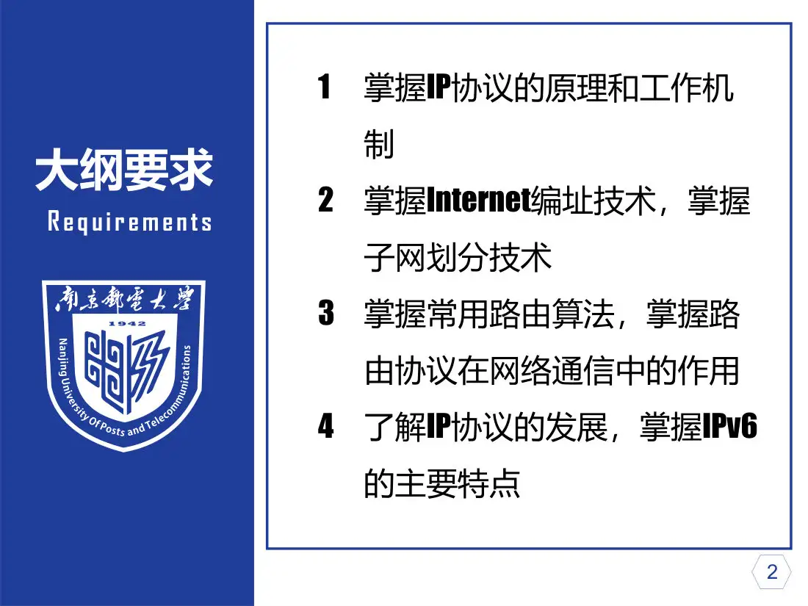

原文：

1 掌握IP协议的原理和工作机制

2 掌握Internet编址技术，掌握子网划分技术

3 掌握常用路由算法，掌握路由协议在网络通信中的作用

4 了解IP协议的发展，掌握IPv6的主要特点

2

### 内容纲要C o n t e n t s P a g e

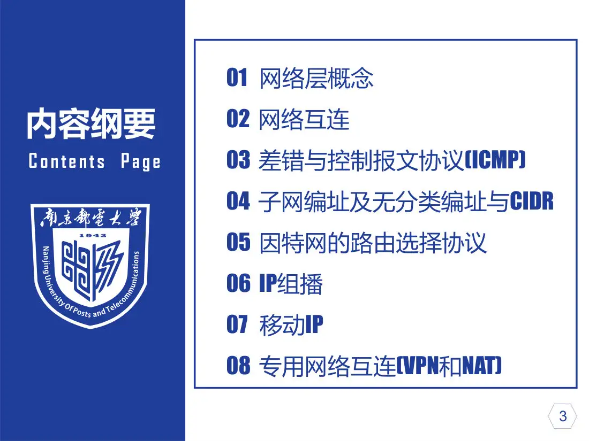

原文：

内容纲要C o n t e n t s P a g e

01 网络层概念
02 网络互连
03 差错与控制报文协议(ICMP)
04 子网编址及无分类编址与CIDR
05 因特网的路由选择协议
06 IP组播
07 移动IP
08 专用网络互连(VPN和NAT)

3

### 过渡页 T r a n s i t i o n P a g e

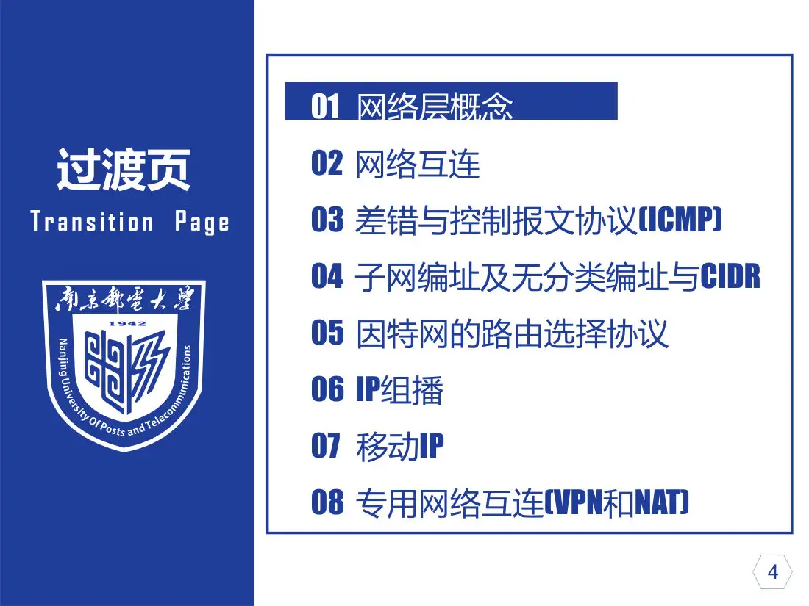

原文：

过渡页 T r a n s i t i o n P a g e

01 网络层概念
02 网络互连
03 差错与控制报文协议(ICMP)
04 子网编址及无分类编址与CIDR
05 因特网的路由选择协议
06 IP组播
07 移动IP
08 专用网络互连(VPN和NAT)

4

### 为什么需要网络互联

原文：

为什么需要网络互联

网络互联需要解决的问题

因特网的分层模型

南志執電大學

网络层概念

网络互连

ICMP IP编址技术 路由选择协议 IP组播 移动IP VPN和NAT

5

### 网络互联

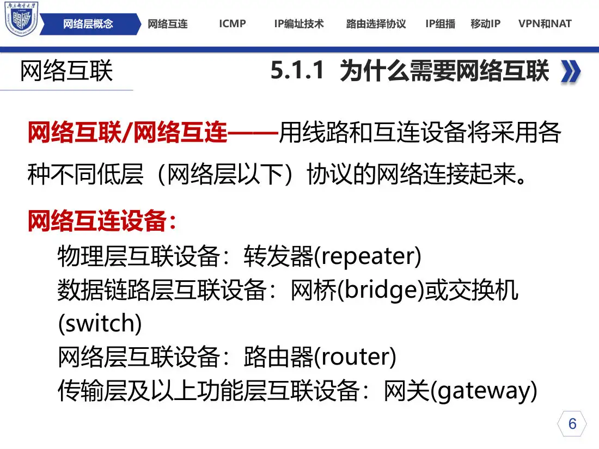

原文：

网络互联

5.1.1 为什么需要网络互联

网络互联/网络互连——用线路和互连设备将采用各种不同低层（网络层以下）协议的网络连接起来。

网络互连设备：

物理层互联设备：转发器(repeater)

数据链路层互联设备：网桥(bridge)或交换机

(switch)

网络层互联设备：路由器(router)

传输层及以上功能层互联设备：网关(gateway)

南志執電大學

网络层概念 网络互连 ICMP IP编址技术 路由选择协议 IP组播 移动IP VPN和NAT

6

### 5.1.1 为什么需要网络互联

原文：

5.1.1 为什么需要网络互联

在1970年代中期已存在大大小小相互独立的多种物理网络

已有的异种网络客观存在

没有哪种网络技术可以满足所有需求

全球范围的通信需求

各物理网络中的用户希望能够相互通信，不受物理网络边界限制

南志執電大學

网络层概念 网络互连 ICMP IP编址技术 路由选择协议 IP组播 移动IP VPN和NAT

### 网络互联的作用

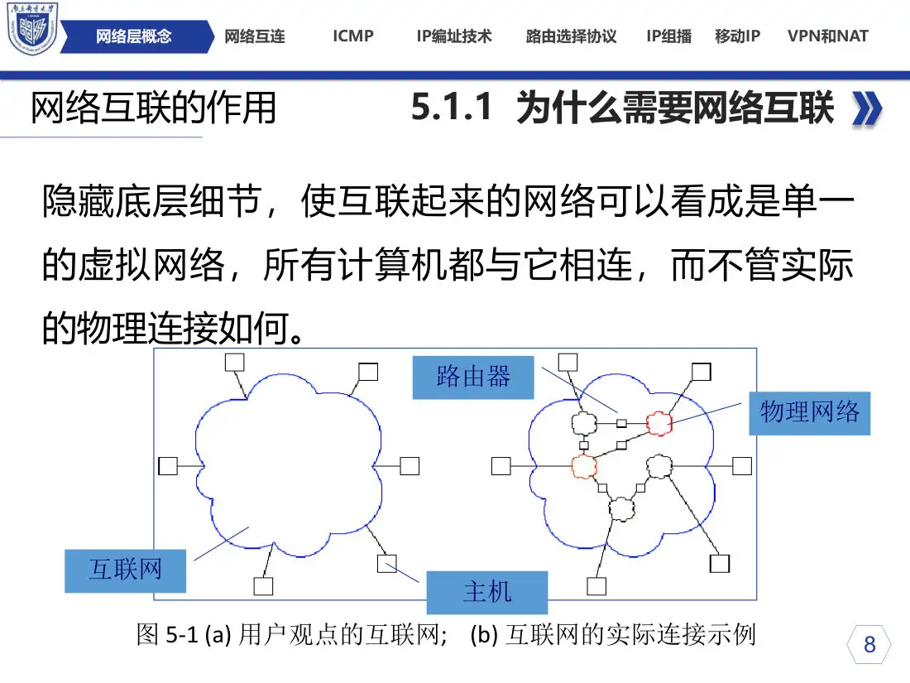

原文：

网络互联的作用

5.1.1 为什么需要网络互联

隐藏底层细节，使互联起来的网络可以看成是单一的虚拟网络，所有计算机都与它相连，而不管实际的物理连接如何。

南志執電大學

网络层概念

网络互连

ICMP

IP编址技术

路由选择协议

8

### 5.1.2 网络互联需要解决的问题

原文：

5.1.2 网络互联需要解决的问题

IP层主要功能是负责为不同物理网络上的主机提供通信服务。需要解决若干问题：

如何屏蔽异种网络的差异

统一网络地址

统一数据格式

如何实现全网的数据传输和交换

网络之间的数据包寻径、转发

路由表的产生和动态刷新

差错处理

在全网内的组播

南志執電大學

网络层概念 网络互连 ICMP IP编址技术 路由选择协议 IP组播 移动IP VPN和NAT

9

### 5.1.3 因特网的分层模型

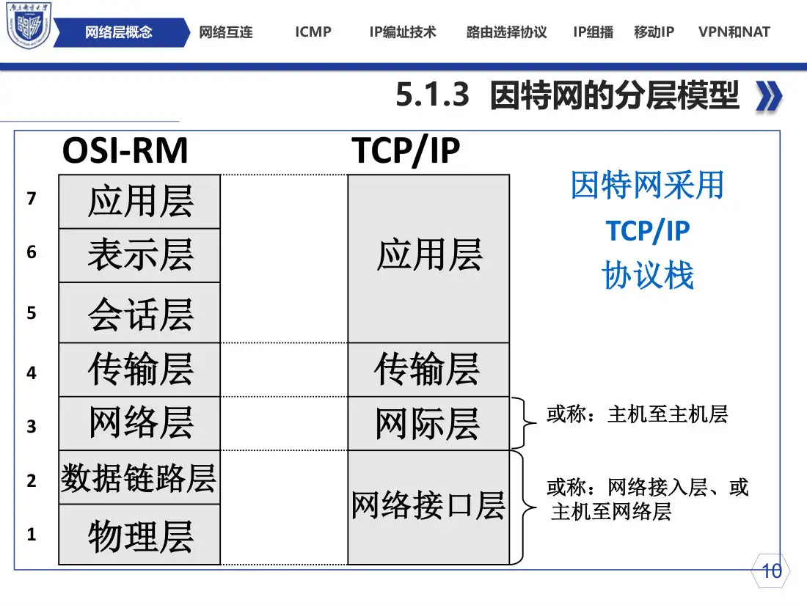

原文：

5.1.3 因特网的分层模型

南志執電大學

网络层概念 网络互连 ICMP IP编址技术 路由选择协议 IP组播 移动IP VPN和NAT

10

### 5.1.3 因特网的分层模型

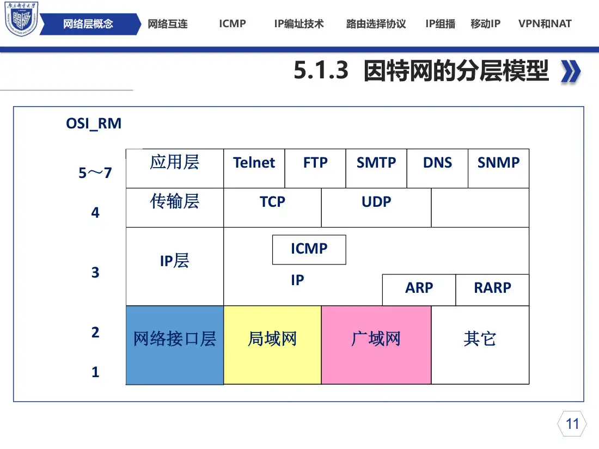

原文：

5.1.3 因特网的分层模型

<table><tr><td colspan="9">OSI_RM</td></tr><tr><td>5~7</td><td>应用层</td><td>Telnet</td><td colspan="2">FTP</td><td>SMTP</td><td colspan="2">DNS</td><td>SNMP</td></tr><tr><td>4</td><td>传输层</td><td colspan="2">TCP</td><td colspan="3">UDP</td><td colspan="2"></td></tr><tr><td rowspan="2">3</td><td rowspan="2">IP层</td><td colspan="7">ICMP</td></tr><tr><td colspan="4">IP</td><td colspan="2">ARP</td><td>RARP</td></tr><tr><td>2</td><td rowspan="2">网络接口层</td><td rowspan="2" colspan="2">局域网</td><td rowspan="2" colspan="3">广域网</td><td rowspan="2" colspan="2">其它</td></tr><tr><td>1</td></tr></table>

南志執電大學

网络层概念

网络互连

ICMP

IP编址技术 路由选择协议 IP组播 移动IP VPN和NAT

11

### 过渡页 T r a n s i t i o n P a g e

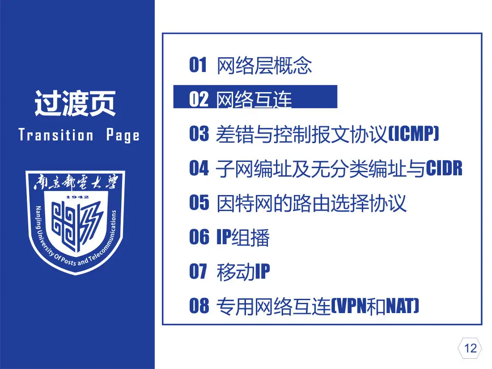

原文：

过渡页 T r a n s i t i o n P a g e

01 网络层概念

02 网络互连

03 差错与控制报文协议(ICMP)

04 子网编址及无分类编址与CIDR

05 因特网的路由选择协议

06 IP组播

07 移动IP

08 专用网络互连(VPN和NAT)

12

### 分类的IP地址

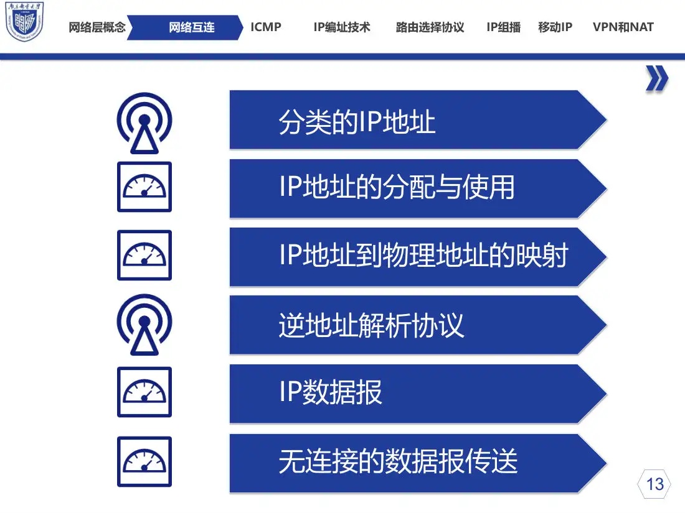

原文：

分类的IP地址

IP地址的分配与使用

IP地址到物理地址的映射

逆地址解析协议

IP数据报

无连接的数据报传送

IP组播

南志執電大學

网络层概念

网络互连

ICMP

IP编址技术

路由选择协议

13

### 网络互连

原文：

网络互连

因特网IP层的服务是一个尽最大努力传送的、不可靠、无连接的数据报存储转发系统。

支持TCP/IP软件隐藏物理网络细节，使构成的互联网看起来是一个统一实体的基础：IP编址和IP数据报。

南志郵電大學Nanjing Un

网络层概念

网络互连

ICMP

IP编址技术 路由选择协议 IP组播 移动IP VPN和NAT

14

### 5.2.1 分类的IP地址

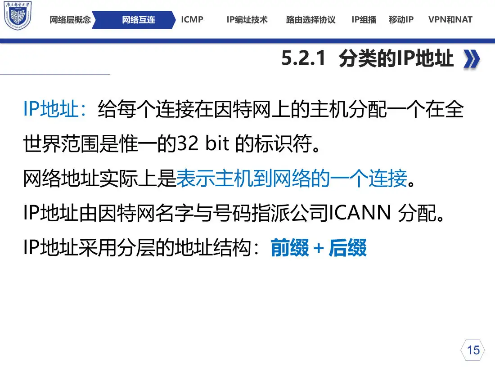

原文：

5.2.1 分类的IP地址

IP地址：给每个连接在因特网上的主机分配一个在全世界范围是惟一的32 bit 的标识符。

网络地址实际上是表示主机到网络的一个连接。

IP地址由因特网名字与号码指派公司ICANN 分配。

IP地址采用分层的地址结构：前缀＋后缀

网络层概念 网络互连 ICMP IP编址技术 路由选择协议 IP组播 移动IP VPN和NAT

南志郵電大學

15

### 网络号和主机号

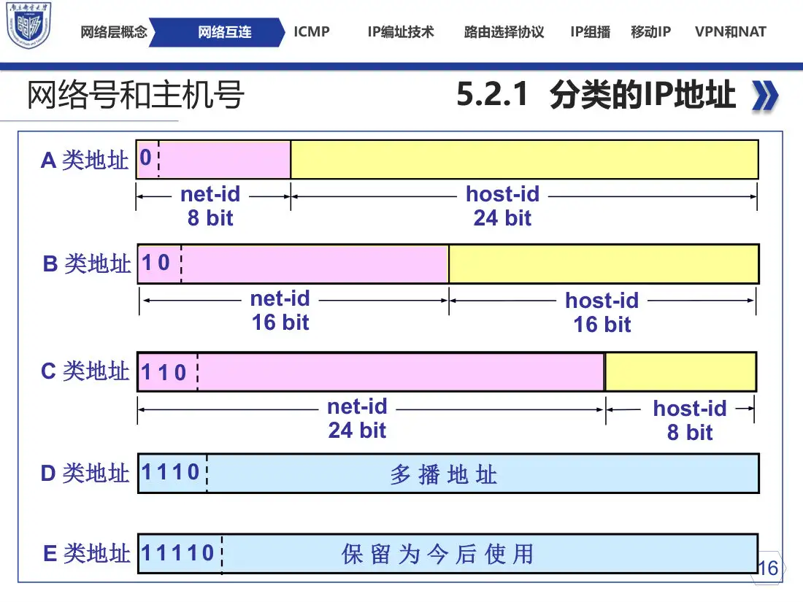

原文：

网络号和主机号

5.2.1 分类的IP地址

南志執電大學

网络层概念

网络互连

ICMP

IP编址技术 路由选择协议 IP组播 移动IP VPN和NAT

6

### 点分十进制记法

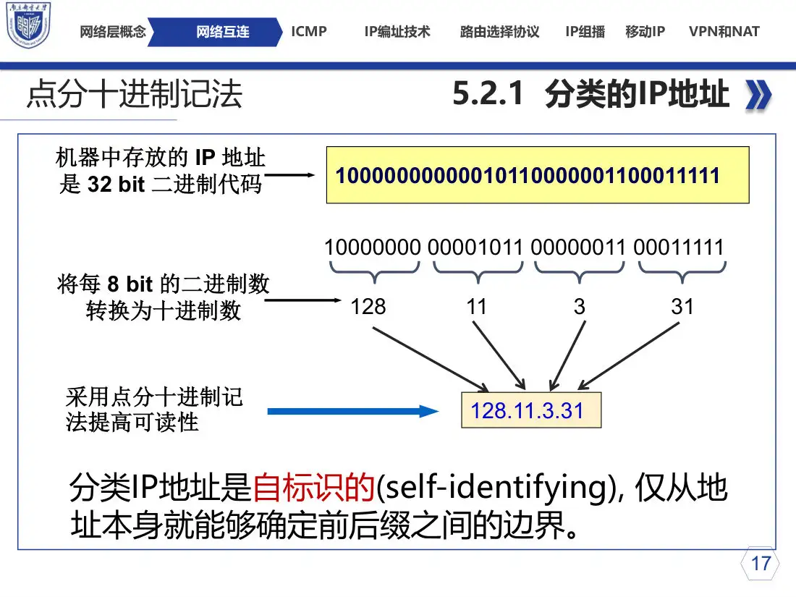

原文：

点分十进制记法

机器中存放的 IP 地址是 32 bit 二进制代码

5.2.1 分类的IP地址

将每 8 bit 的二进制数转换为十进制数

采用点分十进制记法提高可读性

10000000000010110000001100011111

10000000 00001011 00000011 00011111

128

128.11.3.31

分类IP地址是自标识的(self-identifying), 仅从地址本身就能够确定前后缀之间的边界。

南志郵電大學yofPo

网络层概念

网络互连

ICMP

IP编址技术 路由选择协议 IP组播 移动IP VPN和NAT

17

### ABC类地址使用范围

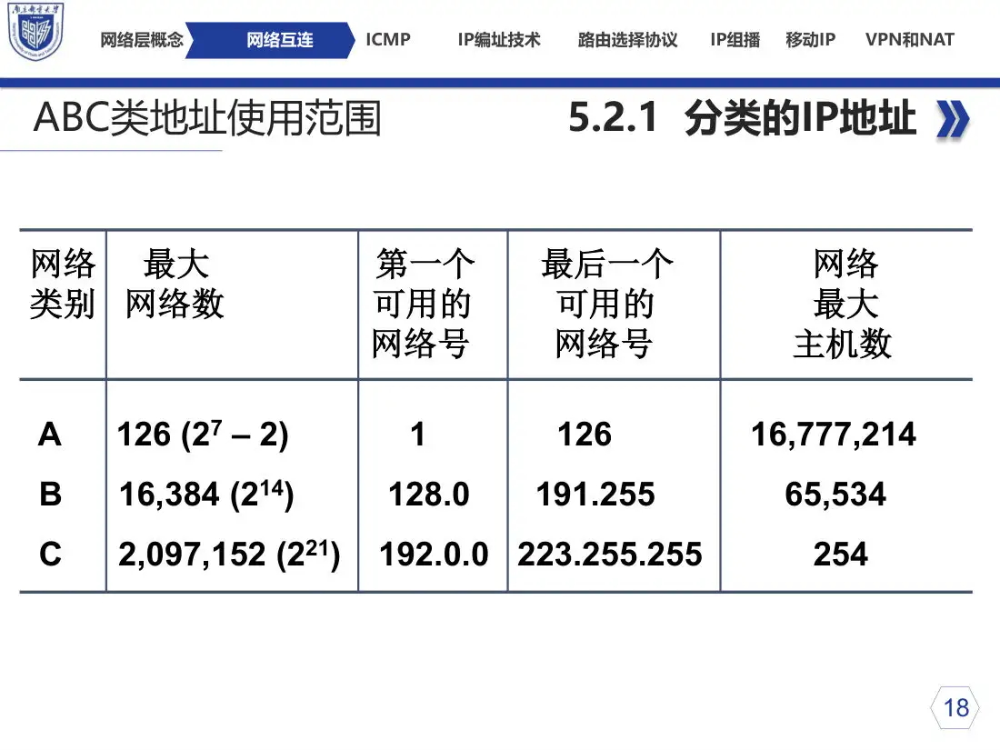

原文：

ABC类地址使用范围

5.2.1 分类的IP地址

<table><tr><td>网络类别</td><td>最大网络数</td><td>第一个可用的网络号</td><td>最后一个可用的网络号</td><td>网络最大主机数</td></tr><tr><td>A</td><td>126 (27-2)</td><td>1</td><td>126</td><td>16,777,214</td></tr><tr><td>B</td><td>16,384 (214)</td><td>128.0</td><td>191.255</td><td>65,534</td></tr><tr><td>C</td><td>2,097,152 (221)</td><td>192.0.0</td><td>223.255.255</td><td>254</td></tr></table>

18

南志執電大學

网络层概念

网络互连

ICMP

IP编址技术 路由选择协议 IP组播 移动IP VPN和NAT

### 特殊的IP地址

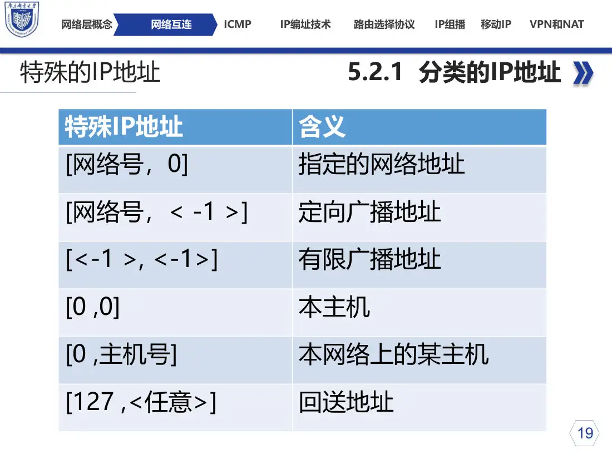

原文：

特殊的IP地址

5.2.1 分类的IP地址

<table><tr><td>特殊IP地址</td><td>含义</td></tr><tr><td>[网络号,0]</td><td>指定的网络地址</td></tr><tr><td>[网络号,&lt;-1&gt;]</td><td>定向广播地址</td></tr><tr><td>[&lt;-1&gt;,&lt;-1&gt;]</td><td>有限广播地址</td></tr><tr><td>[0,0]</td><td>本主机</td></tr><tr><td>[0,主机号]</td><td>本网络上的某主机</td></tr><tr><td>[127,&lt;任意&gt;]</td><td>回送地址</td></tr></table>

ICMP IP编址技术 路由选择协议 IP组播 移动IP VPN和NAT

南志郵電大學

网络层概念

网络互连

19

### IP地址分配

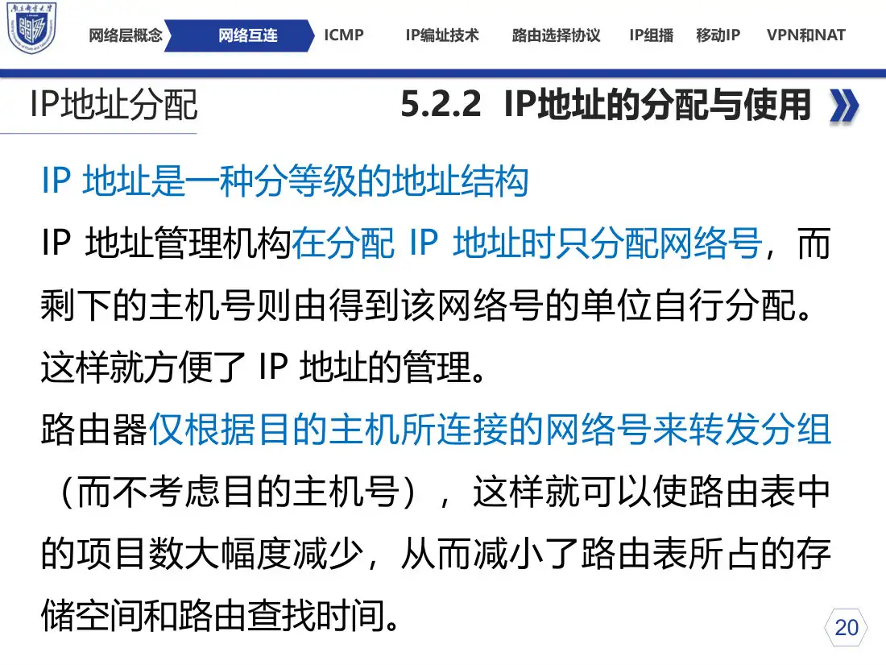

原文：

IP地址分配

5.2.2 IP地址的分配与使用

IP 地址是一种分等级的地址结构

IP 地址管理机构在分配 IP 地址时只分配网络号，而剩下的主机号则由得到该网络号的单位自行分配。这样就方便了 IP 地址的管理。

路由器仅根据目的主机所连接的网络号来转发分组（而不考虑目的主机号），这样就可以使路由表中的项目数大幅度减少，从而减小了路由表所占的存储空间和路由查找时间。

南志郵電大學Nanjing Un

网络层概念

网络互连

ICMP

IP编址技术 路由选择协议 IP组播 移动IP VPN和NAT

20

### IP地址分配

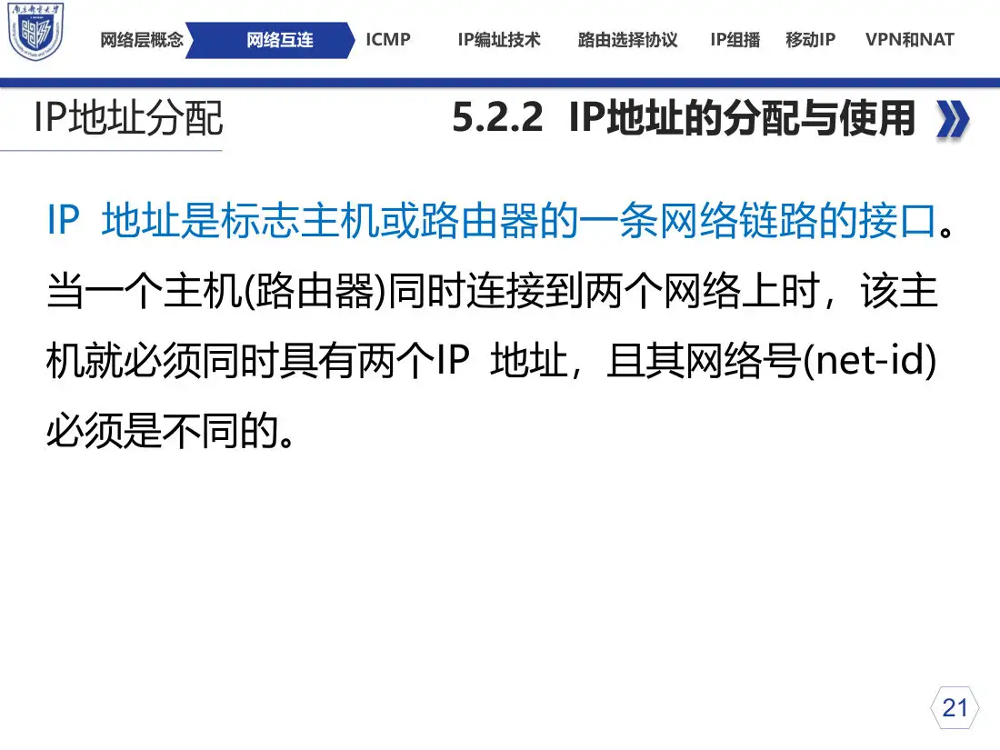

原文：

IP地址分配

5.2.2 IP地址的分配与使用

IP 地址是标志主机或路由器的一条网络链路的接口。当一个主机(路由器)同时连接到两个网络上时，该主机就必须同时具有两个IP 地址，且其网络号(net-id)必须是不同的。

21

南志郵電大學Nanjing Un

网络层概念

网络互连

ICMP

IP编址技术 路由选择协议 IP组播 移动IP VPN和NAT

### IP地址分配

原文：

IP地址分配

5.2.2 IP地址的分配与使用

用转发器或网桥(交换机)连接起来的若干个局域网，虽然在物理上是多个网络，但在逻辑上仍为一个网络，这些局域网都具有相同的网络号(net-id)。

所有分配到网络号的网络，不管是范围很小的局域网，还是可能覆盖很大地理范围的广域网，都是平等的。

南志郵電大學Nanjing Un

网络层概念

网络互连

ICMP

IP编址技术 路由选择协议 IP组播 移动IP VPN和NAT

22

### IP地址分配示例

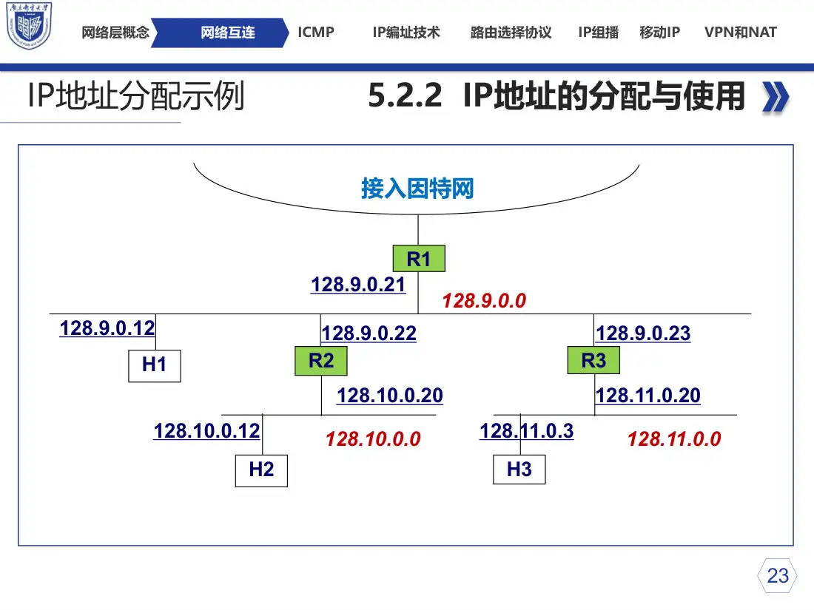

原文：

IP地址分配示例

5.2.2 IP地址的分配与使用

南志郵電大學Nanjing Un

网络层概念

网络互连

ICMP

IP编址技术 路由选择协议 IP组播 移动IP VPN和NAT

23

### 24

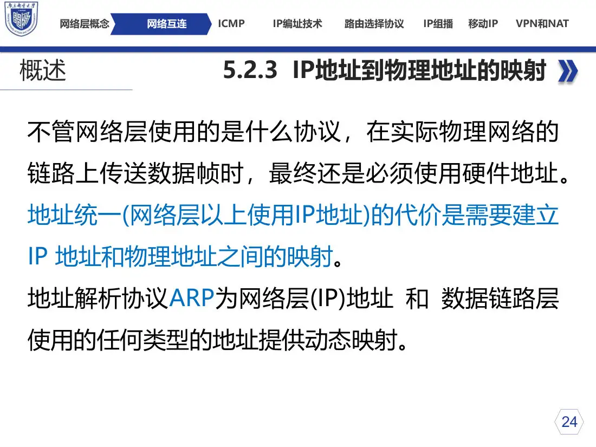

原文：

24

概述

5.2.3 IP地址到物理地址的映射

不管网络层使用的是什么协议，在实际物理网络的链路上传送数据帧时，最终还是必须使用硬件地址。地址统一(网络层以上使用IP地址)的代价是需要建立IP 地址和物理地址之间的映射。

地址解析协议ARP为网络层(IP)地址 和 数据链路层使用的任何类型的地址提供动态映射。

网络层概念 网络互连 ICMP IP编址技术 路由选择协议 IP组播 移动IP VPN和NAT

南志執電大學Nanjing and Te

### ARP cache

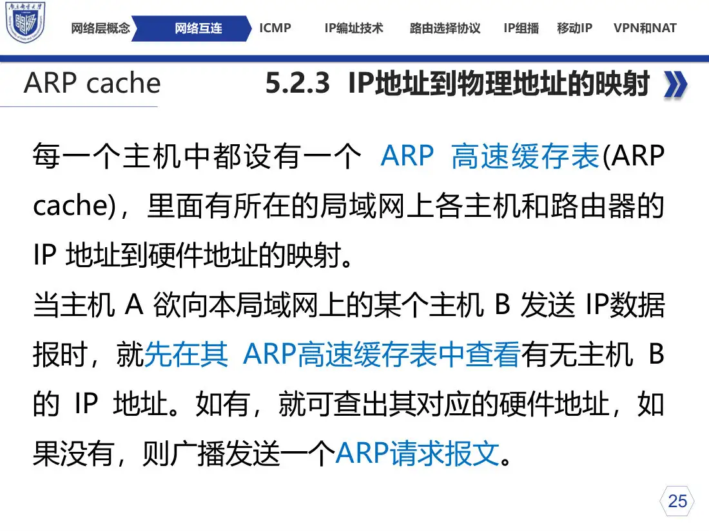

原文：

ARP cache

5.2.3 IP地址到物理地址的映射

每一个主机中都设有一个 ARP 高速缓存表(ARPcache)，里面有所在的局域网上各主机和路由器的IP 地址到硬件地址的映射。

当主机 A 欲向本局域网上的某个主机 B 发送 IP数据报时，就先在其 ARP高速缓存表中查看有无主机 B的 IP 地址。如有，就可查出其对应的硬件地址，如果没有，则广播发送一个ARP请求报文。

南志郵電大學Nanjing

网络层概念 网络互连 ICMP IP编址技术 路由选择协议 IP组播 移动IP VPN和NAT

25

### 以太网上的示例

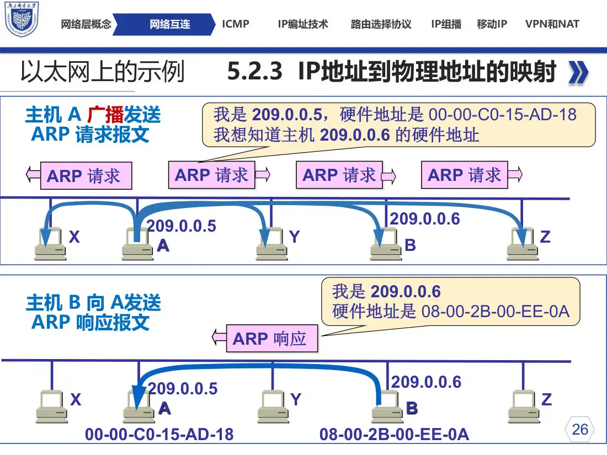

原文：

以太网上的示例

5.2.3 IP地址到物理地址的映射

主机 A 广播发送ARP 请求报文

ARP 请求

我是 209.0.0.5，硬件地址是 00-00-C0-15-AD-18我想知道主机 209.0.0.6 的硬件地址

主机 B 向 A发送ARP 响应报文

ARP 响应

我是 209.0.0.6硬件地址是 08-00-2B-00-EE-0A

南志郵電大學Nanjing Un

网络层概念

网络互连

ICMP

IP编址技术 路由选择协议 IP组播 移动IP VPN和NAT

26

### 5.2.3 IP地址到物理地址的映射

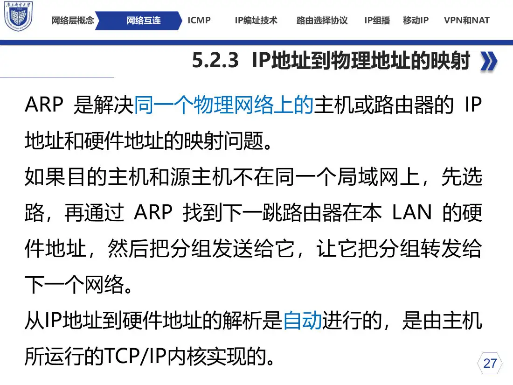

原文：

5.2.3 IP地址到物理地址的映射

ARP 是解决同一个物理网络上的主机或路由器的 IP地址和硬件地址的映射问题。

如果目的主机和源主机不在同一个局域网上，先选路，再通过 ARP 找到下一跳路由器在本 LAN 的硬件地址，然后把分组发送给它，让它把分组转发给下一个网络。

从IP地址到硬件地址的解析是自动进行的，是由主机所运行的TCP/IP内核实现的。

2

南志郵電大學Nanjing

网络层概念 网络互连 ICMP IP编址技术 路由选择协议 IP组播 移动IP VPN和NAT

### ARP报文格式

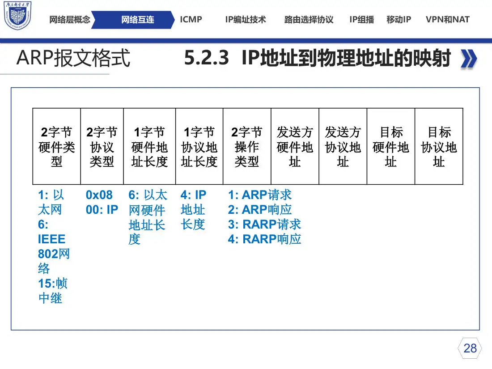

原文：

ARP报文格式

5.2.3 IP地址到物理地址的映射

<table><tr><td>2字节硬件类型</td><td>2字节协议类型</td><td>1字节硬件地址长度</td><td>1字节协议地址长度</td><td>2字节操作类型</td><td>发送方硬件地址</td><td>发送方协议地址</td><td>目标硬件地址</td><td>目标协议地址</td></tr><tr><td>1:以太网6:IEEE802网络15:帧中继</td><td>0x0800:IP</td><td>6:以太网硬件地址长度</td><td>4:IP地址长度</td><td colspan="5">1:ARP请求2:ARP响应3:RARP请求4:RARP响应</td></tr></table>

南志郵電大學Nanjing Un

网络层概念

网络互连

ICMP

IP编址技术 路由选择协议 IP组播 移动IP VPN和NAT

28

### RARP

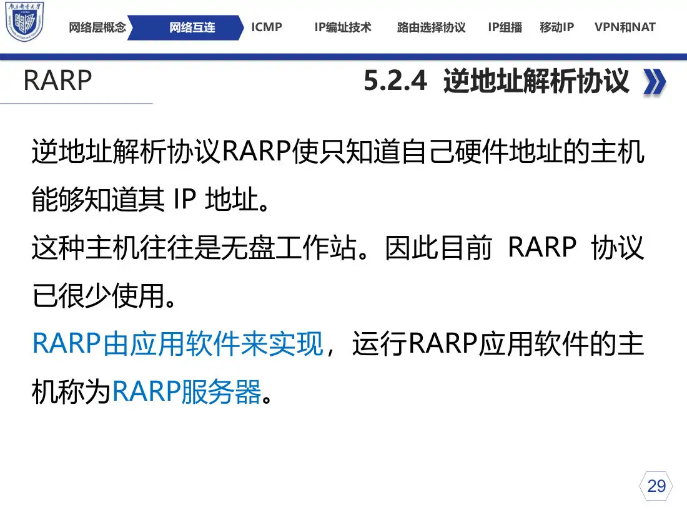

原文：

RARP

5.2.4 逆地址解析协议

逆地址解析协议RARP使只知道自己硬件地址的主机能够知道其 IP 地址。

这种主机往往是无盘工作站。因此目前 RARP 协议已很少使用。

RARP由应用软件来实现，运行RARP应用软件的主机称为RARP服务器。

ICMP

南志郵電大學Nanjing U

网络层概念

网络互连

IP编址技术 路由选择协议 IP组播 移动IP VPN和NAT

29

### 解析过程

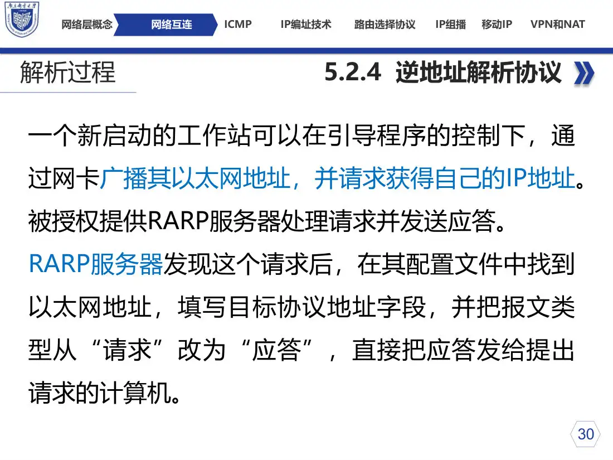

原文：

解析过程

5.2.4 逆地址解析协议

一个新启动的工作站可以在引导程序的控制下，通过网卡广播其以太网地址，并请求获得自己的IP地址。被授权提供RARP服务器处理请求并发送应答。

RARP服务器发现这个请求后，在其配置文件中找到以太网地址，填写目标协议地址字段，并把报文类型从“请求”改为“应答”，直接把应答发给提出请求的计算机。

南志郵電大學Nanjing U

网络层概念

网络互连

ICMP

IP编址技术 路由选择协议 IP组播 移动IP VPN和NAT

30

### 5.2.5 IP数据报

原文：

5.2.5 IP数据报

因特网的基本传送单元是IP数据报(或IP分组)。

一个 IP 数据报由首部（报头）和数据两部分组成。

首部的前一部分是固定部分，共20字节，是所有 IP数据报必须具有的。

在首部的固定部分的后面是一些可选字段，其长度是可变的。

IP 数据报首部的固定部分和可选字段长度之和最大为 60 字节。

南志郵電大學Nanjing

网络层概念 网络互连 ICMP IP编址技术 路由选择协议 IP组播 移动IP VPN和NAT

31

### 版本

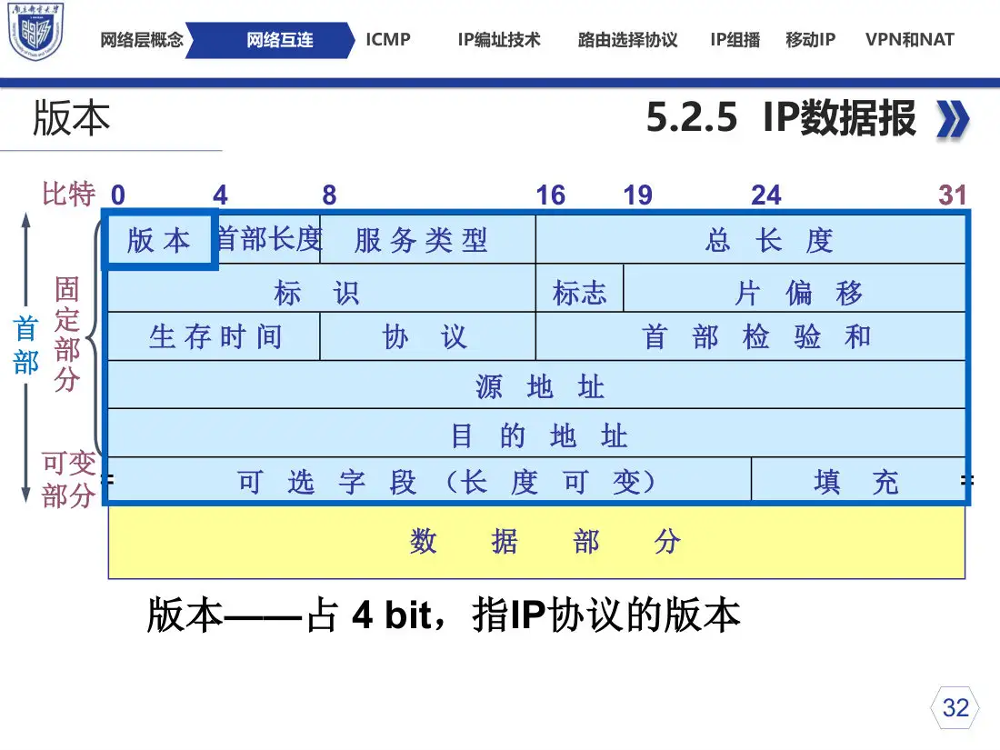

原文：

版本

5.2.5 IP数据报

版本——占 4 bit，指IP协议的版本

网络层概念 网络互连 ICMP IP编址技术 路由选择协议 IP组播 移动IP VPN和NAT

南志執電大學Nanjing and Te

32

### 首部长度和服务类型

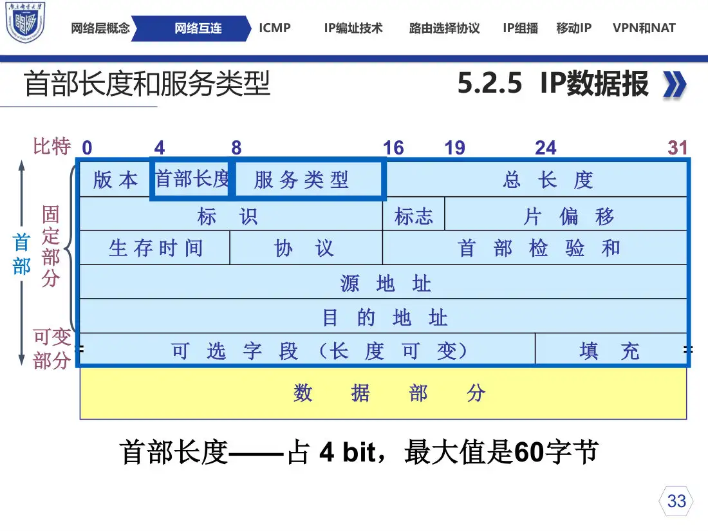

原文：

首部长度和服务类型

5.2.5 IP数据报

首部长度——占 4 bit，最大值是60字节

南志郵電大學Nanjing Un

网络层概念

网络互连

ICMP

IP编址技术 路由选择协议 IP组播 移动IP VPN和NAT

33

### 总长度

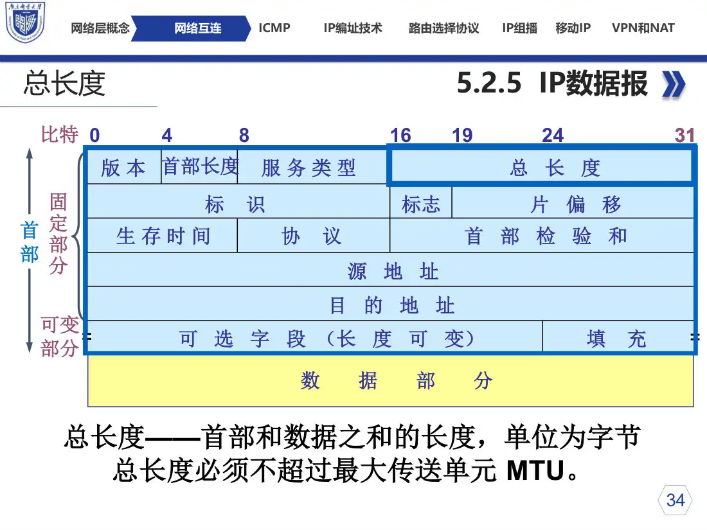

原文：

总长度

5.2.5 IP数据报

总长度——首部和数据之和的长度，单位为字节总长度必须不超过最大传送单元 MTU。

南志郵電大學Nanjing Un

网络层概念

网络互连

ICMP

IP编址技术 路由选择协议 IP组播 移动IP VPN和NAT

34

### 标识

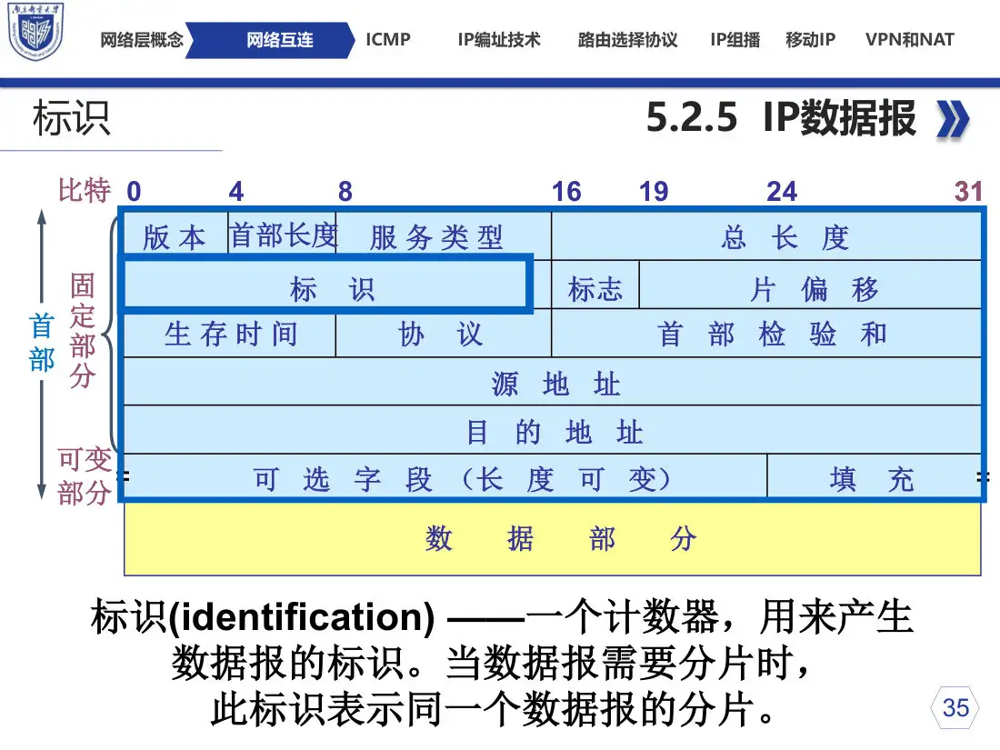

原文：

标识

5.2.5 IP数据报

标识(identification) ——一个计数器，用来产生数据报的标识。当数据报需要分片时，此标识表示同一个数据报的分片。

网络层概念 网络互连 ICMP IP编址技术 路由选择协议 IP组播 移动IP VPN和NAT

南志郵電大學Nanjing Un

35

### 标志

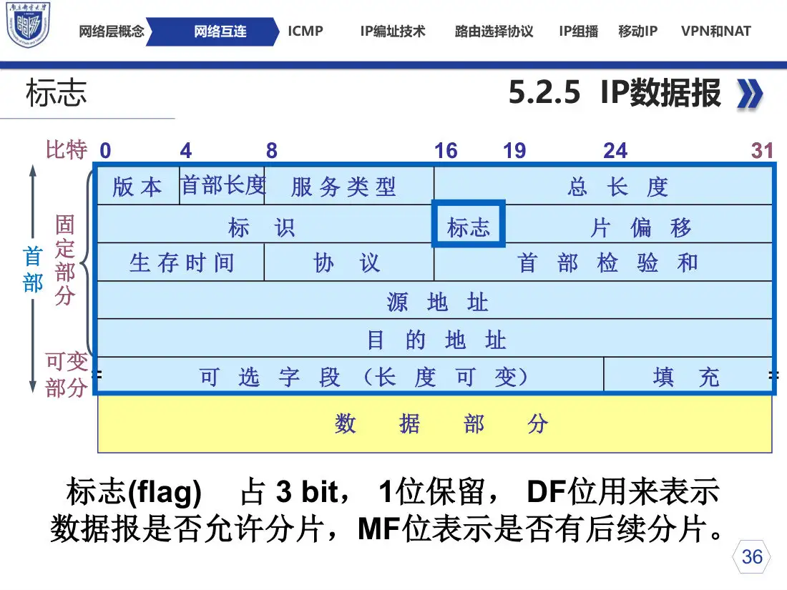

原文：

标志

5.2.5 IP数据报

标志(flag) 占 3 bit， 1位保留， DF位用来表示数据报是否允许分片，MF位表示是否有后续分片。

网络层概念 网络互连 ICMP IP编址技术 路由选择协议 IP组播 移动IP VPN和NAT

南志執電大學

36

### 片偏移

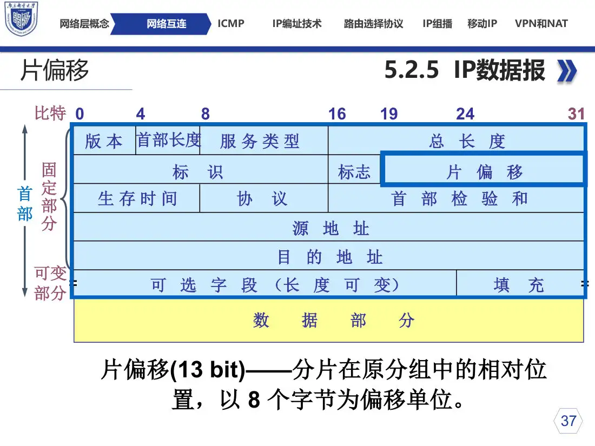

原文：

片偏移

5.2.5 IP数据报

片偏移(13 bit)——分片在原分组中的相对位置，以 8 个字节为偏移单位。

南志郵電大學Nanjing Un

网络层概念 网络互连 ICMP IP编址技术 路由选择协议 IP组播 移动IP VPN和NAT

37

### IP数据报分片举例

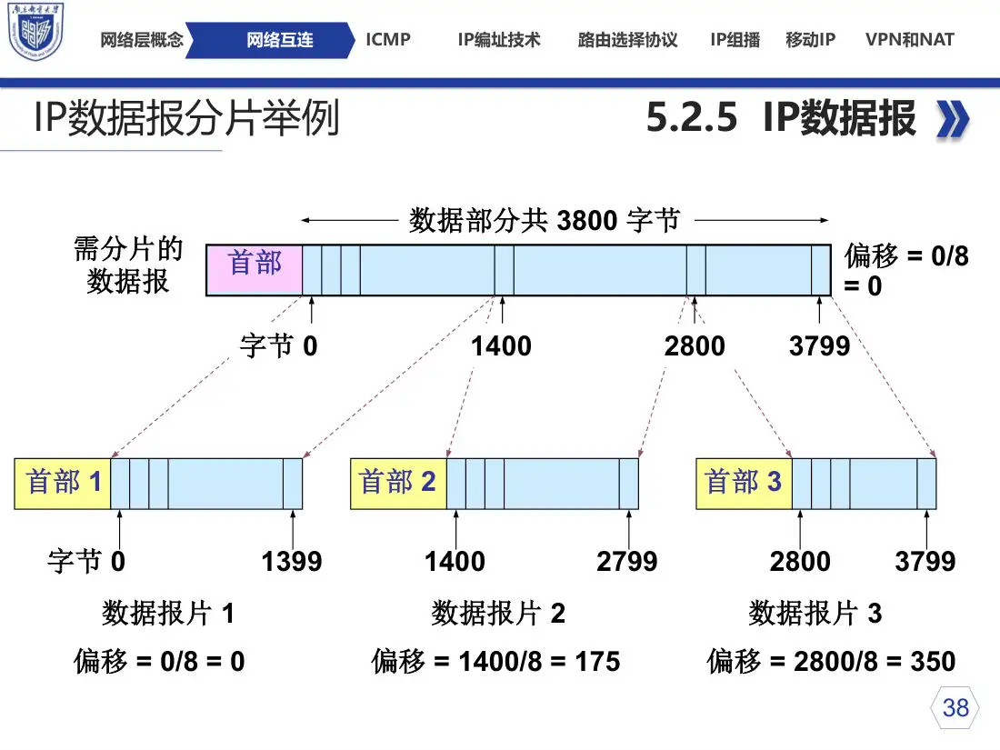

原文：

IP数据报分片举例

5.2.5 IP数据报

南志執電大學

网络层概念

网络互连

ICMP

IP编址技术 路由选择协议 IP组播 移动IP VPN和NAT

38

### 生存时间

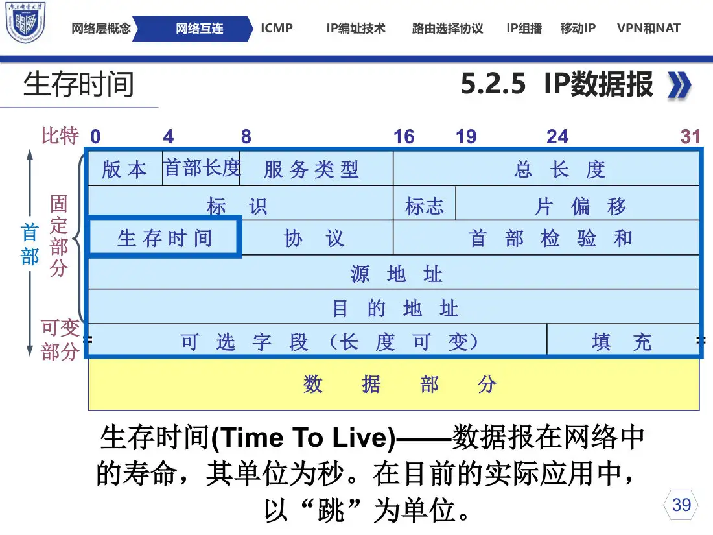

原文：

生存时间

5.2.5 IP数据报

生存时间(Time To Live)——数据报在网络中的寿命，其单位为秒。在目前的实际应用中，以“跳”为单位。

网络层概念 网络互连 ICMP IP编址技术 路由选择协议 IP组播 移动IP VPN和NAT

南志郵電大學Nanjing Un

39

### 协议

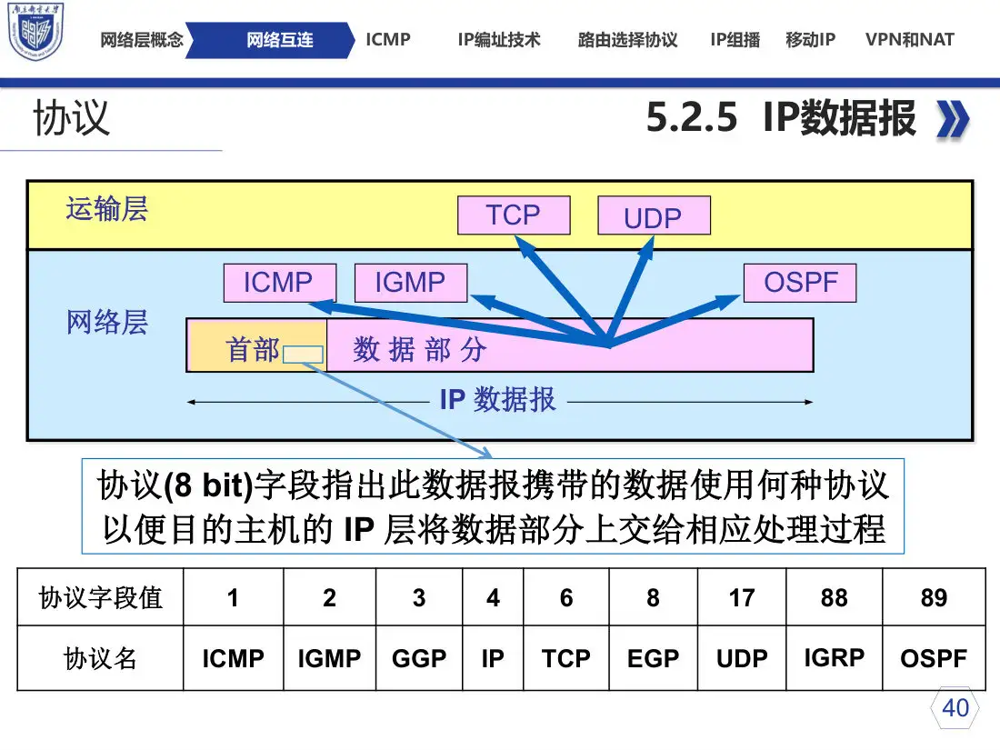

原文：

协议

5.2.5 IP数据报

协议(8 bit)字段指出此数据报携带的数据使用何种协议以便目的主机的 IP 层将数据部分上交给相应处理过程

<table><tr><td>协议字段值</td><td>1</td><td>2</td><td>3</td><td>4</td><td>6</td><td>8</td><td>17</td><td>88</td><td>89</td></tr><tr><td>协议名</td><td>ICMP</td><td>IGMP</td><td>GGP</td><td>IP</td><td>TCP</td><td>EGP</td><td>UDP</td><td>IGRP</td><td>OSPF</td></tr></table>

南志郵電大學Nanjing Un

网络层概念

网络互连

ICMP

IP编址技术 路由选择协议 IP组播 移动IP VPN和NAT

40

### 首部校验和

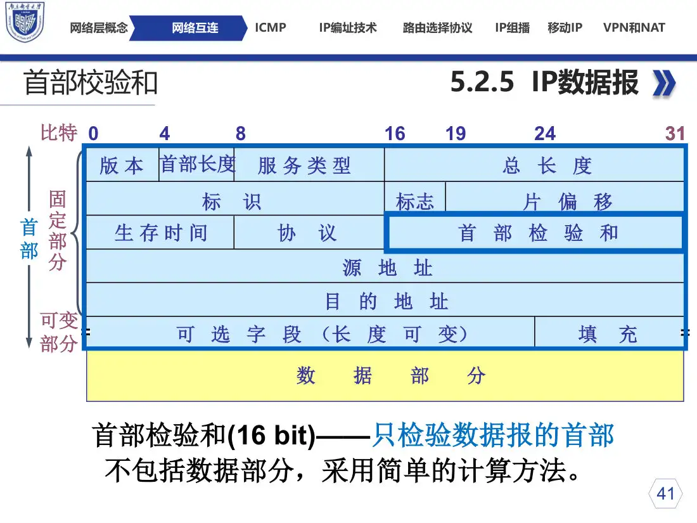

原文：

首部校验和

5.2.5 IP数据报

首部检验和(16 bit)——只检验数据报的首部不包括数据部分，采用简单的计算方法。

网络层概念 网络互连 ICMP IP编址技术 路由选择协议 IP组播 移动IP VPN和NAT

南志郵電大學Nanjing Un

41

### 首部校验和

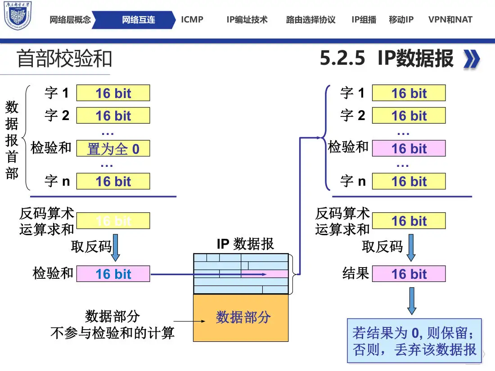

原文：

首部校验和

数

据

报

首

部

字 2

检验和

字 n

16 bit

置为全 0

16 bit

数据部分不参与检验和的计算

5.2.5 IP数据报

南志執電大學

网络层概念

网络互连

ICMP

IP编址技术 路由选择协议 IP组播 移动IP VPN和NAT

### 地址

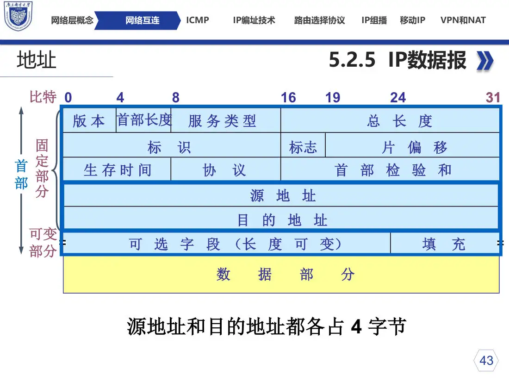

原文：

地址

5.2.5 IP数据报

源地址和目的地址都各占 4 字节

南志郵電大學Nanjing Un

网络层概念 网络互连 ICMP IP编址技术 路由选择协议 IP组播 移动IP VPN和NAT

43

### 可选字段

原文：

可选字段

5.2.5 IP数据报

IP 首部的可选字段，用来支持排错、测量以及安全等措施。

选项字段长度可变，从 1 个字节到 40 个字节不等。增加首部的可变部分是为了增加 IP 数据报的功能，但这同时也使得 IP 数据报的首部长度成为可变的。这增加了每一个路由器处理数据报的开销。

实际上这些选项较少被使用。

南志郵電大學Nanjing Un

网络层概念

网络互连

ICMP

IP编址技术 路由选择协议 IP组播 移动IP VPN和NAT

44

### IP包解析举例

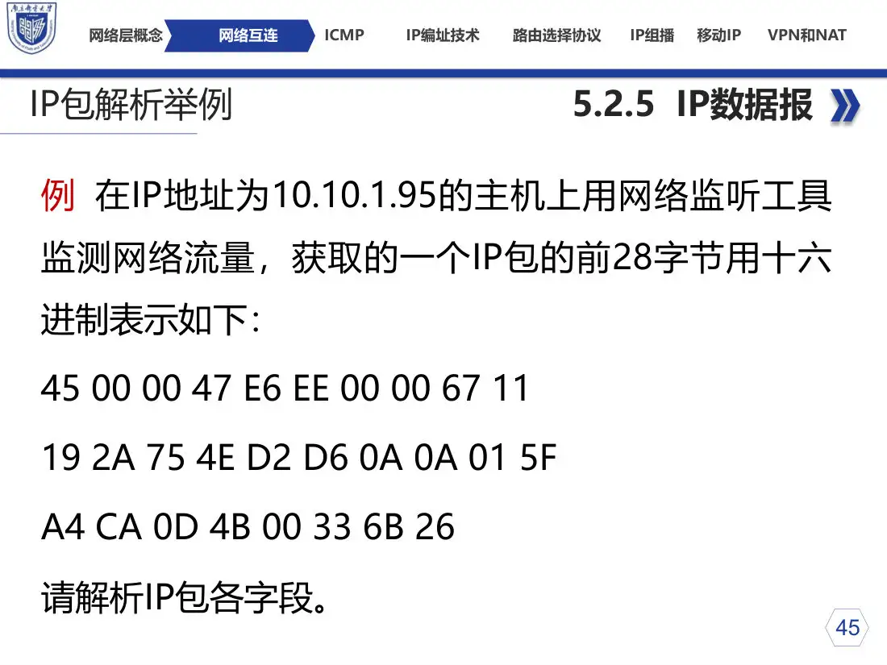

原文：

IP包解析举例

5.2.5 IP数据报

例 在IP地址为10.10.1.95的主机上用网络监听工具监测网络流量，获取的一个IP包的前28字节用十六进制表示如下：

45 00 00 47 E6 EE 00 00 67 11

19 2A 75 4E D2 D6 0A 0A 01 5F

A4 CA 0D 4B 00 33 6B 26

请解析IP包各字段。

南志執電大學Nanjing and Te

网络层概念

网络互连

IP编址技术 路由选择协议 IP组播 移动IP VPN和NAT

45

### IP包解析举例

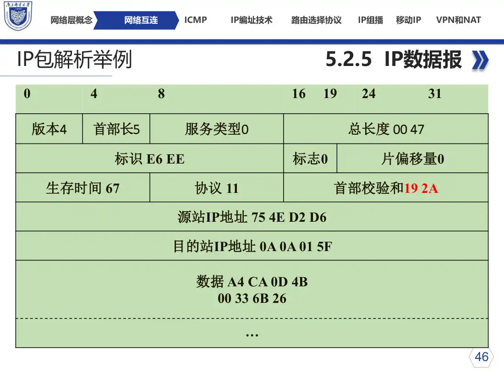

原文：

IP包解析举例

5.2.5 IP数据报

<table><tr><td colspan="5">0 4 8 16 19 24 31</td></tr><tr><td>版本4</td><td>首部长5</td><td>服务类型0</td><td colspan="2">总长度00 47</td></tr><tr><td colspan="3">标识E6 EE</td><td>标志0</td><td>片偏移量0</td></tr><tr><td colspan="2">生存时间67</td><td>协议11</td><td colspan="2">首部校验和19 2A</td></tr><tr><td colspan="5">源站IP地址75 4E D2 D6</td></tr><tr><td colspan="5">目的站IP地址0A 0A 01 5F</td></tr><tr><td colspan="5">数据A4 CA 0D 4B00 33 6B 26</td></tr><tr><td colspan="5">...</td></tr></table>

网络层概念 网络互连 ICMP IP编址技术 路由选择协议 IP组播 移动IP VPN和NAT

南志郵電大學Nanjing Un

46

### 5.2.6 无连接的数据报传送

原文：

5.2.6 无连接的数据报传送

路由器功能

路由器在网际互连中的功能：

网络分段，实现子网的划分

提供不同类型网络的互联

隔离广播风暴

实现子网之间的信息传输

提供安全访问的机制

支持网络层的特殊服务

南志郵電大學Nanjing Un

网络层概念

网络互连

ICMP

IP编址技术 路由选择协议 IP组播 移动IP VPN和NAT

47

### 典型的路由器结构

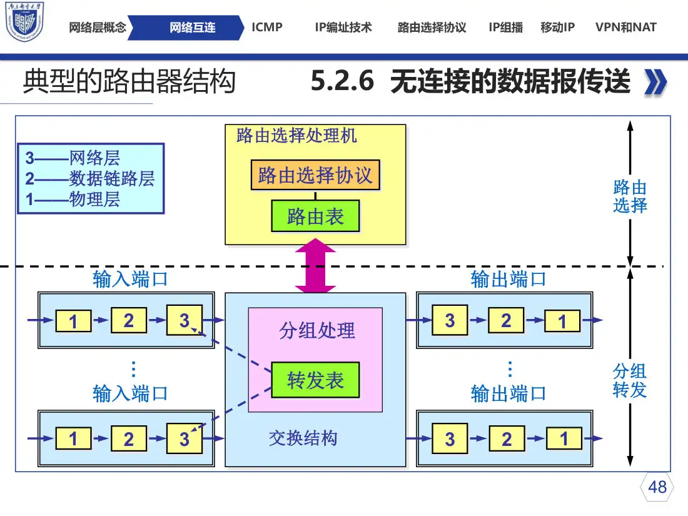

原文：

典型的路由器结构

3 网络层

2——数据链路层

5.2.6 无连接的数据报传送

南志郵電大學and Te

网络层概念

网络互连

ICMP

IP编址技术 路由选择协议 IP组播 移动IP VPN和NAT

48

### 输入端口的处理

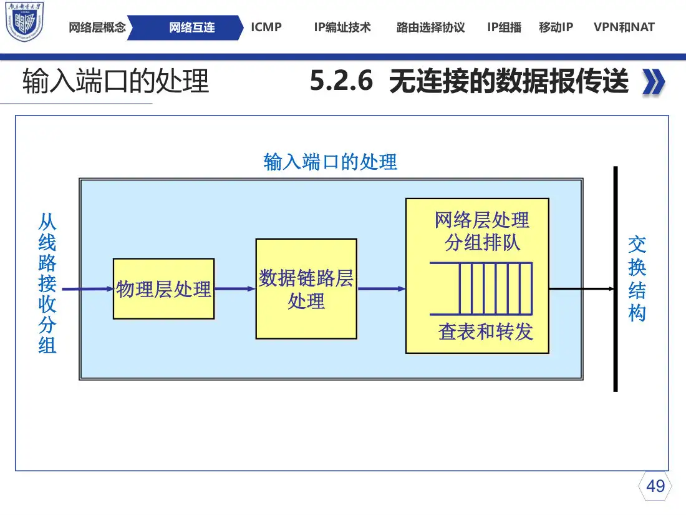

原文：

输入端口的处理

5.2.6 无连接的数据报传送

南志郵電大學Nanjing Un

网络层概念

网络互连

ICMP

IP编址技术 路由选择协议 IP组播 移动IP VPN和NAT

49

### 输出端口的处理

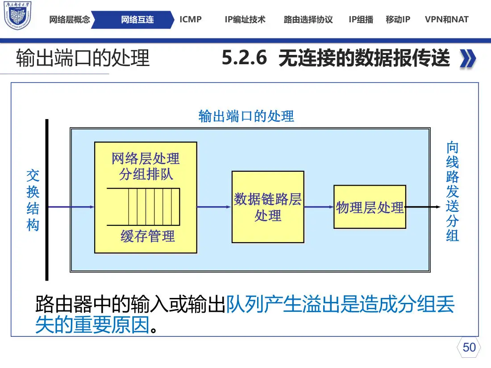

原文：

输出端口的处理

5.2.6 无连接的数据报传送

输出端口的处理

向

线

路

发

送

分

路由器中的输入或输出队列产生溢出是造成分组丢失的重要原因。

南志郵電大學Nanjing Un

网络层概念

网络互连

ICMP

IP编址技术 路由选择协议 IP组播 移动IP VPN和NAT

50

### 直接与间接交付

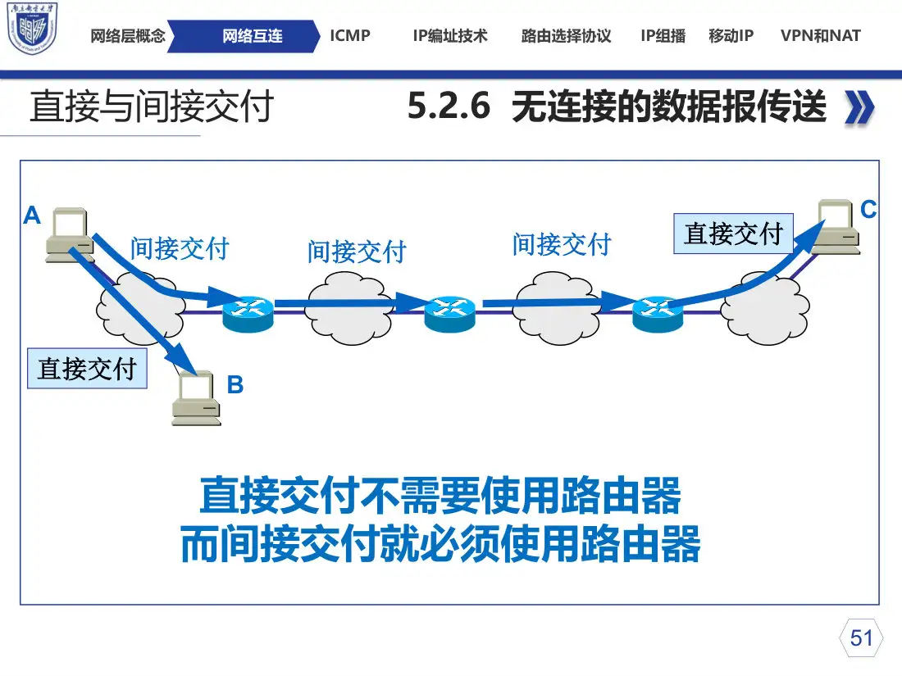

原文：

直接与间接交付

5.2.6 无连接的数据报传送

间接交付

间接交付

间接交付

直接交付

直接交付

直接交付不需要使用路由器而间接交付就必须使用路由器

南志郵電大學Nanjing Un

网络层概念

网络互连

ICMP

IP编址技术 路由选择协议 IP组播 移动IP VPN和NAT

51

### IP包转发算法

原文：

IP包转发算法

5.2.6 无连接的数据报传送

采用最初的分类编址方案时的IP数据报转发（数据报DG, 路由表T）

南志郵電大學Nanjing Un

网络层概念

网络互连

ICMP

IP编址技术 路由选择协议 IP组播 移动IP VPN和NAT

### 对传入IP包的处理

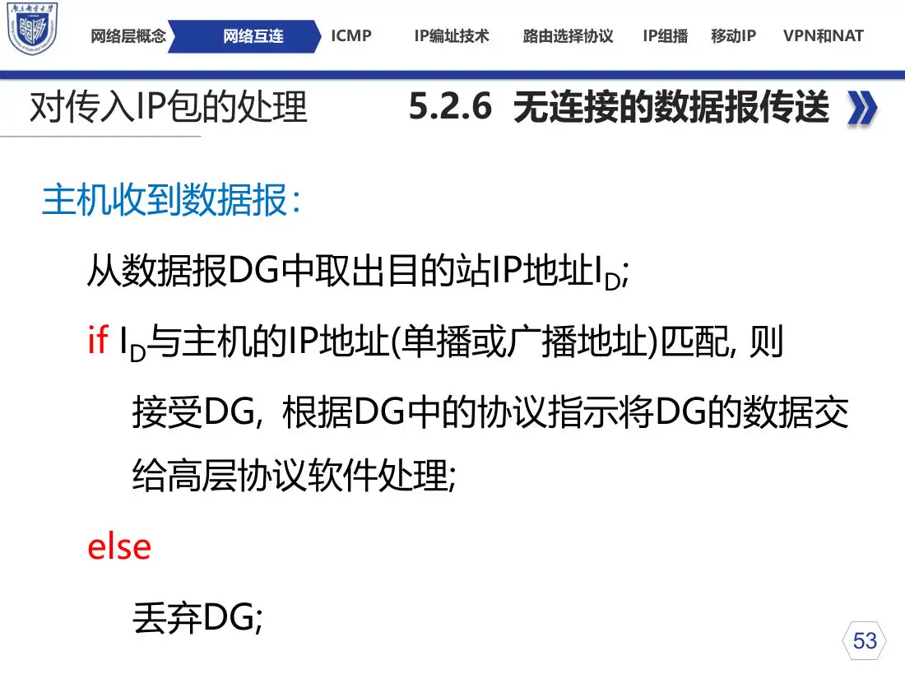

原文：

对传入IP包的处理

5.2.6 无连接的数据报传送

主机收到数据报：

从数据报DG中取出目的站IP地址I ;

if $l _ { \mathsf { D } }$ 与主机的IP地址(单播或广播地址)匹配, 则接受DG, 根据DG中的协议指示将DG的数据交给高层协议软件处理;

else

丢弃DG;

南志郵電大學Nanjing Un

网络层概念

网络互连

ICMP

IP编址技术 路由选择协议 IP组播 移动IP VPN和NAT

53

### 5.2.6 无连接的数据报传送

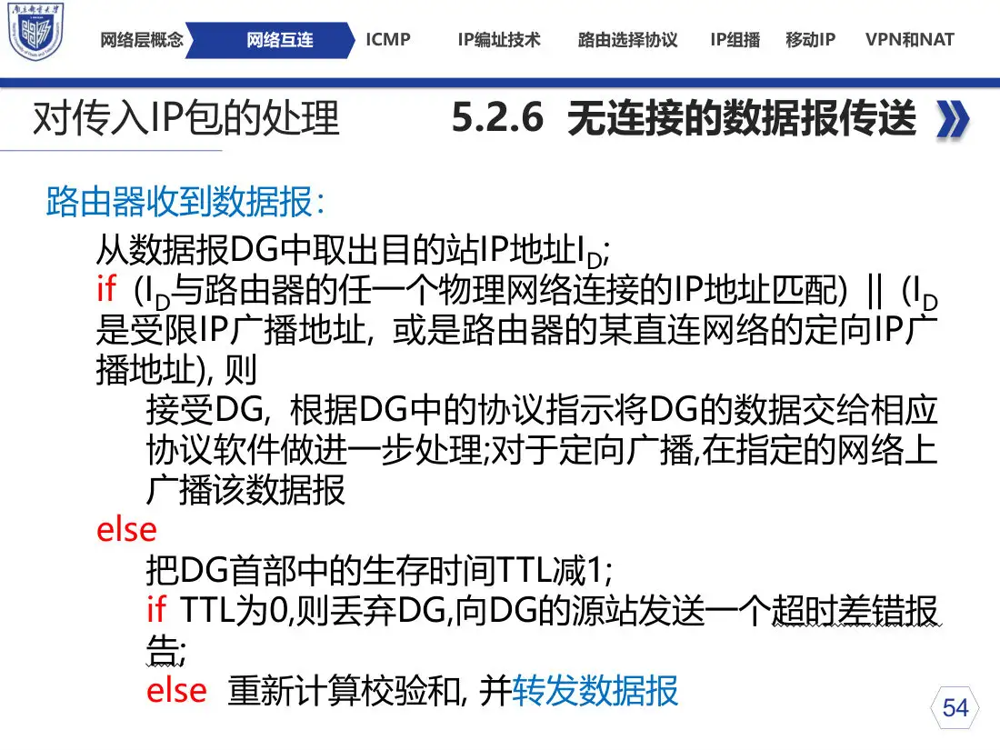

原文：

5.2.6 无连接的数据报传送

对传入IP包的处理

路由器收到数据报：

从数据报DG中取出目的站IP地址ID;

if $( \mathsf { I } _ { \mathsf { D } }$ 与路由器的任一个物理网络连接的IP地址匹配) || $( \mathsf { I } _ { \mathsf { D } }$ 是受限IP广播地址, 或是路由器的某直连网络的定向IP广播地址), 则

接受DG, 根据DG中的协议指示将DG的数据交给相应协议软件做进一步处理;对于定向广播,在指定的网络上广播该数据报

else

把DG首部中的生存时间TTL减1;

if TTL为0,则丢弃DG,向DG的源站发送一个超时差错报告;

else 重新计算校验和, 并转发数据报

南志郵電大學Nanjing Un

网络层概念

网络互连

ICMP

IP编址技术 路由选择协议 IP组播 移动IP VPN和NAT

54

### 过渡页 T r a n s i t i o n P a g e

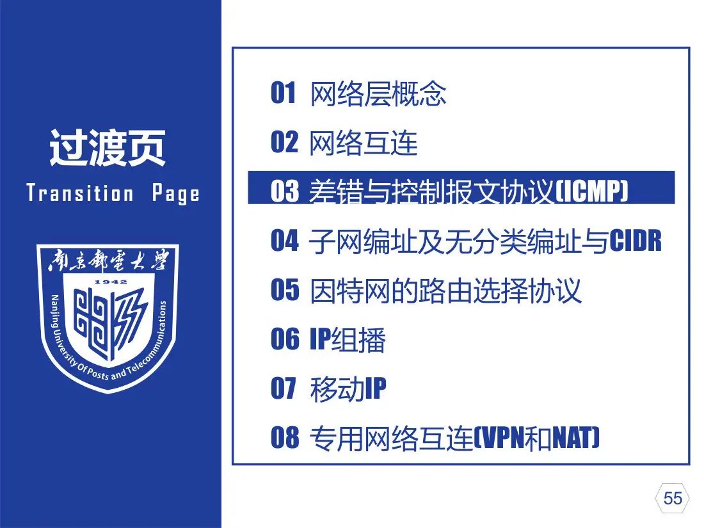

原文：

过渡页 T r a n s i t i o n P a g e

01 网络层概念

02 网络互连

03 差错与控制报文协议(ICMP)

04 子网编址及无分类编址与CIDR

05 因特网的路由选择协议

06 IP组播

07 移动IP

08 专用网络互连(VPN和NAT)

55

### 目的不可达报文

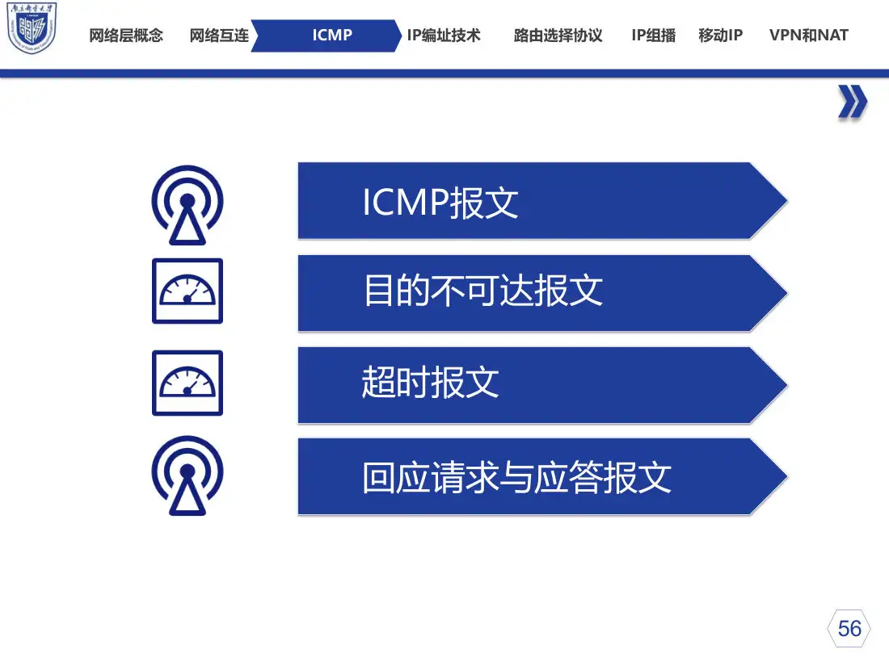

原文：

目的不可达报文

ICMP报文

超时报文

回应请求与应答报文

南志郵電大學Nanjing Un

网络层概念 网络互连 ICMP IP编址技术 路由选择协议 IP组播 移动IP VPN和NAT

56

### ICMP的作用

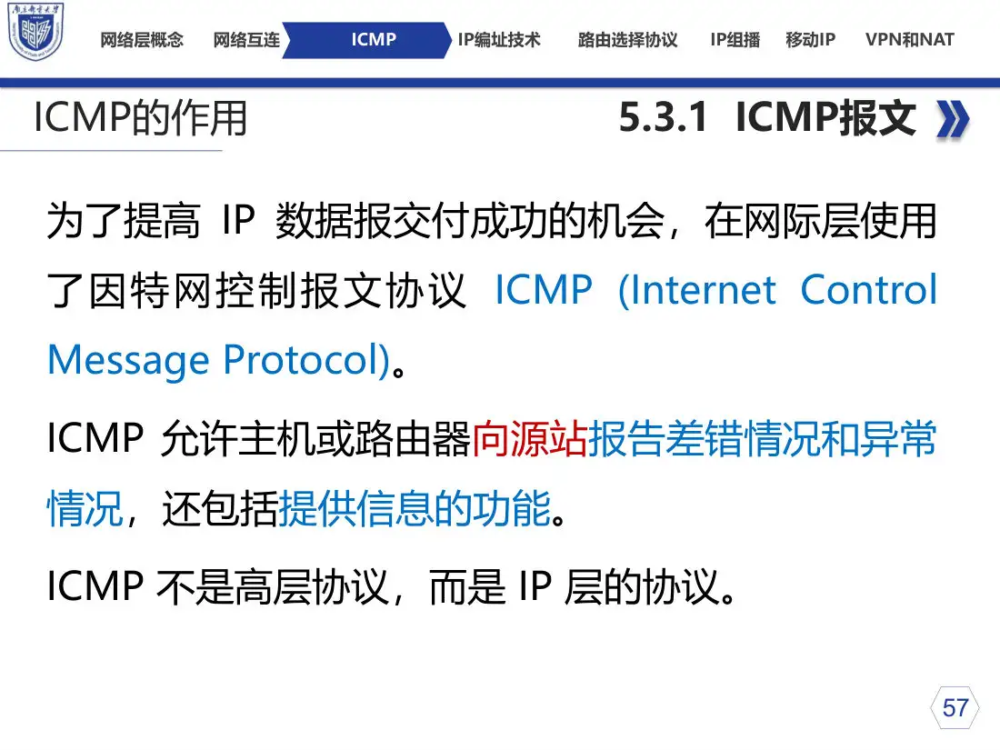

原文：

ICMP的作用

5.3.1 ICMP报文

为了提高 IP 数据报交付成功的机会，在网际层使用了因特网控制报文协议 ICMP (Internet ControlMessage Protocol)。

ICMP 允许主机或路由器向源站报告差错情况和异常情况，还包括提供信息的功能。

ICMP 不是高层协议，而是 IP 层的协议。

网络层概念 网络互连 ICMP IP编址技术 路由选择协议 IP组播 移动IP VPN和NAT

南志郵電大學Nanjing

57

### ICMP报文类型

原文：

ICMP报文类型

5.3.1 ICMP报文

ICMP报文分为两大类：差错报告报文和提供信息的报文。

差错报告报文有：目的不可达报文、超时报文、源抑制报文等。

提供信息的报文有：回应请求与应答报文、时间戳请求与应答报文、地址掩码请求与应答报文等。

网络层概念 网络互连 ICMP IP编址技术 路由选择协议 IP组播 移动IP VPN和NAT

南志郵電大學Nanjing

58

### ICMP报文格式

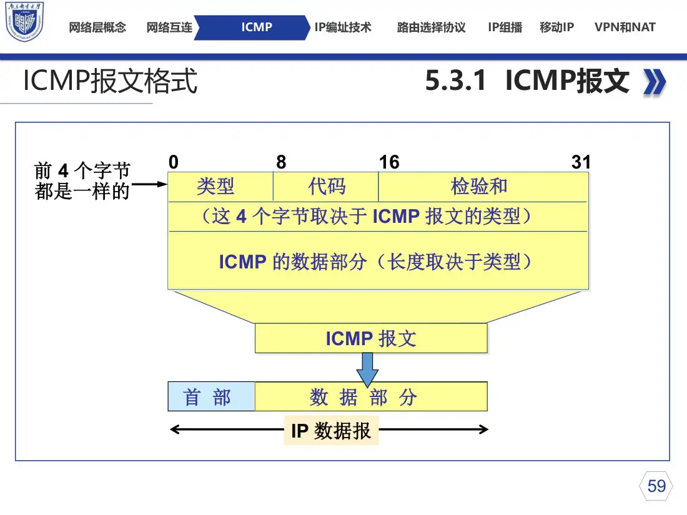

原文：

ICMP报文格式

5.3.1 ICMP报文

前 4 个字节都是一样的

（这 4 个字节取决于 ICMP 报文的类型）

南志執電大學

网络层概念 网络互连

IP编址技术 路由选择协议 IP组播 移动IP VPN和NAT

59

### ICMP报文的类型字段

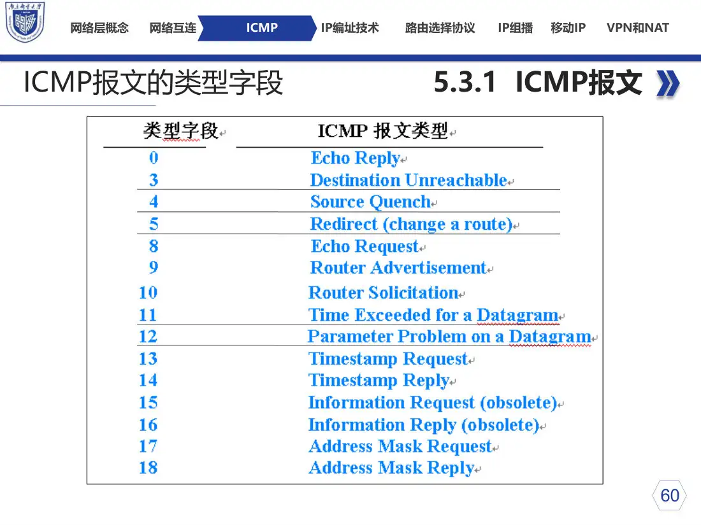

原文：

ICMP报文的类型字段

5.3.1 ICMP报文

<table><tr><td>类型字段</td><td>ICMP 报文类型</td></tr><tr><td>0</td><td>Echo Reply</td></tr><tr><td>3</td><td>Destination Unreachable</td></tr><tr><td>4</td><td>Source Quench</td></tr><tr><td>5</td><td>Redirect (change a route)</td></tr><tr><td>8</td><td>Echo Request</td></tr><tr><td>9</td><td>Router Advertisement</td></tr><tr><td>10</td><td>Router Solicitation</td></tr><tr><td>11</td><td>Time Exceeded for a Datagram</td></tr><tr><td>12</td><td>Parameter Problem on a Datagram</td></tr><tr><td>13</td><td>Timestamp Request</td></tr><tr><td>14</td><td>Timestamp Reply</td></tr><tr><td>15</td><td>Information Request (obsolete)</td></tr><tr><td>16</td><td>Information Reply (obsolete)</td></tr><tr><td>17</td><td>Address Mask Request</td></tr><tr><td>18</td><td>Address Mask Reply</td></tr></table>

南志郵電大學Nanjing Un

网络层概念 网络互连

ICMP

IP编址技术 路由选择协议 IP组播 移动IP VPN和NAT

60

### ICMP报文的代码字段

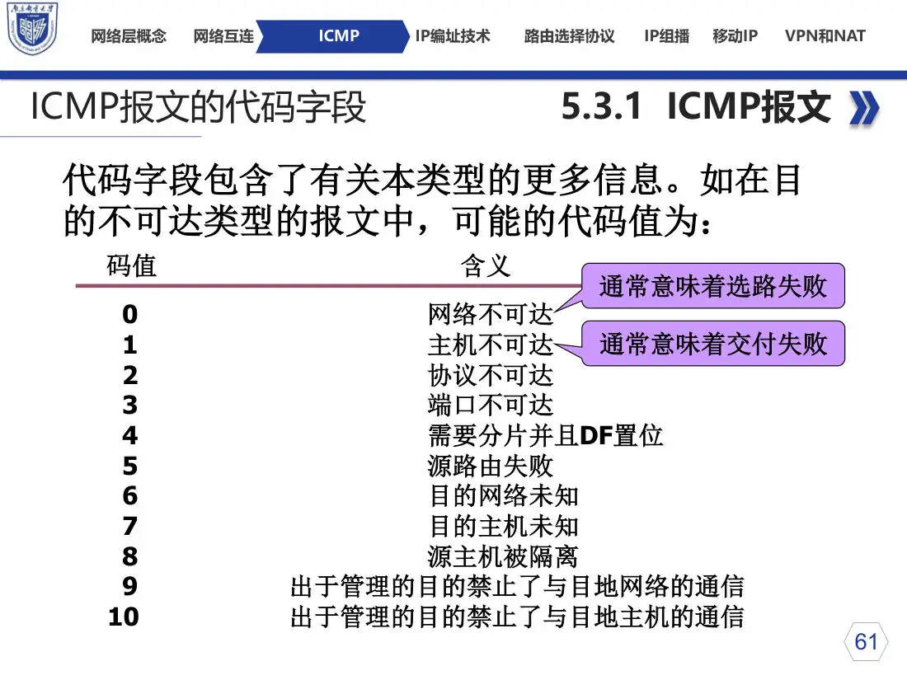

原文：

ICMP报文的代码字段

5.3.1 ICMP报文

代码字段包含了有关本类型的更多信息。如在目的不可达类型的报文中，可能的代码值为：

<table><tr><td>码值</td><td>含义</td><td>通常意味着选路失败</td></tr><tr><td>0</td><td>网络不可达</td><td rowspan="11">通常意味着交付失败</td></tr><tr><td>1</td><td>主机不可达</td></tr><tr><td>2</td><td>协议不可达</td></tr><tr><td>3</td><td>端口不可达</td></tr><tr><td>4</td><td>需要分片并且DF置位</td></tr><tr><td>5</td><td>源路由失败</td></tr><tr><td>6</td><td>目的网络未知</td></tr><tr><td>7</td><td>目的主机未知</td></tr><tr><td>8</td><td>源主机被隔离</td></tr><tr><td>9</td><td>出于管理的目的禁止了与目地网络的通信</td></tr><tr><td>10</td><td>出于管理的目的禁止了与目地主机的通信</td></tr></table>

南志郵電大學Nanjing

网络层概念 网络互连

IP编址技术 路由选择协议 IP组播 移动IP VPN和NAT

61

### ICMP报文格式

原文：

ICMP报文格式

5.3.1 ICMP报文

ICMP 差错报告报文数据字段的内容

南志郵電大學Nanjing

IP编址技术 路由选择协议 IP组播 移动IP VPN和NAT

62

### 5.3.1 ICMP报文

原文：

5.3.1 ICMP报文

不应发送ICMP差错报告报文的几种情况：

对 ICMP 差错报告报文不再发送差错报告报文。

对第1个分片的数据报片的所有后续数据报片都不发送 差错报告报文。

对具有组播地址的数据报都不发送差错报告报文。

对具有特殊地址（如127.0.0.0或0.0.0.0）的数据报不发送差错报告报文。

南志郵電大學Nanjing

网络层概念 网络互连 ICMP IP编址技术 路由选择协议 IP组播 移动IP VPN和NAT

63

### 5.3.2 目的不可达报文

原文：

5.3.2 目的不可达报文

类型为3, 代码进一步描述问题：

0 网络不可达1 主机不可达协议不可达端口不可达需要分片但DF标志置位源路由失败

南志郵電大學Nanjing

网络层概念 网络互连 ICMP IP编址技术 路由选择协议 IP组播 移动IP VPN和NAT

64

### 5.3.3 超时报文

原文：

5.3.3 超时报文

类型为11, 代码说明超时的性质：

0 传输过程中IP TTL(time to live)超时

1 分片重装超时

TTL超时可用于实现路由跟踪(tracert)

南志郵電大學Nanjing

网络层概念 网络互连 ICMP IP编址技术 路由选择协议 IP组播 移动IP VPN和NAT

65

### 5.3.4 回应请求与应答报文

原文：

5.3.4 回应请求与应答报文

回应请求报文的类型为8，回应应答报文的类型为0。

回应请求与应答报文用于可达性探测（ping）。

<table><tr><td>类型(8/0)</td><td>代码</td><td>校验和</td></tr><tr><td colspan="2">标识符</td><td>序号</td></tr><tr><td colspan="3">数据</td></tr></table>

南志郵電大學Nanjing

图 5-12 ICMP回应请求与应答报文的格式网络层概念 网络互连 ICMP IP编址技术 路由选择协议 IP组播 移动IP VPN和NAT

66

### 01 网络层概念

原文：

01 网络层概念
02 网络互连
03 差错与控制报文协议[ICMP]
04 子网编址及无分类编址与CIDR
05 因特网的路由选择协议
06 IP组播
07 移动IP
08 专用网络互连[VPN和NAT]

过渡页 T r a n s i t i o n P a g e

67

### 子网编址

原文：

子网编址

子网转发

无分类编址与CIDR

使用CIDR时的路由查找算法

专用IP地址

南志郵電大學yofPo

网络层概念 网络互连

ICMP

IP编址技术

路由选择协议 IP组播 移动IP VPN和NAT

68

### 存在的问题

原文：

存在的问题

5.4.1 子网编址

在 ARPANET 的早期，IP 地址的设计— 给每一个物理网络分配一个网络号，确实不够合理：

IP 地址空间的利用率有时很低

会使路由表变得太大，因而使网络性能变坏

南志郵電大學Nanjing Un

网络层概念 网络互连 ICMP

IP编址技术

路由选择协议 IP组播 移动IP VPN和NAT

69

### 划分子网

原文：

划分子网

5.4.1 子网编址

从 1985 年起在 IP 地址中增加了“子网号字段”，使两级的 IP 地址变成为三级的 IP 地址。

使得多个物理网络可以共用一个网络前缀，这种做法叫作划分子网(subnetting) 。

划分子网已成为因特网的正式标准协议。

南志郵電大學Nanjing

网络层概念 网络互连

IP编址技术

路由选择协议 IP组播 移动IP VPN和NAT

70

### 子网编址的实现

原文：

子网编址的实现

5.4.1 子网编址

IP 地址 = [ 网络号，子网号，主机号 ]

一般从主机域的最左边开始连续借用若干位用作子网号，位数是可变的。

为了反映哪些位用于子网号，采用子网掩码

网络号、子网号对应位为1，主机号对应位为0

子网地址 = 子网掩码 & IP 地址

子网号在网外是不可见的，仅在子网内使用。

南志郵電大學

网络层概念 网络互连 ICMP

IP编址技术

路由选择协议 IP组播 移动IP VPN和NAT

71

### 子网的规划设计

原文：

子网的规划设计

5.4.1 子网编址

在设计选择子网划分方案时，必须考虑5个问题：

（1）该网络内将划分几个子网？

（2）每个子网有多少有效主机？

（3）在该子网划分中，子网掩码是什么？

（4）有效的子网地址是什么？

（5）每个子网的广播地址是什么？

南志郵電大學Nanjing

网络层概念 网络互连 ICMP

IP编址技术

路由选择协议 IP组播 移动IP VPN和NAT

72

### 子网掩码计算举例

原文：

子网掩码计算举例

5.4.1 子网编址

设有一个网络地址为 172.168.0.0，要在此网络中划分14个子网，问：需要多少位表示子网？子网掩码的点分十进制数值是多少？每个子网地址是什么？

解：子网数<= 2x-2，则x＝4，需借用 4 位表示子网，其中减2是指除去子网位全0和全1情形，因为它们默认是无效的；

又172.168是B类网络，网络掩码为255.255.0.0

所以子网掩码为：255.255.240.0 128＋64＋32＋16＝240

子网地址：172.168.16.0，172.168.32.0，172.168.48.0，……，172.168.224.0

子 网 广 播 地 址 ： 172.168.31.255 ， 172.168.47.255…，172.168.239.255

南志執電大學Nanjing and Te

网络层概念 网络互连 ICMP

IP编址技术

路由选择协议 IP组播 移动IP VPN和NAT

73

### 子网划分

原文：

子网划分

5.4.1 子网编址

使用子网划分会造成部分主机地址损失，但仍可提高IP地址利用率。

根据需要设计子网掩码划分子网。

主机号全0或全1的IP地址不能分配给主机，因此子网划分需要确保主机号位数至少为2；

如果不允许子网号全0或全1，则子网划分要确保子网号位数至少为2。

南志郵電大學Nanjing

网络层概念 网络互连 ICMP

IP编址技术

路由选择协议 IP组播 移动IP VPN和NAT

74

### 子网转发

原文：

子网转发

5.4.2 子网转发

南志郵電大學yofPo

网络层概念 网络互连 ICMP

IP编址技术

路由选择协议 IP组播 移动IP VPN和NAT

### 3个问题

原文：

3个问题

5.4.3 无分类编址与CIDR

划分子网在一定程度上缓解了因特网在发展中遇到的困难。然而在 1992 年因特网仍然面临三个必须尽早解决的问题：

B 类地址在 1992 年已分配了近一半，很快就要全部分配完毕。而一个 C 类地址空间较小。

因特网主干网上的路由表中的项目数急剧增长（从几千个增长到几万个）。

B类地址空间未得到充分利用。整个 IPv4 的地址空间将耗尽。

南志郵電大學

网络层概念 网络互连 ICMP

IP编址技术

路由选择协议 IP组播 移动IP VPN和NAT

76

### IP 编址问题的演进

原文：

IP 编址问题的演进

5.4.3 无分类编址与CIDR

变长子网掩码

1987 年，RFC 1009 就指明了在一个划分子网的网络中可同时使用几个不同的子网掩码。使用变长子网掩码 VLSM 可进一步提高 IP 地址资源的利用率。

无分类编址

在 VLSM 的基础上又进一步研究出无分类编址方法，它的正式名字是无分类域间路由选择CIDR(Classless Inter-Domain Routing)。

南志郵電大學Nanjing

网络层概念 网络互连 ICMP

IP编址技术

路由选择协议 IP组播 移动IP VPN和NAT

77

### CIDR主要特点

原文：

CIDR主要特点

5.4.3 无分类编址与CIDR

CIDR 消除了传统的 A 类、B 类和 C 类地址以及划分子网的概念，因而可以更加有效地分配 IPv4 的地址空间。

CIDR使用各种长度的“网络前缀”(network-prefix)来代替分类地址中的网络号和子网号。

IP 地址从三级编址（使用子网掩码）又回到了两级编址。

南志郵電大學

网络层概念 网络互连 ICMP

IP编址技术

路由选择协议 IP组播 移动IP VPN和NAT

78

### CIDR两级编址

原文：

CIDR两级编址

5.4.3 无分类编址与CIDR

无分类的两级编址的记法是：

IP地址 ::= {<网络前缀>, <主机号>}

CIDR 还使用“斜线记法”：

即在IP地址后面加上一个斜线“/”，后面写上网络前缀所占的比特数，如20.5.0.0/10，还可简写为 20.5/10

CIDR 将网络前缀相同的连续的 IP 地址组成“CIDR地址块”。

南志執電大學Nanjing and Te

网络层概念 网络互连 ICMP

IP编址技术

路由选择协议 IP组播 移动IP VPN和NAT

79

### CIDR地址块

原文：

CIDR地址块

5.4.3 无分类编址与CIDR

128.14.32.0/20表示的地址块共有212 个地址（主机号的比特数 = 32-20）。

该地址块的起始地址是 128.14.32.0。

该地址块的最小地址：128.14.32.0

10000000 00001110 0010 0000 00000000

该地址块的最大地址：128.14.47.255

10000000 00001110 0010 1111 11111111

南志郵電大學Nanjing

网络层概念 网络互连 ICMP

IP编址技术

路由选择协议 IP组播 移动IP VPN和NAT

80

### 路由聚合

原文：

路由聚合

5.4.3 无分类编址与CIDR

一个 CIDR 地址块可以表示很多地址，这种地址的聚合常称为路由聚合(route aggregation) ，它使得路由表中的一个项目可以表示很多个（例如上千个）原来传统分类地址的路由。

南志執電大學NanjingU

网络层概念 网络互连

IP编址技术

路由选择协议 IP组播 移动IP VPN和NAT

81

### 构成超网

原文：

构成超网

5.4.3 无分类编址与CIDR

前缀长度不超过 23 bit 的 CIDR 地址块都包含了多个 C 类地址。

这些 C 类地址合起来就构成了超网(supernetting) 。

CIDR 地址块中的地址数一定是 2 的整数次幂。

网络前缀越短，地址块所包含的地址数就越多。

ICMP

南志執電大學Nanjing and Te

网络层概念 网络互连

IP编址技术

路由选择协议 IP组播 移动IP VPN和NAT

82

### 5.4.4 使用CIDR时的路由查找算法

原文：

5.4.4 使用CIDR时的路由查找算法

路由表中的每个项目由“网络前缀/掩码”和“下一跳地址”组成。

在查找路由表时可能会得到不止一个匹配结果。

应当从匹配结果中选择具有最长网络前缀的路由：最长前缀匹配(longest-prefix matching)。

网络前缀越长，其地址块就越小，因而路由就越具体。

南志郵電大學Nanjing

网络层概念 网络互连 ICMP

IP编址技术

路由选择协议 IP组播 移动IP VPN和NAT

83

### 5.4.4 使用CIDR时的路由查找算法

原文：

5.4.4 使用CIDR时的路由查找算法

最长前缀匹配举例

收到的分组的目的地址 D = 206.0.71.130

路由表中的项目： ①206.0.68.0/22

解：D & 255.255.252.0 = 206.0.68.0 与①匹配 D & 255.255.255.128 = 206.0.71.128与②匹配

选择两个匹配的地址中更具体的一个，即选择具有最长网络前缀的路由。

南志執電大學

网络层概念 网络互连 ICMP

IP编址技术

路由选择协议 IP组播 移动IP VPN和NAT

84

### 二叉线索树

原文：

二叉线索树

5.4.4 使用CIDR时的路由查找算法

• 无分类查找使用二叉线索树

<table><tr><td>网络前缀/前缀长</td><td>下一跳</td></tr><tr><td>128.10.0.0/16</td><td>10.0.0.2</td></tr><tr><td>128.10.2.0/24</td><td>10.0.0.4</td></tr><tr><td>128.10.3.0/24</td><td>10.1.0.5</td></tr><tr><td>128.10.4.0/24</td><td>10.0.0.6</td></tr><tr><td>128.10.4.3/32</td><td>10.0.0.3</td></tr><tr><td>128.10.5.0/24</td><td>10.0.0.6</td></tr><tr><td>128.10.5.1/32</td><td>10.0.0.3</td></tr></table>

南志郵電大學Nanjing Un

网络层概念 网络互连 ICMP

IP编址技术

路由选择协议 IP组播 移动IP VPN和NAT

? 128.10.4.3 ? 128.10.4.5

85

### 5.4.5 专用IP地址

原文：

5.4.5 专用IP地址

IP地址资源是有限的，为了节约地址的使用，IANA保留了三块只能用于专用互联网（private internet）内部通信的IP地址空间[RFC1918]

<table><tr><td>前缀</td><td>最低地址</td><td>最高地址</td></tr><tr><td>10/8</td><td>10.0.0.0</td><td>10.255.255.255</td></tr><tr><td>172.16/12</td><td>172.16.0.0</td><td>172.31.255.255</td></tr><tr><td>192.168/16</td><td>192.168.0.0</td><td>192.168.255.255</td></tr></table>

南志執電大學NanjingU

网络层概念 网络互连

IP编址技术

路由选择协议 IP组播 移动IP VPN和NAT

86

### 过渡页 T r a n s i t i o n P a g e

原文：

过渡页 T r a n s i t i o n P a g e

01 网络层概念

02 网络互连

03 差错与控制报文协议(ICMP)

04 子网编址及无分类编址与CIDR

05 因特网的路由选择协议

06 IP组播

07 移动IP

08 专用网络互连(VPN和NAT)

87

### 自治系统与路由选择协议分类

原文：

自治系统与路由选择协议分类

内部网关协议RIP

内部网关协议OSPF

外部网关协议BGP

IP组播

南志郵電大學Nanjing Un

网络层概念

网络互连

ICMP

IP编址技术

路由选择协议

移动IP VPN和NAT

88

### 5.5.1 AS与路由选择协议分类

原文：

5.5.1 AS与路由选择协议分类

从路由算法的自适应性(对网络变化的适应能力)考虑，路由算法可分为两类

静态路由选择策略——即非自适应路由选择，其特点是简单和开销较小，但不能及时适应网络状态的变化。

动态路由选择策略——即自适应路由选择，其特点是能较好地适应网络状态的变化，但实现起来较为复杂，开销也比较大。

南志郵電大學Nanjing U

网络层概念 网络互连 ICMP IP编址技术 路由选择协议 IP组播 移动IP VPN和NAT

89

### 5.5.1 AS与路由选择协议分类

原文：

5.5.1 AS与路由选择协议分类

适合使用静态路由的情况：

链路带宽较低,不希望传输动态路由选择更新

管理员想完全控制路由器使用的路由

需要为动态路由提供一条备用路由

前往只有一条路径可以到达的网络时

静态路由的缺点：不能动态地适应网络变化

IP组播 移动IP VPN和NAT

南志郵電大學Nanjing Un

网络层概念 网络互连

ICMP

IP编址技术

路由选择协议

90

### 5.5.1 AS与路由选择协议分类

原文：

5.5.1 AS与路由选择协议分类

动态路由选择

管理员在每台路由器上配置路由选择协议。这样运行相同路由选择协议的路由器之间会交换有关可达的网络的信息和每个网络的状态。

网络拓扑发生变化后，新信息将动态地传遍整个网络，每台路由器都将更新其路由选择表，以反映变化后的拓扑。

南志郵電大學Nanjing

网络层概念 网络互连 ICMP IP编址技术 路由选择协议 IP组播 移动IP VPN和NAT

91

### 5.5.1 AS与路由选择协议分类

原文：

5.5.1 AS与路由选择协议分类

因特网采用分层次的路由选择协议,原因：

因特网的规模非常大。如果让所有的路由器知道所有的网络应怎样到达，则这种路由表将非常大，处理起来也太花时间。而所有这些路由器之间交换路由信息所需的带宽就会使因特网的通信链路饱和。

南志郵電大學Nanjing U

网络层概念 网络互连 ICMP IP编址技术 路由选择协议 IP组播 移动IP VPN和NAT

92

### 自治系统

原文：

自治系统

5.5.1 AS与路由选择协议分类

因特网将整个互联网划分为许多较小的自治系统(Autonomous System，AS) 。

传统定义的AS 是在单一技术管理下的一组路由器，使用一个内部网关协议（IGP）和共同的测度确定如何在AS内路由分组，并使用一个AS间路由选择协议决定如何将分组发送到其他自治系统。

现在使用AS术语强调的是即使使用了多个IGPs和几组测度，一个AS的管理在其他AS看来具有单个一致的内部路由选择规划，并对通过该AS可到达的目的地提供一致的描述。

网络层概念 网络互连 ICMP IP编址技术 路由选择协议 IP组播 移动IP VPN和NAT

南志郵電大學Nanjing

93

### IGP和EGP

原文：

IGP和EGP

5.5.1 AS与路由选择协议分类

因特网有两大类路由选择协议：

内部网关协议（IGP,Interior Gateway Protocol）即在一个自治系统内部使用的路由选择协议。目前这类路由选择协议使用得最多，如 RIP 和OSPF 协议。

外部网关协议（EGP,External Gateway Protocol）即在自治系统之间交换网络可达性信息所用的路由选择协议。在外部网关协议中目前使用最多的是 BGP-4。 9

南志郵電大學Nanjing U

网络层概念 网络互连 ICMP IP编址技术

路由选择协议

4

### AS、IGP和EGP

原文：

AS、IGP和EGP

5.5.1 AS与路由选择协议分类

南志郵電大學

网络层概念 网络互连 ICMP IP编址技术

路由选择协议

IP组播 移动IP VPN和NAT

95

### RIP

原文：

RIP

5.5.2 内部网关协议RIP

路由信息协议 RIP (Routing Information Protocol)是内部网关协议 IGP中最先得到广泛使用的协议。

RIP 是 一 种 分 布 式 的 基 于 距 离 向 量 （ DistanceVector）算法的路由选择协议。

RIP 协议要求网络中的每一个路由器都要维护从它自己到其他每一个目的网络的距离记录。

网络层概念 网络互连 ICMP IP编址技术 路由选择协议 IP组播 移动IP VPN和NAT

南志執電大學NanjingU

96

### 距离

原文：

距离

5.5.2 内部网关协议RIP

RIP 协议中的“距离”也称为“跳数” (hop count)，因为每经过一个路由器，跳数就加 1。

从一个路由器到直接连接的网络的距离定义为 1 or0。

从一个路由器到非直接连接的网络的距离定义为所经过的路由器数加 1。

南志執電大學Nanjing and Te

网络层概念 网络互连 ICMP IP编址技术

路由选择协议

IP组播 移动IP VPN和NAT

97

### 距离向量算法特点

原文：

距离向量算法特点

5.5.2 内部网关协议RIP

RIP 认为一个好的路由就是它通过的路由器的数目少，即“距离短”。

RIP 允许一条路径最多只能包含 15 个路由器。

“距离”的最大值为16 时即相当于不可达。可见RIP 只适用于小型互联网。

RIP 不能在两个网络之间同时使用多条路由。RIP 选择一个具有最少路由器的路由（即最短路由），哪怕还存在另一条高速(低时延)但路由器较多的路由。

南志執電大學Nanjing and Te

网络层概念 网络互连 ICMP IP编址技术

路由选择协议

IP组播 移动IP VPN和NAT

98

### RIP协议三要素

原文：

RIP协议三要素

5.5.2 内部网关协议RIP

运行RIP的路由器仅和相邻路由器交换信息。

交换的信息是当前本路由器所知道的全部信息，即自己的路由表。

按固定的时间间隔(例如每隔 30 秒)交换路由信息，包括每个目的地以及到这些目的地的距离。

当网络拓扑发生变化时，路由器及时向相邻路由器通告网络拓扑变化后的路由信息。

南志郵電大學Nanjing Un

网络层概念 网络互连 ICMP IP编址技术

路由选择协议

IP组播 移动IP VPN和NAT

99

### 路由表的构建

原文：

路由表的构建

5.5.2 内部网关协议RIP

路由器在刚开始工作时只知道到直接连接的网络的距离（可定义为1）。以后，每个路由器只和相邻路由器交换并更新路由信息。

经过若干次更新后，所有的路由器最终都会知道到达本自治系统中任何一个网络的最短距离和下一跳路由器的地址。

RIP协议的收敛(convergence)过程(即在AS中所有的结点都得到正确的路由选择信息的过程)较快

IP组播 移动IP VPN和NAT

南志郵電大學Nanjing Un

网络层概念 网络互连 ICMP IP编址技术

路由选择协议

100

### 路由表构建举例

原文：

路由表构建举例

5.5.2 内部网关协议RIP

一开始，各路由表只有到相邻路由器的信息

4: 从本路由器到网4

“1”表示“距离是1”

101

南志郵電大學Nanjing Un

网络层概念 网络互连 ICMP IP编址技术

路由选择协议

IP组播 移动IP VPN和NAT

### 路由表构建举例

原文：

路由表构建举例

5.5.2 内部网关协议RIP

路由器 B 收到相邻路由器 A 和 C 的路由表

A 说:“我到网 1 的距离是 1”因此 B 现在也可以到网 1，距离是 2，经过A。” 102 102

南志執電大學

网络层概念 网络互连 ICMP IP编址技术

路由选择协议

IP组播 移动IP VPN和NAT

### 路由表构建举例

原文：

路由表构建举例

5.5.2 内部网关协议RIP

最终所有的路由器的路由表都更新了

南志郵電大學Nanjing Un

网络层概念 网络互连

ICMP

IP编址技术

路由选择协议

IP组播 移动IP VPN和NAT

### 路由表构建举例

原文：

路由表构建举例

5.5.2 内部网关协议RIP

路由器收到相邻路由器（其地址为 X）的一个 RIP 报文：

(1) 先修改此RIP 报文中的所有项目：把“下一跳”字段中的地址都改为X，并把所有的“距离”字段的值加1。

(2) 对修改后的RIP 报文中的每一个项目，重复以下步骤：若项目中的目的网络不在路由表中，则把该项目加到路由表中。否则

若下一跳字段给出的路由器地址是同样的，则把收到的项目替换原路由表中的项目。

否则

若收到项目中的距离小于路由表中的距离，则进行更新，否则，什么也不做。

(3) 若3 分钟还没有收到相邻路由器的更新路由表，则把此相邻路由器记为不可达路由器，即将距离置为16（表示不可达）。(4) 返回。

南志郵電大學Nanjing Un

网络层概念 网络互连 ICMP IP编址技术

路由选择协议

IP组播 移动IP VPN和NAT

### 路由表的构建

原文：

路由表的构建

5.5.2 内部网关协议RIP

【例1】已知路由器 $\mathsf { R } _ { 6 }$ 有表(a)所示的路由表。现在收到相邻路由器 ${ \mathsf { R } } _ { 4 }$ 发来的路由更新信息，如表(b)所示。试更新路由器 $\mathsf { R } _ { 6 }$ 的路由表。

表(a) 路由器 $\mathtt { R _ { 6 } }$ 的路由表
<table><tr><td>目的网络</td><td>距离</td><td>下一跳路由器</td></tr><tr><td>Net2</td><td>3</td><td> $R_4$ </td></tr><tr><td>Net3</td><td>4</td><td> $R_5$ </td></tr><tr><td>...</td><td>...</td><td>...</td></tr></table>

表(d) 路由器 $\bf R _ { 6 }$ 更新后的路由表
<table><tr><td>目的网络</td><td>距离</td><td>下一跳路由器</td></tr><tr><td>Net1</td><td>4</td><td> $R_{4}$ </td></tr><tr><td>Net2</td><td>5</td><td> $R_{4}$ </td></tr><tr><td>Net3</td><td>2</td><td> $R_{4}$ </td></tr><tr><td>...</td><td>...</td><td>...</td></tr></table>

表(b) $\mathsf { R } _ { \pmb { 4 } }$ 发来的路由更新信息
<table><tr><td>目的网络</td><td>距离</td><td>下一跳路由器</td></tr><tr><td>Net1</td><td>3</td><td> $R_1$ </td></tr><tr><td>Net2</td><td>4</td><td> $R_2$ </td></tr><tr><td>Net3</td><td>1</td><td>直接交付</td></tr></table>

计算更新距离加1

表(c) 修改后的表4-9(b)
<table><tr><td>目的网络</td><td>距离</td><td>下一跳路由器</td></tr><tr><td>Net1</td><td>4</td><td> $R_4$ </td></tr><tr><td>Net2</td><td>5</td><td> $R_4$ </td></tr><tr><td>Net3</td><td>2</td><td> $R_4$ </td></tr></table>

南志郵電大學Nanjing Un

网络层概念 网络互连 ICMP IP编址技术

路由选择协议

IP组播 移动IP VPN和NAT

### 路由表的构建

原文：

路由表的构建

5.5.2 内部网关协议RIP

【例2】路由表更新

Net1:没有新信息，不变

Net2:相同的下一跳，替换

Net3:一条新路由，增加

Net6:不同的下一跳，新跳数小，替换

Net8:不同的下一跳，跳数相同，不变

南志郵電大學Nanjing Un

网络层概念 网络互连

ICMP

IP编址技术

路由选择协议

### 路由表的构建

原文：

路由表的构建

5.5.2 内部网关协议RIP

${ \bf R } _ { 1 }$ 说：“我到网1 的距离是1，是直接交付。”

IP组播

南志郵電大學Nanjing Un

网络层概念 网络互连

ICMP

IP编址技术

路由选择协议

### 路由表的构建

原文：

路由表的构建

5.5.2 内部网关协议RIP

R2 说：“我到网 1 的距离是 2，是经过 R1。”

IP组播 移动IP VPN和NAT

南志郵電大學Nanjing Un

网络层概念 网络互连

ICMP

IP编址技术

路由选择协议

### 路由表的构建

原文：

路由表的构建

正

常

情

况

5.5.2 内部网关协议RIP

网 1

网 2

网 3

网 2

网1出了故障

网 3

1 2 R1

$\mathsf { R } _ { 1 }$ 说：“我到网 1 的距离是 16 （表示无法到达）是直接交付。

但 ${ \sf R } _ { 2 }$ 在收到 $\mathsf { R } _ { 1 }$ 的更新报文之前，还发送原来的报文，因为这时 ${ \sf R } _ { 2 }$ 并不知道 ${ \bf R } _ { 1 }$ 出了故障。

IP组播 移动IP VPN和NAT

南志郵電大學Nanjing Un

网络层概念 网络互连

ICMP

IP编址技术

路由选择协议

### 路由表的构建

原文：

路由表的构建

5.5.2 内部网关协议RIP

正

常

情

况

网 1

网 2

网 3

网 2

网 3

网1出了故障

1 2 R1

$$
\boxed {1 3 R _ {2}}
$$

$\mathsf { R } _ { 1 }$ 收到 ${ \sf R } _ { 2 }$ 的更新报文后，误认为可经过 ${ \sf R } _ { 2 }$ 到达网1，于是更新自己的路由表，说：“我到网 1 的距离是 3，下一跳经过 ${ \bar { \mathsf { R } } } _ { 2 } ^ { \prime \prime }$ 。然后将此更新信息发送给 $\mathbb { R } _ { 2 }$

南志郵電大學Nanjing Un

网络层概念 网络互连

ICMP

IP编址技术

路由选择协议

IP组播

移动IP VPN和NAT

### 路由表的构建

原文：

路由表的构建

5.5.2 内部网关协议RIP

网1出了故障

${ \mathbb { R } } _ { 2 }$ 以后又更新自己的路由表为“1, 4, ${ \bar { \mathsf { R } } } _ { 1 } ^ { \prime \prime }$ ，表明“我到网1距离是4，下一跳经过 ${ \bar { \mathsf { R } } } _ { 1 } ^ { \prime \prime }$ o

IP组播 移动IP VPN和NAT

南志郵電大學Nanjing Un

网络层概念 网络互连

ICMP

IP编址技术

路由选择协议

### 路由表的构建

原文：

路由表的构建

5.5.2 内部网关协议RIP

网 2

网1出了故障

网 3

$$
\begin{array}{c c} \hline 1 & 1 6 - \\ \hline \end{array}
$$

$$
\begin{array}{c c c} 1 & 2 & R _ {1} \end{array}
$$

$$
\boxed {1 3 R _ {2}}
$$

$$
\begin{array}{c c c} 1 & 4 & R _ {1} \\ \hline \end{array}
$$

$$
\begin{array}{c c c} \hline 1 & 5 & R _ {2} \\ \hline \end{array}
$$

$$
\begin{array}{c c c} 1 & 1 6 & R _ {2} \end{array}
$$

$$
\begin{array}{c c c} 1 & 1 6 & R _ {1} \\ \hline \end{array}
$$

这样不断更新下去，直到 $\mathbb { R } _ { 1 }$ 和 ${ \bar { \mathsf { R } } } _ { 2 }$ 到网 1 的距离都增大到 16时， $\mathbb { R } _ { 1 }$ 和 ${ \sf R } _ { 2 }$ 才知道网1是不可达的。

移动IP VPN和NAT

南志郵電大學Nanjing Un

网络层概念 网络互连

ICMP

IP编址技术

路由选择协议

IP组播

### RIP优缺点

原文：

RIP优缺点

5.5.2 内部网关协议RIP

RIP 协议最大的优点就是实现简单，开销较小。

RIP 存在的问题:

当网络出现故障时，要经过比较长的时间才能将此信息传送到所有的路由器，也称为”好消息传得快，坏消息传的慢”。

RIP限制了网络的规模，它能使用的最大距离为 15。

路由器之间交换的路由信息是路由器中的完整路由表，因而随着网络规模的扩大，开销也就增加。

113

南志執電大學Nanjing and Te

网络层概念 网络互连 ICMP IP编址技术

路由选择协议

IP组播 移动IP VPN和NAT

### 5.5.3 内部网关协议OSPF

原文：

5.5.3 内部网关协议OSPF

OSPF (Open Shortest Path First)是一个链路状态路由选择协议(link-state routing protocol)，设计运行于一个自治系统内部。

Open表示公开发表，使用Dijkstra 提出的最短路径算法SPF。

每个OSPF路由器保持一个相同的描述AS拓扑的数据库(链路状态数据库,LSDB)。通过从这个库构造一个最短路径树来计算得出路由表。

网络层概念 网络互连 ICMP IP编址技术 路由选择协议 IP组播 移动IP VPN和NAT

南志郵電大學Nanjing

114

### 5.5.3 内部网关协议OSPF

原文：

5.5.3 内部网关协议OSPF

当拓扑有改变时，OSPF使用最少的路由选择协议流量，快速重新计算路由。OSPF提供对等价多路径(equal-cost multipath)的支持。

OSPF 提 供 区 域 路 由 选 择 能 力 (area routingcapability)，使更高水平的路由选择保护和路由选择协议流量减少成为可能。此外，所有OSPF路由选择协议传输都是经过认证的。

南志郵電大學Nanjing

网络层概念 网络互连 ICMP IP编址技术 路由选择协议 IP组播 移动IP VPN和NAT

115

### 链路状态路由选择协议 5.5.3 内部网关协议OSPF

原文：

链路状态路由选择协议 5.5.3 内部网关协议OSPF

快速适应网络变化，在网络拓扑发生变化时,发送触发更新

链路状态发生变化后,检测到变化的设备将生成一个针对该链路的链路状态通告(LSA),使用组播地址将LSA传播给其所有邻接设备.它们据此更新LSDB,再将LSA转发给其所有邻接设备. LSA报告路由器和链路的状态.

以较低的频率(如每隔30分钟)发送定期更新（链路状态刷新）

116

南志郵電大學

网络层概念 网络互连 ICMP IP编址技术

路由选择协议

### DV和LS

原文：

DV和LS

5.5.3 内部网关协议OSPF

距离向量和链路状态

使用距离向量路由选择协议时，路由器依赖于邻居的路由选择策略。路由器并不完全了解网络拓扑。

使用链路状态路由选择协议时，每台路由器都完全了解网络拓扑，能够根据网络拓扑信息独立地做出决策。

网络层概念 网络互连

南志郵電大學Nanjing Un

ICMP

IP编址技术

路由选择协议

IP组播

117

### OSPF的区域

原文：

OSPF的区域

5.5.3 内部网关协议OSPF

为了使 OSPF 能够用于规模很大的网络，OSPF 将一个自治系统再划分为若干个更小的范围，叫作区域(area)。

每一个区域都有一个 32 bit 的区域标识符（用点分十进制表示）。

区域也不能太大，在一个区域内的路由器最好不超过 200 个。

网络层概念 网络互连 ICMP IP编址技术 路由选择协议 IP组播 移动IP VPN和NAT

南志郵電大學Nanjing

118

### 主干区域和常规区域

原文：

主干区域和常规区域

5.5.3 内部网关协议OSPF

至其他自治系统

南志郵電大學Nanjing Un

网络层概念 网络互连

ICMP

IP编址技术

路由选择协议

IP组播 移动IP VPN和NAT

119

### 划分区域的好处

原文：

划分区域的好处

5.5.3 内部网关协议OSPF

划分区域的好处就是将利用洪泛法交换链路状态信息的范围局限于每一个区域而不是整个的自治系统，这就减少了整个网络上的通信量。

在一个区域内部的路由器只知道本区域的完整网络拓扑，而不知道其他区域的网络拓扑情况。

南志郵電大學Nanjing Un

网络层概念 网络互连 ICMP IP编址技术

路由选择协议

IP组播 移动IP VPN和NAT

120

### OSPF分组的传送

原文：

OSPF分组的传送

5.5.3 内部网关协议OSPF

OSPF 不用 UDP或TCP 而是直接用 IP 数据报传送，因此 OSPF 位于网络层。

OSPF 构成的数据报很短。好处是可以不必将长的数据报进行分片传送。分片传送的数据报只要丢失一个，就无法组装成原来的数据报，而整个数据报就必须重传。

IP组播 移动IP VPN和NAT

南志郵電大學Nanjing U

网络层概念 网络互连 ICMP IP编址技术

路由选择协议

121

### OSPF分组类型

原文：

OSPF分组类型

5.5.3 内部网关协议OSPF

类型1 问候(Hello)分组 用于发现邻居,建立邻接关系

有关LSDB中LSA条目的摘要信息,用于检查路由器的LSDB是否同步

类型3 链路状态请求(Link State Request)分组

类型4 链路状态更新(Link State Update)分组

用洪泛法更新链路状态

类型5 链路状态确认(Link State Ack.) 分组

南志郵電大學Nanjing

网络层概念 网络互连 ICMP IP编址技术

路由选择协议

122

### OSPF特点

原文：

OSPF特点

5.5.3 内部网关协议OSPF

OSPF 对于不同类型的业务可计算出不同的路由。

如果到同一个目的网络有多条相同代价的路径，那么可以将通信量分配给这几条路径。这叫作多路径间的负载平衡。

OSPF 支持邻居身份验证功能。

支持可变长度的子网划分和无分类编址 CIDR。

每一个LSA报头都带上一个 32 bit 的序号，序号越大状态就越新。

123

南志執電大學Nanjing and Te

网络层概念 网络互连

ICMP

IP编址技术

路由选择协议

IP组播 移动IP VPN和NAT

### OSPF特点

原文：

OSPF特点

5.5.3 内部网关协议OSPF

OSPF 规定每隔一段时间，如 30 分钟，要刷新一次数据库中的链路状态。

由于一个路由器的链路状态只涉及到与相邻路由器的连通状态，因而与整个互联网的规模并无直接关系。因此当互联网规模很大时，OSPF 要比距离向量协议 RIP 好得多。

OSPF 没有“坏消息传播得慢”的问题，据统计，其响应网络变化的时间小于 100 ms。

南志郵電大學Nanjing

网络层概念 网络互连 ICMP IP编址技术

路由选择协议

IP组播 移动IP VPN和NAT

124

### 5.5.4 外部网关协议BGP

原文：

5.5.4 外部网关协议BGP

外部网关协议用于连接不同的自治系统。

边界网关协议BGP是为TCP/IP互联网设计的外部网关协议。BGP 是不同自治系统的路由器之间交换路由信息的协议。

BGP 的较新版本是 1995 年发表的 BGP-4。可以将BGP-4 简写为 BGP。

网络层概念 网络互连 ICMP IP编址技术 路由选择协议 IP组播 移动IP VPN和NAT

南志郵電大學Nanjing U

125

### 5.5.4 外部网关协议BGP

原文：

5.5.4 外部网关协议BGP

在BGP看来,AS的重要特征是：对于另一个AS来说,它有统一的内部路由规划,并提供一致的有关通过它能够到达哪些网络的信息。

仅当组织打算使用BGP连接到Internet时,才需要使用IANA分配的AS号。私有AS号: 64512\~65535。

若组织只有一条到ISP的连接,则可能不需要用BGP；有多条到一家或多家ISP的连接,可能需要BGP,它允许对路径属性进行操纵。

ISP是需要配置BGP以实现中转策略的AS。

南志郵電大學Nanjing

网络层概念 网络互连 ICMP IP编址技术 路由选择协议 IP组播 移动IP VPN和NAT

126

### 域间路由选择

原文：

域间路由选择

5.5.4 外部网关协议BGP

因特网的规模太大，使得AS之间路由选择非常困难。对于AS之间的路由选择，要寻找最佳路由是很不现实的。

AS之间的路由选择必须考虑策略。

因此，BGP 只能是力求寻找一条能够到达目的网络且比较好的路由（不能兜圈子）。

BGP的主旨是提供一种域间路由选择系统，确保AS只能够无环地交换路由选择信息。

南志郵電大學Nanjing Un

网络层概念 网络互连 ICMP IP编址技术

路由选择协议

IP组播 移动IP VPN和NAT

127

### BGP交换的路由信息

原文：

BGP交换的路由信息

5.5.4 外部网关协议BGP

一个 BGP 发言人与其他AS中的 BGP 发言人交换有关前往目标网络的路径的信息。

通过UPDATE报文通告或撤销一条路径的路由，多条路径需要多条消息。

BGP路径属性(Path Attributes)(强制的)：

路径信息的来源(Origin)，即路径信息是如何被通告到BGP中的,如配置得到的,还是通过IGP获悉的;

南志執電大學Nanjing and Te

网络层概念 网络互连 ICMP IP编址技术

路由选择协议

IP组播 移动IP VPN和NAT

128

### BGP交换的路由信息

原文：

BGP交换的路由信息

5.5.4 外部网关协议BGP

AS路径(AS PATH)，一个BGP AS号列表，列出前往目标网络必须经过的AS;

前往下一个AS的入口的IP地址(next hop)

通告的路由，UPDATE报文中的网络层可达性信息字段：包含通过路径可以达到的IP地址前缀（目的地）。

撤销的路由，UPDATE报文中的撤销路由字段：包含要撤销的IP地址前缀。

IP组播 移动IP VPN和NAT

南志執電大學Nanjing and Te

网络层概念 网络互连 ICMP IP编址技术

路由选择协议

129

### BGP交换的路由信息

原文：

BGP交换的路由信息

5.5.4 外部网关协议BGP

通告的64700中的网络：

图 BGP使用路径向量进行路由选择

南志郵電大學Nanjing

网络层概念 网络互连 ICMP IP编址技术

路由选择协议

IP组播 移动IP VPN和NAT

130

### BGP AS路径

原文：

BGP AS路径

5.5.4 外部网关协议BGP

BGP AS路径是无环的，BGP路由器不接受路径列表中包含其AS号的路由选择更新。

BGP只能通告它使用的路由（最佳路径）。

AS根据自己的BGP路由选择策略选择最佳的路由。

南志執電大學Nanjing and Te

网络层概念 网络互连 ICMP IP编址技术

路由选择协议

IP组播 移动IP VPN和NAT

131

### BGP报文

原文：

BGP报文

5.5.4 外部网关协议BGP

(1)打开(Open)报文，用来与相邻的另一个BGP发言人建立关系。

(2)保活(Keepalive)报文，用来确认打开报文和周期性地证实邻站关系。

(3)更新(Update)报文，用来发送一条路径的路由信息。可能包含如下字段：路径属性、要撤消的多条路由、通过该路径可以到达的IP地址前缀。

(4)通知(Notificaton)报文，用来发送检测到的差错。

南志郵電大學Nanjing

网络层概念

网络互连

ICMP

IP编址技术

路由选择协议

IP组播 移动IP VPN和NAT

132

### BGP报文的传送

原文：

BGP报文的传送

5.5.4 外部网关协议BGP

交换路由信息的两个 BGP 发言人，彼此成为对方的邻站或对等站。邻居关系需显式配置。

要先建立 TCP 连接(179端口监听)，然后在此连接上交换 BGP 报文建立 BGP 会话(session)，再利用BGP 会话交换路由信息。

TCP 连接能提供可靠的服务，简化了路由选择协议。

南志郵電大學

网络层概念 网络互连 ICMP IP编址技术

路由选择协议

IP组播 移动IP VPN和NAT

133

### BGP的特点

原文：

BGP的特点

5.5.4 外部网关协议BGP

BGP是一个路径向量协议，BGP所交换的网络可达性信息就是可到达的网络信息以及到达网络所要经过的一系列自治系统信息。

BGP 协议交换路由信息的结点数量级是自治系统数的量级，这要比这些自治系统中的网络数少很多。

每一个自治系统中 BGP 发言人的数目是很少的。这样就使得自治系统之间的路由选择不致过分复杂。

南志郵電大學

网络层概念 网络互连 ICMP IP编址技术

路由选择协议

IP组播 移动IP VPN和NAT

134

### BGP的特点

原文：

BGP的特点

5.5.4 外部网关协议BGP

BGP 支持 CIDR。BGP 的路由表包括目的网络前缀、下一跳路由器，以及到达该目的网络所要经过的各个AS序列。

在BGP 刚刚运行时，BGP 邻站会交换整个 BGP 路由选择表(要通告的网络超过190 000个)。但以后只需要在表发生变化时发送增量更新。这样做对节省网络带宽和减少路由器的处理开销都有好处。

南志郵電大學Nanjing

网络层概念 网络互连 ICMP IP编址技术

路由选择协议

IP组播 移动IP VPN和NAT

135

### 过渡页 T r a n s i t i o n P a g e

原文：

过渡页 T r a n s i t i o n P a g e

01 网络层概念

02 网络互连

03 差错与控制报文协议(ICMP)

04 子网编址及无分类编址与CIDR

05 因特网的路由选择协议

06 IP组播

07 移动IP

08 专用网络互连(VPN和NAT)

136

### IP组播基本概念

原文：

IP组播基本概念

IP组播地址和IP协议对组播的处理

IP组管理协议

组播转发和路由选择

南志郵電大學Nanjing Un

网络层概念

网络互连

ICMP

IP编址技术

路由选择协议

IP组播

VPN和NAT

137

### 5.6.1 IP组播基本概念

原文：

5.6.1 IP组播基本概念

IP组播是对硬件组播的抽象，它仍然表示到达一个主机子集（包含若干主机）的传输，但它的概念更广泛，允许主机子集跨越互联网上任意的物理网络。这个子集在IP术语中称为组播组（multicastinggroup）。

南志郵電大學Nanjing

网络层概念 网络互连 ICMP IP编址技术 路由选择协议 IP组播 移动IP VPN和NAT

138

### 5.6.1 IP组播基本概念

原文：

5.6.1 IP组播基本概念

•组播可明显地减少网络中资源的消耗。

网络层概念 网络互连 ICMP IP编址技术 路由选择协议

南志執電大學

IP组播

139

### 5.6.2 IP组播地址和IP协议对组播的处理

原文：

5.6.2 IP组播地址和IP协议对组播的处理

组播使用组地址—— IP 使用 D 类地址支持组播。

组播地址只能用于目的地址，而不能用于源地址。

永久组地址——由因特网号码指派管理局 IANA 负责指派。

支持动态的组成员

使用硬件进行组播

网络层概念 网络互连 ICMP IP编址技术 路由选择协议 IP组播 移动IP VPN和NAT

南志執電大學Nanjing and Te

140

### 5.6.2 IP组播地址和IP协议对组播的处理

原文：

5.6.2 IP组播地址和IP协议对组播的处理

IP组播地址与以太网组播地址的映射关系

IP协议特别规定：将IP组播地址中的低23位放入以太网组播地址01.00.5E.00.00.0016的低23位上。

组播主机组标识符(D类IP地址)中的 5 bit 不能用来构成以太网地址

组播IP地址与以太网硬件地址不惟一映射，好在IP软件还会根据IP组播地址判别传入的数据报可否接受。

南志郵電大學Nanjing Un

网络层概念 网络互连 ICMP IP编址技术 路由选择协议 IP组播 移动IP VPN和NAT

### 5.6.2 IP组播地址和IP协议对组播的处理

原文：

5.6.2 IP组播地址和IP协议对组播的处理

主机参与 IP 组播通信的方式, 3种级别 ：

0— 不能发送也不能接收IP组播数据报

—能发送但不能接收IP组播数据报

2— 既能发送也能接收IP组播数据报

为了使主机具有发送、接收组播数据报的能力，需要对原主机IP软件进行扩展。

为了加入跨越物理网络的IP组播，主机另外还必须事先通知本地组播路由器有关自己加入某组播组的信息，即组成员信息。

南志郵電大學

网络层概念 网络互连 ICMP IP编址技术 路由选择协议

142

### 5.6.3 IP组管理协议

原文：

5.6.3 IP组管理协议

IGMP(Internet Group management Protocol)——组播路由器和参与组播的主机之间交换组成员信息所用的协议。 它位于网际层。

IGMP 使用 IP 数据报传递其报文（即 IGMP 报文加上 IP 首部构成 IP 数据报），但它也向 IP 提供服务。

不把 IGMP 看成是一个单独的协议，而是属于整个网际协议 IP 的一个组成部分。

南志執電大學NanjingU

网络层概念 网络互连 ICMP IP编址技术 路由选择协议 IP组播 移动IP VPN和NAT

### 5.6.3 IP组管理协议

原文：

5.6.3 IP组管理协议

IGMP 分为两个阶段：

第一阶段：当某个主机加入新的组播组时，该主机应向组播组的组播地址发送 IGMP 报文，声明自己要成为该组的成员。本地的组播路由器收到 IGMP报文后，将组成员关系转发给因特网上的其他组播路由器。

南志郵電大學Nanjing

网络层概念 网络互连 ICMP IP编址技术 路由选择协议 IP组播 移动IP VPN和NAT

144

### 5.6.3 IP组管理协议

原文：

5.6.3 IP组管理协议

第二阶段：因为组成员关系是动态的，因此本地组播路由器要周期性地探询本地局域网上的主机，以便知道这些主机是否还继续是组的成员。

只要某个组有一个主机响应，那么组播路由器就认为这个组是活跃的。

但一个组在经过几次的探询后仍然没有一个主机响应，则不再将该组的成员关系转发给其他的组播路由器。

南志郵電大學Nanjing

网络层概念 网络互连 ICMP IP编址技术 路由选择协议 IP组播 移动IP VPN和NAT

145

### IGMP减少开销的措施

原文：

IGMP减少开销的措施

5.6.3 IP组管理协议

由于一个网络中可以有多个主机参加多个组播组，还可能有多个组播路由器，因此IGMP特别采取一些措施以避免组成员查询与报告造成本地网络拥塞、产生不必要的流量或给无关主机带来额外开销 。

探询组成员情况时，可以针对所有可能的组播组发送一个通用查询；

主机不会同时响应IGMP查询；

主机可以用一个报文报告自己的多个组成员关系。

网络层概念 网络互连 ICMP IP编址技术 路由选择协议 IP组播 移动IP VPN和NAT

南志執電大學Nanjing and Te

146

### IGMP报文的格式

原文：

IGMP报文的格式

5.6.3 IP组管理协议

31

<table><tr><td rowspan="2">比特</td><td>类 型</td><td>响 应 时 间</td><td>检 验 和</td></tr><tr><td colspan="3">组地址(询问时为零)</td></tr></table>

IP组播

南志郵電大學Nanjing Un

网络层概念 网络互连

ICMP

IP编址技术

路由选择协议

### 复杂性

原文：

复杂性

5.6.3 组播转发和路由选择

(1) 即使网络拓扑不发生变化，但由于某个应用程序加入或离开了一个组播组，组播路由都会发生变化。

(2) 组播转发要求路由器不仅要检查目的地址,而且还要检查源地址,以便确定何时需要复制组播数据报和转发组播数据报副本。

(3) 组播数据报可以由不是组播组成员的主机产生，可能通过没有任何组成员的网络，还可能通过不支持组播的网络。

IP编址技术

南志郵電大學Nanjing U

网络层概念 网络互连

148

### 使用隧道技术

原文：

使用隧道技术

5.6.3 组播转发和路由选择

网 1（支持组播）

网 2（支持组播）

不支持组播的网络

首部

数 据

网1和网 2 中的组播数据报

首部

单播 IP 数据报

隧道中通行的单播 IP 数据报

南志郵電大學Nanjing Un

网络层概念 网络互连

ICMP

IP编址技术

路由选择协议

IP组播

移动IP VPN和NAT

149

### 组播路由选择协议

原文：

组播路由选择协议

5.6.3 组播转发和路由选择

距离向量组播路由选择协议 DVMRP (Distance Vector Multicast Routing Protocol)

核心基干树 CBT (Core Based Tree)

开放最短通路优先的组播扩展 MOSPF (MulticastExtensions to OSPF)

协议无关组播-稀疏方式 PIM-SM(Protocol Independent Multicast-Sparse Mode)

协议无关组播-密集方式 PIM-DM(Protocol Independent Multicast-Dense Mode)

150

网络层概念 网络互连 ICMP IP编址技术 路由选择协议 IP组播 移动IP VPN和NAT

南志郵電大學Nanjing

### 过渡页 T r a n s i t i o n P a g e

原文：

过渡页 T r a n s i t i o n P a g e

01 网络层概念

02 网络互连

03 差错与控制报文协议(ICMP)

04 子网编址及无分类编址与CIDR

05 因特网的路由选择协议

06 IP组播

07 移动IP

08 专用网络互连(VPN和NAT)

### 5.7.1 移动IP的概念

原文：

5.7.1 移动IP的概念

随着无线通信的兴起以及便携计算机的流行，产生了允许主机移动而且不中断正在进行的通信的需求。

由IETF设计的允许便携计算机从一个网络移动到另一个网络的IP 技术，即IP移动性支持(IP mobilitysupport)，一般简称为移动IP(mobile IP)。

移动IP技术支持主机的移动，而且既不要求主机更改其IP地址，也不要求路由器获悉特定主机路由信息。

南志執電大學NanjingU

网络层概念 网络互连 ICMP IP编址技术 路由选择协议 IP组播 移动IP VPN和NAT

152

### 移动 IP 技术的特征

原文：

移动 IP 技术的特征

5.7.1 移动IP的概念

宏观移动性：不支持主机的频繁移动。

透明性：移动IP协议支持IP层以上的透明性，对主机移动涉及不到的路由器来说，移动也是透明的。

与IPv4的互操作性：移动IP主机既可以与运行常规IPv4普通主机相互通信，也可以与其他移动主机通信。

物理广泛性：移动IP允许在整个因特网范围内的移动。

安全性：提供鉴别功能

南志執電大學Nanjing and Te

网络层概念 网络互连 ICMP IP编址技术 路由选择协议 IP组播 移动IP VPN和NAT

153

### 移动主机的IP地址

原文：

移动主机的IP地址

5.7.1 移动IP的概念

主地址或归属地址（home address）

应用程序使用的长期固定的永久IP地址，在归属网络（home network）上分配得到的地址。

次地址或转交地址（care-of address）

仅由下层的网络软件使用，以便经过外地网转发和交付。

南志郵電大學Nanjing U

网络层概念 网络互连 ICMP IP编址技术 路由选择协议 IP组播 移动IP VPN和NAT

154

### 必须实现移动协议的功能实体 5.7.1 移动IP的概念

原文：

必须实现移动协议的功能实体 5.7.1 移动IP的概念

移动主机

归属代理

有一个端口与移动主机同属于一个物理网络的路由器。归属代理和外地代理都会周期地发送代理通告消息，主机通过接收这些消息能够判定自己是否移动了。

外地代理

在移动主机的外地网络上的路由器

155

南志郵電大學Nanjing Un

网络层概念 网络互连 ICMP IP编址技术 路由选择协议 IP组播 移动IP VPN和NAT

### 5.7.2 移动 IP 的通信过程

原文：

5.7.2 移动 IP 的通信过程

（1）主机移动后，要获取转交地址。

同址转交地址

外地代理转交地址

（2）注册（registration）

（3）数据报传送

156

IP编址技术

路由选择协议

南志郵電大學Nanjing

网络层概念 网络互连

### 157

原文：

157

5.7.2 移动 IP 的通信过程

网络层概念 网络互连 ICMP IP编址技术 路由选择协议 IP组播 移动IP VPN和NAT

南志執電大學

### 数据报传送

原文：

数据报传送

5.7.2 移动 IP 的通信过程

南志郵電大學Nanjing Un

网络层概念 网络互连

ICMP

IP编址技术

路由选择协议

移动IP

158

### 过渡页 T r a n s i t i o n P a g e

原文：

过渡页 T r a n s i t i o n P a g e

01 网络层概念
02 网络互连
03 差错与控制报文协议(ICMP)
04 子网编址及无分类编址与CIDR
05 因特网的路由选择协议
06 IP组播
07 移动IP
08 专用网络互连(VPN和NAT)

159

### 5.8.1 虚拟专用网 VPN

原文：

5.8.1 虚拟专用网 VPN

Internet 由通过路由器相互连接的网络组成，这种网络的缺点是缺乏保密性。

如果一个机构由分散的多个网点构成，为了保证私密性，较容易的办法是建立一个“专用网络”，但成本较高。

虚拟专用网技术保证了VPN中任何一对计算机之间的通信对外界是隐藏的。

南志郵電大學Nanjing

网络层概念 网络互连 ICMP IP编址技术 路由选择协议 IP组播 移动IP

VPN和NAT

160

### VPN的编址

原文：

VPN的编址

5.8.1 虚拟专用网 VPN

VPN所提供的编址选择与专用网络所提供的是一样的，可以根据需要选择

本地地址— —仅在机构内部使用的 IP 地址，可以由本机构自行分配，而不需要向因特网的管理机构申请

全球地址——全球惟一的IP地址，必须向因特网的管理机构申请

南志郵電大學Nanjing Un

网络层概念 网络互连 ICMP IP编址技术 路由选择协议 IP组播 移动IP

VPN和NAT

161

### 专用地址(RFC1918)

原文：

专用地址(RFC1918)

5.8.1 虚拟专用网 VPN

10.0.0.0 到 10.255.255.255

172.16.0.0 到 172.31.255.255

192.168.0.0 到 192.168.255.255

这些地址只能用于一个机构的内部通信，而不能用于和因特网上的主机通信。

专用地址只能用作本地地址而不能用作全球地址。

在因特网中的所有路由器一般对目的地址是专用地址的数据报不进行转发。 1

南志郵電大學Nanjing

网络层概念 网络互连 ICMP IP编址技术 路由选择协议 IP组播 移动IP

VPN和NAT

162

### VPN的实现

原文：

VPN的实现

5.8.1 虚拟专用网 VPN

VPN的实现主要使用了两种基本技术：隧道传输 和加密技术。

VPN定义了两个网络的路由器之间通过Internet的一个隧道，并使用IP-in-IP封装通过隧道转发数据报。

为了保证保密性，VPN把外发的数据报加密，然后封装在另一个数据报中传输。

隧道接收路由器将数据报解密，还原出内层数据报，然后转发该数据报。

南志郵電大學Nanjing Un

网络层概念 网络互连 ICMP IP编址技术 路由选择协议 IP组播 移动IP

VPN和NAT

163

### VPN的实现

原文：

VPN的实现

5.8.1 虚拟专用网 VPN

本地地址

全球地址

本地地址

部门 A

125.1.2.3

隧道

194.4.5.6

因特网

使用隧道技术

部门 B

10.2.0.3

网络层概念 网络互连 ICMP IP编址技术 路由选择协议 IP组播 移动IP

南志郵電大學Nanjing Un

VPN和NAT

164

### VPN的实现

原文：

VPN的实现

5.8.1 虚拟专用网 VPN

南志執電大學

网络层概念 网络互连 ICMP IP编址技术 路由选择协议 IP组播 移动IP

VPN和NAT

### 5.8.2 网络地址转换 NAT

原文：

5.8.2 网络地址转换 NAT

网络地址转换 NAT (Network Address Translation)方法于1994年提出。

需要在专用网连接到因特网的路由器上安装 NAT 软件。装有 NAT 软件的路由器叫做 NAT路由器，它至少有一个有效的外部全球地址 $P _ { G }$

所有使用本地地址的主机在和外界通信时都要在NAT 路由器上将其本地地址转换成 $P _ { G }$ 才能和因特网连接。

南志執電大學NanjingU

网络层概念 网络互连 ICMP IP编址技术 路由选择协议 IP组播 移动IP VPN和NAT

166

### 两种NAT方法

原文：

两种NAT方法

5.8.2 网络地址转换 NAT

基本网络地址转换（NAT）

并发访问特定外部地址存在限制

网络地址和端口转换（NAPT）

通过对TCP和UDP端口以及IP地址的转换允许并发访问

南志郵電大學Nanjing Un

网络层概念 网络互连 ICMP IP编址技术 路由选择协议 IP组播 移动IP VPN和NAT

167

### NAT网络地址转换过程 5.8.2 网络地址转换 NAT

原文：

NAT网络地址转换过程 5.8.2 网络地址转换 NAT

内部主机 X 用本地地址 $P _ { X }$ 和因特网上主机 Y 通信所发送的数据报必须经过 NAT 路由器。

NAT 路由器将数据报的源地址 $P _ { X }$ 转换成全球地址$P _ { G }$ ，但目的地址 $| \mathsf { P } _ { \mathsf { Y } }$ 保持不变，然后发送到因特网。

NAT 路由器收到主机 Y 发回的数据报时，知道数据报中的源地址是 $P _ { Y }$ 而目的地址是 $P _ { G }$

根据 NAT 转换表，NAT 路由器将目的地址 $P _ { G }$ 转换为 $P _ { X }$ ，转发给最终的内部主机 $X _ { c }$ 。

南志郵電大學Nanjing Un

网络层概念 网络互连 ICMP IP编址技术 路由选择协议 IP组播 移动IP

VPN和NAT

168

### NAPT转换表举例

原文：

NAPT转换表举例

5.8.2 网络地址转换 NAT

<table><tr><td>内部地址</td><td>内部端口</td><td>NAPT端口</td><td>外部地址</td><td>外部端口</td><td>协议</td></tr><tr><td>10.10.8.27</td><td>21043</td><td>14007</td><td>211.23.33.12</td><td>80</td><td>tcp</td></tr><tr><td>10.10.9.23</td><td>43572</td><td>14012</td><td>211.23.33.12</td><td>80</td><td>tcp</td></tr><tr><td>10.10.9.12</td><td>21043</td><td>14013</td><td>211.23.33.12</td><td>80</td><td>tcp</td></tr><tr><td>10.10.12.124</td><td>9542</td><td>14015</td><td>130.126.13.45</td><td>21</td><td>tcp</td></tr><tr><td>10.10.1.10</td><td>5112</td><td>14018</td><td>202.115.232.57</td><td>6919</td><td>udp</td></tr></table>

南志執電大學

网络层概念 网络互连 ICMP IP编址技术 路由选择协议 IP组播 移动IP

VPN和NAT

169

### Thank You

原文：

Thank You

H a v e a N i c e D a y

南京邮电大学通信与信息工程学院
