# 《计算机通信与网络》第6章 传输层（课件）

原件的每一页，下面附识别出的文字。

### 第 6 章 传输层

原文：

计算机通信与网络 Computer Communications & Networks

第 6 章 传输层

南京邮电大学通信与信息工程学院大纲要求R e q u i r e m e n t s

### 01 掌握传输层协议的原理和功能，理解和掌握传输层端口的意义和作用

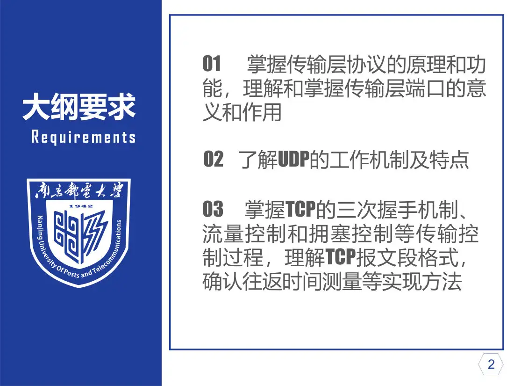

原文：

01 掌握传输层协议的原理和功能，理解和掌握传输层端口的意义和作用

02 了解UDP的工作机制及特点

03 掌握TCP的三次握手机制、流量控制和拥塞控制等传输控制过程，理解TCP报文段格式，确认往返时间测量等实现方法

2

### 内容纲要C o n t e n t s P a g e

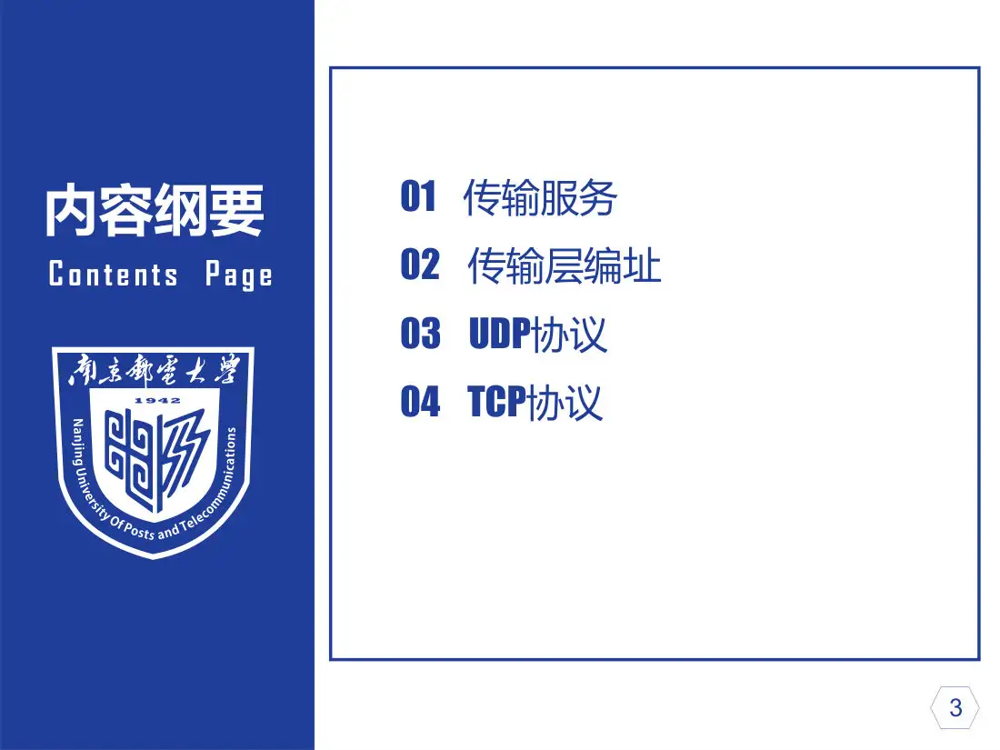

原文：

内容纲要C o n t e n t s P a g e

01 传输服务
02 传输层编址
03 UDP协议
04 TCP协议

3

### 传输层作用

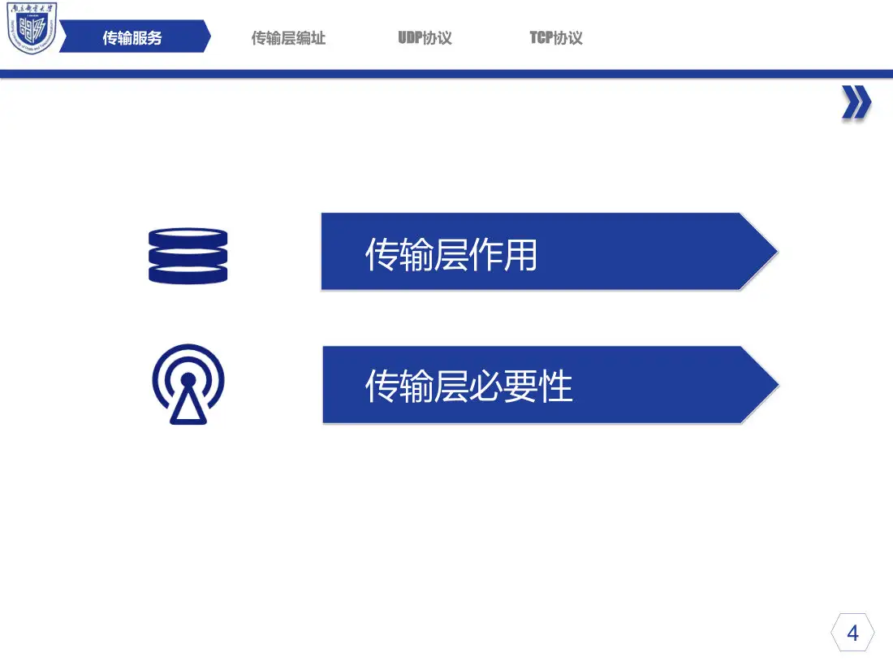

原文：

传输层作用

传输层必要性

南志郵電大學Nanjing Un

传输服务

传输层编址

UDP协议

TCP协议

》

4

### 6.1.1 传输层作用

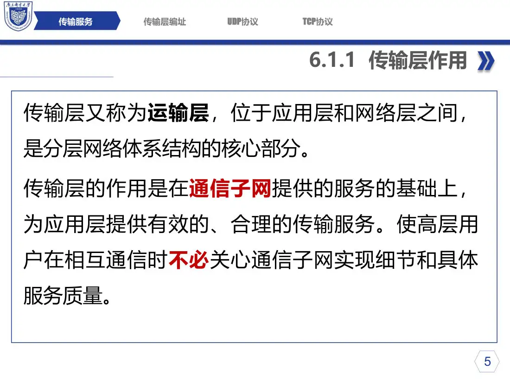

原文：

6.1.1 传输层作用

传输层又称为运输层，位于应用层和网络层之间，是分层网络体系结构的核心部分。

传输层的作用是在通信子网提供的服务的基础上，为应用层提供有效的、合理的传输服务。使高层用户在相互通信时不必关心通信子网实现细节和具体服务质量。

南志郵電大學Nanjing Ur

传输服务

传输层编址

UDP协议

TCP协议

5

### 6.1.1 传输层作用

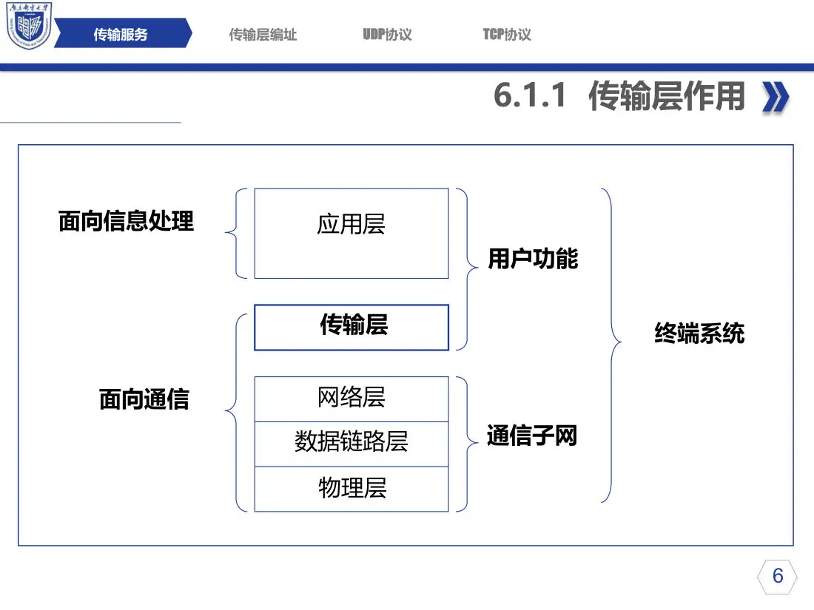

原文：

6.1.1 传输层作用

南志郵電大學Nanjing Ur

传输服务

传输层编址

UDP协议

TCP协议

6

### 应用进程通信

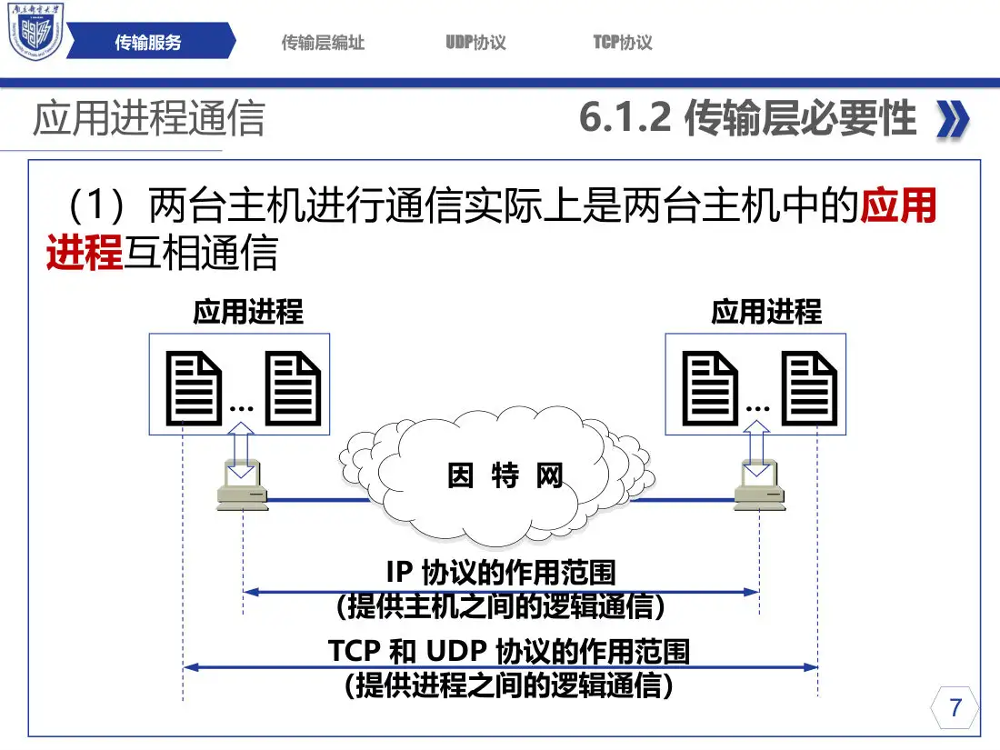

原文：

应用进程通信

6.1.2 传输层必要性

（1）两台主机进行通信实际上是两台主机中的应用进程互相通信

南志郵電大學Nanjing Ur

传输服务

传输层编址

UDP协议

TCP协议

7

### 差错校验

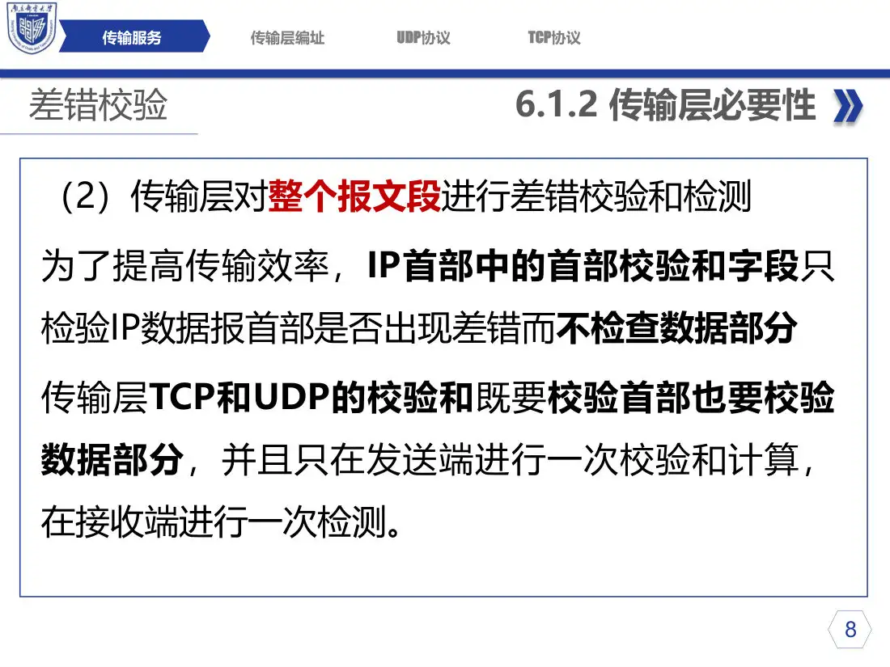

原文：

差错校验

6.1.2 传输层必要性

（2）传输层对整个报文段进行差错校验和检测为了提高传输效率，IP首部中的首部校验和字段只检验IP数据报首部是否出现差错而不检查数据部分传输层TCP和UDP的校验和既要校验首部也要校验数据部分，并且只在发送端进行一次校验和计算，在接收端进行一次检测。

南志郵電大學Nanjing Ur

传输服务

传输层编址

UDP协议

TCP协议

8

### 传输层协议

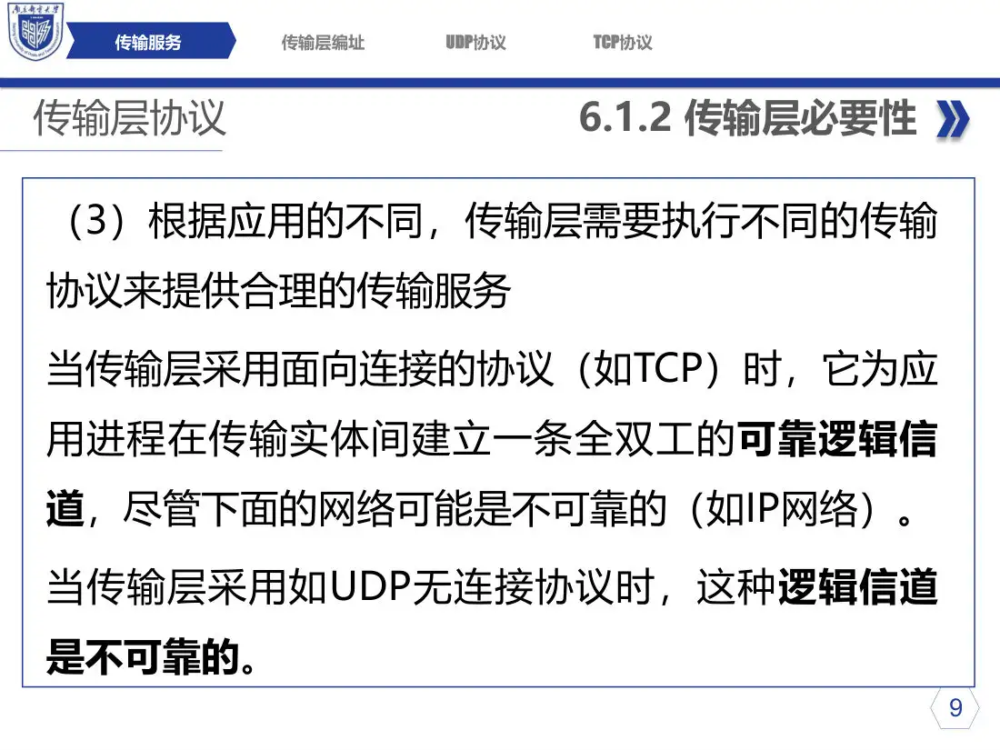

原文：

传输层协议

6.1.2 传输层必要性

（3）根据应用的不同，传输层需要执行不同的传输协议来提供合理的传输服务当传输层采用面向连接的协议（如TCP）时，它为应用进程在传输实体间建立一条全双工的可靠逻辑信道，尽管下面的网络可能是不可靠的（如IP网络）。当传输层采用如UDP无连接协议时，这种逻辑信道是不可靠的。

南志郵電大學Nanjing Ur

传输服务

传输层编址

UDP协议

TCP协议

9

### 传输层协议

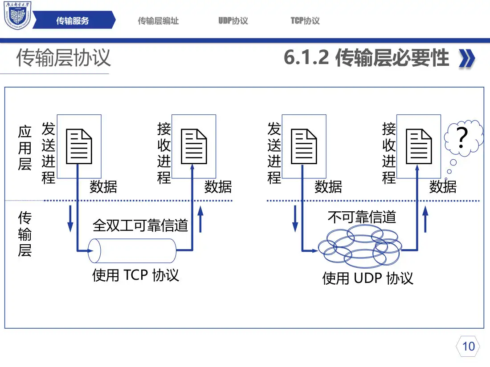

原文：

传输层协议

传
输
层

6.1.2 传输层必要性

使用 UDP 协议

南志郵電大學Nanjing Ur

传输服务

传输层编址

UDP协议

TCP协议

10

### 合理传输服务

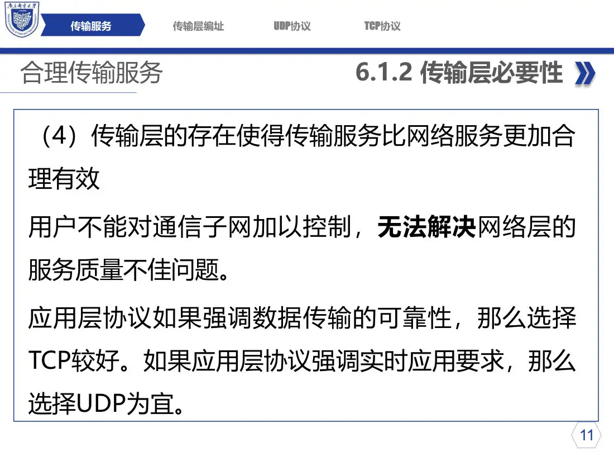

原文：

合理传输服务

6.1.2 传输层必要性

（4）传输层的存在使得传输服务比网络服务更加合理有效

用户不能对通信子网加以控制，无法解决网络层的服务质量不佳问题。

应用层协议如果强调数据传输的可靠性，那么选择TCP较好。如果应用层协议强调实时应用要求，那么选择UDP为宜。

南志郵電大學Nanjing Ur

传输服务

传输层编址

UDP协议

TCP协议

11

### 服务原语

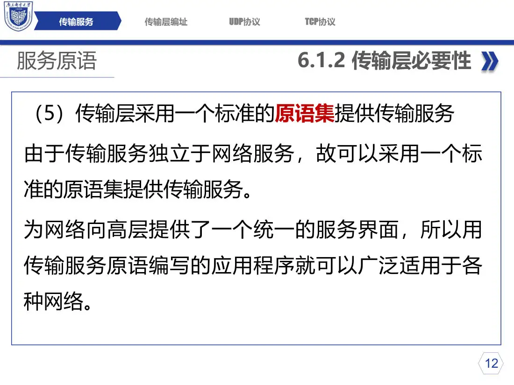

原文：

服务原语

6.1.2 传输层必要性

（5）传输层采用一个标准的原语集提供传输服务由于传输服务独立于网络服务，故可以采用一个标准的原语集提供传输服务。

为网络向高层提供了一个统一的服务界面，所以用传输服务原语编写的应用程序就可以广泛适用于各种网络。

南志郵電大學Nanjing Ur

传输服务

传输层编址

UDP协议

TCP协议

12

### 传输层端口

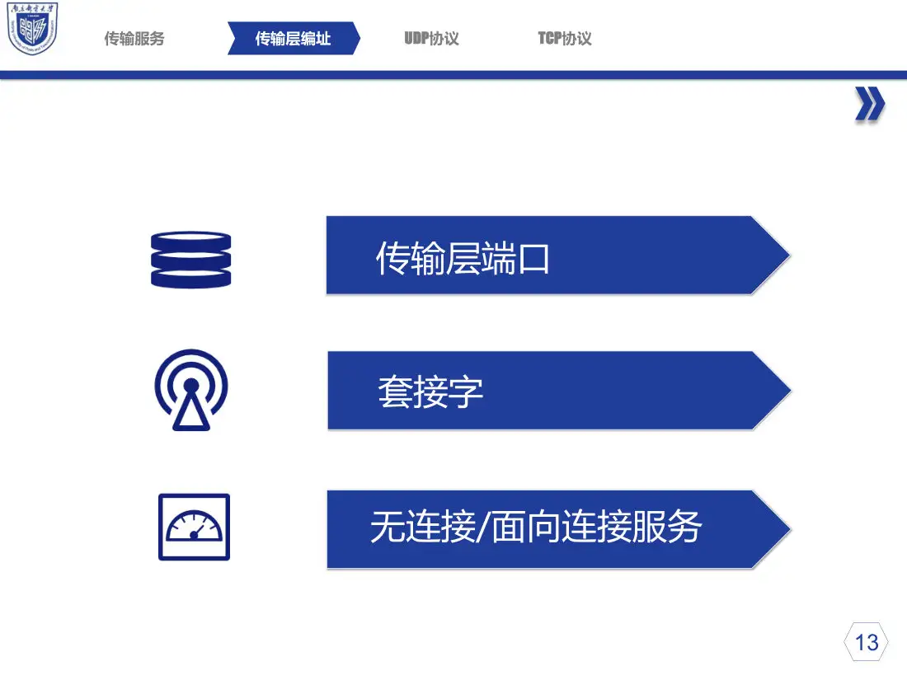

原文：

传输层端口

套接字

无连接/面向连接服务

南志郵電大學Nanjing U

传输服务

传输层编址

UDP协议

TCP协议

》

13

### 基本概念

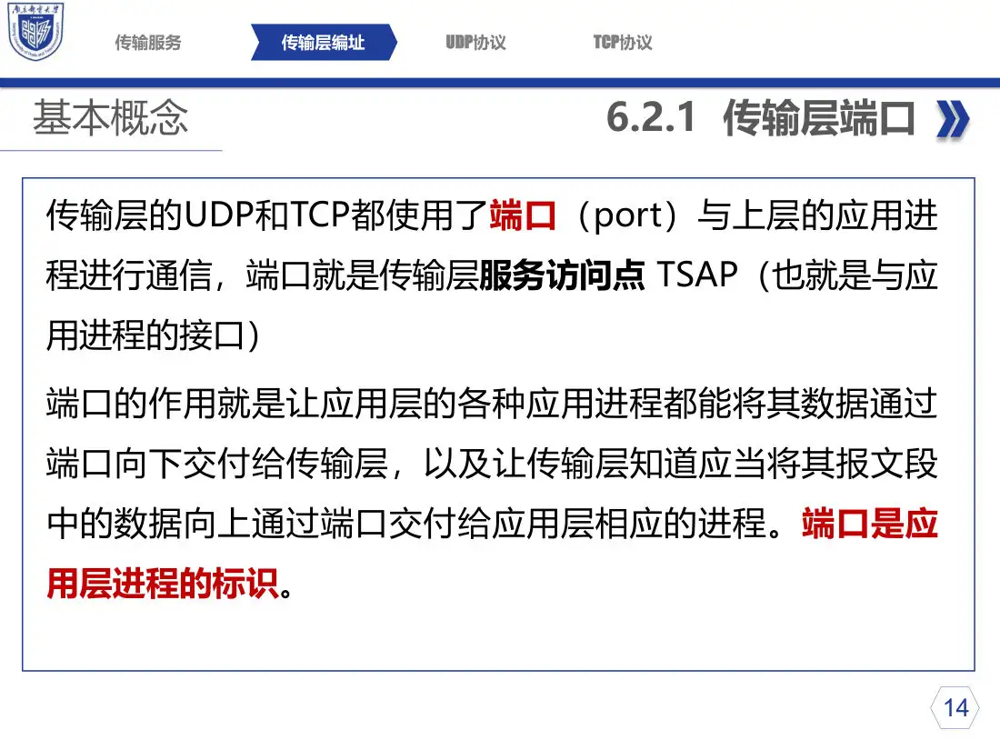

原文：

基本概念

6.2.1 传输层端口

传输层的UDP和TCP都使用了端口（port）与上层的应用进程进行通信，端口就是传输层服务访问点 TSAP（也就是与应用进程的接口）

端口的作用就是让应用层的各种应用进程都能将其数据通过端口向下交付给传输层，以及让传输层知道应当将其报文段中的数据向上通过端口交付给应用层相应的进程。端口是应用层进程的标识。

南志郵電大學Nanjing Ur

传输服务

传输层编址

UDP协议 TCP协议

14

### 复用分用

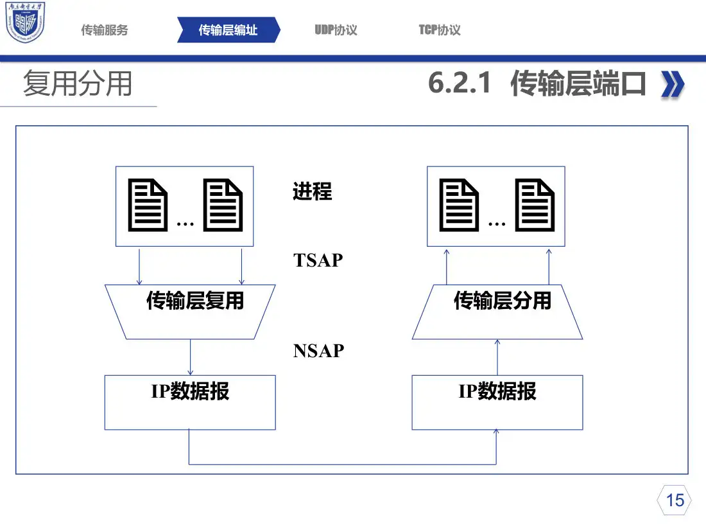

原文：

复用分用

6.2.1 传输层端口

南志郵電大學Nanjing Ur

传输服务

传输层编址

UDP协议

TCP协议

15

### 端口示意

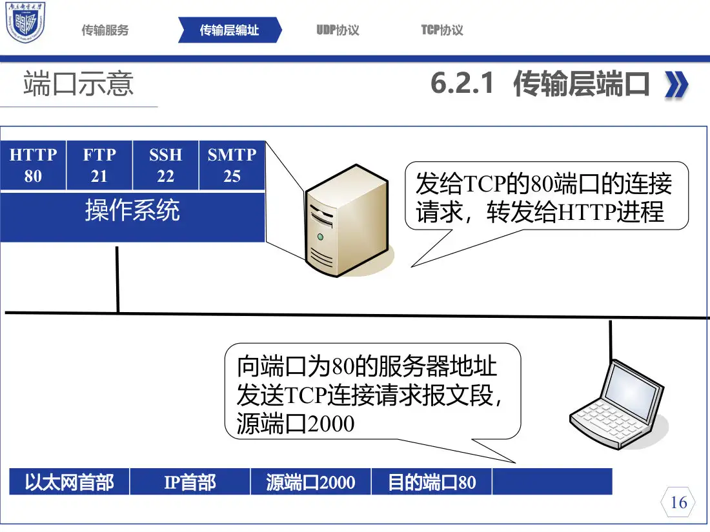

原文：

端口示意

6.2.1 传输层端口

发给TCP的80端口的连接请求，转发给HTTP进程

向端口为80的服务器地址发送TCP连接请求报文段，源端口2000

IP首部

以太网首部

南志郵電大學Nanjing Ur

传输服务

传输层编址

UDP协议

TCP协议

16

### 6.2.1 传输层端口

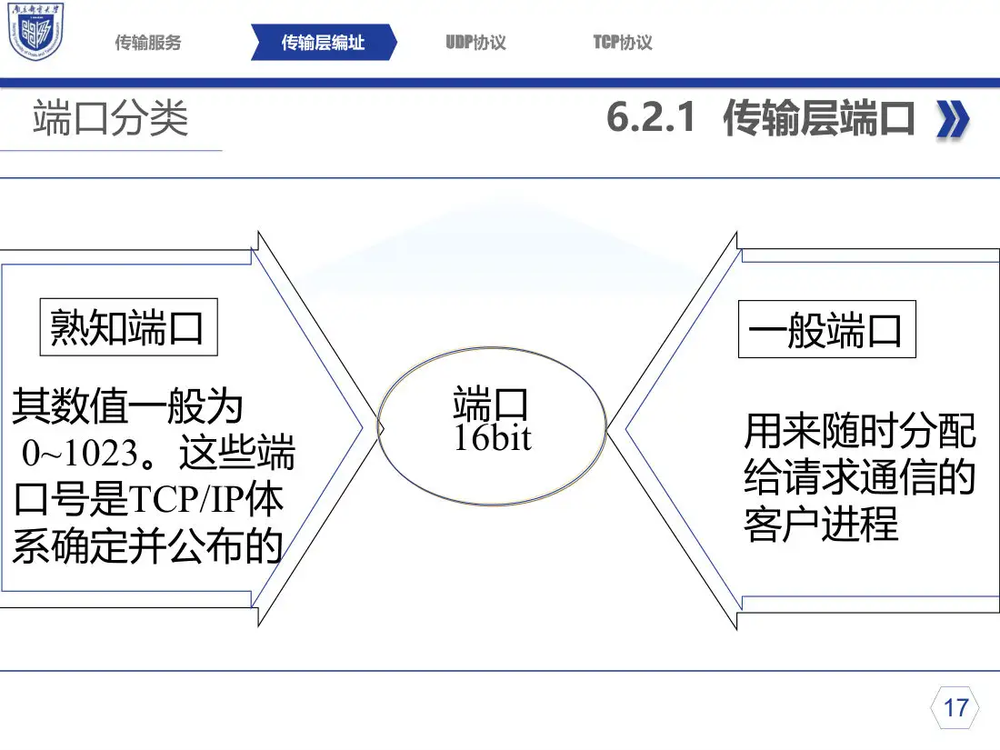

原文：

6.2.1 传输层端口

端口分类

其数值一般为0\~1023。这些端口号是TCP/IP体系确定并公布的用来随时分配给请求通信的客户进程

南志郵電大學Nanjing Ur

传输服务

传输层编址

UDP协议

TCP协议

17

### 常用应用进程默认的端口

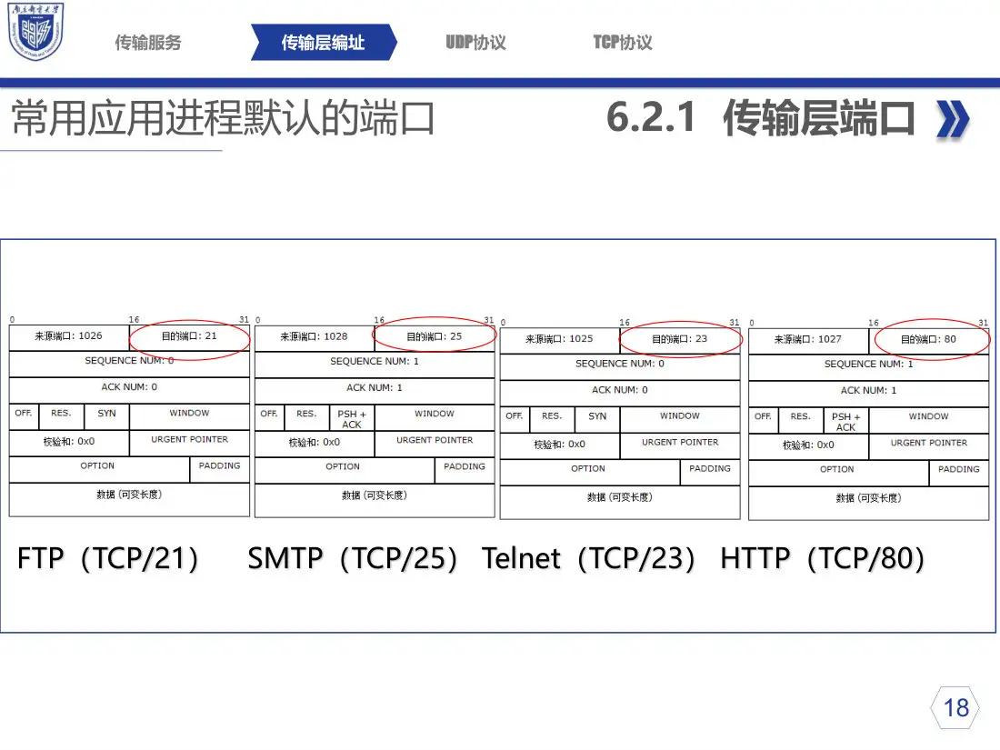

原文：

FTP（TCP/21） SMTP（TCP/25） Telnet（TCP/23） HTTP（TCP/80）

常用应用进程默认的端口

6.2.1 传输层端口

<table><tr><td colspan="5">0 16 31</td></tr><tr><td colspan="3">来源端口: 1027</td><td colspan="2">目的端口: 80</td></tr><tr><td colspan="5">SEQUENCE NUM: 1</td></tr><tr><td colspan="5">ACK NUM: 1</td></tr><tr><td>OFF.</td><td>RES.</td><td>PSH + ACK</td><td colspan="2">WINDOW</td></tr><tr><td colspan="3">校验和: 0x0</td><td colspan="2">URGENT POINTER</td></tr><tr><td colspan="4">OPTION</td><td>PADDING</td></tr><tr><td colspan="5">数据(可变长度)</td></tr></table>

南志執電大學Nanjing Une

传输服务

传输层编址

UDP协议

TCP协议

18

### 常用应用进程默认的端口

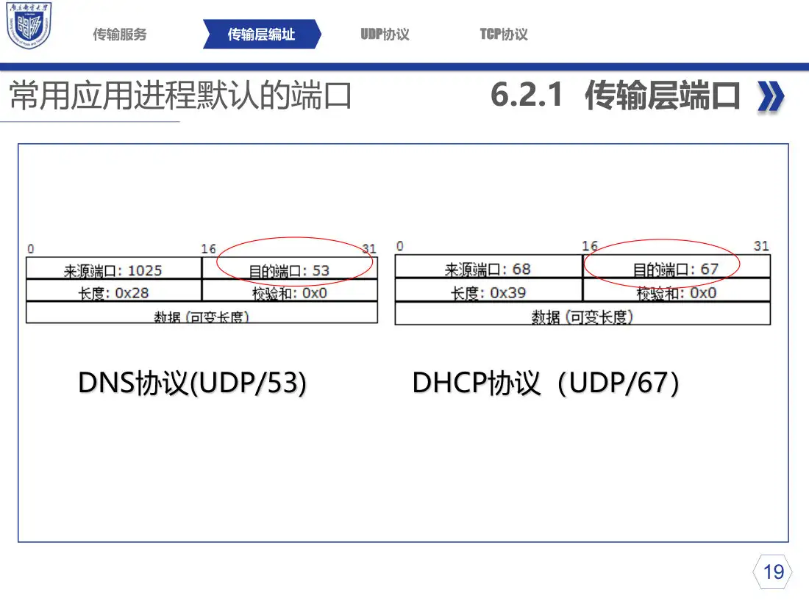

原文：

常用应用进程默认的端口

6.2.1 传输层端口

DNS协议(UDP/53)

DHCP协议（UDP/67）

南志郵電大學Nanjing Ur

传输服务

传输层编址

UDP协议

TCP协议

19

### 基本概念

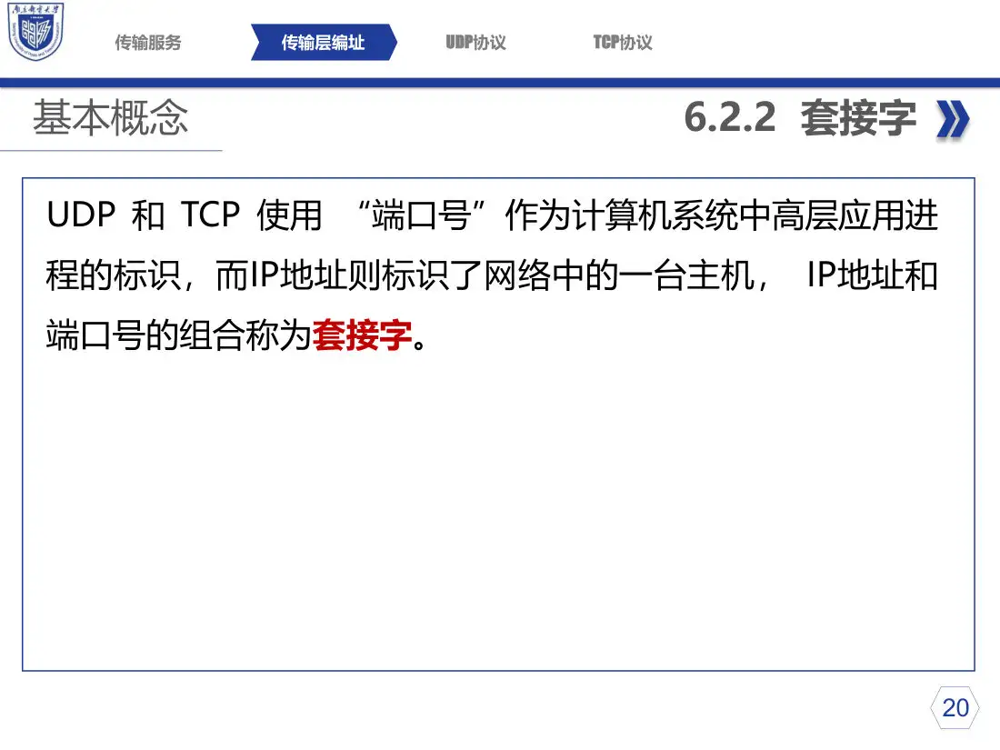

原文：

基本概念

6.2.2 套接字

UDP 和 TCP 使用 “端口号”作为计算机系统中高层应用进程的标识，而IP地址则标识了网络中的一台主机， IP地址和端口号的组合称为套接字。

南志郵電大學Nanjing Ur

传输服务

传输层编址

UDP协议 TCP协议

20

### 基本概念示意

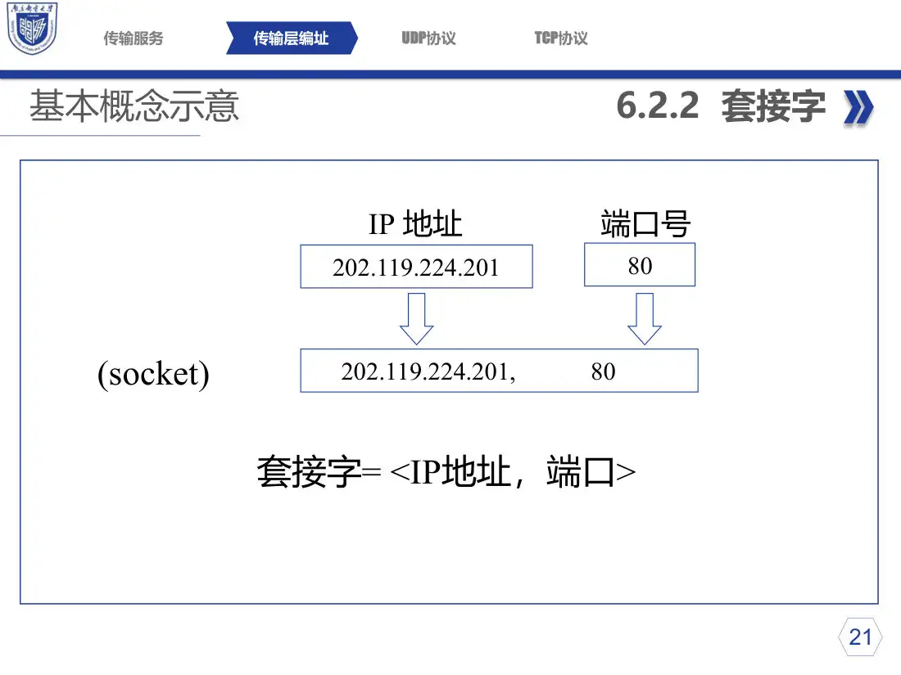

原文：

基本概念示意

6.2.2 套接字

(socket)

套接字= <IP地址，端口>

UDP协议 TCP协议

南志郵電大學Nanjing Ur

传输服务

传输层编址

21

### 五元组

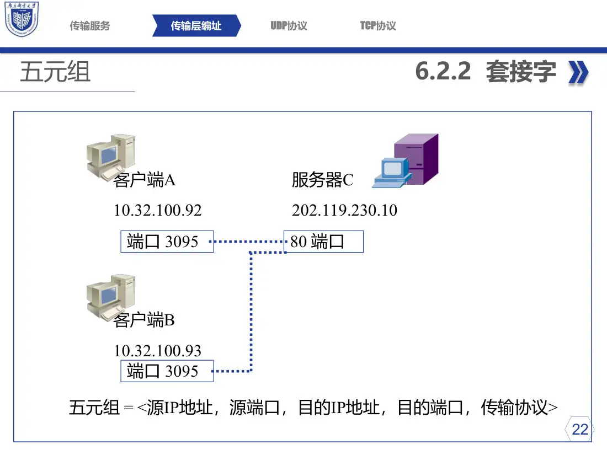

原文：

五元组

6.2.2 套接字

客户端A

10.32.100.92

端口 3095

服务器C

202.119.230.10

80 端口

客户端B

10.32.100.93

端口 3095

五元组 = <源IP地址，源端口，目的IP地址，目的端口，传输协议>

UDP协议 TCP协议

南志郵電大學Nanjing Ur

传输服务

传输层编址

22

### 6.2.3 无连接/面向连接服务

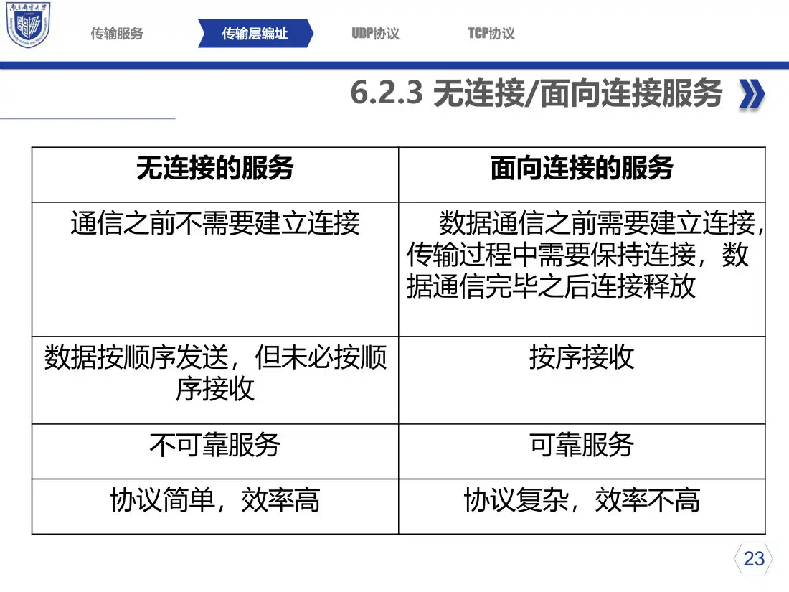

原文：

6.2.3 无连接/面向连接服务

<table><tr><td>无连接的服务</td><td>面向连接的服务</td></tr><tr><td>通信之前不需要建立连接</td><td>数据通信之前需要建立连接,传输过程中需要保持连接,数据通信完毕之后连接释放</td></tr><tr><td>数据按顺序发送,但未必按顺序接收</td><td>按序接收</td></tr><tr><td>不可靠服务</td><td>可靠服务</td></tr><tr><td>协议简单,效率高</td><td>协议复杂,效率不高</td></tr></table>

南志郵電大學Nanjing Ur

传输服务

传输层编址

UDP协议 TCP协议

23

### 6.2.3 无连接/面向连接服务

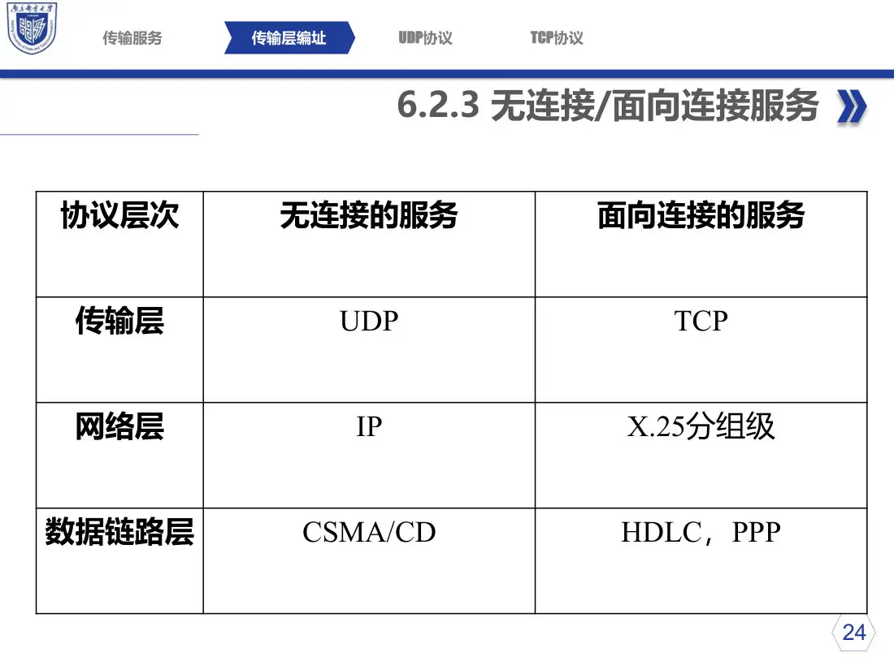

原文：

6.2.3 无连接/面向连接服务

<table><tr><td>协议层次</td><td>无连接的服务</td><td>面向连接的服务</td></tr><tr><td>传输层</td><td>UDP</td><td>TCP</td></tr><tr><td>网络层</td><td>IP</td><td>X.25分组级</td></tr><tr><td>数据链路层</td><td>CSMA/CD</td><td>HDLC, PPP</td></tr></table>

南志郵電大學Nanjing Ur

传输服务

传输层编址

UDP协议

TCP协议

24

### UDP协议特点

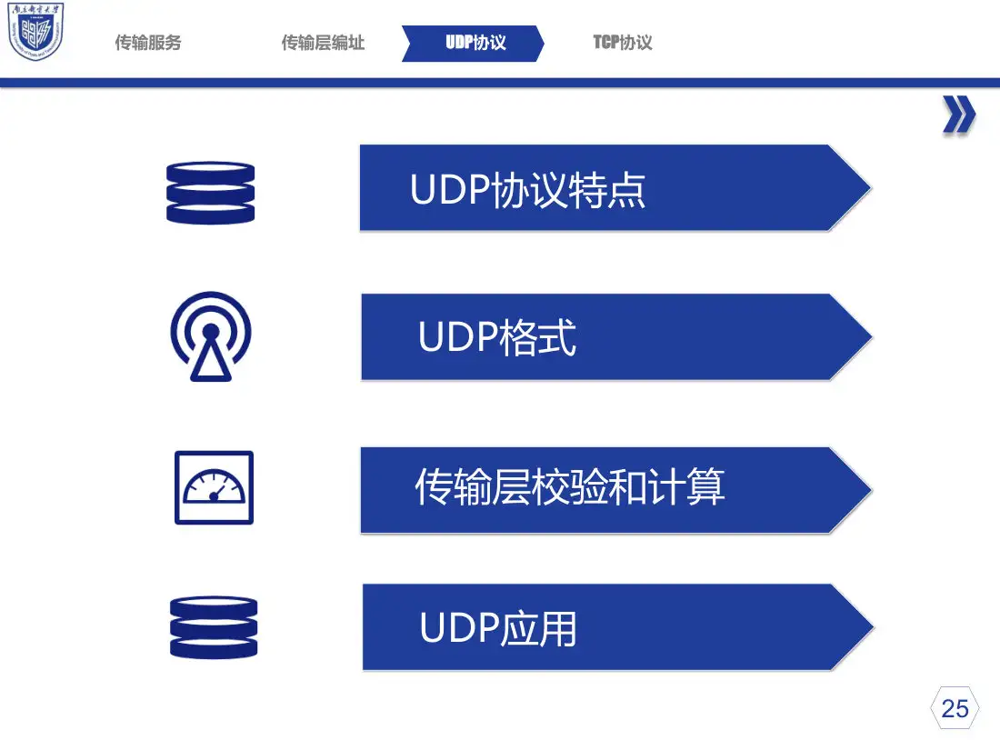

原文：

UDP协议特点
UDP格式
传输层校验和计算
UDP应用

南志郵電大學Nanjing Ur

传输服务

传输层编址

UDP协议

TCP协议

25

### 基本概念

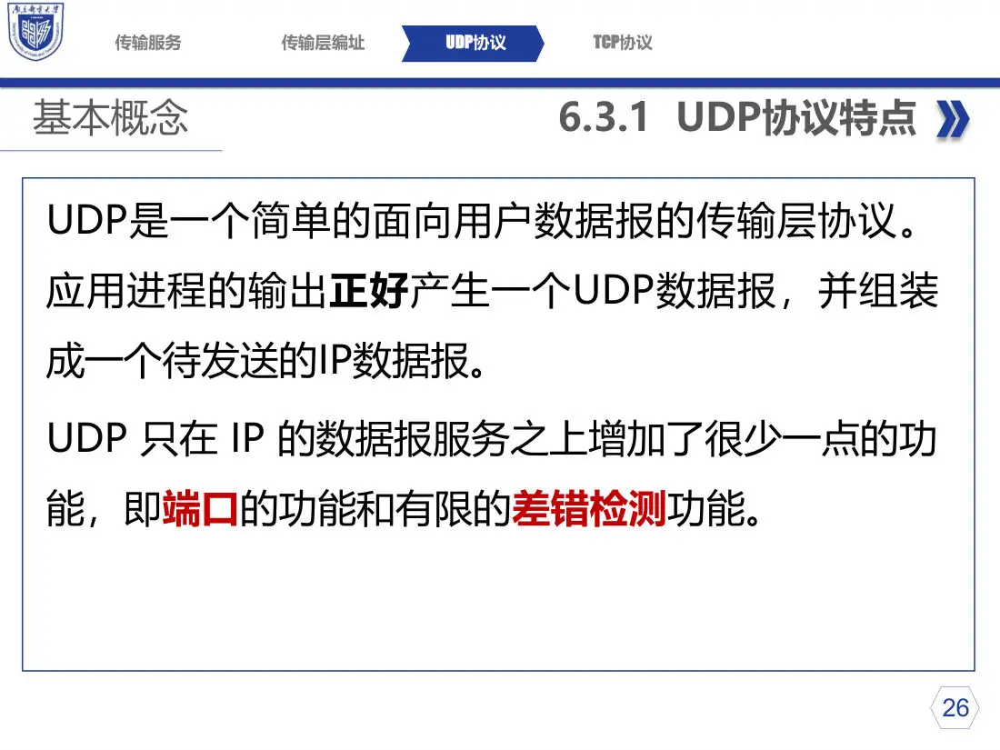

原文：

基本概念

6.3.1 UDP协议特点

UDP是一个简单的面向用户数据报的传输层协议。应用进程的输出正好产生一个UDP数据报，并组装成一个待发送的IP数据报。

UDP 只在 IP 的数据报服务之上增加了很少一点的功能，即端口的功能和有限的差错检测功能。

南志郵電大學Nanjing Ur

传输服务

传输层编址

UDP协议

TCP协议

26

### 基本概念

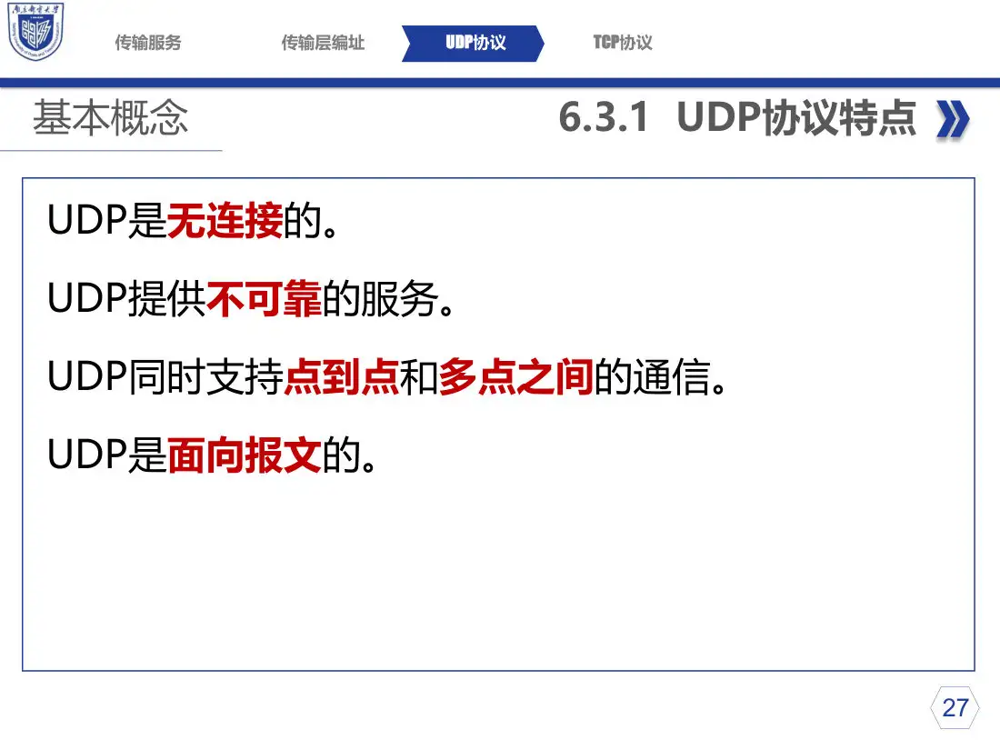

原文：

基本概念

6.3.1 UDP协议特点

UDP是无连接的。

UDP提供不可靠的服务。

UDP同时支持点到点和多点之间的通信。

UDP是面向报文的。

南志郵電大學Nanjing Ur

传输服务

传输层编址

UDP协议

TCP协议

27

### 基本概念

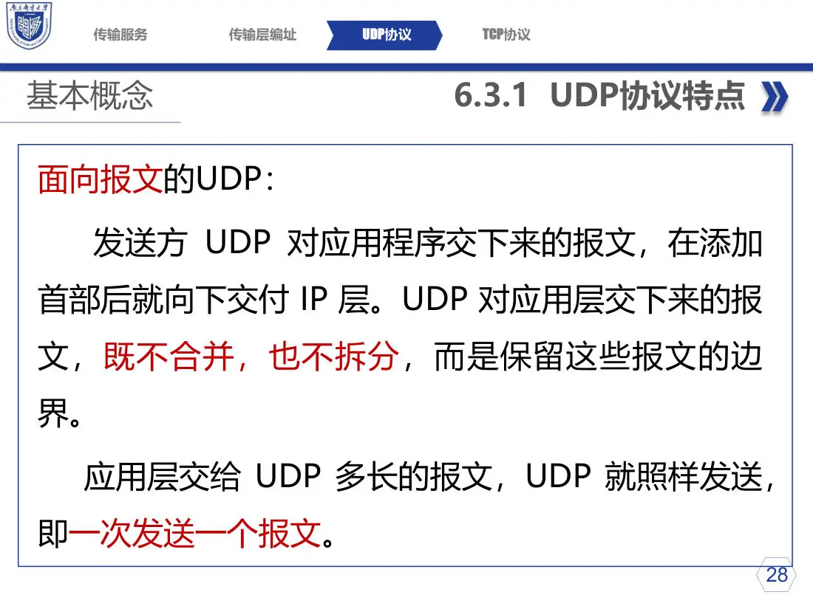

原文：

基本概念

6.3.1 UDP协议特点

面向报文的UDP：

发送方 UDP 对应用程序交下来的报文，在添加首部后就向下交付 IP 层。UDP 对应用层交下来的报文，既不合并，也不拆分，而是保留这些报文的边界。

应用层交给 UDP 多长的报文，UDP 就照样发送，即一次发送一个报文。

南志郵電大學Nanjing Ur

传输服务

传输层编址

UDP协议

TCP协议

28

### 基本概念

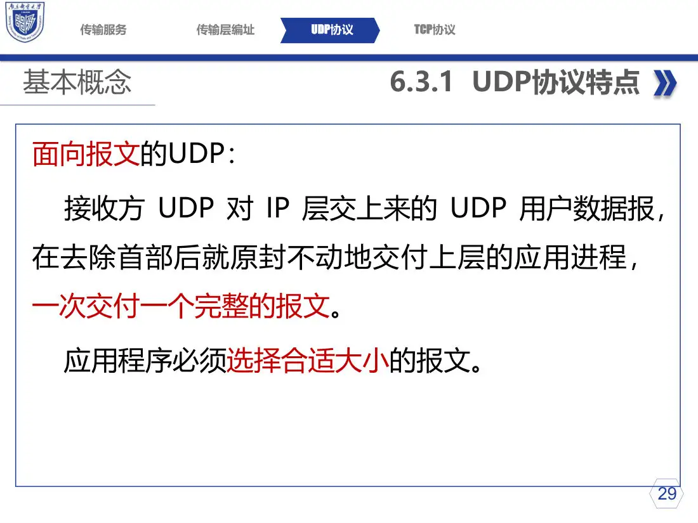

原文：

基本概念

6.3.1 UDP协议特点

面向报文的UDP：

接收方 UDP 对 IP 层交上来的 UDP 用户数据报，在去除首部后就原封不动地交付上层的应用进程，一次交付一个完整的报文。

应用程序必须选择合适大小的报文。

南志郵電大學Nanjing Ur

传输服务

传输层编址

UDP协议

TCP协议

29

### Wireshark采集UDP数据报

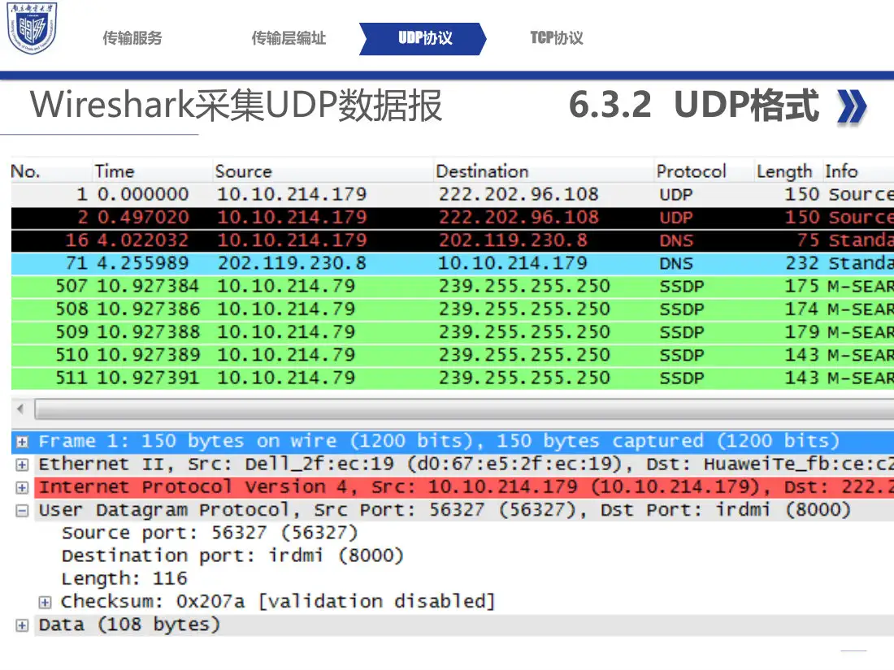

原文：

Wireshark采集UDP数据报

6.3.2 UDP格式

<table><tr><td>No.</td><td>Time</td><td>Source</td><td>Destination</td><td>Protocol</td><td>Length</td><td>Info</td></tr><tr><td>1</td><td>0.000000</td><td>10.10.214.179</td><td>222.202.96.108</td><td>UDP</td><td>150</td><td>Source</td></tr><tr><td>2</td><td>0.497020</td><td>10.10.214.179</td><td>222.202.96.108</td><td>UDP</td><td>150</td><td>Source</td></tr><tr><td>16</td><td>4.022032</td><td>10.10.214.179</td><td>202.119.230.8</td><td>DNS</td><td>75</td><td>Standa</td></tr><tr><td>71</td><td>4.255989</td><td>202.119.230.8</td><td>10.10.214.179</td><td>DNS</td><td>232</td><td>Standa</td></tr><tr><td>507</td><td>10.927384</td><td>10.10.214.79</td><td>239.255.255.250</td><td>SSDP</td><td>175</td><td>M-SEAR</td></tr><tr><td>508</td><td>10.927386</td><td>10.10.214.79</td><td>239.255.255.250</td><td>SSDP</td><td>174</td><td>M-SEAR</td></tr><tr><td>509</td><td>10.927388</td><td>10.10.214.79</td><td>239.255.255.250</td><td>SSDP</td><td>179</td><td>M-SEAR</td></tr><tr><td>510</td><td>10.927389</td><td>10.10.214.79</td><td>239.255.255.250</td><td>SSDP</td><td>143</td><td>M-SEAR</td></tr><tr><td>511</td><td>10.927391</td><td>10.10.214.79</td><td>239.255.255.250</td><td>SSDP</td><td>143</td><td>M-SEAR</td></tr></table>

南志郵電大學Nanjing Ur

传输服务

传输层编址

UDP协议

TCP协议

### 6.3.2 UDP格式

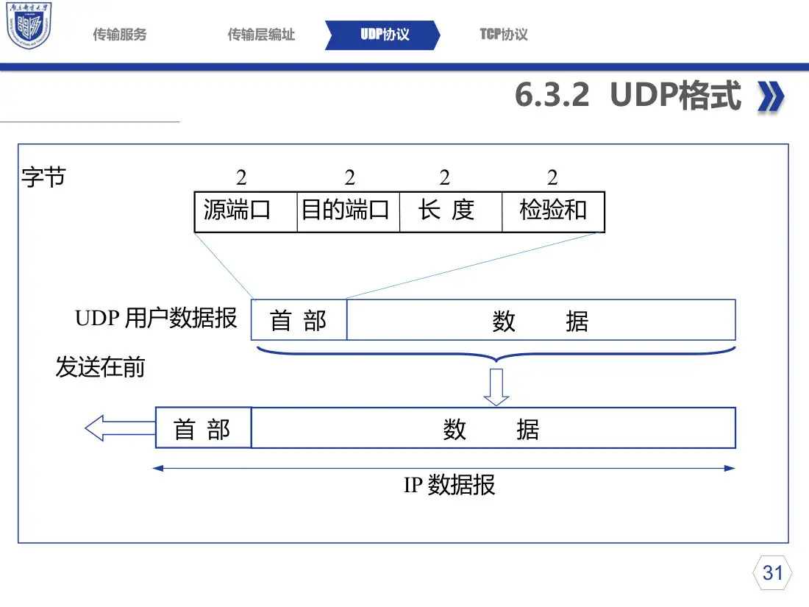

原文：

6.3.2 UDP格式

南志執電大學Nanjing Une

传输服务

传输层编址

UDP协议

TCP协议

31

### 伪首部概念

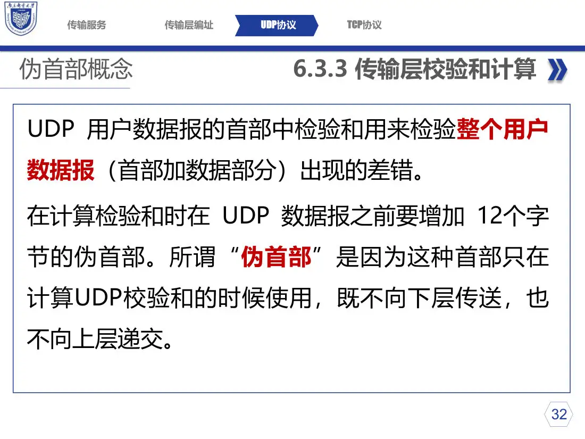

原文：

伪首部概念

6.3.3 传输层校验和计算

UDP 用户数据报的首部中检验和用来检验整个用户数据报（首部加数据部分）出现的差错。

在计算检验和时在 UDP 数据报之前要增加 12个字节的伪首部。所谓“伪首部”是因为这种首部只在计算UDP校验和的时候使用，既不向下层传送，也不向上层递交。

南志郵電大學Nanjing Ur

传输服务

传输层编址

UDP协议

TCP协议

32

### 6.3.3 传输层校验和计算

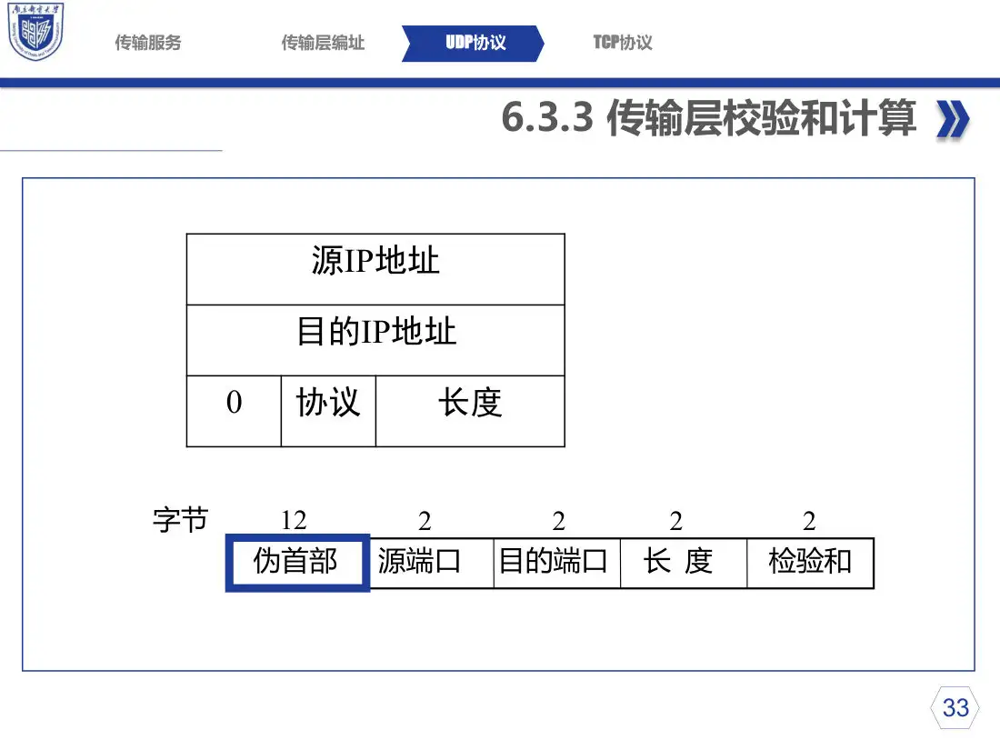

原文：

6.3.3 传输层校验和计算

字节

南志郵電大學Nanjing Ur

传输服务

传输层编址

UDP协议

TCP协议

33

### 举例

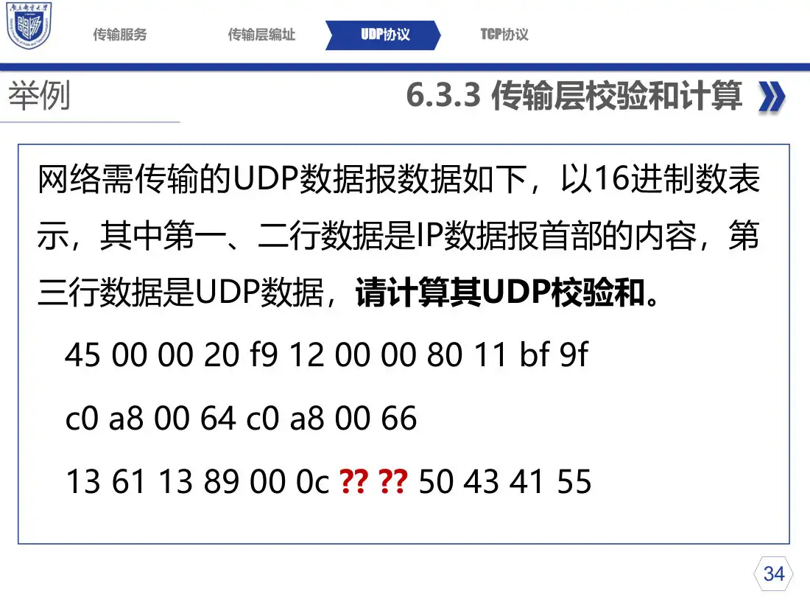

原文：

举例

6.3.3 传输层校验和计算

网络需传输的UDP数据报数据如下，以16进制数表示，其中第一、二行数据是IP数据报首部的内容，第三行数据是UDP数据，请计算其UDP校验和。

45 00 00 20 f9 12 00 00 80 11 bf 9f

c0 a8 00 64 c0 a8 00 66

13 61 13 89 00 0c ?? ?? 50 43 41 55

南志郵電大學Nanjing Ur

传输服务

传输层编址

UDP协议

TCP协议

34

### 举例

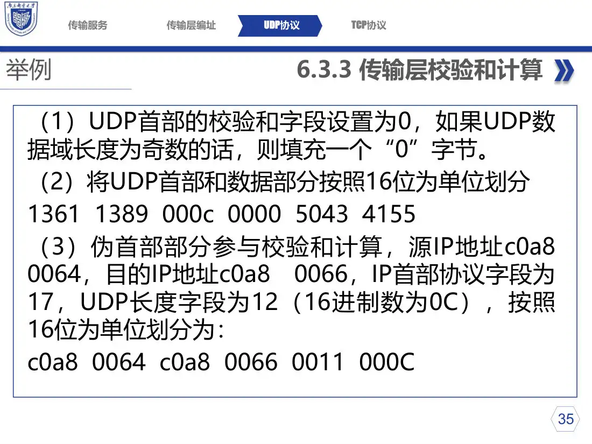

原文：

举例

6.3.3 传输层校验和计算

（1）UDP首部的校验和字段设置为0，如果UDP数据域长度为奇数的话，则填充一个“0”字节。

（2）将UDP首部和数据部分按照16位为单位划分1361 1389 000c 0000 5043 4155

（3）伪首部部分参与校验和计算，源IP地址c0a80064，目的IP地址c0a8 0066，IP首部协议字段为17，UDP长度字段为12（16进制数为0C），按照16位为单位划分为：

c0a8 0064 c0a8 0066 0011 000C

南志郵電大學Nanjing Ur

传输服务

传输层编址

UDP协议

TCP协议

35

### 举例

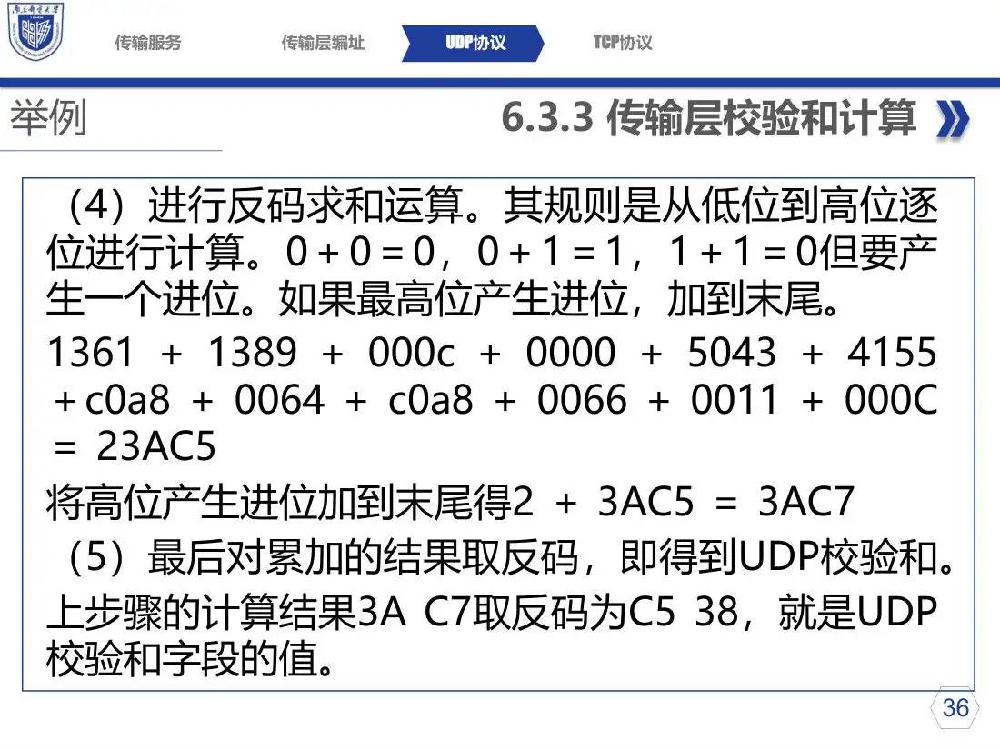

原文：

举例

6.3.3 传输层校验和计算

（4）进行反码求和运算。其规则是从低位到高位逐位进行计算。 $0 + 0 = 0 , 0 + 1 = 1 , 1 + 1 = 0$ 但要产生一个进位。如果最高位产生进位，加到末尾。

$$
\begin{array}{l} 1 3 6 1 + 1 3 8 9 + 0 0 0 \mathrm{c} + 0 0 0 0 + 5 0 4 3 + 4 1 5 5 \\ + \mathrm{c0a8} + 0 0 6 4 + \mathrm{c0a8} + 0 0 6 6 + 0 0 1 1 + 0 0 0 \mathrm{C} \\ = 2 3 \mathrm{AC5} \end{array}
$$

将高位产生进位加到末尾得2 ＋ 3AC5 ＝ 3AC7

（5）最后对累加的结果取反码，即得到UDP校验和。上步骤的计算结果3A C7取反码为C5 38，就是UDP校验和字段的值。

南志郵電大學Nanjing U

传输服务

传输层编址

UDP协议

TCP协议

36

### 6.3.4 UDP应用

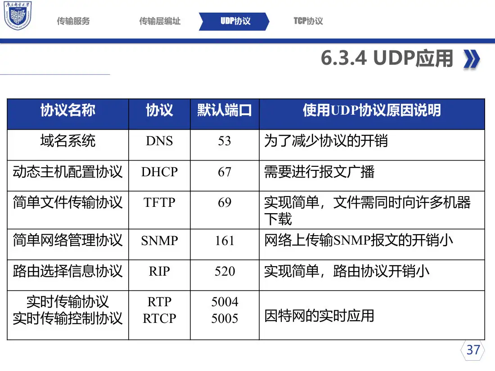

原文：

6.3.4 UDP应用

<table><tr><td>协议名称</td><td>协议</td><td>默认端口</td><td>使用UDP协议原因说明</td></tr><tr><td>域名系统</td><td>DNS</td><td>53</td><td>为了减少协议的开销</td></tr><tr><td>动态主机配置协议</td><td>DHCP</td><td>67</td><td>需要进行报文广播</td></tr><tr><td>简单文件传输协议</td><td>TFTP</td><td>69</td><td>实现简单,文件需同时向许多机器下载</td></tr><tr><td>简单网络管理协议</td><td>SNMP</td><td>161</td><td>网络上传输SNMP报文的开销小</td></tr><tr><td>路由选择信息协议</td><td>RIP</td><td>520</td><td>实现简单,路由协议开销小</td></tr><tr><td>实时传输协议实时传输控制协议</td><td>RTPRTCP</td><td>50045005</td><td>因特网的实时应用</td></tr></table>

南志郵電大學Nanjing Ur

传输服务

传输层编址

UDP协议

TCP协议

37

### TCP协议特点

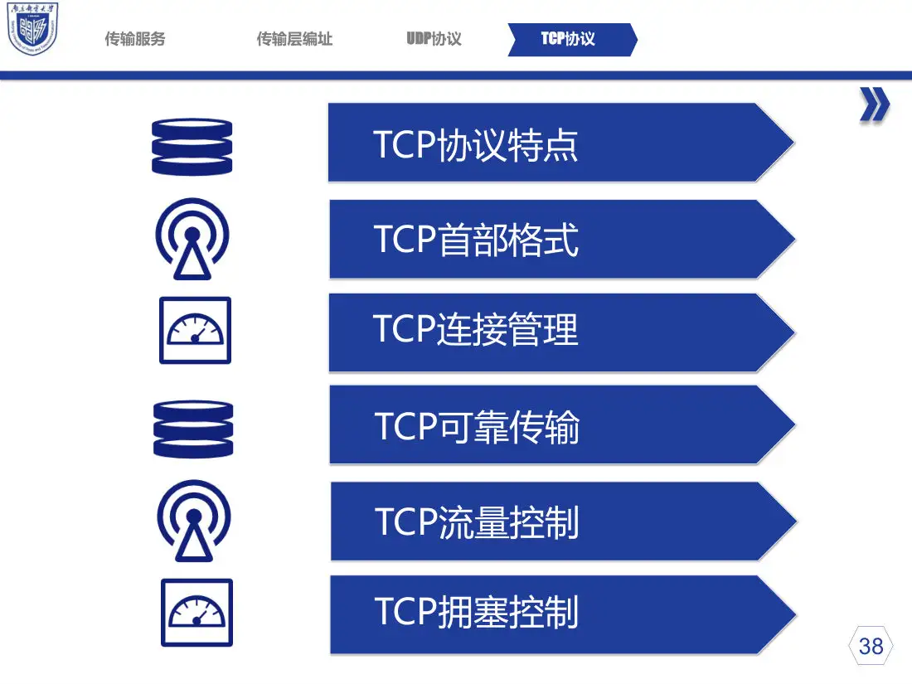

原文：

TCP协议特点

TCP首部格式

TCP连接管理

TCP可靠传输

TCP流量控制

TCP拥塞控制

南志郵電大學Nanjing Un 圆yofpe

传输服务

传输层编址

UDP协议

TCP协议

38

### 基本概念

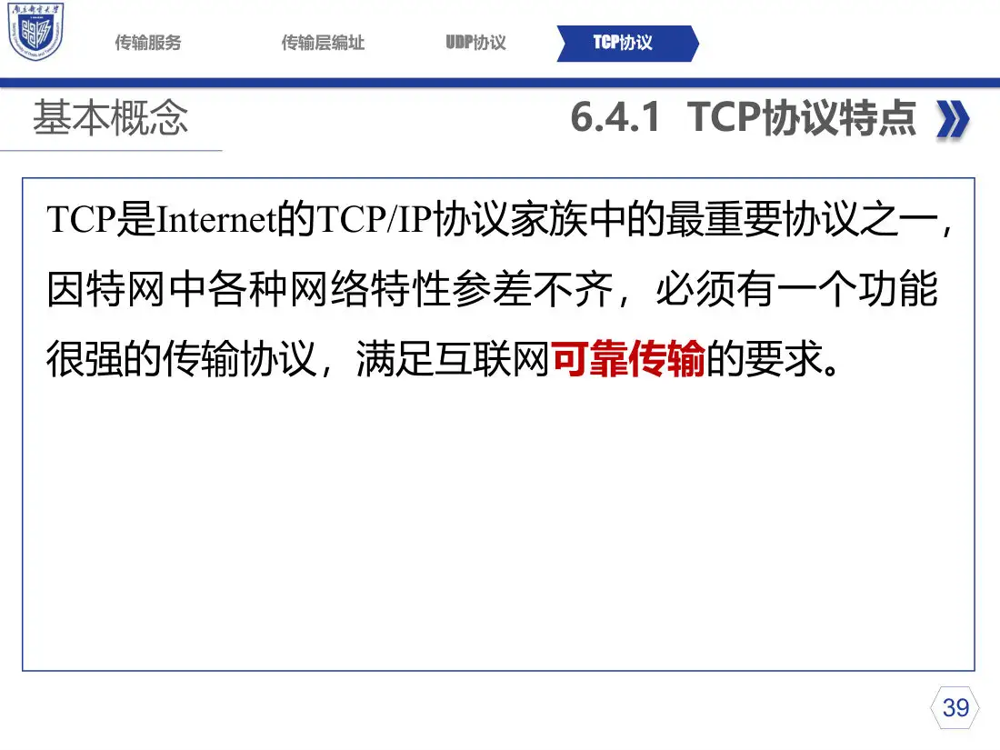

原文：

基本概念

6.4.1 TCP协议特点

TCP是Internet的TCP/IP协议家族中的最重要协议之一，因特网中各种网络特性参差不齐，必须有一个功能很强的传输协议，满足互联网可靠传输的要求。

南志郵電大學Nanjing Ur

传输服务

传输层编址

UDP协议

TCP协议

39

### 基本概念

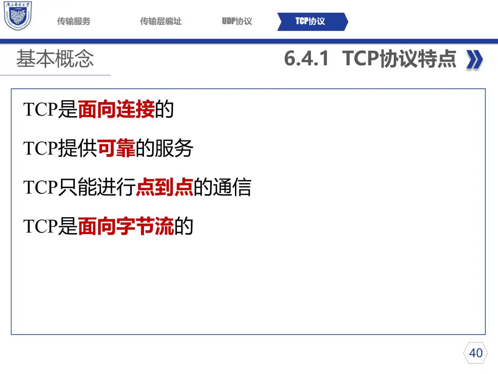

原文：

基本概念

TCP是面向连接的

TCP提供可靠的服务

TCP只能进行点到点的通信

TCP是面向字节流的

6.4.1 TCP协议特点

南志郵電大學Nanjing U

传输服务

传输层编址

UDP协议

TCP协议

40

### 基本概念

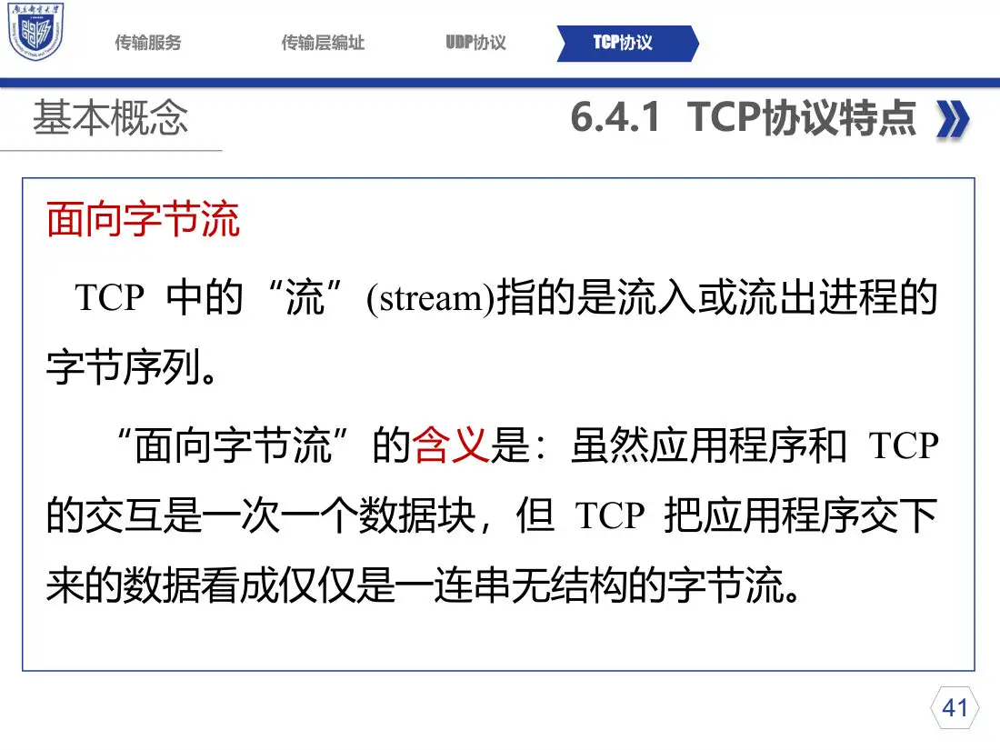

原文：

基本概念

6.4.1 TCP协议特点

面向字节流

TCP 中的“流”(stream)指的是流入或流出进程的字节序列。

“面向字节流”的含义是：虽然应用程序和 TCP的交互是一次一个数据块，但 TCP 把应用程序交下来的数据看成仅仅是一连串无结构的字节流。

南志郵電大學Nanjing Ur

传输服务

传输层编址

UDP协议

TCP协议

41

### 基本概念

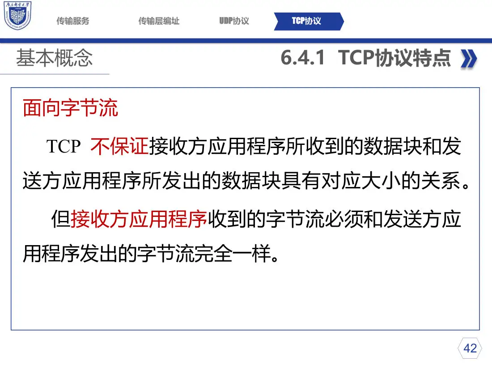

原文：

基本概念

6.4.1 TCP协议特点

面向字节流

TCP 不保证接收方应用程序所收到的数据块和发送方应用程序所发出的数据块具有对应大小的关系。

但接收方应用程序收到的字节流必须和发送方应用程序发出的字节流完全一样。

南志郵電大學Nanjing Ur

传输服务

传输层编址

UDP协议

TCP协议

42

### 基本概念

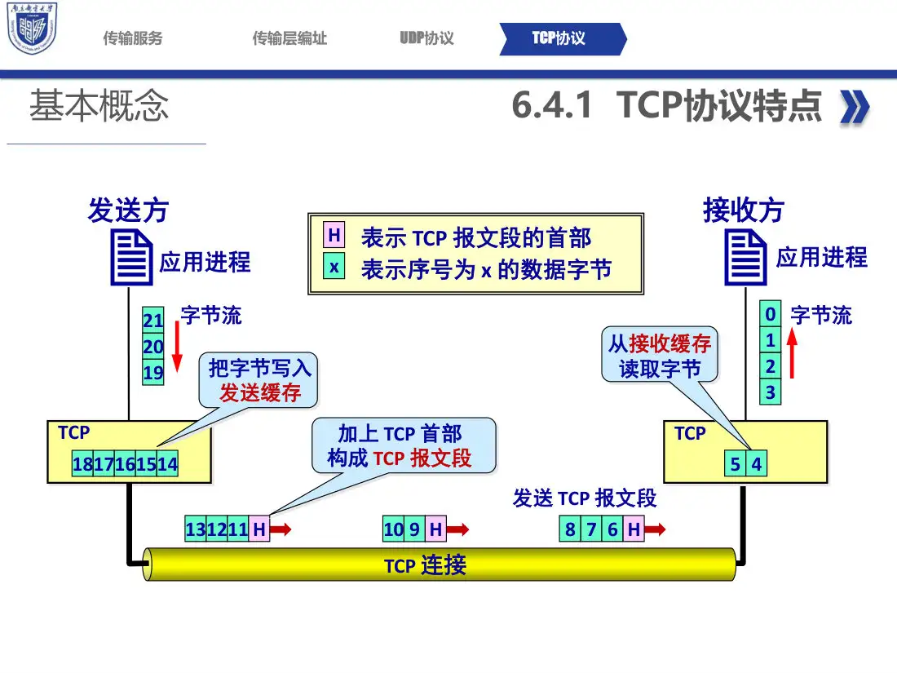

原文：

基本概念

6.4.1 TCP协议特点

南志郵電大學Nanjing U ayofpe

传输服务

传输层编址

UDP协议

TCP协议

### 基本概念

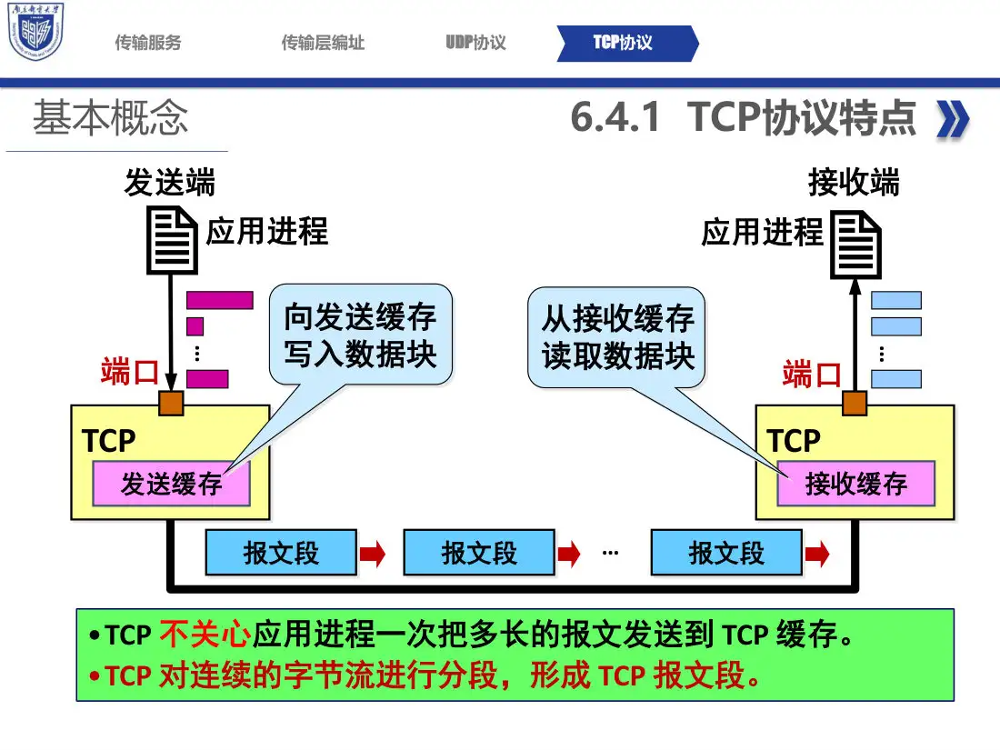

原文：

基本概念

6.4.1 TCP协议特点

•TCP 不关心应用进程一次把多长的报文发送到 TCP 缓存。

•TCP 对连续的字节流进行分段，形成TCP 报文段。

南志郵電大學Nanjing Ur

传输服务

传输层编址

UDP协议

TCP协议

### Wireshark采集TCP报文段

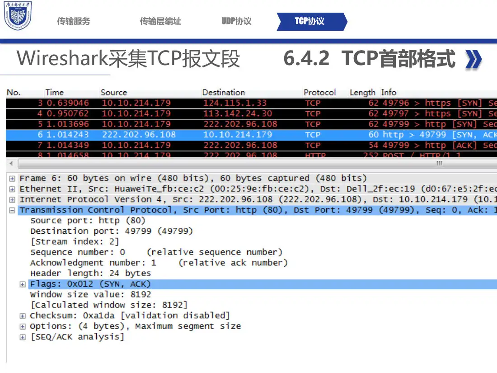

原文：

Wireshark采集TCP报文段

6.4.2 TCP首部格式

南志郵電大學Nanjing Ur

传输服务

传输层编址

UDP协议

TCP协议

### 6.4.7 TCP应用

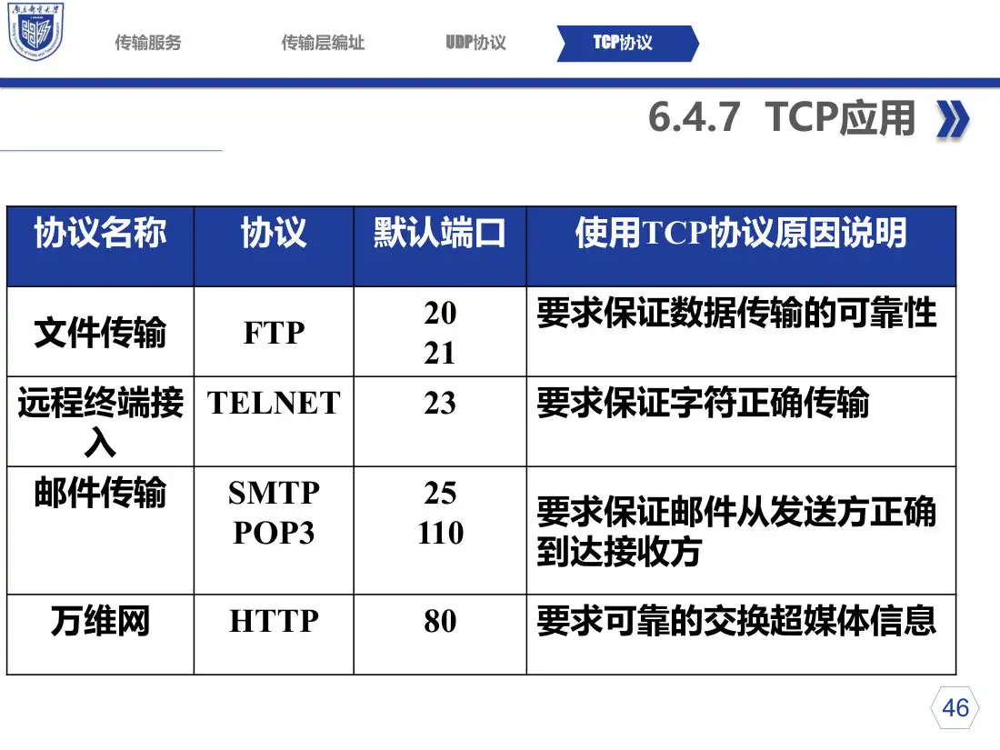

原文：

6.4.7 TCP应用

<table><tr><td>协议名称</td><td>协议</td><td>默认端口</td><td>使用TCP协议原因说明</td></tr><tr><td>文件传输</td><td>FTP</td><td>2021</td><td>要求保证数据传输的可靠性</td></tr><tr><td>远程终端接入</td><td>TELNET</td><td>23</td><td>要求保证字符正确传输</td></tr><tr><td>邮件传输</td><td>SMTPPOP3</td><td>25110</td><td>要求保证邮件从发送方正确到达接收方</td></tr><tr><td>万维网</td><td>HTTP</td><td>80</td><td>要求可靠的交换超媒体信息</td></tr></table>

南志郵電大學Nanjing Ur

传输服务

传输层编址

UDP协议

TCP协议

46

### 6.4.2 TCP首部格式

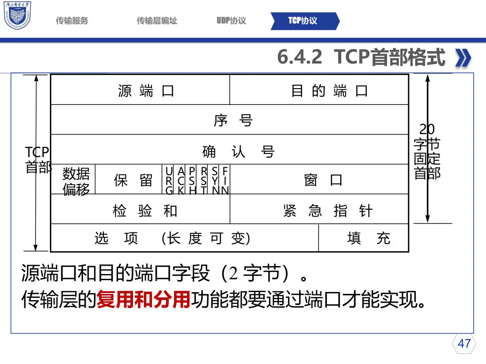

原文：

6.4.2 TCP首部格式

传输层的复用和分用功能都要通过端口才能实现。

南志郵電大學Nanjing U

传输服务

传输层编址 UDP协议

TCP协议

47

### 6.4.2 TCP首部格式

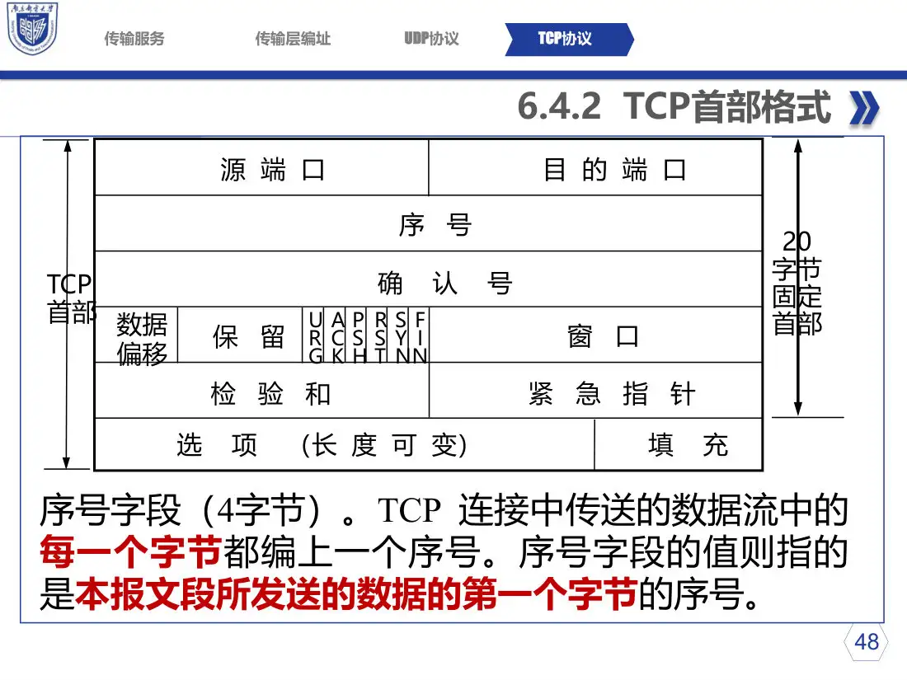

原文：

6.4.2 TCP首部格式

序号字段（4字节）。TCP 连接中传送的数据流中的每一个字节都编上一个序号。序号字段的值则指的是本报文段所发送的数据的第一个字节的序号。

南志執電大學Nanjing Une

传输服务

传输层编址 UDP协议

TCP协议

48

### 6.4.2 TCP首部格式

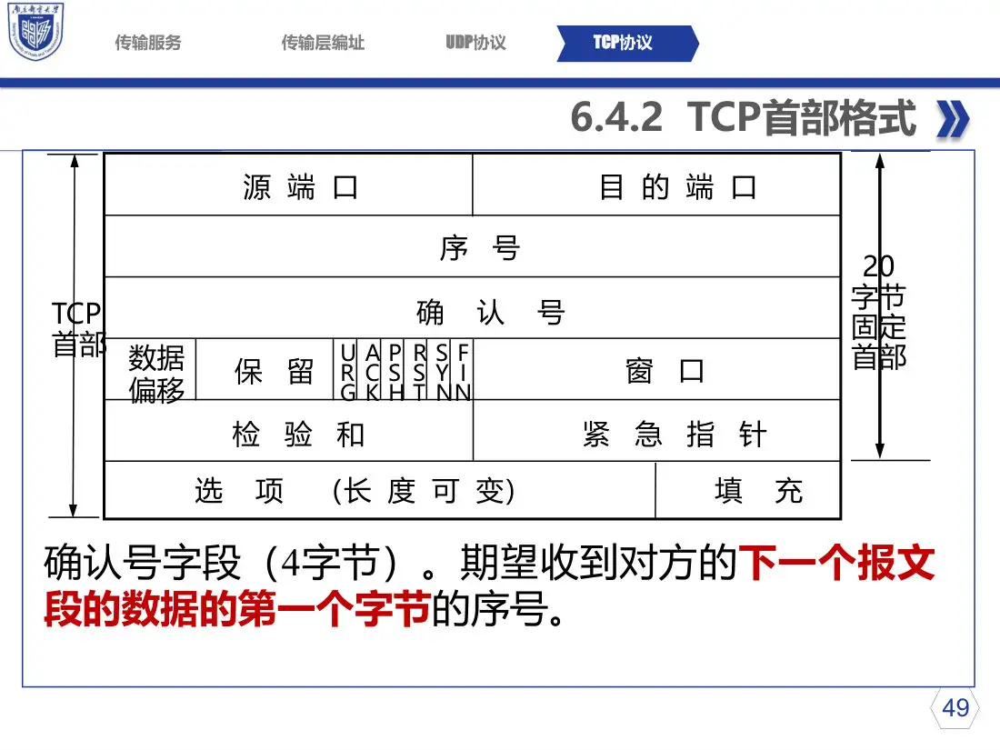

原文：

6.4.2 TCP首部格式

确认号字段（4字节）。期望收到对方的下一个报文段的数据的第一个字节的序号。

南志執電大學Nanjing Une

传输服务

传输层编址 UDP协议

TCP协议

49

### 6.4.2 TCP首部格式

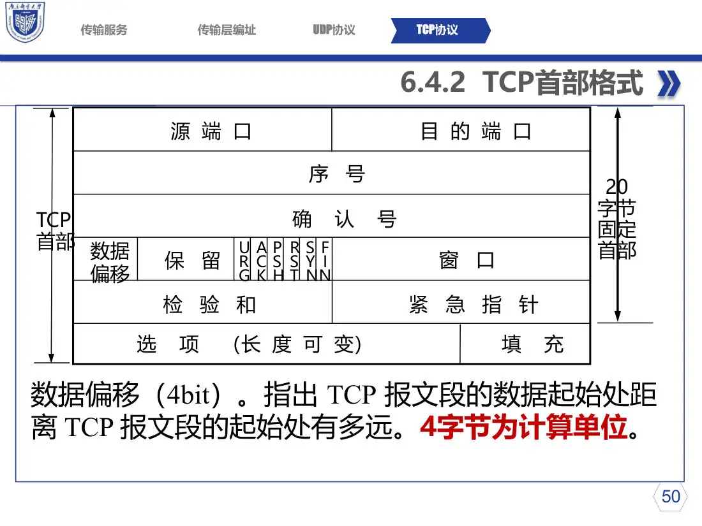

原文：

6.4.2 TCP首部格式

数据偏移（4bit）。指出 TCP 报文段的数据起始处距离 TCP 报文段的起始处有多远。4字节为计算单位。

南志執電大學Nanjing Une

传输服务

传输层编址 UDP协议

TCP协议

50

### 6.4.2 TCP首部格式

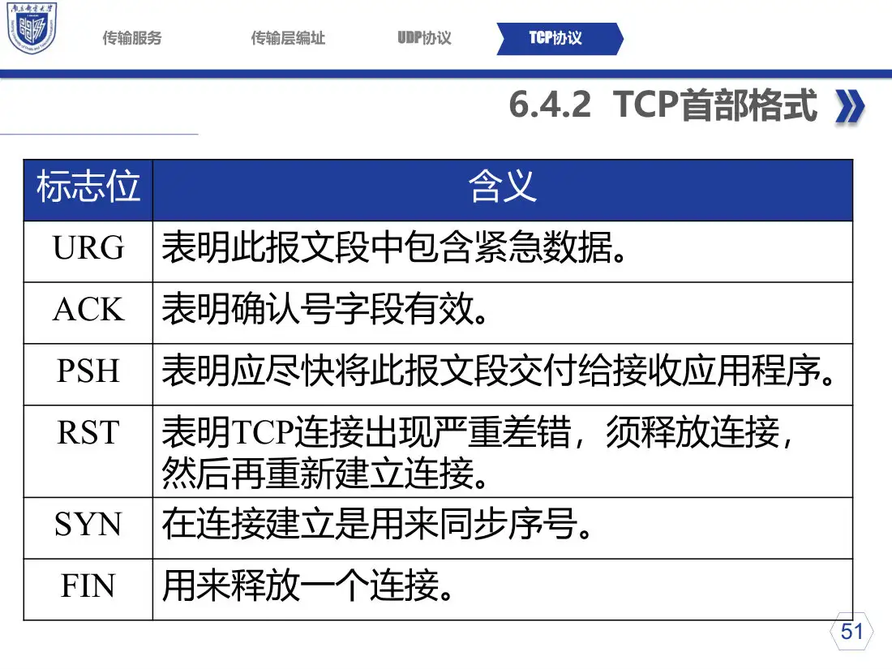

原文：

6.4.2 TCP首部格式

<table><tr><td>标志位</td><td>含义</td></tr><tr><td>URG</td><td>表明此报文段中包含紧急数据。</td></tr><tr><td>ACK</td><td>表明确认号字段有效。</td></tr><tr><td>PSH</td><td>表明应尽快将此报文段交付给接收应用程序。</td></tr><tr><td>RST</td><td>表明TCP连接出现严重差错,须释放连接,然后再重新建立连接。</td></tr><tr><td>SYN</td><td>在连接建立是用来同步序号。</td></tr><tr><td>FIN</td><td>用来释放一个连接。</td></tr></table>

南志郵電大學Nanjing Ur

传输服务

传输层编址

UDP协议

TCP协议

51

### 6.4.2 TCP首部格式

原文：

6.4.2 TCP首部格式

紧急指针字段（2字节）。紧急指针指出在本报文段中的紧急数据的最后一个字节的序号。

南志郵電大學Nanjing U

传输服务

传输层编址 UDP协议

TCP协议

52

### 6.4.2 TCP首部格式

原文：

6.4.2 TCP首部格式

<table><tr><td colspan="9">源端口</td><td colspan="2">目的端口</td></tr><tr><td colspan="11">序号</td></tr><tr><td colspan="11">确认号</td></tr><tr><td>数据偏移</td><td>保留</td><td>URG</td><td>ACK</td><td>PSH</td><td>RST</td><td>SYN</td><td>FIN</td><td colspan="3">窗口</td></tr><tr><td colspan="8">检验和</td><td colspan="3">紧急指针</td></tr><tr><td colspan="9">选项(长度可变)</td><td colspan="2">填充</td></tr></table>

窗口字段（2字节）。窗口字段用来控制对方发送的数据量，单位为字节。TCP 连接的一端根据设置的缓存空间大小确定自己的接收窗口大小，然后通知对方以确定对方的发送窗口的上限。

南志郵電大學Nanjing U

传输服务

传输层编址 UDP协议

TCP协议

53

### 6.4.2 TCP首部格式

原文：

6.4.2 TCP首部格式

检验和（2字节）。检验和字段检验的范围包括首部和数据这两部分。在计算检验和时，要在 TCP 报文段的前面加上 12 字节的伪首部。

南志執電大學Nanjing Une

传输服务

传输层编址 UDP协议

TCP协议

54

### 6.4.2 TCP首部格式

原文：

6.4.2 TCP首部格式

选项字段（长度可变）。TCP只规定了一种选项，即最大报文段长度 MSS。

$$
\mathrm{MSS} = \mathrm{TCP} \text {报文长度} - \mathrm{TCP} \text {首部长度}
$$

55 填充字段，为了使整个首部长度是 4 字节的整数倍。

南志郵電大學Nanjing U

传输服务

传输层编址 UDP协议

TCP协议

### 6.4.2 TCP连接

原文：

6.4.2 TCP连接

A 的 TCP 向 B 发出连接请求报文段，其首部中的同步位 SYN = 1，并选择序号 seq = x，表明传送数据时的第一个数据字节的序号是 x。

南志郵電大學Nanjing Ur

传输服务

传输层编址

UDP协议

TCP协议

### 6.4.2 TCP连接

原文：

6.4.2 TCP连接

B 的 TCP 收到连接请求报文段后，如同意，则发回确认。

B 在确认报文段中应使 $\mathsf { S Y N } = 1$ ，使 $s \mathsf { c K } = 1$ 其确认号 $\mathbf { a c k } = \mathbf { x } + 1$ 自己选择的序号 $\mathsf { s e q } = \mathsf { y }$

南志郵電大學Nanjing Ur

传输服务

传输层编址

UDP协议

TCP协议

### 6.4.2 TCP连接

原文：

6.4.2 TCP连接

A 收到此报文段后向 B 给出确认，其 $\mathsf { A C K } = 1$ 确认号 $\mathbf { a c k } = \mathbf { y } + 1$

• A 的 TCP 通知上层应用进程，连接已经建立。

南志郵電大學Nanjing Ur

传输服务

传输层编址

UDP协议

TCP协议

### 6.4.2 TCP连接

原文：

6.4.2 TCP连接

南志郵電大學Nanjing Ur

传输服务

传输层编址

UDP协议

TCP协议

### 6.4.2 TCP连接

原文：

6.4.2 TCP连接

南志郵電大學Nanjing Ur

传输服务

传输层编址

UDP协议

TCP协议

### 有限状态机

原文：

有限状态机

6.4.3 TCP连接管理

TCP 将连接可能处在的状态及各状态可能发生的变迁，画成状态转移图的形式，称为有限状态机。

图中每一个方框即TCP可能具有的状态，方框中的字是TCP标准使用的状态名；状态之间的箭头表示可能发生的状态变迁，箭头旁边的字表示变迁的原因，或状态变迁后又出现的动作。

南志郵電大學Nanjing Ur

传输服务

传输层编址

UDP协议

TCP协议

62

### 有限状态机

原文：

有限状态机

6.4.3 TCP连接管理

南志郵電大學Nanjing Ur

传输服务

传输层编址

UDP协议

TCP协议

63

### 基本概念

原文：

基本概念

6.4.4 TCP可靠传输

TCP是可靠的传输层协议，主要通过以下三个方面来保证可靠传输：

（1）序号确认机制

（2）超时重传机制

（3）定时器设置

南志郵電大學Nanjing Ur

传输服务

传输层编址

UDP协议

TCP协议

64

### 序号确认机制

原文：

序号确认机制

6.4.4 TCP可靠传输

TCP 将所要传送的整个应用层报文看成是一个个字节组成的数据流，然后对每一个字节编一个序号。

在连接建立时，双方要商定初始序号。

TCP 就将每一次所传送的报文段中的第一个数据字节的序号，放在TCP首部的序号字段中。

南志郵電大學Nanjing Ur

传输服务

传输层编址

UDP协议

TCP协议

65

### 序号确认机制

原文：

序号确认机制

6.4.4 TCP可靠传输

TCP 的确认是对接收到的数据的最高序号表示确认。确认号表示接收端期望下次收到的数据中的第一个数据字节的序号。

为提高效率，TCP可以累积确认，即在接收多个报文段后，一次确认。

南志郵電大學Nanjing Ur

传输服务

传输层编址

UDP协议

TCP协议

66

### 超时重传机制

原文：

超时重传机制

6.4.4 TCP可靠传输

由于 TCP 的下层是一个互连网环境，IP 数据报所选择的路由变化很大。传输层往返时延的方差也很大。

南志郵電大學Nanjing U

传输服务

传输层编址

UDP协议

TCP协议

67

### RTT自适应算法

原文：

RTT自适应算法

6.4.4 TCP可靠传输

计算平均往返时延：

南志郵電大學Nanjing Ur

传输服务

传输层编址

UDP协议

TCP协议

68

### RTT自适应算法举例

原文：

RTT自适应算法举例

6.4.4 TCP可靠传输

已知TCP的往返时延的当前值是30 ms。现在收到了三个接连的确认报文段，它们比相应的数据报文段的发送时间分别滞后的时间是：26ms，32ms和24ms。设α=0.9。试计算新的估计的往返时延值RTTnew。

南志郵電大學Nanjing Ur

传输服务

传输层编址

UDP协议

TCP协议

69

### RTT自适应算法举例

原文：

RTT自适应算法举例

6.4.4 TCP可靠传输

$$
\mathrm{RTTnew} = 3 0 \times \alpha + 2 6 \times (1 - \alpha) = 2 9. 6 \mathrm{ms}
$$

$$
\mathrm{RTTnew} = 2 9. 6 \times \alpha + 3 2 \times (1 - \alpha) = 2 9. 8 4 \mathrm{ms}
$$

$$
\mathrm{RTTnew} = 2 9. 8 4 \times \alpha + 2 4 \times (1 - \alpha) = 2 9. 2 5 6 \mathrm{ms}
$$

南志郵電大學Nanjing Ur

传输服务

传输层编址

UDP协议

TCP协议

70

### RTTD算法

原文：

RTTD算法

6.4.4 TCP可靠传输

71

南志執電大學Nanjing Une

传输服务

传输层编址

UDP协议

TCP协议

### RTO算法

原文：

RTO算法

6.4.4 TCP可靠传输

超时重传时间RTO采用以下公式计算出来：

$$
\mathrm{RTO} = \mathrm{RTTnew} + 4 \times \mathrm{RTTDnew}
$$

Karn 提出了一个算法：在计算平均往返时延时，只要报文段重发了，就不采用其往返时延样本。这样得出的平均往返时延和重发时间较准确。

南志執電大學Nanjing Une

传输服务

传输层编址

UDP协议

TCP协议

72

### 定时器设置

原文：

定时器设置

重传定时器

持续定时器

保活定时器

6.4.4 TCP可靠传输

南志郵電大學Nanjing U

传输服务

传输层编址

UDP协议

TCP协议

73

### 基本概念

原文：

基本概念

6.4.5 TCP流量控制

TCP 采用大小可变滑动窗口的方式进行流量控制。窗口大小的单位是字节。

根据接收方接收能力，通过接收窗口rwnd（receivewindow）可以实现端到端的流量控制，接收端将接收窗口rwnd的值放在 TCP 报文的首部中的“窗口”字段，传送给发送端。

南志執電大學Nanjing Une

传输服务

传输层编址

UDP协议

TCP协议

74

### 基本概念

原文：

基本概念

6.4.5 TCP流量控制

发送窗口在连接建立时由双方商定初始值。

在通信的过程中，接收端可根据自己的资源情况，随时动态地调整自己的接收窗口，然后告诉发送方，使发送方的发送窗口和自己的接收窗口一致。

这种由接收端控制发送端的做法，在计算机网络中经常使用。

南志郵電大學Nanjing Ur

传输服务

传输层编址

UDP协议

TCP协议

75

### 举例

原文：

举例

6.4.5 TCP流量控制

TCP采用大小可变滑动窗口的方式进行流量控制。根据题图的通信情况，设主机A向主机B发送数据。双方商定的窗口值是500。设每一个报文段为100字节长，序号的初始值为1。请问接收方对发送方进行了几次的流量控制？

南志郵電大學Nanjing Ur

传输服务

传输层编址

UDP协议

TCP协议

76

### 举例

原文：

举例

6.4.5 TCP流量控制

$$
\begin{array}{c c} \text {主机A} & \text {主机B} \\ \hline \text {SEQ = 1, WIN = 500} \\ \hline \text {SEQ = 101} \\ \hline \text {ACK = 101, WIN = 400} \\ \hline \text {SEQ = 201} \\ \hline \text {SEQ = 301} \\ \hline \text {SEQ = 101} \\ \hline \text {ACK = 401, WIN = 200} \\ \hline \text {SEQ = 401} \\ \hline \text {ACK = 501, WIN = 0} \\ \hline \end{array} \tag {1}\tag{77}
$$

南志郵電大學Nanjing U

传输服务

传输层编址

UDP协议

TCP协议

### 基本概念

原文：

基本概念

6.4.6 TCP拥塞控制

拥塞控制的基本功能是避免网络发生拥塞，或者缓解已经发生的拥塞。TCP/IP拥塞控制机制主要集中在传输层实现。

南志郵電大學Nanjing Ur

传输服务

传输层编址

UDP协议

TCP协议

78

### 基本概念

原文：

基本概念

6.4.6 TCP拥塞控制

TCP为了进行有效的拥塞控制，需要通过拥塞窗口cwnd（congestion window）来进行衡量网络的拥塞程度。发送窗口的取值依据拥塞窗口和接收窗口中的较小的值，即

Min［rwnd，cwnd

rwnd在流量控制中已阐述，在下文中将只关注cwnd。

南志執電大學Nanjing Une

传输服务

传输层编址

UDP协议

TCP协议

79

### 基本概念

原文：

基本概念

6.4.6 TCP拥塞控制

（1）慢启动：指在TCP刚建立连接或者当网络发生拥塞超时的时候，将拥塞窗口cwnd设置成一个报文段大小，并且当cwnd≤ssthresh时，指数方式增大cwnd（即每经过一个传输轮次，cwnd加倍）。

南志郵電大學Nanjing Ur

传输服务

传输层编址

UDP协议

TCP协议

80

### 基本概念

原文：

基本概念

6.4.6 TCP拥塞控制

（2）拥塞避免：当cwnd≥ssthresh时，为避免网络发生拥塞，进入拥塞避免算法，这时候以线性方式增大cwnd（即每经过一个传输轮次，cwnd只增大一个报文段）。

南志郵電大學Nanjing Ur

传输服务

传输层编址

UDP协议

TCP协议

81

### 基本概念

原文：

基本概念

6.4.6 TCP拥塞控制

（3）快速重传：快速重传算法是指发送方如果连续收到三个重复确认的ACK，则立即重传该报文段，而不必等待重传定时器超时后再重传。

（4）快速恢复：快速恢复算法是指当采用快速重传算法的时候，直接执行拥塞避免算法。这样可以提高传输效率。

南志郵電大學Nanjing Ur

传输服务

传输层编址

UDP协议

TCP协议

82

### 基本概念

原文：

基本概念

6.4.6 TCP拥塞控制

南志郵電大學Nanjing Ur

传输服务

传输层编址

UDP协议

TCP协议

83

### 举例

原文：

举例

6.4.6 TCP拥塞控制

TCP的拥塞窗口cwnd大小（以报文段个数为单位）与传输轮次n的关系如图所示：

（1）请画出拥塞窗口和传输轮次的关系曲线图。

（2）请问各个传输轮次使用的是什么拥塞控制算法？

（3）各个阶段的门限值ssthresh各是多大？

（4）第40个报文段在第几个传输轮次发送？

南志郵電大學Nanjing U

传输服务

传输层编址

UDP协议

TCP协议

84

### 举例

原文：

举例

6.4.6 TCP拥塞控制

<table><tr><td>CWNd</td><td>1</td><td>2</td><td>4</td><td>8</td><td>16</td><td>17</td><td>18</td><td>19</td><td>20</td></tr><tr><td>n</td><td>1</td><td>2</td><td>3</td><td>4</td><td>5</td><td>6</td><td>7</td><td>8</td><td>9</td></tr><tr><td>CWNd</td><td>1</td><td>2</td><td>4</td><td>8</td><td>10</td><td>11</td><td>12</td><td>6</td><td>7</td></tr><tr><td>n</td><td>10</td><td>11</td><td>12</td><td>13</td><td>14</td><td>15</td><td>16</td><td>17</td><td>18</td></tr></table>

南志郵電大學Nanjing Ur

传输服务

传输层编址

UDP协议

TCP协议

85

### 举例

原文：

举例

6.4.6 TCP拥塞控制

南志郵電大學Nanjing Ur

传输服务

传输层编址

UDP协议

TCP协议

86

### 举例

原文：

举例

6.4.6 TCP拥塞控制

传输层编址 UDP协议

南志郵電大學Nanjing U

传输服务

TCP协议

### 举例

原文：

举例

6.4.6 TCP拥塞控制

TCP最大长度为1000字节，若主机甲的当前拥塞窗口为5000字节（初始的接收窗口足够大），假定报文段初始的序号是1，在主机甲向乙连续发送2个最大段后，成功收到主机乙发送的第一段的确认段，确认段中通告的接收窗口大小为3000字节，此时主机甲还可以向主机乙发送的报文段序号分别是多少？

南志執電大學Nanjing Une

传输服务

传输层编址

UDP协议

TCP协议

88

### 举例

原文：

举例

6.4.6 TCP拥塞控制

发送方的发送窗口的上限值应该取接收方窗口和拥塞窗口这两个值中较小的一个，于是此时发送方的发送窗口为MIN{5000B, 3000B}=3000B。

由于发送方还没有收到第二个最大段的确认，所以此时主机甲还可以向主机乙发送的最大字节数为3000B-1000B=2000B。

第一个报文段的序号是1，第二个报文段的序号是1001（尚未收到确认）。所以，还可以发送的两个TCP报文段的序号分别是：2001和3001。

南志執電大學Nanjing Une

传输服务

传输层编址

UDP协议

TCP协议

89

### 举例

原文：

举例

6.4.6 TCP拥塞控制

<table><tr><td></td><td colspan="5">接收窗口rwnd=3000</td></tr><tr><td>1</td><td>1001</td><td>2001</td><td>3001</td><td>4001</td><td>5001</td></tr><tr><td>1000</td><td>2000</td><td>3000</td><td>4000</td><td>5000</td><td></td></tr><tr><td colspan="6">拥塞窗口cwnd=5000</td></tr></table>

南志郵電大學Nanjing Ur

传输服务

传输层编址

UDP协议

TCP协议

90

### 6.4.7 TCP应用

原文：

6.4.7 TCP应用

<table><tr><td>协议名称</td><td>协议</td><td>默认端口</td><td>使用TCP协议原因说明</td></tr><tr><td>文件传输</td><td>FTP</td><td>2021</td><td>要求保证数据传输的可靠性</td></tr><tr><td>远程终端接入</td><td>TELNET</td><td>23</td><td>要求保证字符正确传输</td></tr><tr><td>邮件传输</td><td>SMTPPOP3</td><td>25110</td><td>要求保证邮件从发送方正确到达接收方</td></tr><tr><td>万维网</td><td>HTTP</td><td>80</td><td>要求可靠的交换超媒体信息</td></tr></table>

南志郵電大學Nanjing Ur

传输服务

传输层编址

UDP协议

TCP协议

91

### Thank You

原文：

Thank You

H a v e A N i c e D a y

南京邮电大学通信与信息工程学院
