# 《计算机通信与网络》第7章 应用层（课件）

原件的每一页，下面附识别出的文字。

### 第 7 章应用层

原文：

计算机通信与网络 Computer Communications & Networks

第 7 章应用层

南京邮电大学计算机学院“计算机通信与网络”国家精品课程组

### 大纲要求R e q u i r e m e n t s

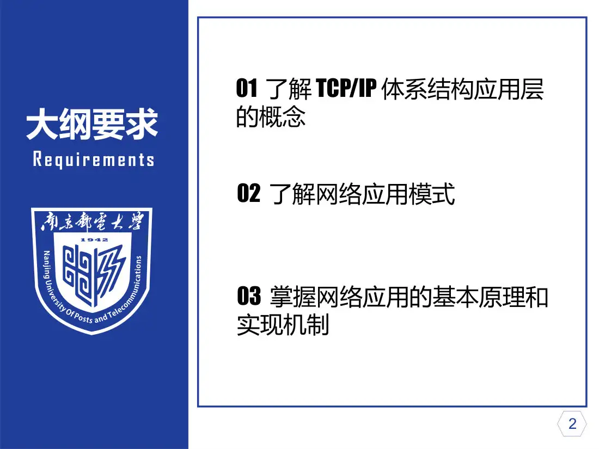

原文：

大纲要求R e q u i r e m e n t s

01 了解 TCP/IP 体系结构应用层的概念

02 了解网络应用模式

03 掌握网络应用的基本原理和实现机制

2

### 内容纲要C o n t e n t s P a g e

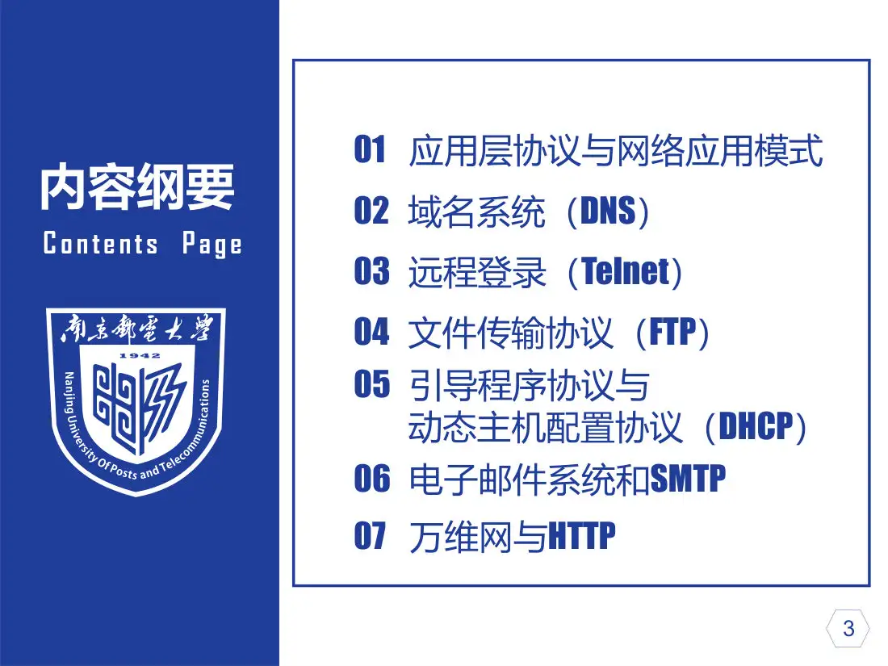

原文：

内容纲要C o n t e n t s P a g e

01 应用层协议与网络应用模式  
02 域名系统（DNS）  
03 远程登录（Telnet）  
04 文件传输协议（FTP）  
05 引导程序协议与动态主机配置协议（DHCP）  
06 电子邮件系统和SMTP  
07 万维网与HTTP

3

### 内容提要T r a n s i t i o n P a g e

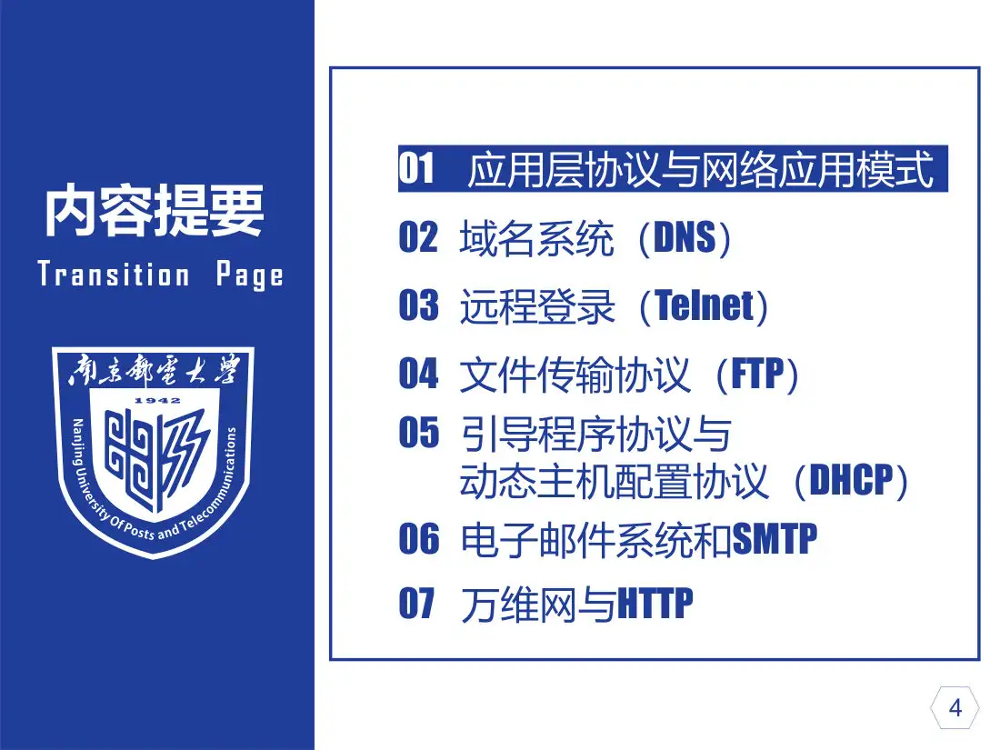

原文：

内容提要T r a n s i t i o n P a g e

01 应用层协议与网络应用模式
02 域名系统（DNS）
03 远程登录（Telnet）
04 文件传输协议（FTP）
05 引导程序协议与动态主机配置协议（DHCP）
06 电子邮件系统和SMTP
07 万维网与HTTP

4

### 应用层协议

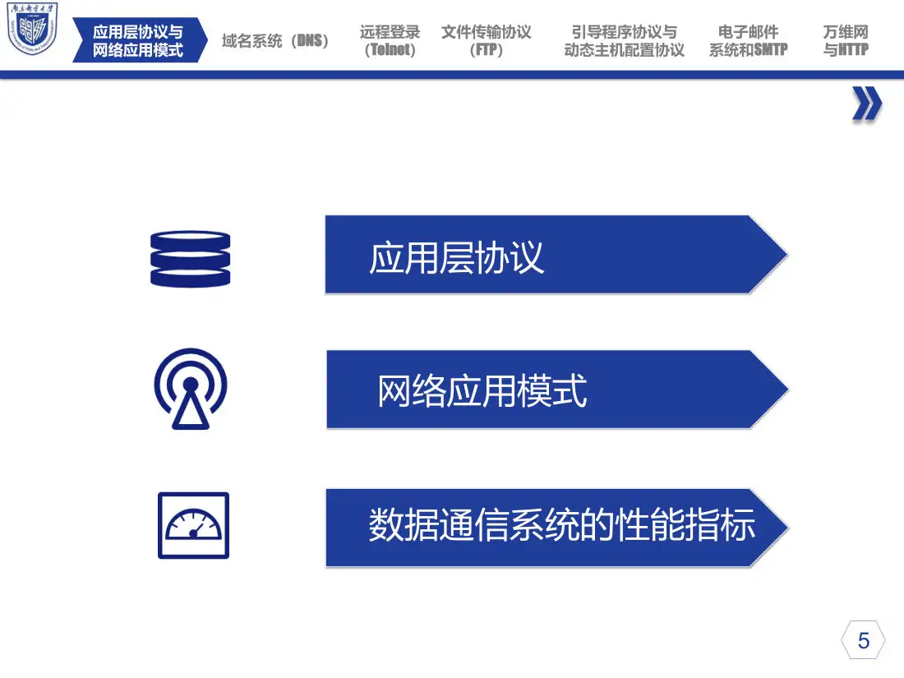

原文：

应用层协议

网络应用模式

数据通信系统的性能指标

》

南志郵電大學Nanjing Ur

应用层协议与网络应用模式

域名系统（DNS）

远程登录 文件传输协议（Telnet） （FTP）

引导程序协议与动态主机配置协议

电子邮件系统和SMTP

万维网与HTTP

5

### 基本概念

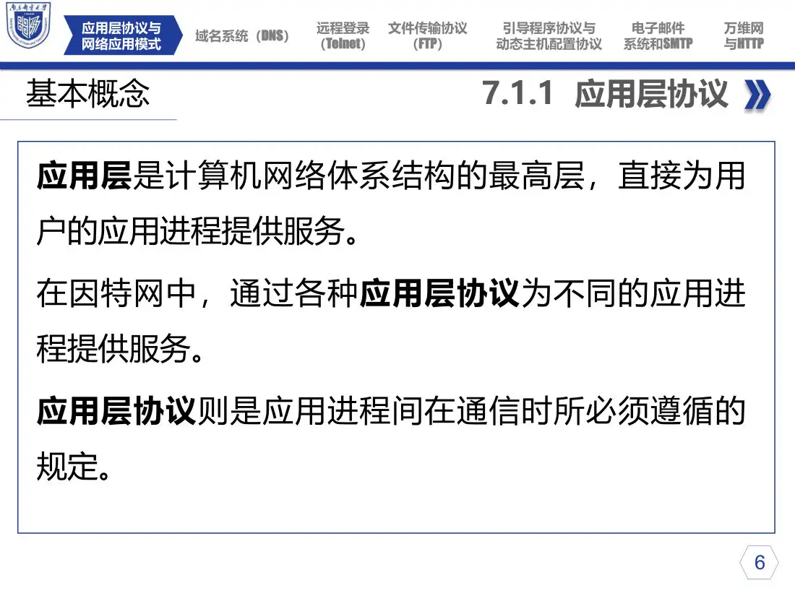

原文：

基本概念

7.1.1 应用层协议

应用层是计算机网络体系结构的最高层，直接为用户的应用进程提供服务。

在因特网中，通过各种应用层协议为不同的应用进程提供服务。

应用层协议则是应用进程间在通信时所必须遵循的规定。

南志郵電大學Nanjing Un 圆yofpe

应用层协议与网络应用模式

域名系统（DNS）

远程登录 文件传输协议（Telnet） （FTP）

引导程序协议与动态主机配置协议

电子邮件系统和SMTP

万维网与HTTP

6

### 应用层与传输层协议对应关系

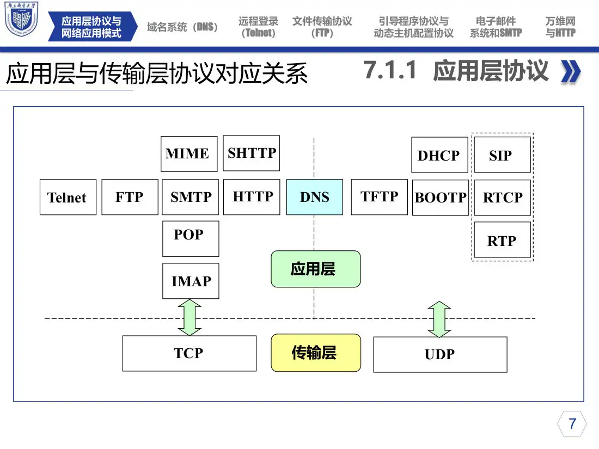

原文：

应用层与传输层协议对应关系

7.1.1 应用层协议

7

南志郵電大學Nanjing Un 圆yofpe

应用层协议与网络应用模式

域名系统（DNS）

远程登录 文件传输协议（Telnet） （FTP）

引导程序协议与动态主机配置协议

电子邮件系统和SMTP

万维网与HTTP

### 应用层协议的特点

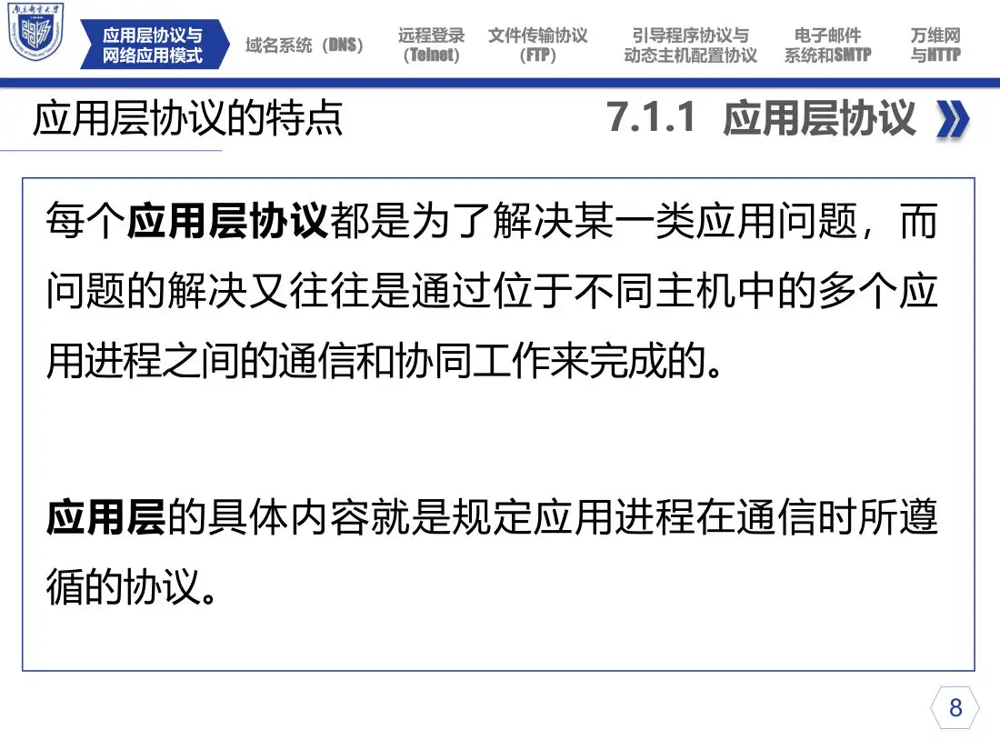

原文：

应用层协议的特点

7.1.1 应用层协议

每个应用层协议都是为了解决某一类应用问题，而问题的解决又往往是通过位于不同主机中的多个应用进程之间的通信和协同工作来完成的。

应用层的具体内容就是规定应用进程在通信时所遵循的协议。

南志郵電大學Nanjing Un 圆yofpe

应用层协议与网络应用模式

域名系统（DNS）

远程登录 文件传输协议（Telnet） （FTP）

引导程序协议与动态主机配置协议

电子邮件系统和SMTP

万维网与HTTP

8

### 7.1.2 网络应用模式

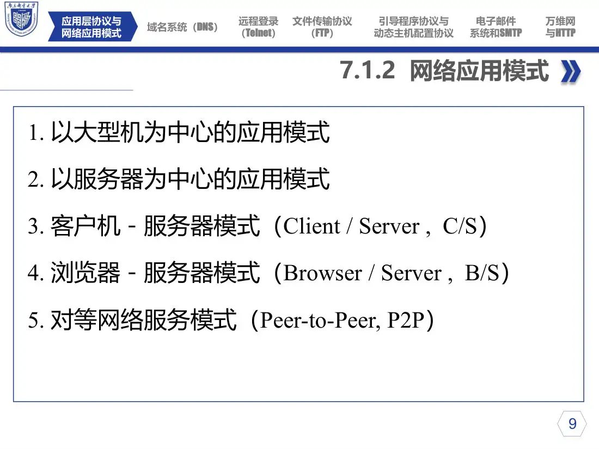

原文：

7.1.2 网络应用模式

1.以大型机为中心的应用模式

2.以服务器为中心的应用模式

3. 客户机－服务器模式（Client / Server , C/S）

4. 浏览器－服务器模式（Browser / Server , B/S）

5. 对等网络服务模式（Peer-to-Peer, P2P）

南志郵電大學Nanjing Un 圆yofpe

应用层协议与网络应用模式

域名系统（DNS）

远程登录 文件传输协议（Telnet） （FTP）

引导程序协议与动态主机配置协议

电子邮件系统和SMTP

万维网与HTTP

9

### 7.1.2 网络应用模式

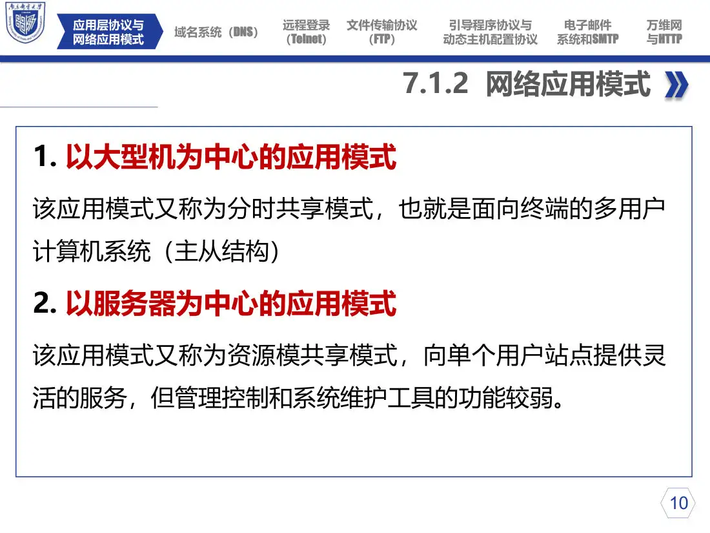

原文：

7.1.2 网络应用模式

1. 以大型机为中心的应用模式

该应用模式又称为分时共享模式，也就是面向终端的多用户计算机系统（主从结构）

2. 以服务器为中心的应用模式

该应用模式又称为资源模共享模式，向单个用户站点提供灵活的服务，但管理控制和系统维护工具的功能较弱。

南志郵電大學Nanjing Ur

应用层协议与网络应用模式

域名系统（DNS）

远程登录 文件传输协议（Telnet） （FTP）

引导程序协议与动态主机配置协议

电子邮件系统和SMTP

万维网与HTTP

10

### 7.1.2 网络应用模式

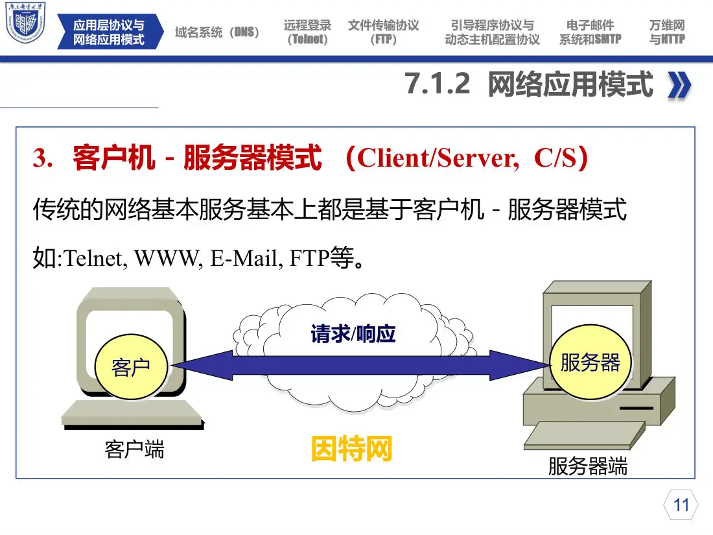

原文：

7.1.2 网络应用模式

3. 客户机－服务器模式 （Client/Server, C/S）

传统的网络基本服务基本上都是基于客户机－服务器模式如:Telnet, WWW, E-Mail, FTP等。

南志郵電大學Nanjing Un 圆yofpe

应用层协议与网络应用模式

域名系统（DNS）

远程登录 文件传输协议（Telnet） （FTP）

引导程序协议与动态主机配置协议

电子邮件系统和SMTP

万维网与HTTP

11

### 7.1.2 网络应用模式

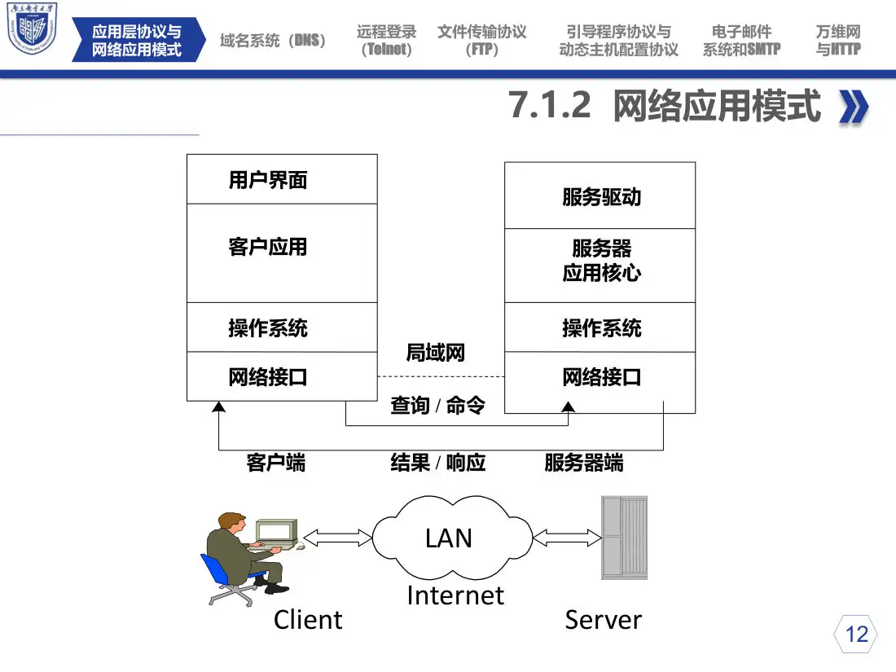

原文：

7.1.2 网络应用模式

南志郵電大學Nanjing Un 圆yofpe

应用层协议与网络应用模式

域名系统（DNS）

远程登录 文件传输协议（Telnet） （FTP）

引导程序协议与动态主机配置协议

电子邮件系统和SMTP

万维网与HTTP

12

### 7.1.2 网络应用模式

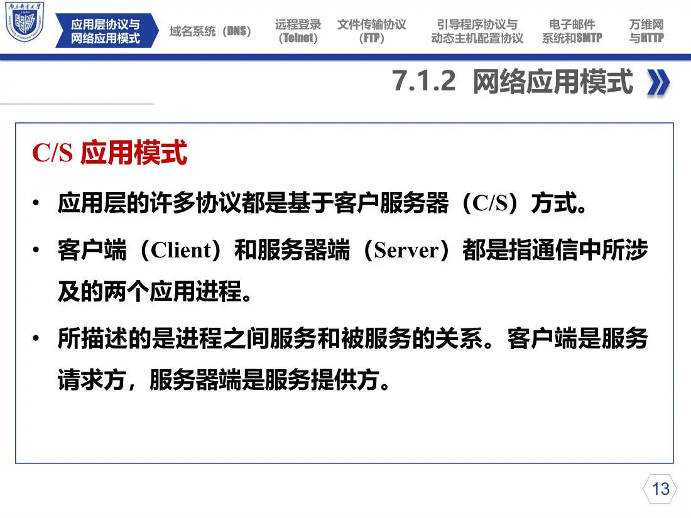

原文：

7.1.2 网络应用模式

C/S 应用模式

• 应用层的许多协议都是基于客户服务器（C/S）方式。

• 客户端（Client）和服务器端（Server）都是指通信中所涉及的两个应用进程。

• 所描述的是进程之间服务和被服务的关系。客户端是服务请求方，服务器端是服务提供方。

南志郵電大學Nanjing Ur

应用层协议与网络应用模式

域名系统（DNS）

远程登录 文件传输协议（Telnet） （FTP）

引导程序协议与动态主机配置协议

电子邮件系统和SMTP

万维网与HTTP

13

### 7.1.2 网络应用模式

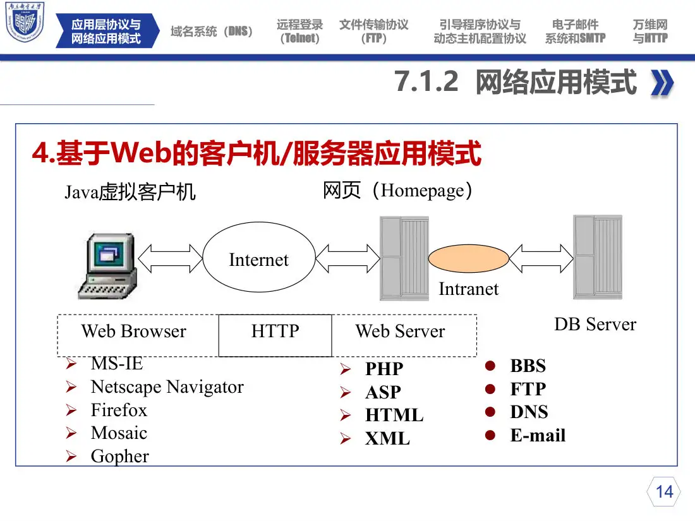

原文：

7.1.2 网络应用模式

4.基于Web的客户机/服务器应用模式

Java虚拟客户机

网页（Homepage）

Internet

Intranet

Web Browser

HTTP

Web Server

DB Server

➢ MS-IE

➢ Netscape Navigator

➢ Firefox

➢ Mosaic

➢ Gopher

➢ PHP

➢ ASP

➢ HTML

➢ XML

⚫ BBS

⚫ FTP

⚫ DNS

⚫ E-mail

南志郵電大學

应用层协议与网络应用模式

域名系统（DNS）

远程登录 文件传输协议（Telnet） （FTP）

引导程序协议与动态主机配置协议

电子邮件系统和SMTP

万维网与HTTP

14

### 7.1.2 网络应用模式

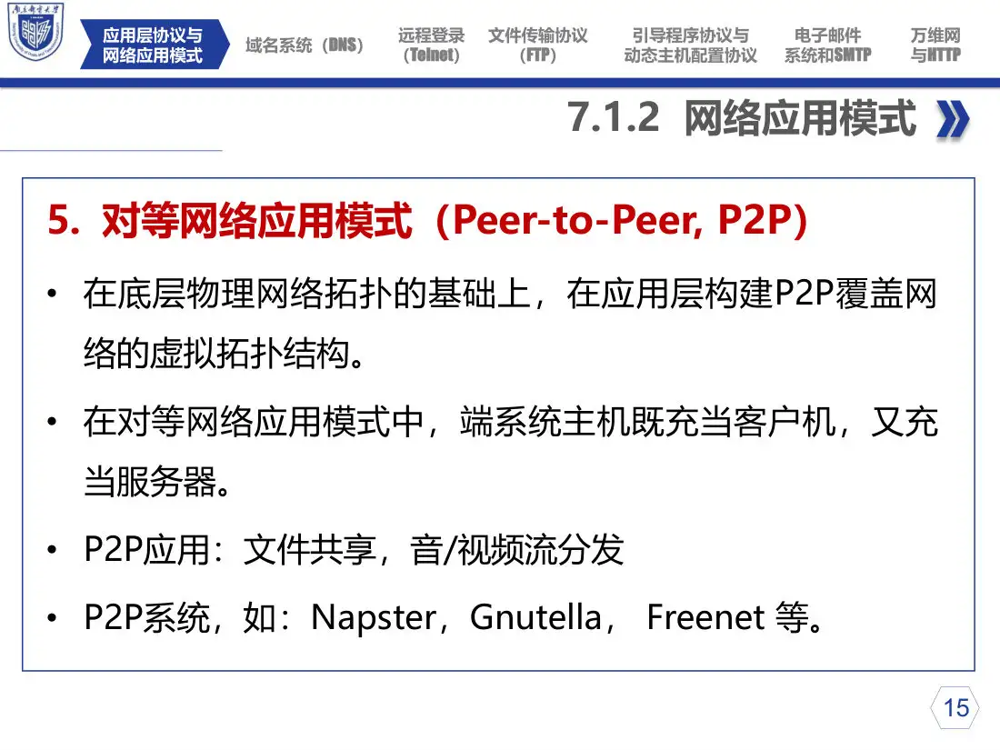

原文：

7.1.2 网络应用模式

5. 对等网络应用模式（Peer-to-Peer, P2P）

• 在底层物理网络拓扑的基础上，在应用层构建P2P覆盖网络的虚拟拓扑结构。

• 在对等网络应用模式中，端系统主机既充当客户机，又充当服务器。

• P2P应用：文件共享，音/视频流分发

• P2P系统，如：Napster，Gnutella， Freenet 等。

南志郵電大學Nanjing Un 圆yofpe

应用层协议与网络应用模式

域名系统（DNS）

远程登录 文件传输协议（Telnet） （FTP）

引导程序协议与动态主机配置协议

电子邮件系统和SMTP

万维网与HTTP

15

### 7.1.2 网络应用模式

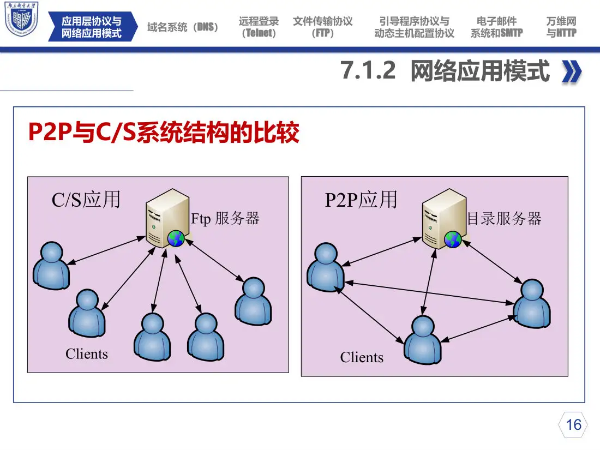

原文：

7.1.2 网络应用模式

P2P与C/S系统结构的比较

C/S应用

Ftp 服务器

P2P应用

目录服务器

南志郵電大學Nanjing Un 圆yofpe

应用层协议与网络应用模式

域名系统（DNS）

远程登录 文件传输协议（Telnet） （FTP）

引导程序协议与动态主机配置协议

电子邮件系统和SMTP

万维网与HTTP

16

### 内容提要T r a n s i t i o n P a g e

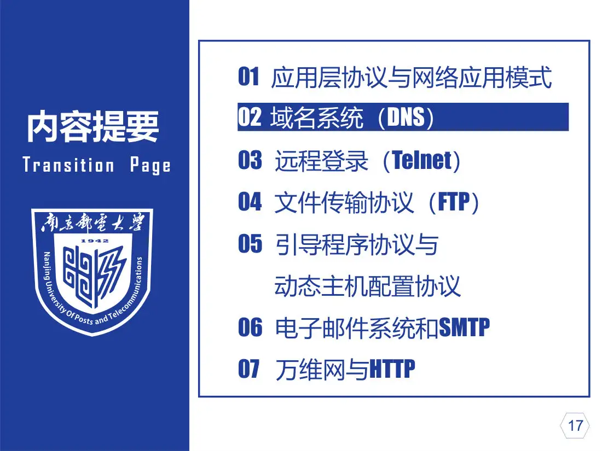

原文：

内容提要T r a n s i t i o n P a g e

01 应用层协议与网络应用模式

02 域名系统（DNS）

03 远程登录（Telnet）

04 文件传输协议（FTP）

05 引导程序协议与动态主机配置协议

06 电子邮件系统和SMTP

07 万维网与HTTP

17

### 基本概念

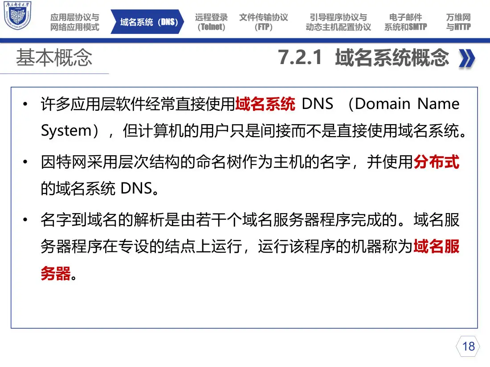

原文：

基本概念

7.2.1 域名系统概念

• 许多应用层软件经常直接使用域名系统 DNS （Domain NameSystem），但计算机的用户只是间接而不是直接使用域名系统。

• 因特网采用层次结构的命名树作为主机的名字，并使用分布式的域名系统 DNS。

• 名字到域名的解析是由若干个域名服务器程序完成的。域名服务器程序在专设的结点上运行，运行该程序的机器称为域名服务器。

南志郵電大學Nanjing Ur

应用层协议与网络应用模式

域名系统（DNS）

远程登录 文件传输协议（Telnet） （FTP）

引导程序协议与动态主机配置协议

电子邮件系统和SMTP

万维网与HTTP

18

### 7.2.2 因特网的域名结构

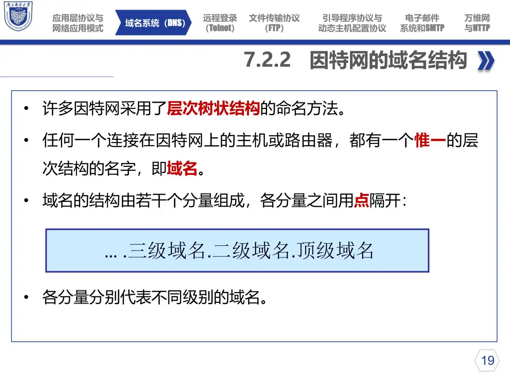

原文：

7.2.2 因特网的域名结构

• 许多因特网采用了层次树状结构的命名方法。

• 任何一个连接在因特网上的主机或路由器，都有一个惟一的层次结构的名字，即域名。

• 域名的结构由若干个分量组成，各分量之间用点隔开：

… .三级域名.二级域名.顶级域名

• 各分量分别代表不同级别的域名。

南志郵電大學Nanjing Ur

应用层协议与网络应用模式

域名系统（DNS）

远程登录 文件传输协议（Telnet） （FTP）

引导程序协议与 电子邮件 万维网动态主机配置协议 系统和SMTP 与HTTP

19

### 顶级域名

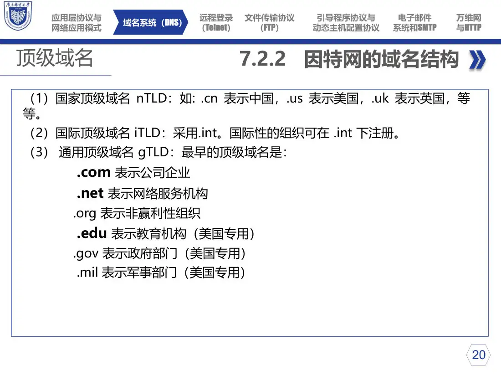

原文：

顶级域名

7.2.2 因特网的域名结构

（1）国家顶级域名 nTLD：如: .cn 表示中国，.us 表示美国，.uk 表示英国，等等。

（2）国际顶级域名 iTLD：采用.int。国际性的组织可在 .int 下注册。

（3） 通用顶级域名 gTLD：最早的顶级域名是：

.com 表示公司企业

.net 表示网络服务机构

.org 表示非赢利性组织

.edu 表示教育机构（美国专用）

.gov 表示政府部门（美国专用）

.mil 表示军事部门（美国专用）

南志郵電大學Nanjing Un 圆yofpe

应用层协议与网络应用模式

域名系统（DNS）

远程登录 文件传输协议（Telnet） （FTP）

引导程序协议与 电子邮件 万维网动态主机配置协议 系统和SMTP 与HTTP

20

### 新通用顶级域名

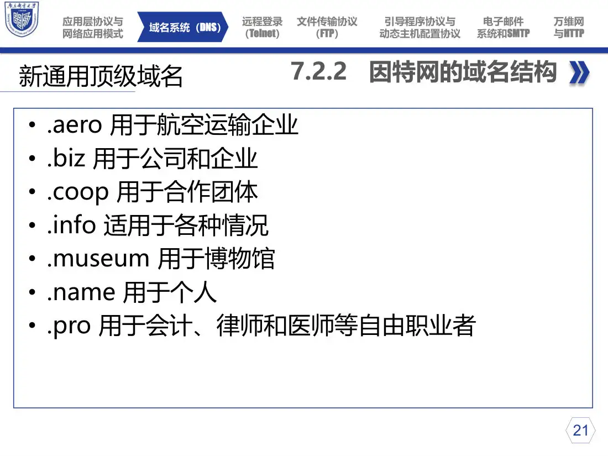

原文：

新通用顶级域名

7.2.2 因特网的域名结构

• .aero 用于航空运输企业

• .biz 用于公司和企业

• .coop 用于合作团体

• .info 适用于各种情况

• .museum 用于博物馆

• .name 用于个人

• .pro 用于会计、律师和医师等自由职业者

南志郵電大學Nanjing Ur

应用层协议与网络应用模式

域名系统（DNS）

远程登录 文件传输协议（Telnet） （FTP）

引导程序协议与动态主机配置协议

电子邮件系统和SMTP

万维网与HTTP

21

### 因特网的名字空间

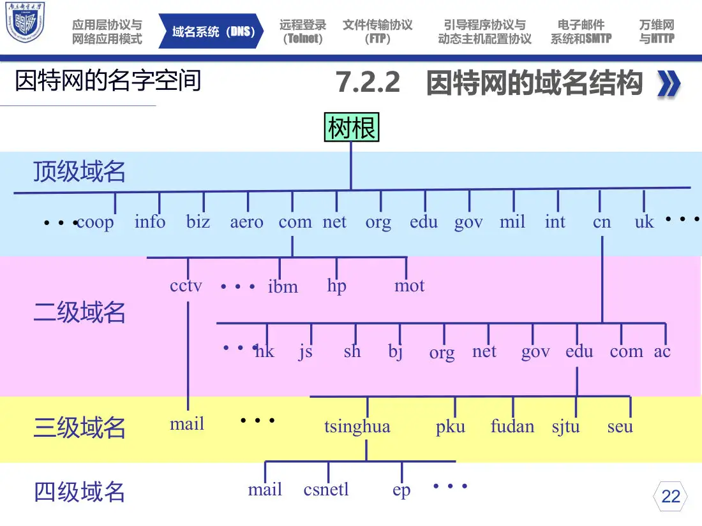

原文：

因特网的名字空间

7.2.2 因特网的域名结构

引导程序协议与 电子邮件 万维网动态主机配置协议 系统和SMTP 与HTTP

南志郵電大學Nanjing Ur

应用层协议与网络应用模式

域名系统（DNS）

远程登录 文件传输协议（Telnet） （FTP）

### 7.2.3 域名解析服务

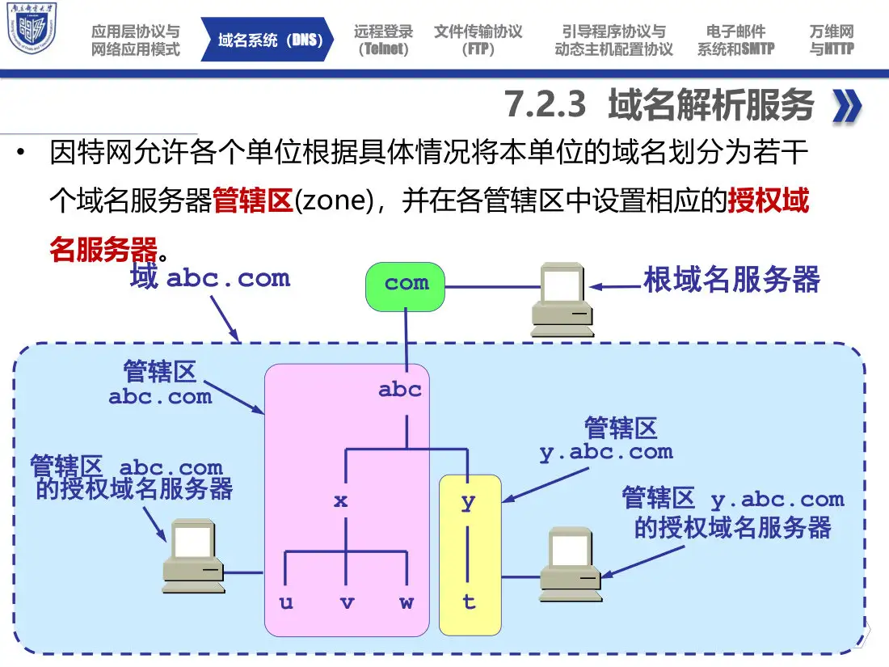

原文：

7.2.3 域名解析服务

因特网允许各个单位根据具体情况将本单位的域名划分为若干个域名服务器管辖区(zone)，并在各管辖区中设置相应的授权域名服务器。

南志郵電大學Nanjing Ur

应用层协议与 域名系统（DNS） 远程登录 文件传输协议 引导程序协议与 电子邮件 万维网网络应用模式 （Telnet） （FTP） 动态主机配置协议 系统和SMTP 与HTTP

### 递归查询

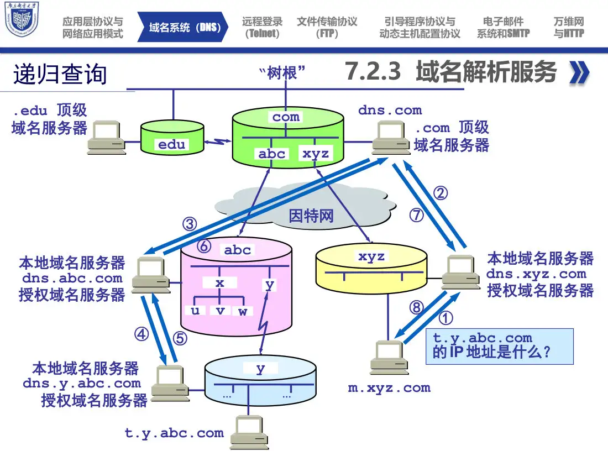

原文：

递归查询

7.2.3 域名解析服务

南志郵電大學Nanjing Ur

应用层协议与网络应用模式

域名系统（DNS）

远程登录 文件传输协议（Telnet） （FTP）

引导程序协议与 电子邮件 万维网动态主机配置协议 系统和SMTP 与HTTP

### 递归与迭代相结合的查询

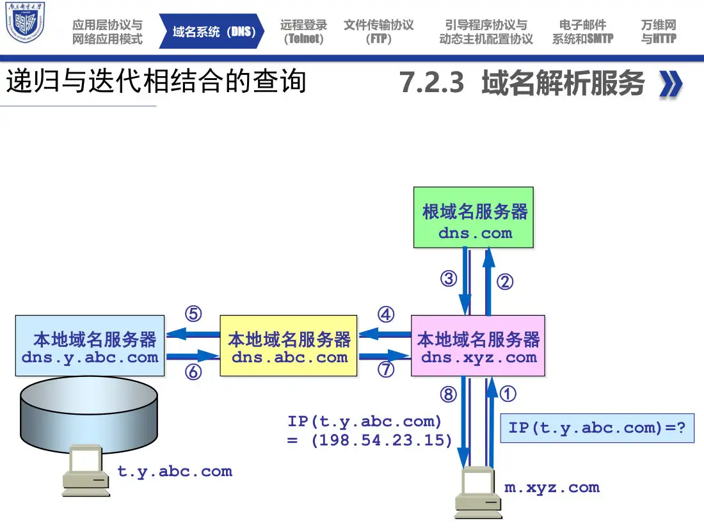

原文：

递归与迭代相结合的查询

7.2.3 域名解析服务

南志郵電大學Nanjing Ur

应用层协议与网络应用模式

域名系统（DNS）

远程登录 文件传输协议（Telnet） （FTP）

引导程序协议与动态主机配置协议

电子邮件系统和SMTP

万维网与HTTP

### 例题

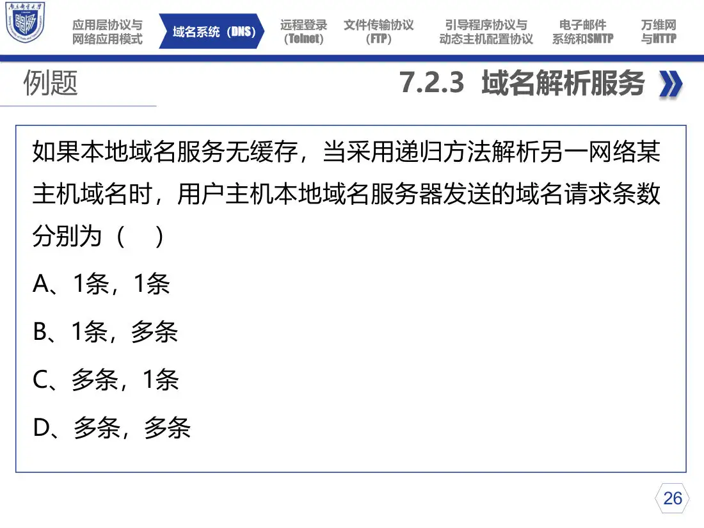

原文：

例题

7.2.3 域名解析服务

如果本地域名服务无缓存，当采用递归方法解析另一网络某主机域名时，用户主机本地域名服务器发送的域名请求条数分别为（ ）A、1条，1条B、1条，多条C、多条，1条D、多条，多条

南志執電大學Nanjing Une

应用层协议与网络应用模式

域名系统（DNS）

远程登录 文件传输协议（Telnet） （FTP）

引导程序协议与动态主机配置协议

电子邮件系统和SMTP

万维网与HTTP

26

### 内容提要T r a n s i t i o n P a g e

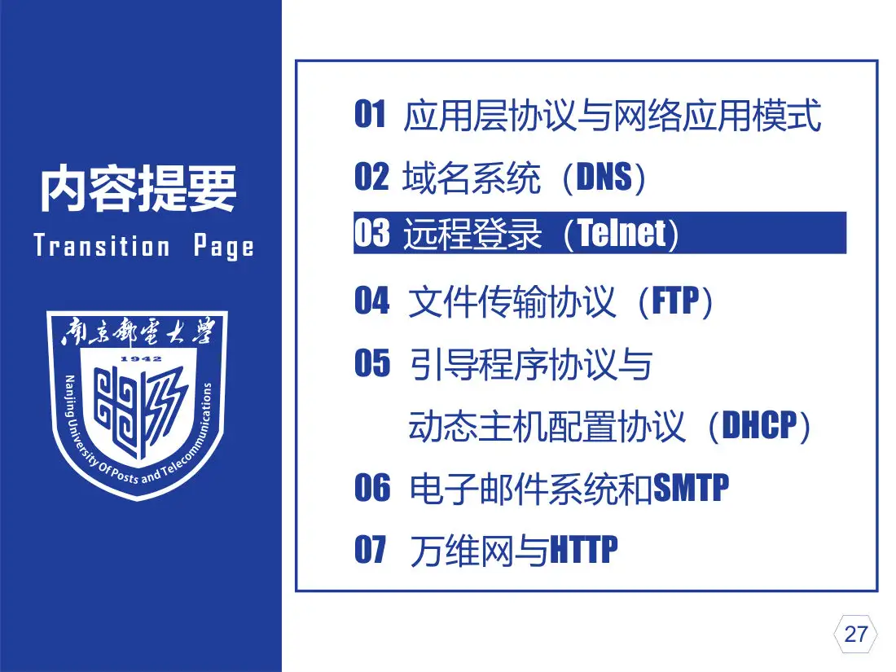

原文：

内容提要T r a n s i t i o n P a g e

01 应用层协议与网络应用模式

02 域名系统（DNS）

03 远程登录（Telnet）

04 文件传输协议（FTP）

05 引导程序协议与动态主机配置协议（DHCP）

06 电子邮件系统和SMTP

07 万维网与HTTP

27

### 7.3 远程登录

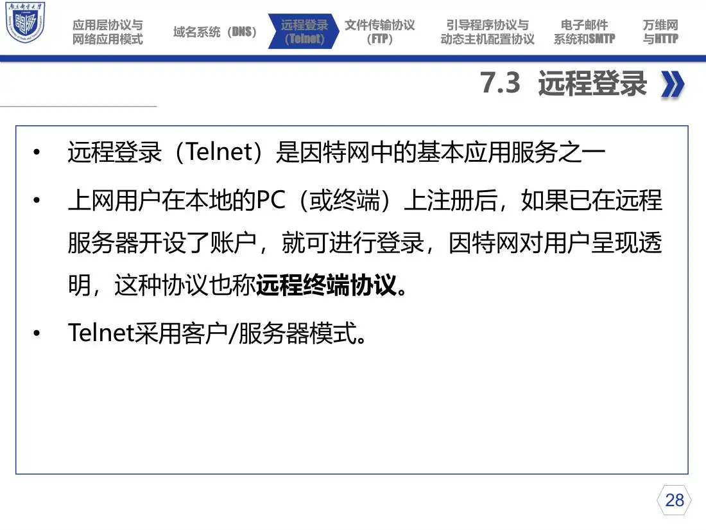

原文：

7.3 远程登录

• 远程登录（Telnet）是因特网中的基本应用服务之一

上网用户在本地的PC（或终端）上注册后，如果已在远程服务器开设了账户，就可进行登录，因特网对用户呈现透明，这种协议也称远程终端协议。

• Telnet采用客户/服务器模式。

引导程序协议与 电子邮件 万维网动态主机配置协议 系统和SMTP 与HTTP

南志郵電大學Nanjing Ur

应用层协议与网络应用模式

域名系统（DNS）

文件传输协议（FTP）

28

### Telnet协议工作流程

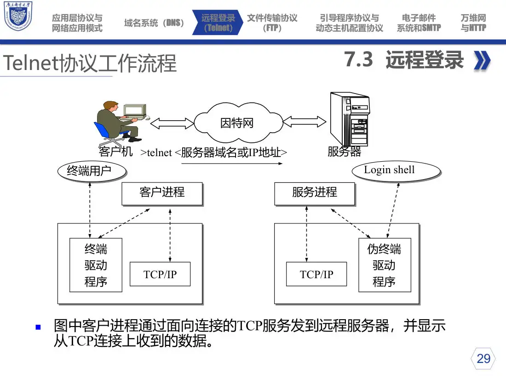

原文：

Telnet协议工作流程

7.3 远程登录

◼ 图中客户进程通过面向连接的TCP服务发到远程服务器，并显示从TCP连接上收到的数据。

南志郵電大學Nanjing Ur

应用层协议与网络应用模式

域名系统（DNS）

远程登录（Telnet）

文件传输协议（FTP）

引导程序协议与动态主机配置协议

电子邮件系统和SMTP

万维网与HTTP

29

### 网络虚拟终端

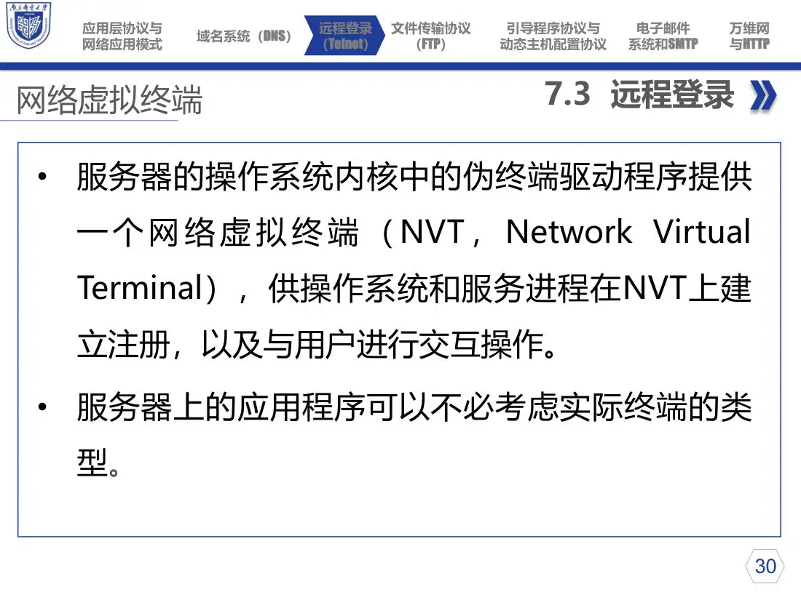

原文：

网络虚拟终端

7.3 远程登录

• 服务器的操作系统内核中的伪终端驱动程序提供一个网络虚拟终端（NVT，Network VirtualTerminal），供操作系统和服务进程在NVT上建立注册，以及与用户进行交互操作。

• 服务器上的应用程序可以不必考虑实际终端的类型。

南志郵電大學Nanjing Ur

应用层协议与网络应用模式

域名系统（DNS）

文件传输协议（FTP）

引导程序协议与 电子邮件 万维网动态主机配置协议 系统和SMTP 与HTTP

30

### NVT

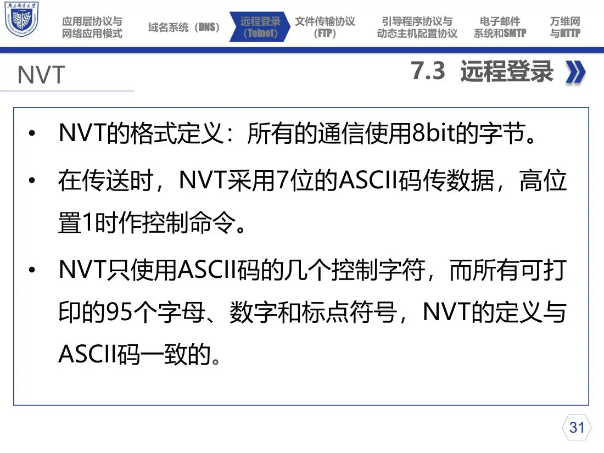

原文：

NVT

7.3 远程登录

• NVT的格式定义：所有的通信使用8bit的字节。

• 在传送时，NVT采用7位的ASCII码传数据，高位置1时作控制命令。

• NVT只使用ASCII码的几个控制字符，而所有可打印的95个字母、数字和标点符号，NVT的定义与ASCII码一致的。

南志郵電大學Nanjing Ur

应用层协议与网络应用模式

域名系统（DNS）

文件传输协议（FTP）

引导程序协议与 电子邮件 万维网动态主机配置协议 系统和SMTP 与HTTP

31

### 内容提要T r a n s i t i o n P a g e

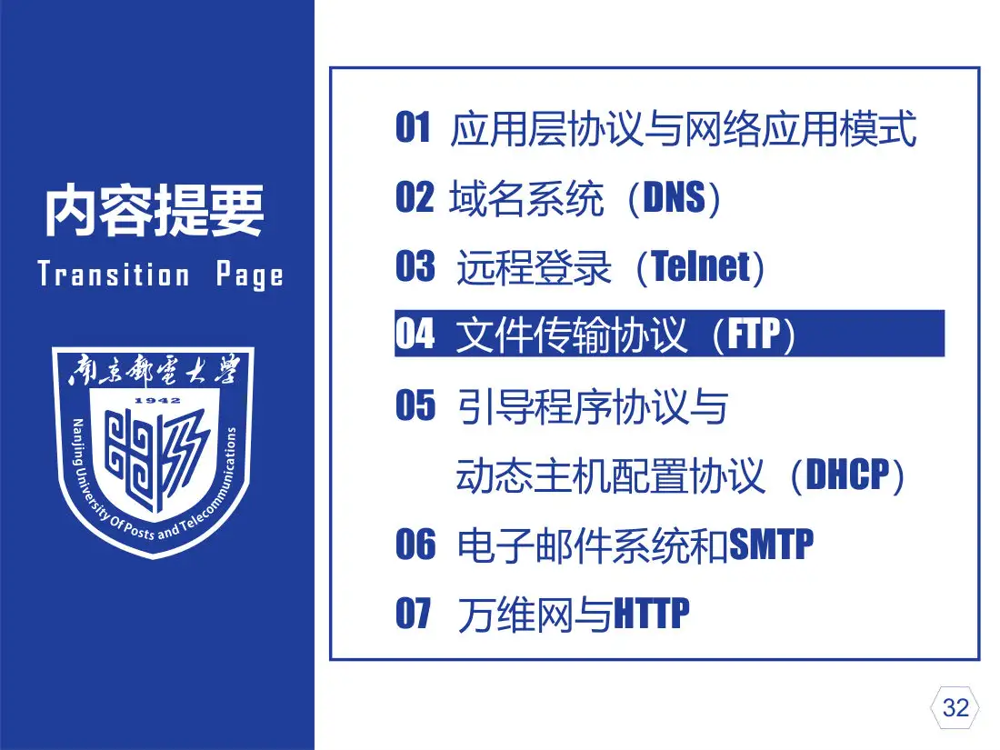

原文：

内容提要T r a n s i t i o n P a g e

01 应用层协议与网络应用模式

02 域名系统（DNS）

03 远程登录（Telnet）

04 文件传输协议（FTP）

05 引导程序协议与动态主机配置协议（DHCP）

06 电子邮件系统和SMTP

07 万维网与HTTP

32

### 交互式访问

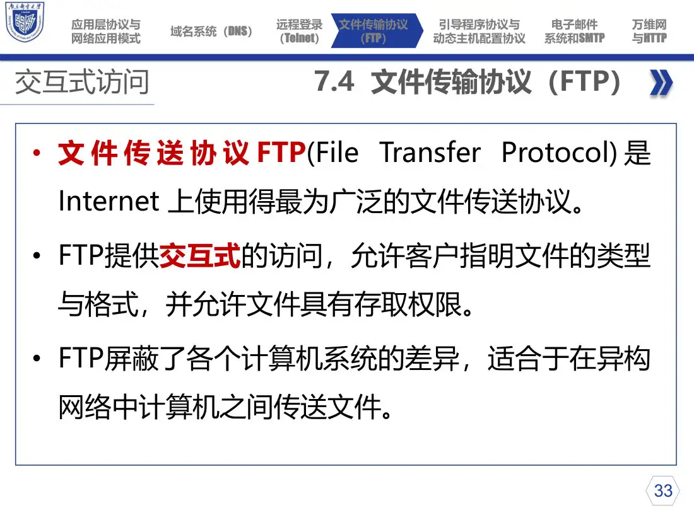

原文：

交互式访问

7.4 文件传输协议（FTP）

• 文 件 传 送 协 议 FTP(File Transfer Protocol) 是Internet 上使用得最为广泛的文件传送协议。

• FTP提供交互式的访问，允许客户指明文件的类型与格式，并允许文件具有存取权限。

• FTP屏蔽了各个计算机系统的差异，适合于在异构网络中计算机之间传送文件。

远程登录 文件传输协议（Telnet） （FTP）

南志郵電大學Nanjing Ur

应用层协议与网络应用模式

域名系统（DNS）

引导程序协议与 电子邮件 万维网动态主机配置协议 系统和SMTP 与HTTP

33

### 设计难点

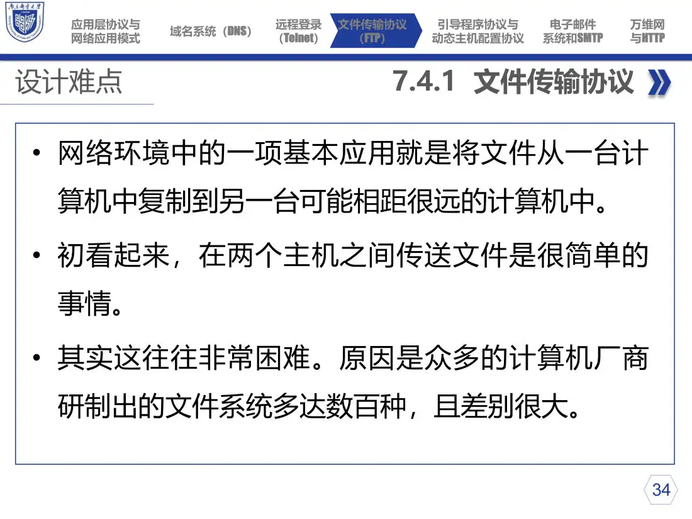

原文：

设计难点

7.4.1 文件传输协议

• 网络环境中的一项基本应用就是将文件从一台计算机中复制到另一台可能相距很远的计算机中。

• 初看起来，在两个主机之间传送文件是很简单的事情。

• 其实这往往非常困难。原因是众多的计算机厂商研制出的文件系统多达数百种，且差别很大。

引导程序协议与 电子邮件 万维网动态主机配置协议 系统和SMTP 与HTTP

南志郵電大學Nanjing Ur

应用层协议与网络应用模式

域名系统（DNS）

远程登录（Telnet）

文件传输协议（FTP）

34

### 网络环境下复制文件的复杂性

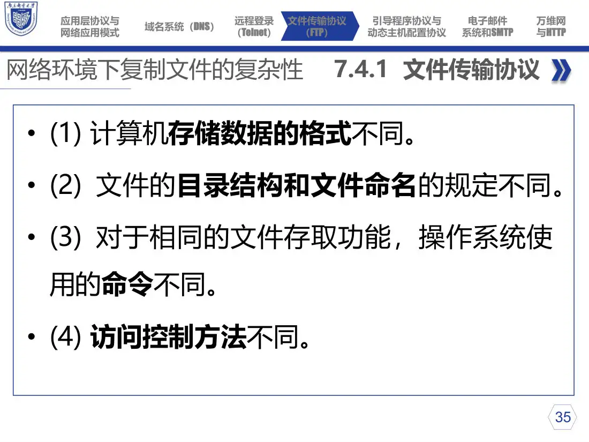

原文：

网络环境下复制文件的复杂性

7.4.1 文件传输协议

• (1) 计算机存储数据的格式不同。

• (2) 文件的目录结构和文件命名的规定不同。

• (3) 对于相同的文件存取功能，操作系统使用的命令不同。

• (4) 访问控制方法不同。

南志郵電大學Nanjing U

应用层协议与网络应用模式

域名系统（DNS）

远程登录（Telnet）

引导程序协议与 电子邮件 万维网动态主机配置协议 系统和SMTP 与HTTP

35

### FTP特点

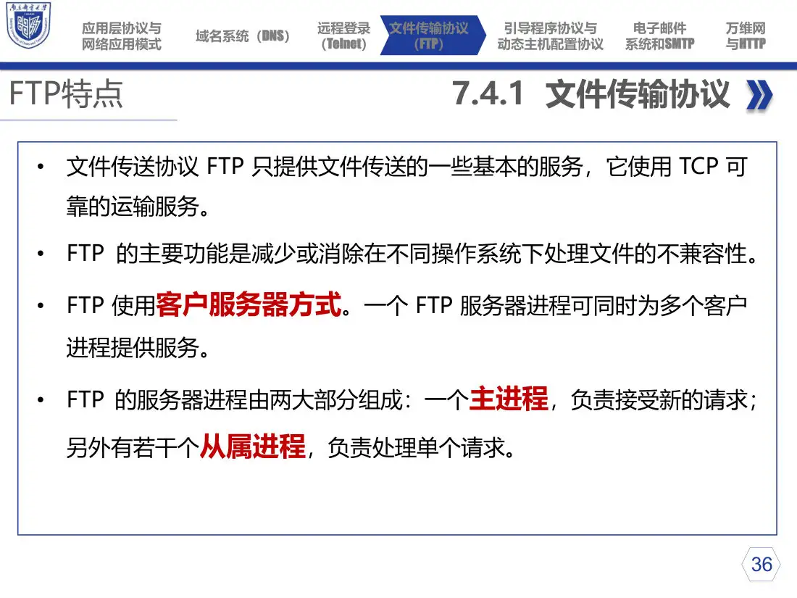

原文：

FTP特点

7.4.1 文件传输协议

• 文件传送协议 FTP 只提供文件传送的一些基本的服务，它使用 TCP 可靠的运输服务。

• FTP 的主要功能是减少或消除在不同操作系统下处理文件的不兼容性。

• FTP 使用客户服务器方式。一个 FTP 服务器进程可同时为多个客户进程提供服务。

• FTP 的服务器进程由两大部分组成：一个主进程，负责接受新的请求；另外有若干个从属进程，负责处理单个请求。

引导程序协议与 电子邮件 万维网动态主机配置协议 系统和SMTP 与HTTP

南志郵電大學Nanjing Ur

应用层协议与网络应用模式

域名系统（DNS）

远程登录（Telnet）

文件传输协议（FTP）

36

### FTP功能模块与连接

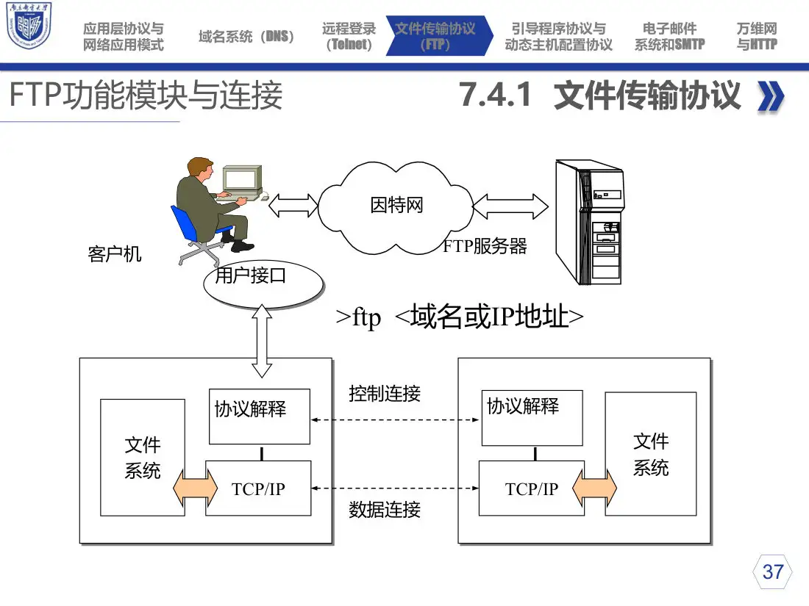

原文：

FTP功能模块与连接

7.4.1 文件传输协议

文件传输协议（FTP）

南志郵電大學Nanjing Ur

应用层协议与网络应用模式

域名系统（DNS）

远程登录（Telnet）

引导程序协议与动态主机配置协议

电子邮件系统和SMTP

万维网与HTTP

37

### 主进程的工作步骤

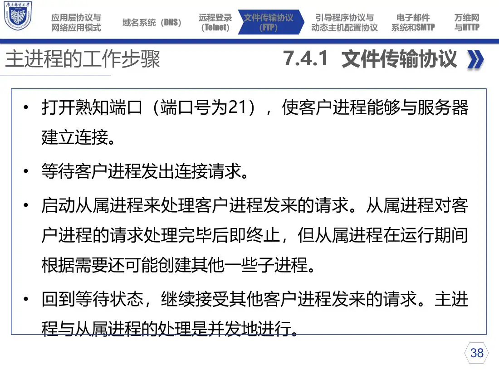

原文：

主进程的工作步骤

7.4.1 文件传输协议

• 打开熟知端口（端口号为21），使客户进程能够与服务器建立连接。

• 等待客户进程发出连接请求。

• 启动从属进程来处理客户进程发来的请求。从属进程对客户进程的请求处理完毕后即终止，但从属进程在运行期间根据需要还可能创建其他一些子进程。

• 回到等待状态，继续接受其他客户进程发来的请求。主进程与从属进程的处理是并发地进行。

远程登录 文件传输协议（Telnet） （FTP）

南志郵電大學Nanjing Ur

应用层协议与网络应用模式

域名系统（DNS）

引导程序协议与 电子邮件 万维网动态主机配置协议 系统和SMTP 与HTTP

38

### 两个连接

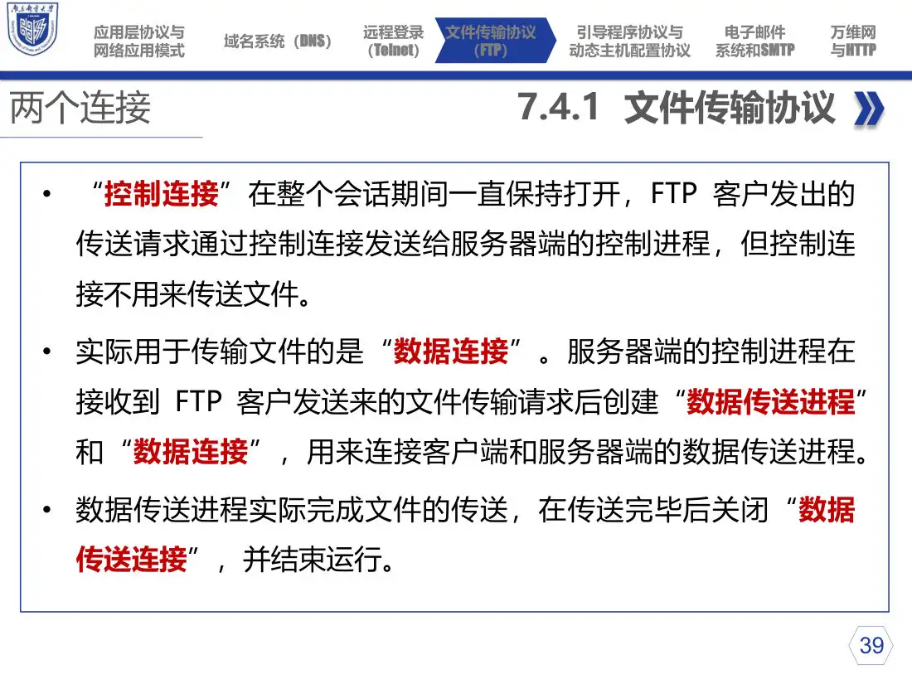

原文：

两个连接

7.4.1 文件传输协议

• “控制连接”在整个会话期间一直保持打开，FTP 客户发出的传送请求通过控制连接发送给服务器端的控制进程，但控制连接不用来传送文件。

• 实际用于传输文件的是“数据连接”。服务器端的控制进程在接收到 FTP 客户发送来的文件传输请求后创建“数据传送进程”和“数据连接”，用来连接客户端和服务器端的数据传送进程。

• 数据传送进程实际完成文件的传送，在传送完毕后关闭“数据传送连接”，并结束运行。

南志郵電大學Nanjing Ur

应用层协议与网络应用模式

域名系统（DNS）

远程登录（Telnet）

文件传输协议（FTP）

引导程序协议与动态主机配置协议

电子邮件系统和SMTP

万维网与HTTP

39

### FTP 使用的两个 TCP 连接

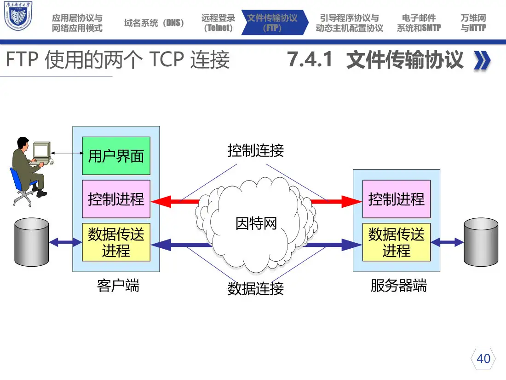

原文：

FTP 使用的两个 TCP 连接

7.4.1 文件传输协议

文件传输协议（FTP）

南志執電大學Nanjing Une

应用层协议与网络应用模式

域名系统（DNS）

远程登录（Telnet）

引导程序协议与动态主机配置协议

电子邮件系统和SMTP

万维网与HTTP

40

### 两个不同的端口号

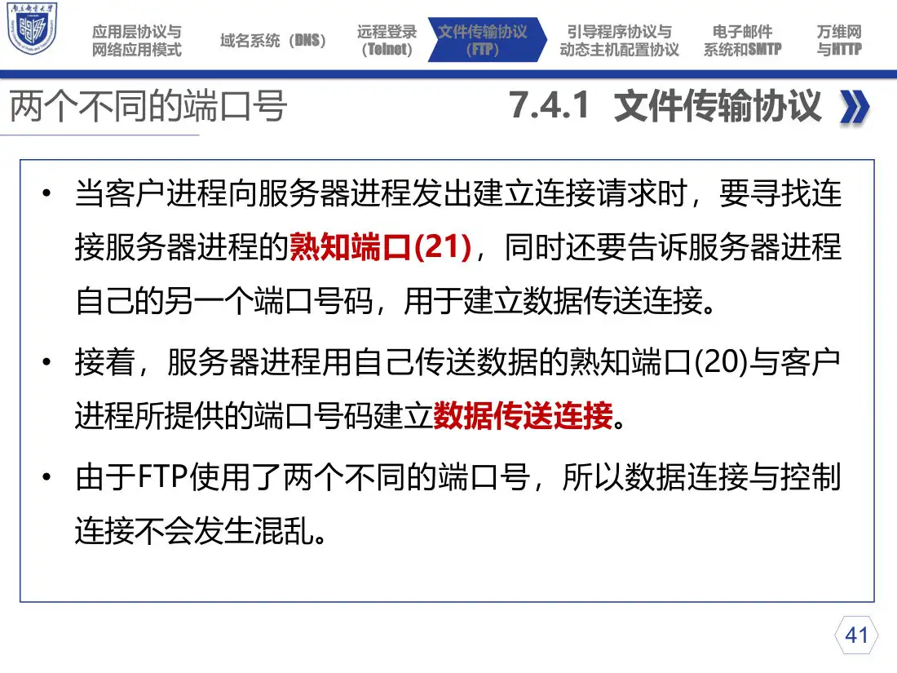

原文：

两个不同的端口号

7.4.1 文件传输协议

• 当客户进程向服务器进程发出建立连接请求时，要寻找连接服务器进程的熟知端口(21)，同时还要告诉服务器进程自己的另一个端口号码，用于建立数据传送连接。

• 接着，服务器进程用自己传送数据的熟知端口(20)与客户进程所提供的端口号码建立数据传送连接。

• 由于FTP使用了两个不同的端口号，所以数据连接与控制连接不会发生混乱。

南志郵電大學Nanjing Ur

应用层协议与网络应用模式

域名系统（DNS）

远程登录（Telnet）

文件传输协议（FTP）

引导程序协议与动态主机配置协议

电子邮件系统和SMTP

万维网与HTTP

41

### 使用两个不同的端口号形成两个独立连接

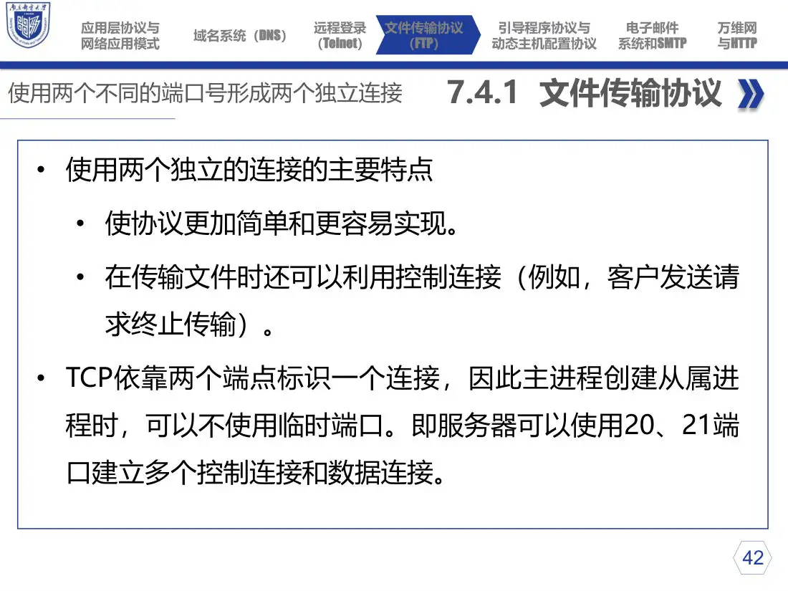

原文：

使用两个不同的端口号形成两个独立连接

7.4.1 文件传输协议

• 使用两个独立的连接的主要特点

• 使协议更加简单和更容易实现。

• 在传输文件时还可以利用控制连接（例如，客户发送请求终止传输）。

• TCP依靠两个端点标识一个连接，因此主进程创建从属进程时，可以不使用临时端口。即服务器可以使用20、21端口建立多个控制连接和数据连接。

远程登录 文件传输协议（Telnet） （FTP）

南志郵電大學Nanjing Ur

应用层协议与网络应用模式

域名系统（DNS）

引导程序协议与 电子邮件 万维网动态主机配置协议 系统和SMTP 与HTTP

42

### FTP 的屏幕信息举例

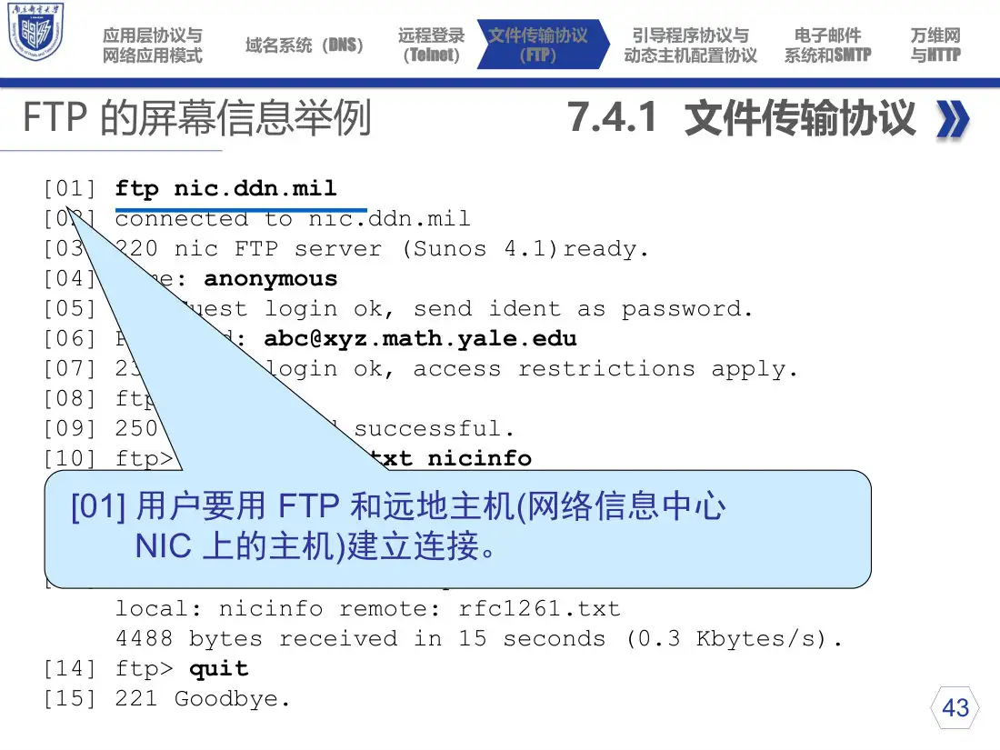

原文：

FTP 的屏幕信息举例

7.4.1 文件传输协议

远程登录 文件传输协议（Telnet） （FTP）

南志郵電大學Nanjing Ur

应用层协议与网络应用模式

域名系统（DNS）

引导程序协议与 电子邮件 万维网动态主机配置协议 系统和SMTP 与HTTP

43

### FTP 的屏幕信息举例

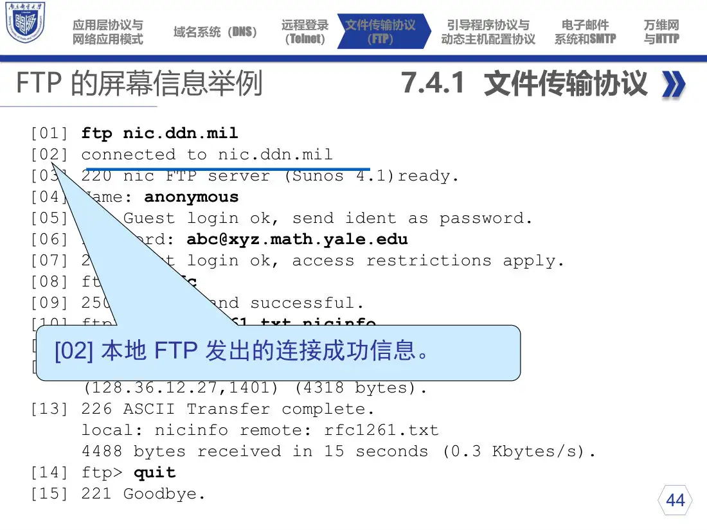

原文：

FTP 的屏幕信息举例

7.4.1 文件传输协议

1] 200 PORT command successful.[02] 本地 FTP 发出的连接成功信息。

远程登录 文件传输协议（Telnet） （FTP）

南志郵電大學Nanjing Ur

应用层协议与网络应用模式

域名系统（DNS）

引导程序协议与 电子邮件 万维网动态主机配置协议 系统和SMTP 与HTTP

44

### FTP 的屏幕信息举例

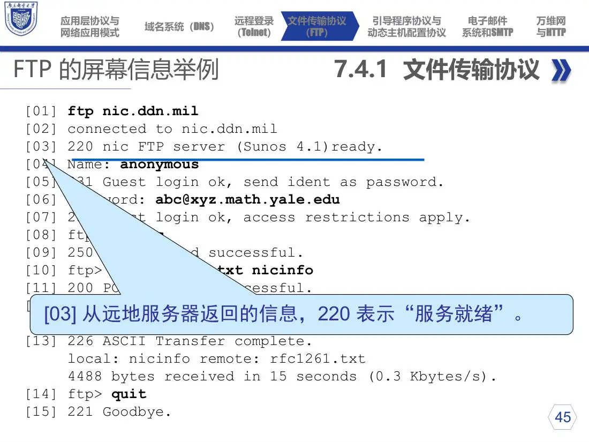

原文：

FTP 的屏幕信息举例

7.4.1 文件传输协议

2] 150 ASCII data connection for rfc1261.txt[03] 从远地服务器返回的信息，220 表示“服务就绪”。

远程登录 文件传输协议（Telnet） （FTP）

南志郵電大學Nanjing Ur

应用层协议与网络应用模式

域名系统（DNS）

引导程序协议与 电子邮件 万维网动态主机配置协议 系统和SMTP 与HTTP

45

### FTP 的屏幕信息举例

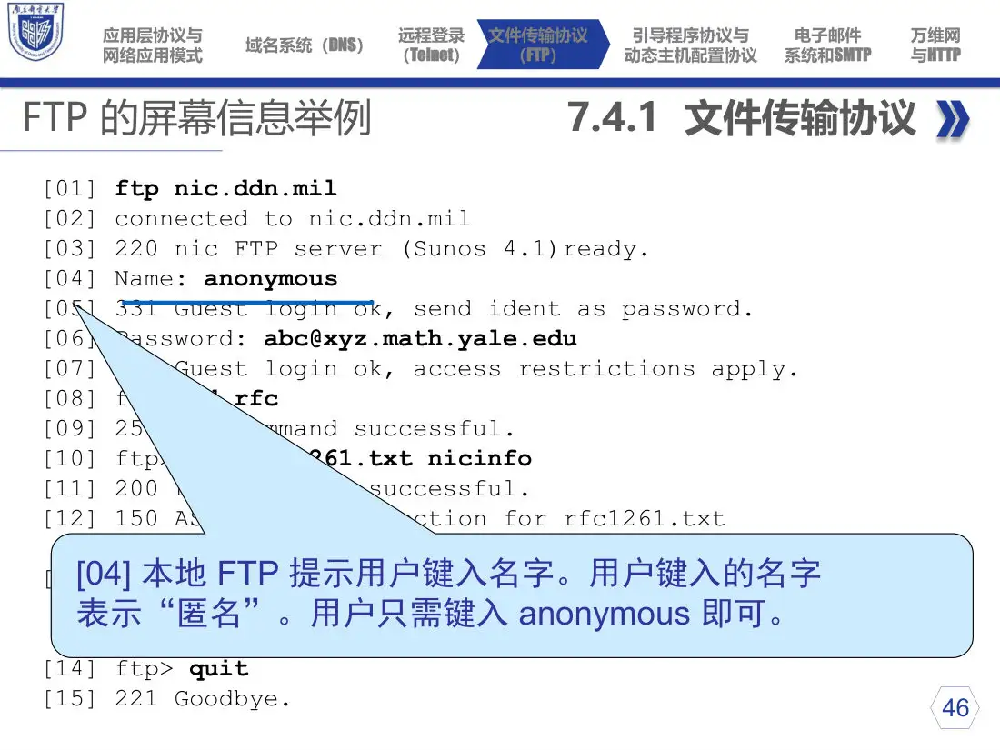

原文：

FTP 的屏幕信息举例

7.4.1 文件传输协议

3] 226 ASCII Transfer complete.[04] 本地 FTP 提示用户键入名字。用户键入的名字local: nicinfo remote: rfc1261.txt表示“匿名”。用户只需键入 anonymous 即可。

远程登录 文件传输协议（Telnet） （FTP）

南志郵電大學Nanjing Ur

应用层协议与网络应用模式

域名系统（DNS）

引导程序协议与 电子邮件 万维网动态主机配置协议 系统和SMTP 与HTTP

46

### 7.4.1 文件传输协议

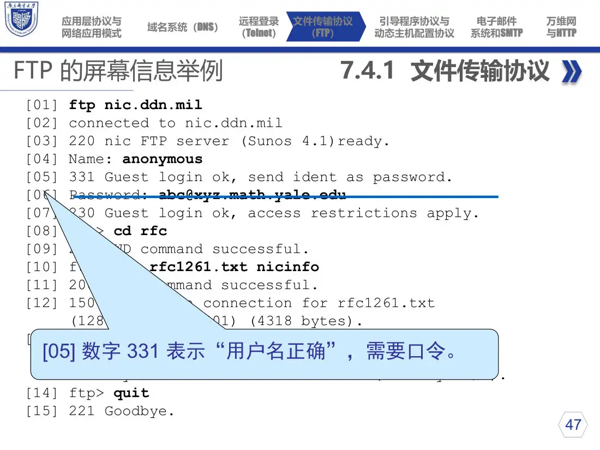

原文：

7.4.1 文件传输协议

FTP 的屏幕信息举例

[14] ftp> quit [15] 221 Goodbye.

文件传输协议（FTP）

南志郵電大學Nanjing Ur

应用层协议与网络应用模式

域名系统（DNS）

远程登录（Telnet）

引导程序协议与 电子邮件 万维网动态主机配置协议 系统和SMTP 与HTTP

47

### FTP 的屏幕信息举例

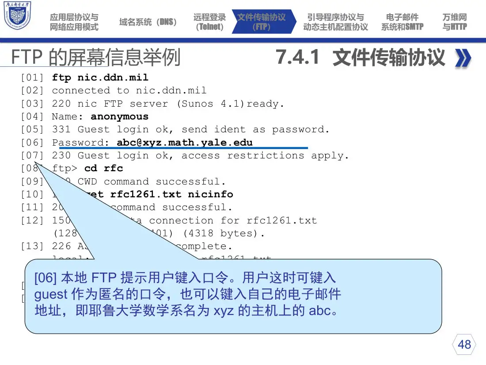

原文：

FTP 的屏幕信息举例

7.4.1 文件传输协议

[01] ftp nic.ddn.mil

[02] connected to nic.ddn.mil

[03] 220 nic FTP server (Sunos 4.1)ready.

[04] Name: anonymous

[05] 331 Guest login ok, send ident as password.

[06] Password: abc@xyz.math.yale.edu

[07] 230 Guest login ok, access restrictions apply.

[08] ftp> cd rfc

[09]

CWD command successful.

[10]

et rfc1261.txt nicinfo

[11] 20

command successful.

[12] 150 (128.

connection for rfc1261.txt

[13] 226 ASC

401) (4318 bytes).

complete. f\~1261++

4488 bytes received in 15 seconds (0.3 Kbyte[06] 本地 FTP 提示用户键入口令。用户这时可键入guest 作为匿名的口令，也可以键入自己的电子邮件地址，即耶鲁大学数学系名为 xyz 的主机上的 abc。

远程登录 文件传输协议（Telnet） （FTP）

南志郵電大學Nanjing Ur

应用层协议与网络应用模式

域名系统（DNS）

引导程序协议与 电子邮件 万维网动态主机配置协议 系统和SMTP 与HTTP

48

### FTP 的屏幕信息举例

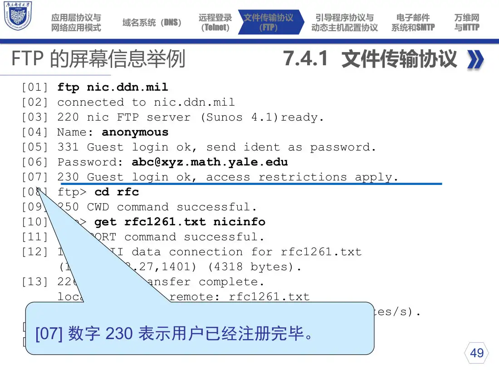

原文：

FTP 的屏幕信息举例

7.4.1 文件传输协议

南志郵電大學Nanjing Ur

应用层协议与网络应用模式

域名系统（DNS）

远程登录（Telnet）

文件传输协议（FTP）

引导程序协议与 电子邮件 万维网动态主机配置协议 系统和SMTP 与HTTP

49

### 7.4.1 文件传输协议

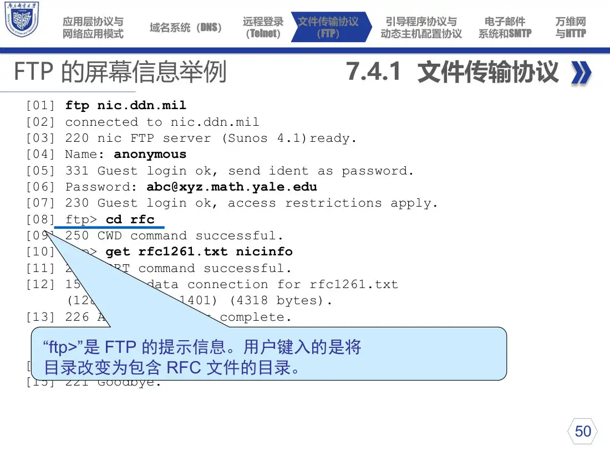

原文：

7.4.1 文件传输协议

FTP 的屏幕信息举例

[01] ftp nic.ddn.mil

[02] connected to nic.ddn.mil

[03] 220 nic FTP server (Sunos 4.1)ready.

[04] Name: anonymous

[05] 331 Guest login ok, send ident as password.

[06] Password: abc@xyz.math.yale.edu

[07] 230 Guest login ok, access restrictions apply.

[08] ftp> cd rfc

[13] 226 AS

4488 bytes received in 15 seconds (0.“ftp>”是 FTP 的提示信息。用户键入的是将4] ftp> quit目录改变为包含 RFC 文件的目录。

南志郵電大學Nanjing Ur

应用层协议与网络应用模式

域名系统（DNS）

远程登录（Telnet）

文件传输协议（FTP）

引导程序协议与 电子邮件 万维网动态主机配置协议 系统和SMTP 与HTTP

50

### FTP 的屏幕信息举例

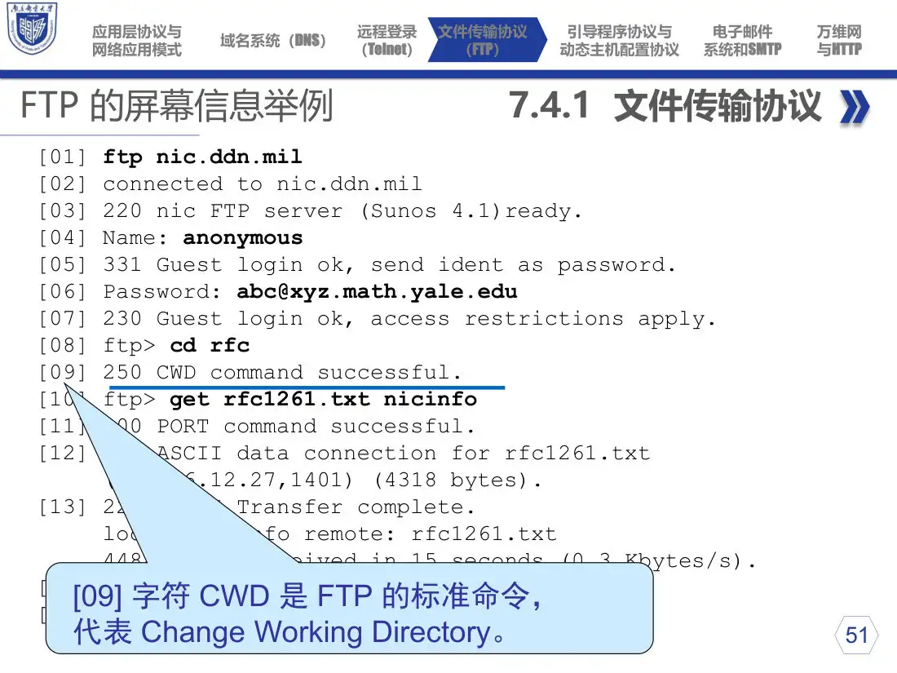

原文：

FTP 的屏幕信息举例

7.4.1 文件传输协议

文件传输协议（FTP）

南志郵電大學Nanjing Ur

应用层协议与网络应用模式

域名系统（DNS）

远程登录（Telnet）

引导程序协议与 电子邮件 万维网动态主机配置协议 系统和SMTP 与HTTP

51

### FTP

原文：

FTP

的屏幕信息举例 7.4.1 文件传输协议[10] 用户要求将名为 rfc1261.txt 的文件复制到本地主机上，并改名为 nicinfo。

远程登录 文件传输协议（Telnet） （FTP）

南志郵電大學Nanjing Ur

应用层协议与网络应用模式

域名系统（DNS）

引导程序协议与 电子邮件 万维网动态主机配置协议 系统和SMTP 与HTTP

52

### FTP 的屏幕信息举例

原文：

FTP 的屏幕信息举例

7.4.1 文件传输协议

[01] ftp nic.ddn.mil[11] 字符 PORT 是 FTP 的标准命令，表示要[02] connected to nic.ddn.mil建立数据连接。200 表示“命令正确”。[03]

南志郵電大學Nanjing Ur

应用层协议与网络应用模式

域名系统（DNS）

远程登录 文件传输协议（Telnet） （FTP）

引导程序协议与 电子邮件 万维网动态主机配置协议 系统和SMTP 与HTTP

53

### FTP 的屏幕信息举例

原文：

FTP 的屏幕信息举例

7.4.1 文件传输协议

ftp nic.ddn.mil[12] 数字 150 表示“文件状态正确，cted to nic.ddn.mil即将建立数据连接”。

南志郵電大學Nanjing Ur

应用层协议与网络应用模式

域名系统（DNS）

远程登录 文件传输协议（Telnet） （FTP）

引导程序协议与 电子邮件 万维网动态主机配置协议 系统和SMTP 与HTTP

54

### FTP 的屏幕信息举例

原文：

FTP 的屏幕信息举例

7.4.1 文件传输协议

南志郵電大學Nanjing Ur

应用层协议与网络应用模式

域名系统（DNS）

远程登录 文件传输协议（Telnet） （FTP）

引导程序协议与 电子邮件 万维网动态主机配置协议 系统和SMTP 与HTTP

55

### FTP 的屏幕信息举例

原文：

FTP 的屏幕信息举例

7.4.1 文件传输协议

[01] ftp nic.ddn.mil

[02] connected to nic.ddn.mil

[03] 220 nic FTP server (Sunos 4.1)ready.

[04] Name: anonymous

[05] 331 Guest login ok, send ident as password.

[06] Password: abc@xyz.math.yale.edu

[07] 230 Guest login ok, access restrictions apply.

[09] 250 CWD command successful.[14] 用户键入退出命令。

[11] 200 POR

[12] 150 data connection for rfc1261.txt (12 .12.27,1401) (4318 bytes).

[14] ftp> quit

[15] 221 Goodbye.

南志郵電大學Nanjing Ur

应用层协议与网络应用模式

域名系统（DNS）

远程登录（Telnet）

引导程序协议与 电子邮件 万维网动态主机配置协议 系统和SMTP 与HTTP

56

### FTP 的屏幕信息举例

原文：

FTP 的屏幕信息举例

7.4.1 文件传输协议

引导程序协议与 电子邮件 万维网动态主机配置协议 系统和SMTP 与HTTP

南志郵電大學Nanjing Ur

应用层协议与网络应用模式

域名系统（DNS）

远程登录（Telnet）

57

### 例题

原文：

例题

7.4.1 文件传输协议

• 下面关于文件传送协议FTP的叙述，错误的是（ ）。

• A、FTP使用客户服务器方式

• B、一个FTP服务器进程可同时为多个客户进程提供服务

• C、FTP的客户和服务器之间要建立两个连接，即控制连接和数据连接

• D、FTP基于UDP协议

南志郵電大學Nanjing Ur

应用层协议与网络应用模式

域名系统（DNS）

远程登录（Telnet）

文件传输协议（FTP）

引导程序协议与动态主机配置协议

电子邮件系统和SMTP

万维网与HTTP

58

### 例题

原文：

例题

7.4.1 文件传输协议

• FTP客户和服务器之间传递FTP命令时，使用的连接是（ ）

• A.建立在TCP之上的控制连接

• B.建立在TCP之上的数据连接

• C.建立在UDP之上的控制连接

• D.建立在UDP之上的数据连接

南志郵電大學Nanjing Ur

应用层协议与网络应用模式

域名系统（DNS）

远程登录（Telnet）

引导程序协议与动态主机配置协议

电子邮件系统和SMTP

万维网与HTTP

59

### TFTP ，Trivial File Transfer Protocol

原文：

TFTP ，Trivial File Transfer Protocol

7.4.2 简单文本传送协议

• TFTP是一个很小且易于实现的文件传送协议。

• TFTP 使用客户服务器方式并采用 UDP 数据报，因此TFTP 需要有自己的差错改正措施。

• TFTP 只支持文件传输而不支持交互。

• TFTP 没有一个庞大的命令集，没有列目录的功能，也不能对用户进行身份鉴别。

南志郵電大學Nanjing Ur

应用层协议与网络应用模式

域名系统（DNS）

远程登录（Telnet）

文件传输协议（FTP）

引导程序协议与 电子邮件 万维网动态主机配置协议 系统和SMTP 与HTTP

60

### TFTP主要特点

原文：

TFTP主要特点

7.4.2 简单文本传送协议

• (1) 每次传送的数据 PDU 中有 512 字节的数据，但最后一次可不足 512 字节。

• (2) 数据 PDU 也称为文件块(block)，每个块按序编号，从1 开始。

• (3) 支持 ASCII 码或二进制传送。

• (4) 可对文件进行读或写。

• (5) 使用很简单的首部。

南志郵電大學Nanjing Ur

应用层协议与网络应用模式

域名系统（DNS）

远程登录（Telnet）

文件传输协议（FTP）

引导程序协议与 电子邮件 万维网动态主机配置协议 系统和SMTP 与HTTP

61

### TFTP 的工作过程

原文：

TFTP 的工作过程

7.4.2 简单文本传送协议

• 在一开始工作时。TFTP 客户进程发送一个读请求 PDU 或写请求 PDU给 TFTP 服务器进程，其熟知端口号码为 69。

• TFTP 服务器进程要选择一个新的端口和 TFTP 客户进程进行通信。

• 若文件长度恰好为 512 字节的整数倍，则在文件传送完毕后，还必须在最后发送一个只含首部而无数据的数据 PDU。

• 若文件长度不是 512 字节的整数倍，则最后传送数据 PDU 的数据字段一定不满512字节，这正好可作为文件结束的标志。

南志郵電大學Nanjing Ur

应用层协议与网络应用模式

域名系统（DNS）

远程登录（Telnet）

文件传输协议（FTP）

引导程序协议与 电子邮件 万维网动态主机配置协议 系统和SMTP 与HTTP

62

### TFTP 的数据传送

原文：

TFTP 的数据传送

7.4.2 简单文本传送协议

• TFTP 的工作很像停止－等待协议

• 发送完一个文件块后就等待对方的确认，确认时应指明所确认的块编号。

• 发完数据后在规定时间内收不到确认就要重发数据 PDU。

• 发送确认 PDU 的一方若在规定时间内收不到下一个文件块，也要重发确认 PDU。这样就可保证文件的传送不致因某一个数据报的丢失而告失败。

南志郵電大學Nanjing Ur

应用层协议与网络应用模式

域名系统（DNS）

远程登录（Telnet）

文件传输协议（FTP）

引导程序协议与动态主机配置协议

电子邮件系统和SMTP

万维网与HTTP

63

### 内容提要T r a n s i t i o n P a g e

原文：

内容提要T r a n s i t i o n P a g e

01 应用层协议与网络应用模式

02 域名系统（DNS）

03 远程登录（Telnet）

04 文件传输协议（FTP）

05 引导程序协议与动态主机配置协议（DHCP）

06 电子邮件系统和SMTP

07 万维网与HTTP

64

### 7.5 引导程序协议与动态主机配置协议

原文：

7.5 引导程序协议与动态主机配置协议

7.5.1 引导程序协议编（BOOTP ）

BOOTP使用UDP为无盘工作站提供自动获取配置信息服务。

BOOTP使用C/S服务模式。为了获取配置信息，协议软件广播一个BOOTP请求报文，使用全1广播地址作为目的地址，而全0作为源地址。

南志郵電大學Nanjing Ur

应用层协议与网络应用模式

域名系统（DNS）

远程登录 文件传输协议（Telnet） （FTP）

引导程序协议与动态主机配置协议

电子邮件 万维网系统和SMTP 与HTTP

65

### 7.5.1 引导程序协议编（BOOTP ）

原文：

7.5.1 引导程序协议编（BOOTP ）

• 收到请求报文的BOOTP服务器查找该计算机的各项配置信息（如IP地址，子网掩码，默认路由器的IP地址，域名服务器的IP地址）后，将其放入一个BOOTP响应报文，可以采用广播方式回送给提出请求的计算机，

• 或使用收到广播帧上的硬件地址（网卡地址）进行单播。

电子邮件 万维网系统和SMTP 与HTTP

南志郵電大學Nanjing Ur

应用层协议与网络应用模式

域名系统（DNS）

远程登录 文件传输协议（Telnet） （FTP）

引导程序协议与动态主机配置协议

66

### 7.5.1 引导程序协议编（BOOTP ）

原文：

7.5.1 引导程序协议编（BOOTP ）

• BOOTP是一个静态配置协议。

• 当BOOTP服务器收到某主机的请求时，就在其数据库中查找该主机已确定的地址绑定信息。

• 一旦当主机移动到其他网络时，则BOOTP不能提供服务，除非管理员人工添加或修改数据库信息。

南志郵電大學Nanjing Ur

应用层协议与网络应用模式

域名系统（DNS）

远程登录 文件传输协议（Telnet） （FTP）

引导程序协议与动态主机配置协议

电子邮件系统和SMTP

万维网与HTTP

67

### 7.5.2 动态主机配置协议

原文：

7.5.2 动态主机配置协议

• 动 态 主 机 配 置 协 议 （ DHCP ， Dynamic HostConfiguration Protocol）是与BOOTP兼容的协议

• 即插即用连网（Plug-and-Play networking）

• DHCP允许一台计算机加入新网可自动获取IP地址，不用人工参与。

南志執電大學Nanjing Une

应用层协议与网络应用模式

域名系统（DNS）

远程登录 文件传输协议（Telnet） （FTP）

引导程序协议与动态主机配置协议

电子邮件 万维网系统和SMTP 与HTTP

68

### DHCP使用C/S服务模式。

原文：

DHCP使用C/S服务模式。

7.5.2 动态主机配置协议

• 当某主机需要IP地址，启动时向DHCP服务器发送广播报文（目的IP地址 为 全 1 ， 源 IP 地 址 置 全 0 ） ， 命 名 为 广 播 发 现 报 文（DHCPDISCOVER），主机成为DHCP客户。

• 在本地网络的所有主机均能收到该广播发现报文，惟有DHCP服务器对此报文予以响应。

• DHCP服务器先在其数据库中查找该计算机配置信息，若找到，则采用提供报文（DHCPOFFER）将其回送到主机；若找不到，则从服务器的IP地址池中任选一个IP地址分配给主机。

电子邮件 万维网系统和SMTP 与HTTP

南志郵電大學Nanjing Ur

应用层协议与网络应用模式

域名系统（DNS）

远程登录 文件传输协议（Telnet） （FTP）

引导程序协议与动态主机配置协议

69

### DHCP 中继代理(relay agent)

原文：

DHCP 中继代理(relay agent)

7.5.2 动态主机配置协议

• 并不是每个网络上都有 DHCP 服务器，这样会使 DHCP服务器的数量太多。现在是每一个网络至少有一个 DHCP中继代理，它配置了 DHCP 服务器的 IP 地址信息。

• 当 DHCP 中继代理收到主机发送的发现报文后，就以单播方式向 DHCP 服务器转发此报文，并等待其回答。收到DHCP 服务器回答的提供报文后，DHCP 中继代理再将此提供报文发回给主机。

南志郵電大學Nanjing Ur

应用层协议与网络应用模式

域名系统（DNS）

远程登录 文件传输协议（Telnet） （FTP）

引导程序协议与动态主机配置协议

电子邮件 万维网系统和SMTP 与HTTP

70

### DHCP 中继代理以单播方式转发发现报文

原文：

DHCP 中继代理以单播方式转发发现报文

7.5.2 动态主机配置协议

注意：DHCP 报文只是 UDP 用户数据报中的数据。

南志執電大學Nanjing Une

应用层协议与网络应用模式

域名系统（DNS）

远程登录 文件传输协议（Telnet） （FTP）

引导程序协议与动态主机配置协议

电子邮件 万维网系统和SMTP 与HTTP

71

### 内容提要T r a n s i t i o n P a g e

原文：

内容提要T r a n s i t i o n P a g e

01 应用层协议与网络应用模式

02 域名系统（DNS）

03 远程登录（Telnet）

04 文件传输协议（FTP）

05 引导程序协议与

动态主机配置协议（DHCP）

06 电子邮件系统和SMTP

07 万维网与HTTP

72

### 7.6 电子邮件系统与SMTP

原文：

7.6 电子邮件系统与SMTP

• 电子邮件(e-mail)是因特网上使用得最多的和最受用户欢迎的一种应用。

• 电子邮件把邮件发送到 ISP 的邮件服务器，并放在其中的收信人邮箱中，收信人可随时上网到 ISP 的邮件服务器进行读取。

• 电子邮件不仅使用方便，而且还具有传递迅速和费用低廉的优点。

• 现在电子邮件不仅可传送文字信息，而且还可附上声音和图像。

南志郵電大學Nanjing Ur

应用层协议与网络应用模式

域名系统（DNS）

远程登录 文件传输协议（Telnet） （FTP）

引导程序协议与动态主机配置协议

电子邮件系统和SMTP

万维网与HTTP

73

### 电子邮件的一些标准

原文：

电子邮件的一些标准

7.6 电子邮件系统与SMTP

• 在 1982 年制定出简单邮件传送协议 SMTP (Simple MailTransfer Protocol) 和因特网文本报文格式，它们都已成为因特网的正式标准。

• 1993 年提出了通用因特网邮件扩展 MIME (MultipurposeInternet Mail Extensions)。

• MIME 在其邮件首部中说明了邮件的数据类型(如文本、声音、图像、视像等)。在 MIME 邮件中可同时传送多种类型的数据。

南志郵電大學Nanjing Ur

应用层协议与网络应用模式

域名系统（DNS）

远程登录 文件传输协议（Telnet） （FTP）

引导程序协议与动态主机配置协议

万维网与HTTP

74

### 7.6.1 电子邮件系统的组成

原文：

7.6.1 电子邮件系统的组成

电子邮件的最主要的组成构件

南志郵電大學Nanjing Ur

应用层协议与网络应用模式

域名系统（DNS）

远程登录 文件传输协议（Telnet） （FTP）

引导程序协议与动态主机配置协议

万维网与HTTP

75

### 用户代理 UA (User Agent)和邮件服务器

原文：

用户代理 UA (User Agent)和邮件服务器

7.6.1 电子邮件系统的组成

• 用户代理 UA 就是用户与电子邮件系统的接口。

• 用户代理的功能是：撰写、显示和处理。

• 邮件服务器的功能是发送和接收邮件，同时还要向发信人报告邮件传送的情况（已交付、被拒绝、丢失等）。

• 邮件服务器按照客户服务器方式工作。邮件服务器需要使用两个不同的协议。

• SMTP 协议用于发送邮件。

• 邮局协议 POP (Post Office Protocol) 用于接收邮件。

南志郵電大學Nanjing Ur

应用层协议与网络应用模式

域名系统（DNS）

远程登录 文件传输协议（Telnet） （FTP）

引导程序协议与动态主机配置协议

电子邮件 万维网系统和SMTP 与HTTP

76

### 7.6.1 电子邮件系统的组成

原文：

7.6.1 电子邮件系统的组成

• 一个邮件服务器既可以作为客户，也可以作为服务器。

• 例如，当邮件服务器 A 向另一个邮件服务器 B 发送邮件时，邮件服务器 A 就作为 SMTP 客户，而 B 是 SMTP 服务器。

• 当邮件服务器 A 从另一个邮件服务器 B 接收邮件时，邮件服务器 A 就作为 SMTP 服务器，而 B是 SMTP 客户。

南志郵電大學Nanjing Ur

应用层协议与网络应用模式

域名系统（DNS）

远程登录 文件传输协议（Telnet） （FTP）

引导程序协议与动态主机配置协议

电子邮件 万维网系统和SMTP 与HTTP

77

### 电子邮件的发送和接收过程 7.6.1 电子邮件系统的组成

原文：

电子邮件的发送和接收过程 7.6.1 电子邮件系统的组成

(1) 发信人调用用户代理来编辑要发送的邮件。用户代理用SMTP 把邮件传送给发送端邮件服务器。

邮件服务器邮件服务器

南志郵電大學Nanjing Ur

应用层协议与网络应用模式

域名系统（DNS）

远程登录 文件传输协议（Telnet） （FTP）

引导程序协议与动态主机配置协议

电子邮件 万维网系统和SMTP 与HTTP

78

### 电子邮件的发送和接收过程 7.6.1 电子邮件系统的组成

原文：

电子邮件的发送和接收过程 7.6.1 电子邮件系统的组成

(2) 发送端邮件服务器将邮件放入邮件缓存队列中，等待发送。

电子邮件 万维网系统和SMTP 与HTTP

南志郵電大學Nanjing Ur

应用层协议与网络应用模式

域名系统（DNS）

远程登录 文件传输协议（Telnet） （FTP）

引导程序协议与动态主机配置协议

### 电子邮件的发送和接收过程 7.6.1 电子邮件系统的组成

原文：

电子邮件的发送和接收过程 7.6.1 电子邮件系统的组成

(3) 运行在发送端邮件服务器的 SMTP 客户进程，发现在邮件缓存中有待发送的邮件，就向运行在接收端邮件服务器的SMTP 服务器进程发起TCP 连接的建立。

80

南志郵電大學Nanjing Ur

应用层协议与网络应用模式

域名系统（DNS）

远程登录 文件传输协议（Telnet） （FTP）

引导程序协议与动态主机配置协议

万维网与HTTP

### 电子邮件的发送和接收过程 7.6.1 电子邮件系统的组成

原文：

电子邮件的发送和接收过程 7.6.1 电子邮件系统的组成

(4) TCP 连接建立后，SMTP 客户进程开始向远程的 SMTP 服务器进程发送邮件。当所有的待发送邮件发完了，SMTP 就关闭所建立的 TCP 连接。

南志郵電大學Nanjing Ur

应用层协议与网络应用模式

域名系统（DNS）

远程登录 文件传输协议（Telnet） （FTP）

引导程序协议与动态主机配置协议

电子邮件系统和SMTP

万维网与HTTP

81

### 电子邮件的发送和接收过程 7.6.1 电子邮件系统的组成

原文：

电子邮件的发送和接收过程 7.6.1 电子邮件系统的组成

(5) 运行在接收端邮件服务器中的 SMTP 服务器进程收到邮件后，将邮件放入收信人的用户邮箱中，等待收信人在方便时进行读取。

南志郵電大學Nanjing Ur

应用层协议与网络应用模式

域名系统（DNS）

远程登录 文件传输协议（Telnet） （FTP）

引导程序协议与动态主机配置协议

电子邮件系统和SMTP

万维网与HTTP

82

### 电子邮件的发送和接收过程 7.6.1 电子邮件系统的组成

原文：

电子邮件的发送和接收过程 7.6.1 电子邮件系统的组成

(6) 收信人在打算收信时，调用用户代理，使用 POP3（或 IMAP）协议将自己的邮件从接收端邮件服务器的用户邮箱中的取回（如果邮箱中有来信的话）。

南志郵電大學Nanjing Ur

应用层协议与网络应用模式

域名系统（DNS）

远程登录 文件传输协议（Telnet） （FTP）

引导程序协议与动态主机配置协议

电子邮件系统和SMTP

万维网与HTTP

83

### 电子邮件的组成

原文：

电子邮件的组成

7.6.1 电子邮件系统的组成

• 电子邮件由信封(envelope)和内容(content)两部分组成。

• 电子邮件的传输程序根据邮件信封上的信息来传送邮件。用户在从自己的邮箱中读取邮件时才能见到邮件的内容。

• 在邮件的信封上，最重要的就是收信人的地址。

• 电子邮件信封中的相关信息，可以自动从内容中获得。

南志郵電大學Nanjing Ur

应用层协议与网络应用模式

域名系统（DNS）

远程登录 文件传输协议（Telnet） （FTP）

引导程序协议与动态主机配置协议

电子邮件 万维网系统和SMTP 与HTTP

84

### 电子邮件地址的格式

原文：

电子邮件地址的格式

7.6.1 电子邮件系统的组成

• TCP/IP 体系的电子邮件系统规定电子邮件地址的格式如下：

收信人邮箱名@邮箱所在主机的域名

• 符号“@”读作“at”，表示“在”的意思。

• 例如，电子邮件地址 zhang123@njupt.edu.cn

这个用户名在该域名的范围内是惟一的。

邮箱所在的主机的域名在全世界必须是惟一的

南志郵電大學Nanjing Ur

应用层协议与网络应用模式

域名系统（DNS）

远程登录 文件传输协议（Telnet） （FTP）

引导程序协议与动态主机配置协议

电子邮件 万维网系统和SMTP 与HTTP

85

### 7.6.2 简单邮件传送协议SMTP

原文：

7.6.2 简单邮件传送协议SMTP

• SMTP 所规定的就是在两个相互通信的 SMTP 进程之间应如何交换信息。

• 由于 SMTP 使用客户服务器方式，因此负责发送邮件的 SMTP 进程就是 SMTP 客户，而负责接收邮件的 SMTP 进程就是 SMTP 服务器。

• SMTP 规定了 14 条命令和 21 种应答信息。每条命令用 4 个字母组成，而每一种应答信息一般只有一行信息，由一个 3 位数字的代码开始，后面附上（也可不附上）很简单的文字说明。

南志郵電大學Nanjing Ur

应用层协议与网络应用模式

域名系统（DNS）

远程登录 文件传输协议（Telnet） （FTP）

引导程序协议与动态主机配置协议

电子邮件 万维网系统和SMTP 与HTTP

86

### SMTP 通信的三个阶段

原文：

SMTP 通信的三个阶段

7.6.2 简单邮件传送协议SMTP

• 1. 连接建立： 连接是在发送主机的 SMTP 客户和接收主机的 SMTP 服务器之间建立的。SMTP不使用中间的邮件服务器。

• 2. 邮件传送

• 3. 连接释放：邮件发送完毕后，SMTP 应释放TCP 连接。

南志郵電大學Nanjing Ur

应用层协议与网络应用模式

域名系统（DNS）

远程登录 文件传输协议（Telnet） （FTP）

引导程序协议与动态主机配置协议

电子邮件系统和SMTP

万维网与HTTP

87

### 电子邮件的信息格式

原文：

电子邮件的信息格式

7.6.2 简单邮件传送协议SMTP

• 一个电子邮件分为信封和内容两大部分。

• [RFC 822]只规定了邮件内容中的首部(header)格式，而对邮件的主体(body)部分则让用户自由撰写。

• 用户写好首部后，邮件系统将自动提取信封所需的信息，并写在信封上。所以用户不需要填写电子邮件信封上的信息。

• 邮件内容首部包括一些关键字，后面加上冒号。最重要的关键字是：To 和 Subject。

电子邮件 万维网系统和SMTP 与HTTP

南志郵電大學Nanjing Ur

应用层协议与网络应用模式

域名系统（DNS）

远程登录 文件传输协议（Telnet） （FTP）

引导程序协议与动态主机配置协议

88

### 邮件内容的首部

原文：

邮件内容的首部

7.6.2 简单邮件传送协议SMTP

• “To:”后面填入一个或多个收信人的电子邮件地址。用户只需打开地址簿，点击收信人名字，收信人的电子邮件地址就会自动地填入到合适的位置上。

“Subject:”是邮件的主题。它反映了邮件的主要内容，便于用户查找邮件。

• 抄送“Cc:” 表示应给某某人发送一个邮件副本。

• “From”和“Date” 表示发信人的电子邮件地址和发信日期。“Reply-To”是对方回信所用的地址。

电子邮件系统和SMTP

南志郵電大學Nanjing Ur

应用层协议与网络应用模式

域名系统（DNS）

远程登录 文件传输协议（Telnet） （FTP）

引导程序协议与动态主机配置协议

万维网与HTTP

89

### • POP 也使用客户服务器的工作方式。

原文：

• 邮局协议 POP 是一个非常简单、但功能有限的邮件读取协议，现在使用的是它的第三个版本POP3。

• POP 也使用客户服务器的工作方式。

• 在接收邮件的用户 PC 机中必须运行 POP 客户程序，而在用户所连接的 ISP 的邮件服务器中则运行 POP 服务器程序。

南志郵電大學Nanjing Ur

应用层协议与网络应用模式

域名系统（DNS）

远程登录 文件传输协议（Telnet） （FTP）

引导程序协议与动态主机配置协议

电子邮件系统和SMTP

万维网与HTTP

90

### IMAP 协议（Internet Message AccessProtocol）

原文：

IMAP 协议（Internet Message AccessProtocol）

7.6.3 邮件读取协议 POP3 和 IMAP

• IMAP 也是按客户服务器方式工作，现在较新的版本是IMAP4。

• 用户在自己的 PC 机上就可以操纵 ISP 的邮件服务器的邮箱，就像在本地操纵一样。

• IMAP 是一个联机协议。当用户 PC 机上的 IMAP 客户程序打开 IMAP 服务器的邮箱时，用户就可看到邮件的首部。若用户需要打开某个邮件，则该邮件才传到用户的计算机上。

电子邮件系统和SMTP

南志郵電大學Nanjing Ur

应用层协议与网络应用模式

域名系统（DNS）

远程登录 文件传输协议（Telnet） （FTP）

引导程序协议与动态主机配置协议

万维网与HTTP

91

### IMAP 的特点

原文：

IMAP 的特点

7.6.3 邮件读取协议 POP3 和 IMAP

• IMAP最大的好处就是用户可以在不同的地方使用不同的计算机随时上网阅读和处理自己的邮件。

• IMAP 还允许收信人只读取邮件中的某一个部分。例如，收到了一个带有视像附件（此文件可能很大）的邮件。为了节省时间，可以先下载邮件的正文部分，待以后有时间再读取或下载这个很长的附件。

• IMAP 的缺点是如果用户没有将邮件复制到自己的 PC 机上，则邮件一直是存放在 IMAP 服务器上。因此用户需要经常与 IMAP 服务器建立连接。

南志郵電大學Nanjing Ur

应用层协议与网络应用模式

域名系统（DNS）

远程登录 文件传输协议（Telnet） （FTP）

引导程序协议与动态主机配置协议

电子邮件系统和SMTP

万维网与HTTP

92

### 必须注意

原文：

必须注意

7.6.3 邮件读取协议 POP3 和 IMAP

• 不要将邮件读取协议 POP 或 IMAP 与邮件传送协议SMTP 弄混。

• 发信人的用户代理向源邮件服务器发送邮件，以及源邮件服务器向目的邮件服务器发送邮件，都是使用 SMTP 协议。

• POP 协议或 IMAP 协议则是用户从目的邮件服务器上读取邮件所使用的协议。

南志郵電大學Nanjing Ur

应用层协议与网络应用模式

域名系统（DNS）

远程登录 文件传输协议（Telnet） （FTP）

引导程序协议与动态主机配置协议

电子邮件系统和SMTP

万维网与HTTP

93

### 7.6.4 通用因特网邮件扩充MIME

原文：

7.6.4 通用因特网邮件扩充MIME

• SMTP 有以下缺点：

• SMTP 不能传送可执行文件或其他的二进制对象。

• SMTP 限于传送 7 位的 ASCII 码。许多其他非英语国家的文字（如中文、俄文，甚至带重音符号的法文或德文）就无法传送。

• SMTP 服务器会拒绝超过一定长度的邮件。

• 某些 SMTP 的实现并没有完全按照[RFC 821]的 SMTP 标准。

南志郵電大學Nanjing Ur

应用层协议与网络应用模式

域名系统（DNS）

远程登录 文件传输协议（Telnet） （FTP）

引导程序协议与动态主机配置协议

电子邮件 万维网系统和SMTP 与HTTP

94

### • MIME 并没有改动 SMTP 或取代它。

原文：

• MIME 并没有改动 SMTP 或取代它。

• MIME 的意图是继续使用目前的[RFC 822]格式，但增加了邮件主体的结构，并定义了传送非 ASCII码的编码规则。

• MIME实际上增加了SMTP的功能。

电子邮件 万维网系统和SMTP 与HTTP

南志郵電大學Nanjing Ur

应用层协议与网络应用模式

域名系统（DNS）

远程登录 文件传输协议（Telnet） （FTP）

引导程序协议与动态主机配置协议

MIME的特点

7.6.3 邮件读取协议 POP3 和 IMAP

95

### MIME 和 SMTP 的关系

原文：

MIME 和 SMTP 的关系

7.6.3 邮件读取协议 POP3 和 IMAP

南志郵電大學Nanjing Ur

应用层协议与网络应用模式

域名系统（DNS）

远程登录 文件传输协议（Telnet） （FTP）

引导程序协议与动态主机配置协议

电子邮件 万维网系统和SMTP 与HTTP

96

### 01 应用层协议与网络应用模式

原文：

01 应用层协议与网络应用模式
02 域名系统 (DNS)
03 远程登录 (Telnet)
04 文件传输协议 (FTP)
05 引导程序协议与
动态主机配置协议 (DHCP)
06 电子邮件系统和SMTP
07 万维网与HTTP

内容提要T r a n s i t i o n P a g e

97

### 7.7 域名解析服务

原文：

7.7 域名解析服务

万维网 WWW (World Wide Web)并非某种特殊的计算机网络。

万维网是一个大规模的、联机式的信息储藏所。

万维网用链接的方法能非常方便地从因特网上的一个站点访问另一个站点，从而主动地按需获取丰富的信息。

这种访问方式称为“链接”。

南志郵電大學Nanjing Ur

应用层协议与网络应用模式

域名系统（DNS）

远程登录 文件传输协议（Telnet） （FTP）

引导程序协议与 电子邮件动态主机配置协议 系统和SMTP

万维网与HTTP

98

### 万维网提供分布式服务

原文：

万维网提供分布式服务

7.7 域名解析服务

南志郵電大學Nanjing Ur

应用层协议与网络应用模式

域名系统（DNS）

远程登录 文件传输协议（Telnet） （FTP）

引导程序协议与 电子邮件动态主机配置协议 系统和SMTP

万维网与HTTP

99

### 7.7.1 超文本传送协议HTTP

原文：

7.7.1 超文本传送协议HTTP

万维网是分布式超媒体(hypermedia)系统，它是超文本(hypertext)系统的扩充。

一个超文本由多个信息源链接成。利用一个链接可使用户找到另一个文档。这些文档可以位于世界上任何一个接在因特网上的超文本系统中。超文本是万维网的基础。

超媒体与超文本的区别是文档内容不同。超文本文档仅包含文本信息，而超媒体文档还包含其他表示方式的信息，如图形、图像、声音、动画，甚至活动视频图像。

南志郵電大學Nanjing Ur

应用层协议与网络应用模式

域名系统（DNS）

远程登录 文件传输协议（Telnet） （FTP）

引导程序协议与 电子邮件动态主机配置协议 系统和SMTP

万维网与HTTP

100

### 万维网的工作方式

原文：

万维网的工作方式

7.7.1 超文本传送协议HTTP

• 万维网以客户服务器方式工作。

• 浏览器就是在用户计算机上的万维网客户程序。万维网文档所驻留的计算机则运行服务器程序，因此这个计算机也称为万维网服务器。

• 客户程序向服务器程序发出请求，服务器程序向客户程序送回客户所要的万维网文档。

• 在一个客户程序主窗口上显示出的万维网文档称为页面(page)。

引导程序协议与 电子邮件动态主机配置协议 系统和SMTP

南志郵電大學Nanjing Ur

应用层协议与网络应用模式

域名系统（DNS）

远程登录 文件传输协议（Telnet） （FTP）

万维网与HTTP

101

### 7.7.1 超文本传送协议HTTP万维网必须解决的问题

原文：

7.7.1 超文本传送协议HTTP万维网必须解决的问题

(1) 怎样标志分布在整个因特网上的万维网文档？

• 使用统一资源定位符 URL (Uniform Resource Locator)来标志万维网上的各种文档。

• 使每一个文档在整个因特网的范围内具有惟一的标识符 URL。

(2) 用何协议实现万维网上各种超链的链接？

• 在万维网客户程序与万维网服务器程序之间进行交互所使用的协议，是超文本传送协议 HTTP (HyperText Transfer Protocol)。

• HTTP 是一个应用层协议，它使用 TCP 连接进行可靠的传送。

南志郵電大學Nanjing Ur

应用层协议与网络应用模式

域名系统（DNS）

远程登录 文件传输协议（Telnet） （FTP）

引导程序协议与 电子邮件动态主机配置协议 系统和SMTP

万维网与HTTP

102

### 7.7.1 超文本传送协议HTTP

原文：

7.7.1 超文本传送协议HTTP

(3) 怎样使各种万维网文档都能在因特网上的各种计算机上显示出来，同时使用户清楚地知道在什么地方存在着超链？

• 超文本标记语言 HTML (HyperText Markup Language)使得万维网页面的设计者可以很方便地用一个超链从本页面的某处链接到因特网上的任何一个万维网页面，并且能够在自己的计算机屏幕上将这些页面显示出来。

(4) 怎样使用户能够很方便地找到所需的信息？

• 为了在万维网上方便地查找信息，用户可使用各种的搜索工具（即搜索引擎）。

南志郵電大學Nanjing Ur

应用层协议与网络应用模式

域名系统（DNS）

远程登录 文件传输协议（Telnet） （FTP）

引导程序协议与 电子邮件动态主机配置协议 系统和SMTP

万维网与HTTP

103

### 统一资源定位符 URL

原文：

统一资源定位符 URL

7.7.1 超文本传送协议HTTP

• 统一资源定位符 URL 是对可以从因特网上得到的资源的位置和访问方法的一种简洁的表示。

• URL 给资源的位置提供一种抽象的识别方法，并用这种方法给资源定位。

• 只要能够对资源定位，系统就可以对资源进行各种操作，如存取、更新、替换和查找其属性。

• URL 相当于一个文件名在网络范围的扩展。因此 URL 是与因特网相连的机器上的任何可访问对象的一个指针。

南志郵電大學Nanjing Ur

应用层协议与网络应用模式

域名系统（DNS）

远程登录 文件传输协议（Telnet） （FTP）

引导程序协议与 电子邮件动态主机配置协议 系统和SMTP

万维网与HTTP

104

### URL 的一般形式

原文：

URL 的一般形式

7.7.1 超文本传送协议HTTP

• 由以冒号隔开的两大部分组成，并且在 URL 中的字符对大写或小写没有要求。

• URL 的一般形式是：

<URL的访问方式>://<主机>:<端口>/<路径>

ftp —— 文件传送协议 FTPhttp —— 超文本传送协议 HTTPNews —— USENET 新闻

南志郵電大學Nanjing Ur

应用层协议与网络应用模式

域名系统（DNS）

远程登录 文件传输协议（Telnet） （FTP）

引导程序协议与 电子邮件动态主机配置协议 系统和SMTP

万维网与HTTP

105

### URL 的一般形式

原文：

URL 的一般形式

7.7.1 超文本传送协议HTTP

• 由以冒号隔开的两大部分组成，并且在URL 中的字符对大写或小写没有要求。

• URL 的一般形式是：

有时可省略

南志郵電大學Nanjing Ur

应用层协议与网络应用模式

域名系统（DNS）

远程登录 文件传输协议（Telnet） （FTP）

引导程序协议与 电子邮件动态主机配置协议 系统和SMTP

万维网与HTTP

106

### 使用 FTP 的 URL

原文：

使用 FTP 的 URL

7.7.1 超文本传送协议HTTP

•使用 FTP 的 URL 举例

ftp://rtfm.mit.edu/pub/abc.txt

这表示使用 FTP 协议

南志郵電大學Nanjing Ur

应用层协议与网络应用模式

域名系统（DNS）

远程登录 文件传输协议（Telnet） （FTP）

引导程序协议与 电子邮件动态主机配置协议 系统和SMTP

万维网与HTTP

107

### 使用 FTP 的 URL

原文：

使用 FTP 的 URL

7.7.1 超文本传送协议HTTP

• 使用 FTP 的 URL 举例

ftp://rtfm.mit.edu/pub/abc.txt

冒号和两个斜线是规定的格式

南志郵電大學Nanjing Ur

应用层协议与网络应用模式

域名系统（DNS）

远程登录 文件传输协议（Telnet） （FTP）

引导程序协议与 电子邮件动态主机配置协议 系统和SMTP

万维网与HTTP

108

### 使用 FTP 的 URL

原文：

使用 FTP 的 URL

7.7.1 超文本传送协议HTTP

• 使用 FTP 的 URL 举例

ftp://rtfm.mit.edu/pub/abc.txt

这是网站的域名

南志郵電大學Nanjing Ur

应用层协议与网络应用模式

域名系统（DNS）

远程登录 文件传输协议（Telnet） （FTP）

引导程序协议与 电子邮件动态主机配置协议 系统和SMTP

万维网与HTTP

109

### 使用 FTP 的 URL

原文：

使用 FTP 的 URL

7.7.1 超文本传送协议HTTP

• 使用 FTP 的 URL 举例

ftp://rtfm.mit.edu/pub/abc.txt

这是路径和文件名

南志郵電大學Nanjing Un 圆yofpe

应用层协议与网络应用模式

域名系统（DNS）

远程登录 文件传输协议（Telnet） （FTP）

引导程序协议与 电子邮件动态主机配置协议 系统和SMTP

万维网与HTTP

110

### 使用 FTP 的 URL

原文：

使用 FTP 的 URL

7.7.1 超文本传送协议HTTP

• 使用 HTTP 的 URL 的一般形式http://<主机>:<端口>/<路径>这表示使用 HTTP 协议

南志郵電大學Nanjing Ur

应用层协议与网络应用模式

域名系统（DNS）

远程登录 文件传输协议（Telnet） （FTP）

引导程序协议与 电子邮件动态主机配置协议 系统和SMTP

万维网与HTTP

111

### 使用 FTP 的 URL

原文：

使用 FTP 的 URL

7.7.1 超文本传送协议HTTP

• 使用 HTTP 的 URL 的一般形式

http://<主机>:<端口>/<路径>

冒号和两个斜线是规定的格式

南志郵電大學Nanjing Ur

应用层协议与网络应用模式

域名系统（DNS）

远程登录 文件传输协议（Telnet） （FTP）

引导程序协议与 电子邮件动态主机配置协议 系统和SMTP

万维网与HTTP

112

### 使用 FTP 的 URL

原文：

使用 FTP 的 URL

7.7.1 超文本传送协议HTTP

• 使用 HTTP 的 URL 的一般形式

http://<主机>:<端口>/<路径>

这里写主机的域名

南志郵電大學Nanjing Ur

应用层协议与网络应用模式

域名系统（DNS）

远程登录 文件传输协议（Telnet） （FTP）

引导程序协议与 电子邮件动态主机配置协议 系统和SMTP

万维网与HTTP

113

### 使用 FTP 的 URL

原文：

使用 FTP 的 URL

7.7.1 超文本传送协议HTTP

• 使用 HTTP 的 URL 的一般形式

http://<主机>:<端口>/<路径>

HTTP 的默认端口号是 80，通常可省略

南志郵電大學Nanjing Ur

应用层协议与网络应用模式

域名系统（DNS）

远程登录 文件传输协议（Telnet） （FTP）

引导程序协议与 电子邮件动态主机配置协议 系统和SMTP

万维网与HTTP

114

### 使用 FTP 的 URL

原文：

使用 FTP 的 URL

7.7.1 超文本传送协议HTTP

• 使用 HTTP 的 URL 的一般形式

http://<主机>:<端口>/<路径>

若再省略文件的<路径>项，则 URL 就指到因特网上的某个主页(home page)。

南志郵電大學Nanjing Ur

应用层协议与网络应用模式

域名系统（DNS）

远程登录 文件传输协议（Telnet） （FTP）

引导程序协议与 电子邮件动态主机配置协议 系统和SMTP

万维网与HTTP

115

### 超文本传送协议 HTTPHTTP 的操作过程

原文：

超文本传送协议 HTTPHTTP 的操作过程

7.7.1 超文本传送协议HTTP

• 为了使超文本的链接能够高效率地完成，需要用HTTP 协议来传送一切必须的信息。

• 从 层 次 的 角 度 看 ， HTTP 是 面 向 事 务 的(transaction-oriented)应用层协议，它是万维网上能够可靠地交换文件（包括文本、声音、图像等各种多媒体文件）的重要基础。

南志郵電大學Nanjing Ur

应用层协议与网络应用模式

域名系统（DNS）

远程登录 文件传输协议（Telnet） （FTP）

引导程序协议与 电子邮件动态主机配置协议 系统和SMTP

万维网与HTTP

116

### 万维网的工作过程客户

原文：

万维网的工作过程客户

南志郵電大學Nanjing Ur

应用层协议与网络应用模式

域名系统（DNS）

远程登录 文件传输协议（Telnet） （FTP）

引导程序协议与动态主机配置协议

电子邮件系统和SMTP

万维网与HTTP

### 用户点击鼠标后所发生的事件

原文：

用户点击鼠标后所发生的事件

7.7.1 超文本传送协议HTTP

(1) 浏览器分析超链指向页面的 URL。

(2) 浏览器向 DNS 请求解析 www.njupt.edu.cn 的 IP 地址。

(3) 域名系统 DNS 解析出南京邮电大学服务器的 IP 地址。

(4) 浏览器与服务器建立 TCP 连接

(5) 浏览器发出取文件命令：GET /chn/yxsz/index.htm。

(6) 服务器 给出响应，把文件 index.htm 发给浏览器。

(7) TCP 连接释放。

(8) 浏览器显示“南京邮电大学院系设置”文件 index.htm 中的所有文本。

南志郵電大學Nanjing Ur

应用层协议与网络应用模式

域名系统（DNS）

远程登录 文件传输协议（Telnet） （FTP）

引导程序协议与 电子邮件动态主机配置协议 系统和SMTP

万维网与HTTP

118

### 浏览器中所看到的页面 7.7.1 超文本传送协议HTTP

原文：

浏览器中所看到的页面 7.7.1 超文本传送协议HTTP

今天是:2013年8月28日星期三作息时间表

厚德弘毅求是笃行

远程登录 文件传输协议（Telnet） （FTP）

南志郵電大學Nanjing Ur

应用层协议与网络应用模式

域名系统（DNS）

引导程序协议与动态主机配置协议

电子邮件系统和SMTP

万维网与HTTP

### HTTP 的主要特点

原文：

HTTP 的主要特点

7.7.1 超文本传送协议HTTP

• HTTP 是面向事务的客户服务器协议。

• HTTP 1.0 协议是无状态的(stateless)。

• HTTP 协议本身也是无连接的，虽然它使用了面向连接的 TCP 向上提供的服务。

• 万维网浏览器就是一个 HTTP 客户，而在万维网服务器等待 HTTP 请求的进程常称为 HTTP daemon，有的文献将它缩写为 HTTPD。

• HTTP daemon 在收到 HTTP 客户的请求后，把所需的文件返回给HTTP 客户。

南志郵電大學Nanjing Ur

应用层协议与网络应用模式

域名系统（DNS）

远程登录 文件传输协议（Telnet） （FTP）

引导程序协议与 电子邮件动态主机配置协议 系统和SMTP

万维网与HTTP

120

### 万维网高速缓存 (Web cache)

原文：

万维网高速缓存 (Web cache)

7.7.1 超文本传送协议HTTP

• 万维网高速缓存代表浏览器发出 HTTP 请求，因此又称为代理服务器(proxy server)。

• 万维网高速缓存将最近的一些请求和响应暂存在本地磁盘中。

• 当与暂时存放的请求相同的新请求到达时，万维网高速缓存就把暂存的响应发送出去，而不需要按 URL 的地址再去因特网访问该资源。

南志郵電大學Nanjing Ur

应用层协议与网络应用模式

域名系统（DNS）

远程登录 文件传输协议（Telnet） （FTP）

引导程序协议与 电子邮件动态主机配置协议 系统和SMTP

万维网与HTTP

121

### 使用高速缓存可减少访问因特网服务器的时延

原文：

使用高速缓存可减少访问因特网服务器的时延

7.7.1 超文本传送协议HTTP

没有使用高速缓存的情况

所有万维网通信量都经过这条链路

122

南志郵電大學Nanjing Un 圆yofpe

应用层协议与网络应用模式

域名系统（DNS）

远程登录 文件传输协议（Telnet） （FTP）

引导程序协议与动态主机配置协议

电子邮件系统和SMTP

万维网与HTTP

### HTTP的报文结构

原文：

HTTP的报文结构

7.7.1 超文本传送协议HTTP

HTTP 有两类报文：

• 请求报文——从客户向服务器发送请求报文。

• 响应报文——从服务器到客户的回答。

南志郵電大學Nanjing Ur

应用层协议与网络应用模式

域名系统（DNS）

远程登录 文件传输协议（Telnet） （FTP）

引导程序协议与 电子邮件动态主机配置协议 系统和SMTP

万维网与HTTP

123

### 一些著名的搜索引擎

原文：

一些著名的搜索引擎

7.7.1 超文本传送协议HTTP

当前最有名的搜索引擎是：

Google (http://www.google.com.hk)

Baidu (http://www.baidu.com)

南志郵電大學Nanjing Un 圆yofpe

应用层协议与网络应用模式

域名系统（DNS）

远程登录 文件传输协议（Telnet） （FTP）

引导程序协议与 电子邮件动态主机配置协议 系统和SMTP

万维网与HTTP

124

### Thank You

原文：

Thank You

H a v e A N i c e D a y

南京邮电大学计算机学院

“计算机通信与网络” 国家精品课程组
