# 《计算机通信与网络》第8章 网络管理和网络安全（课件）

原件的每一页，下面附识别出的文字。

### 第 8 章 网 络 管 理 和 网 络 安 全

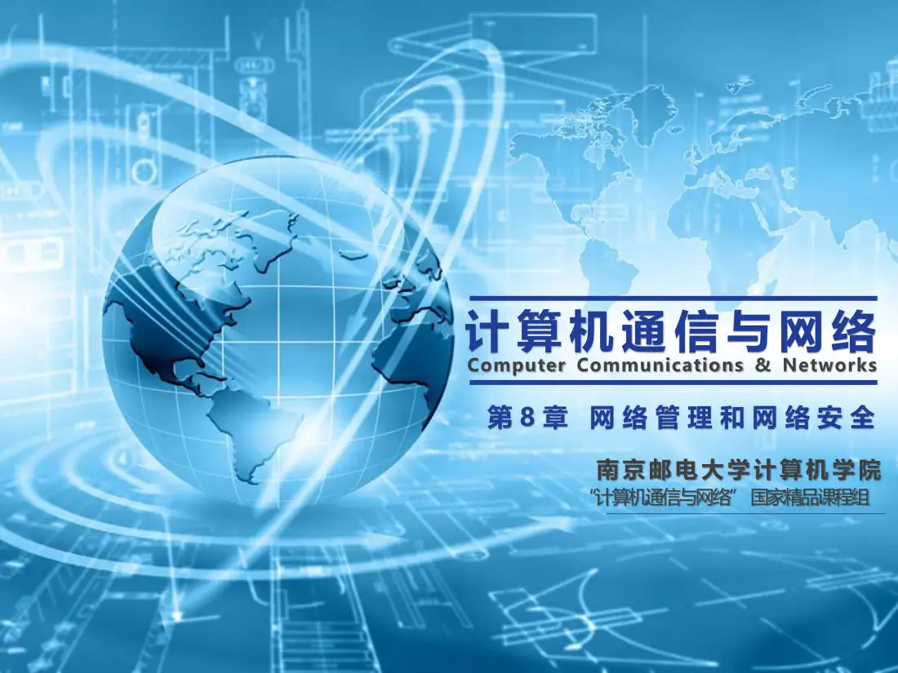

原文：

计算机通信与网络 Computer Communications & Networks

第 8 章 网 络 管 理 和 网 络 安 全

南京邮电大学计算机学院“计算机通信与网络”国家精品课程组

### 大纲要求R e q u i r e m e n t s

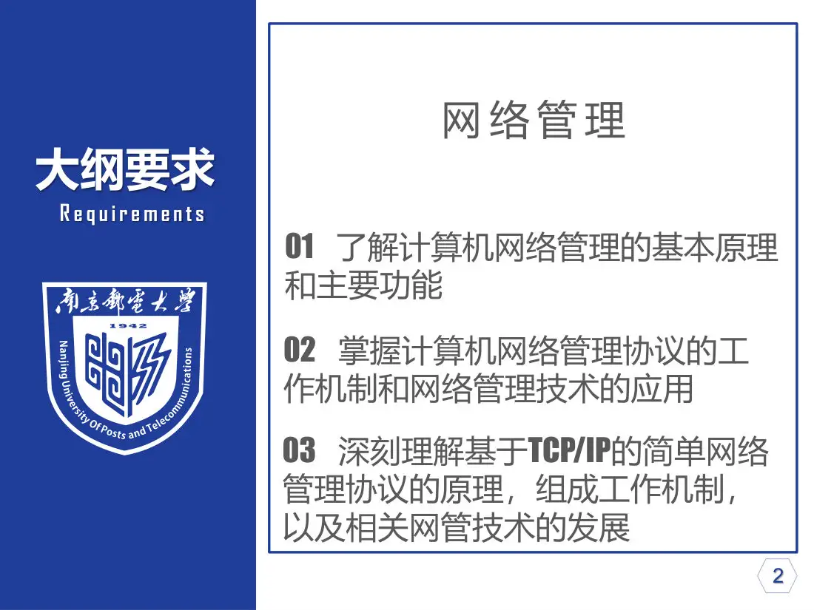

原文：

大纲要求R e q u i r e m e n t s

网 络 管 理

01 了解计算机网络管理的基本原理和主要功能

02 掌握计算机网络管理协议的工作机制和网络管理技术的应用

03 深刻理解基于TCP/IP的简单网络管理协议的原理，组成工作机制，以及相关网管技术的发展

2

### 内容纲要C o n t e n t s P a g e

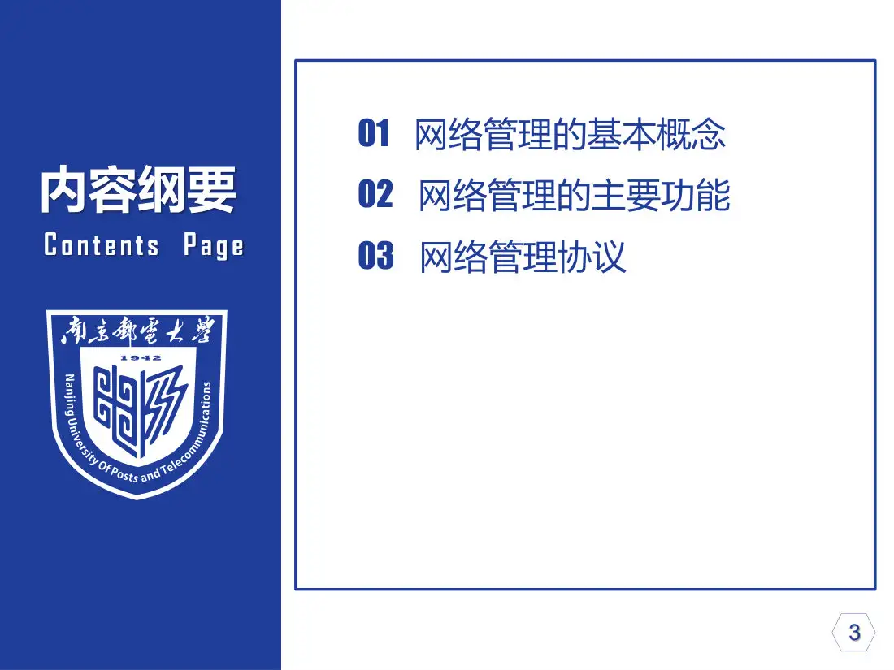

原文：

内容纲要C o n t e n t s P a g e

01 网络管理的基本概念
02 网络管理的主要功能
03 网络管理协议

3

### 内容纲要C o n t e n t s P a g e

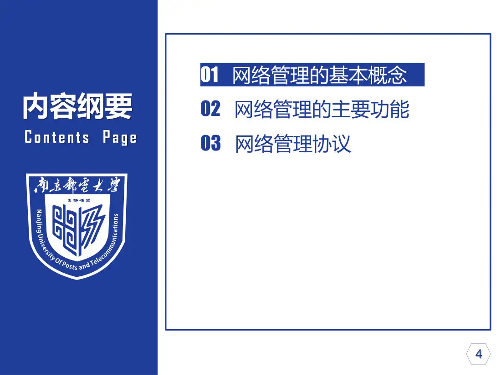

原文：

内容纲要C o n t e n t s P a g e

01 网络管理的基本概念
02 网络管理的主要功能
03 网络管理协议

4

### 8.1 网络管理的基本概念

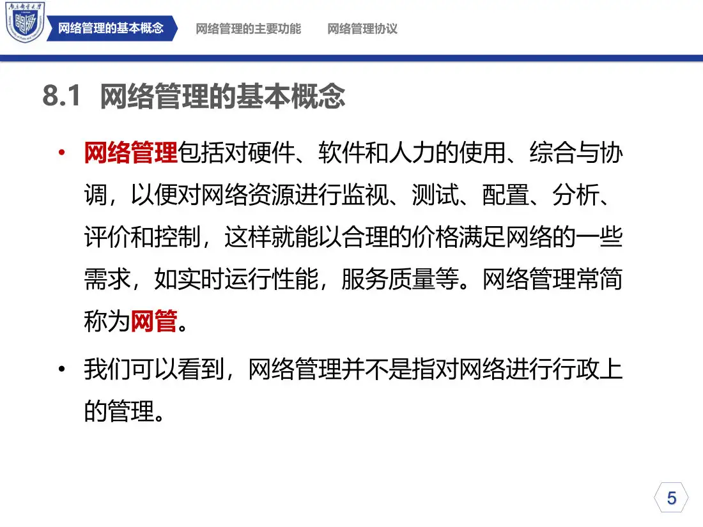

原文：

8.1 网络管理的基本概念

• 网络管理包括对硬件、软件和人力的使用、综合与协调，以便对网络资源进行监视、测试、配置、分析、评价和控制，这样就能以合理的价格满足网络的一些需求，如实时运行性能，服务质量等。网络管理常简称为网管。

• 我们可以看到，网络管理并不是指对网络进行行政上的管理。

南志郵電大學 Nanjing Ue and Te

网络管理的基本概念

网络管理的主要功能 网络管理协议

5

### 一、网络管理的发展及逻辑结构

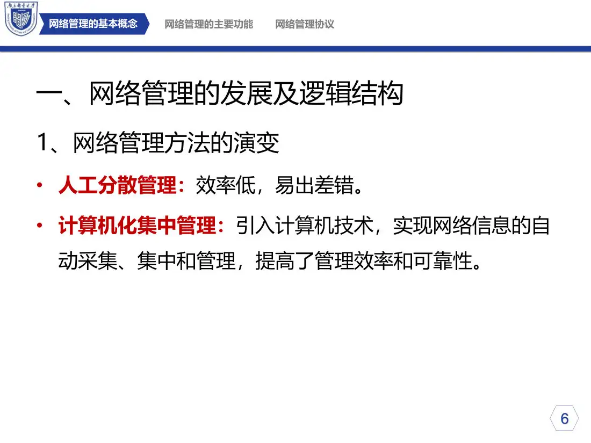

原文：

一、网络管理的发展及逻辑结构

1、网络管理方法的演变

• 人工分散管理：效率低，易出差错。

• 计算机化集中管理：引入计算机技术，实现网络信息的自动采集、集中和管理，提高了管理效率和可靠性。

南志郵電大學 Naning and Te

网络管理的基本概念

网络管理的主要功能 网络管理协议

6

### 2、网络管理系统的逻辑结构

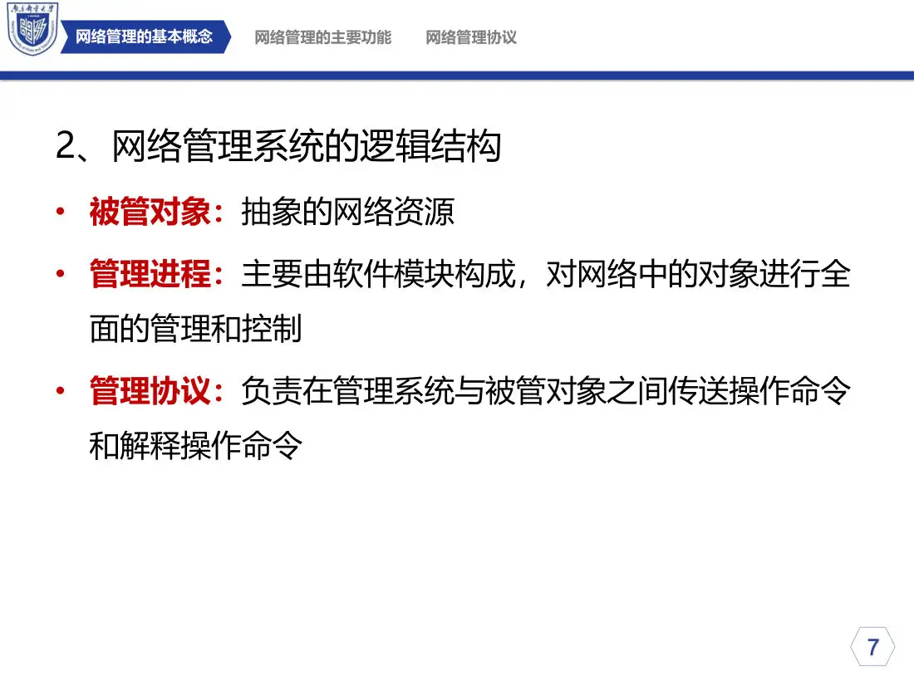

原文：

2、网络管理系统的逻辑结构

• 被管对象：抽象的网络资源

• 管理进程：主要由软件模块构成，对网络中的对象进行全面的管理和控制

• 管理协议：负责在管理系统与被管对象之间传送操作命令和解释操作命令

南立都電大學

网络管理的基本概念

网络管理的主要功能 网络管理协议

7

### 网络管理功能按作用可分为三部分

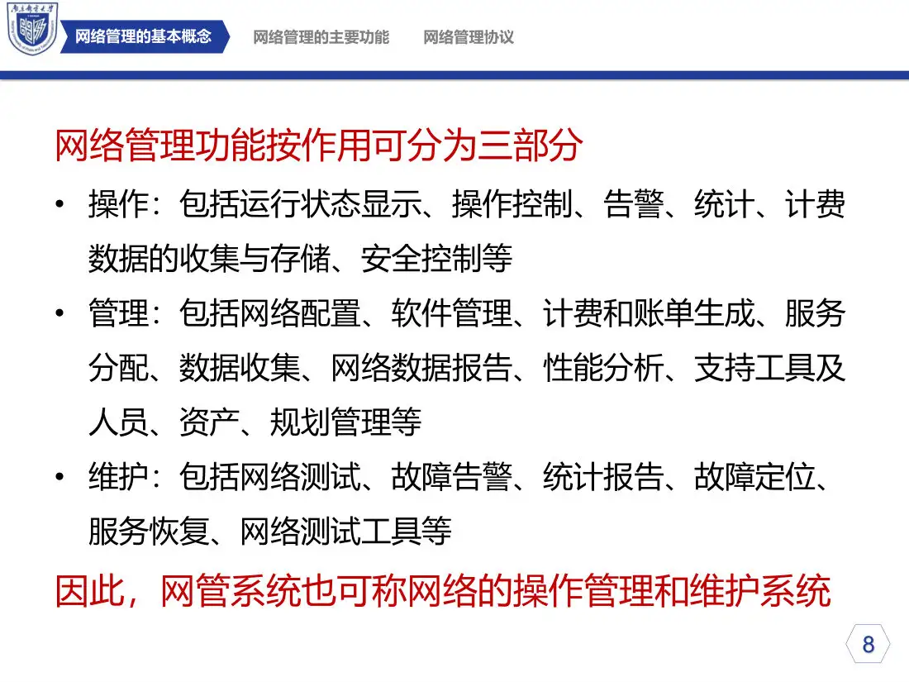

原文：

网络管理功能按作用可分为三部分

• 操作：包括运行状态显示、操作控制、告警、统计、计费数据的收集与存储、安全控制等

• 管理：包括网络配置、软件管理、计费和账单生成、服务分配、数据收集、网络数据报告、性能分析、支持工具及人员、资产、规划管理等

• 维护：包括网络测试、故障告警、统计报告、故障定位、服务恢复、网络测试工具等

因此，网管系统也可称网络的操作管理和维护系统

南志郵電大學

网络管理的基本概念

网络管理的主要功能 网络管理协议

8

### 3、Internet网络管理逻辑模型

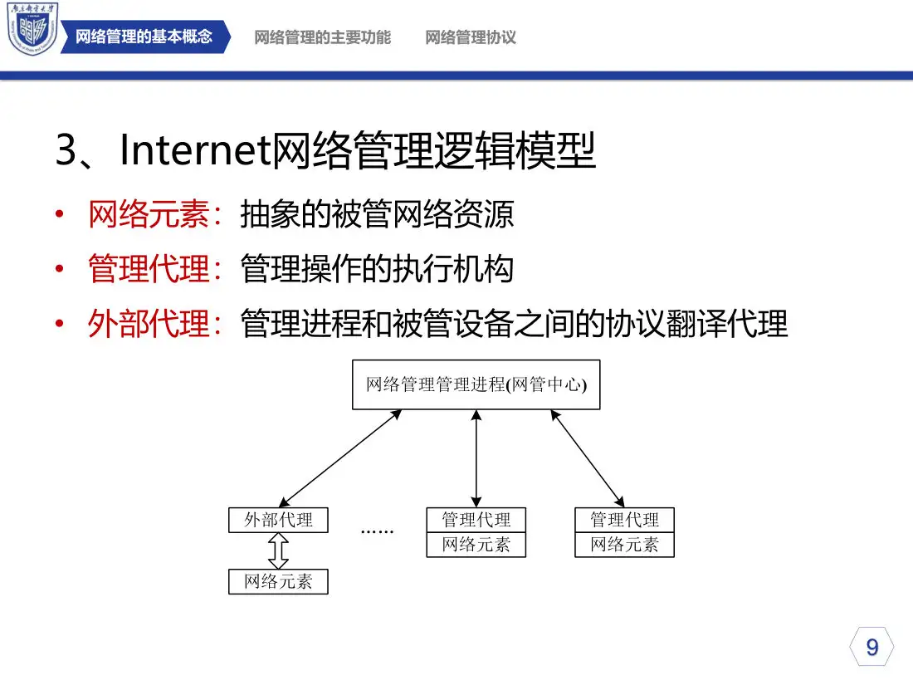

原文：

3、Internet网络管理逻辑模型

• 网络元素：抽象的被管网络资源

• 管理代理：管理操作的执行机构

• 外部代理：管理进程和被管设备之间的协议翻译代理

南立都電大學

网络管理的基本概念

网络管理的主要功能 网络管理协议

9

### 二、网络管理标准化

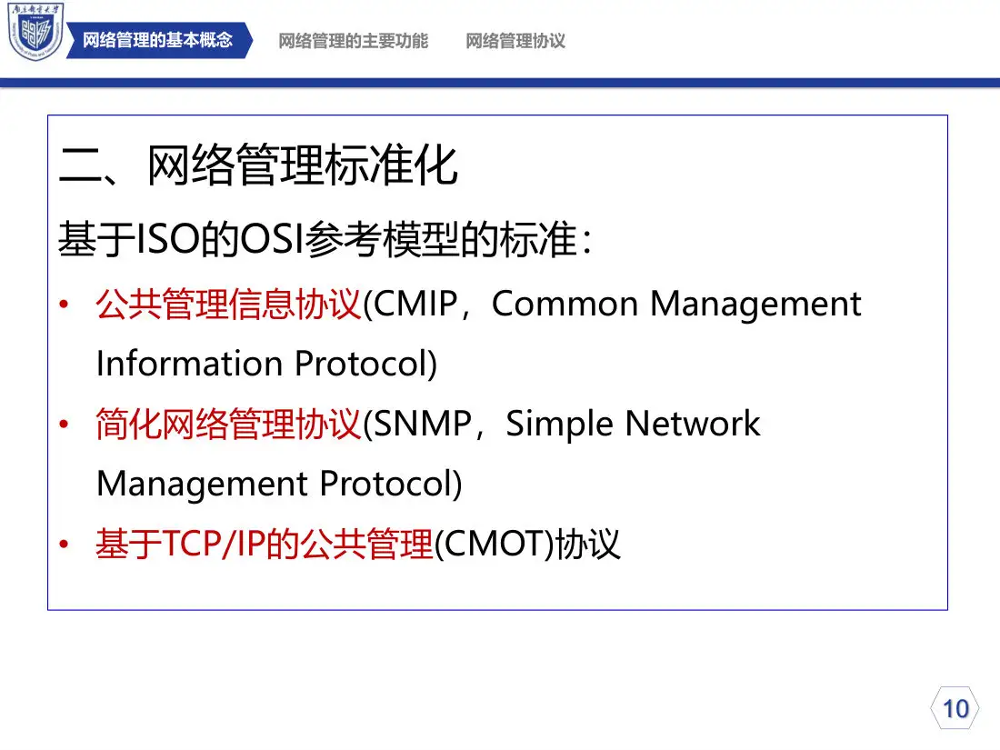

原文：

二、网络管理标准化

基于ISO的OSI参考模型的标准：

公共管理信息协议(CMIP，Common ManagementInformation Protocol)

• 简化网络管理协议(SNMP，Simple NetworkManagement Protocol)

• 基于TCP/IP的公共管理(CMOT)协议

南志郵電大學and Te

网络管理的基本概念

网络管理的主要功能 网络管理协议

10

### 基于ISO的OSI参考模型的标准：

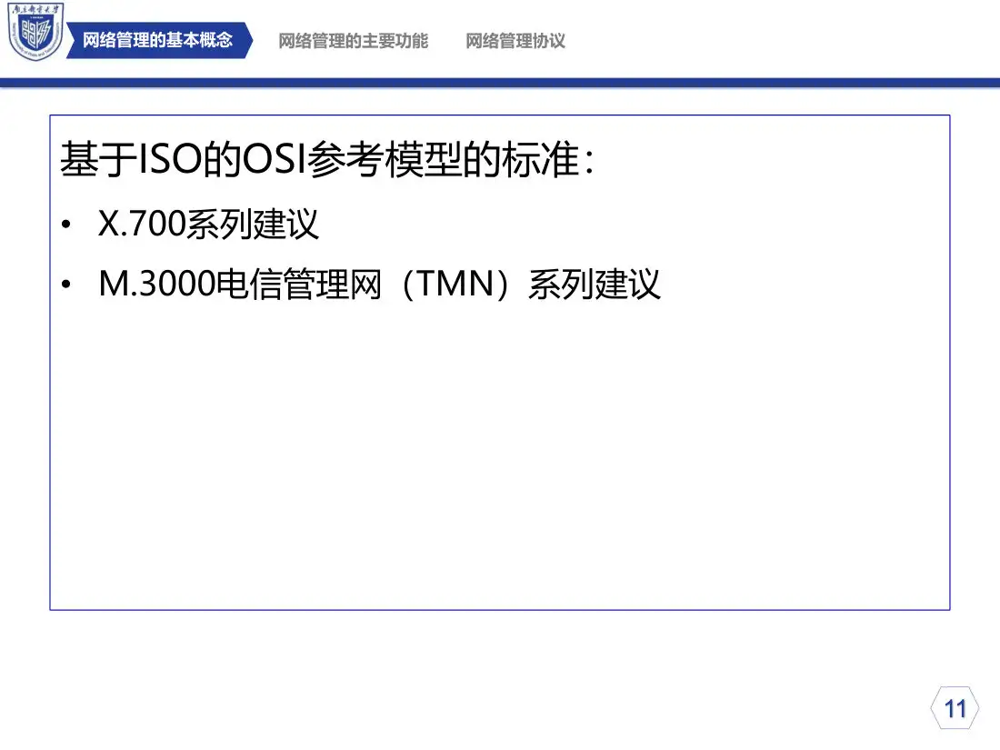

原文：

基于ISO的OSI参考模型的标准：

• X.700系列建议

• M.3000电信管理网（TMN）系列建议

南志郵電大學and Te

网络管理的基本概念

网络管理的主要功能 网络管理协议

11

### 01 网络管理的基本概念

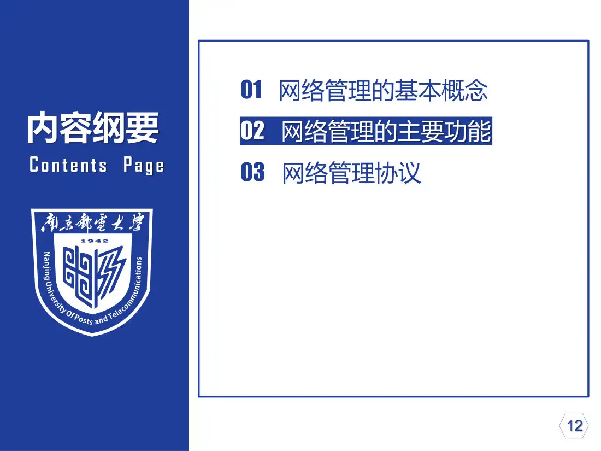

原文：

01 网络管理的基本概念
02 网络管理的主要功能
03 网络管理协议

内容纲要C o n t e n t s P a g e

12

### 8.2 网络管理的主要功能

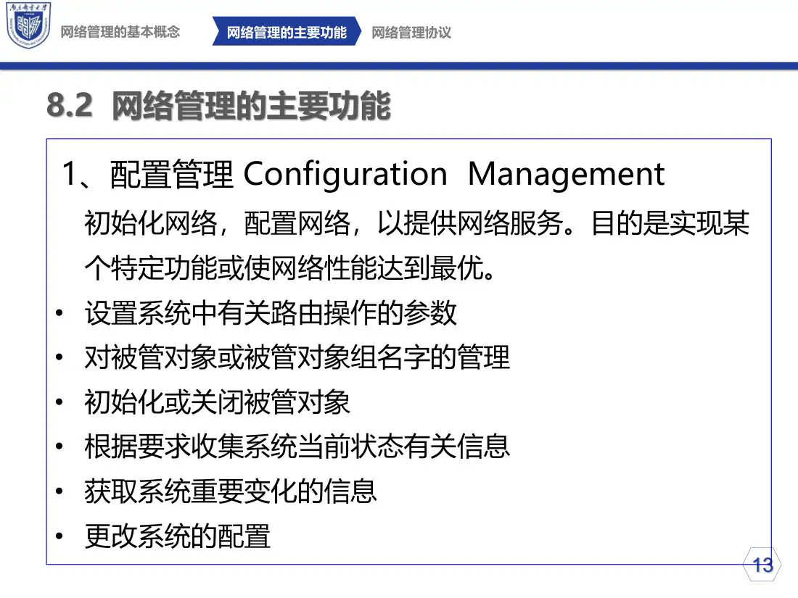

原文：

8.2 网络管理的主要功能

1、配置管理 Configuration Management初始化网络，配置网络，以提供网络服务。目的是实现某个特定功能或使网络性能达到最优。

• 设置系统中有关路由操作的参数

• 对被管对象或被管对象组名字的管理

• 初始化或关闭被管对象

• 根据要求收集系统当前状态有关信息

• 获取系统重要变化的信息

• 更改系统的配置

南立都電大學

网络管理的基本概念

网络管理的主要功能

网络管理协议

### 2、性能管理 Performance Management

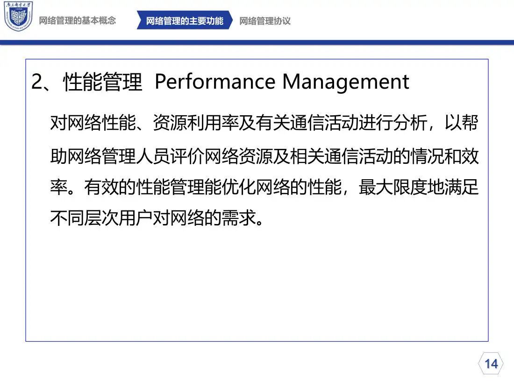

原文：

2、性能管理 Performance Management

对网络性能、资源利用率及有关通信活动进行分析，以帮助网络管理人员评价网络资源及相关通信活动的情况和效率。有效的性能管理能优化网络的性能，最大限度地满足不同层次用户对网络的需求。

南志郵電大學 Nanjing U yorPe s and Te

网络管理的基本概念

网络管理的主要功能

网络管理协议

14

### 性能管理的典型功能

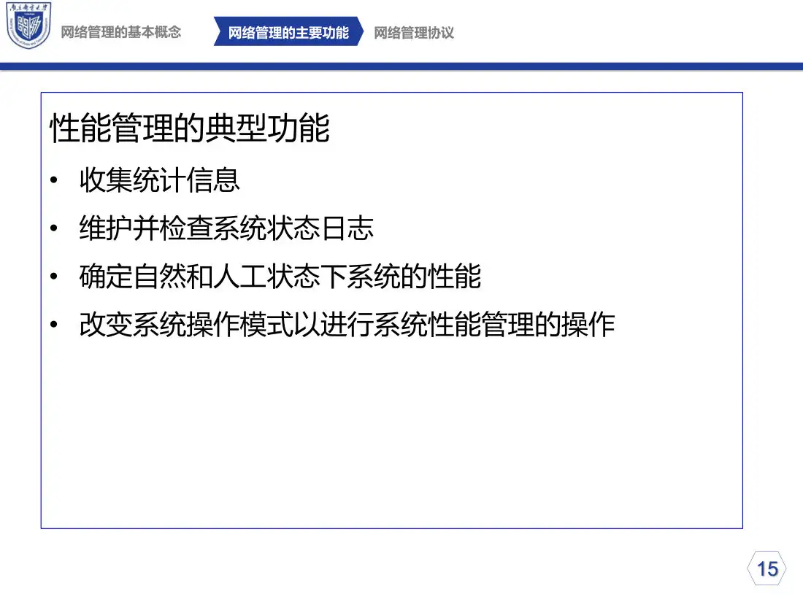

原文：

性能管理的典型功能

• 收集统计信息

• 维护并检查系统状态日志

• 确定自然和人工状态下系统的性能

• 改变系统操作模式以进行系统性能管理的操作

网络管理的主要功能 网络管理协议

南立都電大學

网络管理的基本概念

15

### 3、故障管理 Fault Management

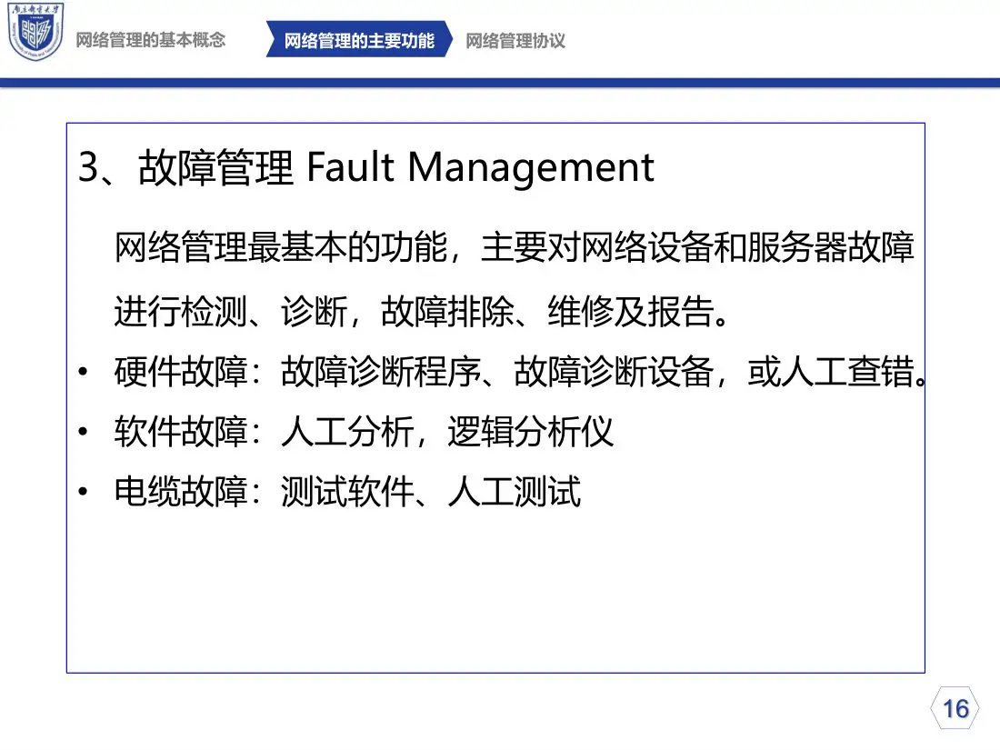

原文：

3、故障管理 Fault Management

网络管理最基本的功能，主要对网络设备和服务器故障进行检测、诊断，故障排除、维修及报告。

• 硬件故障：故障诊断程序、故障诊断设备，或人工查错。

• 软件故障：人工分析，逻辑分析仪

• 电缆故障：测试软件、人工测试

南立都電大學

网络管理的基本概念

网络管理的主要功能 网络管理协议

16

### 4、计费管理 Account Management

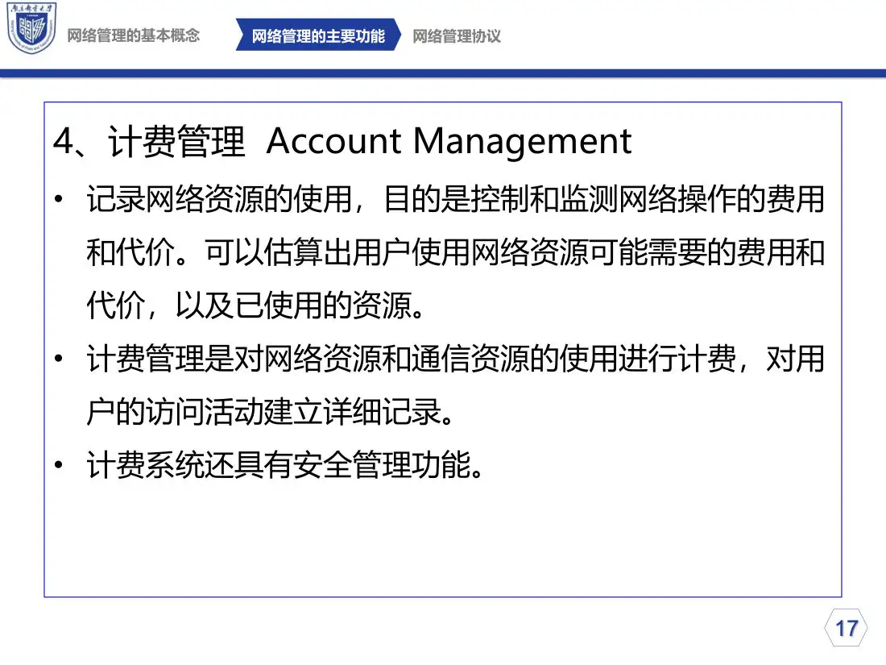

原文：

4、计费管理 Account Management

• 记录网络资源的使用，目的是控制和监测网络操作的费用和代价。可以估算出用户使用网络资源可能需要的费用和代价，以及已使用的资源。

• 计费管理是对网络资源和通信资源的使用进行计费，对用户的访问活动建立详细记录。

• 计费系统还具有安全管理功能。

南志郵電大學 Naning and Te

网络管理的基本概念

网络管理的主要功能 网络管理协议

17

### 5、安全管理 Security Management

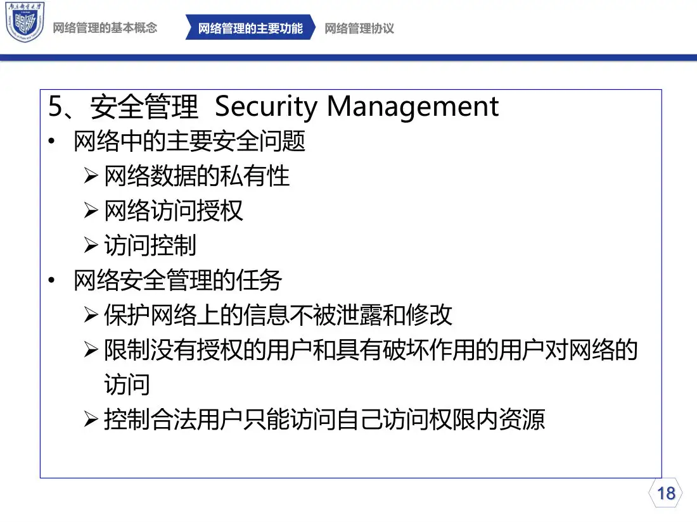

原文：

5、安全管理 Security Management

• 网络中的主要安全问题

➢网络数据的私有性

➢网络访问授权

➢访问控制

• 网络安全管理的任务

➢保护网络上的信息不被泄露和修改

➢限制没有授权的用户和具有破坏作用的用户对网络的访问

➢控制合法用户只能访问自己访问权限内资源

南立都電大學

网络管理的基本概念

网络管理的主要功能 网络管理协议

18

### 网络管理五大功能的关系

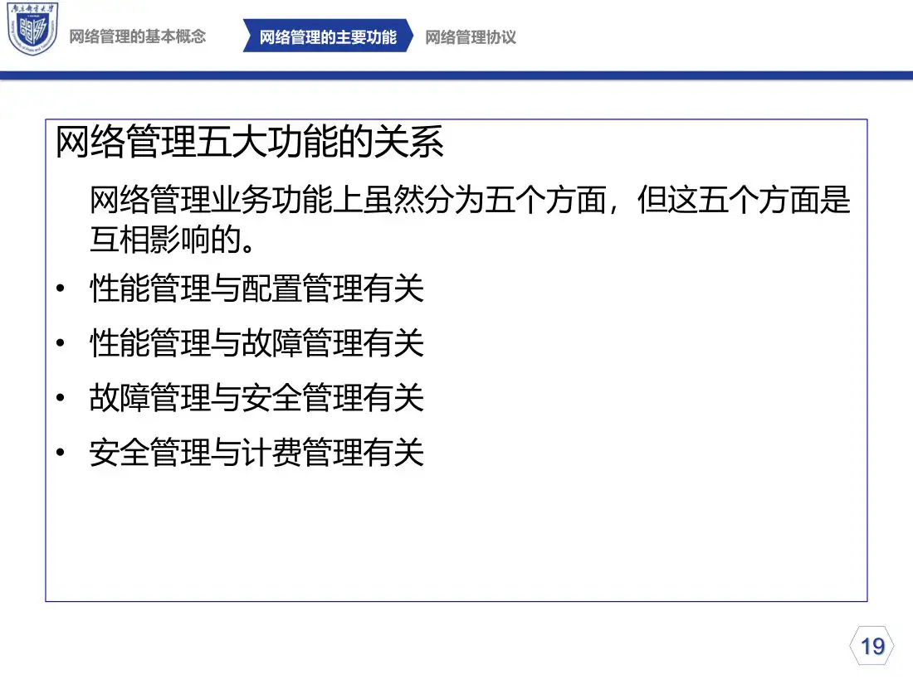

原文：

网络管理五大功能的关系

网络管理业务功能上虽然分为五个方面，但这五个方面是互相影响的。

• 性能管理与配置管理有关

• 性能管理与故障管理有关

• 故障管理与安全管理有关

• 安全管理与计费管理有关

南立都電大學

网络管理的基本概念

网络管理的主要功能 网络管理协议

19

### 内容纲要C o n t e n t s P a g e

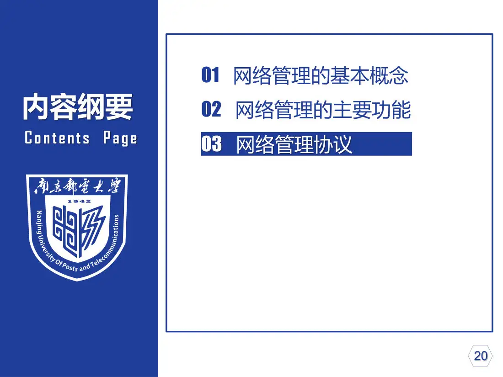

原文：

内容纲要C o n t e n t s P a g e

01 网络管理的基本概念
02 网络管理的主要功能
03 网络管理协议

20

### 8.3 网络管理协议

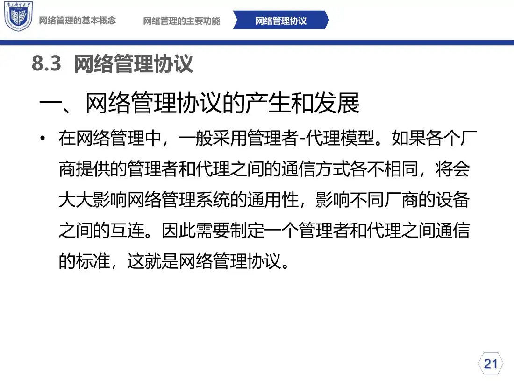

原文：

8.3 网络管理协议

一、网络管理协议的产生和发展

• 在网络管理中，一般采用管理者-代理模型。如果各个厂商提供的管理者和代理之间的通信方式各不相同，将会大大影响网络管理系统的通用性，影响不同厂商的设备之间的互连。因此需要制定一个管理者和代理之间通信的标准，这就是网络管理协议。

南志郵電大學 Nanjing U yorPe s and Te

网络管理的基本概念

网络管理的主要功能

网络管理协议

21

### • 网络管理协议是一个通信标准，简称为网管协议。

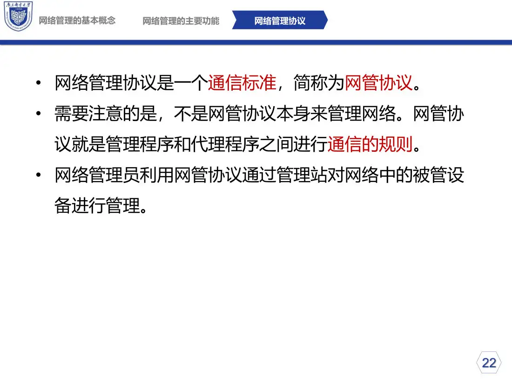

原文：

• 网络管理协议是一个通信标准，简称为网管协议。

• 需要注意的是，不是网管协议本身来管理网络。网管协议就是管理程序和代理程序之间进行通信的规则。

• 网络管理员利用网管协议通过管理站对网络中的被管设备进行管理。

南志郵電大學 Naning and Te

网络管理的基本概念

网络管理的主要功能

网络管理协议

22

### • 管理程序和代理程序按客户-服务器方式工作。

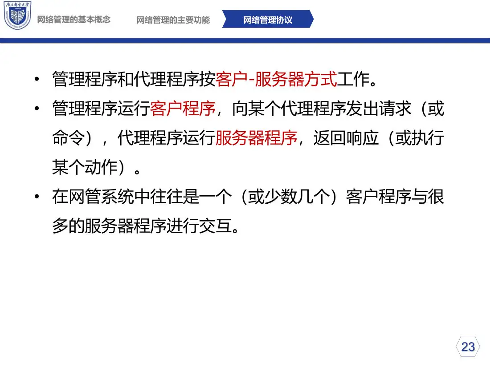

原文：

• 管理程序和代理程序按客户-服务器方式工作。

• 管理程序运行客户程序，向某个代理程序发出请求（或命令），代理程序运行服务器程序，返回响应（或执行某个动作）。

• 在网管系统中往往是一个（或少数几个）客户程序与很多的服务器程序进行交互。

南志郵電大學 Nanjing U yorPe s and Te

网络管理的基本概念

网络管理的主要功能

网络管理协议

23

### 主要的网络管理协议

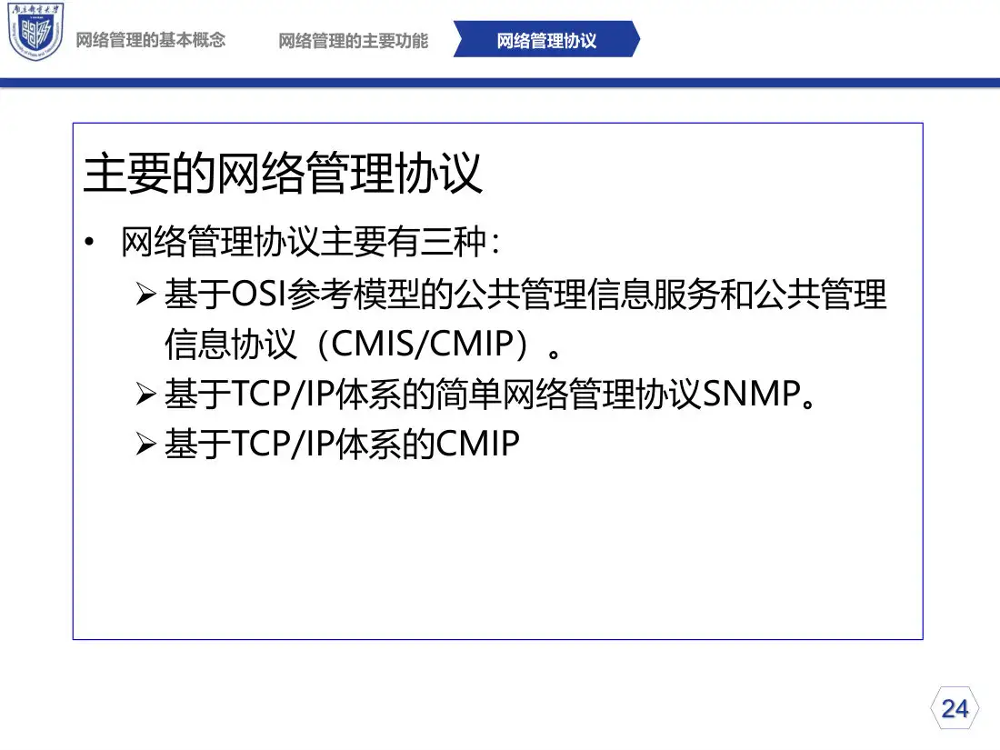

原文：

主要的网络管理协议

• 网络管理协议主要有三种：

➢基于OSI参考模型的公共管理信息服务和公共管理信息协议（CMIS/CMIP）。

➢基于TCP/IP体系的简单网络管理协议SNMP。

➢基于TCP/IP体系的CMIP

南立都電大學

网络管理的基本概念

网络管理的主要功能

网络管理协议

24

### 二、公共管理信息协议

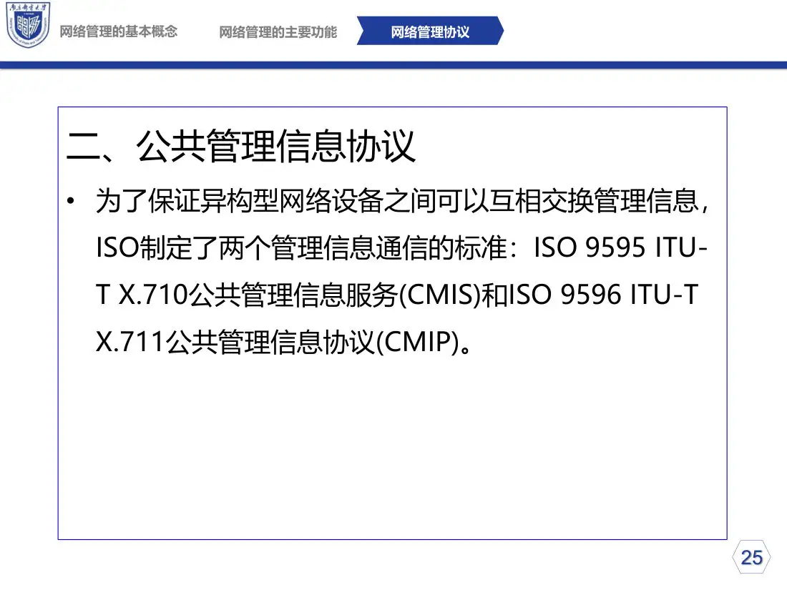

原文：

二、公共管理信息协议

• 为了保证异构型网络设备之间可以互相交换管理信息，ISO制定了两个管理信息通信的标准：ISO 9595 ITU-T X.710公共管理信息服务(CMIS)和ISO 9596 ITU-TX.711公共管理信息协议(CMIP)。

南志郵電大學 Nanjing Ue and Te

网络管理的基本概念

网络管理的主要功能

网络管理协议

25

### 1、管理信息的通信

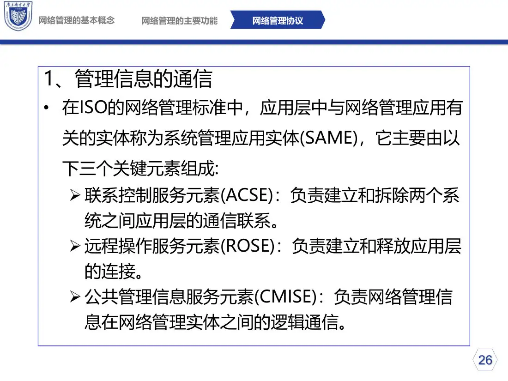

原文：

1、管理信息的通信

• 在ISO的网络管理标准中，应用层中与网络管理应用有关的实体称为系统管理应用实体(SAME)，它主要由以下三个关键元素组成:

➢联系控制服务元素(ACSE)：负责建立和拆除两个系统之间应用层的通信联系。

➢远程操作服务元素(ROSE)：负责建立和释放应用层的连接。

➢公共管理信息服务元素(CMISE)：负责网络管理信息在网络管理实体之间的逻辑通信。

南志郵電大學 Naning and Te

网络管理的基本概念

网络管理的主要功能

网络管理协议

26

### • 基于CMISE的管理信息通信的层次结构

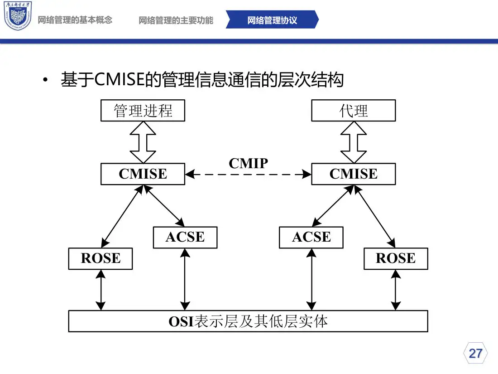

原文：

• 基于CMISE的管理信息通信的层次结构

南志郵電大學 Nanjing U yorPe s and Te

网络管理的基本概念

网络管理的主要功能

网络管理协议

27

### 2、公共管理信息服务元素

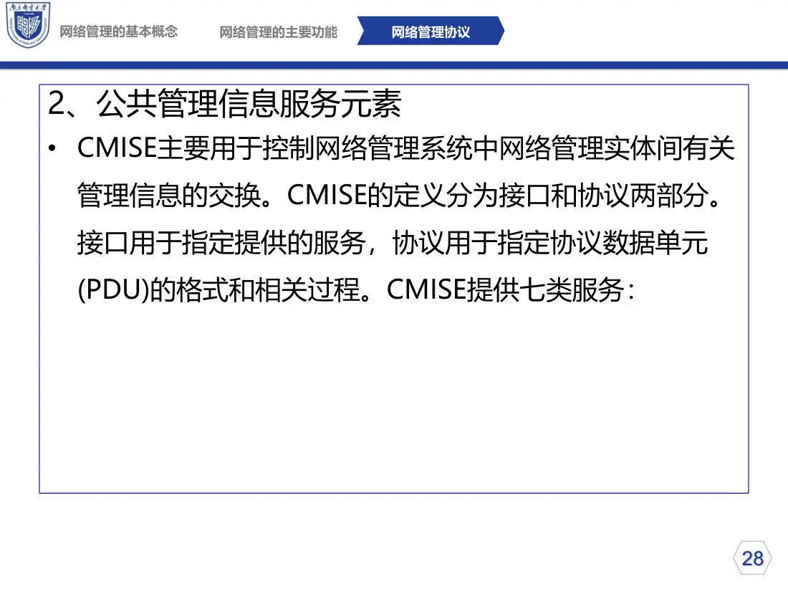

原文：

2、公共管理信息服务元素

• CMISE主要用于控制网络管理系统中网络管理实体间有关管理信息的交换。CMISE的定义分为接口和协议两部分。接口用于指定提供的服务，协议用于指定协议数据单元(PDU)的格式和相关过程。CMISE提供七类服务：

南志郵電大學 Nanjing U yorPe s and Te

网络管理的基本概念

网络管理的主要功能

网络管理协议

28

### 南志郵電大學

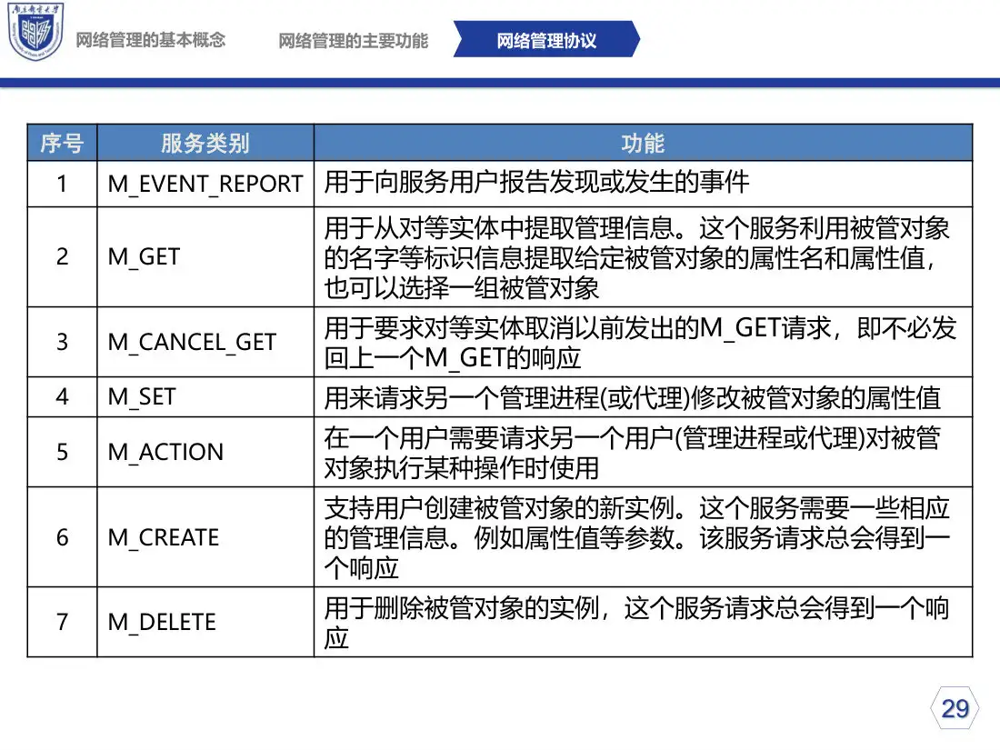

原文：

<table><tr><td>序号</td><td>服务类别</td><td>功能</td></tr><tr><td>1</td><td>M_EVENT_REPORT</td><td>用于向服务用户报告发现或发生的事件</td></tr><tr><td>2</td><td>M_GET</td><td>用于从对等实体中提取管理信息。这个服务利用被管对象的名字等标识信息提取给定被管对象的属性名和属性值,也可以选择一组被管对象</td></tr><tr><td>3</td><td>M_CANCEL_GET</td><td>用于要求对等实体取消以前发出的M_GET请求,即不必发回上一个M_GET的响应</td></tr><tr><td>4</td><td>M_SET</td><td>用来请求另一个管理进程(或代理)修改被管对象的属性值</td></tr><tr><td>5</td><td>M_ACTION</td><td>在一个用户需要请求另一个用户(管理进程或代理)对被管对象执行某种操作时使用</td></tr><tr><td>6</td><td>M_CREATE</td><td>支持用户创建被管对象的新实例。这个服务需要一些相应的管理信息。例如属性值等参数。该服务请求总会得到一个响应</td></tr><tr><td>7</td><td>M_DELETE</td><td>用于删除被管对象的实例,这个服务请求总会得到一个响应</td></tr></table>

南志郵電大學

网络管理的基本概念

网络管理的主要功能

网络管理协议

29

### 3、公共管理信息协议

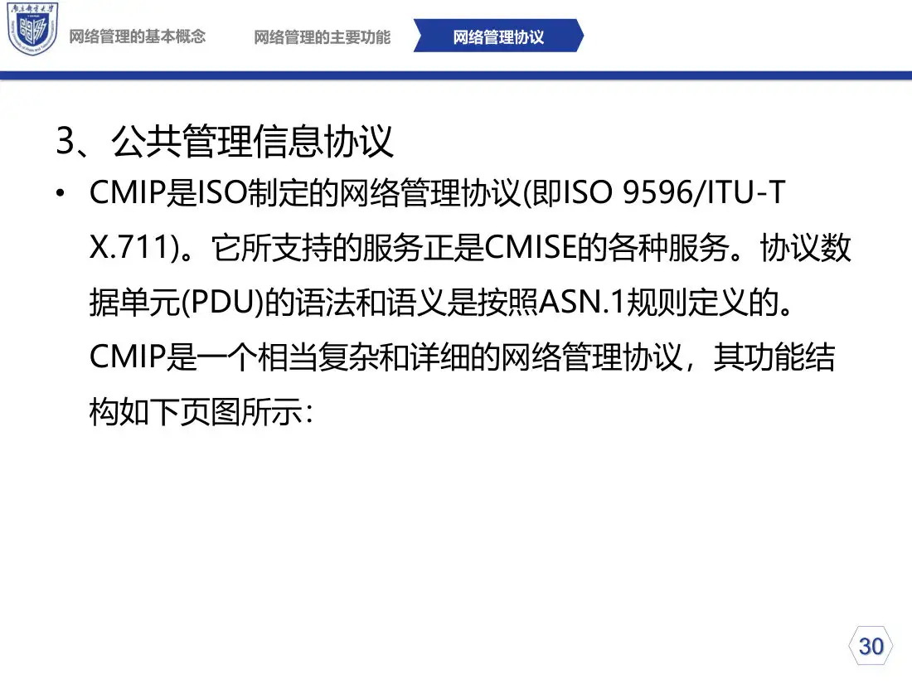

原文：

3、公共管理信息协议

• CMIP是ISO制定的网络管理协议(即ISO 9596/ITU-TX.711)。它所支持的服务正是CMISE的各种服务。协议数据单元(PDU)的语法和语义是按照ASN.1规则定义的。CMIP是一个相当复杂和详细的网络管理协议，其功能结构如下页图所示：

南志郵電大學 Nanjing U yorPe s and Te

网络管理的基本概念

网络管理的主要功能

网络管理协议

30

### 管理功能域

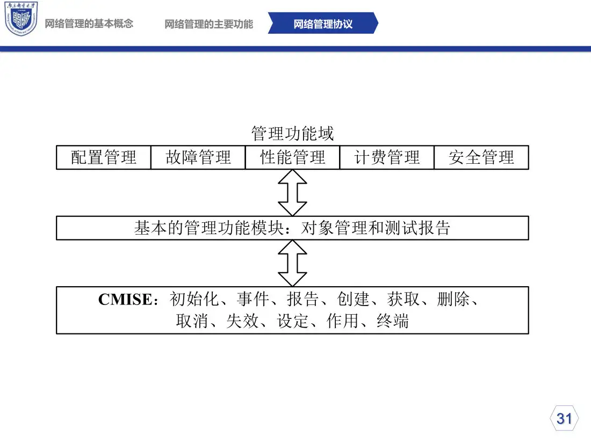

原文：

管理功能域

<table><tr><td>配置管理</td><td>故障管理</td><td>性能管理</td><td>计费管理</td><td>安全管理</td></tr><tr><td colspan="5">基本的管理功能模块:对象管理和测试报告</td></tr><tr><td colspan="5">CMISE:初始化、事件、报告、创建、获取、删除、取消、失效、设定、作用、终端</td></tr></table>

南志郵電大學 Nanjing U yorPe s and Te

网络管理的基本概念

网络管理的主要功能

网络管理协议

31

### 三、简单网络管理协议（SNMP）

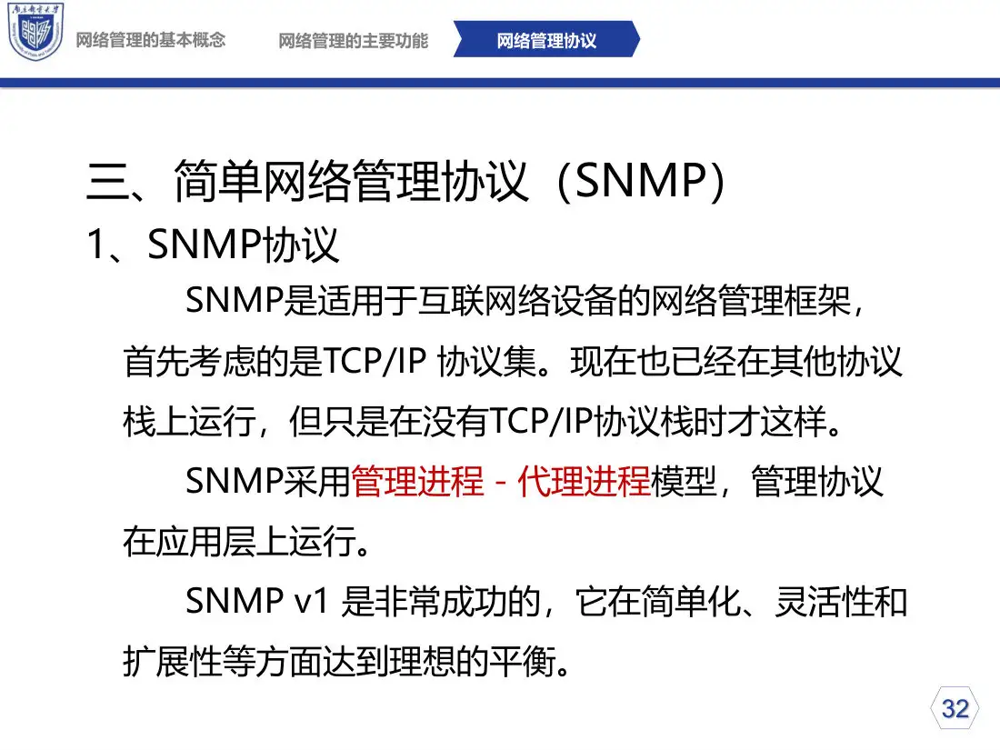

原文：

三、简单网络管理协议（SNMP）

1、SNMP协议

SNMP是适用于互联网络设备的网络管理框架，首先考虑的是TCP/IP 协议集。现在也已经在其他协议栈上运行，但只是在没有TCP/IP协议栈时才这样。

SNMP采用管理进程－代理进程模型，管理协议在应用层上运行。

SNMP v1 是非常成功的，它在简单化、灵活性和扩展性等方面达到理想的平衡。

南志郵電大學 Nanjing Ue and Te

网络管理的基本概念

网络管理的主要功能

网络管理协议

32

### • SNMP的功能结构：

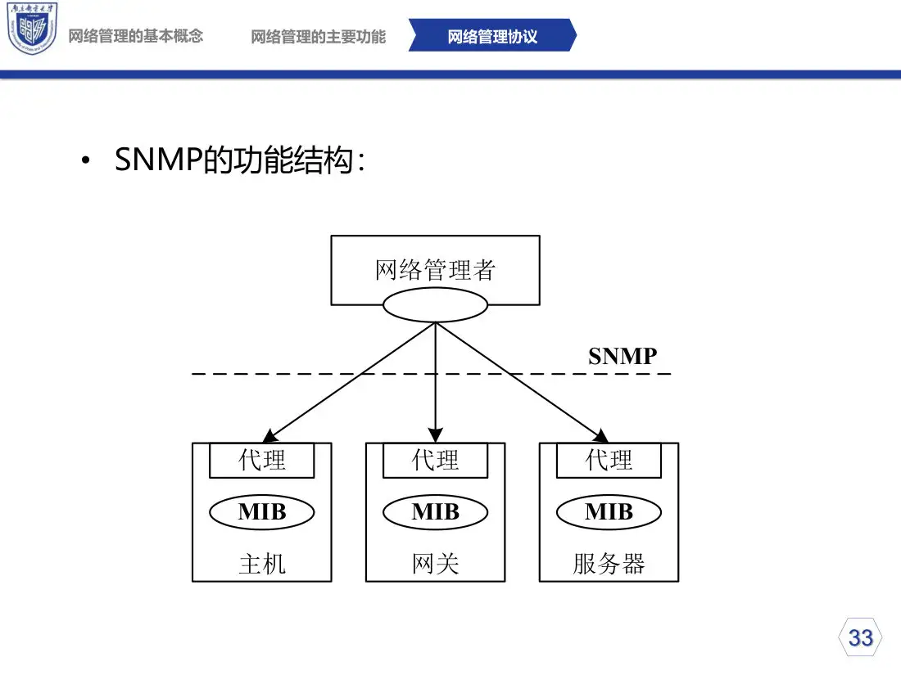

原文：

• SNMP的功能结构：

南志郵電大學 Naning and Te

网络管理的基本概念

网络管理的主要功能

网络管理协议

33

### SNMP的指导思想

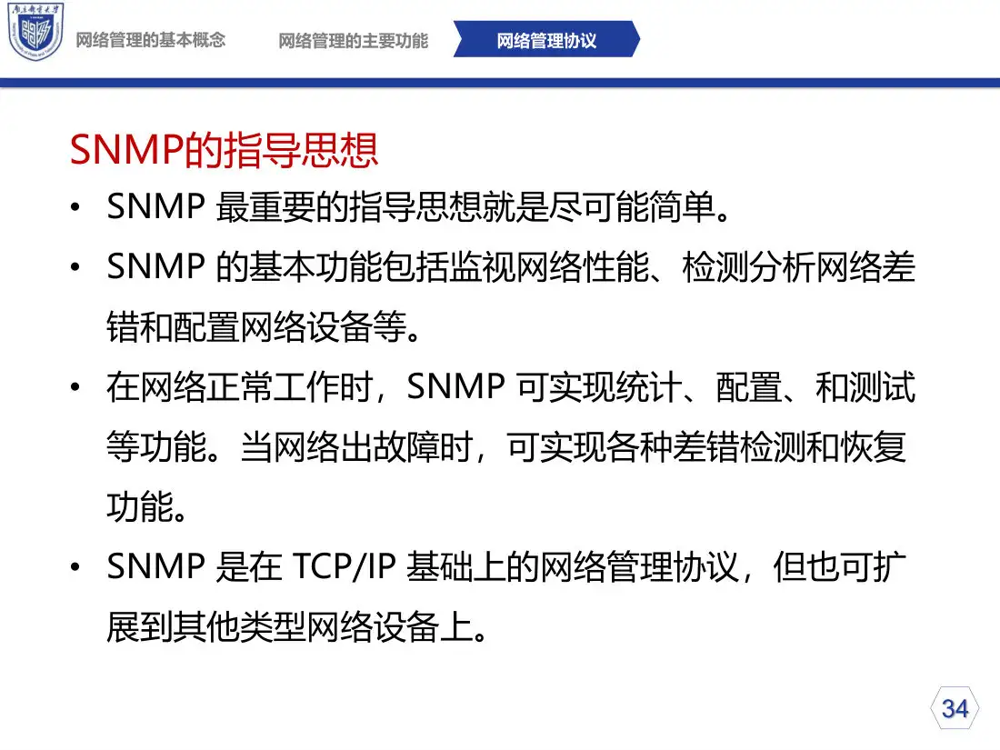

原文：

SNMP的指导思想

• SNMP 最重要的指导思想就是尽可能简单。

• SNMP 的基本功能包括监视网络性能、检测分析网络差错和配置网络设备等。

• 在网络正常工作时，SNMP 可实现统计、配置、和测试等功能。当网络出故障时，可实现各种差错检测和恢复功能。

• SNMP 是在 TCP/IP 基础上的网络管理协议，但也可扩展到其他类型网络设备上。

南志郵電大學 Nanjing U yorPe s and Te

网络管理的基本概念

网络管理的主要功能

网络管理协议

34

### SNMP的特点和组成

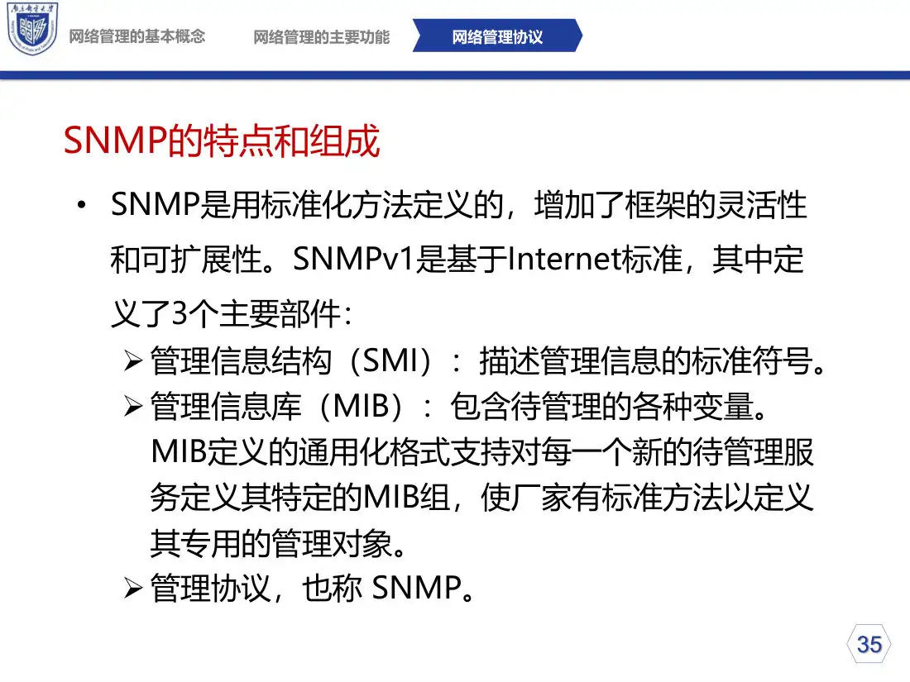

原文：

SNMP的特点和组成

• SNMP是用标准化方法定义的，增加了框架的灵活性和可扩展性。SNMPv1是基于Internet标准，其中定义了3个主要部件：

➢管理信息结构（SMI）：描述管理信息的标准符号。

➢管理信息库（MIB）：包含待管理的各种变量。MIB定义的通用化格式支持对每一个新的待管理服务定义其特定的MIB组，使厂家有标准方法以定义其专用的管理对象。

➢管理协议，也称 SNMP。

南志郵電大學 Nanjing U yorPe s and Te

网络管理的基本概念

网络管理的主要功能

网络管理协议

35

### SNMP 的典型配置

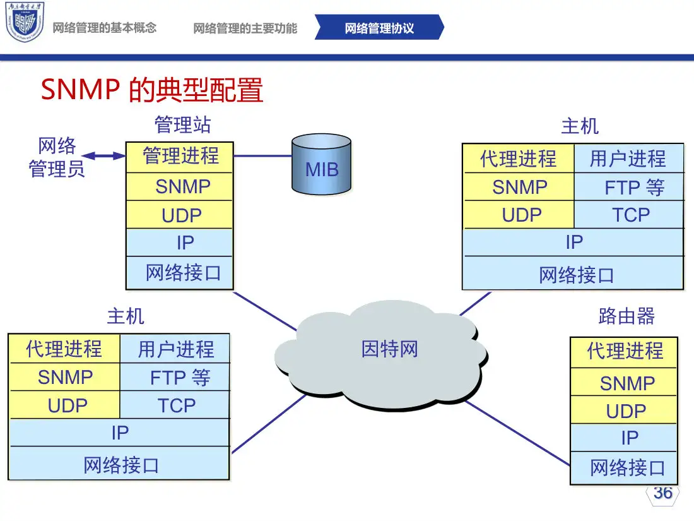

原文：

SNMP 的典型配置

<table><tr><td>代理进程</td><td>用户进程</td></tr><tr><td>SNMP</td><td>FTP 等</td></tr><tr><td>UDP</td><td>TCP</td></tr><tr><td colspan="2">IP</td></tr><tr><td colspan="2">网络接口</td></tr></table>

南志郵電大學 Nanjing U yorPe s and Te

网络管理的基本概念

网络管理的主要功能

网络管理协议

36

### SNMP 的管理站和委托代理

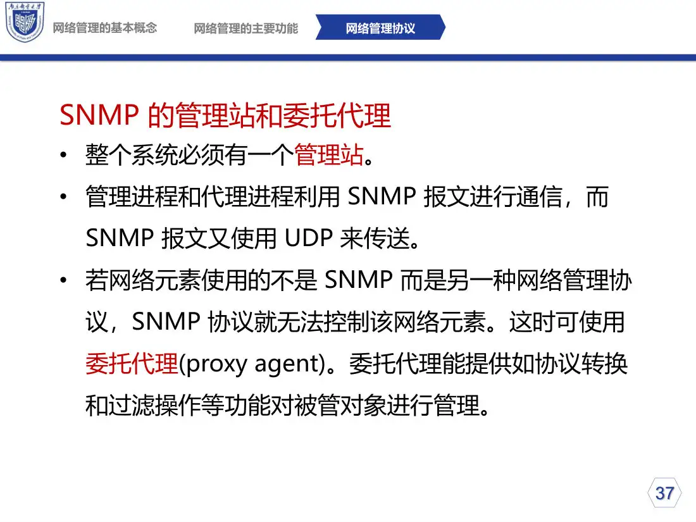

原文：

SNMP 的管理站和委托代理

• 整个系统必须有一个管理站。

• 管理进程和代理进程利用 SNMP 报文进行通信，而SNMP 报文又使用 UDP 来传送。

• 若网络元素使用的不是 SNMP 而是另一种网络管理协议，SNMP 协议就无法控制该网络元素。这时可使用委托代理(proxy agent)。委托代理能提供如协议转换和过滤操作等功能对被管对象进行管理。

南志郵電大學 Nanjing U yorPe s and Te

网络管理的基本概念

网络管理的主要功能

网络管理协议

37

### 管理信息库 MIB

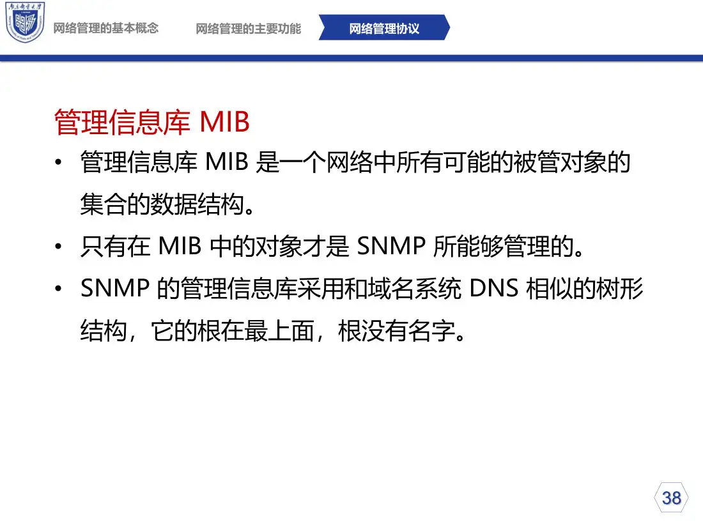

原文：

管理信息库 MIB

• 管理信息库 MIB 是一个网络中所有可能的被管对象的集合的数据结构。

• 只有在 MIB 中的对象才是 SNMP 所能够管理的。

• SNMP 的管理信息库采用和域名系统 DNS 相似的树形结构，它的根在最上面，根没有名字。

南志郵電大學 Naning and Te

网络管理的基本概念

网络管理的主要功能

网络管理协议

38

### 管理信息库的对象命名树举例根

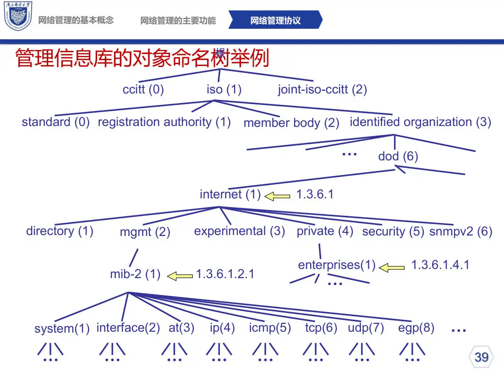

原文：

管理信息库的对象命名树举例根

南志郵電大學 Nanjing Ue and Te

网络管理的基本概念 网络管理的主要功能

网络管理协议

### 管理信息库包括三部分：

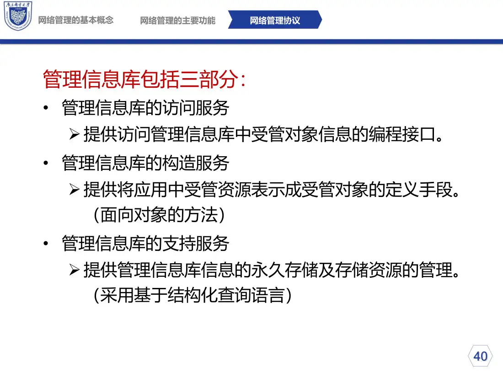

原文：

管理信息库包括三部分：

• 管理信息库的访问服务

➢提供访问管理信息库中受管对象信息的编程接口。

• 管理信息库的构造服务

➢提供将应用中受管资源表示成受管对象的定义手段。（面向对象的方法）

• 管理信息库的支持服务

➢提供管理信息库信息的永久存储及存储资源的管理。

（采用基于结构化查询语言）

南志郵電大學 Naning and Te

网络管理的基本概念

网络管理的主要功能

网络管理协议

40

### SNMP 的探询操作

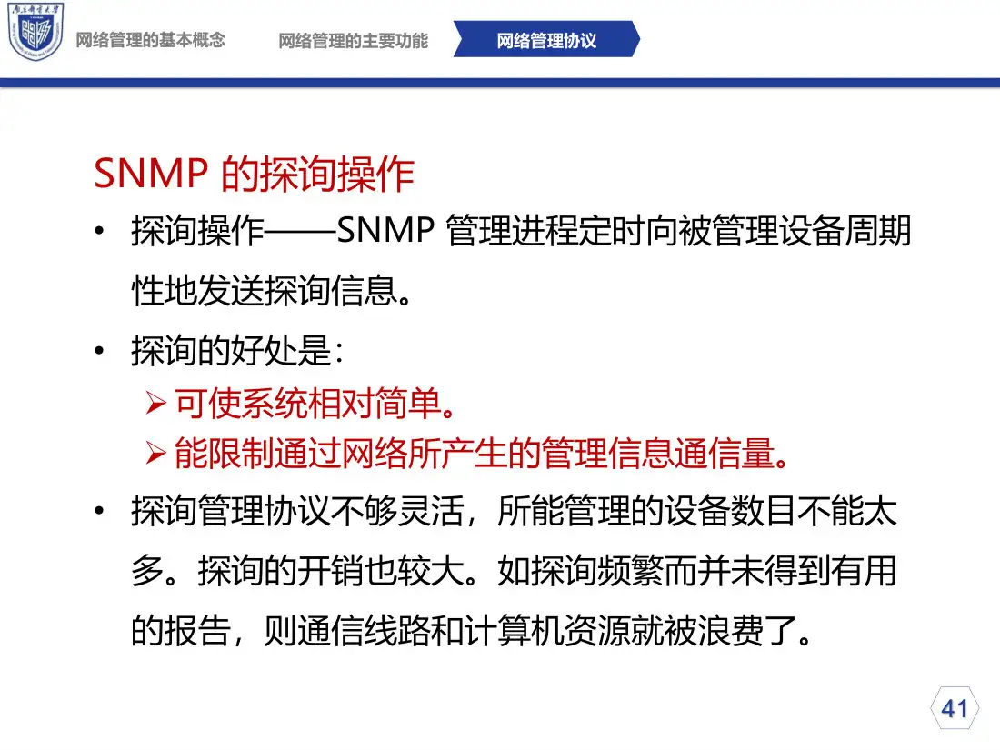

原文：

SNMP 的探询操作

• 探询操作——SNMP 管理进程定时向被管理设备周期性地发送探询信息。

• 探询的好处是：

➢可使系统相对简单。

➢能限制通过网络所产生的管理信息通信量。

• 探询管理协议不够灵活，所能管理的设备数目不能太多。探询的开销也较大。如探询频繁而并未得到有用的报告，则通信线路和计算机资源就被浪费了。

南志郵電大學 Naning and Te

网络管理的基本概念

网络管理的主要功能

网络管理协议

41

### 陷阱(trap)

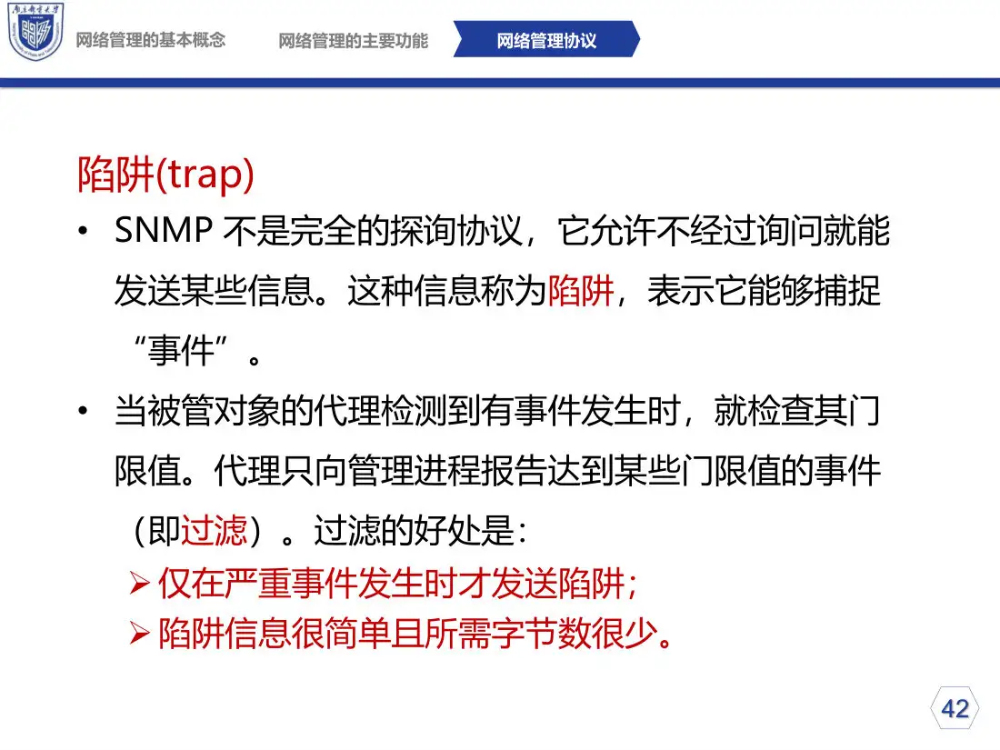

原文：

陷阱(trap)

• SNMP 不是完全的探询协议，它允许不经过询问就能发送某些信息。这种信息称为陷阱，表示它能够捕捉“事件”。

• 当被管对象的代理检测到有事件发生时，就检查其门限值。代理只向管理进程报告达到某些门限值的事件（即过滤）。过滤的好处是：

➢仅在严重事件发生时才发送陷阱；

➢陷阱信息很简单且所需字节数很少。

南志郵電大學 Nanjing U yorPe s and Te

网络管理的基本概念

网络管理的主要功能

网络管理协议

42

### SNMP 是有效的网络管理协议

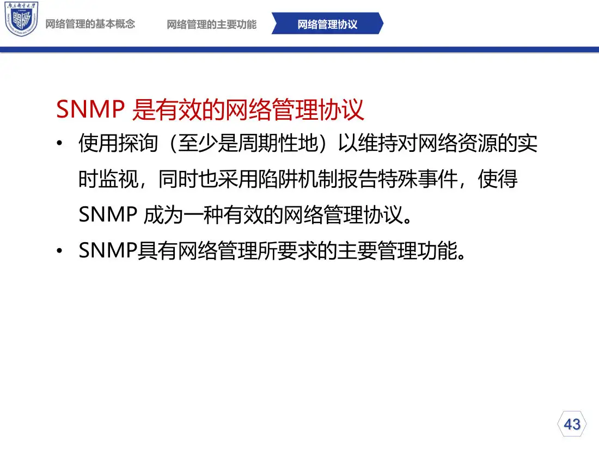

原文：

SNMP 是有效的网络管理协议

• 使用探询（至少是周期性地）以维持对网络资源的实时监视，同时也采用陷阱机制报告特殊事件，使得SNMP 成为一种有效的网络管理协议。

• SNMP具有网络管理所要求的主要管理功能。

南志郵電大學 Naning and Te

网络管理的基本概念

网络管理的主要功能

网络管理协议

43

### SNMP 使用的端口

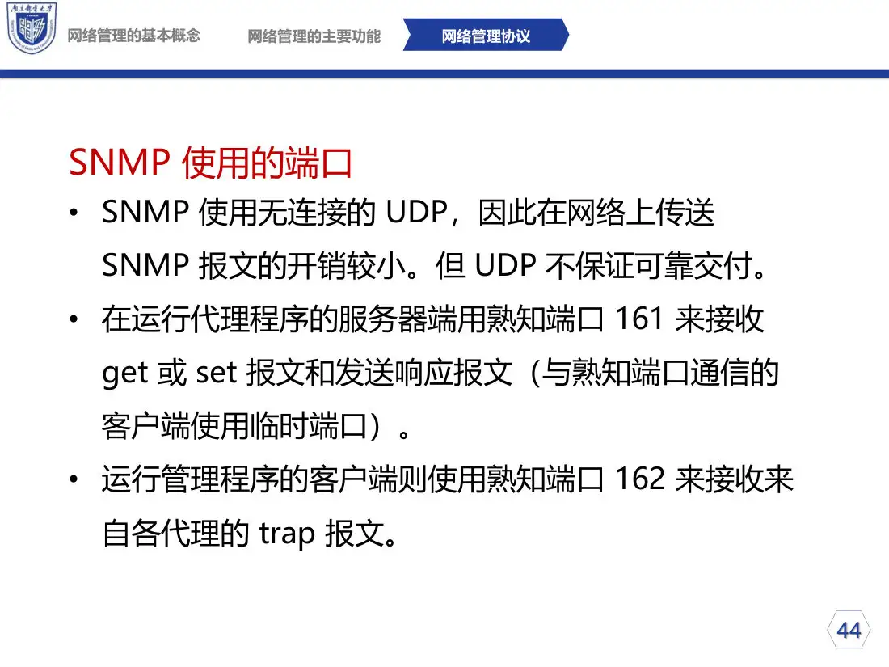

原文：

SNMP 使用的端口

• SNMP 使用无连接的 UDP，因此在网络上传送SNMP 报文的开销较小。但 UDP 不保证可靠交付。

• 在运行代理程序的服务器端用熟知端口 161 来接收get 或 set 报文和发送响应报文（与熟知端口通信的客户端使用临时端口）。

• 运行管理程序的客户端则使用熟知端口 162 来接收来自各代理的 trap 报文。

南志郵電大學 Nanjing U yorPe s and Te

网络管理的基本概念

网络管理的主要功能

网络管理协议

44

### • SNMP的操作只有两种基本的管理功能，即：

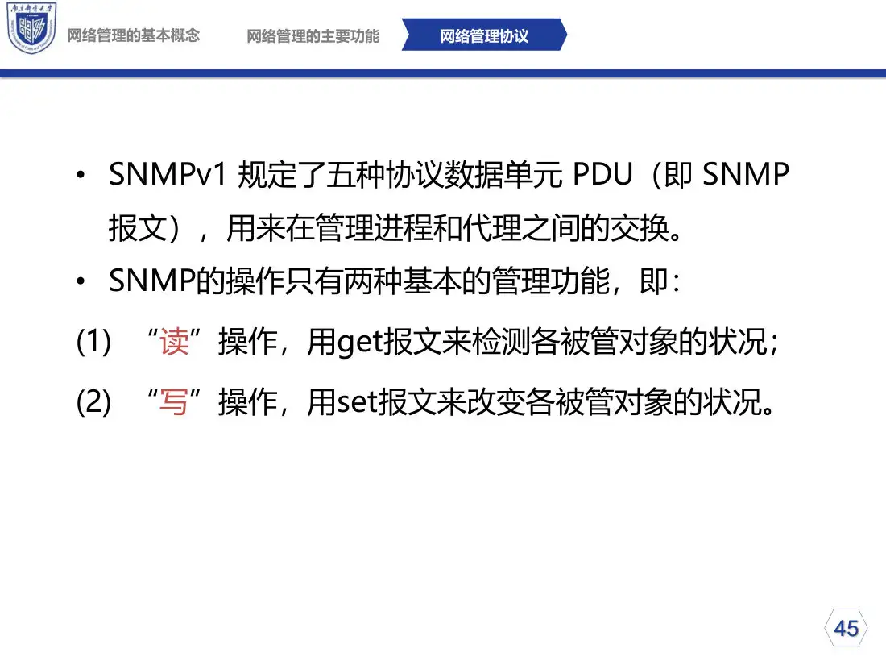

原文：

• SNMPv1 规定了五种协议数据单元 PDU（即 SNMP报文），用来在管理进程和代理之间的交换。

• SNMP的操作只有两种基本的管理功能，即：

(1) “读”操作，用get报文来检测各被管对象的状况；

(2) “写”操作，用set报文来改变各被管对象的状况。

南志郵電大學 Nanjing Ue and Te

网络管理的基本概念

网络管理的主要功能

网络管理协议

45

### SNMPv1的协议数据单元类型

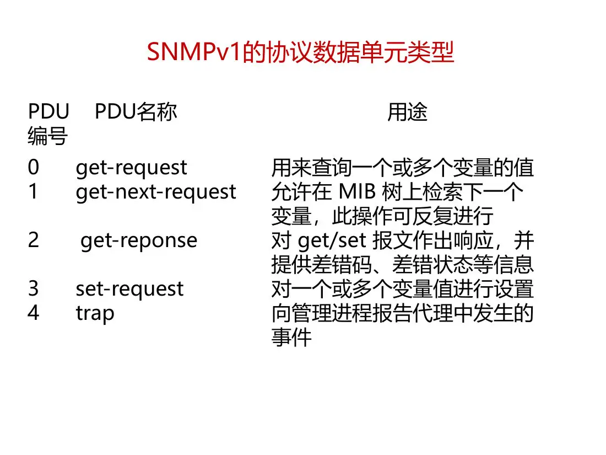

原文：

SNMPv1的协议数据单元类型

<table><tr><td>PDU编号</td><td>PDU名称</td><td>用途</td></tr><tr><td>0</td><td>get-request</td><td>用来查询一个或多个变量的值</td></tr><tr><td>1</td><td>get-next-request</td><td>允许在MIB树上检索下一个变量,此操作可反复进行</td></tr><tr><td>2</td><td>get-response</td><td>对get/set报文作出响应,并提供差错码、差错状态等信息</td></tr><tr><td>3</td><td>set-request</td><td>对一个或多个变量值进行设置</td></tr><tr><td>4</td><td>trap</td><td>向管理进程报告代理中发生的事件</td></tr></table>

### SNMPv1 的报文格式

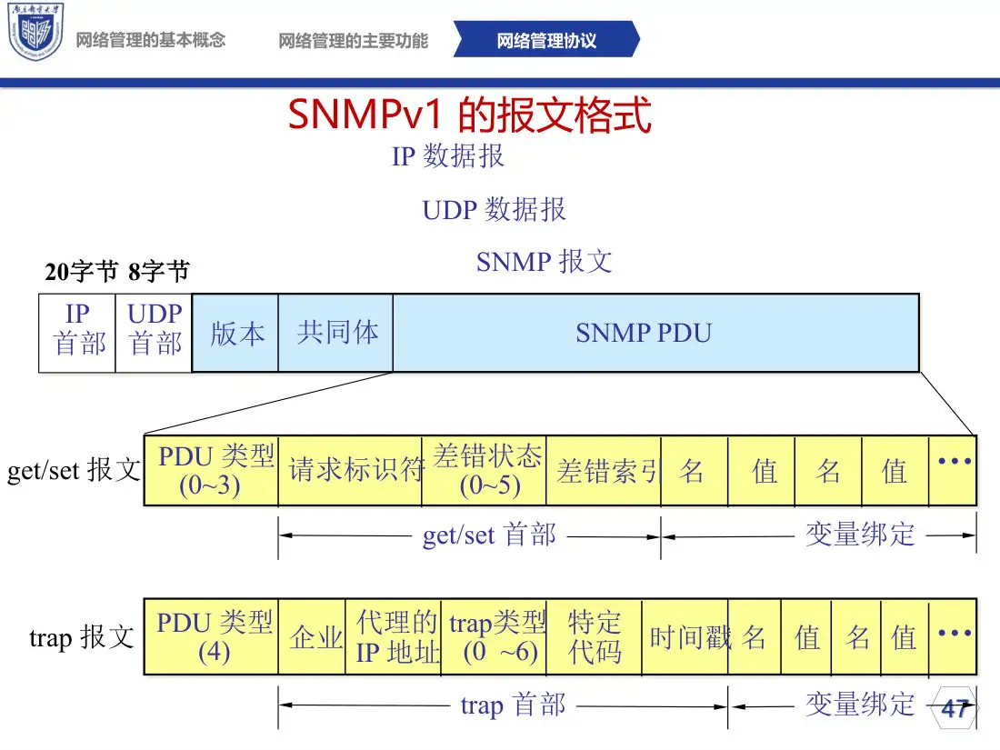

原文：

SNMPv1 的报文格式

IP 数据报

UDP 数据报

20字节 8字节

SNMP 报文

南志郵電大學 Nanjing Ue and Te

网络管理的基本概念

网络管理的主要功能

网络管理协议

### SNMP 报文的组成

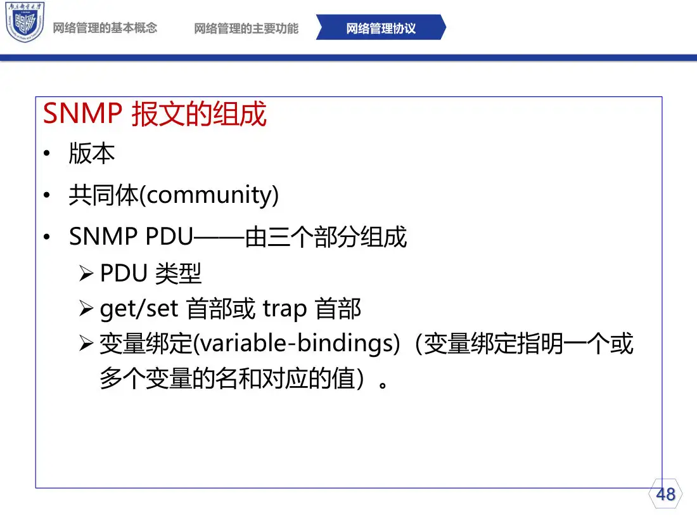

原文：

SNMP 报文的组成

• 版本

• 共同体(community)

• SNMP PDU——由三个部分组成

➢PDU 类型

➢ get/set 首部或 trap 首部

➢变量绑定(variable-bindings)（变量绑定指明一个或多个变量的名和对应的值）。

南立都電大學

网络管理的基本概念

网络管理的主要功能

网络管理协议

48

### get/set 首部的字段

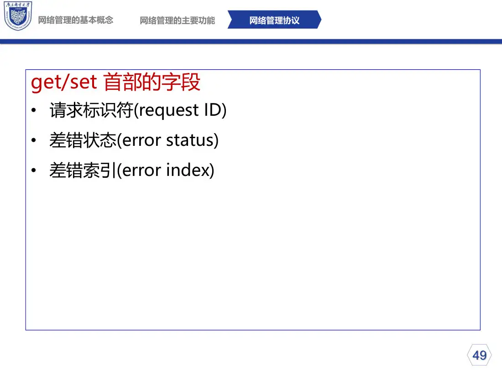

原文：

get/set 首部的字段

• 请求标识符(request ID)

• 差错状态(error status)

• 差错索引(error index)

南立都電大學

网络管理的基本概念

网络管理的主要功能

网络管理协议

49

### trap 首部的字段

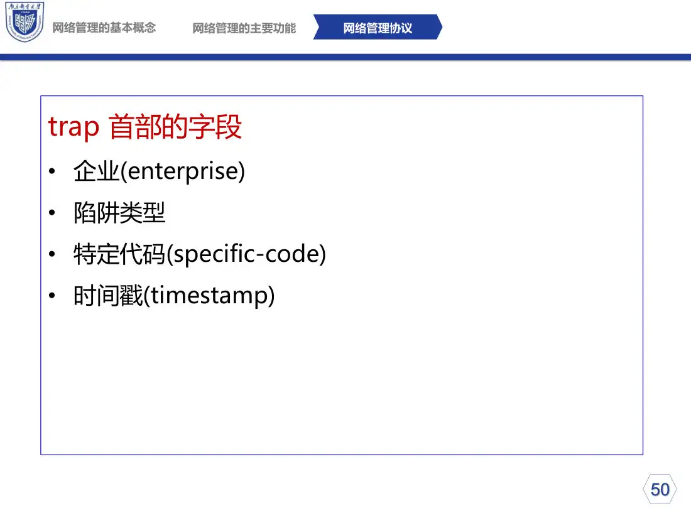

原文：

trap 首部的字段

• 企业(enterprise)

• 陷阱类型

• 特定代码(specific-code)

• 时间戳(timestamp)

南立都電大學

网络管理的基本概念

网络管理的主要功能

网络管理协议

50

### • 管理信息结构 SMI

原文：

• 管理信息结构 SMI

(Structure of Management Information) 标准指明了所有的 MIB 变量必须使用抽象语法记法 1（ASN.1）来定义。

• ASN.1 有两个主要特点：一个是人们阅读的文档中使用的记法，另一个是同一信息在通信协议中使用的紧凑编码表示。这种记法使得数据的含义不存在任何可能的二义性。

南志郵電大學 Nanjing U yorPe s and Te

网络管理的基本概念

网络管理的主要功能

网络管理协议

51

### • “语法”实际上就是“符号串解释方法”。

原文：

• “语法”实际上就是“符号串解释方法”。

• 局部语法用于数据在端系统中的存储。

• 传送语法用于数据在线路上的传输。

• 抽象语法是协议设计者所使用的工具，用于将设计者的思想记录下来，便于交流和讨论。

• 计算机通信的最终目的是传递数据的语义。因此一个数据无论采用何种表示方式，其语义不应改变。

南立都電大學

网络管理的基本概念 网络管理的主要功能

网络管理协议

52

### 南志郵電大學 Nanjing Ue and Te

原文：

• OSI 采用两次转换语法的方法，即由发送方和接收方共同协作完成语法转换。为此，定义了 “传送语法”(transfer syntax)。

• 发送方把符合自己局部语法的比特串转换为符合传送语法的比特串，接收方再把此比特串转换为符合自己局部语法的比特串。

• 在采用这种标准的传送语法时，不仅要传送数据对象的“值信息”，还需要传送关于该对象的“类型信息”。

南志郵電大學 Nanjing Ue and Te

网络管理的基本概念

网络管理的主要功能

网络管理协议

53

### ASN.1 (Abstract Syntax Notation One)

原文：

ASN.1 (Abstract Syntax Notation One)

• ASN.1 是一种数据类型描述语言，具有类似于面向对象程序设计语言中所提供的类型机制。

• ASN.1 可定义任意复杂结构的数据类型，而不同的数据类型之间还可以有继承关系。

• 实际上到目前为止并没有第二个抽象语法记法出现。因此 ASN.1 似应写为 ASN。

• 抽象语法只描述数据的结构形式且与具体的编码格式无关，同时也不涉及这些数据结构在计算机内如何存放。

南志郵電大學 Nanjing U yorPe s and Te

网络管理的基本概念

网络管理的主要功能

网络管理协议

54

### 基本编码规则 BER (Basic Encoding Rule)

原文：

基本编码规则 BER (Basic Encoding Rule)

• ISO 在制订 ASN.1 语言的同时也为它定义了一种标准的编码方案，即基本编码规则BER。

• BER 指明了每种数据类型中每个数据的值的表示。

• 发送端用 BER 编码，可将用 ASN.1 所表述的报文转换成惟一的比特序列。接收端用 BER 进行解码，得到该比特序列所表示的 ASN.1 报文。

南志郵電大學 Nanjing U yorPe s and Te

网络管理的基本概念

网络管理的主要功能

网络管理协议

55

### ASN.1 的两个标准

原文：

ASN.1 的两个标准

(1) 抽象语法记法 1 (ASN.1)ISO 8824 ITU-T X.208

(2) ASN.1的基本编码规则 BERISO 8825 ITU-T X.209

• ASN.1 和 ASN.1 基本编码规则的区别就是：ASN.1 是用来定义各种应用协议数据单元的数据类型的工具，是描述抽象语法的一种语言。ASN.1 基本编码规则用于描述各应用协议数据单元类型所代表的数据值。

南志郵電大學 Nanjing Ue and Te

网络管理的基本概念 网络管理的主要功能

网络管理协议

56

### 抽象语法记法 ASN.1 的要点

原文：

抽象语法记法 ASN.1 的要点

(1) 标识符（即值的名或字段名）、数据类型名和模块名由大写或小写字母、数字、以及连字符组成。

(2) ASN.1 固有的数据类型全部由大写字母组成。

(3) 用户自定义的数据类型名和模块名的第一个字母用大写，后面至少要有一个非大写字母。

南志郵電大學 Nanjing Ue and Te

网络管理的基本概念 网络管理的主要功能

网络管理协议

57

### 抽象语法记法 ASN.1 的要点

原文：

抽象语法记法 ASN.1 的要点

(4) 标识符(identifier)的第一个字母用小写，后面可用数字、连字符以及一些大写字母以增加可读性。

(5) 多个空格或空行都被认为是一个空格。

(6) 注释由两个连字符(--)表示开始，由另外两个连字符或行结束符表示结束。

• ASN.1 把数据类型分为简单类型和构造类型两种。

南志郵電大學 Nanjing Ue and Te

网络管理的基本概念 网络管理的主要功能

网络管理协议

58

### ASN.1 的部分类型

原文：

ASN.1 的部分类型

<table><tr><td>分类</td><td>标记</td><td>类型名称</td><td>主要特点</td></tr><tr><td rowspan="4">简单类型</td><td>UNIVERSAL 2</td><td>INTEGER</td><td>取整数值</td></tr><tr><td>UNIVERSAL 4</td><td>OCTET STRING</td><td>取八位位组序列位</td></tr><tr><td>UNIVERSAL 5</td><td>NULL</td><td>只取空值的</td></tr><tr><td>UNIVERSAL 6</td><td>OBJECT IDENTIFIER</td><td>与信息对象相关联的值的集合</td></tr><tr><td rowspan="4">构造类型</td><td>UNIVERSAL 16</td><td>SEQUENCE</td><td>取值为多个数据类型的按序组成的值</td></tr><tr><td>UNIVERSAL 16</td><td>SEQUENCE-OF</td><td>取值为同一数据类型的按序组成的值</td></tr><tr><td>无标记</td><td>CHOICE</td><td>可选择多个数据类型中的某一个数据类型</td></tr><tr><td>无标记</td><td>ANY</td><td>可描述事先还不知道的任何类型的任何值</td></tr></table>

南志郵電大學 Nanjing U yorPe s and Te

网络管理的基本概念

网络管理的主要功能

网络管理协议

59

### 标记(tab)

原文：

标记(tab)

• ASN.1 规定每一个数据类型应当有一个能够惟一被识别的标记，以便能无二义性地标识各种数据类型。

• 标记有两个分量，一个分量是标记的类(class)，另一个分量是非负整数。

南立都電大學

网络管理的基本概念

网络管理的主要功能

网络管理协议

60

### 标记共划分为以下的四类(class)

原文：

标记共划分为以下的四类(class)

(1) 通用类(Universal)——由 ASN.1 分配给所定义的最常用的一些数据类型，它与具体的应用无关。

(2) 应用类(Application-wide)——与某个特定应用相关联的类型（被其他标准所定义）。

(3) 上下文类(Context-specific)——上下文所定义的类型，它属于一个应用的子集。

(4) 专用类(Private)——保留为一些厂家所定义的类型，在ASN.1 标准中未定义。

南志郵電大學 Nanjing Ue and Te

网络管理的基本概念 网络管理的主要功能

网络管理协议

61

### ASN.1 的基本编码规则

原文：

ASN.1 的基本编码规则

• TLV 方法进行编码——把各种数据元素表示为以下三个字段组成的八位位组序列：

(1) T 字段，即标识符八位位组(identifier octet)，用于标识标记。

(2) L 字段，即长度用八位位组(length octet)，用于标识后面 V 字段的长度。

(3) V 字段，即内容八位位组(content octet)，用于标识数据元素的值。

南志郵電大學 Nanjing U yorPe s and Te

网络管理的基本概念

网络管理的主要功能

网络管理协议

62

### 几点说明

原文：

几点说明

(1) 编码一律用 十六进制数来表示。

(2) 要特别注意在 V 字段中出现的嵌套。

(3) 顶级和二级结点合并成子标识符。

若顶级结点和二级结点的值分别为 X 和 Y，子网得出的子标识符的值为 40X + Y。这样就得出sysDescr 在进行编码时的对象标识符为43.6.1.2.1.1.1.0 （即占两个字符的 1.3 压缩为占一个字符的 43），节省了一个字符的空间。

南志郵電大學 Nanjing Ue and Te

网络管理的基本概念

网络管理的主要功能

网络管理协议

63

### 几点说明

原文：

几点说明

(4) 最后得到的用十六进制表示的编码如下所示：

30 29 02 01 00 04 06 70 75 62 6C 69 63 A0 1C 02 04 05 AE 56 02 02 01 00 02 01 00 30 0E 30 0C 06 08 2B 06 01 02 01 01 01 00 05 00

• 这就是作为 UDP 用户数据报的数据部分的一个完整的SNMP 报文。

南志郵電大學 Nanjing Ue and Te

网络管理的基本概念

网络管理的主要功能

网络管理协议

64

### SNMPv2 和 SNMPv3

原文：

SNMPv2 和 SNMPv3

SNMP 的主要缺点是：

(1) 不能有效地传送大块的数据

(2) 不能将网络管理的功能分散化

(3) 安全性不够好

南志郵電大學 Nanjing U yorPe s and Te

网络管理的基本概念

网络管理的主要功能

网络管理协议

65

### SNMPv2

原文：

SNMPv2

• 1996 年发布 IETF 发布了 8 个 SNMPv2 文档[RFC1901\~1908]。但 SNMPv2 在安全方面的设计过分复杂，使得有些人不愿意接受它。

• SNMPv2 增加了 get-bulk-request 命令，可一次从路由器的路由表中读取许多行的信息。

• SNMPv2 的get 命令允许返回部分的变量值，这就提高了效率，减少了网络上的通信量。

南志郵電大學 Nanjing Ue and Te

网络管理的基本概念

网络管理的主要功能

网络管理协议

66

### SNMPv2

原文：

SNMPv2

• 增加了一个 inform 命令和一个管理进程到管理进程的MIB (manager-to-manager MIB)。

• 使用这种 inform 命令可以使管理进程之间互相传送有关的事件信息而不需要经过请求。这样的信息则定义在管理进程到管理进程的 MIB中。

• SNMPv2 采用了分散化的管理方法。在一个网络中可以有多个顶级管理站，叫做管理服务器。

南志郵電大學 Nanjing Ue and Te

网络管理的基本概念

网络管理的主要功能

网络管理协议

67

### SNMPv3

原文：

SNMPv3

• 1998 年 1 月 IETF 发表了 SNMPv3 的有关文档[RFC2271-2275]。

• 仅隔 15 个月后就更新为[RFC 2571-2575]。

• SNMPv3 最大的改进就是安全特性。也就是说，只有被授权的人员才有资格执行网络管理的功能（如关闭某一条链路）和读取有关网络管理的信息（如读取一个配置文件的内容）。

南志郵電大學 Nanjing Ue and Te

网络管理的基本概念

网络管理的主要功能

网络管理协议

68

### 大纲要求R e q u i r e m e n t s

原文：

大纲要求R e q u i r e m e n t s

01 了解计算机网络管理的基本原理和主要功能

02 掌握计算机网络管理协议的工作机制和网络管理技术的应用

03 深刻理解基于TCP/IP的简单网络管理协议的原理，组成工作机制，以及相关网管技术的发展

04 了解计算机网络的安全问题，掌握数据加密技术的基本原理

05 理解对称加密，非对称加密的原理和实现机制，以及相关的网络安全技术的基本原理

06 了解计算机网络安全体系结构和网络安全技术的应用

69

### 内容纲要C o n t e n t s P a g e

原文：

内容纲要C o n t e n t s P a g e

04 网络安全概述
05 数据加密技术
06 用户身份认证
07 访问控制
08 虚拟专用网
09 高层安全

70

### 1、计算机网络安全性的威胁因素

原文：

1、计算机网络安全性的威胁因素

• 计算机网络上的通信面临以下四种威胁：

(1) 截获——从网络上窃听他人的通信内容。

(2) 中断— —有意中断他人在网络上的通信。

(3) 篡改—— 故意篡改网络上传送的报文。

(4) 伪造— —伪造信息在网络上传送。

• 截获信息的攻击称为被动攻击，更改信息和拒绝用户使用资源攻击称为主动攻击。

南志郵電大學yorPe

网络安全概述

数据加密技术 用户身份认证 访 问 控 制 虚拟专用网 高 层 安 全

71

### 1、计算机网络安全性的威胁因素

原文：

1、计算机网络安全性的威胁因素

⚫ 对网络的被动攻击和主动攻击

南志郵電大學 Nanjing Ue and Te

网络安全概述

数据加密技术 用户身份认证 访 问 控 制 虚拟专用网 高 层 安 全

72

### 1、计算机网络安全性的威胁因素

原文：

1、计算机网络安全性的威胁因素

⚫ 对网络的被动攻击和主动攻击

• 在被动攻击中，攻击者只是观察和分析某一个协议数据单元 PDU 而不干扰信息流。

• 主动攻击是指攻击者对某个连接中通过的 PDU 进行各种处理。

➢更改报文流

➢拒绝报文服务

➢伪造连接初始化

高 层 安 全

南志郵電大學 Nanjing Ue and Te

网络安全概述

数据加密技术 用户身份认证 访 问 控 制

虚拟专用网

73

### 2、计算机网络安全的目标

原文：

2、计算机网络安全的目标

• 可靠性——可靠性主要表现在网络系统的硬件可靠性、软件可靠性、人员可靠性、环境可靠性等方面，是网络系统安全的最基本要求之一。

可用性——可用性主要用来衡量网络系统面向用户的安全性能。可用性还要求网络信息可被授权实体访问并按需求使用，并且当网络部分受损或需要降级使用时仍能为授权用户提供有效服务。

南志郵電大學 Nanjing Ue and Te

网络安全概述

数据加密技术 用户身份认证 访 问 控 制 虚拟专用网 高 层 安 全

74

### 2、计算机网络安全的目标

原文：

2、计算机网络安全的目标

• 可用性还应包括以下功能：

➢身份识别、确认以及访问控制功能

➢业务流控制功能。

➢路由选择控制功能

➢审计跟踪功能

南志郵電大學 Nanjing Ue and Te

网络安全概述

数据加密技术 用户身份认证 访 问 控 制 虚拟专用网 高 层 安 全

75

### 2、计算机网络安全的目标

原文：

2、计算机网络安全的目标

• 保密性

保密性要求网络信息不被泄露给非授权的用户、实体或过程，或供其利用。

常用的保密手段主要有两种 ：

➢物理保密

➢信息加密

南志郵電大學 Nanjing Ue and Te

网络安全概述

数据加密技术 用户身份认证 访 问 控 制 虚拟专用网 高 层 安 全

76

### 2、计算机网络安全的目标

原文：

2、计算机网络安全的目标

• 完整性

完整性要求网络信息未经授权不能进行改变。网络信息在存储及传输过程中要保持不变，不能被偶然或蓄意地进行删除、修改、伪造、乱序、重放、插入等操作，防止网络信息被破坏或丢失。

南志郵電大學 Nanjing Ue and Te

网络安全概述

数据加密技术 用户身份认证 访 问 控 制 虚拟专用网 高 层 安 全

77

### 2、计算机网络安全的目标

原文：

2、计算机网络安全的目标

• 保障网络信息完整性的主要方法有：

➢协议

➢检错及纠错编码

➢数字签名

➢公证

数据加密技术 用户身份认证 访 问 控 制 虚拟专用网 高 层 安 全

南志郵電大學 Nanjing Ue and Te

网络安全概述

78

### 2、计算机网络安全的目标

原文：

2、计算机网络安全的目标

• 不可抵赖性

即不可否认性。在网络系统的信息交互过程中，所有参与者都不可能否认或抵赖曾经完成的操作和承诺。不可抵赖性通过相关的算法实现，利用信息源证据可以防止发信方否认已发送信息的行为；利用递交接收证据可以防止收信方事后否认已经接收的信息。

南志郵電大學 Nanjing Ue and Te

网络安全概述

数据加密技术 用户身份认证 访 问 控 制 虚拟专用网 高 层 安 全

79

### 3、安全服务与安全机制

原文：

3、安全服务与安全机制

• 安全服务

ISO 7498-2描述了五种可选的安全服务：

➢身份鉴别服务

➢访问控制服务

➢数据保密服务

➢数据完整性服务

➢不可否认性服务

数据加密技术 用户身份认证 访 问 控 制 虚拟专用网 高 层 安 全

南志郵電大學 Nanjing Ue and Te

网络安全概述

80

### 3、安全服务与安全机制

原文：

3、安全服务与安全机制

• 安全机制

与上述安全服务相关的安全机制有八种 ：

➢加密机制

➢访问控制机制

➢数字签名机制

➢数据完整性机制

南志郵電大學 Nanjing Ue and Te

网络安全概述

数据加密技术 用户身份认证 访 问 控 制 虚拟专用网 高 层 安 全

81

### 内容纲要C o n t e n t s P a g e

原文：

内容纲要C o n t e n t s P a g e

04 网络安全概述
05 数据加密技术
06 用户身份认证
07 访问控制
08 虚拟专用网
09 高层安全

82

### 一般的数据加密模型

原文：

一般的数据加密模型

南志郵電大學 Nanjing Ue and Te

网络安全概述

数据加密技术

用户身份认证 访 问 控 制

虚拟专用网 高 层 安 全

83

### 数据加密技术主要分为两大类：

原文：

数据加密技术主要分为两大类：

1、对称密钥密码系统

2、非对称密钥密码系统

南志都电大学Naning and Te

网络安全概述

数据加密技术

用户身份认证 访 问 控 制

虚拟专用网

高 层 安 全

84

### 1、对称密钥密码系统

原文：

1、对称密钥密码系统

对称密钥密码系统概念

• 所谓对称密钥密码系统，即加密密钥与解密密钥是相同的密码体制。

• 这种加密系统又称为对称密钥系统。

南志郵電大學 Naning and Te

网络安全概述

数据加密技术

用户身份认证

访 问 控 制

虚拟专用网

高 层 安 全

85

### 1、对称密钥密码系统

原文：

1、对称密钥密码系统

序列密码体制

• 序列码体制是将明文 X 看成是连续的比特流（或字符流）$\mathsf { X } _ { 1 } \mathsf { X } _ { 2 } .$ …，并且用密钥序列 $k = \mathsf { k } _ { 1 } \mathsf { k } _ { 2 } .$ …中的第 i 个元素 $k _ { \mathrm { i } }$ 对明文中的 $\mathsf { X } _ { \mathrm { i } }$ 进行加密，即

$$
\mathbf {E} _ {\mathbf {K}} (\mathbf {X}) = \mathbf {E} _ {\mathbf {k 1}} (\mathbf {x} _ {1}) \mathbf {E} _ {\mathbf {k 2}} (\mathbf {x} _ {2}) \dots
$$

南志郵電大學 Nanjing Ue and Te

网络安全概述

数据加密技术 用户身份认证 访 问 控 制 虚拟专用网 高 层 安 全

86

### 1、对称密钥密码系统

原文：

1、对称密钥密码系统

分组密码

• 它将明文划分成固定的 n 比特的数据组，然后以组为单位，在密钥的控制下进行一系列的线性或非线性的变化而得到密文——分组密码。

• 分组密码算法的一个重要特点就是：当给定一个密钥后，若明文分组相同，那么所变换出密文分组也相同。

• 分组密码的一个重要优点是不需要同步

用户身份认证 访 问 控 制

南志郵電大學 Nanjing Ue and Te

网络安全概述

数据加密技术

虚拟专用网

高 层 安 全

87

### 1、对称密钥密码系统

原文：

1、对称密钥密码系统

数据加密标准DES

• DES 属于常规密钥密码体制，是一种分组密码。

• 在加密前，先对整个明文进行分组。每一个组长为 64 bit。

• 然后对每一个 64 bit 二进制数据进行加密处理，产生一组 64 bit 密文数据。

• 最后将各组密文串接起来，即得出整个的密文。

• 使用的密钥为 64 bit（实际密钥长度为 56 bit，有 8 bit用于奇偶校验)。

南志郵電大學 Nanjing Ue and Te

网络安全概述

数据加密技术

用户身份认证 访 问 控 制

虚拟专用网

高 层 安 全

88

### 1、对称密钥密码系统

原文：

1、对称密钥密码系统

DES加密算法的实现过程

南志郵電大學 Nanjing U yorPe s and Te

网络安全概述

数据加密技术

用户身份认证

访 问 控 制

虚拟专用网

高 层 安 全

89

### 1、对称密钥密码系统

原文：

1、对称密钥密码系统

DES的保密性

• DES 的保密性仅取决于对密钥的保密，而算法是公开的。至今仍未能找到比穷举搜索密钥更有效的方法。

• DES是世界第一个公认的实用密码算法标准。

• 目前较为严重的问题是DES的密钥的长度。

• 已经设计出来搜索 DES 密钥的专用芯片。

南志郵電大學 Nanjing Ue and Te

网络安全概述

数据加密技术

用户身份认证 访 问 控 制

虚拟专用网 高 层 安 全

90

### 1、对称密钥密码系统

原文：

1、对称密钥密码系统

◆ 公开密钥密码体制的特点

• 公开密钥密码体制使用不同的加密密钥与解密密钥，是一种“由已知加密密钥推导出解密密钥在计算上是不可行的”密码体制。

• 公开密钥密码体制的产生主要是因为两个方面的原因，一是由于常规密钥密码体制的密钥分配问题，另一是由于对数字签名的需求。

• 现有三种公开密钥密码体制，其中最著名的是RSA体制，它基于数论中大数分解问题的体制

南志郵電大學 Nanjing Ue and Te

网络安全概述

数据加密技术

用户身份认证 访 问 控 制

虚拟专用网

高 层 安 全

91

### 2、非对称密钥密码系统

原文：

2、非对称密钥密码系统

加密密钥与解密密钥

• 在公开密钥密码体制中，加密密钥（即公开密钥）PK是公开信息，而解密密钥（即秘密密钥）SK是需要保密的。

• 加密算法E和解密算法D也是公开的。

• 虽然秘密密钥 SK 是由公开密钥 PK 决定的，但却不能根据 PK 计算出 SK。

南志郵電大學 Nanjing Ue and Te

网络安全概述

数据加密技术

用户身份认证

访 问 控 制

虚拟专用网

高 层 安 全

92

### 2、非对称密钥密码系统

原文：

2、非对称密钥密码系统

◆ 公开密钥密码体制与传统加密体制

• 任何加密方法的安全性取决于密钥的长度，以及攻破密文所需的计算量。公开密钥密码体制并不具有比传统加密体制更加优越之处。

• 由于目前公开密钥加密算法的开销较大，在可见的将来还看不出来要放弃传统的加密方法。

• 公开密钥还需要密钥分配协议，具体的分配过程并不比采用传统加密方法时更为简单。

南志郵電大學 Nanjing Ue and Te

网络安全概述

数据加密技术

用户身份认证 访 问 控 制

虚拟专用网

高 层 安 全

93

### 2、非对称密钥密码系统

原文：

2、非对称密钥密码系统

公开密钥算法的特点

(1)发送者用加密密钥PK对明文X加密后，在接收者用解密密钥SK解密，即可恢复出明文，或写为：

$$
D _ {S K} (E _ {P K} (X)) = X
$$

解密密钥是接收者专用的秘密密钥，对其他人都保密。

此外，加密和解密的运算可以对调，即

$$
E _ {P K} (D _ {S K} (X)) = X
$$

南志郵電大學 Nanjing Ue and Te

网络安全概述

数据加密技术 用户身份认证 访 问 控 制 虚拟专用网 高 层 安 全

94

### 2、非对称密钥密码系统

原文：

2、非对称密钥密码系统

公开密钥算法的特点

(2) 加密密钥是公开的，但不能用它来解密，即$\mathsf { D } _ { \mathsf { P K } } ( \mathsf { E } _ { \mathsf { P K } } ( \mathsf { X } ) ) \neq \mathsf { X }$

(3) 在计算机上可容易地产生成对的 PK 和 SK。

(4) 从已知的PK实际上不可能推导出SK，即从 PK 到 SK 是“计算上不可能的”。

(5) 加密和解密算法都是公开的。

数据加密技术 用户身份认证 访 问 控 制 虚拟专用网 高 层 安 全

南志郵電大學 Nanjing Ue and Te

网络安全概述

95

### 2、非对称密钥密码系统

原文：

2、非对称密钥密码系统

RSA公开密钥密码体制

• RSA 公开密钥密码体制所根据的原理是：根据数论，寻求两个大素数比较简单，而将它们的乘积分解开则极其困难。

• 每个用户有两个密钥：加密密钥 PK = {e, n} 和解密密钥${ \sf S K } = \{ { \sf d } , { \sf n } \}$ o

南志郵電大學 Nanjing Ue and Te

网络安全概述

数据加密技术

用户身份认证

访 问 控 制

虚拟专用网

高 层 安 全

96

### 2、非对称密钥密码系统

原文：

2、非对称密钥密码系统

RSA公开密钥密码体制

• 用户把加密密钥公开，使得系统中任何其他用户都可使用，而对解密密钥中的 $d$ 则保密。

• N 为两个大素数 $p$ 和 $q$ 之积（素数 $p$ 和 $q$ 一般为 100位以上的十进制数）， $e$ 和 $d$ 满足一定的关系。当敌手已知 $e$ 和 n时并不能求出 $d _ { \circ }$

南志郵電大學 Nanjing Ue and Te

网络安全概述

数据加密技术

用户身份认证

访 问 控 制

虚拟专用网

高 层 安 全

97

### 2、非对称密钥密码系统

原文：

2、非对称密钥密码系统

RSA加密算法

• 若用整数 X 表示明文，用整数 Y 表示密文（X 和 Y 均小于 n）， 则加密和解密 运算为：

加密： $\mathsf { Y } = \mathsf { X } ^ { \mathrm { e } } \mathsf { m o d } \mathsf { n }$

解密： $\mathsf { X } = \mathsf { Y } \mathsf { d } \mathsf { \ m o d } \mathsf { n }$

南志郵電大學 Nanjing Ue and Te

网络安全概述

数据加密技术

用户身份认证 访 问 控 制

虚拟专用网 高 层 安 全

98

### 2、非对称密钥密码系统

原文：

2、非对称密钥密码系统

RSA密钥的产生

① 计算 $\boldsymbol { { n } } _ { \circ }$ 。用户秘密地选择两个大素数p和 $q ,$ ，计算出 $n = p q$ 称为RSA算法的模数。明文必须能够用小于 的数来表示。实际上n是几百比特长的数。

② 计算 $\phi ( \eta )$ 。用户再计算出n 的欧拉函数

$$
\phi (n) = (p - 1) (q - 1)
$$

$\phi ( \eta )$ 定义为不超过 n并与 n互素的数的个数。

③ 选择 $\theta _ { \circ }$ 。用户从[0, (n) − 1]中选择一个与 $\phi ( \boldsymbol { n } )$ 互素的数作为公开的加密指数。

南志郵電大學 Nanjing Ue and Te

网络安全概述

数据加密技术

用户身份认证 访 问 控 制

虚拟专用网 高 层 安 全

99

### 2、非对称密钥密码系统

原文：

2、非对称密钥密码系统

RSA密钥的产生

④ 计算 $d _ { \circ }$ 用户计算出满足下式的 d

$$
e d = 1 \bmod \phi (n)
$$

作为解密指数。

⑤ 得出所需要的公开密钥和秘密密钥：公开密钥（即加密密钥）PK = {e, n}秘密密钥（即解密密钥） $S { \ K } = \{ d , n \}$

虚拟专用网 高 层 安 全

南志郵電大學 Nanjing Ue and Te

网络安全概述

数据加密技术

用户身份认证 访 问 控 制

100

### 2、非对称密钥密码系统

原文：

2、非对称密钥密码系统

RSA正确性例子说明

设选择了两个素数， $\textstyle p = 7 , q = 1 1$

计算出 $\scriptstyle n = p q = 7 \times 1 1 = 7 7$ o

计算出 $\phi ( n ) = ( p - 1 ) ( q - 1 ) = 6 0$

从[0, 59]中选择一个与 60 互素的数 $\theta _ { \circ }$

选 $e = 5 3$ 。然后根据：

$$
5 3 d = 1 \bmod {6 0}
$$

解出 $d _ { \circ }$ 不难得出， $d = 1 7$ , 因为

ed= 53 × 17 = 901 = 15 × 60 + 1 = 1 mod 60。

于是，公开密钥 $\mathsf { P K } = ( e , n ) = \{ 5 3 , 7 7 \}$

秘密密钥 $5 | < = \{ 1 7 , 7 7 \}$ 。

南志郵電大學 Nanjing Ue and Te

网络安全概述

数据加密技术 用户身份认证 访 问 控 制 虚拟专用网 高 层 安 全

101

### 2、非对称密钥密码系统

原文：

2、非对称密钥密码系统

RSA正确性例子说明

南志郵電大學 Nanjing Ue and Te

网络安全概述

数据加密技术 用户身份认证 访 问 控 制 虚拟专用网 高 层 安 全

102

### 内容纲要C o n t e n t s P a g e

原文：

内容纲要C o n t e n t s P a g e

04 网络安全概述
05 数据加密技术
06 用户身份认证
07 访问控制
08 虚拟专用网
09 高层安全• 身份认证(Authentication)是建立安全通信的前提条件。用户身份认证是通信参与方在进行数据交换前的身份鉴定过程，以确定通信的参与方有无合法的身份。身份认证协议是一种特殊的通信协议，它定义了参与认证服务的通信方在身份认证的过程中需要交换的所有消息的格式、语义和产生的次序，常采用加密机制来保证消息的完整性、保密性。

103

### 南志郵電大學 Nanjing Ue and Te

原文：

南志郵電大學 Nanjing Ue and Te

网络安全概述

数据加密

用户身份认证

访 问 控 制

虚拟专用网 高 层 安 全

### 1、基于共享秘密密钥的用户认证协议

原文：

1、基于共享秘密密钥的用户认证协议

假设在A和B之间有一个共享的秘密密钥 $K _ { A B }$ ，当A要求与B进行通信时，可采用如下方法：

(1) A向B发送自己的身份标识；

(2) B收到A的身份标识后，为了证实确实是A发出的，于是选择一个随机的大数 $R _ { \ B }$ 用明文发给A；

虚拟专用网 高 层 安 全

南志郵電大學 Nanjing Ue and Te

网络安全概述

数据加密

用户身份认证

访 问 控 制

105

### 1、基于共享秘密密钥的用户认证协议

原文：

1、基于共享秘密密钥的用户认证协议

(3) A收到 $R _ { B }$ 后用共享的秘密密钥 $K _ { A B }$ 对 $R _ { B }$ 进行加密，然后将密文发回给B；B收到密文后就能确信对方是A，因为除此以外无人知道密钥 $K _ { A B }$ ；

(4) 此时A尚无法确定对方是否为B，所以A也选择一个随机大数 $\mathsf { R } _ { \mathsf { A } }$ ，用明文发给B；

(5) B收到后用 $K _ { A B } \bar { x }$ 对 $\mathsf { R } _ { \mathsf { A } }$ 进行加密，然后将密文发回给A，A收到密文后也确信对方就是B；至此用户认证完毕。

高 层 安 全

南志郵電大學 Nanjing Ue and Te

网络安全概述

数据加密

用户身份认证

访 问 控 制

虚拟专用网

106

### 1、基于共享秘密密钥的用户认证协议

原文：

1、基于共享秘密密钥的用户认证协议

上述认证过程如图所示：

南志郵電大學 Nanjing Ue and Te

网络安全概述

数据加密

用户身份认证

访 问 控 制

虚拟专用网

高 层 安 全

107

### 2、基于公开密钥算法的用户认证协议

原文：

2、基于公开密钥算法的用户认证协议

基于公开密钥算法的用户认证的典型过程如下图所示：

南志郵電大學 Nanjing Ue and Te

网络安全概述

数据加密

用户身份认证

访 问 控 制

虚拟专用网 高 层 安 全

108

### 2、基于公开密钥算法的用户认证协议

原文：

2、基于公开密钥算法的用户认证协议

• A选择一个随机数 $\mathsf { R } _ { \mathsf { A } }$ ，用B的公开密钥 $E _ { B }$ 对A的标识符和 $\mathsf { R } _ { \mathsf { A } }$ 进行加密，将密文发给B。

• 为了确定密文确实来自A，B解开密文后选择一个随机数$R _ { B }$ 和一个会话密钥 ${ \sf K } _ { \sf S }$ ，用A的公开密钥 $\mathsf { E } _ { \mathsf { A } }$ 对 $\mathsf { R } _ { \mathsf { A } }$ 、 $R _ { B }$ 和 ${ \sf K } _ { \sf S }$ 进行加密，将密文发回给A。

• A解开密文，只要其中的 $\mathsf { R } _ { \mathsf { A } }$ 是本方刚才发给B的，则该密文一定发自B，且这是一个最新的报文而不是一个复制品。此后A再用 ${ \sf K } _ { \sf S }$ 对 $R _ { B }$ 进行加密表示确认；B解开密文即可确定这一定是A发来的（因为其他人无法知道 ${ \sf K } _ { \sf S }$ 和 $R _ { B }$ ）。

南志郵電大學 Nanjing Ue and Te

网络安全概述

数据加密

用户身份认证

访 问 控 制

虚拟专用网

109

### 3、基于密钥分发中心的用户认证协议

原文：

3、基于密钥分发中心的用户认证协议

• 基于密钥分发中心(KDC，Key Distribution Center)用户认证的必要条件是KDC的权威性和安全性要有保障，并为网络用户所信任。

• 每个用户和KDC之间都有一个共享的秘密密钥，系统中所有的用户认证工作、针对各用户的秘密密钥和会话密钥的管理都必须通过KDC来进行。

访 问 控 制 虚拟专用网 高 层 安 全

110

南志郵電大學 Nanjing Ue and Te

网络安全概述 数据加密

用户身份认证

### 3、基于密钥分发中心的用户认证协议

原文：

3、基于密钥分发中心的用户认证协议

• 基于密钥分发中心的用户认证过程如下图所示：

$$
\text {用户} \xrightarrow {\text {用户}} \xrightarrow {\text {A,K} _ {\mathrm{A}} (\mathrm{B,K} _ {\mathrm{S}})} \xrightarrow {\text {KDC}} \xrightarrow {\text {K} _ {\mathrm{B}} (\mathrm{A,K} _ {\mathrm{S}})} \xrightarrow {\text {用户}} \text {用户}
$$

南志郵電大學 Nanjing Ue and Te

网络安全概述

数据加密

用户身份认证

访 问 控 制

虚拟专用网 高 层 安 全

### 3、基于密钥分发中心的用户认证协议

原文：

3、基于密钥分发中心的用户认证协议

• A用户要求与B用户进行通信，A可选择一个会话密钥 ${ \sf K } _ { \sf S }$ 然后用与KDC共享的密钥 ${ \mathsf { K } } _ { \mathsf { A } }$ 对B的标识和 ${ \sf K } _ { \sf S }$ 进行加密，并将密文和A的标识一起发给KDC；

• KDC收到后，用与A共享的密钥 ${ \mathsf K } _ { \mathsf { A } }$ 将密文解开，此时KDC可以确信数据是A发来的。

• KDC重新构造一个报文，放入A的标识和会话密钥 ${ \sf K } _ { \sf S }$ ，并用与B共享的密钥 $K _ { B }$ 加密报文，将密文发给B；B用密钥 $K _ { B }$ 将密文解开，此时B可以确信这是KDC发来的，并且获知了A希望用 ${ \sf K } _ { \sf S }$ 与它进行会话。

南志郵電大學 Nanjing Ue and Te

网络安全概述

数据加密

用户身份认证

访 问 控 制

虚拟专用网

112

### 4、数字签名

原文：

4、数字签名

• 数字签名是通信双方在网上交换信息时采用公开密钥法对所收发的信息进行确认，以此来防止伪造和欺骗的一种身份认证方法。数字签名系统的基本功能有：

➢接收方通过文件中附加的发送方的签名信息能认证发送方的身份；

➢发送方无法否认曾经发送过的签名文件：

➢接收方不可能伪造接收到的文件的内容。

南志郵電大學 Nanjing Ue and Te

网络安全概述

数据加密

用户身份认证

访 问 控 制

虚拟专用网 高 层 安 全

### 4、数字签名

原文：

4、数字签名

• 使用公开密钥算法的数字签名，其加密算法和解密算法除了要满足D[E(P)]=P外，还必须满足E[D(P)]=P，即加密过程和解密过程是可逆的。RSA算法就具有这样的特性。使用公开密钥算法的数字签名的过程如下页图所示：

南志郵電大學 Nanjing Ue and Te

网络安全概述

数据加密

用户身份认证

访 问 控 制

虚拟专用网 高 层 安 全

114

### 4、数字签名

原文：

4、数字签名

• 当A要向B发送签名的报文P时，由于A知道自己的私钥 $\mathsf { D } _ { \mathsf { A } }$ 和B的公钥 $E _ { B }$ ，它先用私钥 $\mathsf { D } _ { \mathsf { A } }$ 对明文P进行签字，即$\mathsf { D } _ { \mathsf { S K A } } ( \mathsf { P } )$ ，然后用B的公钥E $B$ 对 $D _ { \mathsf { S K A } }$ (P)加密，向B发送$\mathsf { E } _ { \mathsf { P K B } } [ \mathsf { D } _ { \mathsf { S K A } } ( \mathsf { P } ) ]$ o

• B收到A发送的密文后，先用私钥 $D _ { S \mathsf { K B } }$ 解开密文，将$\mathsf { D } _ { \mathsf { S K A } }$ (P)复制一份放在安全的场所，然后用A的公钥E $\mathsf { \cdot p } \mathsf { K A }$ 将$\mathsf { D } _ { \mathsf { S K A } } ( \mathsf { P } )$ 解开，取出明文P。

115

南志郵電大學 Nanjing Ue and Te

网络安全概述

数据加密

用户身份认证

访 问 控 制

虚拟专用网

高 层 安 全

### 4、数字签名

原文：

4、数字签名

上述算法符合数字签名系统的基本功能要求：

• A不可否认

➢当A发送过签名的报文后试图否认给B发过P时，B可以出示 $\mathsf { D } _ { \mathsf { S K A } }$ (P)作为证据。因为B没有A的私钥 $\mathsf { D } _ { \mathsf { S K A } }$ ，除非A确实发过 $\mathsf { D } _ { \mathsf { S K A } } \left( \mathsf { P } \right)$ ，否则B是不会有这样一份密文的。通过第三方(公证机构)，只要用A的公钥： $\mathsf { E } _ { \mathsf { P K A } }$ 解开$\mathsf { D } _ { \mathsf { S K A } } \left( \mathsf { P } \right)$ ，就可以判断A是否发送过签名文件，证实B说的是否是真话。

南志郵電大學 Nanjing Ue and Te

网络安全概述

数据加密

用户身份认证

访 问 控 制

虚拟专用网

高 层 安 全

116

### 4、数字签名

原文：

4、数字签名

上述算法符合数字签名系统的基本功能要求：

• B不可伪造

➢如B将P伪造为 $\mathsf { P ^ { \prime } }$ ’，则B不可能在第三方的面前出示$\mathsf { D } _ { \mathsf { S K A } } ( \mathsf { P ^ { \prime } }$ )，这证明了B伪造了P。

南志郵電大學 Nanjing Ue and Te

网络安全概述

数据加密

用户身份认证

访 问 控 制

虚拟专用网 高 层 安 全

117

### 5、报文摘要

原文：

5、报文摘要

• 使用一个单向的哈希(Hash)函数，对任意长度的明文进行计算，生成一个固定长度的比特串，然后仅对该比特串进行加密。这样的处理方法通常称为报文摘要(MD，Message Digests)，常用的算法有MD5和SHA(SourceHash Algorithm)。

南志郵電大學 Nanjing Ue and Te

网络安全概述

数据加密

用户身份认证

访 问 控 制

虚拟专用网 高 层 安 全

118

### 5、报文摘要

原文：

5、报文摘要

• 报文摘要必须满足以下三个条件：

➢给定明文P，很容易计算出MD(P)。

➢给出MD(P)，很难反推出明文P。

➢任何人不可能产生出具有相同报文摘要的两个不同的报文。

119

南志郵電大學 Nanjing Ue and Te

网络安全概述

数据加密

用户身份认证

访 问 控 制

虚拟专用网 高 层 安 全

### 5、报文摘要

原文：

5、报文摘要

• 在公钥密码系统中，使用报文摘要进行数字签名的过程是：➢A首先对明文P计算出MD(P)，再用私钥 $\mathsf { S K } _ { \mathsf { A } } \mathsf { \vec { x } } \mathsf { \vec { y } } \mathsf { M } \mathsf { D } ( \mathsf { P } )$ 进行数字签名，连同P一起发送给B。B先备份密文$\mathsf { D } _ { \mathsf { S K A } } [ \mathsf { M D } ( \mathsf { P } ) ]$ ，然后用A的公钥 $\mathsf { P K } _ { \mathsf { A } }$ 解开密文，取出$M D ( P )$

➢B对收到的报文P进行摘要计算，若结果和A送来的MD(P)相同，则P可信，否则说明P在传输过程中被篡改过。

➢当A试图否认发送过P时，B可向仲裁方出示P和${ \mathsf { D A } } [ { \mathsf { M D } } ( { \mathsf { P } } ) ]$ 来证明自己确实收到过P。

南志郵電大學 Nanjing Ue and Te

网络安全概述

数据加密

用户身份认证

访 问 控 制

虚拟专用网

高 层 安 全

120

### 内容纲要C o n t e n t s P a g e

原文：

内容纲要C o n t e n t s P a g e

04 网络安全概述  
05 数据加密技术  
06 用户身份认证  
07 访问控制  
08 虚拟专用网  
09 高层安全

121

### 1、访问控制基本原理

原文：

1、访问控制基本原理

• 在计算机系统中设立安全机制的最初目的就是为了控制用户对系统资源的访问，称为授权(Authorization)。

• 访问控制有两种不同类型：

➢ 自主访问控制(DAC，Discretionary Access Control)

➢强制访问控制(MAC，Mandatory Access Control)。

南志郵電大學 Nanjing Ue and Te

网络安全概述

数据加密

用户身份认证

访 问 控 制

虚拟专用网 高 层 安 全

122

### 1、访问控制基本原理

原文：

1、访问控制基本原理

访问控制的具体实现方法

• 访问控制表

➢访问控制表(ACL，Access Control List)是一种传统的授权控制机制，用稀疏矩阵表示，以客体为索引。每个客体对应有个ACL，指出每个主体可对其实施的操作。这种方法便于客体的访问控制，但不利于主体访问权限的维护，因为若要调整一个主体的访问权限，必须要各个ACL中去搜索。

南志郵電大學 Nanjing Ue and Te

网络安全概述

数据加密

用户身份认证

访 问 控 制

虚拟专用网 高 层 安 全

123

### 1、访问控制基本原理

原文：

1、访问控制基本原理

访问控制的具体实现方法

• 权力表

➢权力表也是一种稀疏矩阵表示法，但是以主体为索引，包含了每个主体可访问的对象和操作权限，按列来处理矩阵，由引用监控器验证访问表提供的权力表和访问者的身份来确定是否授予访问者相应的操作权限。这种方法的优缺点正好和ACL相反，在分布式系统中，可允许主体只进行一次授权就可获得它的权力表，而不必在会话期间不断地对各个分布的系统进行授权申请和处理。

南志郵電大學 Nanjing Ue and Te

网络安全概述

数据加密

用户身份认证

访 问 控 制

虚拟专用网 高 层 安 全

124

### 2、防火墙

原文：

2、防火墙

• 防火墙是由软件、硬件构成的系统，用来在两个网络之间实施接入控制策略。接入控制策略是由使用防火墙的单位自行制订的，为的是可以最适合本单位的需要。

• 防火墙内的网络被称为“可信赖的网络”(trustednetwork)，而外部的因特网则被称为“不可信赖的网络”(untrusted network)。

• 防火墙可用来解决内联网和外联网的安全问题。

南志郵電大學 Nanjing Ue and Te

网络安全概述

数据加密

用户身份认证

访 问 控 制

虚拟专用网 高 层 安 全

125

### 2、防火墙

原文：

2、防火墙

◆ 防火墙在互连网络中的位置

虚拟专用网 高 层 安 全

南志郵電大學 Nanjing Ue and Te

网络安全概述

数据加密

用户身份认证

访 问 控 制

126

### 2、防火墙

原文：

2、防火墙

防火墙的功能

• 防火墙的功能有两个：阻止和允许。

“阻止”就是阻止某种类型的通信量通过防火墙(从外部网络到内部网络，或反过来)

• “允许”的功能与“阻止”恰好相反。

• 防火墙必须能够识别通信量的各种类型。不过在大多数情况下防火墙的主要功能是“阻止”。

南志郵電大學 Nanjing Ue and Te

网络安全概述

数据加密

用户身份认证

访 问 控 制

虚拟专用网 高 层 安 全

127

### 2、防火墙

原文：

2、防火墙

防火墙技术一般分为三类

• IP级防火墙——多基于报文过滤(Packet Filter)技术实现 。属于这类的有分组过滤和授权服务器。前者检查所有流入本网络的信息，然后拒绝不符合事先制订好的一套准则的数据，而后者则是检查用户的登录是否合法。

128

南志郵電大學 Nanjing Ue and Te

网络安全概述

数据加密

用户身份认证

访 问 控 制

虚拟专用网 高 层 安 全

### 2、防火墙

原文：

2、防火墙

防火墙的功能

• 应用级防火墙 —— 从应用程序来进行接入控制。通常又称为代理(Proxy)防火墙，是通过分别连接内外部网络的代理主机实现防火墙的功能；

链路级防火墙 ——工作原理和组成结构和应用级防火墙类似，但它并不针对专门的应用协议，而是一种通用的TCP(或UDP)的连接中继服务，并在此基础上实现防火墙的功能。

南志郵電大學 Nanjing Ue and Te

网络安全概述

数据加密

用户身份认证

访 问 控 制

虚拟专用网

高 层 安 全

129

### 内容纲要C o n t e n t s P a g e

原文：

内容纲要C o n t e n t s P a g e

04 网络安全概述
05 数据加密技术
06 用户身份认证
07 访问控制
08 虚拟专用网
09 高层安全

130

### 什么是虚拟专用网

原文：

什么是虚拟专用网

• 虚拟专用网(VPN，Virtual Privacy Network)是将物理分布在不同地点的网络通过公用骨干网(尤其是Internet)连接而成的逻辑上的虚拟子网。

• 简言之，它是一种建立在开放性网络平台上的专有网络。VPN的定义允许一个给定的站点是一个或者多个VPN的一部分，即VPN可以是交叠的。为了保障信息的安全，VPN技术采用了鉴别、访问控制、保密性和完整性等措施，以防信息被泄露、篡改和复制。

南志郵電大學 Nanjing Ue and Te

网络安全概述

数据加密

用户身份认证

访 问 控 制

虚拟专用网

高 层 安 全

131

### 什么是虚拟专用网

原文：

什么是虚拟专用网

• VPN分为直接模式和隧道模式。

• 直接模式VPN使用IP和编址来建立对VPN上传输的数据的直接控制，对数据加密；采用基于用户身份的鉴别，而不是基于IP地址的。

• 隧道模式使用IP帧作为隧道发送分组。大多数VPN都运行在IP骨干网上，数据加密通常有三种方法：使用具有加密功能的防火墙、使用带有加密功能的路由器和使用单独的加密设备。

南志郵電大學 Nanjing Ue and Te

网络安全概述

数据加密

用户身份认证

访 问 控 制

虚拟专用网

高 层 安 全

132

### 什么是虚拟专用网

原文：

什么是虚拟专用网

• 目前，在七层OSI参考模型层次结构的基础上，主要有下列几种隧道协议用于构建VPN：

➢点到点隧道协议(PPTP，Point-to-Point TunnelingProtocol)；

➢第二层隧道协议(L2TP，Layer 2 Tunnel Protocol)；

➢ IP安全协议(IPSec，IP Security Protocol)。

133

南志郵電大學 Nanjing Ue and Te

网络安全概述 数据加密 用户身份认证 访 问 控 制

虚拟专用网

高 层 安 全

### 1、点到点隧道协议

原文：

1、点到点隧道协议

• 点到点隧道协议(PPTP)在第二层上可以支持封装IP协议及非IP协议(如IPX、Apple Talk等)。PPTP的工作原理是：网络协议将待发送的数据加上协议特定的控制信息组成数据报(Data Packet)进行交换。PPTP的工作对于用户来说是透明的，用户关心的只是需要传送的数据。

南志郵電大學 Nanjing Ue and Te

网络安全概述

数据加密

用户身份认证

访 问 控 制

虚拟专用网

高 层 安 全

### 1、点到点隧道协议

原文：

1、点到点隧道协议

• PPTP的工作方式是在TCP/IP数据报中封装原始分组，例如包括控制信息在内的整个IPX分组都将成为TCP/IP数据报中的“数据”区，然后通过因特网进行传输；另一端的软件分析收到的数据报，去除增加的PPTP控制信息，将其还原成IPX分组并发送给IPX协议进行常规处理。这一处理过程称为隧道(Tunneling)。

南志郵電大學 Nanjing Ue and Te

网络安全概述

数据加密

用户身份认证

访 问 控 制

虚拟专用网

高 层 安 全

### 1、点到点隧道协议

原文：

1、点到点隧道协议

• 使用PPTP对于原有的网络安全性并没有大的影响，因为原有LAN的广泛的例行安全检查可以照样进行。客户端系统除了最底层通信接口模块外，通常不需要其他特殊软、硬件，可以提供平台独立性。另外，PPTP还可以通过对原始分组的压缩、数据加密等手段来保证网络通信的安全性。

南志郵電大學 Nanjing Ue and Te

网络安全概述

数据加密

用户身份认证

访 问 控 制

虚拟专用网

高 层 安 全

136

### RADIUS服务器

原文：

RADIUS服务器

2、第二层隧道协议

• 第二层隧道协议(L2TP)工作原理

客户端Modem

ISP POP的L2TP接入集中器

南志郵電大學 Nanjing Ue and Te

网络安全概述

数据加密

用户身份认证

访 问 控 制

虚拟专用网

高 层 安 全

137

### 2、第二层隧道协议

原文：

2、第二层隧道协议

• 第二层隧道协议(L2TP)工作过程

➢客户端(SOHO或移动用户)拨号到本地因特网服务运行商(ISP)的L2TP接入集中器的局端(POP，Point ofPresence)，通过IP网的L2TP隧道连到L2TP网络服务器、远程鉴别用户拨入服务(RADIUS，RemoteAuthentication Dial In User Service)服务器上。RADIUS是一个维护用户配置文件的数据库，用来鉴定用户，包括口令和访问优先权。代理RADIUS功能允许在Internet服务提供者(ISP)的接入点(POP)设备上接入客户的RADIUS服务器，获得必要的用户配置文件信息。

网络安全概述 数据加密 用户身份认证 访 问 控 制

南志郵電大學 Nanjing Ue and Te

虚拟专用网

高 层 安 全

138

### 3、IP安全协议

原文：

3、IP安全协议

• 什么是IP安全协议(IPSec)

➢Internet工程任务组标准化的IP安全协议(IPSec，IPsecurity Protocol)是简化的端到端安全协议所具有的特定的安全机制。它在第三层执行对称或非对称加密，Layer3 VPN在IP中封装了IP(IP over IP)，并提供鉴别和检错。可在IPSec网络服务器上建立IPSec隧道，其工作原理如图所示：

南志郵電大學 Nanjing Ue and Te

网络安全概述

数据加密

用户身份认证

访 问 控 制

虚拟专用网

高 层 安 全

139

### 3、IP安全协议

原文：

3、IP安全协议

• IP安全协议的工作原理

南志郵電大學 Nanjing Ue and Te

网络安全概述

数据加密

用户身份认证

访 问 控 制

虚拟专用网

高 层 安 全

140

### 3、IP安全协议

原文：

3、IP安全协议

• IP安全协议(IPSec)使用两种机制保证通信安全

➢头部鉴别(AH，Authentication Header)：提供认证和数据完整性；

➢ 封装安全净负荷(ESP，Encapsulation SecurityPayload)：实现保密通信。

网络安全概述 数据加密 用户身份认证 访 问 控 制

南志郵電大學 Nanjing Ue and Te

虚拟专用网

高 层 安 全

### 3、IP安全协议

原文：

3、IP安全协议

• IPSec是一种对IP数据包进行加密和鉴别的技术，因此必须有密钥的管理和交换功能。

• 在用IPSec建立安全传输通路前，通信双方需要事先协商所要采用的安全策略，包括加密算法、密钥、密钥生存期等。协商完毕才表示双方已建立了一个安全关联(SA，Security Association)，已确定了IPSec要执行的处理。

网络安全概述 数据加密 用户身份认证 访 问 控 制

南志郵電大學 Nanjing Ue and Te

虚拟专用网

高 层 安 全

142

### 3、IP安全协议

原文：

3、IP安全协议

• IPSec协议分三个部分：

➢ 封装安全净负荷(ESP，Encapstllation SecurityPayload)

➢鉴别报头(AH，Authentication Header)

➢ Internet密钥交换(IKE，Internet Key Exchange)

南志郵電大學 Nanjing Ue and Te

网络安全概述 数据加密 用户身份认证 访 问 控 制

虚拟专用网

高 层 安 全

143

### 3、IP安全协议

原文：

3、IP安全协议

• ESP协议主要用来处理对IP数据包的加密，并对鉴别提供某种程度的支持。

• AH只涉及鉴别，不涉及加密，它除了对IP的有效负载进行鉴别外，还可对IP报头实施鉴别。

• IKE协议主要是对密钥交换进行管理。IPSec的封装安全净载荷(ESP)允许选择数据加密标准(DES)或三重DES(3DES)作为密钥交换时的加密方法，这两种标准都提供了严格的保密性及强大的验证功能。

南志郵電大學 Nanjing Ue and Te

网络安全概述

数据加密

用户身份认证

访 问 控 制

虚拟专用网

高 层 安 全

144

### 3、IP安全协议

原文：

3、IP安全协议

• IP安全性的优点是它的透明性，即安全服务不需要对应用程序、其他通信层次和网络部件做任何改动。标准的IPSEC VPN的智能包认证技术能保护隧道免受许多电子欺骗的攻击，还具备各厂商产品互操作的能力。

• IPSec的主要缺点是仅支持IP，IP层对属于不同进程的包不作区别。

• IP层非常适合提供基于主机的安全服务，相应的安全协议可用来建立安全的IP通道和虚拟专用网。

南志都电大学Nanjing Ue and Te

网络安全概述

数据加密

用户身份认证

访 问 控 制

虚拟专用网

高 层 安 全

145

### 04 网络安全概述

原文：

04 网络安全概述
05 数据加密技术
06 用户身份认证
07 访问控制
08 虚拟专用网
09 高层安全

内容纲要C o n t e n t s P a g e

146

### 网络安全概述 数据加密 用户身份认证 访 问 控 制 虚拟专用网 高 层 安 全

原文：

• 由于IP网的“尽力而为”理念，TCP/IP协议非常简洁，没有加密、身份认证等安全特性，因此需要在TCP之上建立一个安全通信层次以便向上层应用提供安全通信的机制。

网络安全概述 数据加密 用户身份认证 访 问 控 制 虚拟专用网 高 层 安 全

南志郵電大學 Nanjing Ue and Te

147

### 1、传输层安全

原文：

1、传输层安全

• 传输层网关在两个通信节点之间代为传递TCP连接并进行控制，这个层次一般称作传输层安全。

• 常见的传输层安全技术有：

➢安全套接层(SSL)协议

➢SOCKS

➢安全RPC等。

南志郵電大學 Nanjing Ue and Te

网络安全概述

数据加密

用户身份认证

访 问 控 制

虚拟专用网

高 层 安 全

### 1、传输层安全

原文：

1、传输层安全

• SSL结构分为两个层次：SSL协商子层(上层)和SSL记录子层(下层)，如图所示：

<table><tr><td>应用层</td></tr><tr><td>SSL协商子层</td></tr><tr><td>SSL记录子层</td></tr><tr><td>传输层</td></tr><tr><td>IP层</td></tr></table>

南志郵電大學 Nanjing Ue and Te

网络安全概述

数据加密

用户身份认证

访 问 控 制

虚拟专用网

高 层 安 全

### 1、传输层安全

原文：

1、传输层安全

• 两个子层对应的的协议如下：

(1) SSL协商子层协议：通信双方通过SSL协商子层交换版本号、加密算法、身份认证并交换密钥。SSL采用公钥方式进行身份认证，但大量数据传输仍使用对称密钥方式。SSL v3提供了Deffie-Hellman密钥交换算法、基于RSA的密钥交换机制和在Frotezza chip上的密钥交换机制。

南志郵電大學 Nanjing Ue and Te

网络安全概述

数据加密

用户身份认证

访 问 控 制

虚拟专用网

高 层 安 全

150

### 1、传输层安全

原文：

1、传输层安全

(2) SSL记录子层协议：它把上层的应用程序提供的信息分段、压缩、数据认证和加密，由传输层传送出去。SSL v3提供对数据认证用的MD5和SHA以及数据加密用的RC4和DES等的支持，用来对数据进行认证和加密的密钥可以通过SSL的握手协议来协商。

南志郵電大學 Nanjing Ue and Te

网络安全概述

数据加密

用户身份认证

访 问 控 制

虚拟专用网

高 层 安 全

### 1、传输层安全

原文：

1、传输层安全

• SSL协商子层的工作流程

(1) 在客户端与服务端进行通信之前，客户端发出客户请求消息，服务端收到请求后，发回一个服务请求消息。在交换请求消息后，就确定了双方采用的SSL协议的版本号、会话标志、加密算法集和压缩算法。

152

南志郵電大學 Nanjing Ue and Te

网络安全概述

数据加密

用户身份认证

访 问 控 制

虚拟专用网

高 层 安 全

### 1、传输层安全

原文：

1、传输层安全

• SSL协商子层的工作流程

(2) 服务端在服务请求消息之后，还可以发出一个X.509格式的证书(Certificate)，向客户端鉴别身份。随后服务端发出服务请求结束消息，表明握手阶段结束，等待客户端回答。

153

南志郵電大學 Nanjing Ue and Te

网络安全概述

数据加密

用户身份认证

访 问 控 制

虚拟专用网

高 层 安 全

### 1、传输层安全

原文：

1、传输层安全

• SSL协商子层的工作流程

(3) 客户端此时也可以发回自己的X.509格式的证书，向服务端认证自己的身份，客户端随即产生一个对称密钥，用服务端公钥进行加密，客户端据此生成密钥交换信息传送给服务端。

南志郵電大學 Nanjing Ue and Te

网络安全概述

数据加密

用户身份认证

访 问 控 制

虚拟专用网

高 层 安 全

### 1、传输层安全

原文：

1、传输层安全

• SSL协商子层的工作流程

(4) 如果采用了双向身份认证，客户端还需要对密钥交换信息进行签名，并发送证书检验(Certificate Verify)报文。

(5) 服务端获得密钥交换信息和证书检验信息后就可以获得客户端生成的密钥。

南志郵電大學 Nanjing Ue and Te

网络安全概述

数据加密

用户身份认证

访 问 控 制

虚拟专用网

高 层 安 全

155

### 2、应用层安全性

原文：

2、应用层安全性

• 传输层安全协议允许为主机进程之间的数据通道增加安全属性，但它们都无法根据所传送内容的不同安全要求作出区别对待。如果确实想要区分一个个具体文件的不同的安全性要求，就必须在应用层采用安全机制。

• 提供应用层的安全服务，实际上是最灵活的处理单个文件安全性的手段。

南志郵電大學 Nanjing Ue and Te

网络安全概述

数据加密

用户身份认证

访 问 控 制

虚拟专用网

高 层 安 全

156

### 2、应用层安全性

原文：

2、应用层安全性

• 应用层安全服务方法简介

(1) 专用强化邮件(PEM)和PGP

• PEM依赖于一个既存的、完全可操作的PKI(公钥基础)。

PEM PKI由三个层次构成，自顶向下分别为：

➢Internet安全政策登记机构(IPRA)

➢安全政策证书颁发机构(PCA)

➢证书颁发机构(CA)。

南志郵電大學 Nanjing Ue and Te

网络安全概述

数据加密

用户身份认证

访 问 控 制

虚拟专用网

高 层 安 全

157

### 2、应用层安全性

原文：

2、应用层安全性

• 由于建立一个符合PEM规范的PKI涉及到很多非技术因素，因而至今尚没有一个实际可操作的PKI出现。

• MIT开发的PGP(Pretty Good Privacy)软件包符合PEM的绝大多数规范，但不必要求PKI的存在。 PGP不是去推广一个全局的PKI， 而是采用了分布式的信任模型，即由每个用户自己决定该信任哪些用户，或者说是让用户建立自己的信任网。

南志郵電大學 Nanjing Ue and Te

网络安全概述

数据加密

用户身份认证

访 问 控 制

虚拟专用网

高 层 安 全

158

### 2、应用层安全性

原文：

2、应用层安全性

• 应用层安全服务方法简介

(2) S-HTTP

• S-HTTP是Web上使用的超文本传输协议(HTTP)的安全增强版本，由企业集成技术公司设计。S-HTTP提供了文件级的安全机制，因此每个文件都可以被设成保密/签字状态。用作加密及签名的算法可以由参与通信的收发双方协商。

159

南志郵電大學 Nanjing Ue and Te

网络安全概述

数据加密

用户身份认证

访 问 控 制

虚拟专用网

高 层 安 全

### 2、应用层安全性

原文：

2、应用层安全性

• 应用层安全服务方法简介

(2) S-HTTP

• S-HTTP提供了对多种单向散列函数的支持，如MD2、MD5及SHA；对多种私钥体制的支持，如DES、3DES、RC2以及RC4等；对数字签名体制的支持，如RSA和DSS。由于目前还没有Web安全性的公认标准，暂由WWWConsortium、IETF或其他有关的标准化组织来制定。

南志郵電大學 Nanjing Ue and Te

网络安全概述

数据加密

用户身份认证

访 问 控 制

虚拟专用网

高 层 安 全

160

### 2、应用层安全性

原文：

2、应用层安全性

• 应用层安全服务方法简介

(2) S-HTTP

• S-HTTP和SSL是从不同角度提供Web的安全性的。S-HTTP对单个文件作“保密/签字”之区分，而SSL则把参与通信的相应过程之间的数据通道按“保密(Private)”和“已认证(Authenticated)”进行监管。

南志郵電大學 Nanjing Ue and Te

网络安全概述

数据加密

用户身份认证

访 问 控 制

虚拟专用网

高 层 安 全

161

### 2、应用层安全性

原文：

2、应用层安全性

• 应用层安全服务方法简介

(3) 安全电子交易(SET)协议

• 为使Internet上的电子商务交易更安全， MasterCard、Visa国际和微软联手推出Internet上的安全信用卡交易服务，并发布了相应的安全电子交易(SET)协议。

南志郵電大學 Nanjing Ue and Te

网络安全概述

数据加密

用户身份认证

访 问 控 制

虚拟专用网

高 层 安 全

162

### 2、应用层安全性

原文：

2、应用层安全性

• 应用层安全服务方法简介

(3) 安全电子交易(SET)协议

• 协议规定了信用卡持卡人用其信用卡通过Internet进行付费的方法。这套机制的后台有一个证书颁发的基础设施，提供对X.509证书的支持。

• SET标准在1997年5月发布了第一版，它提供数据保密、数据完整性、对于持卡人和商户的身份认证及与其他安全系统的互操作性等功能。

南志郵電大學 Nanjing Ue and Te

网络安全概述

数据加密

用户身份认证

访 问 控 制

虚拟专用网

高 层 安 全

163

### 2、应用层安全性

原文：

2、应用层安全性

• 应用层安全服务方法简介

(4) 中间件技术

• 为了避免直接修改应用程序或其协议可能带来的使应用协议和系统不兼容的问题，特设计了中间件(Middle ware)层次实现所有安全服务的功能，将底层安全服务进行抽象和屏蔽，即通过定义统一的安全服务接口向应用层提供身份认证、访问控制、数据加密等安全服务。

南志郵電大學 Nanjing Ue and Te

网络安全概述

数据加密

用户身份认证

访 问 控 制

虚拟专用网

高 层 安 全

### 2、应用层安全性

原文：

2、应用层安全性

• 应用层安全服务方法简介

(4) 中间件技术

• 认证系统设计领域内最主要的进展之一就是制定了标准化的安全API，即通用安全服务API(GSS-API)。GSS-API可以支持各种不同的加密算法、认证协议以及其他安全服务，对于用户完全透明。目前各种安全服务都提供了GSS-API的接口。

南志郵電大學 Nanjing Ue and Te

网络安全概述

数据加密

用户身份认证

访 问 控 制

虚拟专用网

高 层 安 全

165

### 2、应用层安全性

原文：

2、应用层安全性

• 尽管各种安全服务技术取得了不少进展，但若将Internet推向以满足承载流媒体业务为主的全业务网，解决安全性问题、可管理性问题，仍然任重而道远。

南志郵電大學 Nanjing Ue and Te

网络安全概述

数据加密

用户身份认证

访 问 控 制

虚拟专用网

高 层 安 全

166

### Thank You

原文：

Thank You

H a v e A N i c e D a y

南京邮电大学计算机学院

“计算机通信与网络” 国家精品课程组
