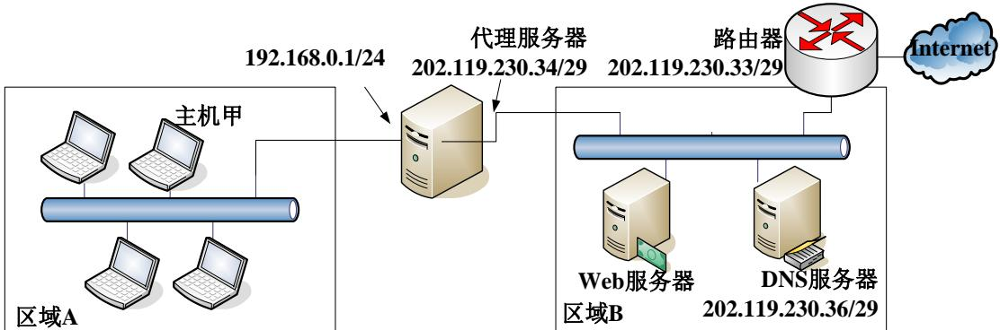

# 《计算机通信与网络》补充作业

原件经识别和整理；“参考解答”是我们补的。

# 《计算机通信与网络》补充作业 1

## 一、填空题

### 填空 1

从逻辑上看，计算机网络是由 \_\_\_\_\_\_ 和 \_\_\_\_\_\_ 组成。

参考解答：结论：**IP 地址、端口号**。

简明推理：套接字用于唯一标识网络通信端点；**IP 地址**唯一标识主机，**端口号**标识该主机上的具体应用进程，二者组合后在网络中唯一确定一个通信进程。

知识点：[传输层服务与端口（复用与分用、五元组、熟知端口）](../../../topics/计算机网络/transport_services_ports.md)

### 填空 2

通信协议的三要素是 \_\_\_\_\_\_ 、 \_\_\_\_\_\_ 和同步。

参考解答：**IP地址**、**子网掩码**、**默认网关**、**DNS服务器地址**

在 IPv4 网络环境下，计算机接入因特网需要配置 TCP/IP 协议栈的核心参数以实现网络层和应用层的正常通信：
1. **IP地址**：分配给本机在网络中的唯一逻辑标识，用于数据包的源和目的寻址。
2. **子网掩码**：与 IP 地址进行按位与运算，用于区分网络号和主机号，从而判断目标主机是否处于同一局域网内。
3. **默认网关**：通常为本地路由器的接口 IP 地址。当目标主机不在同一子网时，数据包将发往默认网关进行跨网段路由转发。
4. **DNS服务器地址**：提供域名解析服务，将人类可读的域名转换为机器可识别的 IP 地址，从而实现通过域名访问因特网资源。

知识点：[IPv4协议与数据报格式（分类IP地址、分片计算、首部字段）](../../../topics/计算机网络/ipv4_datagram.md)、[动态主机配置协议DHCP（工作原理、中继代理）](../../../topics/计算机网络/dhcp.md)、[子网划分与CIDR（子网掩码计算、路由聚合、最长前缀匹配）](../../../topics/计算机网络/subnet_cidr.md)

### 填空 3

按照网络作用范围，计算机网络分为个人区域网、 \_\_\_\_\_\_ 、城域网、 \_\_\_\_\_\_ 和因特网。

参考解答：**结论：OSPF 工作在**网络层（IP 层）**，RIP 工作在**应用层。

**推理：**

- **OSPF**：报文直接封装在 IP 数据报中传输（IP 首部协议字段值为 89），不经过 TCP/UDP 等运输层协议，故属于网络层协议。

- **RIP**：报文借助 **UDP**（端口 520）传送，即“RIP over UDP over IP”。按 TCP/IP 体系结构的划分，凡依赖运输层为应用进程服务的协议都归入应用层，故 RIP 属于应用层协议（尽管其功能是选路）。

**注意**：两者虽都是**路由协议**（解决网络层的选路问题），但协议本身所处的层次不同，这是常考点。

知识点：[互联网路由选择协议（RIP距离向量、OSPF链路状态、BGP）](../../../topics/计算机网络/routing_protocols.md)、[网络体系结构与协议（OSI/RM与TCP/IP模型、协议三要素）](../../../topics/计算机网络/architecture_protocols.md)

### 填空 4

在OSI参考模型中，传输的基本单位是帧的层次是 \_\_\_\_\_\_ ，该模型的最高层是 \_\_\_\_\_\_ 。

## 二、单项选择题

参考解答：**答案：域名；IP 地址（IP 地址，也可写“IP 地址”或“32 位二进制 IP 地址”）**

即：域名系统的功能是实现 **域名** 到 **IP 地址** 的解析。

**说明**

- 用户在应用层使用便于记忆的域名（如 `www.example.com`），而网络层转发分组必须使用 IP 地址，DNS 正是完成这一“域名 $\rightarrow$ IP 地址”映射的系统。
- 解析过程简述：客户端向本地域名服务器查询；若未命中，则由本地服务器以迭代（或客户端以递归）方式依次询问根域名服务器、顶级域名服务器、权限域名服务器，逐级缩小范围直至获得目标主机的 IP 地址，并缓存结果。
- 补充：反向解析（IP 地址 $\rightarrow$ 域名）由 in-addr.arpa 域下的 PTR 记录支持，但 DNS 的基本功能是域名到 IP 地址的正向解析。

知识点：[域名系统DNS（层次名字空间、递归与迭代查询解析）](../../../topics/计算机网络/dns.md)

### 选择 1

在 OSI参考模型中，自下而上第一个提供端到端服务的层次是（ ）。

- A. 数据链路层
- B. 网络层
- C. 传输层
- D. 应用层

参考解答：## 答案：**B. 1000**

**推理：**

TCP 发送方的实际发送窗口取**拥塞窗口 cwnd** 与**接收窗口 rwnd** 中的较小值，即流量控制与拥塞控制同时生效：

$$
\text{发送窗口} = \min(\text{cwnd}, \text{rwnd}) = \min(1000, 2000) = 1000 \text{ 字节}
$$

**排除其他选项：**
- A（0）：两个窗口均大于 0，发送窗口不可能为 0；
- C（2000）：只考虑了 rwnd，忽略了更小的 cwnd 的限制；
- D（3000）：错误地将两个窗口相加，二者是"取小"而非"相加"的关系。

知识点：[TCP流量控制与拥塞控制（滑动窗口、慢开始、拥塞避免、快重传与快恢复）](../../../topics/计算机网络/tcp_flow_congestion.md)、[传输层服务与端口（复用与分用、五元组、熟知端口）](../../../topics/计算机网络/transport_services_ports.md)

### 选择 2

若网络形状是由站点和连接站点的链路组成的一个闭合环，则称这种拓扑结构为（ ）。

- A. 星形拓扑
- B. 总线拓扑
- C. 环形拓扑
- D. 树形拓扑

参考解答：**答案：D**

**推理过程：**

- **D（IP 寻址）不正确**：IP 地址属于**网络层**的功能，网络层负责主机到主机（host-to-host）的交付；运输层不进行 IP 寻址，故该表述不属于运输层协议的职责。

- **A 正确**：运输层通过**端口（Port）号**标识进程，实现进程到进程的通信，即进程寻址是其基本功能。

- **B 正确**：UDP 提供无连接服务，是不可靠但高效的运输层协议。

- **C 正确**：TCP 提供面向连接的、可靠的服务（如三次握手建立连接）。

**关键区别**：网络层用 IP 地址完成主机寻址，运输层用端口号完成进程寻址——二者分工不同，D 混淆了层次功能。

知识点：[传输层服务与端口（复用与分用、五元组、熟知端口）](../../../topics/计算机网络/transport_services_ports.md)、[UDP协议（无连接特性、报文段格式、伪首部校验和计算）](../../../topics/计算机网络/udp_protocol.md)、[TCP连接管理与可靠传输（三次握手、四次挥手、序号确认、RTT与RTO）](../../../topics/计算机网络/tcp_connection_reliability.md)

### 选择 3

在 OSI参考模型中，物理层的主要功能是（ ）。

- A. 数据链路的访问控制和管理
- B. 透明地传输比特流
- C. 在物理实体间传送数据帧
- D. 发送和接收用户数据报文

参考解答：**结论：C. 30.4**

TCP 的加权平均 RTT 估算公式为：

$$
\text{RTT}_{\text{new}}=\alpha \cdot \text{RTT}_{\text{old}}+(1-\alpha)\cdot \text{SampleRTT}
$$

已知：

$$
\text{RTT}_{\text{old}}=30\text{ ms},\quad \text{SampleRTT}=34\text{ ms},\quad \alpha=0.9
$$

代入：

$$
\text{RTT}_{\text{new}}=0.9\times 30+0.1\times 34
$$

$$
=27+3.4=30.4\text{ ms}
$$

所以选 **C**。

- A 29.6：相当于把样本 RTT 取小了，计算结果偏小。
- B 30.0：相当于没有根据新的测量样本更新 RTT。
- D 30.8：相当于样本 RTT 取成了更大的值，计算结果偏大。

知识点：[TCP连接管理与可靠传输（三次握手、四次挥手、序号确认、RTT与RTO）](../../../topics/计算机网络/tcp_connection_reliability.md)、[计算机网络性能指标（速率、时延、吞吐量计算）](../../../topics/计算机网络/performance_metrics.md)

### 选择 4

下面关于计算机网络的体系结构和协议的叙述，不正确的是（ ）。

- A. 计算机网络体系结构是计算机网络及其部件所应完成的功能的精确定义
- B. TCP/IP体系结构中的应用层对应于 OSI体系结构中的表示层和应用层
- C. 网络协议是为进行网络中的数据交换而建立的规则、标准和约定
- D. 网络协议是“水平”的概念

参考解答：## 答案：B. DHCP

**结论：** 选择 B。DHCP 使用 UDP 提供的无连接传输服务，其余三个协议均基于面向连接的 TCP。

**推理过程：**

应用层协议所依赖的传输层服务：

| 协议 | 传输层协议 | 服务类型 |
|------|-----------|---------|
| SMTP | TCP（端口 25） | 面向连接 |
| **DHCP** | **UDP（端口 67/68）** | **无连接** |
| HTTP | TCP（端口 80/443） | 面向连接 |
| FTP | TCP（端口 21/20） | 面向连接 |

DHCP 采用无连接的 UDP，主要因为 DHCP 消息短小（DHCP discover / offer / request / ack 均封装在单个 UDP 数据报中），且 DHCP 本身设计有重传机制，即使报文丢失也可重新请求，无需 TCP 建立连接和可靠传输的开销。此外客户端尚未获得 IP 地址时，使用 UDP 广播（255.255.255.255）方式最容易实现。

**其他选项分析（一句话）：**

- **A. SMTP**：邮件传输要求可靠、不丢失不重复，使用 TCP，故不对。
- **C. HTTP**：网页内容传输要求字节流可靠有序，使用 TCP，故不对。
- **D. FTP**：文件传输对可靠性要求极高，使用两条 TCP 连接（控制连接 + 数据连接），故不对。

知识点：[传输层服务与端口（复用与分用、五元组、熟知端口）](../../../topics/计算机网络/transport_services_ports.md)、[UDP协议（无连接特性、报文段格式、伪首部校验和计算）](../../../topics/计算机网络/udp_protocol.md)、[万维网与HTTP协议（URL、请求与响应报文、Web缓存）](../../../topics/计算机网络/www_http.md)

### 选择 5

下列选项中，不属于网络体系结构中所描述的内容是（ ）。

- A. 协议内部实现细节
- B. 网络层次
- C. 每一层使用协议
- D. 每层须完成的功能

## 三、综合题

参考解答：## 答案：A（1 条，1 条）

### 推理过程

递归解析的查询传递方式是“链式代问”，即每个不能给出答案的服务器都以客户身份替原请求者向下一级服务器继续查询，结果再沿原路逐级返回：

$$\text{用户主机} \to \text{本地域名服务器} \to \text{根域名服务器} \to \text{顶级域名服务器} \to \text{权限域名服务器}$$

- **用户主机**：只在开始时向本地域名服务器发出 1 条查询请求，之后等待最终结果，不再发任何请求；
- **本地域名服务器**：因无缓存而无法解析，只需向根域名服务器转发 1 条请求；后续去查顶级、权限服务器的请求分别由根、顶级服务器自己发出，与本地服务器无关。

故二者发送的域名请求条数分别为 **1 条、1 条**。

### 其他选项

- **B（1 条，多条）**：对应迭代方式——本地服务器自己依次向根、顶级、权限等多个服务器反复发查询，题设为递归，不符。
- **C（多条，1 条）**：无论递归还是迭代，用户主机都只询问本地域名服务器一次，不可能发多条。
- **D（多条，多条）**：同上，用户主机只发 1 条，前提即不成立。

知识点：[域名系统DNS（层次名字空间、递归与迭代查询解析）](../../../topics/计算机网络/dns.md)

### 综合 1

什么是网络协议？由哪几个基本要素组成？各有什么含义？

参考解答：### （1）主机甲的网络配置

- **IP 地址**：$202.119.230.33$
- **子网掩码**：$255.255.255.248$（或 /29）
- **默认网关**：$202.119.230.38$
- **DNS 地址**：可填写 ISP 提供的 DNS（如 $202.119.230.34$）或公共 DNS（如 $8.8.8.8$）

**推理过程**：  
ISP 分配地址块为 $202.119.230.32/29$，其网络地址为 $202.119.230.32$，广播地址为 $202.119.230.39$，可用主机地址范围为 $202.119.230.33 \sim 202.119.230.38$。最小可分配主机地址为 $202.119.230.33$。通常网关使用该子网中最后一个可用地址（$202.119.230.38$），以便与内部网络设备区分；DNS 地址在无特别说明时可任选合法 DNS 服务器地址。

---

### （2）区域 A 访问 Internet 所需协议及作用

- **协议**：NAT（Network Address Translation，网络地址转换）
- **作用**：将区域 A 内部专用 IP 地址转换为 ISP 分配的公网 IP 地址，使私有网络主机能够共享有限的公网地址访问 Internet，并隐藏内部网络结构。

---

### （3）区域 A 主机访问区域 B Web 服务器可能使用的协议（至少 6 种）

1. **HTTP/HTTPS**：应用层协议，用于请求和传输 Web 页面内容。  
2. **TCP**：传输层协议，提供面向连接的可靠数据传输，承载 HTTP。  
3. **IP**：网络层协议，负责数据包的寻址与路由。  
4. **ARP**：链路层协议，在本地网络中解析目标 IP 对应的 MAC 地址。  
5. **DNS**：应用层协议，将 Web 服务器的域名解析为 IP 地址。  
6. **ICMP**：网络层辅助协议，用于路径探测、错误报告（如 TTL 超时、目的不可达）。  

> 注：若考虑 NAT 场景，还可包含 **NAT** 协议机制；若使用 HTTPS，则还涉及 **TLS/SSL**。以上六种已满足题目要求且覆盖各层核心协议。

知识点：[子网划分与CIDR（子网掩码计算、路由聚合、最长前缀匹配）](../../../topics/计算机网络/subnet_cidr.md)、[网络互连与IP转发（路由器转发过程、NAT、VPN、移动IP、组播）](../../../topics/计算机网络/network_interconnection.md)、[网络体系结构与协议（OSI/RM与TCP/IP模型、协议三要素）](../../../topics/计算机网络/architecture_protocols.md)

### 综合 2

画出OSI-RM模型的结构图，并简要说明下三层的功能。

---

# 《计算机通信与网络》补充作业 2

## 一、填空题

参考解答：### （1）采用了 CIDR 技术，如何进行路由选择？

**结论**：使用**最长前缀匹配**（Longest Prefix Match）原则进行路由选择。

**推理**：CIDR 消除了传统的分类地址概念，使用网络前缀。路由器在转发数据包时，会查找路由表中所有与目的 IP 地址匹配的网络前缀，并选择其中前缀最长（即掩码最长、最具体）的路由表项进行转发。

### （2）每一个子网的网络前缀有多长（多少个比特位）？

**结论**：28 个比特位（即 `/28`）。

**计算过程**：
原地址块前缀长度为 26 位。需要划分为 4 个一样大的子网，需向主机位借用 $n$ 位，满足 $2^n = 4$，解得 $n = 2$。
新的网络前缀长度 = 原前缀长度 + 借用位数 = $26 + 2 = 28$ 位。

### （3）每一个子网的地址块是多少？请写出 4 个地址块。

**结论**：
1. `136.23.12.64/28`
2. `136.23.12.80/28`
3. `136.23.12.96/28`
4. `136.23.12.112/28`

**计算过程**：
原地址块最后一个字节 64 的二进制为 `0100 0000`。
`/28` 表示最后一个字节的前 4 位为网络位，后 4 位为主机位。划分 4 个子网，借用的 2 位子网位组合分别为 `00`、`01`、`10`、`11`。
- 子网 1：`0100 0000` $\rightarrow$ 64
- 子网 2：`0101 0000` $\rightarrow$ 80
- 子网 3：`0110 0000` $\rightarrow$ 96
- 子网 4：`0111 0000` $\rightarrow$ 112
结合前缀长度，得到上述 4 个地址块。

### （4）每一个子网可分配给主机使用的最小地址和最大地址是什么？

**结论**：
- **子网 1**：`136.23.12.65` ~ `136.23.12.78`
- **子网 2**：`136.23.12.81` ~ `136.23.12.94`
- **子网 3**：`136.23.12.97` ~ `136.23.12.110`
- **子网 4**：`136.23.12.113` ~ `136.23.12.126`

**计算过程**：
每个子网的主机位数为 $32 - 28 = 4$ 位，每个子网共有 $2^4 = 16$ 个 IP 地址。
可分配给主机的最小地址为**网络地址 + 1**，最大地址为**广播地址 - 1**（即网络地址 + 14）。
- 子网 1：网络地址为 64，最小地址 $64 + 1 = 65$，最大地址 $64 + 14 = 78$。
- 子网 2：网络地址为 80，最小地址 $80 + 1 = 81$，最大地址 $80 + 14 = 94$。
- 子网 3：网络地址为 96，最小地址 $96 + 1 = 97$，最大地址 $96 + 14 = 110$。
- 子网 4：网络地址为 112，最小地址 $112 + 1 = 113$，最大地址 $112 + 14 = 126$。

知识点：[子网划分与CIDR（子网掩码计算、路由聚合、最长前缀匹配）](../../../topics/计算机网络/subnet_cidr.md)、[IPv4协议与数据报格式（分类IP地址、分片计算、首部字段）](../../../topics/计算机网络/ipv4_datagram.md)、[网络互连与IP转发（路由器转发过程、NAT、VPN、移动IP、组播）](../../../topics/计算机网络/network_interconnection.md)

### 填空 1

在HDLC 中，帧的类型可以分为信息帧、 \_\_\_\_\_\_ 和 \_\_\_\_\_\_ 三种。

参考解答：结论：**IP 地址、端口号**。

简明推理：套接字用于唯一标识网络通信端点；**IP 地址**唯一标识主机，**端口号**标识该主机上的具体应用进程，二者组合后在网络中唯一确定一个通信进程。

知识点：[传输层服务与端口（复用与分用、五元组、熟知端口）](../../../topics/计算机网络/transport_services_ports.md)

### 填空 2

若码元周期 $T = 1 \times 10^{-4}$ 秒，且传送16电平信号，则传码速率为 \_\_\_\_\_\_ Bd、传信速率为 \_\_\_\_\_\_ b/s。

参考解答：**IP地址**、**子网掩码**、**默认网关**、**DNS服务器地址**

在 IPv4 网络环境下，计算机接入因特网需要配置 TCP/IP 协议栈的核心参数以实现网络层和应用层的正常通信：
1. **IP地址**：分配给本机在网络中的唯一逻辑标识，用于数据包的源和目的寻址。
2. **子网掩码**：与 IP 地址进行按位与运算，用于区分网络号和主机号，从而判断目标主机是否处于同一局域网内。
3. **默认网关**：通常为本地路由器的接口 IP 地址。当目标主机不在同一子网时，数据包将发往默认网关进行跨网段路由转发。
4. **DNS服务器地址**：提供域名解析服务，将人类可读的域名转换为机器可识别的 IP 地址，从而实现通过域名访问因特网资源。

知识点：[IPv4协议与数据报格式（分类IP地址、分片计算、首部字段）](../../../topics/计算机网络/ipv4_datagram.md)、[动态主机配置协议DHCP（工作原理、中继代理）](../../../topics/计算机网络/dhcp.md)、[子网划分与CIDR（子网掩码计算、路由聚合、最长前缀匹配）](../../../topics/计算机网络/subnet_cidr.md)

### 填空 3

在常用的有线的传输媒体中，主要有 \_\_\_\_\_\_ 和光纤。

参考解答：**结论：OSPF 工作在**网络层（IP 层）**，RIP 工作在**应用层。

**推理：**

- **OSPF**：报文直接封装在 IP 数据报中传输（IP 首部协议字段值为 89），不经过 TCP/UDP 等运输层协议，故属于网络层协议。

- **RIP**：报文借助 **UDP**（端口 520）传送，即“RIP over UDP over IP”。按 TCP/IP 体系结构的划分，凡依赖运输层为应用进程服务的协议都归入应用层，故 RIP 属于应用层协议（尽管其功能是选路）。

**注意**：两者虽都是**路由协议**（解决网络层的选路问题），但协议本身所处的层次不同，这是常考点。

知识点：[互联网路由选择协议（RIP距离向量、OSPF链路状态、BGP）](../../../topics/计算机网络/routing_protocols.md)、[网络体系结构与协议（OSI/RM与TCP/IP模型、协议三要素）](../../../topics/计算机网络/architecture_protocols.md)

### 填空 4

物理层的接口有4个方面的特性，它们是 \_\_\_\_\_\_ 特性、电气特性、 \_\_\_\_\_\_ 特性和规程特性。

参考解答：**答案：域名；IP 地址（IP 地址，也可写“IP 地址”或“32 位二进制 IP 地址”）**

即：域名系统的功能是实现 **域名** 到 **IP 地址** 的解析。

**说明**

- 用户在应用层使用便于记忆的域名（如 `www.example.com`），而网络层转发分组必须使用 IP 地址，DNS 正是完成这一“域名 $\rightarrow$ IP 地址”映射的系统。
- 解析过程简述：客户端向本地域名服务器查询；若未命中，则由本地服务器以迭代（或客户端以递归）方式依次询问根域名服务器、顶级域名服务器、权限域名服务器，逐级缩小范围直至获得目标主机的 IP 地址，并缓存结果。
- 补充：反向解析（IP 地址 $\rightarrow$ 域名）由 in-addr.arpa 域下的 PTR 记录支持，但 DNS 的基本功能是域名到 IP 地址的正向解析。

知识点：[域名系统DNS（层次名字空间、递归与迭代查询解析）](../../../topics/计算机网络/dns.md)

### 填空 5

脉冲编码调制（PCM）的工作过程包括抽样、 \_\_\_\_\_\_ 和 \_\_\_\_\_\_ 。

参考解答：**结论：URL（统一资源定位符，Uniform Resource Locator）**

**理由：**

万维网用 URL 来标志分布在整个互联网上的每一个文档，并保证每个文档的标识符在全球范围内是唯一的。

URL 的一般形式为：

$$\text{协议}://\text{主机}:\text{端口}/\text{路径}$$

例如：`http://www.tsinghua.edu.cn/chn/index.htm`，其中协议为 HTTP（也可为 FTP 等），主机为域名或 IP 地址，路径指明文档在主机上的位置。

**辨析：** 域名或 IP 地址只能标识一台主机，无法指明具体用何种协议访问主机上的哪份文档；只有 URL 同时给出了访问方式（协议）+ 主机 + 文档位置，才能唯一地标志万维网上的一份文档。

知识点：[万维网与HTTP协议（URL、请求与响应报文、Web缓存）](../../../topics/计算机网络/www_http.md)

### 填空 6

信道复用技术包括 \_\_\_\_\_\_ 复用、时分复用、波分复用和 \_\_\_\_\_\_ 。

参考解答：20；1460

**推理与计算过程**：
1. **TCP 首部固定长度**：TCP 报文段首部的前 $20$ 个字节为固定字段，不包含选项字段。
2. **TCP 数据部分最大长度计算**：
   - 默认 IP 首部固定长度为 $20$ 字节，IP 数据部分（即整个 TCP 报文段）的最大长度为：
     $$1500 - 20 = 1480 \text{ 字节}$$
   - 扣除 TCP 首部固定长度 $20$ 字节，TCP 报文段的数据部分最大长度为：
     $$1480 - 20 = 1460 \text{ 字节}$$

知识点：[TCP连接管理与可靠传输（三次握手、四次挥手、序号确认、RTT与RTO）](../../../topics/计算机网络/tcp_connection_reliability.md)、[IPv4协议与数据报格式（分类IP地址、分片计算、首部字段）](../../../topics/计算机网络/ipv4_datagram.md)

### 填空 7

数据链路层采用连续 ARQ 协议，发送方已经发送了编号为 0～7 的帧，当计时器超时，若发送方只收到0、2、3号帧的确认，则发送方需要重发 \_\_\_\_\_\_ 个帧。

参考解答：**结论：复用和分用**（或“端口复用/分用”）。

UDP 在 IP 数据报服务之上主要增加了通过源端口、目的端口实现的**复用和分用**功能，以及通过校验和实现的**差错控制**功能。

知识点：[UDP协议（无连接特性、报文段格式、伪首部校验和计算）](../../../topics/计算机网络/udp_protocol.md)

### 填空 8

对于选择ARQ协议，若采用 3比特编号，则最大接收窗口尺寸为 \_\_\_\_\_\_ 。

参考解答：**控制连接** 和 **数据连接**。

- **控制连接**：用于传送 FTP 命令和应答，如登录、切换目录、请求上传/下载等。
- **数据连接**：用于实际传送文件内容或目录列表等数据。

知识点：[文件传送与远程登录（FTP双连接机制、TFTP、Telnet）](../../../topics/计算机网络/ftp_telnet.md)

### 填空 9

码长为15的汉明码，其中包含的监督位至少为 \_\_\_\_\_\_ 位，编码效率为 \_\_\_\_\_\_ 。

参考解答：**结论**

1. **物理地址**（或填：硬件地址、MAC地址）
2. **IP地址**（或填：逻辑地址）

**推理过程**

在计算机网络体系结构中，不同层次使用不同的寻址机制来实现其特定功能：
- **数据链路层与物理层**：负责同一物理网络内相邻节点间的数据帧传输，依赖网卡上固化的**物理地址**（MAC 地址）进行本地链路寻址。
- **网络层及以上各层**：负责跨网络的路由选择与端到端通信，依赖由软件分配的**IP 地址**（逻辑地址）进行全局网络寻址。传输层和应用层的通信均建立在网络层提供的 IP 寻址基础之上。

知识点：[网络体系结构与协议（OSI/RM与TCP/IP模型、协议三要素）](../../../topics/计算机网络/architecture_protocols.md)、[IPv4协议与数据报格式（分类IP地址、分片计算、首部字段）](../../../topics/计算机网络/ipv4_datagram.md)

### 填空 10

若AB两台计算机之间的距离为1000km，假定在电缆内信号的传播速度是 $2 \times 10^8 \mathrm{m/s}$ ，数据块长度为105bit，数据发送速率为1Mb/s，则发送时延是 \_\_\_\_\_\_ 毫秒，传播时延是 \_\_\_\_\_\_ 毫秒。

## 二、单项选择题

参考解答：**结论**

$0 \sim 1023$；通用（或“众所周知”、“标准”、“常用”）。

**推理过程**

根据 IANA（互联网号码分配局）的规定，传输层 16 位端口号（范围 $0 \sim 65535$）被划分为三个区间：
1. **熟知端口（Well-Known Ports）**：$0 \sim 1023$。这些端口由 IANA 统一分配并严格控制，专门用于标识互联网上**通用**（或众所周知）的核心网络服务应用进程，例如 HTTP（80）、FTP（21）和 SSH（22）。
2. **登记端口（Registered Ports）**：$1024 \sim 49151$。用于标识没有熟知端口号的特定或非核心服务。
3. **短暂/动态端口（Dynamic/Private Ports）**：$49152 \sim 65535$。仅留给客户端进程在通信时短暂使用。

知识点：[传输层服务与端口（复用与分用、五元组、熟知端口）](../../../topics/计算机网络/transport_services_ports.md)

### 选择 1

在物理层的接口特性中，用于描述各种通信事件发生顺序的是（ ）。

- A. 机械特性
- B. 电气特性
- C. 功能特性
- D. 规程特性

参考解答：## 答案：**B. 1000**

**推理：**

TCP 发送方的实际发送窗口取**拥塞窗口 cwnd** 与**接收窗口 rwnd** 中的较小值，即流量控制与拥塞控制同时生效：

$$
\text{发送窗口} = \min(\text{cwnd}, \text{rwnd}) = \min(1000, 2000) = 1000 \text{ 字节}
$$

**排除其他选项：**
- A（0）：两个窗口均大于 0，发送窗口不可能为 0；
- C（2000）：只考虑了 rwnd，忽略了更小的 cwnd 的限制；
- D（3000）：错误地将两个窗口相加，二者是"取小"而非"相加"的关系。

知识点：[TCP流量控制与拥塞控制（滑动窗口、慢开始、拥塞避免、快重传与快恢复）](../../../topics/计算机网络/tcp_flow_congestion.md)、[传输层服务与端口（复用与分用、五元组、熟知端口）](../../../topics/计算机网络/transport_services_ports.md)

### 选择 2

采用连续ARQ协议的滑动窗口协议，设序号位数为 n，则发送窗口最大尺寸为（ ）。

- A. $2n-1$
- B. $2^n-1$
- C. $2^n$
- D. 1

参考解答：**答案：D**

**推理过程：**

- **D（IP 寻址）不正确**：IP 地址属于**网络层**的功能，网络层负责主机到主机（host-to-host）的交付；运输层不进行 IP 寻址，故该表述不属于运输层协议的职责。

- **A 正确**：运输层通过**端口（Port）号**标识进程，实现进程到进程的通信，即进程寻址是其基本功能。

- **B 正确**：UDP 提供无连接服务，是不可靠但高效的运输层协议。

- **C 正确**：TCP 提供面向连接的、可靠的服务（如三次握手建立连接）。

**关键区别**：网络层用 IP 地址完成主机寻址，运输层用端口号完成进程寻址——二者分工不同，D 混淆了层次功能。

知识点：[传输层服务与端口（复用与分用、五元组、熟知端口）](../../../topics/计算机网络/transport_services_ports.md)、[UDP协议（无连接特性、报文段格式、伪首部校验和计算）](../../../topics/计算机网络/udp_protocol.md)、[TCP连接管理与可靠传输（三次握手、四次挥手、序号确认、RTT与RTO）](../../../topics/计算机网络/tcp_connection_reliability.md)

### 选择 3

若数据链路的发送窗口尺寸 W =6，经过初始化后，发送方在发送了3号帧、并接到 1号帧的确认帧后，发送方还可连续发送（ ）。

- A. 1帧
- B. 2帧
- C. 3 帧
- D. 4帧

参考解答：**结论：C. 30.4**

TCP 的加权平均 RTT 估算公式为：

$$
\text{RTT}_{\text{new}}=\alpha \cdot \text{RTT}_{\text{old}}+(1-\alpha)\cdot \text{SampleRTT}
$$

已知：

$$
\text{RTT}_{\text{old}}=30\text{ ms},\quad \text{SampleRTT}=34\text{ ms},\quad \alpha=0.9
$$

代入：

$$
\text{RTT}_{\text{new}}=0.9\times 30+0.1\times 34
$$

$$
=27+3.4=30.4\text{ ms}
$$

所以选 **C**。

- A 29.6：相当于把样本 RTT 取小了，计算结果偏小。
- B 30.0：相当于没有根据新的测量样本更新 RTT。
- D 30.8：相当于样本 RTT 取成了更大的值，计算结果偏大。

知识点：[TCP连接管理与可靠传输（三次握手、四次挥手、序号确认、RTT与RTO）](../../../topics/计算机网络/tcp_connection_reliability.md)、[计算机网络性能指标（速率、时延、吞吐量计算）](../../../topics/计算机网络/performance_metrics.md)

### 选择 4

共有4个站进行码分多址通信。4个站的码片序列为：
A： $( - 1, - 1, - 1, + 1, + 1, - 1, + 1, + 1 )$
B： $( - 1, - 1, + 1, - 1, + 1, + 1, + 1, - 1 )$
C： $( - 1, + 1, - 1, + 1, + 1, + 1, - 1, - 1 )$
D： $( - 1, + 1, - 1, - 1, - 1, - 1, + 1, - 1 )$

若收到码片序列S： $( - 1, + 1, - 3, + 1, - 1, - 3, + 1, + 1 )$ ，则没有发送数据的站是（ ）

- A. A站
- B. B站
- C. C站
- D. D站

参考解答：## 答案：B. DHCP

**结论：** 选择 B。DHCP 使用 UDP 提供的无连接传输服务，其余三个协议均基于面向连接的 TCP。

**推理过程：**

应用层协议所依赖的传输层服务：

| 协议 | 传输层协议 | 服务类型 |
|------|-----------|---------|
| SMTP | TCP（端口 25） | 面向连接 |
| **DHCP** | **UDP（端口 67/68）** | **无连接** |
| HTTP | TCP（端口 80/443） | 面向连接 |
| FTP | TCP（端口 21/20） | 面向连接 |

DHCP 采用无连接的 UDP，主要因为 DHCP 消息短小（DHCP discover / offer / request / ack 均封装在单个 UDP 数据报中），且 DHCP 本身设计有重传机制，即使报文丢失也可重新请求，无需 TCP 建立连接和可靠传输的开销。此外客户端尚未获得 IP 地址时，使用 UDP 广播（255.255.255.255）方式最容易实现。

**其他选项分析（一句话）：**

- **A. SMTP**：邮件传输要求可靠、不丢失不重复，使用 TCP，故不对。
- **C. HTTP**：网页内容传输要求字节流可靠有序，使用 TCP，故不对。
- **D. FTP**：文件传输对可靠性要求极高，使用两条 TCP 连接（控制连接 + 数据连接），故不对。

知识点：[传输层服务与端口（复用与分用、五元组、熟知端口）](../../../topics/计算机网络/transport_services_ports.md)、[UDP协议（无连接特性、报文段格式、伪首部校验和计算）](../../../topics/计算机网络/udp_protocol.md)、[万维网与HTTP协议（URL、请求与响应报文、Web缓存）](../../../topics/计算机网络/www_http.md)

### 选择 5

在一个带宽为 4KHz、没有噪声的信道，采用 16相调制技术传输信号时能够达到的极限数据传输速率为（ ）。

- A. 8 Kbps
- B. 24 Kbps
- C. 32 Kbps
- D. 64 Kbps

参考解答：## 答案：A（1 条，1 条）

### 推理过程

递归解析的查询传递方式是“链式代问”，即每个不能给出答案的服务器都以客户身份替原请求者向下一级服务器继续查询，结果再沿原路逐级返回：

$$\text{用户主机} \to \text{本地域名服务器} \to \text{根域名服务器} \to \text{顶级域名服务器} \to \text{权限域名服务器}$$

- **用户主机**：只在开始时向本地域名服务器发出 1 条查询请求，之后等待最终结果，不再发任何请求；
- **本地域名服务器**：因无缓存而无法解析，只需向根域名服务器转发 1 条请求；后续去查顶级、权限服务器的请求分别由根、顶级服务器自己发出，与本地服务器无关。

故二者发送的域名请求条数分别为 **1 条、1 条**。

### 其他选项

- **B（1 条，多条）**：对应迭代方式——本地服务器自己依次向根、顶级、权限等多个服务器反复发查询，题设为递归，不符。
- **C（多条，1 条）**：无论递归还是迭代，用户主机都只询问本地域名服务器一次，不可能发多条。
- **D（多条，多条）**：同上，用户主机只发 1 条，前提即不成立。

知识点：[域名系统DNS（层次名字空间、递归与迭代查询解析）](../../../topics/计算机网络/dns.md)

### 选择 6

工作在异步链路上的PPP 协议采用面向（ ）的填充方式实现透明传输。

- A. 比特
- B. 字符
- C. 报文
- D. 帧

参考解答：**结论**：C

**推理过程**：
FTP 协议在工作时会建立两个并行的 TCP 连接：控制连接和数据连接。客户端与服务器端之间传输控制命令和响应信息使用的是**控制连接**（默认端口 21），而传输实际文件内容使用的是**数据连接**。同时，FTP 要求命令和数据的可靠传输，因此底层依赖 **TCP** 协议而非 UDP。

- **为什么选 C**：FTP 基于 TCP 协议以保证传输可靠性，且命令与响应的交互专门通过控制连接完成。
- **其他选项为什么不对**：A 和 B 错误是因为 FTP 不使用不可靠的 UDP 协议；D 错误是因为数据连接仅用于传输文件数据，不用于传输控制命令。

知识点：[文件传送与远程登录（FTP双连接机制、TFTP、Telnet）](../../../topics/计算机网络/ftp_telnet.md)、[传输层服务与端口（复用与分用、五元组、熟知端口）](../../../topics/计算机网络/transport_services_ports.md)

### 选择 7

HDLC 采用“0”比特插入法的目的是（ ）。

- A. 差错控制
- B. 链路管理
- C. 保证传输的透明性
- D. 流量控制

参考解答：**结论**：按题目所给数据计算结果应为 **600**，所给选项均不正确；若本题源自 2018 年考研 408 真题（首个报文段序号实为 **200**），则应选 **B. 700**。

**推理与计算过程**：
- **核心机制**：TCP 的确认号表示期望收到对方下一个报文段数据部分第一个字节的序号，等于已成功接收的最后一个字节序号加 1，也可直接通过**首个报文段序号 + 所有已正确接收报文段的有效载荷总字节数**来计算。
- **关键步骤**：
  - 依当前题意计算：确认号 $= 100 + 200 + 300 = 600$。
  - 依 408 真题原数据（首段序号 200）计算：确认号 $= 200 + 200 + 300 = 700$。
- **选项辨析**（基于真题首段序号 200 的情境）：选 B 是因为正确累加了起始序号与两段总载荷字节数（$200+200+300=700$）；其他选项不对是因为在累加时漏加了某段载荷或算错了总和（例如 A 选项 500 是漏加了第一段载荷 $200+300$，C 和 D 则是多加了无关数值）。

知识点：[TCP连接管理与可靠传输（三次握手、四次挥手、序号确认、RTT与RTO）](../../../topics/计算机网络/tcp_connection_reliability.md)、[传输层服务与端口（复用与分用、五元组、熟知端口）](../../../topics/计算机网络/transport_services_ports.md)、[网络体系结构与协议（OSI/RM与TCP/IP模型、协议三要素）](../../../topics/计算机网络/architecture_protocols.md)

### 选择 8

若一个码组信息位的长度是 10比特，如果采用汉明码校验，则所需的监督位是（ ）比特。

- A. 4
- B. 5
- C. 6
- D. 7

参考解答：**选 C**

**结论：** TCP 通过“三次握手”建立连接，即客户端发 SYN、服务器回 SYN+ACK、客户端再发 ACK。

**推理过程：**

三次握手的核心目的是同步双方初始序号，并确认双向链路可用：

$$
\text{Client} \xrightarrow{\ \mathrm{SYN},\ seq=x\ } \text{Server} \xrightarrow{\ \mathrm{SYN}+ \mathrm{ACK},\ seq=y,\ ack=x+1\ } \text{Client} \xrightarrow{\ \mathrm{ACK},\ ack=y+1\ } \text{Server}
$$

- 第 1 次：客户端表明发送能力正常，给出初始序号 $x$；
- 第 2 次：服务器确认客户端发送正常、自己的收发能力正常，给出初始序号 $y$；
- 第 3 次：客户端确认服务器发送正常，防止失效的历史连接请求造成资源浪费。

**其他选项分析：**

- **A 一次握手：** 无法同步序号，任何一方都无法确认对方收到请求，谈不上建立可靠连接。
- **B 二次握手：** 客户端无法确认自己具备接收能力被服务器知晓，且一个滞留网络中的旧 SYN 到达服务器会误建连接。
- **D 四次握手：** 四次握手是 TCP **释放/断开**连接的过程（FIN、ACK、FIN、ACK），而非建立连接。

知识点：[TCP连接管理与可靠传输（三次握手、四次挥手、序号确认、RTT与RTO）](../../../topics/计算机网络/tcp_connection_reliability.md)

### 选择 9

下列工作在物理层的网络设备是( )。

- A. 集线器
- B. 网桥
- C. 路由器
- D. 网关

参考解答：**结论**：B

**推理过程**：
选择 B，因为 POP3（Post Office Protocol version 3，邮局协议第3版）是专门用于客户端从服务器接收电子邮件的应用层协议；其他选项不对，因为 WWW 主要使用 HTTP 协议，BBS 通常基于 HTTP 或 Telnet 协议，FTP 则使用自身的 FTP 协议进行文件传输。

知识点：[电子邮件系统（SMTP、POP3、IMAP、MIME）](../../../topics/计算机网络/email_protocols.md)

### 选择 10

PPP 是Internet中使用的点到点协议，其功能对应于OSI/RM的（ ）。

- A. 数据链路层
- B. 网络层
- C. 传输层
- D. 应用层

## 三、计算题

参考解答：## 选择 10

**结论：选 D。**

**分析：**

两机用电缆直连，中间没有路由器，必须处于同一子网才能直接通信（否则主机会把分组交给默认网关，而网关不存在，Ping 不通）。

各子网归属判断（按最后一个字节 $24=00011000_2$，$100=01100100_2$）：

- **/28 时（掩码 255.255.255.240）**：
  - 主机 A（.24）落在子网 $220.17.33.16/28$（范围 16～31）；
  - 主机 B（.100）落在子网 $220.17.33.96/28$（范围 96～111）。
  - 两者**不在同一子网**，故 Ping 不通。

逐项判断：

- **A 不对**：改为 220.17.33.15 属于 $220.17.33.0/28$，与 B 仍不在同一子网，且 .15 恰是该子网的广播地址，不能用作主机地址。
- **B 不对**：220.17.33.111 仍在 B 原来的子网 $220.17.33.96/28$ 内（且 .111 是该子网的广播地址），与 A 仍不在同一子网。
- **C 不对**：/26 时子网划分为 0～63、64～127 等，A（.24）在 $220.17.33.0/26$，B（.100）在 $220.17.33.64/26$，仍不同网。
- **D 正确**：/25 时子网划分为 0～127、128～255，A（.24）和 B（.100）都落在 $220.17.33.0/25$ 内，且都是合法主机地址，可直接通过 ARP 找到对方通信，Ping 通。

**故应选 D。**

知识点：[子网划分与CIDR（子网掩码计算、路由聚合、最长前缀匹配）](../../../topics/计算机网络/subnet_cidr.md)、[ARP地址解析协议与ICMP控制报文](../../../topics/计算机网络/arp_icmp.md)

### 计算 1

某信道采用停止等待协议，单向传播延迟为20ms，数据帧长为 160bit，忽略确认帧长和处理时间，则信道速率为多少时才能使信道的利用率达到50%？

参考解答：## 结论

信道速率 $R=4\ \text{kbps}$（即 $4000\ \text{bit/s}$）。

## 计算

停止等待协议的信道利用率：

$$
U=\frac{T_{\text{发送}}}{T_{\text{发送}}+2T_{\text{传播}}}
$$

其中数据帧发送时间：

$$
T_{\text{发送}}=\frac{L}{R}
$$

已知：

- $L=160\ \text{bit}$
- $T_{\text{传播}}=20\ \text{ms}=0.02\ \text{s}$
- $U=50\%=0.5$

代入：

$$
0.5=\frac{\dfrac{160}{R}}{\dfrac{160}{R}+2\times 0.02}
$$

整理得：

$$
\frac{160}{R}=2\times 0.02=0.04
$$

因此：

$$
R=\frac{160}{0.04}=4000\ \text{bit/s}
$$

即：

$$
\boxed{R=4\ \text{kbps}}
$$

知识点：[计算机网络性能指标（速率、时延、吞吐量计算）](../../../topics/计算机网络/performance_metrics.md)、[流量控制与可靠传输（停止等待、连续ARQ、选择ARQ及窗口尺寸）](../../../topics/计算机网络/flow_control.md)、[信道容量与传输速率计算（奈氏准则与香农公式）](../../../topics/计算机网络/channel_capacity.md)

### 计算 2

假设一信道带宽为4kHz，信道要达到24kb/s的速率，问：

（1）按奈奎斯特公式，需要多少个电平表示数据？

（2）按香农公式，信道的信噪比是多少倍？

参考解答：## (1) 奈奎斯特公式求电平数

**结论：需要 8 个电平。**

**过程：**

奈奎斯特公式（无噪声信道）：

$$C = 2B\log_2 M$$

代入 $C = 24\ \text{kb/s}$，$B = 4\ \text{kHz}$：

$$\log_2 M = \frac{C}{2B} = \frac{24\ \text{kb/s}}{2 \times 4\ \text{kHz}} = 3$$

$$M = 2^3 = 8$$

## (2) 香农公式求信噪比

**结论：信噪比为 63 倍（约 18 dB）。**

**过程：**

香农公式（有噪声信道）：

$$C = B\log_2\left(1 + \frac{S}{N}\right)$$

代入数据：

$$\log_2\left(1 + \frac{S}{N}\right) = \frac{24\ \text{kb/s}}{4\ \text{kHz}} = 6$$

$$1 + \frac{S}{N} = 2^6 = 64 \quad\Rightarrow\quad \frac{S}{N} = 63$$

即信噪比是 **63 倍**，若用分贝表示：$10\lg 63 \approx 18\ \text{dB}$。

> 注意：$M=8$ 和 $S/N=63$ 数值上接近纯属巧合，二者来自不同的公式与假设（一个无噪声、一个有噪声），不能混用。

知识点：[信道容量与传输速率计算（奈氏准则与香农公式）](../../../topics/计算机网络/channel_capacity.md)、[计算机网络性能指标（速率、时延、吞吐量计算）](../../../topics/计算机网络/performance_metrics.md)

### 计算 3

假设带宽为 3000Hz 的模拟信道中只存在高斯白噪声，并且信噪比是 20dB，则该信道能否可靠的传输速率为 64kb/s的数据流？

参考解答：**结论**

不能可靠传输。

**推理与计算过程**

1.  **将信噪比从分贝（dB）转换为线性比值**
    已知信噪比 $SNR_{dB} = 20 \text{ dB}$，根据公式 $SNR_{dB} = 10 \log_{10}(S/N)$，可得：
    $$
    20 = 10 \log_{10}\left(\frac{S}{N}\right) \implies \log_{10}\left(\frac{S}{N}\right) = 2 \implies \frac{S}{N} = 10^2 = 100
    $$

2.  **利用香农公式计算信道极限容量**
    根据香农定理（Shannon's Theorem），有噪声信道的最大数据传输速率（信道容量）$C$ 为：
    $$
    C = B \log_2(1 + \frac{S}{N})
    $$
    其中带宽 $B = 3000 \text{ Hz}$，$\frac{S}{N} = 100$。代入数值：
    $$
    C = 3000 \times \log_2(1 + 100) = 3000 \times \log_2(101)
    $$
    由于 $\log_2(101) \approx \log_2(128) = 7$（更精确值为 $\approx 6.658$），则：
    $$
    C \approx 3000 \times 6.658 \approx 19974 \text{ bps} \approx 19.97 \text{ kb/s}
    $$

3.  **比较需求速率与信道容量**
    题目要求传输的数据流速率为 $R = 64 \text{ kb/s} = 64000 \text{ bps}$。
    $$
    R (64000 \text{ bps}) > C (19974 \text{ bps})
    $$
    因为所需传输速率超过了信道的理论最大容量，根据信息论原理，此时无法实现无差错（可靠）传输。

知识点：[信道容量与传输速率计算（奈氏准则与香农公式）](../../../topics/计算机网络/channel_capacity.md)、[计算机网络性能指标（速率、时延、吞吐量计算）](../../../topics/计算机网络/performance_metrics.md)

### 计算 4

一个报文的比特序列为 10010110 通过数据链路传输，采用 CRC 进行差错检测，如所用的生成多项式为 $g(X)＝X^4＋X＋1$，试解答下列问题：

（1）写出生成多项式 $G(X)=X^4+X+1$ 对应的二进制序列是：

（2）计算报文的比特序列的循环冗余校验码。（写出计算过程）

（3）简述接收方CRC 码的检测过程。

---

# 《计算机通信与网络》补充作业 3

## 一、填空题

参考解答：## 计算 4

### （1）生成多项式对应的二进制序列

**结论：$10011$**

生成多项式 $G(X)=X^4+X+1$ 的各项系数为：

| 项 | $X^4$ | $X^3$ | $X^2$ | $X^1$ | $X^0$ |
|---|---|---|---|---|---|
| 系数 | 1 | 0 | 0 | 1 | 1 |

所以对应的二进制序列为 **$10011$**。

---

### （2）计算循环冗余校验码

**结论：CRC 校验码为 $1110$**

**计算过程：**

生成多项式最高次为 $4$，所以在报文 $10010110$ 后面补 $4$ 个 $0$，得到：

$$100101100000$$

用生成多项式对应的二进制序列 $10011$ 对其进行模 2 除法（异或运算）：

```
        100001110
       -----------
10011 ) 100101100000
        10011
        -----
            11110
            10011
            -----
             11010
             10011
             -----
              10010
              10011
              -----
                 11100
                 10011
                 -----
                  1110
```

模 2 除法得到的余数为 **$1110$**。

因此，CRC 校验码为：

$$\boxed{1110}$$

实际发送的比特序列为：

$$10010110\,1110$$

---

### （3）接收方 CRC 码的检测过程

**结论：接收方用收到的完整比特序列除以同一个生成多项式，若余数为 0，则认为传输无差错；否则认为传输出错。**

接收方收到数据后，将整个接收序列（信息位 + CRC 校验位）用相同的生成多项式 $G(X)$ 进行模 2 除法：

- 若余数为 **0**，说明数据在传输过程中没有发生错误；
- 若余数 **不为 0**，说明数据在传输过程中发生了错误，接收方通常会丢弃该帧或请求重传。

知识点：[差错控制与检测编码（汉明码、CRC循环冗余校验）](../../../topics/计算机网络/error_control.md)

### 填空 1

CSMA/CD 协议中的 CD 是指 \_\_\_\_\_\_ ，CSMA/CA 协议中的 CA 是指 \_\_\_\_\_\_ 。

参考解答：结论：**IP 地址、端口号**。

简明推理：套接字用于唯一标识网络通信端点；**IP 地址**唯一标识主机，**端口号**标识该主机上的具体应用进程，二者组合后在网络中唯一确定一个通信进程。

知识点：[传输层服务与端口（复用与分用、五元组、熟知端口）](../../../topics/计算机网络/transport_services_ports.md)

### 填空 2

CSMA/CD 协议的要点是 \_\_\_\_\_\_ 、多点接入和 \_\_\_\_\_\_ 。

参考解答：**IP地址**、**子网掩码**、**默认网关**、**DNS服务器地址**

在 IPv4 网络环境下，计算机接入因特网需要配置 TCP/IP 协议栈的核心参数以实现网络层和应用层的正常通信：
1. **IP地址**：分配给本机在网络中的唯一逻辑标识，用于数据包的源和目的寻址。
2. **子网掩码**：与 IP 地址进行按位与运算，用于区分网络号和主机号，从而判断目标主机是否处于同一局域网内。
3. **默认网关**：通常为本地路由器的接口 IP 地址。当目标主机不在同一子网时，数据包将发往默认网关进行跨网段路由转发。
4. **DNS服务器地址**：提供域名解析服务，将人类可读的域名转换为机器可识别的 IP 地址，从而实现通过域名访问因特网资源。

知识点：[IPv4协议与数据报格式（分类IP地址、分片计算、首部字段）](../../../topics/计算机网络/ipv4_datagram.md)、[动态主机配置协议DHCP（工作原理、中继代理）](../../../topics/计算机网络/dhcp.md)、[子网划分与CIDR（子网掩码计算、路由聚合、最长前缀匹配）](../../../topics/计算机网络/subnet_cidr.md)

### 填空 3

IEEE802委员会将局域网的数据链路层分成两个子层，即 \_\_\_\_\_\_ 子层和 \_\_\_\_\_\_ 子层。

参考解答：**结论：OSPF 工作在**网络层（IP 层）**，RIP 工作在**应用层。

**推理：**

- **OSPF**：报文直接封装在 IP 数据报中传输（IP 首部协议字段值为 89），不经过 TCP/UDP 等运输层协议，故属于网络层协议。

- **RIP**：报文借助 **UDP**（端口 520）传送，即“RIP over UDP over IP”。按 TCP/IP 体系结构的划分，凡依赖运输层为应用进程服务的协议都归入应用层，故 RIP 属于应用层协议（尽管其功能是选路）。

**注意**：两者虽都是**路由协议**（解决网络层的选路问题），但协议本身所处的层次不同，这是常考点。

知识点：[互联网路由选择协议（RIP距离向量、OSPF链路状态、BGP）](../../../topics/计算机网络/routing_protocols.md)、[网络体系结构与协议（OSI/RM与TCP/IP模型、协议三要素）](../../../topics/计算机网络/architecture_protocols.md)

### 填空 4

若有 10 台计算机连到了一台 10Mbps 的集线器上，则每台计算机的平均带宽为 \_\_\_\_\_\_ Mbps。若该10台计算机接到了10Mb/s的以太网交换机上，则每台计算机的平均带宽为 \_\_\_\_\_\_ Mbps。

参考解答：**答案：域名；IP 地址（IP 地址，也可写“IP 地址”或“32 位二进制 IP 地址”）**

即：域名系统的功能是实现 **域名** 到 **IP 地址** 的解析。

**说明**

- 用户在应用层使用便于记忆的域名（如 `www.example.com`），而网络层转发分组必须使用 IP 地址，DNS 正是完成这一“域名 $\rightarrow$ IP 地址”映射的系统。
- 解析过程简述：客户端向本地域名服务器查询；若未命中，则由本地服务器以迭代（或客户端以递归）方式依次询问根域名服务器、顶级域名服务器、权限域名服务器，逐级缩小范围直至获得目标主机的 IP 地址，并缓存结果。
- 补充：反向解析（IP 地址 $\rightarrow$ 域名）由 in-addr.arpa 域下的 PTR 记录支持，但 DNS 的基本功能是域名到 IP 地址的正向解析。

知识点：[域名系统DNS（层次名字空间、递归与迭代查询解析）](../../../topics/计算机网络/dns.md)

### 填空 5

以太网交换机的三种转发帧的方式分别是存储转发方式、 \_\_\_\_\_\_ 方式和 \_\_\_\_\_\_ 方式。

参考解答：**结论：URL（统一资源定位符，Uniform Resource Locator）**

**理由：**

万维网用 URL 来标志分布在整个互联网上的每一个文档，并保证每个文档的标识符在全球范围内是唯一的。

URL 的一般形式为：

$$\text{协议}://\text{主机}:\text{端口}/\text{路径}$$

例如：`http://www.tsinghua.edu.cn/chn/index.htm`，其中协议为 HTTP（也可为 FTP 等），主机为域名或 IP 地址，路径指明文档在主机上的位置。

**辨析：** 域名或 IP 地址只能标识一台主机，无法指明具体用何种协议访问主机上的哪份文档；只有 URL 同时给出了访问方式（协议）+ 主机 + 文档位置，才能唯一地标志万维网上的一份文档。

知识点：[万维网与HTTP协议（URL、请求与响应报文、Web缓存）](../../../topics/计算机网络/www_http.md)

### 填空 6

以太网 10BASE-T 标准中 10 指的是 \_\_\_\_\_\_ ，T 指的是 \_\_\_\_\_\_ 。

参考解答：20；1460

**推理与计算过程**：
1. **TCP 首部固定长度**：TCP 报文段首部的前 $20$ 个字节为固定字段，不包含选项字段。
2. **TCP 数据部分最大长度计算**：
   - 默认 IP 首部固定长度为 $20$ 字节，IP 数据部分（即整个 TCP 报文段）的最大长度为：
     $$1500 - 20 = 1480 \text{ 字节}$$
   - 扣除 TCP 首部固定长度 $20$ 字节，TCP 报文段的数据部分最大长度为：
     $$1480 - 20 = 1460 \text{ 字节}$$

知识点：[TCP连接管理与可靠传输（三次握手、四次挥手、序号确认、RTT与RTO）](../../../topics/计算机网络/tcp_connection_reliability.md)、[IPv4协议与数据报格式（分类IP地址、分片计算、首部字段）](../../../topics/计算机网络/ipv4_datagram.md)

### 填空 7

PPP包括三个部分，其中用于建立、配置和管理链路层连接的协议是 \_\_\_\_\_\_ 。

参考解答：**结论：复用和分用**（或“端口复用/分用”）。

UDP 在 IP 数据报服务之上主要增加了通过源端口、目的端口实现的**复用和分用**功能，以及通过校验和实现的**差错控制**功能。

知识点：[UDP协议（无连接特性、报文段格式、伪首部校验和计算）](../../../topics/计算机网络/udp_protocol.md)

### 填空 8

以太网交换机转发帧的三种方式中，时延最小的方式是 \_\_\_\_\_\_ ，时延最大的方式是 \_\_\_\_\_\_ 。

## 二、单项选择题

参考解答：**控制连接** 和 **数据连接**。

- **控制连接**：用于传送 FTP 命令和应答，如登录、切换目录、请求上传/下载等。
- **数据连接**：用于实际传送文件内容或目录列表等数据。

知识点：[文件传送与远程登录（FTP双连接机制、TFTP、Telnet）](../../../topics/计算机网络/ftp_telnet.md)

### 选择 1

10BASE-5 以太网中，BASE 通常是指（ ）。

- A. 异步传输
- B. 基带传输
- C. 频带传输
- D. 宽带传输

参考解答：## 答案：**B. 1000**

**推理：**

TCP 发送方的实际发送窗口取**拥塞窗口 cwnd** 与**接收窗口 rwnd** 中的较小值，即流量控制与拥塞控制同时生效：

$$
\text{发送窗口} = \min(\text{cwnd}, \text{rwnd}) = \min(1000, 2000) = 1000 \text{ 字节}
$$

**排除其他选项：**
- A（0）：两个窗口均大于 0，发送窗口不可能为 0；
- C（2000）：只考虑了 rwnd，忽略了更小的 cwnd 的限制；
- D（3000）：错误地将两个窗口相加，二者是"取小"而非"相加"的关系。

知识点：[TCP流量控制与拥塞控制（滑动窗口、慢开始、拥塞避免、快重传与快恢复）](../../../topics/计算机网络/tcp_flow_congestion.md)、[传输层服务与端口（复用与分用、五元组、熟知端口）](../../../topics/计算机网络/transport_services_ports.md)

### 选择 2

使用集线器的以太网在物理上和逻辑上的拓扑结构分别是（ ）。

- A. 星型，环型
- B. 星型，总线型
- C. 总线型，星型
- D. 树型，总线型

参考解答：**答案：D**

**推理过程：**

- **D（IP 寻址）不正确**：IP 地址属于**网络层**的功能，网络层负责主机到主机（host-to-host）的交付；运输层不进行 IP 寻址，故该表述不属于运输层协议的职责。

- **A 正确**：运输层通过**端口（Port）号**标识进程，实现进程到进程的通信，即进程寻址是其基本功能。

- **B 正确**：UDP 提供无连接服务，是不可靠但高效的运输层协议。

- **C 正确**：TCP 提供面向连接的、可靠的服务（如三次握手建立连接）。

**关键区别**：网络层用 IP 地址完成主机寻址，运输层用端口号完成进程寻址——二者分工不同，D 混淆了层次功能。

知识点：[传输层服务与端口（复用与分用、五元组、熟知端口）](../../../topics/计算机网络/transport_services_ports.md)、[UDP协议（无连接特性、报文段格式、伪首部校验和计算）](../../../topics/计算机网络/udp_protocol.md)、[TCP连接管理与可靠传输（三次握手、四次挥手、序号确认、RTT与RTO）](../../../topics/计算机网络/tcp_connection_reliability.md)

### 选择 3

下列工作在数据链路层的网络设备是（ ）。

- A. 转发器
- B. 网桥
- C. 路由器
- D. 网关

参考解答：**结论：C. 30.4**

TCP 的加权平均 RTT 估算公式为：

$$
\text{RTT}_{\text{new}}=\alpha \cdot \text{RTT}_{\text{old}}+(1-\alpha)\cdot \text{SampleRTT}
$$

已知：

$$
\text{RTT}_{\text{old}}=30\text{ ms},\quad \text{SampleRTT}=34\text{ ms},\quad \alpha=0.9
$$

代入：

$$
\text{RTT}_{\text{new}}=0.9\times 30+0.1\times 34
$$

$$
=27+3.4=30.4\text{ ms}
$$

所以选 **C**。

- A 29.6：相当于把样本 RTT 取小了，计算结果偏小。
- B 30.0：相当于没有根据新的测量样本更新 RTT。
- D 30.8：相当于样本 RTT 取成了更大的值，计算结果偏大。

知识点：[TCP连接管理与可靠传输（三次握手、四次挥手、序号确认、RTT与RTO）](../../../topics/计算机网络/tcp_connection_reliability.md)、[计算机网络性能指标（速率、时延、吞吐量计算）](../../../topics/计算机网络/performance_metrics.md)

### 选择 4

下列有关虚拟局域网VLAN 概念描述中，说法错误的是（ ）。

- A. VLAN 是一种新型的局域网
- B. 建立VLAN 需要使用交换机
- C. VLAN 以软件方式来实现逻辑工作组的划分与管理
- D. 逻辑工作组中的节点组成不受物理位置的限制

参考解答：## 答案：B. DHCP

**结论：** 选择 B。DHCP 使用 UDP 提供的无连接传输服务，其余三个协议均基于面向连接的 TCP。

**推理过程：**

应用层协议所依赖的传输层服务：

| 协议 | 传输层协议 | 服务类型 |
|------|-----------|---------|
| SMTP | TCP（端口 25） | 面向连接 |
| **DHCP** | **UDP（端口 67/68）** | **无连接** |
| HTTP | TCP（端口 80/443） | 面向连接 |
| FTP | TCP（端口 21/20） | 面向连接 |

DHCP 采用无连接的 UDP，主要因为 DHCP 消息短小（DHCP discover / offer / request / ack 均封装在单个 UDP 数据报中），且 DHCP 本身设计有重传机制，即使报文丢失也可重新请求，无需 TCP 建立连接和可靠传输的开销。此外客户端尚未获得 IP 地址时，使用 UDP 广播（255.255.255.255）方式最容易实现。

**其他选项分析（一句话）：**

- **A. SMTP**：邮件传输要求可靠、不丢失不重复，使用 TCP，故不对。
- **C. HTTP**：网页内容传输要求字节流可靠有序，使用 TCP，故不对。
- **D. FTP**：文件传输对可靠性要求极高，使用两条 TCP 连接（控制连接 + 数据连接），故不对。

知识点：[传输层服务与端口（复用与分用、五元组、熟知端口）](../../../topics/计算机网络/transport_services_ports.md)、[UDP协议（无连接特性、报文段格式、伪首部校验和计算）](../../../topics/计算机网络/udp_protocol.md)、[万维网与HTTP协议（URL、请求与响应报文、Web缓存）](../../../topics/计算机网络/www_http.md)

### 选择 5

设利用 IEEE802.3 协议局域网传送 ASCII 码信息“NJUPT”，若封装成 MAC 帧格式，需要填充（ ）个字节。

- A. 0
- B. 41
- C. 46
- D. 64

参考解答：## 答案：A（1 条，1 条）

### 推理过程

递归解析的查询传递方式是“链式代问”，即每个不能给出答案的服务器都以客户身份替原请求者向下一级服务器继续查询，结果再沿原路逐级返回：

$$\text{用户主机} \to \text{本地域名服务器} \to \text{根域名服务器} \to \text{顶级域名服务器} \to \text{权限域名服务器}$$

- **用户主机**：只在开始时向本地域名服务器发出 1 条查询请求，之后等待最终结果，不再发任何请求；
- **本地域名服务器**：因无缓存而无法解析，只需向根域名服务器转发 1 条请求；后续去查顶级、权限服务器的请求分别由根、顶级服务器自己发出，与本地服务器无关。

故二者发送的域名请求条数分别为 **1 条、1 条**。

### 其他选项

- **B（1 条，多条）**：对应迭代方式——本地服务器自己依次向根、顶级、权限等多个服务器反复发查询，题设为递归，不符。
- **C（多条，1 条）**：无论递归还是迭代，用户主机都只询问本地域名服务器一次，不可能发多条。
- **D（多条，多条）**：同上，用户主机只发 1 条，前提即不成立。

知识点：[域名系统DNS（层次名字空间、递归与迭代查询解析）](../../../topics/计算机网络/dns.md)

### 选择 6

下列属于随机介质访问控制的是（ ）。

- A. 频分多路复用
- B. 码分多路复用
- C. 令牌传递
- D. CSMA 协议

参考解答：**结论**：C

**推理过程**：
FTP 协议在工作时会建立两个并行的 TCP 连接：控制连接和数据连接。客户端与服务器端之间传输控制命令和响应信息使用的是**控制连接**（默认端口 21），而传输实际文件内容使用的是**数据连接**。同时，FTP 要求命令和数据的可靠传输，因此底层依赖 **TCP** 协议而非 UDP。

- **为什么选 C**：FTP 基于 TCP 协议以保证传输可靠性，且命令与响应的交互专门通过控制连接完成。
- **其他选项为什么不对**：A 和 B 错误是因为 FTP 不使用不可靠的 UDP 协议；D 错误是因为数据连接仅用于传输文件数据，不用于传输控制命令。

知识点：[文件传送与远程登录（FTP双连接机制、TFTP、Telnet）](../../../topics/计算机网络/ftp_telnet.md)、[传输层服务与端口（复用与分用、五元组、熟知端口）](../../../topics/计算机网络/transport_services_ports.md)

### 选择 7

设以太网发送数据的速率为 10Mbps，采用曼彻斯特编码时，时钟频率为（ ）MHz。

- A. 10
- B. 20
- C. 30
- D. 可变的

参考解答：**结论**：按题目所给数据计算结果应为 **600**，所给选项均不正确；若本题源自 2018 年考研 408 真题（首个报文段序号实为 **200**），则应选 **B. 700**。

**推理与计算过程**：
- **核心机制**：TCP 的确认号表示期望收到对方下一个报文段数据部分第一个字节的序号，等于已成功接收的最后一个字节序号加 1，也可直接通过**首个报文段序号 + 所有已正确接收报文段的有效载荷总字节数**来计算。
- **关键步骤**：
  - 依当前题意计算：确认号 $= 100 + 200 + 300 = 600$。
  - 依 408 真题原数据（首段序号 200）计算：确认号 $= 200 + 200 + 300 = 700$。
- **选项辨析**（基于真题首段序号 200 的情境）：选 B 是因为正确累加了起始序号与两段总载荷字节数（$200+200+300=700$）；其他选项不对是因为在累加时漏加了某段载荷或算错了总和（例如 A 选项 500 是漏加了第一段载荷 $200+300$，C 和 D 则是多加了无关数值）。

知识点：[TCP连接管理与可靠传输（三次握手、四次挥手、序号确认、RTT与RTO）](../../../topics/计算机网络/tcp_connection_reliability.md)、[传输层服务与端口（复用与分用、五元组、熟知端口）](../../../topics/计算机网络/transport_services_ports.md)、[网络体系结构与协议（OSI/RM与TCP/IP模型、协议三要素）](../../../topics/计算机网络/architecture_protocols.md)

### 选择 8

一个总线式以太网中两个站之间的最长距离为2公里，传播速度为 $2 \times 10^5 \mathrm{km/s}$ ，两个站需要经过（ ）才能肯定本次发送没有发生冲突。

- A. 5 us
- B. 10 us
- C. 20 us
- D. 40 us

参考解答：**选 C**

**结论：** TCP 通过“三次握手”建立连接，即客户端发 SYN、服务器回 SYN+ACK、客户端再发 ACK。

**推理过程：**

三次握手的核心目的是同步双方初始序号，并确认双向链路可用：

$$
\text{Client} \xrightarrow{\ \mathrm{SYN},\ seq=x\ } \text{Server} \xrightarrow{\ \mathrm{SYN}+ \mathrm{ACK},\ seq=y,\ ack=x+1\ } \text{Client} \xrightarrow{\ \mathrm{ACK},\ ack=y+1\ } \text{Server}
$$

- 第 1 次：客户端表明发送能力正常，给出初始序号 $x$；
- 第 2 次：服务器确认客户端发送正常、自己的收发能力正常，给出初始序号 $y$；
- 第 3 次：客户端确认服务器发送正常，防止失效的历史连接请求造成资源浪费。

**其他选项分析：**

- **A 一次握手：** 无法同步序号，任何一方都无法确认对方收到请求，谈不上建立可靠连接。
- **B 二次握手：** 客户端无法确认自己具备接收能力被服务器知晓，且一个滞留网络中的旧 SYN 到达服务器会误建连接。
- **D 四次握手：** 四次握手是 TCP **释放/断开**连接的过程（FIN、ACK、FIN、ACK），而非建立连接。

知识点：[TCP连接管理与可靠传输（三次握手、四次挥手、序号确认、RTT与RTO）](../../../topics/计算机网络/tcp_connection_reliability.md)

### 选择 9

下列选项中，对正确接收到的数据帧进行确认的MAC 协议是（ ）。

- A. CDMA
- B. CSMA
- C. CSMA/CD
- D. CSMA/CA

参考解答：**结论**：B

**推理过程**：
选择 B，因为 POP3（Post Office Protocol version 3，邮局协议第3版）是专门用于客户端从服务器接收电子邮件的应用层协议；其他选项不对，因为 WWW 主要使用 HTTP 协议，BBS 通常基于 HTTP 或 Telnet 协议，FTP 则使用自身的 FTP 协议进行文件传输。

知识点：[电子邮件系统（SMTP、POP3、IMAP、MIME）](../../../topics/计算机网络/email_protocols.md)

### 选择 10

下列设备中，扩展了冲突域范围的设备是（ ）。

- A. 集线器
- B. 路由器
- C. 交换机
- D. 网桥

## 三、综合应用题

参考解答：## 选择 10

**结论：选 D。**

**分析：**

两机用电缆直连，中间没有路由器，必须处于同一子网才能直接通信（否则主机会把分组交给默认网关，而网关不存在，Ping 不通）。

各子网归属判断（按最后一个字节 $24=00011000_2$，$100=01100100_2$）：

- **/28 时（掩码 255.255.255.240）**：
  - 主机 A（.24）落在子网 $220.17.33.16/28$（范围 16～31）；
  - 主机 B（.100）落在子网 $220.17.33.96/28$（范围 96～111）。
  - 两者**不在同一子网**，故 Ping 不通。

逐项判断：

- **A 不对**：改为 220.17.33.15 属于 $220.17.33.0/28$，与 B 仍不在同一子网，且 .15 恰是该子网的广播地址，不能用作主机地址。
- **B 不对**：220.17.33.111 仍在 B 原来的子网 $220.17.33.96/28$ 内（且 .111 是该子网的广播地址），与 A 仍不在同一子网。
- **C 不对**：/26 时子网划分为 0～63、64～127 等，A（.24）在 $220.17.33.0/26$，B（.100）在 $220.17.33.64/26$，仍不同网。
- **D 正确**：/25 时子网划分为 0～127、128～255，A（.24）和 B（.100）都落在 $220.17.33.0/25$ 内，且都是合法主机地址，可直接通过 ARP 找到对方通信，Ping 通。

**故应选 D。**

知识点：[子网划分与CIDR（子网掩码计算、路由聚合、最长前缀匹配）](../../../topics/计算机网络/subnet_cidr.md)、[ARP地址解析协议与ICMP控制报文](../../../topics/计算机网络/arp_icmp.md)

### 综合 1

在一个采用CSMA/CD 协议的网络中，传输介质是一根完整的电缆，传输速率为 1Gb/s，电缆中的信号传播速度是200 000km/s。若最小数据帧长度减少了800 比特，则：

（1）最远的两个站点之间的距离应如何变化（增加还是减少）？

（2）至少变化多少米才能保证网络正常工作？

---

# 《计算机通信与网络》补充作业 4

## 一、填空题

参考解答：### （1）主机甲的网络配置

- **IP 地址**：$202.119.230.33$
- **子网掩码**：$255.255.255.248$（或 /29）
- **默认网关**：$202.119.230.38$
- **DNS 地址**：可填写 ISP 提供的 DNS（如 $202.119.230.34$）或公共 DNS（如 $8.8.8.8$）

**推理过程**：  
ISP 分配地址块为 $202.119.230.32/29$，其网络地址为 $202.119.230.32$，广播地址为 $202.119.230.39$，可用主机地址范围为 $202.119.230.33 \sim 202.119.230.38$。最小可分配主机地址为 $202.119.230.33$。通常网关使用该子网中最后一个可用地址（$202.119.230.38$），以便与内部网络设备区分；DNS 地址在无特别说明时可任选合法 DNS 服务器地址。

---

### （2）区域 A 访问 Internet 所需协议及作用

- **协议**：NAT（Network Address Translation，网络地址转换）
- **作用**：将区域 A 内部专用 IP 地址转换为 ISP 分配的公网 IP 地址，使私有网络主机能够共享有限的公网地址访问 Internet，并隐藏内部网络结构。

---

### （3）区域 A 主机访问区域 B Web 服务器可能使用的协议（至少 6 种）

1. **HTTP/HTTPS**：应用层协议，用于请求和传输 Web 页面内容。  
2. **TCP**：传输层协议，提供面向连接的可靠数据传输，承载 HTTP。  
3. **IP**：网络层协议，负责数据包的寻址与路由。  
4. **ARP**：链路层协议，在本地网络中解析目标 IP 对应的 MAC 地址。  
5. **DNS**：应用层协议，将 Web 服务器的域名解析为 IP 地址。  
6. **ICMP**：网络层辅助协议，用于路径探测、错误报告（如 TTL 超时、目的不可达）。  

> 注：若考虑 NAT 场景，还可包含 **NAT** 协议机制；若使用 HTTPS，则还涉及 **TLS/SSL**。以上六种已满足题目要求且覆盖各层核心协议。

知识点：[子网划分与CIDR（子网掩码计算、路由聚合、最长前缀匹配）](../../../topics/计算机网络/subnet_cidr.md)、[网络互连与IP转发（路由器转发过程、NAT、VPN、移动IP、组播）](../../../topics/计算机网络/network_interconnection.md)、[网络体系结构与协议（OSI/RM与TCP/IP模型、协议三要素）](../../../topics/计算机网络/architecture_protocols.md)

### 填空 1

CIDR 地址块 128.10.64.0/20 中，包含有 \_\_\_\_\_\_ 个IP地址，其中，最大的IP地址是 \_\_\_\_\_\_ ，地址块所对应的掩码是 \_\_\_\_\_\_ 。

参考解答：结论：**IP 地址、端口号**。

简明推理：套接字用于唯一标识网络通信端点；**IP 地址**唯一标识主机，**端口号**标识该主机上的具体应用进程，二者组合后在网络中唯一确定一个通信进程。

知识点：[传输层服务与端口（复用与分用、五元组、熟知端口）](../../../topics/计算机网络/transport_services_ports.md)

### 填空 2

一般来讲， $\mathrm { IPV } _ { 6 }$ 数据报的目的地址常用的三种地址类型分别是单播、 \_\_\_\_\_\_ 和 \_\_\_\_\_\_ 。

参考解答：**IP地址**、**子网掩码**、**默认网关**、**DNS服务器地址**

在 IPv4 网络环境下，计算机接入因特网需要配置 TCP/IP 协议栈的核心参数以实现网络层和应用层的正常通信：
1. **IP地址**：分配给本机在网络中的唯一逻辑标识，用于数据包的源和目的寻址。
2. **子网掩码**：与 IP 地址进行按位与运算，用于区分网络号和主机号，从而判断目标主机是否处于同一局域网内。
3. **默认网关**：通常为本地路由器的接口 IP 地址。当目标主机不在同一子网时，数据包将发往默认网关进行跨网段路由转发。
4. **DNS服务器地址**：提供域名解析服务，将人类可读的域名转换为机器可识别的 IP 地址，从而实现通过域名访问因特网资源。

知识点：[IPv4协议与数据报格式（分类IP地址、分片计算、首部字段）](../../../topics/计算机网络/ipv4_datagram.md)、[动态主机配置协议DHCP（工作原理、中继代理）](../../../topics/计算机网络/dhcp.md)、[子网划分与CIDR（子网掩码计算、路由聚合、最长前缀匹配）](../../../topics/计算机网络/subnet_cidr.md)

### 填空 3

ICMP 报文分为 \_\_\_\_\_\_ 和 \_\_\_\_\_\_ 两种类型。

参考解答：**结论：OSPF 工作在**网络层（IP 层）**，RIP 工作在**应用层。

**推理：**

- **OSPF**：报文直接封装在 IP 数据报中传输（IP 首部协议字段值为 89），不经过 TCP/UDP 等运输层协议，故属于网络层协议。

- **RIP**：报文借助 **UDP**（端口 520）传送，即“RIP over UDP over IP”。按 TCP/IP 体系结构的划分，凡依赖运输层为应用进程服务的协议都归入应用层，故 RIP 属于应用层协议（尽管其功能是选路）。

**注意**：两者虽都是**路由协议**（解决网络层的选路问题），但协议本身所处的层次不同，这是常考点。

知识点：[互联网路由选择协议（RIP距离向量、OSPF链路状态、BGP）](../../../topics/计算机网络/routing_protocols.md)、[网络体系结构与协议（OSI/RM与TCP/IP模型、协议三要素）](../../../topics/计算机网络/architecture_protocols.md)

### 填空 4

因特网网络层中，ICMP 对应的中文术语是 \_\_\_\_\_\_ ，IGMP 对应的中文术语是 \_\_\_\_\_\_ 。

参考解答：**答案：域名；IP 地址（IP 地址，也可写“IP 地址”或“32 位二进制 IP 地址”）**

即：域名系统的功能是实现 **域名** 到 **IP 地址** 的解析。

**说明**

- 用户在应用层使用便于记忆的域名（如 `www.example.com`），而网络层转发分组必须使用 IP 地址，DNS 正是完成这一“域名 $\rightarrow$ IP 地址”映射的系统。
- 解析过程简述：客户端向本地域名服务器查询；若未命中，则由本地服务器以迭代（或客户端以递归）方式依次询问根域名服务器、顶级域名服务器、权限域名服务器，逐级缩小范围直至获得目标主机的 IP 地址，并缓存结果。
- 补充：反向解析（IP 地址 $\rightarrow$ 域名）由 in-addr.arpa 域下的 PTR 记录支持，但 DNS 的基本功能是域名到 IP 地址的正向解析。

知识点：[域名系统DNS（层次名字空间、递归与迭代查询解析）](../../../topics/计算机网络/dns.md)

### 填空 5

IPv4 中，IP 地址是 \_\_\_\_\_\_ 位，分组头部固定部分为 \_\_\_\_\_\_ 字节。

参考解答：**结论：URL（统一资源定位符，Uniform Resource Locator）**

**理由：**

万维网用 URL 来标志分布在整个互联网上的每一个文档，并保证每个文档的标识符在全球范围内是唯一的。

URL 的一般形式为：

$$\text{协议}://\text{主机}:\text{端口}/\text{路径}$$

例如：`http://www.tsinghua.edu.cn/chn/index.htm`，其中协议为 HTTP（也可为 FTP 等），主机为域名或 IP 地址，路径指明文档在主机上的位置。

**辨析：** 域名或 IP 地址只能标识一台主机，无法指明具体用何种协议访问主机上的哪份文档；只有 URL 同时给出了访问方式（协议）+ 主机 + 文档位置，才能唯一地标志万维网上的一份文档。

知识点：[万维网与HTTP协议（URL、请求与响应报文、Web缓存）](../../../topics/计算机网络/www_http.md)

### 填空 6

IP 数据报中TTL字段称为 \_\_\_\_\_\_ ，该字段的意义在于 \_\_\_\_\_\_ 。

参考解答：20；1460

**推理与计算过程**：
1. **TCP 首部固定长度**：TCP 报文段首部的前 $20$ 个字节为固定字段，不包含选项字段。
2. **TCP 数据部分最大长度计算**：
   - 默认 IP 首部固定长度为 $20$ 字节，IP 数据部分（即整个 TCP 报文段）的最大长度为：
     $$1500 - 20 = 1480 \text{ 字节}$$
   - 扣除 TCP 首部固定长度 $20$ 字节，TCP 报文段的数据部分最大长度为：
     $$1480 - 20 = 1460 \text{ 字节}$$

知识点：[TCP连接管理与可靠传输（三次握手、四次挥手、序号确认、RTT与RTO）](../../../topics/计算机网络/tcp_connection_reliability.md)、[IPv4协议与数据报格式（分类IP地址、分片计算、首部字段）](../../../topics/计算机网络/ipv4_datagram.md)

### 填空 7

ARP 协议的功能是实现从 \_\_\_\_\_\_ 到 \_\_\_\_\_\_ 的映射。

参考解答：**结论：复用和分用**（或“端口复用/分用”）。

UDP 在 IP 数据报服务之上主要增加了通过源端口、目的端口实现的**复用和分用**功能，以及通过校验和实现的**差错控制**功能。

知识点：[UDP协议（无连接特性、报文段格式、伪首部校验和计算）](../../../topics/计算机网络/udp_protocol.md)

### 填空 8

实现VPN的两种基本技术是： \_\_\_\_\_\_ 和 \_\_\_\_\_\_ 。

参考解答：**控制连接** 和 **数据连接**。

- **控制连接**：用于传送 FTP 命令和应答，如登录、切换目录、请求上传/下载等。
- **数据连接**：用于实际传送文件内容或目录列表等数据。

知识点：[文件传送与远程登录（FTP双连接机制、TFTP、Telnet）](../../../topics/计算机网络/ftp_telnet.md)

### 填空 9

IPv4 向IPv6 过渡常用的方法有双协议栈和 \_\_\_\_\_\_ 技术。

参考解答：**结论**

1. **物理地址**（或填：硬件地址、MAC地址）
2. **IP地址**（或填：逻辑地址）

**推理过程**

在计算机网络体系结构中，不同层次使用不同的寻址机制来实现其特定功能：
- **数据链路层与物理层**：负责同一物理网络内相邻节点间的数据帧传输，依赖网卡上固化的**物理地址**（MAC 地址）进行本地链路寻址。
- **网络层及以上各层**：负责跨网络的路由选择与端到端通信，依赖由软件分配的**IP 地址**（逻辑地址）进行全局网络寻址。传输层和应用层的通信均建立在网络层提供的 IP 寻址基础之上。

知识点：[网络体系结构与协议（OSI/RM与TCP/IP模型、协议三要素）](../../../topics/计算机网络/architecture_protocols.md)、[IPv4协议与数据报格式（分类IP地址、分片计算、首部字段）](../../../topics/计算机网络/ipv4_datagram.md)

### 填空 10

路由器结构可划分为两大部分： \_\_\_\_\_\_ 部分和 \_\_\_\_\_\_ 部分。

## 二、单项选择题

参考解答：**结论**

$0 \sim 1023$；通用（或“众所周知”、“标准”、“常用”）。

**推理过程**

根据 IANA（互联网号码分配局）的规定，传输层 16 位端口号（范围 $0 \sim 65535$）被划分为三个区间：
1. **熟知端口（Well-Known Ports）**：$0 \sim 1023$。这些端口由 IANA 统一分配并严格控制，专门用于标识互联网上**通用**（或众所周知）的核心网络服务应用进程，例如 HTTP（80）、FTP（21）和 SSH（22）。
2. **登记端口（Registered Ports）**：$1024 \sim 49151$。用于标识没有熟知端口号的特定或非核心服务。
3. **短暂/动态端口（Dynamic/Private Ports）**：$49152 \sim 65535$。仅留给客户端进程在通信时短暂使用。

知识点：[传输层服务与端口（复用与分用、五元组、熟知端口）](../../../topics/计算机网络/transport_services_ports.md)

### 选择 1

IPv6 地址 FF02:3::5:1 中的“::”代表了（ ）个比特位0。

- A. 64
- B. 48
- C. 32
- D. 16

参考解答：## 答案：**B. 1000**

**推理：**

TCP 发送方的实际发送窗口取**拥塞窗口 cwnd** 与**接收窗口 rwnd** 中的较小值，即流量控制与拥塞控制同时生效：

$$
\text{发送窗口} = \min(\text{cwnd}, \text{rwnd}) = \min(1000, 2000) = 1000 \text{ 字节}
$$

**排除其他选项：**
- A（0）：两个窗口均大于 0，发送窗口不可能为 0；
- C（2000）：只考虑了 rwnd，忽略了更小的 cwnd 的限制；
- D（3000）：错误地将两个窗口相加，二者是"取小"而非"相加"的关系。

知识点：[TCP流量控制与拥塞控制（滑动窗口、慢开始、拥塞避免、快重传与快恢复）](../../../topics/计算机网络/tcp_flow_congestion.md)、[传输层服务与端口（复用与分用、五元组、熟知端口）](../../../topics/计算机网络/transport_services_ports.md)

### 选择 2

设有两个子网202.118.133.0/24和202.118.132.0/24，如果进行路由汇聚，得到的网络地址是（ ）。

- A. 202.118.128.0/21
- B. 202.118.128.0/22
- C. 202.118.130.0/22
- D. 202.118.132.0/23

参考解答：**答案：D**

**推理过程：**

- **D（IP 寻址）不正确**：IP 地址属于**网络层**的功能，网络层负责主机到主机（host-to-host）的交付；运输层不进行 IP 寻址，故该表述不属于运输层协议的职责。

- **A 正确**：运输层通过**端口（Port）号**标识进程，实现进程到进程的通信，即进程寻址是其基本功能。

- **B 正确**：UDP 提供无连接服务，是不可靠但高效的运输层协议。

- **C 正确**：TCP 提供面向连接的、可靠的服务（如三次握手建立连接）。

**关键区别**：网络层用 IP 地址完成主机寻址，运输层用端口号完成进程寻址——二者分工不同，D 混淆了层次功能。

知识点：[传输层服务与端口（复用与分用、五元组、熟知端口）](../../../topics/计算机网络/transport_services_ports.md)、[UDP协议（无连接特性、报文段格式、伪首部校验和计算）](../../../topics/计算机网络/udp_protocol.md)、[TCP连接管理与可靠传输（三次握手、四次挥手、序号确认、RTT与RTO）](../../../topics/计算机网络/tcp_connection_reliability.md)

### 选择 3

下列网络设备中，能够抑制网络风暴的是（ ）。

- A. 中继器
- B. 集线器
- C. 网桥
- D. 路由器

参考解答：**结论：C. 30.4**

TCP 的加权平均 RTT 估算公式为：

$$
\text{RTT}_{\text{new}}=\alpha \cdot \text{RTT}_{\text{old}}+(1-\alpha)\cdot \text{SampleRTT}
$$

已知：

$$
\text{RTT}_{\text{old}}=30\text{ ms},\quad \text{SampleRTT}=34\text{ ms},\quad \alpha=0.9
$$

代入：

$$
\text{RTT}_{\text{new}}=0.9\times 30+0.1\times 34
$$

$$
=27+3.4=30.4\text{ ms}
$$

所以选 **C**。

- A 29.6：相当于把样本 RTT 取小了，计算结果偏小。
- B 30.0：相当于没有根据新的测量样本更新 RTT。
- D 30.8：相当于样本 RTT 取成了更大的值，计算结果偏大。

知识点：[TCP连接管理与可靠传输（三次握手、四次挥手、序号确认、RTT与RTO）](../../../topics/计算机网络/tcp_connection_reliability.md)、[计算机网络性能指标（速率、时延、吞吐量计算）](../../../topics/计算机网络/performance_metrics.md)

### 选择 4

常用的 ping 程序使用了 ICMP 的( )报文，用于探测目标主机的可达性。

- A. 地址掩码请求与应答
- B. 回送请求与应答
- C. 路由器询问和通告
- D. 时间戳请求与应答

参考解答：## 答案：B. DHCP

**结论：** 选择 B。DHCP 使用 UDP 提供的无连接传输服务，其余三个协议均基于面向连接的 TCP。

**推理过程：**

应用层协议所依赖的传输层服务：

| 协议 | 传输层协议 | 服务类型 |
|------|-----------|---------|
| SMTP | TCP（端口 25） | 面向连接 |
| **DHCP** | **UDP（端口 67/68）** | **无连接** |
| HTTP | TCP（端口 80/443） | 面向连接 |
| FTP | TCP（端口 21/20） | 面向连接 |

DHCP 采用无连接的 UDP，主要因为 DHCP 消息短小（DHCP discover / offer / request / ack 均封装在单个 UDP 数据报中），且 DHCP 本身设计有重传机制，即使报文丢失也可重新请求，无需 TCP 建立连接和可靠传输的开销。此外客户端尚未获得 IP 地址时，使用 UDP 广播（255.255.255.255）方式最容易实现。

**其他选项分析（一句话）：**

- **A. SMTP**：邮件传输要求可靠、不丢失不重复，使用 TCP，故不对。
- **C. HTTP**：网页内容传输要求字节流可靠有序，使用 TCP，故不对。
- **D. FTP**：文件传输对可靠性要求极高，使用两条 TCP 连接（控制连接 + 数据连接），故不对。

知识点：[传输层服务与端口（复用与分用、五元组、熟知端口）](../../../topics/计算机网络/transport_services_ports.md)、[UDP协议（无连接特性、报文段格式、伪首部校验和计算）](../../../topics/计算机网络/udp_protocol.md)、[万维网与HTTP协议（URL、请求与响应报文、Web缓存）](../../../topics/计算机网络/www_http.md)

### 选择 5

IP 数据报首部的校验和字段，用于校验（ ）。

- A. IP 首部
- B. 整个数据报
- C. 数据部分
- D. 伪首部和数据部分

参考解答：## 答案：A（1 条，1 条）

### 推理过程

递归解析的查询传递方式是“链式代问”，即每个不能给出答案的服务器都以客户身份替原请求者向下一级服务器继续查询，结果再沿原路逐级返回：

$$\text{用户主机} \to \text{本地域名服务器} \to \text{根域名服务器} \to \text{顶级域名服务器} \to \text{权限域名服务器}$$

- **用户主机**：只在开始时向本地域名服务器发出 1 条查询请求，之后等待最终结果，不再发任何请求；
- **本地域名服务器**：因无缓存而无法解析，只需向根域名服务器转发 1 条请求；后续去查顶级、权限服务器的请求分别由根、顶级服务器自己发出，与本地服务器无关。

故二者发送的域名请求条数分别为 **1 条、1 条**。

### 其他选项

- **B（1 条，多条）**：对应迭代方式——本地服务器自己依次向根、顶级、权限等多个服务器反复发查询，题设为递归，不符。
- **C（多条，1 条）**：无论递归还是迭代，用户主机都只询问本地域名服务器一次，不可能发多条。
- **D（多条，多条）**：同上，用户主机只发 1 条，前提即不成立。

知识点：[域名系统DNS（层次名字空间、递归与迭代查询解析）](../../../topics/计算机网络/dns.md)

### 选择 6

给定的 IP 地址为 192.55.12.116，子网掩码是：255.255.255.240，那么其主机号是（ ）。

- A. 4
- B. 24
- C. 120
- D. 127

参考解答：**结论**：C

**推理过程**：
FTP 协议在工作时会建立两个并行的 TCP 连接：控制连接和数据连接。客户端与服务器端之间传输控制命令和响应信息使用的是**控制连接**（默认端口 21），而传输实际文件内容使用的是**数据连接**。同时，FTP 要求命令和数据的可靠传输，因此底层依赖 **TCP** 协议而非 UDP。

- **为什么选 C**：FTP 基于 TCP 协议以保证传输可靠性，且命令与响应的交互专门通过控制连接完成。
- **其他选项为什么不对**：A 和 B 错误是因为 FTP 不使用不可靠的 UDP 协议；D 错误是因为数据连接仅用于传输文件数据，不用于传输控制命令。

知识点：[文件传送与远程登录（FTP双连接机制、TFTP、Telnet）](../../../topics/计算机网络/ftp_telnet.md)、[传输层服务与端口（复用与分用、五元组、熟知端口）](../../../topics/计算机网络/transport_services_ports.md)

### 选择 7

关于OSPF路由协议的描述，错误的是（ ）。

- A. 是一种内部网关协议
- B. 是一种外部网关协议
- C. 支持特定于主机的路由、特定于网络的路由
- D. 提供了负载均衡能力

参考解答：**结论**：按题目所给数据计算结果应为 **600**，所给选项均不正确；若本题源自 2018 年考研 408 真题（首个报文段序号实为 **200**），则应选 **B. 700**。

**推理与计算过程**：
- **核心机制**：TCP 的确认号表示期望收到对方下一个报文段数据部分第一个字节的序号，等于已成功接收的最后一个字节序号加 1，也可直接通过**首个报文段序号 + 所有已正确接收报文段的有效载荷总字节数**来计算。
- **关键步骤**：
  - 依当前题意计算：确认号 $= 100 + 200 + 300 = 600$。
  - 依 408 真题原数据（首段序号 200）计算：确认号 $= 200 + 200 + 300 = 700$。
- **选项辨析**（基于真题首段序号 200 的情境）：选 B 是因为正确累加了起始序号与两段总载荷字节数（$200+200+300=700$）；其他选项不对是因为在累加时漏加了某段载荷或算错了总和（例如 A 选项 500 是漏加了第一段载荷 $200+300$，C 和 D 则是多加了无关数值）。

知识点：[TCP连接管理与可靠传输（三次握手、四次挥手、序号确认、RTT与RTO）](../../../topics/计算机网络/tcp_connection_reliability.md)、[传输层服务与端口（复用与分用、五元组、熟知端口）](../../../topics/计算机网络/transport_services_ports.md)、[网络体系结构与协议（OSI/RM与TCP/IP模型、协议三要素）](../../../topics/计算机网络/architecture_protocols.md)

### 选择 8

因特网中路由器内路由表的项目数仅取决于（ ）。

- A. 因特网中主机数目
- B. 因特网中网络数目
- C. 因特网中B 类网的数目
- D. 因特网中C类网中的主机数目

参考解答：**选 C**

**结论：** TCP 通过“三次握手”建立连接，即客户端发 SYN、服务器回 SYN+ACK、客户端再发 ACK。

**推理过程：**

三次握手的核心目的是同步双方初始序号，并确认双向链路可用：

$$
\text{Client} \xrightarrow{\ \mathrm{SYN},\ seq=x\ } \text{Server} \xrightarrow{\ \mathrm{SYN}+ \mathrm{ACK},\ seq=y,\ ack=x+1\ } \text{Client} \xrightarrow{\ \mathrm{ACK},\ ack=y+1\ } \text{Server}
$$

- 第 1 次：客户端表明发送能力正常，给出初始序号 $x$；
- 第 2 次：服务器确认客户端发送正常、自己的收发能力正常，给出初始序号 $y$；
- 第 3 次：客户端确认服务器发送正常，防止失效的历史连接请求造成资源浪费。

**其他选项分析：**

- **A 一次握手：** 无法同步序号，任何一方都无法确认对方收到请求，谈不上建立可靠连接。
- **B 二次握手：** 客户端无法确认自己具备接收能力被服务器知晓，且一个滞留网络中的旧 SYN 到达服务器会误建连接。
- **D 四次握手：** 四次握手是 TCP **释放/断开**连接的过程（FIN、ACK、FIN、ACK），而非建立连接。

知识点：[TCP连接管理与可靠传输（三次握手、四次挥手、序号确认、RTT与RTO）](../../../topics/计算机网络/tcp_connection_reliability.md)

### 选择 9

若路由器 R 因为拥塞丢弃了一个 IP 分组，则此时 R 向产生该 IP 分组的源主机发送的 ICMP 报文件的类型是（ ）。

- A. 路由重定向
- B. 目的不可达
- C. 源站抑制
- D. 超时

参考解答：**结论**：B

**推理过程**：
选择 B，因为 POP3（Post Office Protocol version 3，邮局协议第3版）是专门用于客户端从服务器接收电子邮件的应用层协议；其他选项不对，因为 WWW 主要使用 HTTP 协议，BBS 通常基于 HTTP 或 Telnet 协议，FTP 则使用自身的 FTP 协议进行文件传输。

知识点：[电子邮件系统（SMTP、POP3、IMAP、MIME）](../../../topics/计算机网络/email_protocols.md)

### 选择 10

使用专用网地址的用户通过（ ）实现对公共Internet的访问。

- A. DNS
- B. DHCP
- C. SMTP
- D. NAT

## 三、综合应用题

参考解答：## 选择 10

**结论：选 D。**

**分析：**

两机用电缆直连，中间没有路由器，必须处于同一子网才能直接通信（否则主机会把分组交给默认网关，而网关不存在，Ping 不通）。

各子网归属判断（按最后一个字节 $24=00011000_2$，$100=01100100_2$）：

- **/28 时（掩码 255.255.255.240）**：
  - 主机 A（.24）落在子网 $220.17.33.16/28$（范围 16～31）；
  - 主机 B（.100）落在子网 $220.17.33.96/28$（范围 96～111）。
  - 两者**不在同一子网**，故 Ping 不通。

逐项判断：

- **A 不对**：改为 220.17.33.15 属于 $220.17.33.0/28$，与 B 仍不在同一子网，且 .15 恰是该子网的广播地址，不能用作主机地址。
- **B 不对**：220.17.33.111 仍在 B 原来的子网 $220.17.33.96/28$ 内（且 .111 是该子网的广播地址），与 A 仍不在同一子网。
- **C 不对**：/26 时子网划分为 0～63、64～127 等，A（.24）在 $220.17.33.0/26$，B（.100）在 $220.17.33.64/26$，仍不同网。
- **D 正确**：/25 时子网划分为 0～127、128～255，A（.24）和 B（.100）都落在 $220.17.33.0/25$ 内，且都是合法主机地址，可直接通过 ARP 找到对方通信，Ping 通。

**故应选 D。**

知识点：[子网划分与CIDR（子网掩码计算、路由聚合、最长前缀匹配）](../../../topics/计算机网络/subnet_cidr.md)、[ARP地址解析协议与ICMP控制报文](../../../topics/计算机网络/arp_icmp.md)

### 综合 1

设有一个网络地址为192.168.10.0，要在此网络中划分两个一样大的子网，并且每个子网规模尽可能的大（本题不可以使用全0和全1的子网）。请问：

1）IP 地址 192.168.10.0，是 \_\_\_\_\_\_ 类IP 地址（选填：A/B/C）。

2）所选用的子网掩码，用点分十进制表示为 \_\_\_\_\_\_ 。

3）两个子网地址分别是 \_\_\_\_\_\_ 、 \_\_\_\_\_\_ 。

4）每个子网可以容纳 \_\_\_\_\_\_ 个有效主机（注：全 0全 1主机号不用）。

5）两个子网的广播地址分别是 \_\_\_\_\_\_ 、 \_\_\_\_\_\_ 。

参考解答：### （1）主机甲的网络配置

- **IP 地址**：$202.119.230.33$
- **子网掩码**：$255.255.255.248$（或 /29）
- **默认网关**：$202.119.230.38$
- **DNS 地址**：可填写 ISP 提供的 DNS（如 $202.119.230.34$）或公共 DNS（如 $8.8.8.8$）

**推理过程**：  
ISP 分配地址块为 $202.119.230.32/29$，其网络地址为 $202.119.230.32$，广播地址为 $202.119.230.39$，可用主机地址范围为 $202.119.230.33 \sim 202.119.230.38$。最小可分配主机地址为 $202.119.230.33$。通常网关使用该子网中最后一个可用地址（$202.119.230.38$），以便与内部网络设备区分；DNS 地址在无特别说明时可任选合法 DNS 服务器地址。

---

### （2）区域 A 访问 Internet 所需协议及作用

- **协议**：NAT（Network Address Translation，网络地址转换）
- **作用**：将区域 A 内部专用 IP 地址转换为 ISP 分配的公网 IP 地址，使私有网络主机能够共享有限的公网地址访问 Internet，并隐藏内部网络结构。

---

### （3）区域 A 主机访问区域 B Web 服务器可能使用的协议（至少 6 种）

1. **HTTP/HTTPS**：应用层协议，用于请求和传输 Web 页面内容。  
2. **TCP**：传输层协议，提供面向连接的可靠数据传输，承载 HTTP。  
3. **IP**：网络层协议，负责数据包的寻址与路由。  
4. **ARP**：链路层协议，在本地网络中解析目标 IP 对应的 MAC 地址。  
5. **DNS**：应用层协议，将 Web 服务器的域名解析为 IP 地址。  
6. **ICMP**：网络层辅助协议，用于路径探测、错误报告（如 TTL 超时、目的不可达）。  

> 注：若考虑 NAT 场景，还可包含 **NAT** 协议机制；若使用 HTTPS，则还涉及 **TLS/SSL**。以上六种已满足题目要求且覆盖各层核心协议。

知识点：[子网划分与CIDR（子网掩码计算、路由聚合、最长前缀匹配）](../../../topics/计算机网络/subnet_cidr.md)、[网络互连与IP转发（路由器转发过程、NAT、VPN、移动IP、组播）](../../../topics/计算机网络/network_interconnection.md)、[网络体系结构与协议（OSI/RM与TCP/IP模型、协议三要素）](../../../topics/计算机网络/architecture_protocols.md)

### 综合 2

一个 IP 数据报总长度为 3820 字节（包含固定长度的首部）。现在需要经过某物理网络传送，但是该网络的 MTU=1500 字节。则：

1）该 IP 数据报应当被划分为 \_\_\_\_\_\_ 个短些的数据报片。

2）分片的工作通常是由 \_\_\_\_\_\_ 完成的。

3）第一个数据报片的数据字段长度= \_\_\_\_\_\_ 字节、片偏移字段= \_\_\_\_\_\_ 、MF= \_\_\_\_\_\_ 。

4）最后一个分片的数据字段长度= \_\_\_\_\_\_ 字节、片偏移字段= \_\_\_\_\_\_ 、MF= \_\_\_\_\_\_ 。

参考解答：### （1）采用了 CIDR 技术，如何进行路由选择？

**结论**：使用**最长前缀匹配**（Longest Prefix Match）原则进行路由选择。

**推理**：CIDR 消除了传统的分类地址概念，使用网络前缀。路由器在转发数据包时，会查找路由表中所有与目的 IP 地址匹配的网络前缀，并选择其中前缀最长（即掩码最长、最具体）的路由表项进行转发。

### （2）每一个子网的网络前缀有多长（多少个比特位）？

**结论**：28 个比特位（即 `/28`）。

**计算过程**：
原地址块前缀长度为 26 位。需要划分为 4 个一样大的子网，需向主机位借用 $n$ 位，满足 $2^n = 4$，解得 $n = 2$。
新的网络前缀长度 = 原前缀长度 + 借用位数 = $26 + 2 = 28$ 位。

### （3）每一个子网的地址块是多少？请写出 4 个地址块。

**结论**：
1. `136.23.12.64/28`
2. `136.23.12.80/28`
3. `136.23.12.96/28`
4. `136.23.12.112/28`

**计算过程**：
原地址块最后一个字节 64 的二进制为 `0100 0000`。
`/28` 表示最后一个字节的前 4 位为网络位，后 4 位为主机位。划分 4 个子网，借用的 2 位子网位组合分别为 `00`、`01`、`10`、`11`。
- 子网 1：`0100 0000` $\rightarrow$ 64
- 子网 2：`0101 0000` $\rightarrow$ 80
- 子网 3：`0110 0000` $\rightarrow$ 96
- 子网 4：`0111 0000` $\rightarrow$ 112
结合前缀长度，得到上述 4 个地址块。

### （4）每一个子网可分配给主机使用的最小地址和最大地址是什么？

**结论**：
- **子网 1**：`136.23.12.65` ~ `136.23.12.78`
- **子网 2**：`136.23.12.81` ~ `136.23.12.94`
- **子网 3**：`136.23.12.97` ~ `136.23.12.110`
- **子网 4**：`136.23.12.113` ~ `136.23.12.126`

**计算过程**：
每个子网的主机位数为 $32 - 28 = 4$ 位，每个子网共有 $2^4 = 16$ 个 IP 地址。
可分配给主机的最小地址为**网络地址 + 1**，最大地址为**广播地址 - 1**（即网络地址 + 14）。
- 子网 1：网络地址为 64，最小地址 $64 + 1 = 65$，最大地址 $64 + 14 = 78$。
- 子网 2：网络地址为 80，最小地址 $80 + 1 = 81$，最大地址 $80 + 14 = 94$。
- 子网 3：网络地址为 96，最小地址 $96 + 1 = 97$，最大地址 $96 + 14 = 110$。
- 子网 4：网络地址为 112，最小地址 $112 + 1 = 113$，最大地址 $112 + 14 = 126$。

知识点：[子网划分与CIDR（子网掩码计算、路由聚合、最长前缀匹配）](../../../topics/计算机网络/subnet_cidr.md)、[IPv4协议与数据报格式（分类IP地址、分片计算、首部字段）](../../../topics/计算机网络/ipv4_datagram.md)、[网络互连与IP转发（路由器转发过程、NAT、VPN、移动IP、组播）](../../../topics/计算机网络/network_interconnection.md)

### 综合 3

有个IP数据报从首部开始的部分内容如右所示 (16进制表示)，请回答：

`45 00 02 79 1C A4 40 00 80 06 00 00 0A 0A 01 5F DA 1E 73 7B 07 38 00 50 19 71 85 77 7E 25 2B AA 50 18 FF FF 5B 6E 00 00 47 45 54 20 2F 73 2F 62 6C 6F 67 5F 34 62 63 66 64 64 63 64`

1）该数据报首部长度为 \_\_\_\_\_\_ 字节，总长度为 \_\_\_\_\_\_ 字节。

2）该数据报的协议字段是 \_\_\_\_\_\_ ，表示该数据报数据部分封装的是 \_\_\_\_\_\_ 协议包。

3）源站和目的站IP地址分别是（请用点分十进制表示）： \_\_\_\_\_\_ 、 \_\_\_\_\_\_ 。

4）经过推测该数据报所用的应用层协议是 \_\_\_\_\_\_ 。

参考解答：### 1）首部长度与总长度

**结论：** 首部长度为 **20** 字节，总长度为 **633** 字节。

**推理过程：**

- IP 首部第 1 个字节 `45`：高 4 位 `4` 为版本号（IPv4），低 4 位 `5` 为首部长度字段（IHL），单位为 4 字节，故首部长度 $= 5 \times 4 = 20$ 字节。
- 第 3\~4 字节 `02 79` 为总长度字段：$0x0279 = 2 \times 256 + 7 \times 16 + 9 = 633$ 字节。

---

### 2）协议字段及封装的上层协议

**结论：** 协议字段值为 **6**，表示数据部分封装的是 **TCP** 协议包。

**推理过程：**

- IP 首部第 10 个字节（偏移量 9）为协议字段，其值为 `06`。
- 根据 IANA 协议号分配，`6` 对应 TCP。

---

### 3）源站和目的站 IP 地址

**结论：**
- 源 IP 地址：**10.10.1.95**
- 目的 IP 地址：**218.30.115.123**

**计算过程：**

首部长度 20 字节，源地址在偏移 12\~15，目的地址在偏移 16\~19。

- 源地址 `0A 0A 01 5F`：$10.10.1.95$（$0x5F = 95$）
- 目的地址 `DA 1E 73 7B`：$218.30.115.123$（$0xDA=218,\; 0x1E=30,\; 0x73=115,\; 0x7B=123$）

---

### 4）应用层协议

**结论：** 该数据报所用的应用层协议是 **HTTP**。

**推理过程：**

1. TCP 首部从第 21 字节开始（偏移 20）。TCP 源端口在偏移 20\~21 处为 `07 38`，即 $0x0738 = 1848$；目的端口在偏移 22\~23 处为 `00 50`，即 $0x0050 = 80$。目的端口 80 是 HTTP 的默认端口。
2. TCP 首部长度字段在偏移 32 的高 4 位：`50` → 高 4 位为 `5`，即 TCP 首部 $= 5 \times 4 = 20$ 字节，无选项。
3. 数据部分从总偏移 40（IP 20 + TCP 20）开始：`47 45 54 20 2F 73 2F ...`，转换为 ASCII 即 `GET /s/...`，这是标准的 HTTP GET 请求报文。

知识点：[IPv4协议与数据报格式（分类IP地址、分片计算、首部字段）](../../../topics/计算机网络/ipv4_datagram.md)、[传输层服务与端口（复用与分用、五元组、熟知端口）](../../../topics/计算机网络/transport_services_ports.md)、[TCP连接管理与可靠传输（三次握手、四次挥手、序号确认、RTT与RTO）](../../../topics/计算机网络/tcp_connection_reliability.md)

### 综合 4

设有 A、B、C、D 四台主机都处于同一个网络中，它们的 IP 地址分别是 193.155.12.112，193.155.12.120, 193.155.12.176, 193.155.12.222，共同的子网掩码是 255.255.255.224。请问：

1） 这四台主机哪些可以直接通信，哪些需要通过路由器才能通信？

2） 若要加入第五台主机E，使其能与D主机直接通信，则E 主机 IP 地址范围是什么？

## 一、填空题

参考解答：结论：  
1）A 与 B 可直接通信；C 与 D 可直接通信。其余主机之间需通过路由器通信。  
2）E 的 IP 地址范围为  

$$
193.155.12.193 \sim 193.155.12.221
$$

且不能与网络中已有地址冲突，也不能使用子网地址和广播地址。

---

简明的计算与推理：

子网掩码为  

$$
255.255.255.224 = /27
$$

每个子网大小为  

$$
2^{5}=32
$$

将主机地址按 32 个地址一组划分：

- 193.155.12.112 属于子网 96～127，即子网地址 193.155.12.96；
- 193.155.12.120 也属于 96～127；
- 193.155.12.176 属于子网 160～191，即子网地址 193.155.12.160；
- 193.155.12.222 属于子网 192～223，即子网地址 193.155.12.192。

因此：

A 和 B 在同一个子网，可直接通信；  
C 和 D 不在同一个子网，不能直接通信；  
但 C 属于子网 160～191，而 D 属于子网 192～223，相邻但不相同，因此 C、D 之间需要路由器。  

实际上，这里按子网划分结果：

- 子网1：193.155.12.96/27，范围 193.155.12.96～193.155.12.127，A、B 在其中；
- 子网2：193.155.12.160/27，范围 193.155.12.160～193.155.12.191，C 在其中；
- 子网3：193.155.12.192/27，范围 193.155.12.192～193.155.12.223，D 在其中。

所以：

A、B 同一子网，可以直接通信；  
C 与 A、B 不同子网，D 与 A、B、C 不同子网，因此都需要路由器。

---

第五台主机 E 要与 D 直接通信，必须与 D 处于同一子网，即子网 193.155.12.192/27。

该子网可用主机地址范围为：

$$
193.155.12.193 \sim 193.155.12.222
$$

因为：

- 193.155.12.192 是子网地址；
- 193.155.12.223 是该子网的广播地址；
- 193.155.12.222 已被 D 使用。

所以 E 的可用 IP 地址范围为：

$$
193.155.12.193 \sim 193.155.12.221
$$

知识点：[子网划分与CIDR（子网掩码计算、路由聚合、最长前缀匹配）](../../../topics/计算机网络/subnet_cidr.md)、[局域网的扩展与互连设备（集线器、网桥、交换机、冲突域与广播域）](../../../topics/计算机网络/lan_extension.md)、[IPv4协议与数据报格式（分类IP地址、分片计算、首部字段）](../../../topics/计算机网络/ipv4_datagram.md)

### 填空 1

网络上具有唯一性的\_\_\_\_\_\_和\_\_\_\_\_\_的组合，称为插口（或套接字）。

参考解答：结论：**IP 地址、端口号**。

简明推理：套接字用于唯一标识网络通信端点；**IP 地址**唯一标识主机，**端口号**标识该主机上的具体应用进程，二者组合后在网络中唯一确定一个通信进程。

知识点：[传输层服务与端口（复用与分用、五元组、熟知端口）](../../../topics/计算机网络/transport_services_ports.md)

### 填空 2

在目前的上网操作中，一台计算机访问因特网需要配置的4个项目，分别为：\_\_\_\_\_\_、\_\_\_\_\_\_、\_\_\_\_\_\_、\_\_\_\_\_\_。

参考解答：**IP地址**、**子网掩码**、**默认网关**、**DNS服务器地址**

在 IPv4 网络环境下，计算机接入因特网需要配置 TCP/IP 协议栈的核心参数以实现网络层和应用层的正常通信：
1. **IP地址**：分配给本机在网络中的唯一逻辑标识，用于数据包的源和目的寻址。
2. **子网掩码**：与 IP 地址进行按位与运算，用于区分网络号和主机号，从而判断目标主机是否处于同一局域网内。
3. **默认网关**：通常为本地路由器的接口 IP 地址。当目标主机不在同一子网时，数据包将发往默认网关进行跨网段路由转发。
4. **DNS服务器地址**：提供域名解析服务，将人类可读的域名转换为机器可识别的 IP 地址，从而实现通过域名访问因特网资源。

知识点：[IPv4协议与数据报格式（分类IP地址、分片计算、首部字段）](../../../topics/计算机网络/ipv4_datagram.md)、[动态主机配置协议DHCP（工作原理、中继代理）](../../../topics/计算机网络/dhcp.md)、[子网划分与CIDR（子网掩码计算、路由聚合、最长前缀匹配）](../../../topics/计算机网络/subnet_cidr.md)

### 填空 3

OSPF 和 RIP 分别工作在\_\_\_\_\_\_层和\_\_\_\_\_\_层。

参考解答：**结论：OSPF 工作在**网络层（IP 层）**，RIP 工作在**应用层。

**推理：**

- **OSPF**：报文直接封装在 IP 数据报中传输（IP 首部协议字段值为 89），不经过 TCP/UDP 等运输层协议，故属于网络层协议。

- **RIP**：报文借助 **UDP**（端口 520）传送，即“RIP over UDP over IP”。按 TCP/IP 体系结构的划分，凡依赖运输层为应用进程服务的协议都归入应用层，故 RIP 属于应用层协议（尽管其功能是选路）。

**注意**：两者虽都是**路由协议**（解决网络层的选路问题），但协议本身所处的层次不同，这是常考点。

知识点：[互联网路由选择协议（RIP距离向量、OSPF链路状态、BGP）](../../../topics/计算机网络/routing_protocols.md)、[网络体系结构与协议（OSI/RM与TCP/IP模型、协议三要素）](../../../topics/计算机网络/architecture_protocols.md)

### 填空 4

域名系统的功能是实现\_\_\_\_\_\_到\_\_\_\_\_\_的解析。

参考解答：**答案：域名；IP 地址（IP 地址，也可写“IP 地址”或“32 位二进制 IP 地址”）**

即：域名系统的功能是实现 **域名** 到 **IP 地址** 的解析。

**说明**

- 用户在应用层使用便于记忆的域名（如 `www.example.com`），而网络层转发分组必须使用 IP 地址，DNS 正是完成这一“域名 $\rightarrow$ IP 地址”映射的系统。
- 解析过程简述：客户端向本地域名服务器查询；若未命中，则由本地服务器以迭代（或客户端以递归）方式依次询问根域名服务器、顶级域名服务器、权限域名服务器，逐级缩小范围直至获得目标主机的 IP 地址，并缓存结果。
- 补充：反向解析（IP 地址 $\rightarrow$ 域名）由 in-addr.arpa 域下的 PTR 记录支持，但 DNS 的基本功能是域名到 IP 地址的正向解析。

知识点：[域名系统DNS（层次名字空间、递归与迭代查询解析）](../../../topics/计算机网络/dns.md)

### 填空 5

在万维网（WWW）中，使用\_\_\_\_\_\_来标志万维网上的各种文档。

参考解答：**结论：URL（统一资源定位符，Uniform Resource Locator）**

**理由：**

万维网用 URL 来标志分布在整个互联网上的每一个文档，并保证每个文档的标识符在全球范围内是唯一的。

URL 的一般形式为：

$$\text{协议}://\text{主机}:\text{端口}/\text{路径}$$

例如：`http://www.tsinghua.edu.cn/chn/index.htm`，其中协议为 HTTP（也可为 FTP 等），主机为域名或 IP 地址，路径指明文档在主机上的位置。

**辨析：** 域名或 IP 地址只能标识一台主机，无法指明具体用何种协议访问主机上的哪份文档；只有 URL 同时给出了访问方式（协议）+ 主机 + 文档位置，才能唯一地标志万维网上的一份文档。

知识点：[万维网与HTTP协议（URL、请求与响应报文、Web缓存）](../../../topics/计算机网络/www_http.md)

### 填空 6

TCP 报文段的首部长度固定部分是\_\_\_\_\_\_个字节，某网络要求 IP 分组长度不能超过 1500 字节，则 TCP 报文段的数据部分最多为\_\_\_\_\_\_个字节。

参考解答：20；1460

**推理与计算过程**：
1. **TCP 首部固定长度**：TCP 报文段首部的前 $20$ 个字节为固定字段，不包含选项字段。
2. **TCP 数据部分最大长度计算**：
   - 默认 IP 首部固定长度为 $20$ 字节，IP 数据部分（即整个 TCP 报文段）的最大长度为：
     $$1500 - 20 = 1480 \text{ 字节}$$
   - 扣除 TCP 首部固定长度 $20$ 字节，TCP 报文段的数据部分最大长度为：
     $$1480 - 20 = 1460 \text{ 字节}$$

知识点：[TCP连接管理与可靠传输（三次握手、四次挥手、序号确认、RTT与RTO）](../../../topics/计算机网络/tcp_connection_reliability.md)、[IPv4协议与数据报格式（分类IP地址、分片计算、首部字段）](../../../topics/计算机网络/ipv4_datagram.md)

### 填空 7

用户数据报协议 UDP 只是在 IP 的数据报服务之上增加了\_\_\_\_\_\_和差错控制的功能。

参考解答：**结论：复用和分用**（或“端口复用/分用”）。

UDP 在 IP 数据报服务之上主要增加了通过源端口、目的端口实现的**复用和分用**功能，以及通过校验和实现的**差错控制**功能。

知识点：[UDP协议（无连接特性、报文段格式、伪首部校验和计算）](../../../topics/计算机网络/udp_protocol.md)

### 填空 8

FTP 使用两条 TCP 连接来完成文件传输，即\_\_\_\_\_\_和\_\_\_\_\_\_。

参考解答：**控制连接** 和 **数据连接**。

- **控制连接**：用于传送 FTP 命令和应答，如登录、切换目录、请求上传/下载等。
- **数据连接**：用于实际传送文件内容或目录列表等数据。

知识点：[文件传送与远程登录（FTP双连接机制、TFTP、Telnet）](../../../topics/计算机网络/ftp_telnet.md)

### 填空 9

从层次的角度看，\_\_\_\_\_\_是数据链路层和物理层使用的地址，而\_\_\_\_\_\_是网络层和以上各层使用的地址。

参考解答：**结论**

1. **物理地址**（或填：硬件地址、MAC地址）
2. **IP地址**（或填：逻辑地址）

**推理过程**

在计算机网络体系结构中，不同层次使用不同的寻址机制来实现其特定功能：
- **数据链路层与物理层**：负责同一物理网络内相邻节点间的数据帧传输，依赖网卡上固化的**物理地址**（MAC 地址）进行本地链路寻址。
- **网络层及以上各层**：负责跨网络的路由选择与端到端通信，依赖由软件分配的**IP 地址**（逻辑地址）进行全局网络寻址。传输层和应用层的通信均建立在网络层提供的 IP 寻址基础之上。

知识点：[网络体系结构与协议（OSI/RM与TCP/IP模型、协议三要素）](../../../topics/计算机网络/architecture_protocols.md)、[IPv4协议与数据报格式（分类IP地址、分片计算、首部字段）](../../../topics/计算机网络/ipv4_datagram.md)

### 填空 10

传输层的熟知端口号范围是\_\_\_\_\_\_，用于标识\_\_\_\_\_\_服务的应用进程。

## 二、单项选择题

参考解答：**结论**

$0 \sim 1023$；通用（或“众所周知”、“标准”、“常用”）。

**推理过程**

根据 IANA（互联网号码分配局）的规定，传输层 16 位端口号（范围 $0 \sim 65535$）被划分为三个区间：
1. **熟知端口（Well-Known Ports）**：$0 \sim 1023$。这些端口由 IANA 统一分配并严格控制，专门用于标识互联网上**通用**（或众所周知）的核心网络服务应用进程，例如 HTTP（80）、FTP（21）和 SSH（22）。
2. **登记端口（Registered Ports）**：$1024 \sim 49151$。用于标识没有熟知端口号的特定或非核心服务。
3. **短暂/动态端口（Dynamic/Private Ports）**：$49152 \sim 65535$。仅留给客户端进程在通信时短暂使用。

知识点：[传输层服务与端口（复用与分用、五元组、熟知端口）](../../../topics/计算机网络/transport_services_ports.md)

### 选择 1

主机甲和主机乙建立 TCP 连接传输数据，假定主机甲的拥塞窗口 cwnd=1000 字节，接收方主机乙通告的 rwnd=2000 字节，则主机甲的发送窗口的取值是（ ）字节。

- A. 0
- B. 1000
- C. 2000
- D. 3000

参考解答：## 答案：**B. 1000**

**推理：**

TCP 发送方的实际发送窗口取**拥塞窗口 cwnd** 与**接收窗口 rwnd** 中的较小值，即流量控制与拥塞控制同时生效：

$$
\text{发送窗口} = \min(\text{cwnd}, \text{rwnd}) = \min(1000, 2000) = 1000 \text{ 字节}
$$

**排除其他选项：**
- A（0）：两个窗口均大于 0，发送窗口不可能为 0；
- C（2000）：只考虑了 rwnd，忽略了更小的 cwnd 的限制；
- D（3000）：错误地将两个窗口相加，二者是"取小"而非"相加"的关系。

知识点：[TCP流量控制与拥塞控制（滑动窗口、慢开始、拥塞避免、快重传与快恢复）](../../../topics/计算机网络/tcp_flow_congestion.md)、[传输层服务与端口（复用与分用、五元组、熟知端口）](../../../topics/计算机网络/transport_services_ports.md)

### 选择 2

下面关于 TCP/IP 的运输层协议表述不正确的是（ ）。

- A. 进程寻址
- B. 提供无连接服务
- C. 提供面向连接的服务
- D. IP 寻址

参考解答：**答案：D**

**推理过程：**

- **D（IP 寻址）不正确**：IP 地址属于**网络层**的功能，网络层负责主机到主机（host-to-host）的交付；运输层不进行 IP 寻址，故该表述不属于运输层协议的职责。

- **A 正确**：运输层通过**端口（Port）号**标识进程，实现进程到进程的通信，即进程寻址是其基本功能。

- **B 正确**：UDP 提供无连接服务，是不可靠但高效的运输层协议。

- **C 正确**：TCP 提供面向连接的、可靠的服务（如三次握手建立连接）。

**关键区别**：网络层用 IP 地址完成主机寻址，运输层用端口号完成进程寻址——二者分工不同，D 混淆了层次功能。

知识点：[传输层服务与端口（复用与分用、五元组、熟知端口）](../../../topics/计算机网络/transport_services_ports.md)、[UDP协议（无连接特性、报文段格式、伪首部校验和计算）](../../../topics/计算机网络/udp_protocol.md)、[TCP连接管理与可靠传输（三次握手、四次挥手、序号确认、RTT与RTO）](../../../topics/计算机网络/tcp_connection_reliability.md)

### 选择 3

如果 TCP 来回路程时间 RTT 的当前值是 30ms，随后应答在 34ms 时候到来，取 α=0.9，那么新的 RTT 估算值是（ ）。

- A. 29.6
- B. 30.0
- C. 30.4
- D. 30.8

参考解答：**结论：C. 30.4**

TCP 的加权平均 RTT 估算公式为：

$$
\text{RTT}_{\text{new}}=\alpha \cdot \text{RTT}_{\text{old}}+(1-\alpha)\cdot \text{SampleRTT}
$$

已知：

$$
\text{RTT}_{\text{old}}=30\text{ ms},\quad \text{SampleRTT}=34\text{ ms},\quad \alpha=0.9
$$

代入：

$$
\text{RTT}_{\text{new}}=0.9\times 30+0.1\times 34
$$

$$
=27+3.4=30.4\text{ ms}
$$

所以选 **C**。

- A 29.6：相当于把样本 RTT 取小了，计算结果偏小。
- B 30.0：相当于没有根据新的测量样本更新 RTT。
- D 30.8：相当于样本 RTT 取成了更大的值，计算结果偏大。

知识点：[TCP连接管理与可靠传输（三次握手、四次挥手、序号确认、RTT与RTO）](../../../topics/计算机网络/tcp_connection_reliability.md)、[计算机网络性能指标（速率、时延、吞吐量计算）](../../../topics/计算机网络/performance_metrics.md)

### 选择 4

使用无连接传输服务的应用层协议是（ ）。

- A. SMTP
- B. DHCP
- C. HTTP
- D. FTP

参考解答：## 答案：B. DHCP

**结论：** 选择 B。DHCP 使用 UDP 提供的无连接传输服务，其余三个协议均基于面向连接的 TCP。

**推理过程：**

应用层协议所依赖的传输层服务：

| 协议 | 传输层协议 | 服务类型 |
|------|-----------|---------|
| SMTP | TCP（端口 25） | 面向连接 |
| **DHCP** | **UDP（端口 67/68）** | **无连接** |
| HTTP | TCP（端口 80/443） | 面向连接 |
| FTP | TCP（端口 21/20） | 面向连接 |

DHCP 采用无连接的 UDP，主要因为 DHCP 消息短小（DHCP discover / offer / request / ack 均封装在单个 UDP 数据报中），且 DHCP 本身设计有重传机制，即使报文丢失也可重新请求，无需 TCP 建立连接和可靠传输的开销。此外客户端尚未获得 IP 地址时，使用 UDP 广播（255.255.255.255）方式最容易实现。

**其他选项分析（一句话）：**

- **A. SMTP**：邮件传输要求可靠、不丢失不重复，使用 TCP，故不对。
- **C. HTTP**：网页内容传输要求字节流可靠有序，使用 TCP，故不对。
- **D. FTP**：文件传输对可靠性要求极高，使用两条 TCP 连接（控制连接 + 数据连接），故不对。

知识点：[传输层服务与端口（复用与分用、五元组、熟知端口）](../../../topics/计算机网络/transport_services_ports.md)、[UDP协议（无连接特性、报文段格式、伪首部校验和计算）](../../../topics/计算机网络/udp_protocol.md)、[万维网与HTTP协议（URL、请求与响应报文、Web缓存）](../../../topics/计算机网络/www_http.md)

### 选择 5

如果本地域名服务无缓存，当采用递归方法解析另一网络某主机域名时，用户主机、本地域名服务器发送的域名请求条数分别为（ ）。

- A. 1 条，1 条
- B. 1 条，多条
- C. 多条，1 条
- D. 多条，多条

参考解答：## 答案：A（1 条，1 条）

### 推理过程

递归解析的查询传递方式是“链式代问”，即每个不能给出答案的服务器都以客户身份替原请求者向下一级服务器继续查询，结果再沿原路逐级返回：

$$\text{用户主机} \to \text{本地域名服务器} \to \text{根域名服务器} \to \text{顶级域名服务器} \to \text{权限域名服务器}$$

- **用户主机**：只在开始时向本地域名服务器发出 1 条查询请求，之后等待最终结果，不再发任何请求；
- **本地域名服务器**：因无缓存而无法解析，只需向根域名服务器转发 1 条请求；后续去查顶级、权限服务器的请求分别由根、顶级服务器自己发出，与本地服务器无关。

故二者发送的域名请求条数分别为 **1 条、1 条**。

### 其他选项

- **B（1 条，多条）**：对应迭代方式——本地服务器自己依次向根、顶级、权限等多个服务器反复发查询，题设为递归，不符。
- **C（多条，1 条）**：无论递归还是迭代，用户主机都只询问本地域名服务器一次，不可能发多条。
- **D（多条，多条）**：同上，用户主机只发 1 条，前提即不成立。

知识点：[域名系统DNS（层次名字空间、递归与迭代查询解析）](../../../topics/计算机网络/dns.md)

### 选择 6

利用 FTP 在客户端和服务器端传输命令时，使用的是（ ）。

- A. 建立在 UDP 之上的控制连接
- B. 建立在 UDP 之上的数据连接
- C. 建立在 TCP 之上的控制连接
- D. 建立在 TCP 之上的数据连接

参考解答：**结论**：C

**推理过程**：
FTP 协议在工作时会建立两个并行的 TCP 连接：控制连接和数据连接。客户端与服务器端之间传输控制命令和响应信息使用的是**控制连接**（默认端口 21），而传输实际文件内容使用的是**数据连接**。同时，FTP 要求命令和数据的可靠传输，因此底层依赖 **TCP** 协议而非 UDP。

- **为什么选 C**：FTP 基于 TCP 协议以保证传输可靠性，且命令与响应的交互专门通过控制连接完成。
- **其他选项为什么不对**：A 和 B 错误是因为 FTP 不使用不可靠的 UDP 协议；D 错误是因为数据连接仅用于传输文件数据，不用于传输控制命令。

知识点：[文件传送与远程登录（FTP双连接机制、TFTP、Telnet）](../../../topics/计算机网络/ftp_telnet.md)、[传输层服务与端口（复用与分用、五元组、熟知端口）](../../../topics/计算机网络/transport_services_ports.md)

### 选择 7

主机甲与主机乙之间建立一个连接，主机甲向主机乙发送了两个连续的报文段，分别包含 200 字节和 300 字节的有效载荷，第一个报文段的序号为 100，主机乙正确接收到两个段后，发送给主机甲的确认号为（ ）。

- A. 500
- B. 700
- C. 800
- D. 1000

参考解答：**结论**：按题目所给数据计算结果应为 **600**，所给选项均不正确；若本题源自 2018 年考研 408 真题（首个报文段序号实为 **200**），则应选 **B. 700**。

**推理与计算过程**：
- **核心机制**：TCP 的确认号表示期望收到对方下一个报文段数据部分第一个字节的序号，等于已成功接收的最后一个字节序号加 1，也可直接通过**首个报文段序号 + 所有已正确接收报文段的有效载荷总字节数**来计算。
- **关键步骤**：
  - 依当前题意计算：确认号 $= 100 + 200 + 300 = 600$。
  - 依 408 真题原数据（首段序号 200）计算：确认号 $= 200 + 200 + 300 = 700$。
- **选项辨析**（基于真题首段序号 200 的情境）：选 B 是因为正确累加了起始序号与两段总载荷字节数（$200+200+300=700$）；其他选项不对是因为在累加时漏加了某段载荷或算错了总和（例如 A 选项 500 是漏加了第一段载荷 $200+300$，C 和 D 则是多加了无关数值）。

知识点：[TCP连接管理与可靠传输（三次握手、四次挥手、序号确认、RTT与RTO）](../../../topics/计算机网络/tcp_connection_reliability.md)、[传输层服务与端口（复用与分用、五元组、熟知端口）](../../../topics/计算机网络/transport_services_ports.md)、[网络体系结构与协议（OSI/RM与TCP/IP模型、协议三要素）](../../../topics/计算机网络/architecture_protocols.md)

### 选择 8

TCP 使用（ ）机制来建立连接。

- A. 一次握手
- B. 二次握手
- C. 三次握手
- D. 四次握手

参考解答：**选 C**

**结论：** TCP 通过“三次握手”建立连接，即客户端发 SYN、服务器回 SYN+ACK、客户端再发 ACK。

**推理过程：**

三次握手的核心目的是同步双方初始序号，并确认双向链路可用：

$$
\text{Client} \xrightarrow{\ \mathrm{SYN},\ seq=x\ } \text{Server} \xrightarrow{\ \mathrm{SYN}+ \mathrm{ACK},\ seq=y,\ ack=x+1\ } \text{Client} \xrightarrow{\ \mathrm{ACK},\ ack=y+1\ } \text{Server}
$$

- 第 1 次：客户端表明发送能力正常，给出初始序号 $x$；
- 第 2 次：服务器确认客户端发送正常、自己的收发能力正常，给出初始序号 $y$；
- 第 3 次：客户端确认服务器发送正常，防止失效的历史连接请求造成资源浪费。

**其他选项分析：**

- **A 一次握手：** 无法同步序号，任何一方都无法确认对方收到请求，谈不上建立可靠连接。
- **B 二次握手：** 客户端无法确认自己具备接收能力被服务器知晓，且一个滞留网络中的旧 SYN 到达服务器会误建连接。
- **D 四次握手：** 四次握手是 TCP **释放/断开**连接的过程（FIN、ACK、FIN、ACK），而非建立连接。

知识点：[TCP连接管理与可靠传输（三次握手、四次挥手、序号确认、RTT与RTO）](../../../topics/计算机网络/tcp_connection_reliability.md)

### 选择 9

POP3 是 Internet 中（ ）服务中所使用的协议。

- A. WWW
- B. 电子邮件
- C. BBS
- D. FTP

参考解答：**结论**：B

**推理过程**：
选择 B，因为 POP3（Post Office Protocol version 3，邮局协议第3版）是专门用于客户端从服务器接收电子邮件的应用层协议；其他选项不对，因为 WWW 主要使用 HTTP 协议，BBS 通常基于 HTTP 或 Telnet 协议，FTP 则使用自身的 FTP 协议进行文件传输。

知识点：[电子邮件系统（SMTP、POP3、IMAP、MIME）](../../../topics/计算机网络/email_protocols.md)

### 选择 10

两个主机通过电缆直接相连，主机 A 的 IP 地址为 220.17.33.24/28，而主机 B 的 IP 地址为 220.17.33.100/28，两个主机互相 Ping 不通，这时应该（ ）。

- A. 改变主机 A 的地址为 220.17.33.15
- B. 改变主机 B 的地址为 220.17.33.111
- C. 改变网络前缀的长度为 26
- D. 改变网络前缀的长度为 25

## 三、综合应用题

参考解答：## 选择 10

**结论：选 D。**

**分析：**

两机用电缆直连，中间没有路由器，必须处于同一子网才能直接通信（否则主机会把分组交给默认网关，而网关不存在，Ping 不通）。

各子网归属判断（按最后一个字节 $24=00011000_2$，$100=01100100_2$）：

- **/28 时（掩码 255.255.255.240）**：
  - 主机 A（.24）落在子网 $220.17.33.16/28$（范围 16～31）；
  - 主机 B（.100）落在子网 $220.17.33.96/28$（范围 96～111）。
  - 两者**不在同一子网**，故 Ping 不通。

逐项判断：

- **A 不对**：改为 220.17.33.15 属于 $220.17.33.0/28$，与 B 仍不在同一子网，且 .15 恰是该子网的广播地址，不能用作主机地址。
- **B 不对**：220.17.33.111 仍在 B 原来的子网 $220.17.33.96/28$ 内（且 .111 是该子网的广播地址），与 A 仍不在同一子网。
- **C 不对**：/26 时子网划分为 0～63、64～127 等，A（.24）在 $220.17.33.0/26$，B（.100）在 $220.17.33.64/26$，仍不同网。
- **D 正确**：/25 时子网划分为 0～127、128～255，A（.24）和 B（.100）都落在 $220.17.33.0/25$ 内，且都是合法主机地址，可直接通过 ARP 找到对方通信，Ping 通。

**故应选 D。**

知识点：[子网划分与CIDR（子网掩码计算、路由聚合、最长前缀匹配）](../../../topics/计算机网络/subnet_cidr.md)、[ARP地址解析协议与ICMP控制报文](../../../topics/计算机网络/arp_icmp.md)

### 综合 1

某单位局域网的网络结构如题图所示。通过 ISP（网络服务提供商）提供的宽带线路连接 Internet，ISP 分配的 IP 地址为 202.119.230.32/29，区域 A 的计算机通过网关访问 Internet，区域 B 的计算机可以直接访问 Internet。



（1）对主机甲进行网络配置，请写出其 IP 地址（用最小可分配主机地址）、子网掩码、默认网关和 DNS 地址。

（2）使用专用网络的区域 A 的计算机如果要访问 Internet，网关需要执行哪个协议？该协议有什么作用？

（3）区域 A 的主机访问区域 B 的 Web 服务器，可能使用到哪些网络协议？（至少写出 6 种）

参考解答：### （1）主机甲的网络配置

- **IP 地址**：$202.119.230.33$
- **子网掩码**：$255.255.255.248$（或 /29）
- **默认网关**：$202.119.230.38$
- **DNS 地址**：可填写 ISP 提供的 DNS（如 $202.119.230.34$）或公共 DNS（如 $8.8.8.8$）

**推理过程**：  
ISP 分配地址块为 $202.119.230.32/29$，其网络地址为 $202.119.230.32$，广播地址为 $202.119.230.39$，可用主机地址范围为 $202.119.230.33 \sim 202.119.230.38$。最小可分配主机地址为 $202.119.230.33$。通常网关使用该子网中最后一个可用地址（$202.119.230.38$），以便与内部网络设备区分；DNS 地址在无特别说明时可任选合法 DNS 服务器地址。

---

### （2）区域 A 访问 Internet 所需协议及作用

- **协议**：NAT（Network Address Translation，网络地址转换）
- **作用**：将区域 A 内部专用 IP 地址转换为 ISP 分配的公网 IP 地址，使私有网络主机能够共享有限的公网地址访问 Internet，并隐藏内部网络结构。

---

### （3）区域 A 主机访问区域 B Web 服务器可能使用的协议（至少 6 种）

1. **HTTP/HTTPS**：应用层协议，用于请求和传输 Web 页面内容。  
2. **TCP**：传输层协议，提供面向连接的可靠数据传输，承载 HTTP。  
3. **IP**：网络层协议，负责数据包的寻址与路由。  
4. **ARP**：链路层协议，在本地网络中解析目标 IP 对应的 MAC 地址。  
5. **DNS**：应用层协议，将 Web 服务器的域名解析为 IP 地址。  
6. **ICMP**：网络层辅助协议，用于路径探测、错误报告（如 TTL 超时、目的不可达）。  

> 注：若考虑 NAT 场景，还可包含 **NAT** 协议机制；若使用 HTTPS，则还涉及 **TLS/SSL**。以上六种已满足题目要求且覆盖各层核心协议。

知识点：[子网划分与CIDR（子网掩码计算、路由聚合、最长前缀匹配）](../../../topics/计算机网络/subnet_cidr.md)、[网络互连与IP转发（路由器转发过程、NAT、VPN、移动IP、组播）](../../../topics/计算机网络/network_interconnection.md)、[网络体系结构与协议（OSI/RM与TCP/IP模型、协议三要素）](../../../topics/计算机网络/architecture_protocols.md)

### 综合 2

某单位分配到一个地址块 136.23.12.64/26。现在需要进一步划分为 4 个一样大的子网（包括全 0 和全 1 的子网），并且每个子网规模尽可能的大。请问：

（1）采用了 CIDR 技术，如何进行路由选择？

（2）每一个子网的网络前缀有多长（多少个比特位）？

（3）每一个子网的地址块是多少？请写出 4 个地址块。

（4）每一个子网可分配给主机使用的最小地址和最大地址是什么？

参考解答：### （1）采用了 CIDR 技术，如何进行路由选择？

**结论**：使用**最长前缀匹配**（Longest Prefix Match）原则进行路由选择。

**推理**：CIDR 消除了传统的分类地址概念，使用网络前缀。路由器在转发数据包时，会查找路由表中所有与目的 IP 地址匹配的网络前缀，并选择其中前缀最长（即掩码最长、最具体）的路由表项进行转发。

### （2）每一个子网的网络前缀有多长（多少个比特位）？

**结论**：28 个比特位（即 `/28`）。

**计算过程**：
原地址块前缀长度为 26 位。需要划分为 4 个一样大的子网，需向主机位借用 $n$ 位，满足 $2^n = 4$，解得 $n = 2$。
新的网络前缀长度 = 原前缀长度 + 借用位数 = $26 + 2 = 28$ 位。

### （3）每一个子网的地址块是多少？请写出 4 个地址块。

**结论**：
1. `136.23.12.64/28`
2. `136.23.12.80/28`
3. `136.23.12.96/28`
4. `136.23.12.112/28`

**计算过程**：
原地址块最后一个字节 64 的二进制为 `0100 0000`。
`/28` 表示最后一个字节的前 4 位为网络位，后 4 位为主机位。划分 4 个子网，借用的 2 位子网位组合分别为 `00`、`01`、`10`、`11`。
- 子网 1：`0100 0000` $\rightarrow$ 64
- 子网 2：`0101 0000` $\rightarrow$ 80
- 子网 3：`0110 0000` $\rightarrow$ 96
- 子网 4：`0111 0000` $\rightarrow$ 112
结合前缀长度，得到上述 4 个地址块。

### （4）每一个子网可分配给主机使用的最小地址和最大地址是什么？

**结论**：
- **子网 1**：`136.23.12.65` ~ `136.23.12.78`
- **子网 2**：`136.23.12.81` ~ `136.23.12.94`
- **子网 3**：`136.23.12.97` ~ `136.23.12.110`
- **子网 4**：`136.23.12.113` ~ `136.23.12.126`

**计算过程**：
每个子网的主机位数为 $32 - 28 = 4$ 位，每个子网共有 $2^4 = 16$ 个 IP 地址。
可分配给主机的最小地址为**网络地址 + 1**，最大地址为**广播地址 - 1**（即网络地址 + 14）。
- 子网 1：网络地址为 64，最小地址 $64 + 1 = 65$，最大地址 $64 + 14 = 78$。
- 子网 2：网络地址为 80，最小地址 $80 + 1 = 81$，最大地址 $80 + 14 = 94$。
- 子网 3：网络地址为 96，最小地址 $96 + 1 = 97$，最大地址 $96 + 14 = 110$。
- 子网 4：网络地址为 112，最小地址 $112 + 1 = 113$，最大地址 $112 + 14 = 126$。

知识点：[子网划分与CIDR（子网掩码计算、路由聚合、最长前缀匹配）](../../../topics/计算机网络/subnet_cidr.md)、[IPv4协议与数据报格式（分类IP地址、分片计算、首部字段）](../../../topics/计算机网络/ipv4_datagram.md)、[网络互连与IP转发（路由器转发过程、NAT、VPN、移动IP、组播）](../../../topics/计算机网络/network_interconnection.md)
