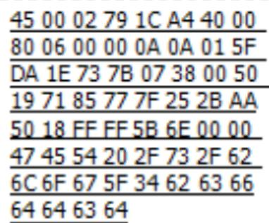
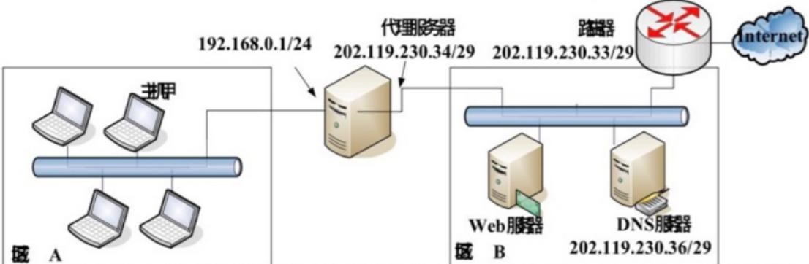

# 《计算机通信与网络》补充作业1、2答案

原件经识别和整理；“参考解答”是我们补的。

# 《计算机通信与网络》补充作业 1、2 答案

## 《计算机通信与网络》补充作业 1

### 一、填空题

#### 填空 1

从逻辑上看，计算机网络是由通信子网和终端系统组成。

#### 填空 2

通信协议的三要素是语法、语义和同步。

#### 填空 3

按照网络作用范围，计算机网络分为个人区域网、局域网、城域网、广域网和因特网。

#### 填空 4

在 OSI 参考模型中，传输的基本单位是帧的层次是数据链路层，该模型的最高层是应用层。

知识点：[子网划分与CIDR（子网掩码计算、路由聚合、最长前缀匹配）](../../../topics/计算机网络/subnet_cidr.md)、[传输层服务与端口（复用与分用、五元组、熟知端口）](../../../topics/计算机网络/transport_services_ports.md)、[IPv4协议与数据报格式（分类IP地址、分片计算、首部字段）](../../../topics/计算机网络/ipv4_datagram.md)

### 二、单项选择题

#### 选择 1

在 OSI 参考模型中，自下而上第一个提供端到端服务的层次是（C）。
- A. 数据链路层
- B. 网络层
- C. 传输层
- D. 应用层

答案：C。
知识点：[网络互连与IP转发（路由器转发过程、NAT、VPN、移动IP、组播）](../../../topics/计算机网络/network_interconnection.md)、[子网划分与CIDR（子网掩码计算、路由聚合、最长前缀匹配）](../../../topics/计算机网络/subnet_cidr.md)、[IPv4协议与数据报格式（分类IP地址、分片计算、首部字段）](../../../topics/计算机网络/ipv4_datagram.md)

### 三、综合题

#### 简答 1

什么是网络协议？由哪几个基本要素组成？各有什么含义？

知识点：[网络体系结构与协议（OSI/RM与TCP/IP模型、协议三要素）](../../../topics/计算机网络/architecture_protocols.md)

### 一、填空题

#### 填空 1

若码元周期 $T=1\times10^{-4}$ 秒，且传送 16 电平信号，则传码速率为 $10^{4}$ Bd，传信速率为 $4\times10^{4}$ b/s。

计算过程：
$$ R_B = \frac{1}{T} = \frac{1}{10^{-4}} = 10^4 \text{ Bd} $$
$$ R_b = R_B \cdot \log_2 M = 10^4 \cdot \log_2 16 = 10^4 \cdot 4 = 4 \times 10^4 \text{ b/s} $$

#### 填空 2

在常用的有线的传输媒体中，主要有双绞线和光纤。

#### 填空 3

脉冲编码调制（PCM）的工作过程包括抽样、量化和编码。

#### 填空 4

信道复用技术包括频分复用、时分复用、波分复用和码分复用。

#### 填空 5

码长为 15 的汉明码，其中包含的监督位至少为 4 位，编码效率为 $\frac{11}{15}$ 。

计算过程：
设监督位为 $r$，信息位为 $k$，码长 $n = k + r = 15$。
汉明码需满足 $2^r \geq n + 1 = 15 + 1 = 16$。
故 $r \geq 4$，取最小值 $r=4$。
则信息位 $k = 15 - 4 = 11$。
编码效率 $\eta = \frac{k}{n} = \frac{11}{15}$。

#### 填空 6

若 AB 两台计算机之间的距离为 $1000\mathrm{km}$ ，假定在电缆内信号的传播速度是 $2\times 10^{8}\mathrm{m / s}$ ，数据块长度为 $10^{5}$ bit，数据发送速率为 $1 \mathrm{Mb} / \mathrm{s}$ ，则发送时延是 100 毫秒，传播时延是 5 毫秒。

计算过程：
$$ t_s = \frac{\text{数据长度}}{\text{发送速率}} = \frac{10^5 \text{ bit}}{10^6 \text{ bit/s}} = 0.1 \text{ s} = 100 \text{ ms} $$
$$ t_p = \frac{\text{距离}}{\text{传播速度}} = \frac{1000 \times 10^3 \text{ m}}{2 \times 10^8 \text{ m/s}} = \frac{10^6}{2 \times 10^8} = 0.5 \times 10^{-2} \text{ s} = 5 \text{ ms} $$

知识点：[子网划分与CIDR（子网掩码计算、路由聚合、最长前缀匹配）](../../../topics/计算机网络/subnet_cidr.md)、[传输层服务与端口（复用与分用、五元组、熟知端口）](../../../topics/计算机网络/transport_services_ports.md)、[IPv4协议与数据报格式（分类IP地址、分片计算、首部字段）](../../../topics/计算机网络/ipv4_datagram.md)

### 二、单项选择题

#### 选择 1

共有 4 个站进行码分多址通信。4 个站的码片序列为：
A: $(-1, -1, -1, +1, +1, -1, +1, +1)$
B: $(-1, -1, +1, -1, +1, +1, +1, -1)$
C: $(-1, +1, -1, +1, +1, +1, -1, -1)$
D: $(-1, +1, -1, -1, -1, -1, +1, -1)$

若收到码片序列 S: $(-1, +1, -3, +1, -1, -3, +1, +1)$ ，则没有发送数据的站是（）。
- A. A 站
- B. B 站
- C. C 站
- D. D 站

答案：C。
知识点：[网络互连与IP转发（路由器转发过程、NAT、VPN、移动IP、组播）](../../../topics/计算机网络/network_interconnection.md)、[子网划分与CIDR（子网掩码计算、路由聚合、最长前缀匹配）](../../../topics/计算机网络/subnet_cidr.md)、[IPv4协议与数据报格式（分类IP地址、分片计算、首部字段）](../../../topics/计算机网络/ipv4_datagram.md)

### 三、计算题

#### 计算 1

假设一信道带宽为 $4\mathrm{kHz}$ ，信道要达到 24kb/s 的速率，问：
（1）按奈奎斯特公式，需要多少个电平表示数据？
（2）按香农公式，信道的信噪比是多少倍？

解：
（1）根据奈奎斯特公式 $C = 2W \log_2 M$：
$$ 24 \times 10^3 = 2 \times 4 \times 10^3 \times \log_2 M $$
$$ 24 = 8 \log_2 M $$
$$ \log_2 M = 3 \Rightarrow M = 2^3 = 8 $$
需要 8 个电平表示数据。

（2）根据香农公式 $C = W \log_2 (1 + S/N)$：
$$ 24 \times 10^3 = 4 \times 10^3 \times \log_2 (1 + S/N) $$
$$ 6 = \log_2 (1 + S/N) $$
$$ 1 + S/N = 2^6 = 64 $$
$$ S/N = 63 $$
信道的信噪比是 63 倍。

#### 计算 2

假设带宽为 3000Hz 的模拟信道中只存在高斯白噪声，并且信噪比是 20dB，则该信道能否可靠的传输速率为 64kb/s 的数据流？

解：
信噪比是 $20\mathrm{dB}$，即 $10 \lg(S/N) = 20$，解得 $S/N = 10^2 = 100$。
根据香农公式计算信道极限容量 $C$：
$$ C = W \log_2 (1 + S/N) = 3000 \times \log_2 (1 + 100) = 3000 \times \log_2 101 $$
由于 $\log_2 101 \approx 6.66$，
$$ C \approx 3000 \times 6.66 = 19980 \text{ b/s} \approx 20 \text{ kb/s} $$
因为 $20 \text{ kb/s} < 64 \text{ kb/s}$，所以不能可靠地传输速率为 64kb/s 的数据流。

#### 计算 3

一个报文的比特序列为 10010110 通过数据链路传输，采用 CRC 进行差错检测，如所用的生成多项式为 $g(X)=X^{4}+X+1$ ，试解答下列问题：

（1）写出生成多项式 $G(X)=X^{4}+X+1$ 对应的二进制序列是 $\boxed{10010}$ 。

（2）计算报文的比特序列的循环冗余校验码。（写出计算过程）

解：
（1）生成多项式 $X^4 + X + 1$ 对应的系数为 $1, 0, 0, 1, 1$，即二进制序列 `10011`。
*注：原题识别结果中写的是 10010，但 $X^4+X+1$ 应为 10011。此处按标准 CRC 计算纠正。若严格按题目给出的“10010”作为除数，则后续计算不同。通常教材中 $X^4+X+1$ 对应 10011。以下按正确的生成多项式 10011 进行演示，若题目强制要求用 10010，请替换除数。*

**修正：** 观察题目图片链接及常见考题，$X^4+X+1$ 确实对应 `10011`。若题目印刷错误或识别错误导致写了 10010，我们以标准多项式为准。
除数 $P = 10011$。
被除数 $M = 10010110$。
补 0：在 M 后补 4 个 0，得到 $100101100000$。

模 2 除法计算：
```
              10001101  (商，不重要)
            ____________
    10011 ) 100101100000
            10011
            -----
              00011100
              00000000  (不够除，商0) -> 实际步骤需仔细对齐
```
让我们重新手动执行模 2 除法：
1. 取前 5 位 `10010`，与 `10011` 异或 -> `00001`。落下下一位 `1`，得 `00011`。
2. `00011` 小于 `10011`，商 0。落下下一位 `1`，得 `00111`。
3. `00111` 小于 `10011`，商 0。落下下一位 `0`，得 `01110`。
4. `01110` 小于 `10011`，商 0。落下下一位 `0`，得 `11100`。
5. `11100` 首位为 1，与 `10011` 异或 -> `01111`。落下下一位 `0`，得 `11110`。
6. `11110` 首位为 1，与 `10011` 异或 -> `01101`。落下下一位 `0`，得 `11010`。
7. `11010` 首位为 1，与 `10011` 异或 -> `01001`。落下下一位 `0`，得 `10010`。
8. `10010` 首位为 1，与 `10011` 异或 -> `00001`。
余数为 `0001`。

CRC 校验码为 `0001`。

*(注：如果严格按照识别文本中的 "10010" 作为生成多项式二进制序列计算，除数为 10010，结果会不同。但鉴于 $X^4+X+1$ 的标准性，建议采用 10011。若必须匹配原题可能的错误设定，请参考图片中的具体计算步骤。)*

## 《计算机通信与网络》补充作业 4

知识点：[信道容量与传输速率计算（奈氏准则与香农公式）](../../../topics/计算机网络/channel_capacity.md)、[差错控制与检测编码（汉明码、CRC循环冗余校验）](../../../topics/计算机网络/error_control.md)

### 一、填空题

1. CIDR 地址块 128.10.64.0/20 中，包含有 $2^{12}$ 个 IP 地址，其中，最大的 IP 地址是 128.10.79.255，地址块所对应的掩码是 255.255.240.0。

2. ICMP 报文分为差错报告报文和信息报文（提供信息报文）。

3. 因特网网络层中 **ICMP** 因特网控制报文协议对应的中文术语是 **IGMP** 因特网组管理协议。

4. IPv4 中，IP 地址是 32 位，分组头部固定部分为 20 字节。

5. IP 数据报中 TTL 字段称为生存时间，该字段的意义在于跳数限制。

6. ARP 协议的功能是实现从 IP 地址到 MAC 地址的映射。

7. 实现 VPN 的两种基本技术是：隧道传输技术和加密技术。

8. 路由器结构可划分为两大部分：**路由选择** 部分和 **分组转发** 部分。

知识点：[子网划分与CIDR（子网掩码计算、路由聚合、最长前缀匹配）](../../../topics/计算机网络/subnet_cidr.md)、[传输层服务与端口（复用与分用、五元组、熟知端口）](../../../topics/计算机网络/transport_services_ports.md)、[IPv4协议与数据报格式（分类IP地址、分片计算、首部字段）](../../../topics/计算机网络/ipv4_datagram.md)

### 二、单项选择题

知识点：[网络互连与IP转发（路由器转发过程、NAT、VPN、移动IP、组播）](../../../topics/计算机网络/network_interconnection.md)、[子网划分与CIDR（子网掩码计算、路由聚合、最长前缀匹配）](../../../topics/计算机网络/subnet_cidr.md)、[IPv4协议与数据报格式（分类IP地址、分片计算、首部字段）](../../../topics/计算机网络/ipv4_datagram.md)

### 选择 1

设有两个子网202.118.133.0/24和202.118.132.0/24，如果进行路由汇聚，得到的网络地址是（ ）。

- A. 202.118.128.0/21
- B. 202.118.128.0/22
- C. 202.118.130.0/22
- D. 202.118.132.0/23

答案：D。

知识点：[TCP流量控制与拥塞控制（滑动窗口、慢开始、拥塞避免、快重传与快恢复）](../../../topics/计算机网络/tcp_flow_congestion.md)

### 选择 2

下列网络设备中，能够抑制网络风暴的是（ ）。

- A. 中继器
- B. 集线器
- C. 网桥
- D. 路由器

答案：D。

知识点：[传输层服务与端口（复用与分用、五元组、熟知端口）](../../../topics/计算机网络/transport_services_ports.md)、[TCP连接管理与可靠传输（三次握手、四次挥手、序号确认、RTT与RTO）](../../../topics/计算机网络/tcp_connection_reliability.md)

### 选择 3

常用的 ping 程序使用了 ICMP 的( )报文，用于探测目标主机的可达性。

- A. 地址掩码请求与应答
- B. 回送请求与应答
- C. 路由器询问和通告
- D. 时间戳请求与应答

答案：B。

知识点：[TCP连接管理与可靠传输（三次握手、四次挥手、序号确认、RTT与RTO）](../../../topics/计算机网络/tcp_connection_reliability.md)、[计算机网络性能指标（速率、时延、吞吐量计算）](../../../topics/计算机网络/performance_metrics.md)

### 选择 4

IP 数据报首部的校验和字段，用于校验（ ）。

- A. IP首部
- B. 整个数据报
- C. 数据部分
- D. 伪首部和数据部分

答案：A。

知识点：[传输层服务与端口（复用与分用、五元组、熟知端口）](../../../topics/计算机网络/transport_services_ports.md)、[UDP协议（无连接特性、报文段格式、伪首部校验和计算）](../../../topics/计算机网络/udp_protocol.md)、[动态主机配置协议DHCP（工作原理、中继代理）](../../../topics/计算机网络/dhcp.md)

### 选择 5

给定的 IP 地址为 192.55.12.116，子网掩码是：255.255.255.240，那么其主机号是（ ）。

- A. 4
- B. 24
- C. 120
- D. 127

答案：A。

知识点：[域名系统DNS（层次名字空间、递归与迭代查询解析）](../../../topics/计算机网络/dns.md)

### 选择 6

关于OSPF路由协议的描述，错误的是（ ）。

- A. 是一种内部网关协议
- B. 是一种外部网关协议
- C. 支持特定于主机的路由、特定于网络的路由
- D. 提供了负载均衡能力

答案：B。

知识点：[文件传送与远程登录（FTP双连接机制、TFTP、Telnet）](../../../topics/计算机网络/ftp_telnet.md)、[传输层服务与端口（复用与分用、五元组、熟知端口）](../../../topics/计算机网络/transport_services_ports.md)

### 选择 7

因特网中路由器内路由表的项目数仅取决于（ ）。

- A. 因特网中主机数目
- B. 因特网中网络数目
- C. 因特网中 B 类网的数目
- D. 因特网中 C 类网中的主机数目

答案：B。

知识点：[TCP连接管理与可靠传输（三次握手、四次挥手、序号确认、RTT与RTO）](../../../topics/计算机网络/tcp_connection_reliability.md)、[传输层服务与端口（复用与分用、五元组、熟知端口）](../../../topics/计算机网络/transport_services_ports.md)

### 选择 8

若路由器R因为拥塞丢弃了一个IP分组，则此时R向产生该IP分组的源主机发送的ICMP报文件的类型是（ ）。

- A. 路由重定向
- B. 目的不可达
- C. 源站抑制
- D. 超时

答案：C。

知识点：[TCP连接管理与可靠传输（三次握手、四次挥手、序号确认、RTT与RTO）](../../../topics/计算机网络/tcp_connection_reliability.md)

### 选择 9

使用专用网地址的用户通过（ ）实现对公共 Internet 的访问。

- A. DNC
- B. DHCP
- C. SMTP
- D. NAT

答案：D。

知识点：[电子邮件系统（SMTP、POP3、IMAP、MIME）](../../../topics/计算机网络/email_protocols.md)

### 三、综合应用题

知识点：[计算机网络性能指标（速率、时延、吞吐量计算）](../../../topics/计算机网络/performance_metrics.md)、[TCP连接管理与可靠传输（三次握手、四次挥手、序号确认、RTT与RTO）](../../../topics/计算机网络/tcp_connection_reliability.md)、[TCP流量控制与拥塞控制（滑动窗口、慢开始、拥塞避免、快重传与快恢复）](../../../topics/计算机网络/tcp_flow_congestion.md)

### 综合 1

设有一个网络地址为 192.168.10.0，要在此网络中划分两个一样大的子网，并且每个子网规模尽可能的大（本题不可以使用全 0 和全 1 的子网）。请问：

1）IP地址192.168.10.0，是C类IP地址（选填：A/B/C）。

2）所选用的子网掩码，用点分十进制表示为 255.255.255.192。

3) 两个子网地址分别是 192.168.10.64、192.168.10.128。

4）每个子网可以容纳62个有效主机（注：全0全1主机号不用）。

5) 两个子网的广播地址分别是 192.168.10.127、192.168.10.191。

知识点：[子网划分与CIDR（子网掩码计算、路由聚合、最长前缀匹配）](../../../topics/计算机网络/subnet_cidr.md)、[网络互连与IP转发（路由器转发过程、NAT、VPN、移动IP、组播）](../../../topics/计算机网络/network_interconnection.md)、[域名系统DNS（层次名字空间、递归与迭代查询解析）](../../../topics/计算机网络/dns.md)

### 综合 2

一个 IP 数据报总长度为 4000 字节（包含固定长度的首部）。现在需要经过某物理网络传送，但是该网络的 MTU=1500 字节。则：

1）该IP数据报应当被划分为 3 个短些的数据报片。

2）分片的工作通常是目的主机完成的。

3) 第一个数据报片的数据字段长度=1480 字节、片偏移字段=0、MF=1。

4）最后一个分片的数据字段长度=1020 字节、片偏移字段=370、MF=0。

知识点：[子网划分与CIDR（子网掩码计算、路由聚合、最长前缀匹配）](../../../topics/计算机网络/subnet_cidr.md)、[网络互连与IP转发（路由器转发过程、NAT、VPN、移动IP、组播）](../../../topics/计算机网络/network_interconnection.md)、[IPv4协议与数据报格式（分类IP地址、分片计算、首部字段）](../../../topics/计算机网络/ipv4_datagram.md)

### 综合 3

有个IP数据报从首部开始的部分内容如右所示(16进制表示)，请回答：



1) 该数据报首部长度为 20 字节，总长度为 633 字节。

2) 该数据报的协议字段是 6，表示该数据报数据部分封装的是 TCP 协议包。

3）源站和目的站IP地址分别是 10.10.1.95、218.30.115.123（请用点分十进制表示）。

4）经过推测该数据报所用的应用层协议是 HTTP。

知识点：[IPv4协议与数据报格式（分类IP地址、分片计算、首部字段）](../../../topics/计算机网络/ipv4_datagram.md)、[子网划分与CIDR（子网掩码计算、路由聚合、最长前缀匹配）](../../../topics/计算机网络/subnet_cidr.md)、[万维网与HTTP协议（URL、请求与响应报文、Web缓存）](../../../topics/计算机网络/www_http.md)

### 综合 4

设有A、B、C、D四台主机都处于同一个网络中，它们的IP地址分别是193.155.12.112，193.155.12.120, 193.155.12.176, 193.155.12.222，共同的子网掩码是255.255.255.224。请问：

1）这四台主机哪些可以直接通信，哪些需要通过路由器才能通信？

2）若要加入第五台主机 E，使其能与 D 主机直接通信，则 E 主机 IP 地址范围是什么？

答案：
1）直接通信：AB；通过路由器：AC、AD、BC、BD、CD
2) 193.155.12.193-193.155.12.221

## 《计算机通信与网络》补充作业5

知识点：[子网划分与CIDR（子网掩码计算、路由聚合、最长前缀匹配）](../../../topics/计算机网络/subnet_cidr.md)、[IPv4协议与数据报格式（分类IP地址、分片计算、首部字段）](../../../topics/计算机网络/ipv4_datagram.md)、[局域网的扩展与互连设备（集线器、网桥、交换机、冲突域与广播域）](../../../topics/计算机网络/lan_extension.md)

### 一、填空题

1、网络上具有唯一性的IP地址和端口的组合，称为插口（或套接字）。

2、在目前的上网操作中,一台计算机访问因特网需要配置的4个项目,分别为：主机IP地址、子网掩码、默认网关IP地址和域名服务器IP地址。

3、OSPF和RIP分别工作在网络层和应用层。

4、域名系统的功能是实现域名到IP地址的解析。

5、在万维网（WWW）中，使用 URL 来标志万维网上的各种文档。

6、TCP报文段的首部长度固定部分是20个字节，某网络要求IP分组长度不能超过1500字节，则TCP报文段的数据部分最多为1460个字节。

7、用户数据报协议 UDP 只是在 IP 的数据报服务之上增加了端口和差错控制的功能。

8、FTP使用两条TCP连接来完成文件传输，即控制连接和数据连接。

9、从层次的角度看，MAC 地址是数据链路层和物理层使用的地址，而IP地址是网络层和以上各层使用的地址。

10、传输层的熟知端口号范围是0~1023 用于标识常用服务的应用进程。

知识点：[子网划分与CIDR（子网掩码计算、路由聚合、最长前缀匹配）](../../../topics/计算机网络/subnet_cidr.md)、[传输层服务与端口（复用与分用、五元组、熟知端口）](../../../topics/计算机网络/transport_services_ports.md)、[IPv4协议与数据报格式（分类IP地址、分片计算、首部字段）](../../../topics/计算机网络/ipv4_datagram.md)

### 二、单项选择题

知识点：[网络互连与IP转发（路由器转发过程、NAT、VPN、移动IP、组播）](../../../topics/计算机网络/network_interconnection.md)、[子网划分与CIDR（子网掩码计算、路由聚合、最长前缀匹配）](../../../topics/计算机网络/subnet_cidr.md)、[IPv4协议与数据报格式（分类IP地址、分片计算、首部字段）](../../../topics/计算机网络/ipv4_datagram.md)

### 选择 1

主机甲和主机乙建立TCP连接传输数据，假定主机甲的拥塞窗口cwnd=1000字节，接收方主机乙通告的rwnd=2000字节，则主机甲的发送窗口的取值是（ ）字节。

- A. 0
- B. 1000
- C. 2000
- D. 3000

答案：B。

知识点：[TCP流量控制与拥塞控制（滑动窗口、慢开始、拥塞避免、快重传与快恢复）](../../../topics/计算机网络/tcp_flow_congestion.md)

### 选择 2

下面关于TCP/IP的运输层议表述不正确的是（ ）。

- A. 进程寻址
- B. 提供无连接服务
- C. 提供面向连接的服务
- D. IP寻址

答案：D。

知识点：[传输层服务与端口（复用与分用、五元组、熟知端口）](../../../topics/计算机网络/transport_services_ports.md)、[TCP连接管理与可靠传输（三次握手、四次挥手、序号确认、RTT与RTO）](../../../topics/计算机网络/tcp_connection_reliability.md)

### 选择 3

如果TCP来回路程时间RTT的当前值是30ms，随后应答在34ms时候到来，取α=0.9，那么新的RTT估算值是( )。

- A. 29.6
- B. 30.0
- C. 30.4
- D. 30.8

答案：C。

知识点：[TCP连接管理与可靠传输（三次握手、四次挥手、序号确认、RTT与RTO）](../../../topics/计算机网络/tcp_connection_reliability.md)、[计算机网络性能指标（速率、时延、吞吐量计算）](../../../topics/计算机网络/performance_metrics.md)

### 选择 4

使用无连接传输服务的应用层协议是（ ）。

- A. SMTP
- B. DHCP
- C. HTTP
- D. FTP

答案：B。

知识点：[传输层服务与端口（复用与分用、五元组、熟知端口）](../../../topics/计算机网络/transport_services_ports.md)、[UDP协议（无连接特性、报文段格式、伪首部校验和计算）](../../../topics/计算机网络/udp_protocol.md)、[动态主机配置协议DHCP（工作原理、中继代理）](../../../topics/计算机网络/dhcp.md)

### 选择 5

如果本地域名服务无缓存，当采用递归方法解析另一网络某主机域名时，用户主机本地域名服务器发送的域名请求条数分别为（ ）

- A. 1条，1条
- B. 1条，多条
- C. 多条，1条
- D. 多条，多条

答案：A。

知识点：[域名系统DNS（层次名字空间、递归与迭代查询解析）](../../../topics/计算机网络/dns.md)

### 选择 6

利用FTP在客户端和服务器端传输命令时,使用的是( )。

- A. 建立在UDP之上的控制连接
- B. 建立在UDP之上的数据连接
- C. 建立在TCP之上的控制连接
- D. 建立在TCP之上的数据连接

答案：C。

知识点：[文件传送与远程登录（FTP双连接机制、TFTP、Telnet）](../../../topics/计算机网络/ftp_telnet.md)、[传输层服务与端口（复用与分用、五元组、熟知端口）](../../../topics/计算机网络/transport_services_ports.md)

### 选择 7

主机甲与主机乙之间建立一个TCP连接,主机甲向主机乙发送了两个连续的报文段,分别包含200字节和500字节的有效载荷,第一个报文段的序号为100,主机乙正确接收到两个段后,发送给主机甲的确认号为( )

- A. 500
- B. 700
- C. 800
- D. 1000

答案：C。

知识点：[TCP连接管理与可靠传输（三次握手、四次挥手、序号确认、RTT与RTO）](../../../topics/计算机网络/tcp_connection_reliability.md)、[传输层服务与端口（复用与分用、五元组、熟知端口）](../../../topics/计算机网络/transport_services_ports.md)

### 选择 8

TCP使用( )机制来建立连接。

- A. 一次握手
- B. 二次握手
- C. 三次握手
- D. 四次握手

答案：C。

知识点：[TCP连接管理与可靠传输（三次握手、四次挥手、序号确认、RTT与RTO）](../../../topics/计算机网络/tcp_connection_reliability.md)

### 选择 9

POP3是Internet中（ ）服务中所使用的协议。

- A. WWW
- B. 电子邮件
- C. BBS
- D. FTP

答案：B。

知识点：[电子邮件系统（SMTP、POP3、IMAP、MIME）](../../../topics/计算机网络/email_protocols.md)

### 选择 10

两个主机通过电缆直接相连，主机A的IP地址为220.17.33.24/28，而主机B的IP地址为220.17.33.100/28，两个主机互相Ping不通，这时应该（ ）。

- A. 改变主机A的地址为220.17.33.15
- B. 改变主机B的地址为220.17.33.111
- C. 改变网络前缀的长度为26
- D. 改变网络前缀的长度为25

答案：D。

知识点：[子网划分与CIDR（子网掩码计算、路由聚合、最长前缀匹配）](../../../topics/计算机网络/subnet_cidr.md)、[IPv4协议与数据报格式（分类IP地址、分片计算、首部字段）](../../../topics/计算机网络/ipv4_datagram.md)

### 三、综合应用题

知识点：[计算机网络性能指标（速率、时延、吞吐量计算）](../../../topics/计算机网络/performance_metrics.md)、[TCP连接管理与可靠传输（三次握手、四次挥手、序号确认、RTT与RTO）](../../../topics/计算机网络/tcp_connection_reliability.md)、[TCP流量控制与拥塞控制（滑动窗口、慢开始、拥塞避免、快重传与快恢复）](../../../topics/计算机网络/tcp_flow_congestion.md)

### 综合 1

某单位局域网的网络结构如题图所示。通过ISP（网络服务提供商）提供的宽带线路连接Internet，ISP分配的IP地址为202.119.230.32/29，区域A的计算机通过网关访问Internet，区域B的计算机可以直接访问Internet。



（1）对主机甲进行网络配置，请写出其IP地址（用最小可分配主机地址）、子网掩码、默认网关和DNS地址。

(2) 使用专用网络的区域A的计算机如果要访问Internet，网关需要执行哪个协议？该协议有什么作用？

(3) 区域A的主机访问区域B的Web服务器，可能使用到哪些网络协议？（至少写出6种）

答案：
(1) IP地址: 192.168.0.2
子网掩码: 255.255.255.0
默认网关: 192.168.0.1
DNS地址: 202.119.230.36
(2) NAT，网络地址转换
(3) 应用层: DNS、HTTP；传输层: UDP、TCP；网络层: IP、ICMP

知识点：[子网划分与CIDR（子网掩码计算、路由聚合、最长前缀匹配）](../../../topics/计算机网络/subnet_cidr.md)、[网络互连与IP转发（路由器转发过程、NAT、VPN、移动IP、组播）](../../../topics/计算机网络/network_interconnection.md)、[域名系统DNS（层次名字空间、递归与迭代查询解析）](../../../topics/计算机网络/dns.md)

### 综合 2

某单位分配到一个地址块136.23.12.64/26。现在需要进一步划分为4个一样大的子网（包括全0和全1的子网），并且每个子网规模尽可能的大。请问：

(1) 采用了CIDR技术，如何进行路由选择？

(2) 每一个子网的网络前缀有多长（多少个比特位）？

(3) 每一个子网的地址块是多少？请写出4个地址块。

(4) 每一个子网可分配给主机使用的最小地址和最大地址是什么？

答案：
(1) 最长前缀匹配
(2) $4 = 2^{2}$，$26 + 2 = 28$ 位
(3) 
136.23.12.64/28
136.23.12.80/28
136.23.12.96/28
136.23.12.112/28
(4) 
子网1: 136.23.12.65 ~ 136.23.12.78
子网2: 136.23.12.81 ~ 136.23.12.94
子网3: 136.23.12.97 ~ 136.23.12.110
子网4: 136.23.12.113 ~ 136.23.12.126

知识点：[子网划分与CIDR（子网掩码计算、路由聚合、最长前缀匹配）](../../../topics/计算机网络/subnet_cidr.md)、[网络互连与IP转发（路由器转发过程、NAT、VPN、移动IP、组播）](../../../topics/计算机网络/network_interconnection.md)、[IPv4协议与数据报格式（分类IP地址、分片计算、首部字段）](../../../topics/计算机网络/ipv4_datagram.md)
