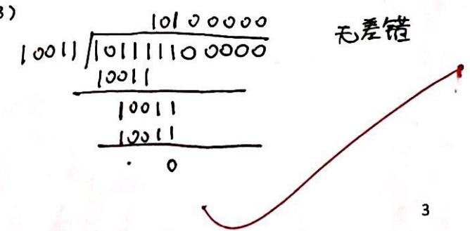

# 《计算机通信与网络》补充作业参考答案（修正版）

原件经识别和整理；“参考解答”是我们补的。

## 一、填空题

### 填空 1

从逻辑上看，计算机网络是由\_\_通信子网\_\_和\_\_终端系统\_\_组成。

知识点：[传输层服务与端口（复用与分用、五元组、熟知端口）](../../../topics/计算机网络/transport_services_ports.md)

### 填空 2

通信协议的三要素是\_\_语法\_\_、\_\_语义\_\_和同步。

知识点：[网络互连与IP转发（路由器转发过程、NAT、VPN、移动IP、组播）](../../../topics/计算机网络/network_interconnection.md)、[子网划分与CIDR（子网掩码计算、路由聚合、最长前缀匹配）](../../../topics/计算机网络/subnet_cidr.md)、[域名系统DNS（层次名字空间、递归与迭代查询解析）](../../../topics/计算机网络/dns.md)

### 填空 3

按照网络作用范围，计算机网络分为个人区域网、局域网、城域网、广域网和因特网。

知识点：[互联网路由选择协议（RIP距离向量、OSPF链路状态、BGP）](../../../topics/计算机网络/routing_protocols.md)、[网络体系结构与协议（OSI/RM与TCP/IP模型、协议三要素）](../../../topics/计算机网络/architecture_protocols.md)

### 填空 4

在 OSI 参考模型中，传输的基本单位是帧的层次是数据链路层，该模型的最高层是应用层。

## 二、单项选择题

知识点：[域名系统DNS（层次名字空间、递归与迭代查询解析）](../../../topics/计算机网络/dns.md)

### 选择 1

在 OSI 参考模型中，自下而上第一个提供端到端服务的层次是（ ）。

- A. 数据链路层
- B. 网络层
- C. 传输层
- D. 应用层

答案：C。

知识点：[IPv4协议与数据报格式（分类IP地址、分片计算、首部字段）](../../../topics/计算机网络/ipv4_datagram.md)

### 选择 2

若网络形状是由站点和连接站点的链路组成的一个闭合环，则称这种拓扑结构为（ ）。

- A. 星形拓扑
- B. 总线拓扑
- C. 环形拓扑
- D. 树形拓扑

答案：C。

知识点：[传输层服务与端口（复用与分用、五元组、熟知端口）](../../../topics/计算机网络/transport_services_ports.md)、[UDP协议（无连接特性、报文段格式、伪首部校验和计算）](../../../topics/计算机网络/udp_protocol.md)、[TCP连接管理与可靠传输（三次握手、四次挥手、序号确认、RTT与RTO）](../../../topics/计算机网络/tcp_connection_reliability.md)

### 选择 3

在 OSI 参考模型中，物理层的主要功能是（ ）。

- A. 数据链路的访问控制和管理
- B. 透明地传输比特流
- C. 在物理实体间传送数据帧
- D. 发送和接收用户数据报文

答案：B。

知识点：[万维网与HTTP协议（URL、请求与响应报文、Web缓存）](../../../topics/计算机网络/www_http.md)、[域名系统DNS（层次名字空间、递归与迭代查询解析）](../../../topics/计算机网络/dns.md)、[TCP连接管理与可靠传输（三次握手、四次挥手、序号确认、RTT与RTO）](../../../topics/计算机网络/tcp_connection_reliability.md)

### 选择 4

下面关于计算机网络的体系结构和协议的叙述，不正确的是（ ）。

- A. 计算机网络体系结构是计算机网络及其部件所应完成的功能的精确定义
- B. TCP/IP 体系结构中的应用层对应于 OSI 体系结构中的表示层和应用层
- C. 网络协议是为进行网络中的数据交换而建立的规则、标准和约定
- D. 网络协议是“水平”的概念

答案：B。

知识点：[传输层服务与端口（复用与分用、五元组、熟知端口）](../../../topics/计算机网络/transport_services_ports.md)、[万维网与HTTP协议（URL、请求与响应报文、Web缓存）](../../../topics/计算机网络/www_http.md)、[电子邮件系统（SMTP、POP3、IMAP、MIME）](../../../topics/计算机网络/email_protocols.md)

### 选择 5

下列选项中，不属于网络体系结构中所描述的内容是（ ）。

- A. 协议内部实现细节
- B. 网络层次
- C. 每一层使用协议
- D. 每层须完成的功能

答案：A。

## 三、综合题

知识点：[域名系统DNS（层次名字空间、递归与迭代查询解析）](../../../topics/计算机网络/dns.md)

### 综合 1

什么是网络协议？由哪几个基本要素组成？各有什么含义？

知识点：[子网划分与CIDR（子网掩码计算、路由聚合、最长前缀匹配）](../../../topics/计算机网络/subnet_cidr.md)、[网络互连与IP转发（路由器转发过程、NAT、VPN、移动IP、组播）](../../../topics/计算机网络/network_interconnection.md)、[网络体系结构与协议（OSI/RM与TCP/IP模型、协议三要素）](../../../topics/计算机网络/architecture_protocols.md)

### 综合 2

画出 OSI-RM 模型的结构图，并简要说明下三层的功能。

## 一、填空题

知识点：[子网划分与CIDR（子网掩码计算、路由聚合、最长前缀匹配）](../../../topics/计算机网络/subnet_cidr.md)、[IPv4协议与数据报格式（分类IP地址、分片计算、首部字段）](../../../topics/计算机网络/ipv4_datagram.md)、[网络互连与IP转发（路由器转发过程、NAT、VPN、移动IP、组播）](../../../topics/计算机网络/network_interconnection.md)

### 填空 1

在 HDLC 中，帧的类型可以分为信息帧、监督帧（S 帧）和未编号帧（U 帧）三种。

知识点：[传输层服务与端口（复用与分用、五元组、熟知端口）](../../../topics/计算机网络/transport_services_ports.md)

### 填空 2

若码元周期 $T=1\times10^{-4}$ 秒，且传送 16 电平信号，则传码速率为 10000 Bd、传信速率为 $4\times10^{3}$ b/s。

知识点：[网络互连与IP转发（路由器转发过程、NAT、VPN、移动IP、组播）](../../../topics/计算机网络/network_interconnection.md)、[子网划分与CIDR（子网掩码计算、路由聚合、最长前缀匹配）](../../../topics/计算机网络/subnet_cidr.md)、[域名系统DNS（层次名字空间、递归与迭代查询解析）](../../../topics/计算机网络/dns.md)

### 填空 3

在常用的有线的传输媒体中，主要有\_\_同轴电缆\_\_、\_\_双绞线\_\_和光纤。

知识点：[互联网路由选择协议（RIP距离向量、OSPF链路状态、BGP）](../../../topics/计算机网络/routing_protocols.md)、[网络体系结构与协议（OSI/RM与TCP/IP模型、协议三要素）](../../../topics/计算机网络/architecture_protocols.md)

### 填空 4

物理层的接口有 4 个方面的特性，它们是机械特性、电气特性、功能特性和规程特性。

知识点：[域名系统DNS（层次名字空间、递归与迭代查询解析）](../../../topics/计算机网络/dns.md)

### 填空 5

脉冲编码调制（PCM）的工作过程包括抽样、量化和编码。

知识点：[万维网与HTTP协议（URL、请求与响应报文、Web缓存）](../../../topics/计算机网络/www_http.md)

### 填空 6

信道复用技术包括\_\_频分\_\_复用、时分复用、波分复用和\_\_码分复用\_\_。

知识点：[IPv4协议与数据报格式（分类IP地址、分片计算、首部字段）](../../../topics/计算机网络/ipv4_datagram.md)、[TCP连接管理与可靠传输（三次握手、四次挥手、序号确认、RTT与RTO）](../../../topics/计算机网络/tcp_connection_reliability.md)

### 填空 7

数据链路层采用连续 ARQ 协议，发送方已经发送了编号为 $0 \sim 7$ 的帧，当计时器超时，若发送方只收到 0、2、3 号帧的确认，则发送方需要重发 \_\_\_\_ 个帧。（4~7 号帧）

知识点：[UDP协议（无连接特性、报文段格式、伪首部校验和计算）](../../../topics/计算机网络/udp_protocol.md)、[IPv4协议与数据报格式（分类IP地址、分片计算、首部字段）](../../../topics/计算机网络/ipv4_datagram.md)、[传输层服务与端口（复用与分用、五元组、熟知端口）](../../../topics/计算机网络/transport_services_ports.md)

### 填空 8

对于选择 ARQ 协议，若采用 3 比特编号，则最大接收窗口尺寸为 \_\_\_\_。

知识点：[文件传送与远程登录（FTP双连接机制、TFTP、Telnet）](../../../topics/计算机网络/ftp_telnet.md)

### 填空 9

码长为 15 的汉明码，其中包含的监督位至少为 4 位，编码效率为 73.3%。$2^r-1\ge n \therefore r\ge 4$

知识点：[网络体系结构与协议（OSI/RM与TCP/IP模型、协议三要素）](../../../topics/计算机网络/architecture_protocols.md)、[局域网体系结构与IEEE 802标准（LLC与MAC子层）](../../../topics/计算机网络/lan_ieee802.md)、[IPv4协议与数据报格式（分类IP地址、分片计算、首部字段）](../../../topics/计算机网络/ipv4_datagram.md)

### 填空 10

若 AB 两台计算机之间的距离为 1000km，假定在电缆内信号的传播速度是 $2\times10^{8}$ m/s，数据块长度为 $10^{5}$ bit，数据发送速率为 1Mb/s，则发送时延是\_\_\_\_ 毫秒，传播时延是\_\_\_\_ 毫秒。

$$\frac{10^{5}\ \text{bit}}{1\ \text{Mb/s}}=0.1\ \text{s}$$

## 二、单项选择题

知识点：[TCP流量控制与拥塞控制（滑动窗口、慢开始、拥塞避免、快重传与快恢复）](../../../topics/计算机网络/tcp_flow_congestion.md)、[流量控制与可靠传输（停止等待、连续ARQ、选择ARQ及窗口尺寸）](../../../topics/计算机网络/flow_control.md)

### 选择 1

在物理层的接口特性中，用于描述各种通信事件发生顺序的是（ ）。

- A. 机械特性
- B. 电气特性
- C. 功能特性
- D. 规程特性

答案：D。

知识点：[IPv4协议与数据报格式（分类IP地址、分片计算、首部字段）](../../../topics/计算机网络/ipv4_datagram.md)

### 选择 2

采用连续 ARQ 协议的滑动窗口协议，设序号位数为 n，则发送窗口最大尺寸为（ ）。

- A. $2n-1$
- B. $2^{n}-1$
- C. $2^{n}$
- D. 1

答案：B。

知识点：[传输层服务与端口（复用与分用、五元组、熟知端口）](../../../topics/计算机网络/transport_services_ports.md)、[UDP协议（无连接特性、报文段格式、伪首部校验和计算）](../../../topics/计算机网络/udp_protocol.md)、[TCP连接管理与可靠传输（三次握手、四次挥手、序号确认、RTT与RTO）](../../../topics/计算机网络/tcp_connection_reliability.md)

### 选择 3

若数据链路的发送窗口尺寸 $W_{1}=6$，经过初始化后，发送方在发送了 3 号帧，并接到 1 号帧的确认帧后，发送方还可连续发送（ ）。

- A. 1 帧
- B. 2 帧
- C. 3 帧
- D. 4 帧

答案：D。

知识点：[万维网与HTTP协议（URL、请求与响应报文、Web缓存）](../../../topics/计算机网络/www_http.md)、[域名系统DNS（层次名字空间、递归与迭代查询解析）](../../../topics/计算机网络/dns.md)、[TCP连接管理与可靠传输（三次握手、四次挥手、序号确认、RTT与RTO）](../../../topics/计算机网络/tcp_connection_reliability.md)

### 选择 4

共有 4 个站进行码分多址通信。4 个站的码片序列为

- A：$(-1-1-1+1+1-1+1+1)$
- B：$(-1-1+1-1+1+1+1-1)$
- C：$(-1+1-1+1+1+1-1-1)$
- D：$(-1+1-1-1-1-1+1-1)$

若收到码片序列 S：$(-1+1-3+1-1-3+1+1)$，则没有发送数据的站是（ ）。

- A. A 站发送
- B. B 站发送
- C. C 站没有发送
- D. D 站发送

答案：C。

知识点：[传输层服务与端口（复用与分用、五元组、熟知端口）](../../../topics/计算机网络/transport_services_ports.md)、[万维网与HTTP协议（URL、请求与响应报文、Web缓存）](../../../topics/计算机网络/www_http.md)、[电子邮件系统（SMTP、POP3、IMAP、MIME）](../../../topics/计算机网络/email_protocols.md)

### 选择 5

在一个带宽为 4KHz、没有噪声的信道，采用 16 相调制技术传输信号时能够达到的极限数据传输速率为（ ）。

- A. 8 Kbps
- B. 24 Kbps
- C. 32 Kbps
- D. 64 Kbps

答案：C。

知识点：[域名系统DNS（层次名字空间、递归与迭代查询解析）](../../../topics/计算机网络/dns.md)

### 选择 6

工作在异步链路上的 PPP 协议采用面向（ ）的填充方式实现透明传输。

- A. 比特
- B. 字符
- C. 报文
- D. 帧

答案：B。

知识点：[文件传送与远程登录（FTP双连接机制、TFTP、Telnet）](../../../topics/计算机网络/ftp_telnet.md)、[传输层服务与端口（复用与分用、五元组、熟知端口）](../../../topics/计算机网络/transport_services_ports.md)

### 选择 7

HDLC 采用“0”比特插入法的目的是（ ）。

- A. 差错控制
- B. 链路管理
- C. 保证传输的透明性
- D. 流量控制

答案：C。

知识点：[TCP连接管理与可靠传输（三次握手、四次挥手、序号确认、RTT与RTO）](../../../topics/计算机网络/tcp_connection_reliability.md)

### 选择 8

若一个码组信息位的长度是 10 比特，如果采用汉明码校验，则所需的监督位是（ ）比特。

- A. 4
- B. 5
- C. 6
- D. 7

答案：A。

知识点：[TCP流量控制与拥塞控制（滑动窗口、慢开始、拥塞避免、快重传与快恢复）](../../../topics/计算机网络/tcp_flow_congestion.md)、[传输层服务与端口（复用与分用、五元组、熟知端口）](../../../topics/计算机网络/transport_services_ports.md)

### 选择 9

下列工作在物理层的网络设备是（ ）。

- A. 集线器
- B. 网桥
- C. 路由器
- D. 网关

答案：A。

知识点：[电子邮件系统（SMTP、POP3、IMAP、MIME）](../../../topics/计算机网络/email_protocols.md)

### 选择 10

PPP 是 Internet 中使用的点到点协议，其功能对应于 OSI/RM 的（ ）。

- A. 数据链路层
- B. 网络层
- C. 传输层
- D. 应用层

答案：A。

## 三、计算题

知识点：[子网划分与CIDR（子网掩码计算、路由聚合、最长前缀匹配）](../../../topics/计算机网络/subnet_cidr.md)、[IPv4协议与数据报格式（分类IP地址、分片计算、首部字段）](../../../topics/计算机网络/ipv4_datagram.md)

### 计算 1

某信道采用停止等待协议，单向传播延迟为 20ms，数据帧长为 160bit，忽略确认帧长和处理时间，则信道速率为多少时才能使信道的利用率达到 50%？

知识点：[计算机网络性能指标（速率、时延、吞吐量计算）](../../../topics/计算机网络/performance_metrics.md)、[流量控制与可靠传输（停止等待、连续ARQ、选择ARQ及窗口尺寸）](../../../topics/计算机网络/flow_control.md)、[数据通信系统模型与传输媒体](../../../topics/计算机网络/comm_basics_media.md)

### 计算 2

假设一信道带宽为 $4\ \text{kHz}$，信道要达到 $24\ \text{kb/s}$ 的速率，问：

(1) 按奈奎斯特公式，需要多少个电平表示数据？

(2) 按香农公式，信道的信噪比是多少倍？

答案：(1) 8 电平；(2) 63 倍。

知识点：[信道容量与传输速率计算（奈氏准则与香农公式）](../../../topics/计算机网络/channel_capacity.md)、[计算机网络性能指标（速率、时延、吞吐量计算）](../../../topics/计算机网络/performance_metrics.md)

### 计算 3

假设带宽为 $3000\ \text{Hz}$ 的模拟信道中只存在高斯白噪声，并且信噪比是 $20\ \text{dB}$，则该信道能否可靠的传输速率为 $64\ \text{kb/s}$ 的数据流？

知识点：[差错控制与检测编码（汉明码、CRC循环冗余校验）](../../../topics/计算机网络/error_control.md)

### 计算 4

一个报文的比特序列为 10010110 通过数据链路传输，采用 CRC 进行差错检测，如所用的生成多项式为 $g(X)=X^{4}+X+1$，试解答下列问题：

(1) 写出生成多项式 $G(X)=X^{4}+X+1$ 对应的二进制序列是：（0011）

(2) 计算报文的比特序列的循环冗余校验码。（写出计算过程）

(3) 简述接收方 CRC 码的检测过程。

知识点：[差错控制与检测编码（汉明码、CRC循环冗余校验）](../../../topics/计算机网络/error_control.md)

### 一、填空题

知识点：[子网划分与CIDR（子网掩码计算、路由聚合、最长前缀匹配）](../../../topics/计算机网络/subnet_cidr.md)、[IPv4协议与数据报格式（分类IP地址、分片计算、首部字段）](../../../topics/计算机网络/ipv4_datagram.md)、[ARP地址解析协议与ICMP控制报文](../../../topics/计算机网络/arp_icmp.md)

### 填空 1

CSMA/CD 协议中的 CD 是指冲突检测，CSMA/CA 协议中的 CA 是指冲突避免。

知识点：[传输层服务与端口（复用与分用、五元组、熟知端口）](../../../topics/计算机网络/transport_services_ports.md)

### 填空 2

CSMA/CD 协议的要点是载波侦听、多点接入和冲突检测。

知识点：[网络互连与IP转发（路由器转发过程、NAT、VPN、移动IP、组播）](../../../topics/计算机网络/network_interconnection.md)、[子网划分与CIDR（子网掩码计算、路由聚合、最长前缀匹配）](../../../topics/计算机网络/subnet_cidr.md)、[域名系统DNS（层次名字空间、递归与迭代查询解析）](../../../topics/计算机网络/dns.md)

### 填空 3

IEEE802 委员会将局域网的数据链路层分成两个子层，即 MAC 子层和 LLC 子层。

知识点：[互联网路由选择协议（RIP距离向量、OSPF链路状态、BGP）](../../../topics/计算机网络/routing_protocols.md)、[网络体系结构与协议（OSI/RM与TCP/IP模型、协议三要素）](../../../topics/计算机网络/architecture_protocols.md)

### 填空 4

若有 10 台计算机连到了一台 10Mbps 的集线器上，则每台计算机的平均带宽为 1 Mbps。若该 10 台计算机接到了 10Mb/s 的以太网交换机上，则每台计算机的平均带宽为 10 Mbps。

知识点：[域名系统DNS（层次名字空间、递归与迭代查询解析）](../../../topics/计算机网络/dns.md)

### 填空 5

以太网交换机的三种转发帧的方式分别是存储转发方式、直通方式和碎片隔离方式。

知识点：[万维网与HTTP协议（URL、请求与响应报文、Web缓存）](../../../topics/计算机网络/www_http.md)

### 填空 6

以太网 10BASE-T 标准中 10 指的是带宽为 10Mb/s，T 指的是双绞线。

知识点：[IPv4协议与数据报格式（分类IP地址、分片计算、首部字段）](../../../topics/计算机网络/ipv4_datagram.md)、[TCP连接管理与可靠传输（三次握手、四次挥手、序号确认、RTT与RTO）](../../../topics/计算机网络/tcp_connection_reliability.md)

### 填空 7

PPP 包括三个部分，其中用于建立、配置和管理链路层连接的协议是 LCP。

知识点：[UDP协议（无连接特性、报文段格式、伪首部校验和计算）](../../../topics/计算机网络/udp_protocol.md)、[IPv4协议与数据报格式（分类IP地址、分片计算、首部字段）](../../../topics/计算机网络/ipv4_datagram.md)、[传输层服务与端口（复用与分用、五元组、熟知端口）](../../../topics/计算机网络/transport_services_ports.md)

### 填空 8

以太网交换机转发帧的三种方式中，时延最小的方式是直通，时延最大的方式是存储转发。

知识点：[文件传送与远程登录（FTP双连接机制、TFTP、Telnet）](../../../topics/计算机网络/ftp_telnet.md)

### 二、单项选择题

知识点：[网络互连与IP转发（路由器转发过程、NAT、VPN、移动IP、组播）](../../../topics/计算机网络/network_interconnection.md)、[子网划分与CIDR（子网掩码计算、路由聚合、最长前缀匹配）](../../../topics/计算机网络/subnet_cidr.md)、[IPv4协议与数据报格式（分类IP地址、分片计算、首部字段）](../../../topics/计算机网络/ipv4_datagram.md)

### 选择 1

10BASE-5 以太网中，BASE 通常是指（B）。

- A. 异步传输
- B. 基带传输
- C. 频带传输
- D. 宽带传输

答案：B。

知识点：[IPv4协议与数据报格式（分类IP地址、分片计算、首部字段）](../../../topics/计算机网络/ipv4_datagram.md)

### 选择 2

使用集线器的以太网在物理上和逻辑上的拓扑结构分别是（B）。

- A. 星型，环型
- B. 星型，总线型
- C. 总线型，星型
- D. 树型，总线型

答案：B。

知识点：[传输层服务与端口（复用与分用、五元组、熟知端口）](../../../topics/计算机网络/transport_services_ports.md)、[UDP协议（无连接特性、报文段格式、伪首部校验和计算）](../../../topics/计算机网络/udp_protocol.md)、[TCP连接管理与可靠传输（三次握手、四次挥手、序号确认、RTT与RTO）](../../../topics/计算机网络/tcp_connection_reliability.md)

### 选择 3

下列工作在数据链路层的网络设备是（B）。

- A. 转发器
- B. 网桥
- C. 路由器
- D. 网关

答案：B。

知识点：[万维网与HTTP协议（URL、请求与响应报文、Web缓存）](../../../topics/计算机网络/www_http.md)、[域名系统DNS（层次名字空间、递归与迭代查询解析）](../../../topics/计算机网络/dns.md)、[TCP连接管理与可靠传输（三次握手、四次挥手、序号确认、RTT与RTO）](../../../topics/计算机网络/tcp_connection_reliability.md)

### 选择 4

下列有关虚拟局域网 VLAN 概念描述中，说法错误的是（A）。

- A. VLAN 是一种新型的局域网
- B. 建立 VLAN 需要使用交换机
- C. VLAN 以软件方式来实现逻辑工作组的划分与管理
- D. 逻辑工作组中的节点组成不受物理位置的限制

答案：A。

知识点：[传输层服务与端口（复用与分用、五元组、熟知端口）](../../../topics/计算机网络/transport_services_ports.md)、[万维网与HTTP协议（URL、请求与响应报文、Web缓存）](../../../topics/计算机网络/www_http.md)、[电子邮件系统（SMTP、POP3、IMAP、MIME）](../../../topics/计算机网络/email_protocols.md)

### 选择 5

设利用 IEEE802.3 协议局域网传送 ASCII 码信息“NJUPT”，若封装成 MAC 帧格式，需要填充（B）个字节。46 - 5 = 41

- A. 0
- B. 41
- C. 46
- D. 64

答案：B。

知识点：[域名系统DNS（层次名字空间、递归与迭代查询解析）](../../../topics/计算机网络/dns.md)

### 选择 6

下列属于随机介质访问控制的是（D）。

- A. 频分多路复用
- B. 码分多路复用
- C. 令牌传递
- D. CSMA 协议

答案：D。

知识点：[文件传送与远程登录（FTP双连接机制、TFTP、Telnet）](../../../topics/计算机网络/ftp_telnet.md)、[传输层服务与端口（复用与分用、五元组、熟知端口）](../../../topics/计算机网络/transport_services_ports.md)

### 选择 7

设以太网发送数据的速率为 $10 \mathrm{Mbps}$，采用曼彻斯特编码时，时钟频率为（B）MHz。

- A. 10
- B. 20
- C. 30
- D. 可变的

答案：B。

知识点：[TCP连接管理与可靠传输（三次握手、四次挥手、序号确认、RTT与RTO）](../../../topics/计算机网络/tcp_connection_reliability.md)

### 选择 8

一个总线式以太网中两个站之间的最长距离为 2 公里，传播速度为 $2\times10^{5}km/s$，两个站需要经过（C）才能肯定本次发送没有发生冲突。

- A. 5 us
- B. 10 us
- C. 20 us
- D. 40 us

答案：C。$2\tau=2\times10\mu s$

知识点：[TCP流量控制与拥塞控制（滑动窗口、慢开始、拥塞避免、快重传与快恢复）](../../../topics/计算机网络/tcp_flow_congestion.md)、[传输层服务与端口（复用与分用、五元组、熟知端口）](../../../topics/计算机网络/transport_services_ports.md)

### 选择 9

下列选项中，对正确接收到的数据帧进行确认的 MAC 协议是（D）。

- A. CDMA
- B. CSMA
- C. CSMA/CD
- D. CSMA/CA

答案：D。

知识点：[电子邮件系统（SMTP、POP3、IMAP、MIME）](../../../topics/计算机网络/email_protocols.md)

### 选择 10

下列设备中，扩展了冲突域范围的设备是（A）。

- A. 集线器
- B. 路由器
- C. 交换机
- D. 网桥

答案：A。

知识点：[子网划分与CIDR（子网掩码计算、路由聚合、最长前缀匹配）](../../../topics/计算机网络/subnet_cidr.md)、[IPv4协议与数据报格式（分类IP地址、分片计算、首部字段）](../../../topics/计算机网络/ipv4_datagram.md)

### 三、综合应用题

知识点：[计算机网络性能指标（速率、时延、吞吐量计算）](../../../topics/计算机网络/performance_metrics.md)、[TCP连接管理与可靠传输（三次握手、四次挥手、序号确认、RTT与RTO）](../../../topics/计算机网络/tcp_connection_reliability.md)、[TCP流量控制与拥塞控制（滑动窗口、慢开始、拥塞避免、快重传与快恢复）](../../../topics/计算机网络/tcp_flow_congestion.md)

### 综合 1

在一个采用 CSMA/CD 协议的网络中，传输介质是一根完整的电缆，传输速率为 1Gb/s，电缆中的信号传播速度是 200 000km/s。若最小数据帧长度减少了 800 比特，则：

（1）最远的两个站点之间的距离应如何变化（增加还是减少）？

（2）至少变化多少米才能保证网络正常工作？

答案：（1）减少。两个速度要注意区别。

（2）求出 800bit 对应的传输介质长度（帧长）

$$
L = 2 C
$$

$$
800 \mathrm{bit} = 2 \tau
$$

∴电缆长度应减少

## 《计算机通信与网络》补充作业 4

知识点：[子网划分与CIDR（子网掩码计算、路由聚合、最长前缀匹配）](../../../topics/计算机网络/subnet_cidr.md)、[网络互连与IP转发（路由器转发过程、NAT、VPN、移动IP、组播）](../../../topics/计算机网络/network_interconnection.md)、[网络体系结构与协议（OSI/RM与TCP/IP模型、协议三要素）](../../../topics/计算机网络/architecture_protocols.md)

### 一、填空题

知识点：[子网划分与CIDR（子网掩码计算、路由聚合、最长前缀匹配）](../../../topics/计算机网络/subnet_cidr.md)、[IPv4协议与数据报格式（分类IP地址、分片计算、首部字段）](../../../topics/计算机网络/ipv4_datagram.md)、[ARP地址解析协议与ICMP控制报文](../../../topics/计算机网络/arp_icmp.md)

### 填空 1

CIDR 地址块 128.10.64.0/20 中，包含有 $2^{12}$ 个 IP 地址，其中，最大的 IP 地址是 128.10.79.255，地址块所对应的掩码是 255.255.240.0。

知识点：[传输层服务与端口（复用与分用、五元组、熟知端口）](../../../topics/计算机网络/transport_services_ports.md)

### 填空 2

一般来讲，IPv6 数据报的目的地址常用的三种地址类型分别是单播、多播和任播。

知识点：[网络互连与IP转发（路由器转发过程、NAT、VPN、移动IP、组播）](../../../topics/计算机网络/network_interconnection.md)、[子网划分与CIDR（子网掩码计算、路由聚合、最长前缀匹配）](../../../topics/计算机网络/subnet_cidr.md)、[域名系统DNS（层次名字空间、递归与迭代查询解析）](../../../topics/计算机网络/dns.md)

### 填空 3

ICMP 报文分为询问报文和差错报告报文两种类型。

知识点：[互联网路由选择协议（RIP距离向量、OSPF链路状态、BGP）](../../../topics/计算机网络/routing_protocols.md)、[网络体系结构与协议（OSI/RM与TCP/IP模型、协议三要素）](../../../topics/计算机网络/architecture_protocols.md)

### 填空 4

因特网网络层中，ICMP 对应的中文术语是网际控制报文协议，IGMP 对应的中文术语是网际组管理协议。

知识点：[域名系统DNS（层次名字空间、递归与迭代查询解析）](../../../topics/计算机网络/dns.md)

### 填空 5

IPv4 中，IP 地址是 32 位，分组头部固定部分为 20 字节。

知识点：[万维网与HTTP协议（URL、请求与响应报文、Web缓存）](../../../topics/计算机网络/www_http.md)

### 填空 6

IP 数据报中 TTL 字段称为生存周期，该字段的意义在于防止 IP 数据报在网络中无限制地循环转发。

知识点：[IPv4协议与数据报格式（分类IP地址、分片计算、首部字段）](../../../topics/计算机网络/ipv4_datagram.md)、[TCP连接管理与可靠传输（三次握手、四次挥手、序号确认、RTT与RTO）](../../../topics/计算机网络/tcp_connection_reliability.md)

### 填空 7

ARP 协议的功能是实现从 IP 地址到 MAC 地址的映射。

知识点：[UDP协议（无连接特性、报文段格式、伪首部校验和计算）](../../../topics/计算机网络/udp_protocol.md)、[IPv4协议与数据报格式（分类IP地址、分片计算、首部字段）](../../../topics/计算机网络/ipv4_datagram.md)、[传输层服务与端口（复用与分用、五元组、熟知端口）](../../../topics/计算机网络/transport_services_ports.md)

### 填空 8

实现 VPN 的两种基本技术是：隧道技术和加密技术。

知识点：[文件传送与远程登录（FTP双连接机制、TFTP、Telnet）](../../../topics/计算机网络/ftp_telnet.md)

### 填空 9

IPv4 向 IPv6 过渡常用的方法有双协议栈和隧道技术。

知识点：[网络体系结构与协议（OSI/RM与TCP/IP模型、协议三要素）](../../../topics/计算机网络/architecture_protocols.md)、[局域网体系结构与IEEE 802标准（LLC与MAC子层）](../../../topics/计算机网络/lan_ieee802.md)、[IPv4协议与数据报格式（分类IP地址、分片计算、首部字段）](../../../topics/计算机网络/ipv4_datagram.md)

### 填空 10

路由器结构可划分为两大部分：路由选择部分和分组转发部分。

知识点：[TCP流量控制与拥塞控制（滑动窗口、慢开始、拥塞避免、快重传与快恢复）](../../../topics/计算机网络/tcp_flow_congestion.md)、[流量控制与可靠传输（停止等待、连续ARQ、选择ARQ及窗口尺寸）](../../../topics/计算机网络/flow_control.md)

### 二、单项选择题

知识点：[网络互连与IP转发（路由器转发过程、NAT、VPN、移动IP、组播）](../../../topics/计算机网络/network_interconnection.md)、[子网划分与CIDR（子网掩码计算、路由聚合、最长前缀匹配）](../../../topics/计算机网络/subnet_cidr.md)、[IPv4协议与数据报格式（分类IP地址、分片计算、首部字段）](../../../topics/计算机网络/ipv4_datagram.md)

### 选择 1

IPv6 地址 FF02:3::5:1 中的“::”代表了（A）个比特位 0。

- A. 64
- B. 48
- C. 32
- D. 16

答案：A。

知识点：[IPv4协议与数据报格式（分类IP地址、分片计算、首部字段）](../../../topics/计算机网络/ipv4_datagram.md)

### 选择 2

设有两个子网 202.118.133.0/24 和 202.118.132.0/24，如果进行路由汇聚，得到的网络地址是（D）。

- A. 202.118.128.0/21
- B. 202.118.128.0/22
- C. 202.118.130.0/22
- D. 202.118.132.0/23

答案：D。

知识点：[传输层服务与端口（复用与分用、五元组、熟知端口）](../../../topics/计算机网络/transport_services_ports.md)、[UDP协议（无连接特性、报文段格式、伪首部校验和计算）](../../../topics/计算机网络/udp_protocol.md)、[TCP连接管理与可靠传输（三次握手、四次挥手、序号确认、RTT与RTO）](../../../topics/计算机网络/tcp_connection_reliability.md)

### 选择 3

下列网络设备中，能够抑制网络风暴的是（D）。

- A. 中继器
- B. 集线器
- C. 网桥
- D. 路由器

答案：D。

知识点：[万维网与HTTP协议（URL、请求与响应报文、Web缓存）](../../../topics/计算机网络/www_http.md)、[域名系统DNS（层次名字空间、递归与迭代查询解析）](../../../topics/计算机网络/dns.md)、[TCP连接管理与可靠传输（三次握手、四次挥手、序号确认、RTT与RTO）](../../../topics/计算机网络/tcp_connection_reliability.md)

### 选择 4

常用的 ping 程序使用了 ICMP 的（B）报文，用于探测目标主机的可达性。

- A. 地址掩码请求与应答
- B. 回送请求与应答
- C. 路由器询问和通告
- D. 时间戳请求与应答

答案：B。

知识点：[传输层服务与端口（复用与分用、五元组、熟知端口）](../../../topics/计算机网络/transport_services_ports.md)、[万维网与HTTP协议（URL、请求与响应报文、Web缓存）](../../../topics/计算机网络/www_http.md)、[电子邮件系统（SMTP、POP3、IMAP、MIME）](../../../topics/计算机网络/email_protocols.md)

### 选择 5

IP 数据报首部的校验和字段，用于校验（A）。

- A. IP 首部
- B. 整个数据报
- C. 数据部分
- D. 伪首部和数据部分

答案：A。

知识点：[域名系统DNS（层次名字空间、递归与迭代查询解析）](../../../topics/计算机网络/dns.md)

### 选择 6

给定的 IP 地址为 192.55.12.116，子网掩码是：255.255.255.240，那么其主机号是（A）。$116 = 01110100B$

- A. 4
- B. 24
- C. 120
- D. 127

答案：A。$240 = 11110000B$

知识点：[文件传送与远程登录（FTP双连接机制、TFTP、Telnet）](../../../topics/计算机网络/ftp_telnet.md)、[传输层服务与端口（复用与分用、五元组、熟知端口）](../../../topics/计算机网络/transport_services_ports.md)

### 选择 7

关于 OSPF 路由协议的描述，错误的是（B）。

- A. 是一种内部网关协议
- B. 是一种外部网关协议
- C. 支持特定于主机的路由、特定于网络的路由
- D. 提供了负载均衡能力

答案：B。

知识点：[TCP连接管理与可靠传输（三次握手、四次挥手、序号确认、RTT与RTO）](../../../topics/计算机网络/tcp_connection_reliability.md)

### 选择 8

因特网中路由器内路由表的项目数仅取决于（B）。

- A. 因特网中主机数目
- B. 因特网中网络数目
- C. 因特网中 B 类网的数目
- D. 因特网中 C 类网中的主机数目

答案：B。

知识点：[TCP流量控制与拥塞控制（滑动窗口、慢开始、拥塞避免、快重传与快恢复）](../../../topics/计算机网络/tcp_flow_congestion.md)、[传输层服务与端口（复用与分用、五元组、熟知端口）](../../../topics/计算机网络/transport_services_ports.md)

### 选择 9

若路由器 R 因为拥塞丢弃了一个 IP 分组，则此时 R 向产生该 IP 分组的源主机发送的 ICMP 报文的类型是（C）。

- A. 路由重定向
- B. 目的不可达
- C. 源站抑制
- D. 超时

答案：C。

知识点：[电子邮件系统（SMTP、POP3、IMAP、MIME）](../../../topics/计算机网络/email_protocols.md)

### 选择 10

使用专用网地址的用户通过（D）实现对公共 Internet 的访问。

- A. DNS
- B. DHCP
- C. SMTP
- D. NAT

答案：D。

知识点：[子网划分与CIDR（子网掩码计算、路由聚合、最长前缀匹配）](../../../topics/计算机网络/subnet_cidr.md)、[IPv4协议与数据报格式（分类IP地址、分片计算、首部字段）](../../../topics/计算机网络/ipv4_datagram.md)

### 三、综合应用题

知识点：[计算机网络性能指标（速率、时延、吞吐量计算）](../../../topics/计算机网络/performance_metrics.md)、[TCP连接管理与可靠传输（三次握手、四次挥手、序号确认、RTT与RTO）](../../../topics/计算机网络/tcp_connection_reliability.md)、[TCP流量控制与拥塞控制（滑动窗口、慢开始、拥塞避免、快重传与快恢复）](../../../topics/计算机网络/tcp_flow_congestion.md)

### 综合 1

设有一个网络地址为 192.168.10.0，要在此网络中划分两个一样大的子网，并且每个子网规模尽可能的大（本题不可以使用全 0 和全 1 的子网）。请问：

1) IP 地址 192.168.10.0，是 C 类 IP 地址（选填：A/B/C）。

2) 所选用的子网掩码，用点分十进制表示为 255.255.255.192。

3) 两个子网地址分别是 192.168.10.64、192.168.10.128。

4) 每个子网可以容纳 $2^{6}-2=62$ 个有效主机（注：全 0 全 1 主机号不用）。

5) 两个子网的广播地址分别是 192.168.10.127、192.168.10.191。

知识点：[子网划分与CIDR（子网掩码计算、路由聚合、最长前缀匹配）](../../../topics/计算机网络/subnet_cidr.md)、[网络互连与IP转发（路由器转发过程、NAT、VPN、移动IP、组播）](../../../topics/计算机网络/network_interconnection.md)、[网络体系结构与协议（OSI/RM与TCP/IP模型、协议三要素）](../../../topics/计算机网络/architecture_protocols.md)

### 综合 2

一个 IP 数据报总长度为 4000 字节（包含固定长度的首部）。现在需要经过某物理网络传送，但是该网络的 MTU=1500 字节。则：

1) 该 IP 数据报应当被划分为 3 个短些的数据报片。$\frac{4000-20}{1500-20} = 3$

2) 分片的工作通常是由路由器完成的。

3) 第一个数据报片的数据字段长度=1480 字节、片偏移字段=0、MF=1。

4) 最后一个分片的数据字段长度=1020 字节、片偏移字段=370、MF=0。

知识点：[子网划分与CIDR（子网掩码计算、路由聚合、最长前缀匹配）](../../../topics/计算机网络/subnet_cidr.md)、[IPv4协议与数据报格式（分类IP地址、分片计算、首部字段）](../../../topics/计算机网络/ipv4_datagram.md)、[网络互连与IP转发（路由器转发过程、NAT、VPN、移动IP、组播）](../../../topics/计算机网络/network_interconnection.md)

### 综合 3

有个 IP 数据报从首部开始的部分内容如右所示（16 进制表示），请回答：

```
45 00 02 79 1C A4 40 00
80 06 00 00 0A 0A 01 5F
DA 1E 73 7B 07 38 00 50
19 71 85 77 7F 25 2B AA
50 18 FF FF 5B 6E 00 00
47 45 54 20 2F 73 2F 62
6C 6F 67 5F 34 62 63 66
64 64 63 64
```

1) 该数据报首部长度为 20 字节，总长度为 633 字节。0279H

2) 该数据报的协议字段是 06，表示该数据报数据部分封装的是 TCP 协议包。

3) 源站和目的站 IP 地址分别是 10.10.1.95、218.30.115.123（请用点分十进制表示）。

4) 经过推测该数据报所用的应用层协议是 HTTP。

知识点：[IPv4协议与数据报格式（分类IP地址、分片计算、首部字段）](../../../topics/计算机网络/ipv4_datagram.md)、[传输层服务与端口（复用与分用、五元组、熟知端口）](../../../topics/计算机网络/transport_services_ports.md)、[万维网与HTTP协议（URL、请求与响应报文、Web缓存）](../../../topics/计算机网络/www_http.md)

### 综合 4

设有 A、B、C、D 四台主机都处于同一个网络中，它们的 IP 地址分别是 193.155.12.112，193.155.12.120，193.155.12.176，193.155.12.222，共同的子网掩码是 255.255.255.224。请问：

1）这四台主机哪些可以直接通信，哪些需要通过路由器才能通信？

2) 若要加入第五台主机 E，使其能与 D 主机直接通信，则 E 主机 IP 地址范围是什么？

$$
112 = 01110000B \quad A\ D
$$

∴ A、B 在同一子网，C、D 分解属于另外两个子网

$$
120 = 01111000B
$$

$$
176 = 10110000B
$$

只有 A、B 直接通信。

$$
222 = 11011110B
$$

$$
224 = 11100000B
$$

2) D 主机所在子网的子网地址为：193.155.12.192，主机 IP 地址的范围为：

193.155.12.193 ~ 193.155.12.222

11000001B

11011110B

最大地址已经分配给了 D 主机

∴ E 的范围为 193.155.12.193 ~ 193.155.12.221

## 《计算机通信与网络》补充作业 5

知识点：[子网划分与CIDR（子网掩码计算、路由聚合、最长前缀匹配）](../../../topics/计算机网络/subnet_cidr.md)、[IPv4协议与数据报格式（分类IP地址、分片计算、首部字段）](../../../topics/计算机网络/ipv4_datagram.md)

### 一、填空题

知识点：[子网划分与CIDR（子网掩码计算、路由聚合、最长前缀匹配）](../../../topics/计算机网络/subnet_cidr.md)、[IPv4协议与数据报格式（分类IP地址、分片计算、首部字段）](../../../topics/计算机网络/ipv4_datagram.md)、[ARP地址解析协议与ICMP控制报文](../../../topics/计算机网络/arp_icmp.md)

### 填空 1

网络上具有唯一性的 IP 地址和端口号的组合，称为插口（或套接字）。

答案：IP 地址；端口。

知识点：[传输层服务与端口（复用与分用、五元组、熟知端口）](../../../topics/计算机网络/transport_services_ports.md)

### 填空 2

在目前的上网操作中，一台计算机访问因特网需要配置的 4 个项目，分别为：主机 IP 地址、子网掩码、默认网关 IP 地址和域名服务器 IP 地址。

答案：子网掩码。

知识点：[网络互连与IP转发（路由器转发过程、NAT、VPN、移动IP、组播）](../../../topics/计算机网络/network_interconnection.md)、[子网划分与CIDR（子网掩码计算、路由聚合、最长前缀匹配）](../../../topics/计算机网络/subnet_cidr.md)、[域名系统DNS（层次名字空间、递归与迭代查询解析）](../../../topics/计算机网络/dns.md)

### 填空 3

OSPF 和 RIP 分别工作在\_\_\_\_网络\_\_\_\_层和\_\_\_\_应用\_\_\_\_层。

答案：网络；应用。

知识点：[互联网路由选择协议（RIP距离向量、OSPF链路状态、BGP）](../../../topics/计算机网络/routing_protocols.md)、[网络体系结构与协议（OSI/RM与TCP/IP模型、协议三要素）](../../../topics/计算机网络/architecture_protocols.md)

### 填空 4

域名系统的功能是实现\_\_\_\_域名\_\_\_\_到\_\_\_\_IP 地址\_\_\_\_的解析。

答案：域名；IP 地址。

知识点：[域名系统DNS（层次名字空间、递归与迭代查询解析）](../../../topics/计算机网络/dns.md)

### 填空 5

在万维网（WWW）中，使用\_\_\_\_URL\_\_\_\_来标志万维网上的各种文档。

答案：URL。

知识点：[万维网与HTTP协议（URL、请求与响应报文、Web缓存）](../../../topics/计算机网络/www_http.md)

### 填空 6

TCP 报文段的首部长度固定部分是 20 个字节，某网络要求 IP 分组长度不能超过 1500 字节，则 TCP 报文段的数据部分最多为 1460 个字节。

答案：20；1460。

知识点：[IPv4协议与数据报格式（分类IP地址、分片计算、首部字段）](../../../topics/计算机网络/ipv4_datagram.md)、[TCP连接管理与可靠传输（三次握手、四次挥手、序号确认、RTT与RTO）](../../../topics/计算机网络/tcp_connection_reliability.md)

### 填空 7

用户数据报协议 UDP 只是在 IP 的数据报服务之上增加了\_\_\_\_复用/分用\_\_\_\_和差错控制的功能。

答案：复用/分用。

知识点：[UDP协议（无连接特性、报文段格式、伪首部校验和计算）](../../../topics/计算机网络/udp_protocol.md)、[IPv4协议与数据报格式（分类IP地址、分片计算、首部字段）](../../../topics/计算机网络/ipv4_datagram.md)、[传输层服务与端口（复用与分用、五元组、熟知端口）](../../../topics/计算机网络/transport_services_ports.md)

### 填空 8

FTP 使用两条 TCP 连接来完成文件传输，即控制连接和数据连接。

答案：控制连接；数据连接。

知识点：[文件传送与远程登录（FTP双连接机制、TFTP、Telnet）](../../../topics/计算机网络/ftp_telnet.md)

### 填空 9

从层次的角度看，MAC 地址是数据链路层和物理层使用的地址，而 IP 地址是网络层和以上各层使用的地址。

答案：数据链路；网络。

知识点：[网络体系结构与协议（OSI/RM与TCP/IP模型、协议三要素）](../../../topics/计算机网络/architecture_protocols.md)、[局域网体系结构与IEEE 802标准（LLC与MAC子层）](../../../topics/计算机网络/lan_ieee802.md)、[IPv4协议与数据报格式（分类IP地址、分片计算、首部字段）](../../../topics/计算机网络/ipv4_datagram.md)

### 填空 10

传输层的熟知端口号范围是 0~1023，用于标识服务的应用进程。

答案：0~1023。

知识点：[TCP流量控制与拥塞控制（滑动窗口、慢开始、拥塞避免、快重传与快恢复）](../../../topics/计算机网络/tcp_flow_congestion.md)、[流量控制与可靠传输（停止等待、连续ARQ、选择ARQ及窗口尺寸）](../../../topics/计算机网络/flow_control.md)

### 二、单项选择题

知识点：[网络互连与IP转发（路由器转发过程、NAT、VPN、移动IP、组播）](../../../topics/计算机网络/network_interconnection.md)、[子网划分与CIDR（子网掩码计算、路由聚合、最长前缀匹配）](../../../topics/计算机网络/subnet_cidr.md)、[IPv4协议与数据报格式（分类IP地址、分片计算、首部字段）](../../../topics/计算机网络/ipv4_datagram.md)

### 选择 1

主机甲和主机乙建立 TCP 连接传输数据，假定主机甲的拥塞窗口 cwnd=1000 字节，接收方主机乙通告的 rwnd=2000 字节，则主机甲的发送窗口的取值是（ ）字节。

- A. 0
- B. 1000
- C. 2000
- D. 3000

答案：B。

知识点：[IPv4协议与数据报格式（分类IP地址、分片计算、首部字段）](../../../topics/计算机网络/ipv4_datagram.md)

### 选择 2

下面关于 TCP/IP 的运输层协议表述不正确的是（ ）。

- A. 进程寻址
- B. 提供无连接服务
- C. 提供面向连接的服务
- D. IP 寻址

答案：D。

知识点：[传输层服务与端口（复用与分用、五元组、熟知端口）](../../../topics/计算机网络/transport_services_ports.md)、[UDP协议（无连接特性、报文段格式、伪首部校验和计算）](../../../topics/计算机网络/udp_protocol.md)、[TCP连接管理与可靠传输（三次握手、四次挥手、序号确认、RTT与RTO）](../../../topics/计算机网络/tcp_connection_reliability.md)

### 选择 3

如果 TCP 来回路程时间 RTT 的当前值是 30ms，随后应答在 34ms 时候到来，取 $\alpha=0.9$，那么新的 RTT 估算值是（ ）。

- A. 29.6
- B. 30.0
- C. 30.4
- D. 30.8

答案：C。

知识点：[万维网与HTTP协议（URL、请求与响应报文、Web缓存）](../../../topics/计算机网络/www_http.md)、[域名系统DNS（层次名字空间、递归与迭代查询解析）](../../../topics/计算机网络/dns.md)、[TCP连接管理与可靠传输（三次握手、四次挥手、序号确认、RTT与RTO）](../../../topics/计算机网络/tcp_connection_reliability.md)

### 选择 4

使用无连接传输服务的应用层协议是（ ）。

- A. SMTP
- B. DHCP
- C. HTTP
- D. FTP

答案：B。

知识点：[传输层服务与端口（复用与分用、五元组、熟知端口）](../../../topics/计算机网络/transport_services_ports.md)、[万维网与HTTP协议（URL、请求与响应报文、Web缓存）](../../../topics/计算机网络/www_http.md)、[电子邮件系统（SMTP、POP3、IMAP、MIME）](../../../topics/计算机网络/email_protocols.md)

### 选择 5

如果本地域名服务无缓存，当采用递归方法解析另一网络某主机域名时，用户主机本地域名服务器发送的域名请求条数分别为（ ）。

- A. 1 条，1 条
- B. 1 条，多条
- C. 多条，1 条
- D. 多条，多条

答案：A。

知识点：[域名系统DNS（层次名字空间、递归与迭代查询解析）](../../../topics/计算机网络/dns.md)

### 选择 6

利用 FTP 在客户端和服务器端传输命令时，使用的是（ ）。

- A. 建立在 UDP 之上的控制连接
- B. 建立在 UDP 之上的数据连接
- C. 建立在 TCP 之上的控制连接
- D. 建立在 TCP 之上的数据连接

答案：C。

知识点：[文件传送与远程登录（FTP双连接机制、TFTP、Telnet）](../../../topics/计算机网络/ftp_telnet.md)、[传输层服务与端口（复用与分用、五元组、熟知端口）](../../../topics/计算机网络/transport_services_ports.md)

### 选择 7

主机甲与主机乙之间建立一个 TCP 连接，主机甲向主机乙发送了两个连续的报文段，分别包含 200 字节和 500 字节的有效载荷，第一个报文段的序号为 100，主机乙正确接收到两个段后，发送给主机甲的确认号为（ ）。

- A. 500
- B. 700
- C. 800
- D. 1000

答案：C。

知识点：[TCP连接管理与可靠传输（三次握手、四次挥手、序号确认、RTT与RTO）](../../../topics/计算机网络/tcp_connection_reliability.md)

### 选择 8

TCP 使用（ ）机制来建立连接。

- A. 一次握手
- B. 二次握手
- C. 三次握手
- D. 四次握手

答案：C。

知识点：[TCP流量控制与拥塞控制（滑动窗口、慢开始、拥塞避免、快重传与快恢复）](../../../topics/计算机网络/tcp_flow_congestion.md)、[传输层服务与端口（复用与分用、五元组、熟知端口）](../../../topics/计算机网络/transport_services_ports.md)

### 选择 9

POP3 是 Internet 中（ ）服务中所使用的协议。

- A. WWW
- B. 电子邮件
- C. BBS
- D. FTP

答案：B。

知识点：[电子邮件系统（SMTP、POP3、IMAP、MIME）](../../../topics/计算机网络/email_protocols.md)

### 选择 10

两个主机通过电缆直接相连，主机 A 的 IP 地址为 220.17.33.24/28，而主机 B 的 IP 地址为 220.17.33.100/28，两个主机互相 Ping 不通，这时应该（ ）。

- A. 改变主机 A 的地址为 220.17.33.15
- B. 改变主机 B 的地址为 220.17.33.111
- C. 改变网络前缀的长度为 26
- D. 改变网络前缀的长度为 25

答案：D。

知识点：[子网划分与CIDR（子网掩码计算、路由聚合、最长前缀匹配）](../../../topics/计算机网络/subnet_cidr.md)、[IPv4协议与数据报格式（分类IP地址、分片计算、首部字段）](../../../topics/计算机网络/ipv4_datagram.md)

### 三、综合应用题

知识点：[计算机网络性能指标（速率、时延、吞吐量计算）](../../../topics/计算机网络/performance_metrics.md)、[TCP连接管理与可靠传输（三次握手、四次挥手、序号确认、RTT与RTO）](../../../topics/计算机网络/tcp_connection_reliability.md)、[TCP流量控制与拥塞控制（滑动窗口、慢开始、拥塞避免、快重传与快恢复）](../../../topics/计算机网络/tcp_flow_congestion.md)

### 综合 1

某单位局域网的网络结构如题图所示。通过 ISP（网络服务提供商）提供的宽带线路连接 Internet，ISP 分配的 IP 地址为 202.119.230.32/29，区域 A 的计算机通过网关访问 Internet，区域 B 的计算机可以直接访问 Internet。


(1) 对主机甲进行网络配置，请写出其 IP 地址（用最小可分配主机地址）、子网掩码、默认网关和 DNS 地址。

(2) 使用专用网络的区域 A 的计算机如果要访问 Internet，网关需要执行哪个协议？该协议有什么作用？

(3) 区域 A 的主机访问区域 B 的 Web 服务器，可能使用到哪些网络协议？（至少写出 6 种）

答案：

(1) 甲：192.168.0.2；255.255.255.0；192.168.0.1；202.119.230.36

(2) NAT，网络地址转换。

(3) DNS、HTTP、UDP、TCP、IP、ICMP。

知识点：[子网划分与CIDR（子网掩码计算、路由聚合、最长前缀匹配）](../../../topics/计算机网络/subnet_cidr.md)、[网络互连与IP转发（路由器转发过程、NAT、VPN、移动IP、组播）](../../../topics/计算机网络/network_interconnection.md)、[网络体系结构与协议（OSI/RM与TCP/IP模型、协议三要素）](../../../topics/计算机网络/architecture_protocols.md)

### 综合 2

某单位分配到一个地址块 136.23.12.64/26。现在需要进一步划分为 4 个一样大的子网（包括全 0 和全 1 的子网），并且每个子网规模尽可能的大。请问：

(1) 采用了 CIDR 技术，如何进行路由选择？

(2) 每一个子网的网络前缀有多长（多少个比特位）？

(3) 每一个子网的地址块是多少？请写出 4 个地址块。

(4) 每一个子网可分配给主机使用的最小地址和最大地址是什么？

答案：

(1) 最长前缀匹配。

(2) $2^2 = 4$，所以网络前缀的长度为 $26 + 2 = 28$ 位。

(3) 136.23.12.01000000（64），136.23.12.01010000（80），136.23.12.01100000（96），136.23.12.01110000（112），即 136.23.12.64/28、136.23.12.80/28、136.23.12.96/28、136.23.12.112/28。

(4) 子网 1：136.23.12.65～136.23.12.78；

子网 2：136.23.12.81～136.23.12.94；

子网 3：136.23.12.97～136.23.12.110；

子网 4：136.23.12.113～136.23.12.126。

知识点：[子网划分与CIDR（子网掩码计算、路由聚合、最长前缀匹配）](../../../topics/计算机网络/subnet_cidr.md)、[IPv4协议与数据报格式（分类IP地址、分片计算、首部字段）](../../../topics/计算机网络/ipv4_datagram.md)、[网络互连与IP转发（路由器转发过程、NAT、VPN、移动IP、组播）](../../../topics/计算机网络/network_interconnection.md)

### 附录

知识点：[IPv4协议与数据报格式（分类IP地址、分片计算、首部字段）](../../../topics/计算机网络/ipv4_datagram.md)、[子网划分与CIDR（子网掩码计算、路由聚合、最长前缀匹配）](../../../topics/计算机网络/subnet_cidr.md)

### 1、IPv4 数据报格式及协议编号

图 1 IPv4 数据报格式

| 版本 | 首部长度 | 服务类型 | 总长度 | |
| --- | --- | --- | --- | --- |
| 标识 | | | 标志 | 片偏移量 |
| 生存时间 | | 协议 | 首部校验和 | |
| 源站 IP 地址 | | | | |
| 目的站 IP 地址 | | | | |
| IP 选项 | | | | 填充 |
| 数据 | | | | |
| … | | | | |

表 1 协议编号

| 协议字段值 | 1 | 2 | 3 | 4 | 6 | 8 | 17 | 88 | 89 |
| --- | --- | --- | --- | --- | --- | --- | --- | --- | --- |
| 协议名 | ICMP | IGMP | GGP | IP | TCP | EGP | UDP | EIGRP | OSPF |

知识点：[IPv4协议与数据报格式（分类IP地址、分片计算、首部字段）](../../../topics/计算机网络/ipv4_datagram.md)、[网络体系结构与协议（OSI/RM与TCP/IP模型、协议三要素）](../../../topics/计算机网络/architecture_protocols.md)

### 2、UDP 格式

图 2 用户数据报 UDP 的格式

| 2 字节 | 2 字节 | 2 字节 | 2 字节 | |
| --- | --- | --- | --- | --- |
| 源端口 | 目的端口 | 长度 | 校验和 | 数据 |

知识点：[UDP协议（无连接特性、报文段格式、伪首部校验和计算）](../../../topics/计算机网络/udp_protocol.md)

### 3、TCP 报文段的首部

图 3 TCP 报文段的首部

| 32 比特 | | | | | | | | |
| --- | --- | --- | --- | --- | --- | --- | --- | --- |
| 源端口（2 字节） | | | | | | | 目的端口（2 字节） | |
| 序号（Seq） | | | | | | | | |
| 确认号（Ack） | | | | | | | | |
| 数据偏移（4 比特） | 保留 | URG | ACK | PSH | RST | SYN | FIN | 窗口 |
| 检验和 | | | | | | | 紧急指针 | |
| 选项（长度可变） | | | | | | | | 填充 |

知识点：[TCP连接管理与可靠传输（三次握手、四次挥手、序号确认、RTT与RTO）](../../../topics/计算机网络/tcp_connection_reliability.md)、[传输层服务与端口（复用与分用、五元组、熟知端口）](../../../topics/计算机网络/transport_services_ports.md)

### 4、常用的熟知端口号

表 2 常用应用层协议默认使用的端口号

| 协议名 | DNS | HTTP | SMTP | SNMP | POP3 | FTP | RIP | BGP |
| --- | --- | --- | --- | --- | --- | --- | --- | --- |
| 端口号 | 53/UDP | 80/TCP | 25/TCP | 161/162/UDP | 110/TCP | 20/21/TCP | 520/UDP | 179/TCP |

知识点：[传输层服务与端口（复用与分用、五元组、熟知端口）](../../../topics/计算机网络/transport_services_ports.md)、[域名系统DNS（层次名字空间、递归与迭代查询解析）](../../../topics/计算机网络/dns.md)、[万维网与HTTP协议（URL、请求与响应报文、Web缓存）](../../../topics/计算机网络/www_http.md)

### 5、Ethernet 帧格式

4 字节

| 目的地址（DA） | 源地址（SA） | 类型（type） | DATA（填充） | 帧检验序列（FCS） |
| --- | --- | --- | --- | --- |

图 4 Ethernet DIX V2 MAC 帧格式

## 《计算机通信与网络》补充作业 1

知识点：[CSMA/CD协议与以太网（争用期、最短帧长、MAC帧格式）](../../../topics/计算机网络/csmacd_ethernet.md)、[局域网体系结构与IEEE 802标准（LLC与MAC子层）](../../../topics/计算机网络/lan_ieee802.md)、[数据链路层功能与透明传输（HDLC、PPP协议）](../../../topics/计算机网络/dll_functions.md)

### 一、填空题

知识点：[子网划分与CIDR（子网掩码计算、路由聚合、最长前缀匹配）](../../../topics/计算机网络/subnet_cidr.md)、[IPv4协议与数据报格式（分类IP地址、分片计算、首部字段）](../../../topics/计算机网络/ipv4_datagram.md)、[ARP地址解析协议与ICMP控制报文](../../../topics/计算机网络/arp_icmp.md)

### 填空 1

从逻辑上看，计算机网络是由通信子网和终端系统组成。

答案：通信子网；终端系统。

知识点：[传输层服务与端口（复用与分用、五元组、熟知端口）](../../../topics/计算机网络/transport_services_ports.md)

### 填空 2

通信协议的三要素是语法、语义和同步，其中，同步规定了通信事件的执行顺序。

答案：语法；语义；同步。

知识点：[网络互连与IP转发（路由器转发过程、NAT、VPN、移动IP、组播）](../../../topics/计算机网络/network_interconnection.md)、[子网划分与CIDR（子网掩码计算、路由聚合、最长前缀匹配）](../../../topics/计算机网络/subnet_cidr.md)、[域名系统DNS（层次名字空间、递归与迭代查询解析）](../../../topics/计算机网络/dns.md)

### 填空 3

按照网络作用范围，计算机网络分为个人区域网、局域网、城域网、广域网和因特网。

答案：个人区域网；局域网；城域网；广域网；因特网。

知识点：[互联网路由选择协议（RIP距离向量、OSPF链路状态、BGP）](../../../topics/计算机网络/routing_protocols.md)、[网络体系结构与协议（OSI/RM与TCP/IP模型、协议三要素）](../../../topics/计算机网络/architecture_protocols.md)

### 填空 4

在 OSI 参考模型中，传输的基本单位是帧的层次是数据链路层，该模型的最高层是应用层。

答案：数据链路层；应用层。

知识点：[域名系统DNS（层次名字空间、递归与迭代查询解析）](../../../topics/计算机网络/dns.md)

### 二、单项选择题

知识点：[网络互连与IP转发（路由器转发过程、NAT、VPN、移动IP、组播）](../../../topics/计算机网络/network_interconnection.md)、[子网划分与CIDR（子网掩码计算、路由聚合、最长前缀匹配）](../../../topics/计算机网络/subnet_cidr.md)、[IPv4协议与数据报格式（分类IP地址、分片计算、首部字段）](../../../topics/计算机网络/ipv4_datagram.md)

### 选择 1

在 OSI 参考模型中，自下而上第一个提供端到端服务的层次是（ ）。

- A. 数据链路层
- B. 网络层
- C. 传输层
- D. 应用层

答案：C。

知识点：[IPv4协议与数据报格式（分类IP地址、分片计算、首部字段）](../../../topics/计算机网络/ipv4_datagram.md)

### 选择 2

若网络形状是由站点和连接站点的链路组成的一个闭合环，则称这种拓扑结构为（ ）。

- A. 星形拓扑
- B. 总线拓扑
- C. 环形拓扑
- D. 树形拓扑

答案：C。

知识点：[传输层服务与端口（复用与分用、五元组、熟知端口）](../../../topics/计算机网络/transport_services_ports.md)、[UDP协议（无连接特性、报文段格式、伪首部校验和计算）](../../../topics/计算机网络/udp_protocol.md)、[TCP连接管理与可靠传输（三次握手、四次挥手、序号确认、RTT与RTO）](../../../topics/计算机网络/tcp_connection_reliability.md)

### 选择 3

在 OSI 参考模型中，物理层的主要功能是（ ）。

- A. 数据链路的访问控制和管理
- B. 透明地传输比特流
- C. 在物理实体间传送数据帧
- D. 发送和接收用户数据报文

答案：B。

知识点：[万维网与HTTP协议（URL、请求与响应报文、Web缓存）](../../../topics/计算机网络/www_http.md)、[域名系统DNS（层次名字空间、递归与迭代查询解析）](../../../topics/计算机网络/dns.md)、[TCP连接管理与可靠传输（三次握手、四次挥手、序号确认、RTT与RTO）](../../../topics/计算机网络/tcp_connection_reliability.md)

### 选择 4

阿帕网是因特网的前身，它是一种（ ）。

- A. 电路交换网
- B. 报文交换网
- C. 分组交换网
- D. 混合交换网

答案：C。

知识点：[传输层服务与端口（复用与分用、五元组、熟知端口）](../../../topics/计算机网络/transport_services_ports.md)、[万维网与HTTP协议（URL、请求与响应报文、Web缓存）](../../../topics/计算机网络/www_http.md)、[电子邮件系统（SMTP、POP3、IMAP、MIME）](../../../topics/计算机网络/email_protocols.md)

### 选择 5

下列选项中，不属于网络体系结构中所描述的内容是（ ）。

- A. 协议内部实现细节
- B. 网络层次
- C. 每一层使用协议
- D. 每层须完成的功能

答案：A。

知识点：[域名系统DNS（层次名字空间、递归与迭代查询解析）](../../../topics/计算机网络/dns.md)

### 选择 6

在 OSI 体系结构中，直接为应用层提供服务的是（ ）层。

- A. 表示层
- B. 会话层
- C. 传输层
- D. 网络层

答案：A。

知识点：[文件传送与远程登录（FTP双连接机制、TFTP、Telnet）](../../../topics/计算机网络/ftp_telnet.md)、[传输层服务与端口（复用与分用、五元组、熟知端口）](../../../topics/计算机网络/transport_services_ports.md)

### 选择 7

在 TCP/IP 模型中，负责网间路径选择的层次是（ ）。

- A. 应用层
- B. 传输层
- C. 互联网络层
- D. 网络接口层

答案：C。

知识点：[TCP连接管理与可靠传输（三次握手、四次挥手、序号确认、RTT与RTO）](../../../topics/计算机网络/tcp_connection_reliability.md)

### 三、综合题

知识点：[TCP连接管理与可靠传输（三次握手、四次挥手、序号确认、RTT与RTO）](../../../topics/计算机网络/tcp_connection_reliability.md)、[TCP流量控制与拥塞控制（滑动窗口、慢开始、拥塞避免、快重传与快恢复）](../../../topics/计算机网络/tcp_flow_congestion.md)、[传输层服务与端口（复用与分用、五元组、熟知端口）](../../../topics/计算机网络/transport_services_ports.md)

### 综合 1

什么是网络协议？由哪几个基本要素组成？各有什么含义？

答案：网络协议是指通信双方必须遵循的、控制信息交换的规则的集合，是一套语义和语法规则，用来规定有关功能部件在通信过程中的操作，定义了数据发送和接收工作中必经过程。

① 语法：对所表达内容的数据结构形式的一种规定。

② 语义：对构成协议的协议元素含义的解释。

③ 同步：规定了事件的执行顺序。

知识点：[子网划分与CIDR（子网掩码计算、路由聚合、最长前缀匹配）](../../../topics/计算机网络/subnet_cidr.md)、[网络互连与IP转发（路由器转发过程、NAT、VPN、移动IP、组播）](../../../topics/计算机网络/network_interconnection.md)、[网络体系结构与协议（OSI/RM与TCP/IP模型、协议三要素）](../../../topics/计算机网络/architecture_protocols.md)

### 综合 2

从逻辑上说，计算机网络由哪两个部分组成？这两个部分的主要作用分别是什么？

答案：① 通信子网：网络信息的传输和交换。

② 终端系统：负责信息的处理。

## 《计算机通信与网络》补充作业 2

知识点：[子网划分与CIDR（子网掩码计算、路由聚合、最长前缀匹配）](../../../topics/计算机网络/subnet_cidr.md)、[IPv4协议与数据报格式（分类IP地址、分片计算、首部字段）](../../../topics/计算机网络/ipv4_datagram.md)、[网络互连与IP转发（路由器转发过程、NAT、VPN、移动IP、组播）](../../../topics/计算机网络/network_interconnection.md)

### 一、填空题

1、在 HDLC 中，帧的类型可以分为信息帧、监控帧和无编号帧三种。

2、若码元周期 $T=1\times10^{-4}$ 秒，且传送 16 电平信号，则传码速率为 $1\times10^{4}$ Bd、传信速率为 $4\times10^{4}$ b/s。

3、在常用的有线的传输媒体中，主要有双绞线、同轴电缆和光纤。

4、物理层的接口有 4 个方面的特性，它们是机械特性、电气特性、功能特性和规程特性。

5、脉冲编码调制（PCM）的工作过程包括抽样、量化和编码。

6、信道复用技术包括频分复用、时分复用、波分复用和码分复用。

7、数据链路层采用连续 ARQ 协议，发送方已经发送了编号为 $0 \sim 7$ 的帧，当计时器超时，若发送方只收到 0、2、3 号帧的确认，则发送方需要重发 4 个帧。

8、对于选择 ARQ 协议，若采用 3 比特编号，则最大接收窗口尺寸为 4。

9、码长为 15 的汉明码，其中包含的监督位至少为 4 位，编码效率为 11/15。

10、若 AB 两台计算机之间的距离为 1000km，假定在电缆内信号的传播速度是 $2\times10^{8}$ m/s，数据块长度为 $10^{5}$ bit，数据发送速率为 1Mb/s，则发送时延是 100 毫秒，传播时延是 5 毫秒。

知识点：[子网划分与CIDR（子网掩码计算、路由聚合、最长前缀匹配）](../../../topics/计算机网络/subnet_cidr.md)、[IPv4协议与数据报格式（分类IP地址、分片计算、首部字段）](../../../topics/计算机网络/ipv4_datagram.md)、[ARP地址解析协议与ICMP控制报文](../../../topics/计算机网络/arp_icmp.md)

### 二、单项选择题

知识点：[网络互连与IP转发（路由器转发过程、NAT、VPN、移动IP、组播）](../../../topics/计算机网络/network_interconnection.md)、[子网划分与CIDR（子网掩码计算、路由聚合、最长前缀匹配）](../../../topics/计算机网络/subnet_cidr.md)、[IPv4协议与数据报格式（分类IP地址、分片计算、首部字段）](../../../topics/计算机网络/ipv4_datagram.md)

### 选择 1

在物理层的接口特性中，用于描述各种通信事件发生顺序的是（）。

- A. 机械特性
- B. 电气特性
- C. 功能特性
- D. 规程特性

答案：D。

知识点：[IPv4协议与数据报格式（分类IP地址、分片计算、首部字段）](../../../topics/计算机网络/ipv4_datagram.md)

### 选择 2

采用连续 ARQ 协议的滑动窗口协议，设序号位数为 n，则发送窗口最大尺寸为（）。

- A. $2n-1$
- B. $2^{n}-1$
- C. $2^{n}$
- D. 1

答案：B。

知识点：[传输层服务与端口（复用与分用、五元组、熟知端口）](../../../topics/计算机网络/transport_services_ports.md)、[UDP协议（无连接特性、报文段格式、伪首部校验和计算）](../../../topics/计算机网络/udp_protocol.md)、[TCP连接管理与可靠传输（三次握手、四次挥手、序号确认、RTT与RTO）](../../../topics/计算机网络/tcp_connection_reliability.md)

### 选择 3

若数据链路的发送窗口尺寸 $W_{T} = 6$ ，经过初始化后，发送方在发送了 3 号帧、并接到 1 号帧的确认帧后，发送方还可连续发送（）。

- A. 1 帧
- B. 2 帧
- C. 3 帧
- D. 4 帧

答案：D。

知识点：[万维网与HTTP协议（URL、请求与响应报文、Web缓存）](../../../topics/计算机网络/www_http.md)、[域名系统DNS（层次名字空间、递归与迭代查询解析）](../../../topics/计算机网络/dns.md)、[TCP连接管理与可靠传输（三次握手、四次挥手、序号确认、RTT与RTO）](../../../topics/计算机网络/tcp_connection_reliability.md)

### 选择 4

共有 4 个站进行码分多址通信。4 个站的码片序列为：
A: $(-1-1-1+1+1-1+1+1)$
B: $(-1-1+1-1+1+1+1-1)$
C: $(-1+1-1+1+1+1-1-1)$
D: $(-1+1-1-1-1-1+1-1)$

若收到码片序列 S: $(-1+1-3+1-1-3+1+1)$，则没有发送数据的站是（）

- A. A 站
- B. B 站
- C. C 站
- D. D 站

答案：C。
知识点：[传输层服务与端口（复用与分用、五元组、熟知端口）](../../../topics/计算机网络/transport_services_ports.md)、[万维网与HTTP协议（URL、请求与响应报文、Web缓存）](../../../topics/计算机网络/www_http.md)、[电子邮件系统（SMTP、POP3、IMAP、MIME）](../../../topics/计算机网络/email_protocols.md)

### 选择 5

在一个带宽为 4KHz、没有噪声的信道；采用 16 相调制技术传输信号时能够达到的极限数据传输速率为（ ）。

- A. 8 Kbps
- B. 24 Kbps
- C. 32 Kbps
- D. 64 Kbps

答案：C。
知识点：[域名系统DNS（层次名字空间、递归与迭代查询解析）](../../../topics/计算机网络/dns.md)

### 选择 6

工作在异步链路上的 PPP 协议采用面向（）的填充方式实现透明传输。

- A. 比特
- B. 字符
- C. 报文
- D. 帧

答案：B。

知识点：[文件传送与远程登录（FTP双连接机制、TFTP、Telnet）](../../../topics/计算机网络/ftp_telnet.md)、[传输层服务与端口（复用与分用、五元组、熟知端口）](../../../topics/计算机网络/transport_services_ports.md)

### 选择 7

HDLC 采用“0”比特插入法的目的是（ ）。

- A. 差错控制
- B. 链路管理
- C. 保证传输的透明性
- D. 流量控制

答案：C。

知识点：[TCP连接管理与可靠传输（三次握手、四次挥手、序号确认、RTT与RTO）](../../../topics/计算机网络/tcp_connection_reliability.md)

### 选择 8

若一个码组信息位的长度是 10 比特，如果采用汉明码校验，则所需的监督位是（）比特。

- A. 4
- B. 5
- C. 6
- D. 7

答案：A。
知识点：[TCP流量控制与拥塞控制（滑动窗口、慢开始、拥塞避免、快重传与快恢复）](../../../topics/计算机网络/tcp_flow_congestion.md)、[传输层服务与端口（复用与分用、五元组、熟知端口）](../../../topics/计算机网络/transport_services_ports.md)

### 选择 9

下列工作在物理层的网络设备是（ ）。

- A. 集线器
- B. 网桥
- C. 路由器
- D. 网关

答案：A。

知识点：[电子邮件系统（SMTP、POP3、IMAP、MIME）](../../../topics/计算机网络/email_protocols.md)

### 选择 10

PPP 是 Internet 中使用的点到点协议，其功能对应于 OSI/RM 的（）。

- A. 数据链路层
- B. 网络层
- C. 传输层
- D. 应用层

答案：A。

知识点：[子网划分与CIDR（子网掩码计算、路由聚合、最长前缀匹配）](../../../topics/计算机网络/subnet_cidr.md)、[IPv4协议与数据报格式（分类IP地址、分片计算、首部字段）](../../../topics/计算机网络/ipv4_datagram.md)

### 三、计算题

知识点：[信道容量与传输速率计算（奈氏准则与香农公式）](../../../topics/计算机网络/channel_capacity.md)、[计算机网络性能指标（速率、时延、吞吐量计算）](../../../topics/计算机网络/performance_metrics.md)

### 计算 1

某信道采用停止等待协议，单向传播延迟为 20ms，数据帧长为 160bit，忽略确认帧长和处理时间，则信道速率为多少时才能使信道的利用率达到 50%？

解：

$$
\frac {\frac {160}{C}}{\frac {160}{C} + 20 \times 2} = 50 \%
$$

$$
\therefore C = 4 \text{ kb/s}
$$

知识点：[计算机网络性能指标（速率、时延、吞吐量计算）](../../../topics/计算机网络/performance_metrics.md)、[流量控制与可靠传输（停止等待、连续ARQ、选择ARQ及窗口尺寸）](../../../topics/计算机网络/flow_control.md)、[数据通信系统模型与传输媒体](../../../topics/计算机网络/comm_basics_media.md)

### 计算 2

假设一信道带宽为 $4 \, kHz$ ，信道要达到 $24 \, kb/s$ 的速率，问：

（1）按奈奎斯特公式，需要多少个电平表示数据？

（2）按香农公式，信道的信噪比是多少倍？

解：

（1）$C = 2W \log_{2} M$
$\therefore 24 \times 10^{3} = 2 \times 4000 \log_{2} M$
$\log_{2} M = 3 \Rightarrow M = 8$

（2）$C = W \log_{2}(1 + S/N)$
$24 \times 10^{3} = 4000 \log_{2}(1 + S/N)$
$\log_{2}(1 + S/N) = 6$
$1 + S/N = 64$
$\therefore S/N = 63$

知识点：[信道容量与传输速率计算（奈氏准则与香农公式）](../../../topics/计算机网络/channel_capacity.md)、[计算机网络性能指标（速率、时延、吞吐量计算）](../../../topics/计算机网络/performance_metrics.md)

### 计算 3

若收发双方采用汉明码，已知（7,4）汉明码中校正子与错码位置如下表所示，该（7，4）汉明码中一共有 16 个许用码组，编码效率是 4/7。其中的一个许用码组，若信息位为 1101，则其对应的监督位应该是 010。若接收端收到一个码组 $a_{6}a_{5}a_{4}a_{3}a_{2}a_{1}a_{0}$ 为 1001010（假如只有一个比特出错），则其校正子为 110，所以可以把该码组纠正为 1101010。

题 4-2 表 校正子与错码位置关系

| S1S2S3 | 错码位置 | S1S2S3 | 错码位置 | S1S2S3 | 错码位置 | S1S2S3 | 错码位置 |
| :--- | :--- | :--- | :--- | :--- | :--- | :--- | :--- |
| 001 | a0 | 100 | a2 | 101 | a4 | 111 | a6 |
| 010 | a1 | 011 | a3 | 110 | a5 | 000 | 无错 |

知识点：[差错控制与检测编码（汉明码、CRC循环冗余校验）](../../../topics/计算机网络/error_control.md)

### 计算 4

某通信链路采用 CRC 技术进行差错检测，生成多项式为 $G(X) = X^{4} + X + 1$ ，若接收到的数据序列是 10111110，请回答：
(1) 该序列包含的冗余码的长度是多少位？
(2) 生成多项式对应的比特序列是什么？
(3) 接收到的该数据序列有没有差错？请写出差错检测的过程。

解：

(1) 4 位

(2) 10011

(3) 使用模 2 除法，将被除数 10111110 除以除数 10011。



余数不为 0，故有差错。

## 《计算机通信与网络》补充作业 3

知识点：[差错控制与检测编码（汉明码、CRC循环冗余校验）](../../../topics/计算机网络/error_control.md)

### 一、填空题

1、CSMA/CD 协议中的 CD 是指冲突检测，CSMA/CA 协议中的 CA 是指冲突避免。

2、CSMA/CD 协议的要点是载波监听、多点接入和冲突检测。

3、IEEE802 委员会将局域网的数据链路层分成两个子层，即 LLC 子层和 MAC 子层。

4、若有 10 台计算机连到了一台 10Mbps 的集线器上，则每台计算机的平均带宽为 1 Mbps。若该 10 台计算机接到了 10Mb/s 的以太网交换机上，则每台计算机的平均带宽为 10 Mbps。

5、以太网交换机的三种转发帧的方式分别是存储转发方式、直通方式和碎片隔离方式。

6、以太网 10BASE-T 标准中 BASE 指的是基带信号（基带传输），T 指的是非屏蔽双绞线。

7、以太网交换机根据 MAC 地址转发数据帧，根据 MAC 地址更新转发表。

8、以太网交换机转发帧的三种方式中，时延最小的方式是直通方式，时延最大的方式是存储转发方式。

知识点：[子网划分与CIDR（子网掩码计算、路由聚合、最长前缀匹配）](../../../topics/计算机网络/subnet_cidr.md)、[IPv4协议与数据报格式（分类IP地址、分片计算、首部字段）](../../../topics/计算机网络/ipv4_datagram.md)、[ARP地址解析协议与ICMP控制报文](../../../topics/计算机网络/arp_icmp.md)

### 二、单项选择题

知识点：[网络互连与IP转发（路由器转发过程、NAT、VPN、移动IP、组播）](../../../topics/计算机网络/network_interconnection.md)、[子网划分与CIDR（子网掩码计算、路由聚合、最长前缀匹配）](../../../topics/计算机网络/subnet_cidr.md)、[IPv4协议与数据报格式（分类IP地址、分片计算、首部字段）](../../../topics/计算机网络/ipv4_datagram.md)

### 选择 1

10BASE-5 以太网中，BASE 通常是指（）。

- A. 异步传输
- B. 基带传输
- C. 频带传输
- D. 宽带传输

答案：B。

知识点：[IPv4协议与数据报格式（分类IP地址、分片计算、首部字段）](../../../topics/计算机网络/ipv4_datagram.md)

### 选择 2

使用集线器的以太网在物理上和逻辑上的拓扑结构分别是（）。

- A. 星型，环型
- B. 星型，总线型
- C. 总线型，星型
- D. 树型，总线型

答案：B。

知识点：[传输层服务与端口（复用与分用、五元组、熟知端口）](../../../topics/计算机网络/transport_services_ports.md)、[UDP协议（无连接特性、报文段格式、伪首部校验和计算）](../../../topics/计算机网络/udp_protocol.md)、[TCP连接管理与可靠传输（三次握手、四次挥手、序号确认、RTT与RTO）](../../../topics/计算机网络/tcp_connection_reliability.md)

### 选择 3

下列工作在数据链路层的网络设备是（ ）。

- A. 转发器
- B. 网桥
- C. 路由器
- D. 网关

答案：B。

知识点：[万维网与HTTP协议（URL、请求与响应报文、Web缓存）](../../../topics/计算机网络/www_http.md)、[域名系统DNS（层次名字空间、递归与迭代查询解析）](../../../topics/计算机网络/dns.md)、[TCP连接管理与可靠传输（三次握手、四次挥手、序号确认、RTT与RTO）](../../../topics/计算机网络/tcp_connection_reliability.md)

### 选择 4

下列有关虚拟局域网 VLAN 概念描述中，说法错误的是（）。

- A. VLAN 是一种新型的局域网
- B. 建立 VLAN 需要使用交换机
- C. VLAN 以软件方式来实现逻辑工作组的划分与管理
- D. 逻辑工作组中的节点组成不受物理位置的限制

答案：A。

知识点：[传输层服务与端口（复用与分用、五元组、熟知端口）](../../../topics/计算机网络/transport_services_ports.md)、[万维网与HTTP协议（URL、请求与响应报文、Web缓存）](../../../topics/计算机网络/www_http.md)、[电子邮件系统（SMTP、POP3、IMAP、MIME）](../../../topics/计算机网络/email_protocols.md)

### 选择 5

设利用 IEEE802.3 协议局域网传送 ASCII 码信息“NJUPT”，若封装成 MAC 帧格式，需要填充（）个字节。

- A. 0
- B. 41
- C. 46
- D. 64

答案：B。
知识点：[域名系统DNS（层次名字空间、递归与迭代查询解析）](../../../topics/计算机网络/dns.md)

### 选择 6

下列属于随机介质访问控制的是（ ）。

- A. 频分多路复用
- B. 码分多路复用
- C. 令牌传递
- D. CSMA 协议

答案：D。

知识点：[文件传送与远程登录（FTP双连接机制、TFTP、Telnet）](../../../topics/计算机网络/ftp_telnet.md)、[传输层服务与端口（复用与分用、五元组、熟知端口）](../../../topics/计算机网络/transport_services_ports.md)

### 选择 7

以太网中，第 3 次冲突之后，则某节点选择随机退避系数 $r$ 的值为 4 的概率是（ ）。

- A. $1/4$
- B. $1/8$
- C. $1/16$
- D. $1/32$

答案：B。
知识点：[TCP连接管理与可靠传输（三次握手、四次挥手、序号确认、RTT与RTO）](../../../topics/计算机网络/tcp_connection_reliability.md)

### 选择 8

一个总线式以太网中两个站之间的最长距离为 2 公里，传播速度为 $2 \times 10^{5} \text{ km/s}$，两个站需要经过（ ）才能肯定本次发送没有发生冲突。

- A. 5 us
- B. 10 us
- C. 20 us
- D. 40 us

答案：C。
知识点：[TCP流量控制与拥塞控制（滑动窗口、慢开始、拥塞避免、快重传与快恢复）](../../../topics/计算机网络/tcp_flow_congestion.md)、[传输层服务与端口（复用与分用、五元组、熟知端口）](../../../topics/计算机网络/transport_services_ports.md)

### 选择 9

下列选项中，对正确接收到的数据帧进行确认的 MAC 协议是（ ）。

- A. CDMA
- B. CSMA
- C. CSMA/CD
- D. CSMA/CA

答案：D。

知识点：[电子邮件系统（SMTP、POP3、IMAP、MIME）](../../../topics/计算机网络/email_protocols.md)

### 选择 10

下列设备中，扩展了冲突域范围的设备是（）。

- A. 集线器
- B. 路由器
- C. 交换机
- D. 网桥

答案：A。

知识点：[子网划分与CIDR（子网掩码计算、路由聚合、最长前缀匹配）](../../../topics/计算机网络/subnet_cidr.md)、[IPv4协议与数据报格式（分类IP地址、分片计算、首部字段）](../../../topics/计算机网络/ipv4_datagram.md)

### 三、综合应用题

知识点：[计算机网络性能指标（速率、时延、吞吐量计算）](../../../topics/计算机网络/performance_metrics.md)、[TCP连接管理与可靠传输（三次握手、四次挥手、序号确认、RTT与RTO）](../../../topics/计算机网络/tcp_connection_reliability.md)、[TCP流量控制与拥塞控制（滑动窗口、慢开始、拥塞避免、快重传与快恢复）](../../../topics/计算机网络/tcp_flow_congestion.md)

### 综合 1

在一个采用 CSMA/CD 协议的网络中，传输介质是一根完整的电缆，传输速率为 1Gb/s，电缆中的信号传播速度是 200 000km/s。若最小数据帧长度减少了 800 比特，

则：（1）最远的两个站点之间的距离应如何变化（增加还是减少）？

（2）至少变化多少米才能保证网络正常工作？

解：

（1）减少

（2）为了保证碰撞检测，争用期（往返传播时延）必须大于等于帧发送时延。
设距离变化量为 $\Delta x$。
原关系：$\frac{2L}{v} \geqslant \frac{L_{min}}{R}$
新关系：$\frac{2(L-\Delta x)}{v} \geqslant \frac{L_{min} - 800}{R}$
变化量满足：$\frac{2 \Delta x}{v} = \frac{800}{R}$
$\Delta x = \frac{800 \times v}{2 R} = \frac{800 \times 200,000 \times 10^3 \text{ m/s}}{2 \times 10^9 \text{ bit/s}}$
$\Delta x = \frac{16 \times 10^{10}}{2 \times 10^9} = 80 \text{ m}$

注：原题解公式为 $\frac {2 x}{2 0 0 0 0 0 \times 1 0 0 0} \geqslant \frac {8 0 0}{1 0 ^ {9}}$，解得 $x=80$ 米。即距离应减少 80 米。

## 《计算机通信与网络》补充作业 4

知识点：[子网划分与CIDR（子网掩码计算、路由聚合、最长前缀匹配）](../../../topics/计算机网络/subnet_cidr.md)、[网络互连与IP转发（路由器转发过程、NAT、VPN、移动IP、组播）](../../../topics/计算机网络/network_interconnection.md)、[网络体系结构与协议（OSI/RM与TCP/IP模型、协议三要素）](../../../topics/计算机网络/architecture_protocols.md)

### 一、填空题

1. CIDR 地址块 128.10.64.0/20 中，包含有 $2^{12}$ 个 IP 地址，其中，最大的 IP 地址是 128.10.79.255，地址块所对应的掩码是 255.255.240.0。

2. 一般来讲，IPv6 数据报的目的地址常用的三种地址类型分别是单播、组播和任意播。

3. ICMP 报文分为差错报告和询问报告两种类型。

4. 因特网网络层中，ICMP 对应的中文名称是“网际控制报文协议”，IGMP 对应的中文名称是“网际组管理协议”。

5. 某主机的 IP 地址是 191.38.77.55，子网掩码为 255.255.248.0，则该主机所在子网的子网地址是 191.38.72.0。若该主机向其所在子网的所有主机发送广播分组，则目的 IP 地址是 191.38.79.255（注：IP 地址用点分十进制表示）

6. IPv4 中，IP 地址是 32 位，分组头部固定部分为 20 字节。

7. ARP 协议的功能是实现从 IP 地址到物理地址的映射。

8. 实现 VPN 的两种基本技术是：隧道技术和加密技术。

9. IPv4 向 IPv6 过渡常用的方法有双协议栈和隧道技术。

10. 路由器结构可划分为两大部分：路由选择部分和分组转发部分。

知识点：[子网划分与CIDR（子网掩码计算、路由聚合、最长前缀匹配）](../../../topics/计算机网络/subnet_cidr.md)、[IPv4协议与数据报格式（分类IP地址、分片计算、首部字段）](../../../topics/计算机网络/ipv4_datagram.md)、[ARP地址解析协议与ICMP控制报文](../../../topics/计算机网络/arp_icmp.md)

### 二、单项选择题

知识点：[网络互连与IP转发（路由器转发过程、NAT、VPN、移动IP、组播）](../../../topics/计算机网络/network_interconnection.md)、[子网划分与CIDR（子网掩码计算、路由聚合、最长前缀匹配）](../../../topics/计算机网络/subnet_cidr.md)、[IPv4协议与数据报格式（分类IP地址、分片计算、首部字段）](../../../topics/计算机网络/ipv4_datagram.md)

### 选择 1

IPv6 地址 FF02:3::5:1 中的“::”代表了（）个比特位 0。

- A. 64
- B. 48
- C. 32
- D. 16

答案：B。
知识点：[IPv4协议与数据报格式（分类IP地址、分片计算、首部字段）](../../../topics/计算机网络/ipv4_datagram.md)

### 选择 2

设有两个子网 202.118.133.0/24 和 202.118.132.0/24，如果进行路由汇聚，得到的网络地址是（ ）。

- A. 202.118.128.0/21
- B. 202.118.128.0/22
- C. 202.118.130.0/22
- D. 202.118.132.0/23

答案：D。
知识点：[传输层服务与端口（复用与分用、五元组、熟知端口）](../../../topics/计算机网络/transport_services_ports.md)、[UDP协议（无连接特性、报文段格式、伪首部校验和计算）](../../../topics/计算机网络/udp_protocol.md)、[TCP连接管理与可靠传输（三次握手、四次挥手、序号确认、RTT与RTO）](../../../topics/计算机网络/tcp_connection_reliability.md)

### 选择 3

下列网络设备中，能够抑制网络风暴的是（ ）。

- A. 中继器
- B. 集线器
- C. 网桥
- D. 路由器

答案：D。
知识点：[万维网与HTTP协议（URL、请求与响应报文、Web缓存）](../../../topics/计算机网络/www_http.md)、[域名系统DNS（层次名字空间、递归与迭代查询解析）](../../../topics/计算机网络/dns.md)、[TCP连接管理与可靠传输（三次握手、四次挥手、序号确认、RTT与RTO）](../../../topics/计算机网络/tcp_connection_reliability.md)

### 选择 4

常用的 ping 程序使用了 ICMP 的（ ）报文，用于探测目标主机的可达性。

- A. 地址掩码请求与应答
- B. 回送请求与应答
- C. 路由器询问和通告
- D. 时间戳请求与应答

答案：B。

知识点：[传输层服务与端口（复用与分用、五元组、熟知端口）](../../../topics/计算机网络/transport_services_ports.md)、[万维网与HTTP协议（URL、请求与响应报文、Web缓存）](../../../topics/计算机网络/www_http.md)、[电子邮件系统（SMTP、POP3、IMAP、MIME）](../../../topics/计算机网络/email_protocols.md)

### 选择 5

IP 数据报首部的校验和字段，用于校验（ ）。

- A. IP 首部
- B. 整个数据报
- C. 数据部分
- D. 伪首部和数据部分

答案：A。

知识点：[域名系统DNS（层次名字空间、递归与迭代查询解析）](../../../topics/计算机网络/dns.md)

### 选择 6

在某一个子网中，给 4 台主机分配 IP 地址（子网掩码为 255.255.255.192），其中一台因 IP 地址分配不当而存在通信故障，则这一台主机 IP 地址可能为（）。

- A. 202.10.1.69
- B. 202.10.1.75
- C. 202.10.1.110
- D. 202.10.1.130

答案：D。
知识点：[文件传送与远程登录（FTP双连接机制、TFTP、Telnet）](../../../topics/计算机网络/ftp_telnet.md)、[传输层服务与端口（复用与分用、五元组、熟知端口）](../../../topics/计算机网络/transport_services_ports.md)

### 选择 7

主机 A 向主机 B 发送 IP 分组，沿途经过了 4 台路由器，那么，在 IP 分组的转发过程中，最多可能使用 ARP 协议的次数是（）。

- A. 3
- B. 4
- C. 5
- D. 6

答案：C。
知识点：[TCP连接管理与可靠传输（三次握手、四次挥手、序号确认、RTT与RTO）](../../../topics/计算机网络/tcp_connection_reliability.md)

### 选择 8

因特网中路由器内路由表的项目数仅取决于（）。

- A. 因特网中主机数目
- B. 因特网中网络数目
- C. 因特网中 B 类网的数目
- D. 因特网中 C 类网中的主机数目

答案：B。

知识点：[TCP流量控制与拥塞控制（滑动窗口、慢开始、拥塞避免、快重传与快恢复）](../../../topics/计算机网络/tcp_flow_congestion.md)、[传输层服务与端口（复用与分用、五元组、熟知端口）](../../../topics/计算机网络/transport_services_ports.md)

### 选择 9

若路由器 R 因为拥塞丢弃了一个 IP 分组，则此时 R 向产生该 IP 分组的源主机发送的 ICMP 报文的类型是（）。

- A. 路由重定向
- B. 目的不可达
- C. 源站抑制
- D. 超时

答案：C。
注：源站抑制（Source Quench）已在现代网络中被废弃，但在传统教材中仍作为拥塞控制的 ICMP 类型出现。

D 10. 使用专用网地址的用户通过（）实现对公共 Internet 的访问。

- A. DNS
- B. DHCP
- C. SMTP
- D. NAT

## 三、综合应用题

知识点：[电子邮件系统（SMTP、POP3、IMAP、MIME）](../../../topics/计算机网络/email_protocols.md)

### 综合 1

设有一个网络地址为 192.168.10.0，要在此网络中划分两个一样大的子网，并且每个子网规模尽可能的大（本题不可以使用全 0 和全 1 的子网）。请问：

1) IP 地址 192.168.10.0，是 $\underline{C}$ 类 IP 地址（选填：A/B/C）。

2) 所选用的子网掩码，用点分十进制表示为 $255.255.255.192$。

3) 两个子网地址分别是 192.168.10.128、192.168.10.64。

4) 每个子网可以容纳 62 个有效主机（注：全 0 全 1 主机号不用）。

5) 两个子网的广播地址分别是：192.168.10.191、192.168.10.127。

知识点：[子网划分与CIDR（子网掩码计算、路由聚合、最长前缀匹配）](../../../topics/计算机网络/subnet_cidr.md)、[网络互连与IP转发（路由器转发过程、NAT、VPN、移动IP、组播）](../../../topics/计算机网络/network_interconnection.md)、[网络体系结构与协议（OSI/RM与TCP/IP模型、协议三要素）](../../../topics/计算机网络/architecture_protocols.md)

### 综合 2

一个 IP 数据报总长度为 4000 字节（包含固定长度的首部）。现在需要经过某物理网络传送，但是该网络的 MTU=1500 字节。则：

1) 该 IP 数据报应当被划分为 3 个短些的数据报片。

2) 分片的工作通常是由路由器完成的。

3) 第一个数据报片的数据字段长度=____字节、片偏移字段=____、MF=____。

4) 最后一个分片的数据字段长度为____。

答案：3) 第一个数据报片的数据字段长度 = 1480 字节、片偏移字段 = 0、MF = 1；4) 最后一个分片的数据字段长度 = 1020 字节、片偏移字段 = 370、MF = 0。

知识点：[子网划分与CIDR（子网掩码计算、路由聚合、最长前缀匹配）](../../../topics/计算机网络/subnet_cidr.md)、[IPv4协议与数据报格式（分类IP地址、分片计算、首部字段）](../../../topics/计算机网络/ipv4_datagram.md)、[网络互连与IP转发（路由器转发过程、NAT、VPN、移动IP、组播）](../../../topics/计算机网络/network_interconnection.md)

### 综合 3

有个 IP 数据报从首部开始的部分内容如右所示（16 进制表示），请回答：

1) 该数据报首部长度为 20 字节，总长度为 633 字节。

2) 该数据报的协议字段是 06，表示该数据报数据部分封装的是 TCP 协议包。

3) 源站和目的站 IP 地址分别是 10.10.1.98、248.30.115.123（请用点分十进制表示）。

```
45 00 02 79 1C A4 40 00
80 06 00 00 0A 0A 01 5F
DA 1E 73 7B 07 38 00 50
19 71 85 77 7F 25 2B AA
50 18 FF FF 5B 6E 00 00
47 45 54 20 2F 73 2F 62
6C 6F 67 5F 34 62 63 66
64 64 63 64
```

4) 经过推测该数据报所用的应用层协议是 HTTP。

知识点：[IPv4协议与数据报格式（分类IP地址、分片计算、首部字段）](../../../topics/计算机网络/ipv4_datagram.md)、[传输层服务与端口（复用与分用、五元组、熟知端口）](../../../topics/计算机网络/transport_services_ports.md)、[万维网与HTTP协议（URL、请求与响应报文、Web缓存）](../../../topics/计算机网络/www_http.md)

### 综合 4

设有 A、B、C、D 四台主机都处于同一个网络中，它们的 IP 地址分别是 193.155.12.112、193.155.12.120、193.155.12.176、193.155.12.222，共同的子网掩码是 255.255.255.224。请问：

1) 这四台主机哪些可以直接通信，哪些需要通过路由器才能通信？

2) 若要加入第五台主机 E，使其能与 D 主机直接通信，则 E 主机 IP 地址范围是什么？

解：(1) 由子网掩码可知，其子网可以有 001、010、011、100、101、110。

最小主机分别为：193.155.12.33、193.155.12.65、193.155.12.97、193.155.12.129。

(2) 193.155.12.193~193.155.12.222。

# 《计算机通信与网络》补充作业 5

## 一、填空题

知识点：[子网划分与CIDR（子网掩码计算、路由聚合、最长前缀匹配）](../../../topics/计算机网络/subnet_cidr.md)、[IPv4协议与数据报格式（分类IP地址、分片计算、首部字段）](../../../topics/计算机网络/ipv4_datagram.md)

### 填空 1

网络上具有唯一性的 IP 地址和端口的组合，称为插口（或套接字）。

知识点：[传输层服务与端口（复用与分用、五元组、熟知端口）](../../../topics/计算机网络/transport_services_ports.md)

### 填空 2

在目前的上网操作中，一台计算机访问因特网需要配置的 4 个项目，分别为：IP 地址、子网掩码、默认网关 IP 地址和域名服务器 IP 地址。

知识点：[网络互连与IP转发（路由器转发过程、NAT、VPN、移动IP、组播）](../../../topics/计算机网络/network_interconnection.md)、[子网划分与CIDR（子网掩码计算、路由聚合、最长前缀匹配）](../../../topics/计算机网络/subnet_cidr.md)、[域名系统DNS（层次名字空间、递归与迭代查询解析）](../../../topics/计算机网络/dns.md)

### 填空 3

OSPF 和 RIP 分别工作在网络层和传输层。

知识点：[互联网路由选择协议（RIP距离向量、OSPF链路状态、BGP）](../../../topics/计算机网络/routing_protocols.md)、[网络体系结构与协议（OSI/RM与TCP/IP模型、协议三要素）](../../../topics/计算机网络/architecture_protocols.md)

### 填空 4

域名系统的功能是实现域名到 IP 地址的解析。

知识点：[域名系统DNS（层次名字空间、递归与迭代查询解析）](../../../topics/计算机网络/dns.md)

### 填空 5

在万维网（WWW）中，使用统一资源定位符 URL 来标志万维网上的各种文档。

知识点：[万维网与HTTP协议（URL、请求与响应报文、Web缓存）](../../../topics/计算机网络/www_http.md)

### 填空 6

TCP 报文段的首部长度固定部分是 20 个字节，某网络要求 IP 分组长度不能超过 1500 字节，则 TCP 报文段的数据部分最多为 1460 个字节。

知识点：[IPv4协议与数据报格式（分类IP地址、分片计算、首部字段）](../../../topics/计算机网络/ipv4_datagram.md)、[TCP连接管理与可靠传输（三次握手、四次挥手、序号确认、RTT与RTO）](../../../topics/计算机网络/tcp_connection_reliability.md)

### 填空 7

用户数据报协议 UDP 只是在 IP 的数据报服务之上增加了端口复用和差错控制的功能。

知识点：[UDP协议（无连接特性、报文段格式、伪首部校验和计算）](../../../topics/计算机网络/udp_protocol.md)、[IPv4协议与数据报格式（分类IP地址、分片计算、首部字段）](../../../topics/计算机网络/ipv4_datagram.md)、[传输层服务与端口（复用与分用、五元组、熟知端口）](../../../topics/计算机网络/transport_services_ports.md)

### 填空 8

FTP 使用两条 TCP 连接来完成文件传输，即数据连接和控制连接。

知识点：[文件传送与远程登录（FTP双连接机制、TFTP、Telnet）](../../../topics/计算机网络/ftp_telnet.md)

### 填空 9

从层次的角度看，MAC 地址是数据链路层和物理层使用的地址，而 IP 地址是网络层和以上各层使用的地址。

知识点：[网络体系结构与协议（OSI/RM与TCP/IP模型、协议三要素）](../../../topics/计算机网络/architecture_protocols.md)、[局域网体系结构与IEEE 802标准（LLC与MAC子层）](../../../topics/计算机网络/lan_ieee802.md)、[IPv4协议与数据报格式（分类IP地址、分片计算、首部字段）](../../../topics/计算机网络/ipv4_datagram.md)

### 填空 10

发送的所有 TCP 段都得到肯定应答后，拥塞窗口大小为 16×KB（请填写具体的数字）。1,2,4,8,9,(10)

## 二、单项选择题

知识点：[TCP流量控制与拥塞控制（滑动窗口、慢开始、拥塞避免、快重传与快恢复）](../../../topics/计算机网络/tcp_flow_congestion.md)、[流量控制与可靠传输（停止等待、连续ARQ、选择ARQ及窗口尺寸）](../../../topics/计算机网络/flow_control.md)

### 选择 10

1、主机甲和主机乙建立 TCP 连接传输数据，假定主机甲的拥塞窗口 cwnd=1000 字节，接收方主机乙通告的 rwnd=2000 字节，则主机甲的发送窗口的取值是（B）字节。

- A. 0
- B. 1000
- C. 2000
- D. 3000

答案：B。

知识点：[子网划分与CIDR（子网掩码计算、路由聚合、最长前缀匹配）](../../../topics/计算机网络/subnet_cidr.md)、[IPv4协议与数据报格式（分类IP地址、分片计算、首部字段）](../../../topics/计算机网络/ipv4_datagram.md)

### 选择 2

2、下面关于 TCP/IP 的运输层协议表述不正确的是（）。

- A. 进程寻址
- B. 提供无连接服务
- C. 提供面向连接的服务
- D. IP 寻址

知识点：[传输层服务与端口（复用与分用、五元组、熟知端口）](../../../topics/计算机网络/transport_services_ports.md)、[UDP协议（无连接特性、报文段格式、伪首部校验和计算）](../../../topics/计算机网络/udp_protocol.md)、[TCP连接管理与可靠传输（三次握手、四次挥手、序号确认、RTT与RTO）](../../../topics/计算机网络/tcp_connection_reliability.md)

### 选择 3

3、使用 WWW 浏览器访问南京邮电大学服务器 http://www.njupt.edu.cn 时，用户可用鼠标单击超链接，从协议分析的角度来看，浏览器首先需要进行（D）。

- A. IP 地址到 MAC 地址的解析
- B. 建立 TCP 连接
- C. 域名到 IP 地址的解析
- D. 建立会话连接，发出取文件的命令

答案：D。

知识点：[万维网与HTTP协议（URL、请求与响应报文、Web缓存）](../../../topics/计算机网络/www_http.md)、[域名系统DNS（层次名字空间、递归与迭代查询解析）](../../../topics/计算机网络/dns.md)、[TCP连接管理与可靠传输（三次握手、四次挥手、序号确认、RTT与RTO）](../../../topics/计算机网络/tcp_connection_reliability.md)

### 选择 4

4、使用无连接传输服务的应用层协议是（C）。

- A. SMTP
- B. DHCP
- C. HTTP
- D. FTP

答案：C。

知识点：[传输层服务与端口（复用与分用、五元组、熟知端口）](../../../topics/计算机网络/transport_services_ports.md)、[万维网与HTTP协议（URL、请求与响应报文、Web缓存）](../../../topics/计算机网络/www_http.md)、[电子邮件系统（SMTP、POP3、IMAP、MIME）](../../../topics/计算机网络/email_protocols.md)

### 选择 5

5、若某主机希望解析域名 t.y.abc.com，且该主机配置的默认域名服务器地址为 A，Internet 根域名服务器为 B，.com 顶级域名服务器为 C，而存储域名 t.y.abc.com 与其 IP 地址对应关系的域名服务器为 D，则该主机通常先查询（A）。

- A. 域名服务器 A
- B. 域名服务器 B
- C. 域名服务器 C
- D. 域名服务器 D

答案：A。

知识点：[域名系统DNS（层次名字空间、递归与迭代查询解析）](../../../topics/计算机网络/dns.md)

### 选择 6

6、利用 FTP 在客户端和服务器端传输命令时，使用的是（C）。

- A. 建立在 UDP 之上的控制连接
- B. 建立在 UDP 之上的数据连接
- C. 建立在 TCP 之上的控制连接
- D. 建立在 TCP 之上的数据连接

答案：C。

知识点：[文件传送与远程登录（FTP双连接机制、TFTP、Telnet）](../../../topics/计算机网络/ftp_telnet.md)、[传输层服务与端口（复用与分用、五元组、熟知端口）](../../../topics/计算机网络/transport_services_ports.md)

### 选择 7

7、主机甲与主机乙之间建立一个 TCP 连接，主机甲向主机乙发送了两个连续的报文段，分别包含 200 字节和 500 字节的有效载荷，第一个报文段的序号为 100，主机乙正确接收到两个段后，发送给主机甲的确认号为（C）。

- A. 500
- B. 700
- C. 800
- D. 1000

答案：C。

知识点：[TCP连接管理与可靠传输（三次握手、四次挥手、序号确认、RTT与RTO）](../../../topics/计算机网络/tcp_connection_reliability.md)

### 选择 8

8、主机甲乙之间已建立一个 TCP 连接，每个 TCP 报文段最大长度为 1000 字节，若主机甲的当前拥塞窗口为 4000 字节，在主机甲向乙连续发送 3 个最大段后，成功收到主机乙发送的第一段的确认段，确认段中通告的接收窗口大小为 3000 字节，则此时主机甲还可以向主机乙发送的最大字节数是（）。

- A. 0
- B. 1000
- C. 2000
- D. 3000

知识点：[TCP流量控制与拥塞控制（滑动窗口、慢开始、拥塞避免、快重传与快恢复）](../../../topics/计算机网络/tcp_flow_congestion.md)、[传输层服务与端口（复用与分用、五元组、熟知端口）](../../../topics/计算机网络/transport_services_ports.md)

### 选择 9

9、POP3 是 Internet 中（D）服务中所使用的协议。

- A. WWW
- B. 电子邮件
- C. BBS
- D. FTP

答案：D。

知识点：[电子邮件系统（SMTP、POP3、IMAP、MIME）](../../../topics/计算机网络/email_protocols.md)

### 选择 10

10、两个主机通过电缆直接相连，主机 A 的 IP 地址为 220.17.33.24/28，而主机 B 的 IP 地址为 220.17.33.100/28，两个主机互相 Ping 不通，这时应该（D）。

- A. 改变主机 A 的地址为 220.17.33.15
- B. 改变主机 B 的地址为 220.17.33.111
- C. 改变网络前缀的长度为 26
- D. 改变网络前缀的长度为 25

答案：D。

## 三、综合应用题

知识点：[子网划分与CIDR（子网掩码计算、路由聚合、最长前缀匹配）](../../../topics/计算机网络/subnet_cidr.md)、[IPv4协议与数据报格式（分类IP地址、分片计算、首部字段）](../../../topics/计算机网络/ipv4_datagram.md)

### 综合 1

某单位局域网的网络结构如题图所示。通过 ISP（网络服务提供商）提供的宽带线路连接 Internet，ISP 分配的 IP 地址为 202.119.230.32/29，区域 A 的计算机通过网关访问 Internet，区域 B 的计算机可以直接访问 Internet。


(1) 对主机甲进行网络配置，请写出其 IP 地址（用最小可分配主机地址）、子网掩码、默认网关和 DNS 地址。

(2) 使用专用网络的区域 A 的计算机如果要访问 Internet，网关需要执行哪个协议？该协议有什么作用？

(3) 区域 A 的主机访问区域 B 的 Web 服务器，可能使用到哪些网络协议？（至少写出 6 种）

答案：(1) 192.168.0.2；(2) NAT，网络地址转换。

知识点：[子网划分与CIDR（子网掩码计算、路由聚合、最长前缀匹配）](../../../topics/计算机网络/subnet_cidr.md)、[网络互连与IP转发（路由器转发过程、NAT、VPN、移动IP、组播）](../../../topics/计算机网络/network_interconnection.md)、[网络体系结构与协议（OSI/RM与TCP/IP模型、协议三要素）](../../../topics/计算机网络/architecture_protocols.md)

### 综合 2

某单位分配到一个地址块 136.23.12.64/26。现在需要进一步划分为 4 个一样大的子网（包括全 0 和全 1 的子网），并且每个子网规模尽可能的大。请问：

(1) 采用了 CIDR 技术，如何进行路由选择？

(2) 每一个子网的网络前缀有多长（多少个比特位）？

(3) 每一个子网的地址块是多少？请写出 4 个地址块。

(4) 每一个子网可分配给主机使用的最小地址和最大地址是什么？

答案：(1) 最长前缀匹配；(2) $2^2=4$，即 136.23.12.64/28；(3) 136.23.12.64/28、136.23.12.80/28、136.23.12.96/28、136.23.12.112/28；(4) 136.23.12.65~136.23.12.78、136.23.12.81~136.23.12.94、136.23.12.97~136.23.12.110、136.23.12.113~136.23.12.126。

知识点：[子网划分与CIDR（子网掩码计算、路由聚合、最长前缀匹配）](../../../topics/计算机网络/subnet_cidr.md)、[IPv4协议与数据报格式（分类IP地址、分片计算、首部字段）](../../../topics/计算机网络/ipv4_datagram.md)、[网络互连与IP转发（路由器转发过程、NAT、VPN、移动IP、组播）](../../../topics/计算机网络/network_interconnection.md)
