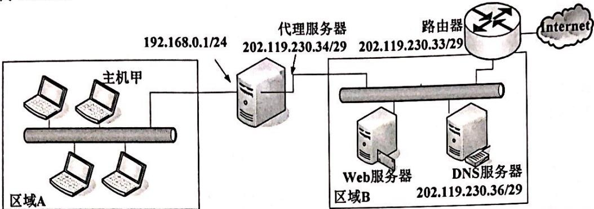
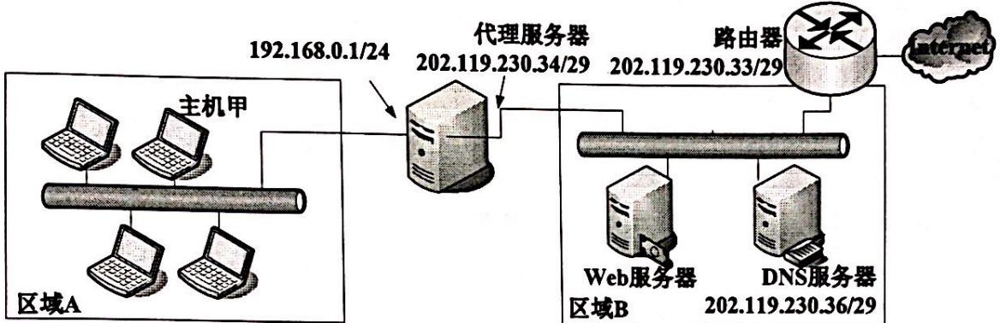

# 《计算机通信与网络》补充作业参考答案（修正版）

原件经识别和整理；“参考解答”是我们补的。

## 一、填空题

### 填空 1

从逻辑上看，计算机网络是由\_\_通信子网\_\_和\_\_终端系统\_\_组成。

参考解答：**答案：插口（套接字，socket）。**

IP 地址标识网络中的主机，端口号标识该主机中的应用进程，因此二者组合 $\text{插口}=(\text{IP 地址},\text{端口号})$ 能唯一标识网络中的一个通信端点。应用进程也通过插口与传输层交互。

知识点：[传输层服务与端口（复用与分用、五元组、熟知端口）](../../../topics/计算机网络/transport_services_ports.md)

### 填空 2

通信协议的三要素是\_\_语法\_\_、\_\_语义\_\_和同步。

参考解答：**结论：域名服务器 IP 地址（DNS 服务器地址）。**

简要推理：IP 地址用于标识本机，子网掩码用于判断目标是否在同一子网，默认网关用于跨子网转发数据；访问互联网中的域名时，还需 DNS 服务器将域名解析为 IP 地址，因此需配置域名服务器 IP 地址。

知识点：[网络互连与IP转发（路由器转发过程、NAT、VPN、移动IP、组播）](../../../topics/计算机网络/network_interconnection.md)、[子网划分与CIDR（子网掩码计算、路由聚合、最长前缀匹配）](../../../topics/计算机网络/subnet_cidr.md)、[域名系统DNS（层次名字空间、递归与迭代查询解析）](../../../topics/计算机网络/dns.md)

### 填空 3

按照网络作用范围，计算机网络分为个人区域网、局域网、城域网、广域网和因特网。

参考解答：**结论**：错误（OSPF 工作在网络层，RIP 工作在应用层）。

**推理**：
* **OSPF**：直接封装在 IP 数据报中传输（IP 协议号为 $89$），不依赖传输层协议，因此工作在**网络层**。
* **RIP**：使用 UDP 协议（目的端口号为 $520$）来交换路由信息，在 TCP/IP 体系结构中属于**应用层**协议。
* 尽管两者都是内部网关协议（IGP），用于实现网络层的路由选择功能，但其在协议栈中的封装层次不同，原题称 RIP 工作在传输层是错误的。

知识点：[互联网路由选择协议（RIP距离向量、OSPF链路状态、BGP）](../../../topics/计算机网络/routing_protocols.md)、[网络体系结构与协议（OSI/RM与TCP/IP模型、协议三要素）](../../../topics/计算机网络/architecture_protocols.md)

### 填空 4

在 OSI 参考模型中，传输的基本单位是帧的层次是数据链路层，该模型的最高层是应用层。


## 二、单项选择题

参考解答：**答案：域名；IP 地址**

即域名系统的功能是实现**域名**到 **IP 地址**的解析。

**理由：**

- 用户在浏览器中输入的是便于记忆的域名（如 `www.example.com`），而网络层实际寻址、转发分组必须使用 32 位（IPv4）或 128 位（IPv6）的二进制 IP 地址，二者之间需要一种转换机制。
- DNS（Domain Name System）正是为此设计的应用层协议：它采用分布式、层次结构的域名服务器（本地域名服务器 → 根域名服务器 → 顶级域名服务器 → 权限域名服务器），通过递归或迭代查询方式，把域名映射为对应的 IP 地址返回给主机（如 Windows 下可用 `nslookup` 验证）。
- 因此，DNS 的核心功能就是"域名 → IP 地址"的解析（逆向解析 IP → 域名仅是其辅助功能，借助 `in-addr.arpa` 域实现）。

知识点：[域名系统DNS（层次名字空间、递归与迭代查询解析）](../../../topics/计算机网络/dns.md)

### 选择 1

在 OSI 参考模型中，自下而上第一个提供端到端服务的层次是（ ）。

- A. 数据链路层
- B. 网络层
- C. 传输层
- D. 应用层

答案：C。

知识点：[IPv4协议与数据报格式（分类IP地址、分片计算、首部字段）](../../../topics/计算机网络/ipv4_datagram.md)

### 选择 2

若网络形状是由站点和连接站点的链路组成的一个闭合环，则称这种拓扑结构为（ ）。

- A. 星形拓扑
- B. 总线拓扑
- C. 环形拓扑
- D. 树形拓扑

答案：C。

参考解答：**答案：D**

运输层的职责是为应用进程提供端到端的逻辑通信，寻址靠的是端口号；IP 寻址是网络层的事，故 D 表述不正确。

- **D（应选）**：IP 寻址属于网络层 IP 协议的功能，解决主机定位与路由选择，不属于运输层协议。
- **A 不选**：表述正确，运输层通过端口号实现进程寻址，完成复用与分用。
- **B 不选**：表述正确，运输层的 UDP 提供无连接的数据报服务。
- **C 不选**：表述正确，运输层的 TCP 提供面向连接的可靠传输服务。

一句话区分：网络层用 IP 地址“找主机”，运输层用端口号“找进程”。

知识点：[传输层服务与端口（复用与分用、五元组、熟知端口）](../../../topics/计算机网络/transport_services_ports.md)、[UDP协议（无连接特性、报文段格式、伪首部校验和计算）](../../../topics/计算机网络/udp_protocol.md)、[TCP连接管理与可靠传输（三次握手、四次挥手、序号确认、RTT与RTO）](../../../topics/计算机网络/tcp_connection_reliability.md)

### 选择 3

在 OSI 参考模型中，物理层的主要功能是（ ）。

- A. 数据链路的访问控制和管理
- B. 透明地传输比特流
- C. 在物理实体间传送数据帧
- D. 发送和接收用户数据报文

答案：B。

知识点：[万维网与HTTP协议（URL、请求与响应报文、Web缓存）](../../../topics/计算机网络/www_http.md)、[域名系统DNS（层次名字空间、递归与迭代查询解析）](../../../topics/计算机网络/dns.md)、[TCP连接管理与可靠传输（三次握手、四次挥手、序号确认、RTT与RTO）](../../../topics/计算机网络/tcp_connection_reliability.md)

### 选择 4

下面关于计算机网络的体系结构和协议的叙述，不正确的是（ ）。

- A. 计算机网络体系结构是计算机网络及其部件所应完成的功能的精确定义
- B. TCP/IP 体系结构中的应用层对应于 OSI 体系结构中的表示层和应用层
- C. 网络协议是为进行网络中的数据交换而建立的规则、标准和约定
- D. 网络协议是“水平”的概念

答案：B。

知识点：[传输层服务与端口（复用与分用、五元组、熟知端口）](../../../topics/计算机网络/transport_services_ports.md)、[万维网与HTTP协议（URL、请求与响应报文、Web缓存）](../../../topics/计算机网络/www_http.md)、[电子邮件系统（SMTP、POP3、IMAP、MIME）](../../../topics/计算机网络/email_protocols.md)

### 选择 5

下列选项中，不属于网络体系结构中所描述的内容是（ ）。

- A. 协议内部实现细节
- B. 网络层次
- C. 每一层使用协议
- D. 每层须完成的功能

答案：A。


## 三、综合题

知识点：[域名系统DNS（层次名字空间、递归与迭代查询解析）](../../../topics/计算机网络/dns.md)

### 综合 1

什么是网络协议？由哪几个基本要素组成？各有什么含义？

参考解答：**结论**

1) C  
2) $255.255.255.192$  
3) $192.168.10.128$、$192.168.10.64$（即 $192.168.10.128/26$ 和 $192.168.10.64/26$）  
4) $62$  
5) $192.168.10.191$、$192.168.10.127$，分别对应子网 $192.168.10.128/26$、$192.168.10.64/26$。

**推理与计算**

- 首字节 $192 \in [192,223]$，属于 C 类；A 类为 $[1,126]$，B 类为 $[128,191]$，所以不选 A、B。
- C 类默认掩码为 $/24$。若只借 1 位，两个子网位 $0$、$1$ 正好是全 0、全 1 子网，不可用；因此需借 2 位，掩码为 $/26$，即 $255.255.255.192$。
- 借 2 位后块大小为 $2^6=64$，四个子网为 $.0/26$、$.64/26$、$.128/26$、$.192/26$。去掉全 0 子网 $.0/26$ 和全 1 子网 $.192/26$，可用子网为 $192.168.10.64/26$ 和 $192.168.10.128/26$。
- 每个子网主机位为 $6$ 位，有效主机数 $2^6-2=62$。
- 广播地址为主机位全 1：$192.168.10.64/26$ 的广播地址为 $192.168.10.127$；$192.168.10.128/26$ 的广播地址为 $192.168.10.191$。

知识点：[子网划分与CIDR（子网掩码计算、路由聚合、最长前缀匹配）](../../../topics/计算机网络/subnet_cidr.md)、[网络互连与IP转发（路由器转发过程、NAT、VPN、移动IP、组播）](../../../topics/计算机网络/network_interconnection.md)、[网络体系结构与协议（OSI/RM与TCP/IP模型、协议三要素）](../../../topics/计算机网络/architecture_protocols.md)

### 综合 2

画出 OSI-RM 模型的结构图，并简要说明下三层的功能。


## 一、填空题

参考解答：**结论**：应分为 **3 片**；给出的 4 个说法结论上都正确。  
若严格判断，第 1 条的公式写法不够严谨，应为上取整：  

$$
\left\lceil \frac{4000-20}{1500-20} \right\rceil = 3
$$


**推理与计算过程**：

1. IPv4 固定首部按 $20$ 字节计，原数据报的数据长度为：  
   
$$
4000-20=3980\ \text{字节}
$$


2. 网络 $MTU=1500$ 字节，每个分片也要带 $20$ 字节 IP 首部，因此每片最大数据字段长度为：  
   
$$
1500-20=1480\ \text{字节}
$$


3. 分片数量为：  
   
$$
\left\lceil \frac{3980}{1480} \right\rceil = 3
$$

   所以该数据报应划分为 3 个分片。

4. 前两个分片取最大允许数据长度：  
   
$$
1480\ \text{字节}
$$

   最后一个分片的数据长度为：  
   
$$
3980-2 \times 1480=1020\ \text{字节}
$$


5. 片偏移字段以 $8$ 字节为单位。  
   第一个分片偏移为：  
   
$$
0
$$

   最后一个分片偏移为：  
   
$$
\frac{1480+1480}{8}=370
$$


6. MF 标志：  
   - 不是最后一片时 $MF=1$；
   - 最后一片时 $MF=0$。

因此：

| 分片 | 数据字段长度 | 片偏移 | MF |
|---|---:|---:|---:|
| 第 1 片 | $1480$ 字节 | $0$ | $1$ |
| 第 2 片 | $1480$ 字节 | $185$ | $1$ |
| 第 3 片 | $1020$ 字节 | $370$ | $0$ |

分片通常由路径上发现 $MTU$ 不够的路由器完成，因此第 2 条也正确。

知识点：[子网划分与CIDR（子网掩码计算、路由聚合、最长前缀匹配）](../../../topics/计算机网络/subnet_cidr.md)、[IPv4协议与数据报格式（分类IP地址、分片计算、首部字段）](../../../topics/计算机网络/ipv4_datagram.md)、[网络互连与IP转发（路由器转发过程、NAT、VPN、移动IP、组播）](../../../topics/计算机网络/network_interconnection.md)

### 填空 1

在 HDLC 中，帧的类型可以分为信息帧、监督帧（S 帧）和未编号帧（U 帧）三种。

参考解答：**答案：插口（套接字，socket）。**

IP 地址标识网络中的主机，端口号标识该主机中的应用进程，因此二者组合 $\text{插口}=(\text{IP 地址},\text{端口号})$ 能唯一标识网络中的一个通信端点。应用进程也通过插口与传输层交互。

知识点：[传输层服务与端口（复用与分用、五元组、熟知端口）](../../../topics/计算机网络/transport_services_ports.md)

### 填空 2

若码元周期 $T=1\times10^{-4}$ 秒，且传送 16 电平信号，则传码速率为 10000 Bd、传信速率为 $4\times10^{3}$ b/s。

参考解答：**结论：域名服务器 IP 地址（DNS 服务器地址）。**

简要推理：IP 地址用于标识本机，子网掩码用于判断目标是否在同一子网，默认网关用于跨子网转发数据；访问互联网中的域名时，还需 DNS 服务器将域名解析为 IP 地址，因此需配置域名服务器 IP 地址。

知识点：[网络互连与IP转发（路由器转发过程、NAT、VPN、移动IP、组播）](../../../topics/计算机网络/network_interconnection.md)、[子网划分与CIDR（子网掩码计算、路由聚合、最长前缀匹配）](../../../topics/计算机网络/subnet_cidr.md)、[域名系统DNS（层次名字空间、递归与迭代查询解析）](../../../topics/计算机网络/dns.md)

### 填空 3

在常用的有线的传输媒体中，主要有\_\_同轴电缆\_\_、\_\_双绞线\_\_和光纤。

参考解答：**结论**：错误（OSPF 工作在网络层，RIP 工作在应用层）。

**推理**：
* **OSPF**：直接封装在 IP 数据报中传输（IP 协议号为 $89$），不依赖传输层协议，因此工作在**网络层**。
* **RIP**：使用 UDP 协议（目的端口号为 $520$）来交换路由信息，在 TCP/IP 体系结构中属于**应用层**协议。
* 尽管两者都是内部网关协议（IGP），用于实现网络层的路由选择功能，但其在协议栈中的封装层次不同，原题称 RIP 工作在传输层是错误的。

知识点：[互联网路由选择协议（RIP距离向量、OSPF链路状态、BGP）](../../../topics/计算机网络/routing_protocols.md)、[网络体系结构与协议（OSI/RM与TCP/IP模型、协议三要素）](../../../topics/计算机网络/architecture_protocols.md)

### 填空 4

物理层的接口有 4 个方面的特性，它们是机械特性、电气特性、功能特性和规程特性。

参考解答：**答案：域名；IP 地址**

即域名系统的功能是实现**域名**到 **IP 地址**的解析。

**理由：**

- 用户在浏览器中输入的是便于记忆的域名（如 `www.example.com`），而网络层实际寻址、转发分组必须使用 32 位（IPv4）或 128 位（IPv6）的二进制 IP 地址，二者之间需要一种转换机制。
- DNS（Domain Name System）正是为此设计的应用层协议：它采用分布式、层次结构的域名服务器（本地域名服务器 → 根域名服务器 → 顶级域名服务器 → 权限域名服务器），通过递归或迭代查询方式，把域名映射为对应的 IP 地址返回给主机（如 Windows 下可用 `nslookup` 验证）。
- 因此，DNS 的核心功能就是"域名 → IP 地址"的解析（逆向解析 IP → 域名仅是其辅助功能，借助 `in-addr.arpa` 域实现）。

知识点：[域名系统DNS（层次名字空间、递归与迭代查询解析）](../../../topics/计算机网络/dns.md)

### 填空 5

脉冲编码调制（PCM）的工作过程包括抽样、量化和编码。

参考解答：**结论：** 统一资源定位符 **URL**。

**说明：** WWW 中每个文档或资源都通过 URL 唯一标识，其一般形式为：


$$
\text{协议}://\text{主机}[: \text{端口}]/\text{路径}
$$


例如 `https://www.example.com/index.html`，因此应填 **URL**。

知识点：[万维网与HTTP协议（URL、请求与响应报文、Web缓存）](../../../topics/计算机网络/www_http.md)

### 填空 6

信道复用技术包括\_\_频分\_\_复用、时分复用、波分复用和\_\_码分复用\_\_。

参考解答：**答案：$\boxed{1460}$ 字节。**

IP 分组总长度包括 IP 首部和数据部分。按 IP 固定首部为 $20$ 字节计算，IP 数据部分（即整个 TCP 报文段）最多为：


$$
1500-20=1480\ \text{字节}
$$


再减去 TCP 固定首部的 $20$ 字节，TCP 数据部分的最大长度为：


$$
L_{\max}=1500-\underbrace{20}_{\text{IP 首部}}-\underbrace{20}_{\text{TCP 首部}}
=1460\ \text{字节}
$$


知识点：[IPv4协议与数据报格式（分类IP地址、分片计算、首部字段）](../../../topics/计算机网络/ipv4_datagram.md)、[TCP连接管理与可靠传输（三次握手、四次挥手、序号确认、RTT与RTO）](../../../topics/计算机网络/tcp_connection_reliability.md)

### 填空 7

数据链路层采用连续 ARQ 协议，发送方已经发送了编号为 $0 \sim 7$ 的帧，当计时器超时，若发送方只收到 0、2、3 号帧的确认，则发送方需要重发 \_\_\_\_ 个帧。（4~7 号帧）

参考解答：**复用和分用**（或端口复用）、**差错检测**。

**推理过程：**
* **复用和分用**：网络层的 IP 协议仅提供主机到主机的逻辑通信（基于 IP 地址）。UDP 通过引入**端口号**机制，在发送端允许多个应用进程共用 UDP 和 IP 服务（复用），在接收端根据端口号将数据报准确交付给对应的应用进程（分用），从而向上层提供进程到进程的通信。
* **差错检测**：UDP 首部包含**校验和**（Checksum）字段，用于检测数据在传输过程中是否发生比特差错。需要特别指出的是，UDP 是无连接的不可靠协议，发现差错后仅丢弃数据报，不提供确认、重传等**差错控制**机制。因此，严谨的教材标准表述应为“差错检测”（若原题填空处给定了“差错控制”，属于命题表述不严谨，实际答题应以“差错检测”为准）。

知识点：[UDP协议（无连接特性、报文段格式、伪首部校验和计算）](../../../topics/计算机网络/udp_protocol.md)、[IPv4协议与数据报格式（分类IP地址、分片计算、首部字段）](../../../topics/计算机网络/ipv4_datagram.md)、[传输层服务与端口（复用与分用、五元组、熟知端口）](../../../topics/计算机网络/transport_services_ports.md)

### 填空 8

对于选择 ARQ 协议，若采用 3 比特编号，则最大接收窗口尺寸为 \_\_\_\_。

参考解答：**结论**：数据连接、控制连接。

FTP 的控制连接用于传输 FTP 命令和应答，数据连接用于实际传输文件内容或目录列表，因此需要两条独立的 TCP 连接。

知识点：[文件传送与远程登录（FTP双连接机制、TFTP、Telnet）](../../../topics/计算机网络/ftp_telnet.md)

### 填空 9

码长为 15 的汉明码，其中包含的监督位至少为 4 位，编码效率为 73.3%。$2^r-1\ge n \therefore r\ge 4$

参考解答：**结论**  
填空应填：**数据链路层和物理层**；**网络层**。

**简明推理**  
MAC 地址用于数据链路层的帧封装、介质访问控制和局域网内寻址，并与物理接口绑定；IP 地址用于网络层的逻辑寻址与路由，传输层及以上各层使用 IP 地址进行通信。

知识点：[网络体系结构与协议（OSI/RM与TCP/IP模型、协议三要素）](../../../topics/计算机网络/architecture_protocols.md)、[局域网体系结构与IEEE 802标准（LLC与MAC子层）](../../../topics/计算机网络/lan_ieee802.md)、[IPv4协议与数据报格式（分类IP地址、分片计算、首部字段）](../../../topics/计算机网络/ipv4_datagram.md)

### 填空 10

若 AB 两台计算机之间的距离为 1000km，假定在电缆内信号的传播速度是 $2\times10^{8}$ m/s，数据块长度为 $10^{5}$ bit，数据发送速率为 1Mb/s，则发送时延是\_\_\_\_ 毫秒，传播时延是\_\_\_\_ 毫秒。

$$\frac{10^{5}\ \text{bit}}{1\ \text{Mb/s}}=0.1\ \text{s}$$


## 二、单项选择题

参考解答：**结论**  
10

**推理过程**  
根据 TCP 拥塞控制算法，假设慢开始门限 $\text{ssthresh} = 8$，初始拥塞窗口 $\text{cwnd} = 1$：
1. **慢开始阶段**（$\text{cwnd} < \text{ssthresh}$）：拥塞窗口按指数规律增长，每个 RTT 后翻倍，序列为 $1 \rightarrow 2 \rightarrow 4 \rightarrow 8$。
2. **拥塞避免阶段**（$\text{cwnd} \ge \text{ssthresh}$）：拥塞窗口改为按线性规律增长，每个 RTT 后加 1，序列为 $8 \rightarrow 9 \rightarrow 10 \rightarrow \dots \rightarrow 16$。

题干给出的数列 $1, 2, 4, 8, 9$ 描述了该窗口增长过程。根据拥塞避免阶段的线性递增规律（每次 $+1$），数列的下一项即为 $10$。题目中的“16 KB”为窗口最终达到的目标值背景，不影响该局部序列下一项的推导。

知识点：[TCP流量控制与拥塞控制（滑动窗口、慢开始、拥塞避免、快重传与快恢复）](../../../topics/计算机网络/tcp_flow_congestion.md)、[流量控制与可靠传输（停止等待、连续ARQ、选择ARQ及窗口尺寸）](../../../topics/计算机网络/flow_control.md)

### 选择 1

在物理层的接口特性中，用于描述各种通信事件发生顺序的是（ ）。

- A. 机械特性
- B. 电气特性
- C. 功能特性
- D. 规程特性

答案：D。

知识点：[IPv4协议与数据报格式（分类IP地址、分片计算、首部字段）](../../../topics/计算机网络/ipv4_datagram.md)

### 选择 2

采用连续 ARQ 协议的滑动窗口协议，设序号位数为 n，则发送窗口最大尺寸为（ ）。

- A. $2n-1$
- B. $2^{n}-1$
- C. $2^{n}$
- D. 1

答案：B。

参考解答：**答案：D**

运输层的职责是为应用进程提供端到端的逻辑通信，寻址靠的是端口号；IP 寻址是网络层的事，故 D 表述不正确。

- **D（应选）**：IP 寻址属于网络层 IP 协议的功能，解决主机定位与路由选择，不属于运输层协议。
- **A 不选**：表述正确，运输层通过端口号实现进程寻址，完成复用与分用。
- **B 不选**：表述正确，运输层的 UDP 提供无连接的数据报服务。
- **C 不选**：表述正确，运输层的 TCP 提供面向连接的可靠传输服务。

一句话区分：网络层用 IP 地址“找主机”，运输层用端口号“找进程”。

知识点：[传输层服务与端口（复用与分用、五元组、熟知端口）](../../../topics/计算机网络/transport_services_ports.md)、[UDP协议（无连接特性、报文段格式、伪首部校验和计算）](../../../topics/计算机网络/udp_protocol.md)、[TCP连接管理与可靠传输（三次握手、四次挥手、序号确认、RTT与RTO）](../../../topics/计算机网络/tcp_connection_reliability.md)

### 选择 3

若数据链路的发送窗口尺寸 $W_{1}=6$，经过初始化后，发送方在发送了 3 号帧，并接到 1 号帧的确认帧后，发送方还可连续发送（ ）。

- A. 1 帧
- B. 2 帧
- C. 3 帧
- D. 4 帧

答案：D。

知识点：[万维网与HTTP协议（URL、请求与响应报文、Web缓存）](../../../topics/计算机网络/www_http.md)、[域名系统DNS（层次名字空间、递归与迭代查询解析）](../../../topics/计算机网络/dns.md)、[TCP连接管理与可靠传输（三次握手、四次挥手、序号确认、RTT与RTO）](../../../topics/计算机网络/tcp_connection_reliability.md)

### 选择 4

共有 4 个站进行码分多址通信。4 个站的码片序列为

- A：$(-1-1-1+1+1-1+1+1)$
- B：$(-1-1+1-1+1+1+1-1)$
- C：$(-1+1-1+1+1+1-1-1)$
- D：$(-1+1-1-1-1-1+1-1)$

若收到码片序列 S：$(-1+1-3+1-1-3+1+1)$，则没有发送数据的站是（ ）。

- A. A 站发送
- B. B 站发送
- C. C 站没有发送
- D. D 站发送

答案：C。

知识点：[传输层服务与端口（复用与分用、五元组、熟知端口）](../../../topics/计算机网络/transport_services_ports.md)、[万维网与HTTP协议（URL、请求与响应报文、Web缓存）](../../../topics/计算机网络/www_http.md)、[电子邮件系统（SMTP、POP3、IMAP、MIME）](../../../topics/计算机网络/email_protocols.md)

### 选择 5

在一个带宽为 4KHz、没有噪声的信道，采用 16 相调制技术传输信号时能够达到的极限数据传输速率为（ ）。

- A. 8 Kbps
- B. 24 Kbps
- C. 32 Kbps
- D. 64 Kbps

答案：C。

参考解答：$C=2W\log_{2}M=2\times4\times\log_{2}16=32\ \text{Kbps}$

知识点：[域名系统DNS（层次名字空间、递归与迭代查询解析）](../../../topics/计算机网络/dns.md)

### 选择 6

工作在异步链路上的 PPP 协议采用面向（ ）的填充方式实现透明传输。

- A. 比特
- B. 字符
- C. 报文
- D. 帧

答案：B。

知识点：[文件传送与远程登录（FTP双连接机制、TFTP、Telnet）](../../../topics/计算机网络/ftp_telnet.md)、[传输层服务与端口（复用与分用、五元组、熟知端口）](../../../topics/计算机网络/transport_services_ports.md)

### 选择 7

HDLC 采用“0”比特插入法的目的是（ ）。

- A. 差错控制
- B. 链路管理
- C. 保证传输的透明性
- D. 流量控制

答案：C。

知识点：[TCP连接管理与可靠传输（三次握手、四次挥手、序号确认、RTT与RTO）](../../../topics/计算机网络/tcp_connection_reliability.md)

### 选择 8

若一个码组信息位的长度是 10 比特，如果采用汉明码校验，则所需的监督位是（ ）比特。

- A. 4
- B. 5
- C. 6
- D. 7

答案：A。

参考解答：$2^{r}-1\ge n=10+r \therefore r\ge 4$

参考解答：**答案：B. 1000**

## 推理过程

TCP 发送方的实际发送窗口受拥塞窗口与接收方通告窗口的共同约束：

$$\text{发送窗口} = \min(\text{cwnd}, \text{rwnd}) = \min(4000, 3000) = 3000 \text{ 字节}$$

**已发送未确认的数据量（在途数据）：**

甲连续发送了 3 个最大段共 $3 \times 1000 = 3000$ 字节，随后收到第 1 段的确认，则已被确认 $1000$ 字节，仍在途、未被确认的数据为：

$$3000 - 1000 = 2000 \text{ 字节}$$

**此时还可发送的最大字节数：**

$$\text{可用窗口} = \text{发送窗口} - \text{在途未确认数据} = 3000 - 2000 = 1000 \text{ 字节}$$

即主机甲还能发送 1 个最大报文段。

## 其他选项分析

- **A（0）**：误以为 3000 字节已发满窗口（实际只发了 3000 且已确认 1000，窗口并未占满）。
- **C（2000）**：只用拥塞窗口计算 $4000-2000=2000$，忽略了接收方通告的 rwnd = 3000 才是更小的限制。
- **D（3000）**：只算了发送窗口 3000，忽略了还有 2000 字节在途数据未确认，占用了窗口。

知识点：[TCP流量控制与拥塞控制（滑动窗口、慢开始、拥塞避免、快重传与快恢复）](../../../topics/计算机网络/tcp_flow_congestion.md)、[传输层服务与端口（复用与分用、五元组、熟知端口）](../../../topics/计算机网络/transport_services_ports.md)

### 选择 9

下列工作在物理层的网络设备是（ ）。

- A. 集线器
- B. 网桥
- C. 路由器
- D. 网关

答案：A。

知识点：[电子邮件系统（SMTP、POP3、IMAP、MIME）](../../../topics/计算机网络/email_protocols.md)

### 选择 10

PPP 是 Internet 中使用的点到点协议，其功能对应于 OSI/RM 的（ ）。

- A. 数据链路层
- B. 网络层
- C. 传输层
- D. 应用层

答案：A。


## 三、计算题

知识点：[子网划分与CIDR（子网掩码计算、路由聚合、最长前缀匹配）](../../../topics/计算机网络/subnet_cidr.md)、[IPv4协议与数据报格式（分类IP地址、分片计算、首部字段）](../../../topics/计算机网络/ipv4_datagram.md)

### 计算 1

某信道采用停止等待协议，单向传播延迟为 20ms，数据帧长为 160bit，忽略确认帧长和处理时间，则信道速率为多少时才能使信道的利用率达到 50%？

参考解答：

$$\eta=\frac{\text{数据帧的发送时延}}{\text{总的时间（正确传输一帧所花费）}}\times100\%=\frac{T}{T+2t}=0.5$$

$$\therefore T=\frac{L}{C}\qquad \therefore C=\frac{L}{T}=\frac{160\ \text{bit}}{40\ \text{ms}}=4\ \text{kb/s}\qquad \therefore T=40\ \text{ms}$$

参考解答：**结论：信道速率 $C = 4\ \text{kb/s}$（即 $4000\ \text{b/s}$）。**

设数据帧发送时延 $T_f = \dfrac{L}{C} = \dfrac{160}{C}$，单向传播时延 $T_p = 20\ \text{ms} = 0.02\ \text{s}$。

停止等待协议下，忽略确认帧发送时间和处理时间，每发一帧的周期为“发送时延 + 数据帧传播过去 + 确认帧传播回来”，即 $T = T_f + 2T_p$，故信道利用率

$$
U=\frac{T_f}{T_f+2T_p}=\frac{\dfrac{160}{C}}{\dfrac{160}{C}+0.04}=50\%
$$

（代入时注意统一单位：$2T_p=40\ \text{ms}=0.04\ \text{s}$。）

由 $U=50\%$ 可知发送时间占总周期的一半，即

$$
T_f = 2T_p = 40\ \text{ms}=0.04\ \text{s}
$$

于是

$$
C=\frac{L}{T_f}=\frac{160\ \text{bit}}{0.04\ \text{s}}=4000\ \text{b/s}=4\ \text{kb/s}
$$

验证：此时 $T_f=40\ \text{ms}$，周期为 $40+40=80\ \text{ms}$，$U=\dfrac{40}{80}=50\%$，符合要求。

知识点：[计算机网络性能指标（速率、时延、吞吐量计算）](../../../topics/计算机网络/performance_metrics.md)、[流量控制与可靠传输（停止等待、连续ARQ、选择ARQ及窗口尺寸）](../../../topics/计算机网络/flow_control.md)、[数据通信系统模型与传输媒体](../../../topics/计算机网络/comm_basics_media.md)

### 计算 2

假设一信道带宽为 $4\ \text{kHz}$，信道要达到 $24\ \text{kb/s}$ 的速率，问：

(1) 按奈奎斯特公式，需要多少个电平表示数据？

(2) 按香农公式，信道的信噪比是多少倍？

答案：(1) 8 电平；(2) 63 倍。

参考解答：

$$C=2W\log_{2}M$$

$$24\ \text{kb/s}=2\times4\ \text{k}\log_{2}M$$

$$\therefore M=2^{3}=8$$

$$(2)\ C=W\cdot\log_{2}(1+S/N)$$

$$\therefore 1+\frac{S}{N}=2^{6}$$

$$\therefore \frac{S}{N}=63$$（即为最终答案）

参考解答：**结论**

（1）需要 $8$ 个电平表示数据。
（2）信道的信噪比是 $63$ 倍。

**计算过程**

（1）根据奈奎斯特公式 $C = 2W \log_{2} M$，已知极限数据传输率 $C = 24 \, \text{kb/s} = 24000 \, \text{b/s}$，信道带宽 $W = 4 \, \text{kHz} = 4000 \, \text{Hz}$，代入公式得：
$$24000 = 2 \times 4000 \times \log_{2} M$$
$$\log_{2} M = \frac{24000}{8000} = 3$$
$$M = 2^3 = 8$$

（2）根据香农公式 $C = W \log_{2}(1 + S/N)$，代入已知数据得：
$$24000 = 4000 \times \log_{2}(1 + S/N)$$
$$\log_{2}(1 + S/N) = \frac{24000}{4000} = 6$$
$$1 + S/N = 2^6 = 64$$
$$S/N = 64 - 1 = 63$$

知识点：[信道容量与传输速率计算（奈氏准则与香农公式）](../../../topics/计算机网络/channel_capacity.md)、[计算机网络性能指标（速率、时延、吞吐量计算）](../../../topics/计算机网络/performance_metrics.md)

### 计算 3

假设带宽为 $3000\ \text{Hz}$ 的模拟信道中只存在高斯白噪声，并且信噪比是 $20\ \text{dB}$，则该信道能否可靠的传输速率为 $64\ \text{kb/s}$ 的数据流？

参考解答：

$$=3000\times\log_{2}\left(\frac{1+100}{44000}\right)\div19.97\ \text{kb/s}<64\ \text{kb/s}$$

∴ 不能可靠地传输速率为……

参考解答：**结论**

1. 许用码组数：**16**
2. 编码效率：**4/7**
3. 监督位：**010**
4. 校正子：**110**
5. 纠正后的码组：**1101010**

**推理与计算过程**

**1. 许用码组数与编码效率**
* (7,4) 汉明码的信息位 $k=4$，许用码组总数为 $2^k = 2^4 = 16$。
* 码长 $n=7$，编码效率 $\eta = \frac{k}{n} = \frac{4}{7}$。

**2. 监督位计算**
* 根据校正子与错码位置表，$S_3$、$S_2$、$S_1$ 分别对应二进制位置编号的最低位、中间位和最高位（a0~a6 对应 1~7）。由此可推导出发送端的偶校验监督方程：
  $$a_0 = a_3 \oplus a_4 \oplus a_6$$
  $$a_1 = a_3 \oplus a_5 \oplus a_6$$
  $$a_2 = a_4 \oplus a_5 \oplus a_6$$
* 已知信息位 $a_6 a_5 a_4 a_3 = 1101$，即 $a_6=1, a_5=1, a_4=0, a_3=1$。代入方程计算监督位：
  $$a_0 = 1 \oplus 0 \oplus 1 = 0$$
  $$a_1 = 1 \oplus 1 \oplus 1 = 1$$
  $$a_2 = 0 \oplus 1 \oplus 1 = 0$$
* 故监督位 $a_2 a_1 a_0 = 010$。

**3. 校正子计算与纠错**
* 接收码组 $a_6 a_5 a_4 a_3 a_2 a_1 a_0 = 1001010$。计算校正子 $S_1 S_2 S_3$：
  $$S_3 = a_6 \oplus a_4 \oplus a_3 \oplus a_0 = 1 \oplus 0 \oplus 1 \oplus 0 = 0$$
  $$S_2 = a_6 \oplus a_5 \oplus a_3 \oplus a_1 = 1 \oplus 0 \oplus 1 \oplus 1 = 1$$
  $$S_1 = a_6 \oplus a_5 \oplus a_4 \oplus a_2 = 1 \oplus 0 \oplus 0 \oplus 0 = 1$$
* 得到校正子 $S_1 S_2 S_3 = 110$。
* 查表可知，校正子 $110$ 对应的错码位置为 $a_5$。
* 将接收码组中出错的 $a_5$ 取反（由 $0$ 纠正为 $1$），得到纠正后的正确码组为 $1101010$。

知识点：[差错控制与检测编码（汉明码、CRC循环冗余校验）](../../../topics/计算机网络/error_control.md)

### 计算 4

一个报文的比特序列为 10010110 通过数据链路传输，采用 CRC 进行差错检测，如所用的生成多项式为 $g(X)=X^{4}+X+1$，试解答下列问题：

(1) 写出生成多项式 $G(X)=X^{4}+X+1$ 对应的二进制序列是：（0011）

(2) 计算报文的比特序列的循环冗余校验码。（写出计算过程）

(3) 简述接收方 CRC 码的检测过程。

参考解答：

接收方把收到的整个码组去除以生成多项式对应的码组 10011，若余数全零（整除），则表示接收到的数据无错，反之有错。

（写出计算过程）

$$
\begin{array}{r}
10011\sqrt[1000]{\dfrac{100101100000}{10011}}\\
\underbrace{\dfrac{11100}{10011}}_{3}\\
\underbrace{\dfrac{11110}{10011}}_{3}\\
\underbrace{\dfrac{11010}{10011}}_{3}\\
\underbrace{\dfrac{10010}{10011}}_{3}\\
\underbrace{\dfrac{10011}{0001}}_{3}
\end{array}
$$

（注意：不是 1000 哦！）且是 4 位，∴ 生成多项式的最高次数是 4


## 《计算机通信与网络》补充作业 3

参考解答：**(

知识点：[差错控制与检测编码（汉明码、CRC循环冗余校验）](../../../topics/计算机网络/error_control.md)

### 一、填空题

参考解答：1. **地址数为 $2^{12}=4096$ 个；最大 IP 地址为 `128.10.79.255`；掩码为 `255.255.240.0`。**  
   主机位数为 $32-20=12$，故共有 $2^{12}$ 个地址。掩码第 3 字节为 $240$，地址块大小为 $256-240=16$，因此第 3 字节的范围为 $64\sim 64+16-1=79$。

2. **单播、组播（多播）和任意播（任播）。**  
   三者分别表示交付给一个接口、一组接口，以及一组接口中的某一个接口；IPv6 不使用广播地址。

3. **差错报告报文和询问报文。**  
   前者用于报告数据报传送中的差错或异常情况，后者通过请求与回答获取网络信息。

4. **ICMP：网际控制报文协议；IGMP：网际组管理协议。**  
   ICMP 主要用于差错报告和网络诊断，IGMP 主要用于管理主机与相邻组播路由器之间的组播组成员关系。

5. **子网地址为 `191.38.72.0`；广播地址为 `191.38.79.255`。**  
   掩码 `255.255.248.0` 对应 `/21`，第 3 字节按位与得：
   
$$
77\ \mathrm{AND}\ 248=72
$$

   每个子网在第 3 字节上的块长为 $256-248=8$，故该子网地址范围为 `191.38.72.0`～`191.38.79.255`。将主机位全部置 1，得到定向广播地址 `191.38.79.255`。

6. **IP 地址为 32 位；分组头部固定部分为 20 字节。**  
   IPv4 地址由 4 个字节组成，即 $4\times8=32$ 位。固定首部的首部长度字段值为 5，以 4 字节为单位，因此固定部分为 $5\times4=20$ 字节，选项字段不计入固定部分。

7. **将 IP 地址解析为物理地址，通常是以太网中的 MAC 地址。**  
   ARP 用于在局域网内根据目的主机或下一跳路由器的 IP 地址，获取封装帧所需的硬件地址。

8. **隧道技术和加密技术。**  
   隧道技术通过封装使私有分组能够经公共网络传输，加密技术用于保护传输数据的机密性。

9. **双协议栈和隧道技术。**  
   双协议栈使主机或路由器同时支持 IPv4 与 IPv6；隧道技术将一种协议的数据报封装在另一种协议的数据报中，以跨越不兼容的网络。

10. **路由选择部分和分组转发部分。**  
    路由选择部分通过路由协议构造并维护路由信息；分组转发部分根据转发表，将到达的分组从合适的输出接口转发出去。

知识点：[子网划分与CIDR（子网掩码计算、路由聚合、最长前缀匹配）](../../../topics/计算机网络/subnet_cidr.md)、[IPv4协议与数据报格式（分类IP地址、分片计算、首部字段）](../../../topics/计算机网络/ipv4_datagram.md)、[ARP地址解析协议与ICMP控制报文](../../../topics/计算机网络/arp_icmp.md)

### 填空 1

CSMA/CD 协议中的 CD 是指冲突检测，CSMA/CA 协议中的 CA 是指冲突避免。

参考解答：**答案：插口（套接字，socket）。**

IP 地址标识网络中的主机，端口号标识该主机中的应用进程，因此二者组合 $\text{插口}=(\text{IP 地址},\text{端口号})$ 能唯一标识网络中的一个通信端点。应用进程也通过插口与传输层交互。

知识点：[传输层服务与端口（复用与分用、五元组、熟知端口）](../../../topics/计算机网络/transport_services_ports.md)

### 填空 2

CSMA/CD 协议的要点是载波侦听、多点接入和冲突检测。

参考解答：**结论：域名服务器 IP 地址（DNS 服务器地址）。**

简要推理：IP 地址用于标识本机，子网掩码用于判断目标是否在同一子网，默认网关用于跨子网转发数据；访问互联网中的域名时，还需 DNS 服务器将域名解析为 IP 地址，因此需配置域名服务器 IP 地址。

知识点：[网络互连与IP转发（路由器转发过程、NAT、VPN、移动IP、组播）](../../../topics/计算机网络/network_interconnection.md)、[子网划分与CIDR（子网掩码计算、路由聚合、最长前缀匹配）](../../../topics/计算机网络/subnet_cidr.md)、[域名系统DNS（层次名字空间、递归与迭代查询解析）](../../../topics/计算机网络/dns.md)

### 填空 3

IEEE802 委员会将局域网的数据链路层分成两个子层，即 MAC 子层和 LLC 子层。

参考解答：**结论**：错误（OSPF 工作在网络层，RIP 工作在应用层）。

**推理**：
* **OSPF**：直接封装在 IP 数据报中传输（IP 协议号为 $89$），不依赖传输层协议，因此工作在**网络层**。
* **RIP**：使用 UDP 协议（目的端口号为 $520$）来交换路由信息，在 TCP/IP 体系结构中属于**应用层**协议。
* 尽管两者都是内部网关协议（IGP），用于实现网络层的路由选择功能，但其在协议栈中的封装层次不同，原题称 RIP 工作在传输层是错误的。

知识点：[互联网路由选择协议（RIP距离向量、OSPF链路状态、BGP）](../../../topics/计算机网络/routing_protocols.md)、[网络体系结构与协议（OSI/RM与TCP/IP模型、协议三要素）](../../../topics/计算机网络/architecture_protocols.md)

### 填空 4

若有 10 台计算机连到了一台 10Mbps 的集线器上，则每台计算机的平均带宽为 1 Mbps。若该 10 台计算机接到了 10Mb/s 的以太网交换机上，则每台计算机的平均带宽为 10 Mbps。

参考解答：**答案：域名；IP 地址**

即域名系统的功能是实现**域名**到 **IP 地址**的解析。

**理由：**

- 用户在浏览器中输入的是便于记忆的域名（如 `www.example.com`），而网络层实际寻址、转发分组必须使用 32 位（IPv4）或 128 位（IPv6）的二进制 IP 地址，二者之间需要一种转换机制。
- DNS（Domain Name System）正是为此设计的应用层协议：它采用分布式、层次结构的域名服务器（本地域名服务器 → 根域名服务器 → 顶级域名服务器 → 权限域名服务器），通过递归或迭代查询方式，把域名映射为对应的 IP 地址返回给主机（如 Windows 下可用 `nslookup` 验证）。
- 因此，DNS 的核心功能就是"域名 → IP 地址"的解析（逆向解析 IP → 域名仅是其辅助功能，借助 `in-addr.arpa` 域实现）。

知识点：[域名系统DNS（层次名字空间、递归与迭代查询解析）](../../../topics/计算机网络/dns.md)

### 填空 5

以太网交换机的三种转发帧的方式分别是存储转发方式、直通方式和碎片隔离方式。

参考解答：**结论：** 统一资源定位符 **URL**。

**说明：** WWW 中每个文档或资源都通过 URL 唯一标识，其一般形式为：


$$
\text{协议}://\text{主机}[: \text{端口}]/\text{路径}
$$


例如 `https://www.example.com/index.html`，因此应填 **URL**。

知识点：[万维网与HTTP协议（URL、请求与响应报文、Web缓存）](../../../topics/计算机网络/www_http.md)

### 填空 6

以太网 10BASE-T 标准中 10 指的是带宽为 10Mb/s，T 指的是双绞线。

参考解答：**答案：$\boxed{1460}$ 字节。**

IP 分组总长度包括 IP 首部和数据部分。按 IP 固定首部为 $20$ 字节计算，IP 数据部分（即整个 TCP 报文段）最多为：


$$
1500-20=1480\ \text{字节}
$$


再减去 TCP 固定首部的 $20$ 字节，TCP 数据部分的最大长度为：


$$
L_{\max}=1500-\underbrace{20}_{\text{IP 首部}}-\underbrace{20}_{\text{TCP 首部}}
=1460\ \text{字节}
$$


知识点：[IPv4协议与数据报格式（分类IP地址、分片计算、首部字段）](../../../topics/计算机网络/ipv4_datagram.md)、[TCP连接管理与可靠传输（三次握手、四次挥手、序号确认、RTT与RTO）](../../../topics/计算机网络/tcp_connection_reliability.md)

### 填空 7

PPP 包括三个部分，其中用于建立、配置和管理链路层连接的协议是 LCP。

参考解答：**复用和分用**（或端口复用）、**差错检测**。

**推理过程：**
* **复用和分用**：网络层的 IP 协议仅提供主机到主机的逻辑通信（基于 IP 地址）。UDP 通过引入**端口号**机制，在发送端允许多个应用进程共用 UDP 和 IP 服务（复用），在接收端根据端口号将数据报准确交付给对应的应用进程（分用），从而向上层提供进程到进程的通信。
* **差错检测**：UDP 首部包含**校验和**（Checksum）字段，用于检测数据在传输过程中是否发生比特差错。需要特别指出的是，UDP 是无连接的不可靠协议，发现差错后仅丢弃数据报，不提供确认、重传等**差错控制**机制。因此，严谨的教材标准表述应为“差错检测”（若原题填空处给定了“差错控制”，属于命题表述不严谨，实际答题应以“差错检测”为准）。

知识点：[UDP协议（无连接特性、报文段格式、伪首部校验和计算）](../../../topics/计算机网络/udp_protocol.md)、[IPv4协议与数据报格式（分类IP地址、分片计算、首部字段）](../../../topics/计算机网络/ipv4_datagram.md)、[传输层服务与端口（复用与分用、五元组、熟知端口）](../../../topics/计算机网络/transport_services_ports.md)

### 填空 8

以太网交换机转发帧的三种方式中，时延最小的方式是直通，时延最大的方式是存储转发。

参考解答：**结论**：数据连接、控制连接。

FTP 的控制连接用于传输 FTP 命令和应答，数据连接用于实际传输文件内容或目录列表，因此需要两条独立的 TCP 连接。

知识点：[文件传送与远程登录（FTP双连接机制、TFTP、Telnet）](../../../topics/计算机网络/ftp_telnet.md)

### 二、单项选择题

参考解答：**目前缺少题干和选项，无法确定答案。** 请补充各小题的完整题干、选项，以及涉及的图示或参数；若是图片，可直接上传清晰截图。

收到后会逐题按以下形式作答：**先给答案，再用一句话说明正确选项的依据，并分别指出其余选项错误的原因**；涉及计算时保留关键公式与代入步骤。

知识点：[网络互连与IP转发（路由器转发过程、NAT、VPN、移动IP、组播）](../../../topics/计算机网络/network_interconnection.md)、[子网划分与CIDR（子网掩码计算、路由聚合、最长前缀匹配）](../../../topics/计算机网络/subnet_cidr.md)、[IPv4协议与数据报格式（分类IP地址、分片计算、首部字段）](../../../topics/计算机网络/ipv4_datagram.md)

### 选择 1

10BASE-5 以太网中，BASE 通常是指（B）。

- A. 异步传输
- B. 基带传输
- C. 频带传输
- D. 宽带传输

答案：B。

知识点：[IPv4协议与数据报格式（分类IP地址、分片计算、首部字段）](../../../topics/计算机网络/ipv4_datagram.md)

### 选择 2

使用集线器的以太网在物理上和逻辑上的拓扑结构分别是（B）。

- A. 星型，环型
- B. 星型，总线型
- C. 总线型，星型
- D. 树型，总线型

答案：B。

参考解答：**答案：D**

运输层的职责是为应用进程提供端到端的逻辑通信，寻址靠的是端口号；IP 寻址是网络层的事，故 D 表述不正确。

- **D（应选）**：IP 寻址属于网络层 IP 协议的功能，解决主机定位与路由选择，不属于运输层协议。
- **A 不选**：表述正确，运输层通过端口号实现进程寻址，完成复用与分用。
- **B 不选**：表述正确，运输层的 UDP 提供无连接的数据报服务。
- **C 不选**：表述正确，运输层的 TCP 提供面向连接的可靠传输服务。

一句话区分：网络层用 IP 地址“找主机”，运输层用端口号“找进程”。

知识点：[传输层服务与端口（复用与分用、五元组、熟知端口）](../../../topics/计算机网络/transport_services_ports.md)、[UDP协议（无连接特性、报文段格式、伪首部校验和计算）](../../../topics/计算机网络/udp_protocol.md)、[TCP连接管理与可靠传输（三次握手、四次挥手、序号确认、RTT与RTO）](../../../topics/计算机网络/tcp_connection_reliability.md)

### 选择 3

下列工作在数据链路层的网络设备是（B）。

- A. 转发器
- B. 网桥
- C. 路由器
- D. 网关

答案：B。

知识点：[万维网与HTTP协议（URL、请求与响应报文、Web缓存）](../../../topics/计算机网络/www_http.md)、[域名系统DNS（层次名字空间、递归与迭代查询解析）](../../../topics/计算机网络/dns.md)、[TCP连接管理与可靠传输（三次握手、四次挥手、序号确认、RTT与RTO）](../../../topics/计算机网络/tcp_connection_reliability.md)

### 选择 4

下列有关虚拟局域网 VLAN 概念描述中，说法错误的是（A）。

- A. VLAN 是一种新型的局域网
- B. 建立 VLAN 需要使用交换机
- C. VLAN 以软件方式来实现逻辑工作组的划分与管理
- D. 逻辑工作组中的节点组成不受物理位置的限制

答案：A。

知识点：[传输层服务与端口（复用与分用、五元组、熟知端口）](../../../topics/计算机网络/transport_services_ports.md)、[万维网与HTTP协议（URL、请求与响应报文、Web缓存）](../../../topics/计算机网络/www_http.md)、[电子邮件系统（SMTP、POP3、IMAP、MIME）](../../../topics/计算机网络/email_protocols.md)

### 选择 5

设利用 IEEE802.3 协议局域网传送 ASCII 码信息“NJUPT”，若封装成 MAC 帧格式，需要填充（B）个字节。46 - 5 = 41

- A. 0
- B. 41
- C. 46
- D. 64

答案：B。

知识点：[域名系统DNS（层次名字空间、递归与迭代查询解析）](../../../topics/计算机网络/dns.md)

### 选择 6

下列属于随机介质访问控制的是（D）。

- A. 频分多路复用
- B. 码分多路复用
- C. 令牌传递
- D. CSMA 协议

答案：D。

知识点：[文件传送与远程登录（FTP双连接机制、TFTP、Telnet）](../../../topics/计算机网络/ftp_telnet.md)、[传输层服务与端口（复用与分用、五元组、熟知端口）](../../../topics/计算机网络/transport_services_ports.md)

### 选择 7

设以太网发送数据的速率为 $10 \mathrm{Mbps}$，采用曼彻斯特编码时，时钟频率为（B）MHz。

- A. 10
- B. 20
- C. 30
- D. 可变的

答案：B。

知识点：[TCP连接管理与可靠传输（三次握手、四次挥手、序号确认、RTT与RTO）](../../../topics/计算机网络/tcp_connection_reliability.md)

### 选择 8

一个总线式以太网中两个站之间的最长距离为 2 公里，传播速度为 $2\times10^{5}km/s$，两个站需要经过（C）才能肯定本次发送没有发生冲突。

- A. 5 us
- B. 10 us
- C. 20 us
- D. 40 us

答案：C。$2\tau=2\times10\mu s$

参考解答：**答案：B. 1000**

## 推理过程

TCP 发送方的实际发送窗口受拥塞窗口与接收方通告窗口的共同约束：

$$\text{发送窗口} = \min(\text{cwnd}, \text{rwnd}) = \min(4000, 3000) = 3000 \text{ 字节}$$

**已发送未确认的数据量（在途数据）：**

甲连续发送了 3 个最大段共 $3 \times 1000 = 3000$ 字节，随后收到第 1 段的确认，则已被确认 $1000$ 字节，仍在途、未被确认的数据为：

$$3000 - 1000 = 2000 \text{ 字节}$$

**此时还可发送的最大字节数：**

$$\text{可用窗口} = \text{发送窗口} - \text{在途未确认数据} = 3000 - 2000 = 1000 \text{ 字节}$$

即主机甲还能发送 1 个最大报文段。

## 其他选项分析

- **A（0）**：误以为 3000 字节已发满窗口（实际只发了 3000 且已确认 1000，窗口并未占满）。
- **C（2000）**：只用拥塞窗口计算 $4000-2000=2000$，忽略了接收方通告的 rwnd = 3000 才是更小的限制。
- **D（3000）**：只算了发送窗口 3000，忽略了还有 2000 字节在途数据未确认，占用了窗口。

知识点：[TCP流量控制与拥塞控制（滑动窗口、慢开始、拥塞避免、快重传与快恢复）](../../../topics/计算机网络/tcp_flow_congestion.md)、[传输层服务与端口（复用与分用、五元组、熟知端口）](../../../topics/计算机网络/transport_services_ports.md)

### 选择 9

下列选项中，对正确接收到的数据帧进行确认的 MAC 协议是（D）。

- A. CDMA
- B. CSMA
- C. CSMA/CD
- D. CSMA/CA

答案：D。

知识点：[电子邮件系统（SMTP、POP3、IMAP、MIME）](../../../topics/计算机网络/email_protocols.md)

### 选择 10

下列设备中，扩展了冲突域范围的设备是（A）。

- A. 集线器
- B. 路由器
- C. 交换机
- D. 网桥

答案：A。

知识点：[子网划分与CIDR（子网掩码计算、路由聚合、最长前缀匹配）](../../../topics/计算机网络/subnet_cidr.md)、[IPv4协议与数据报格式（分类IP地址、分片计算、首部字段）](../../../topics/计算机网络/ipv4_datagram.md)

### 三、综合应用题

参考解答：您未提供具体的综合应用题题目内容。请补充题目，我将严格按照您的格式要求为您解答。

以下以一道典型的**TCP拥塞控制**综合题为例，展示解答格式：

**结论**
发生超时后，慢开始门限 $ssthresh = 12\text{KB}$，拥塞窗口 $cwnd = 1\text{KB}$；经过3个RTT后，$cwnd = 8\text{KB}$。

**推理与计算过程**
1. **超时状态更新**：当发生超时时，TCP将慢开始门限减半，即 $ssthresh = \lfloor 24 / 2 \rfloor = 12\text{KB}$；同时将拥塞窗口重置为1个最大报文段长度，即 $cwnd = 1\text{KB}$。
2. **第1个RTT后**：由于 $cwnd < ssthresh$，执行慢开始算法，窗口指数增长。$cwnd = 1 \times 2 = 2\text{KB}$。
3. **第2个RTT后**：仍处于慢开始阶段，窗口继续翻倍。$cwnd = 2 \times 2 = 4\text{KB}$。
4. **第3个RTT后**：仍处于慢开始阶段，窗口继续翻倍。$cwnd = 4 \times 2 = 8\text{KB}$。此时 $cwnd$ 仍未达到 $ssthresh$，下一个RTT将继续执行慢开始。

知识点：[计算机网络性能指标（速率、时延、吞吐量计算）](../../../topics/计算机网络/performance_metrics.md)、[TCP连接管理与可靠传输（三次握手、四次挥手、序号确认、RTT与RTO）](../../../topics/计算机网络/tcp_connection_reliability.md)、[TCP流量控制与拥塞控制（滑动窗口、慢开始、拥塞避免、快重传与快恢复）](../../../topics/计算机网络/tcp_flow_congestion.md)

### 综合 1

在一个采用 CSMA/CD 协议的网络中，传输介质是一根完整的电缆，传输速率为 1Gb/s，电缆中的信号传播速度是 200 000km/s。若最小数据帧长度减少了 800 比特，则：

（1）最远的两个站点之间的距离应如何变化（增加还是减少）？

（2）至少变化多少米才能保证网络正常工作？

答案：（1）减少。两个速度要注意区别。

（2）求出 800bit 对应的传输介质长度（帧长）

$$
L = 2 C
$$

$$
800 \mathrm{bit} = 2 \tau
$$

∴电缆长度应减少


## 《计算机通信与网络》补充作业 4

参考解答：**结论**

1) C  
2) $255.255.255.192$  
3) $192.168.10.128$、$192.168.10.64$（即 $192.168.10.128/26$ 和 $192.168.10.64/26$）  
4) $62$  
5) $192.168.10.191$、$192.168.10.127$，分别对应子网 $192.168.10.128/26$、$192.168.10.64/26$。

**推理与计算**

- 首字节 $192 \in [192,223]$，属于 C 类；A 类为 $[1,126]$，B 类为 $[128,191]$，所以不选 A、B。
- C 类默认掩码为 $/24$。若只借 1 位，两个子网位 $0$、$1$ 正好是全 0、全 1 子网，不可用；因此需借 2 位，掩码为 $/26$，即 $255.255.255.192$。
- 借 2 位后块大小为 $2^6=64$，四个子网为 $.0/26$、$.64/26$、$.128/26$、$.192/26$。去掉全 0 子网 $.0/26$ 和全 1 子网 $.192/26$，可用子网为 $192.168.10.64/26$ 和 $192.168.10.128/26$。
- 每个子网主机位为 $6$ 位，有效主机数 $2^6-2=62$。
- 广播地址为主机位全 1：$192.168.10.64/26$ 的广播地址为 $192.168.10.127$；$192.168.10.128/26$ 的广播地址为 $192.168.10.191$。

知识点：[子网划分与CIDR（子网掩码计算、路由聚合、最长前缀匹配）](../../../topics/计算机网络/subnet_cidr.md)、[网络互连与IP转发（路由器转发过程、NAT、VPN、移动IP、组播）](../../../topics/计算机网络/network_interconnection.md)、[网络体系结构与协议（OSI/RM与TCP/IP模型、协议三要素）](../../../topics/计算机网络/architecture_protocols.md)

### 一、填空题

参考解答：1. **地址数为 $2^{12}=4096$ 个；最大 IP 地址为 `128.10.79.255`；掩码为 `255.255.240.0`。**  
   主机位数为 $32-20=12$，故共有 $2^{12}$ 个地址。掩码第 3 字节为 $240$，地址块大小为 $256-240=16$，因此第 3 字节的范围为 $64\sim 64+16-1=79$。

2. **单播、组播（多播）和任意播（任播）。**  
   三者分别表示交付给一个接口、一组接口，以及一组接口中的某一个接口；IPv6 不使用广播地址。

3. **差错报告报文和询问报文。**  
   前者用于报告数据报传送中的差错或异常情况，后者通过请求与回答获取网络信息。

4. **ICMP：网际控制报文协议；IGMP：网际组管理协议。**  
   ICMP 主要用于差错报告和网络诊断，IGMP 主要用于管理主机与相邻组播路由器之间的组播组成员关系。

5. **子网地址为 `191.38.72.0`；广播地址为 `191.38.79.255`。**  
   掩码 `255.255.248.0` 对应 `/21`，第 3 字节按位与得：
   
$$
77\ \mathrm{AND}\ 248=72
$$

   每个子网在第 3 字节上的块长为 $256-248=8$，故该子网地址范围为 `191.38.72.0`～`191.38.79.255`。将主机位全部置 1，得到定向广播地址 `191.38.79.255`。

6. **IP 地址为 32 位；分组头部固定部分为 20 字节。**  
   IPv4 地址由 4 个字节组成，即 $4\times8=32$ 位。固定首部的首部长度字段值为 5，以 4 字节为单位，因此固定部分为 $5\times4=20$ 字节，选项字段不计入固定部分。

7. **将 IP 地址解析为物理地址，通常是以太网中的 MAC 地址。**  
   ARP 用于在局域网内根据目的主机或下一跳路由器的 IP 地址，获取封装帧所需的硬件地址。

8. **隧道技术和加密技术。**  
   隧道技术通过封装使私有分组能够经公共网络传输，加密技术用于保护传输数据的机密性。

9. **双协议栈和隧道技术。**  
   双协议栈使主机或路由器同时支持 IPv4 与 IPv6；隧道技术将一种协议的数据报封装在另一种协议的数据报中，以跨越不兼容的网络。

10. **路由选择部分和分组转发部分。**  
    路由选择部分通过路由协议构造并维护路由信息；分组转发部分根据转发表，将到达的分组从合适的输出接口转发出去。

知识点：[子网划分与CIDR（子网掩码计算、路由聚合、最长前缀匹配）](../../../topics/计算机网络/subnet_cidr.md)、[IPv4协议与数据报格式（分类IP地址、分片计算、首部字段）](../../../topics/计算机网络/ipv4_datagram.md)、[ARP地址解析协议与ICMP控制报文](../../../topics/计算机网络/arp_icmp.md)

### 填空 1

CIDR 地址块 128.10.64.0/20 中，包含有 $2^{12}$ 个 IP 地址，其中，最大的 IP 地址是 128.10.79.255，地址块所对应的掩码是 255.255.240.0。

参考解答：**答案：插口（套接字，socket）。**

IP 地址标识网络中的主机，端口号标识该主机中的应用进程，因此二者组合 $\text{插口}=(\text{IP 地址},\text{端口号})$ 能唯一标识网络中的一个通信端点。应用进程也通过插口与传输层交互。

知识点：[传输层服务与端口（复用与分用、五元组、熟知端口）](../../../topics/计算机网络/transport_services_ports.md)

### 填空 2

一般来讲，IPv6 数据报的目的地址常用的三种地址类型分别是单播、多播和任播。

参考解答：**结论：域名服务器 IP 地址（DNS 服务器地址）。**

简要推理：IP 地址用于标识本机，子网掩码用于判断目标是否在同一子网，默认网关用于跨子网转发数据；访问互联网中的域名时，还需 DNS 服务器将域名解析为 IP 地址，因此需配置域名服务器 IP 地址。

知识点：[网络互连与IP转发（路由器转发过程、NAT、VPN、移动IP、组播）](../../../topics/计算机网络/network_interconnection.md)、[子网划分与CIDR（子网掩码计算、路由聚合、最长前缀匹配）](../../../topics/计算机网络/subnet_cidr.md)、[域名系统DNS（层次名字空间、递归与迭代查询解析）](../../../topics/计算机网络/dns.md)

### 填空 3

ICMP 报文分为询问报文和差错报告报文两种类型。

参考解答：**结论**：错误（OSPF 工作在网络层，RIP 工作在应用层）。

**推理**：
* **OSPF**：直接封装在 IP 数据报中传输（IP 协议号为 $89$），不依赖传输层协议，因此工作在**网络层**。
* **RIP**：使用 UDP 协议（目的端口号为 $520$）来交换路由信息，在 TCP/IP 体系结构中属于**应用层**协议。
* 尽管两者都是内部网关协议（IGP），用于实现网络层的路由选择功能，但其在协议栈中的封装层次不同，原题称 RIP 工作在传输层是错误的。

知识点：[互联网路由选择协议（RIP距离向量、OSPF链路状态、BGP）](../../../topics/计算机网络/routing_protocols.md)、[网络体系结构与协议（OSI/RM与TCP/IP模型、协议三要素）](../../../topics/计算机网络/architecture_protocols.md)

### 填空 4

因特网网络层中，ICMP 对应的中文术语是网际控制报文协议，IGMP 对应的中文术语是网际组管理协议。

参考解答：**答案：域名；IP 地址**

即域名系统的功能是实现**域名**到 **IP 地址**的解析。

**理由：**

- 用户在浏览器中输入的是便于记忆的域名（如 `www.example.com`），而网络层实际寻址、转发分组必须使用 32 位（IPv4）或 128 位（IPv6）的二进制 IP 地址，二者之间需要一种转换机制。
- DNS（Domain Name System）正是为此设计的应用层协议：它采用分布式、层次结构的域名服务器（本地域名服务器 → 根域名服务器 → 顶级域名服务器 → 权限域名服务器），通过递归或迭代查询方式，把域名映射为对应的 IP 地址返回给主机（如 Windows 下可用 `nslookup` 验证）。
- 因此，DNS 的核心功能就是"域名 → IP 地址"的解析（逆向解析 IP → 域名仅是其辅助功能，借助 `in-addr.arpa` 域实现）。

知识点：[域名系统DNS（层次名字空间、递归与迭代查询解析）](../../../topics/计算机网络/dns.md)

### 填空 5

IPv4 中，IP 地址是 32 位，分组头部固定部分为 20 字节。

参考解答：**结论：** 统一资源定位符 **URL**。

**说明：** WWW 中每个文档或资源都通过 URL 唯一标识，其一般形式为：


$$
\text{协议}://\text{主机}[: \text{端口}]/\text{路径}
$$


例如 `https://www.example.com/index.html`，因此应填 **URL**。

知识点：[万维网与HTTP协议（URL、请求与响应报文、Web缓存）](../../../topics/计算机网络/www_http.md)

### 填空 6

IP 数据报中 TTL 字段称为生存周期，该字段的意义在于防止 IP 数据报在网络中无限制地循环转发。

参考解答：**答案：$\boxed{1460}$ 字节。**

IP 分组总长度包括 IP 首部和数据部分。按 IP 固定首部为 $20$ 字节计算，IP 数据部分（即整个 TCP 报文段）最多为：


$$
1500-20=1480\ \text{字节}
$$


再减去 TCP 固定首部的 $20$ 字节，TCP 数据部分的最大长度为：


$$
L_{\max}=1500-\underbrace{20}_{\text{IP 首部}}-\underbrace{20}_{\text{TCP 首部}}
=1460\ \text{字节}
$$


知识点：[IPv4协议与数据报格式（分类IP地址、分片计算、首部字段）](../../../topics/计算机网络/ipv4_datagram.md)、[TCP连接管理与可靠传输（三次握手、四次挥手、序号确认、RTT与RTO）](../../../topics/计算机网络/tcp_connection_reliability.md)

### 填空 7

ARP 协议的功能是实现从 IP 地址到 MAC 地址的映射。

参考解答：**复用和分用**（或端口复用）、**差错检测**。

**推理过程：**
* **复用和分用**：网络层的 IP 协议仅提供主机到主机的逻辑通信（基于 IP 地址）。UDP 通过引入**端口号**机制，在发送端允许多个应用进程共用 UDP 和 IP 服务（复用），在接收端根据端口号将数据报准确交付给对应的应用进程（分用），从而向上层提供进程到进程的通信。
* **差错检测**：UDP 首部包含**校验和**（Checksum）字段，用于检测数据在传输过程中是否发生比特差错。需要特别指出的是，UDP 是无连接的不可靠协议，发现差错后仅丢弃数据报，不提供确认、重传等**差错控制**机制。因此，严谨的教材标准表述应为“差错检测”（若原题填空处给定了“差错控制”，属于命题表述不严谨，实际答题应以“差错检测”为准）。

知识点：[UDP协议（无连接特性、报文段格式、伪首部校验和计算）](../../../topics/计算机网络/udp_protocol.md)、[IPv4协议与数据报格式（分类IP地址、分片计算、首部字段）](../../../topics/计算机网络/ipv4_datagram.md)、[传输层服务与端口（复用与分用、五元组、熟知端口）](../../../topics/计算机网络/transport_services_ports.md)

### 填空 8

实现 VPN 的两种基本技术是：隧道技术和加密技术。

参考解答：**结论**：数据连接、控制连接。

FTP 的控制连接用于传输 FTP 命令和应答，数据连接用于实际传输文件内容或目录列表，因此需要两条独立的 TCP 连接。

知识点：[文件传送与远程登录（FTP双连接机制、TFTP、Telnet）](../../../topics/计算机网络/ftp_telnet.md)

### 填空 9

IPv4 向 IPv6 过渡常用的方法有双协议栈和隧道技术。

参考解答：**结论**  
填空应填：**数据链路层和物理层**；**网络层**。

**简明推理**  
MAC 地址用于数据链路层的帧封装、介质访问控制和局域网内寻址，并与物理接口绑定；IP 地址用于网络层的逻辑寻址与路由，传输层及以上各层使用 IP 地址进行通信。

知识点：[网络体系结构与协议（OSI/RM与TCP/IP模型、协议三要素）](../../../topics/计算机网络/architecture_protocols.md)、[局域网体系结构与IEEE 802标准（LLC与MAC子层）](../../../topics/计算机网络/lan_ieee802.md)、[IPv4协议与数据报格式（分类IP地址、分片计算、首部字段）](../../../topics/计算机网络/ipv4_datagram.md)

### 填空 10

路由器结构可划分为两大部分：路由选择部分和分组转发部分。

参考解答：**结论**  
10

**推理过程**  
根据 TCP 拥塞控制算法，假设慢开始门限 $\text{ssthresh} = 8$，初始拥塞窗口 $\text{cwnd} = 1$：
1. **慢开始阶段**（$\text{cwnd} < \text{ssthresh}$）：拥塞窗口按指数规律增长，每个 RTT 后翻倍，序列为 $1 \rightarrow 2 \rightarrow 4 \rightarrow 8$。
2. **拥塞避免阶段**（$\text{cwnd} \ge \text{ssthresh}$）：拥塞窗口改为按线性规律增长，每个 RTT 后加 1，序列为 $8 \rightarrow 9 \rightarrow 10 \rightarrow \dots \rightarrow 16$。

题干给出的数列 $1, 2, 4, 8, 9$ 描述了该窗口增长过程。根据拥塞避免阶段的线性递增规律（每次 $+1$），数列的下一项即为 $10$。题目中的“16 KB”为窗口最终达到的目标值背景，不影响该局部序列下一项的推导。

知识点：[TCP流量控制与拥塞控制（滑动窗口、慢开始、拥塞避免、快重传与快恢复）](../../../topics/计算机网络/tcp_flow_congestion.md)、[流量控制与可靠传输（停止等待、连续ARQ、选择ARQ及窗口尺寸）](../../../topics/计算机网络/flow_control.md)

### 二、单项选择题

参考解答：**目前缺少题干和选项，无法确定答案。** 请补充各小题的完整题干、选项，以及涉及的图示或参数；若是图片，可直接上传清晰截图。

收到后会逐题按以下形式作答：**先给答案，再用一句话说明正确选项的依据，并分别指出其余选项错误的原因**；涉及计算时保留关键公式与代入步骤。

知识点：[网络互连与IP转发（路由器转发过程、NAT、VPN、移动IP、组播）](../../../topics/计算机网络/network_interconnection.md)、[子网划分与CIDR（子网掩码计算、路由聚合、最长前缀匹配）](../../../topics/计算机网络/subnet_cidr.md)、[IPv4协议与数据报格式（分类IP地址、分片计算、首部字段）](../../../topics/计算机网络/ipv4_datagram.md)

### 选择 1

IPv6 地址 FF02:3::5:1 中的“::”代表了（A）个比特位 0。

- A. 64
- B. 48
- C. 32
- D. 16

答案：A。

知识点：[IPv4协议与数据报格式（分类IP地址、分片计算、首部字段）](../../../topics/计算机网络/ipv4_datagram.md)

### 选择 2

设有两个子网 202.118.133.0/24 和 202.118.132.0/24，如果进行路由汇聚，得到的网络地址是（D）。

- A. 202.118.128.0/21
- B. 202.118.128.0/22
- C. 202.118.130.0/22
- D. 202.118.132.0/23

答案：D。

参考解答：**答案：D**

运输层的职责是为应用进程提供端到端的逻辑通信，寻址靠的是端口号；IP 寻址是网络层的事，故 D 表述不正确。

- **D（应选）**：IP 寻址属于网络层 IP 协议的功能，解决主机定位与路由选择，不属于运输层协议。
- **A 不选**：表述正确，运输层通过端口号实现进程寻址，完成复用与分用。
- **B 不选**：表述正确，运输层的 UDP 提供无连接的数据报服务。
- **C 不选**：表述正确，运输层的 TCP 提供面向连接的可靠传输服务。

一句话区分：网络层用 IP 地址“找主机”，运输层用端口号“找进程”。

知识点：[传输层服务与端口（复用与分用、五元组、熟知端口）](../../../topics/计算机网络/transport_services_ports.md)、[UDP协议（无连接特性、报文段格式、伪首部校验和计算）](../../../topics/计算机网络/udp_protocol.md)、[TCP连接管理与可靠传输（三次握手、四次挥手、序号确认、RTT与RTO）](../../../topics/计算机网络/tcp_connection_reliability.md)

### 选择 3

下列网络设备中，能够抑制网络风暴的是（D）。

- A. 中继器
- B. 集线器
- C. 网桥
- D. 路由器

答案：D。

知识点：[万维网与HTTP协议（URL、请求与响应报文、Web缓存）](../../../topics/计算机网络/www_http.md)、[域名系统DNS（层次名字空间、递归与迭代查询解析）](../../../topics/计算机网络/dns.md)、[TCP连接管理与可靠传输（三次握手、四次挥手、序号确认、RTT与RTO）](../../../topics/计算机网络/tcp_connection_reliability.md)

### 选择 4

常用的 ping 程序使用了 ICMP 的（B）报文，用于探测目标主机的可达性。

- A. 地址掩码请求与应答
- B. 回送请求与应答
- C. 路由器询问和通告
- D. 时间戳请求与应答

答案：B。

知识点：[传输层服务与端口（复用与分用、五元组、熟知端口）](../../../topics/计算机网络/transport_services_ports.md)、[万维网与HTTP协议（URL、请求与响应报文、Web缓存）](../../../topics/计算机网络/www_http.md)、[电子邮件系统（SMTP、POP3、IMAP、MIME）](../../../topics/计算机网络/email_protocols.md)

### 选择 5

IP 数据报首部的校验和字段，用于校验（A）。

- A. IP 首部
- B. 整个数据报
- C. 数据部分
- D. 伪首部和数据部分

答案：A。

知识点：[域名系统DNS（层次名字空间、递归与迭代查询解析）](../../../topics/计算机网络/dns.md)

### 选择 6

给定的 IP 地址为 192.55.12.116，子网掩码是：255.255.255.240，那么其主机号是（A）。$116 = 01110100B$

- A. 4
- B. 24
- C. 120
- D. 127

答案：A。$240 = 11110000B$

知识点：[文件传送与远程登录（FTP双连接机制、TFTP、Telnet）](../../../topics/计算机网络/ftp_telnet.md)、[传输层服务与端口（复用与分用、五元组、熟知端口）](../../../topics/计算机网络/transport_services_ports.md)

### 选择 7

关于 OSPF 路由协议的描述，错误的是（B）。

- A. 是一种内部网关协议
- B. 是一种外部网关协议
- C. 支持特定于主机的路由、特定于网络的路由
- D. 提供了负载均衡能力

答案：B。

知识点：[TCP连接管理与可靠传输（三次握手、四次挥手、序号确认、RTT与RTO）](../../../topics/计算机网络/tcp_connection_reliability.md)

### 选择 8

因特网中路由器内路由表的项目数仅取决于（B）。

- A. 因特网中主机数目
- B. 因特网中网络数目
- C. 因特网中 B 类网的数目
- D. 因特网中 C 类网中的主机数目

答案：B。

参考解答：**答案：B. 1000**

## 推理过程

TCP 发送方的实际发送窗口受拥塞窗口与接收方通告窗口的共同约束：

$$\text{发送窗口} = \min(\text{cwnd}, \text{rwnd}) = \min(4000, 3000) = 3000 \text{ 字节}$$

**已发送未确认的数据量（在途数据）：**

甲连续发送了 3 个最大段共 $3 \times 1000 = 3000$ 字节，随后收到第 1 段的确认，则已被确认 $1000$ 字节，仍在途、未被确认的数据为：

$$3000 - 1000 = 2000 \text{ 字节}$$

**此时还可发送的最大字节数：**

$$\text{可用窗口} = \text{发送窗口} - \text{在途未确认数据} = 3000 - 2000 = 1000 \text{ 字节}$$

即主机甲还能发送 1 个最大报文段。

## 其他选项分析

- **A（0）**：误以为 3000 字节已发满窗口（实际只发了 3000 且已确认 1000，窗口并未占满）。
- **C（2000）**：只用拥塞窗口计算 $4000-2000=2000$，忽略了接收方通告的 rwnd = 3000 才是更小的限制。
- **D（3000）**：只算了发送窗口 3000，忽略了还有 2000 字节在途数据未确认，占用了窗口。

知识点：[TCP流量控制与拥塞控制（滑动窗口、慢开始、拥塞避免、快重传与快恢复）](../../../topics/计算机网络/tcp_flow_congestion.md)、[传输层服务与端口（复用与分用、五元组、熟知端口）](../../../topics/计算机网络/transport_services_ports.md)

### 选择 9

若路由器 R 因为拥塞丢弃了一个 IP 分组，则此时 R 向产生该 IP 分组的源主机发送的 ICMP 报文的类型是（C）。

- A. 路由重定向
- B. 目的不可达
- C. 源站抑制
- D. 超时

答案：C。

知识点：[电子邮件系统（SMTP、POP3、IMAP、MIME）](../../../topics/计算机网络/email_protocols.md)

### 选择 10

使用专用网地址的用户通过（D）实现对公共 Internet 的访问。

- A. DNS
- B. DHCP
- C. SMTP
- D. NAT

答案：D。

知识点：[子网划分与CIDR（子网掩码计算、路由聚合、最长前缀匹配）](../../../topics/计算机网络/subnet_cidr.md)、[IPv4协议与数据报格式（分类IP地址、分片计算、首部字段）](../../../topics/计算机网络/ipv4_datagram.md)

### 三、综合应用题

参考解答：您未提供具体的综合应用题题目内容。请补充题目，我将严格按照您的格式要求为您解答。

以下以一道典型的**TCP拥塞控制**综合题为例，展示解答格式：

**结论**
发生超时后，慢开始门限 $ssthresh = 12\text{KB}$，拥塞窗口 $cwnd = 1\text{KB}$；经过3个RTT后，$cwnd = 8\text{KB}$。

**推理与计算过程**
1. **超时状态更新**：当发生超时时，TCP将慢开始门限减半，即 $ssthresh = \lfloor 24 / 2 \rfloor = 12\text{KB}$；同时将拥塞窗口重置为1个最大报文段长度，即 $cwnd = 1\text{KB}$。
2. **第1个RTT后**：由于 $cwnd < ssthresh$，执行慢开始算法，窗口指数增长。$cwnd = 1 \times 2 = 2\text{KB}$。
3. **第2个RTT后**：仍处于慢开始阶段，窗口继续翻倍。$cwnd = 2 \times 2 = 4\text{KB}$。
4. **第3个RTT后**：仍处于慢开始阶段，窗口继续翻倍。$cwnd = 4 \times 2 = 8\text{KB}$。此时 $cwnd$ 仍未达到 $ssthresh$，下一个RTT将继续执行慢开始。

知识点：[计算机网络性能指标（速率、时延、吞吐量计算）](../../../topics/计算机网络/performance_metrics.md)、[TCP连接管理与可靠传输（三次握手、四次挥手、序号确认、RTT与RTO）](../../../topics/计算机网络/tcp_connection_reliability.md)、[TCP流量控制与拥塞控制（滑动窗口、慢开始、拥塞避免、快重传与快恢复）](../../../topics/计算机网络/tcp_flow_congestion.md)

### 综合 1

设有一个网络地址为 192.168.10.0，要在此网络中划分两个一样大的子网，并且每个子网规模尽可能的大（本题不可以使用全 0 和全 1 的子网）。请问：

1) IP 地址 192.168.10.0，是 C 类 IP 地址（选填：A/B/C）。

2) 所选用的子网掩码，用点分十进制表示为 255.255.255.192。

3) 两个子网地址分别是 192.168.10.64、192.168.10.128。

4) 每个子网可以容纳 $2^{6}-2=62$ 个有效主机（注：全 0 全 1 主机号不用）。

5) 两个子网的广播地址分别是 192.168.10.127、192.168.10.191。

参考解答：**结论**

1) C  
2) $255.255.255.192$  
3) $192.168.10.128$、$192.168.10.64$（即 $192.168.10.128/26$ 和 $192.168.10.64/26$）  
4) $62$  
5) $192.168.10.191$、$192.168.10.127$，分别对应子网 $192.168.10.128/26$、$192.168.10.64/26$。

**推理与计算**

- 首字节 $192 \in [192,223]$，属于 C 类；A 类为 $[1,126]$，B 类为 $[128,191]$，所以不选 A、B。
- C 类默认掩码为 $/24$。若只借 1 位，两个子网位 $0$、$1$ 正好是全 0、全 1 子网，不可用；因此需借 2 位，掩码为 $/26$，即 $255.255.255.192$。
- 借 2 位后块大小为 $2^6=64$，四个子网为 $.0/26$、$.64/26$、$.128/26$、$.192/26$。去掉全 0 子网 $.0/26$ 和全 1 子网 $.192/26$，可用子网为 $192.168.10.64/26$ 和 $192.168.10.128/26$。
- 每个子网主机位为 $6$ 位，有效主机数 $2^6-2=62$。
- 广播地址为主机位全 1：$192.168.10.64/26$ 的广播地址为 $192.168.10.127$；$192.168.10.128/26$ 的广播地址为 $192.168.10.191$。

知识点：[子网划分与CIDR（子网掩码计算、路由聚合、最长前缀匹配）](../../../topics/计算机网络/subnet_cidr.md)、[网络互连与IP转发（路由器转发过程、NAT、VPN、移动IP、组播）](../../../topics/计算机网络/network_interconnection.md)、[网络体系结构与协议（OSI/RM与TCP/IP模型、协议三要素）](../../../topics/计算机网络/architecture_protocols.md)

### 综合 2

一个 IP 数据报总长度为 4000 字节（包含固定长度的首部）。现在需要经过某物理网络传送，但是该网络的 MTU=1500 字节。则：

1) 该 IP 数据报应当被划分为 3 个短些的数据报片。$\frac{4000-20}{1500-20} = 3$

2) 分片的工作通常是由路由器完成的。

3) 第一个数据报片的数据字段长度=1480 字节、片偏移字段=0、MF=1。

4) 最后一个分片的数据字段长度=1020 字节、片偏移字段=370、MF=0。

参考解答：**结论**：应分为 **3 片**；给出的 4 个说法结论上都正确。  
若严格判断，第 1 条的公式写法不够严谨，应为上取整：  

$$
\left\lceil \frac{4000-20}{1500-20} \right\rceil = 3
$$


**推理与计算过程**：

1. IPv4 固定首部按 $20$ 字节计，原数据报的数据长度为：  
   
$$
4000-20=3980\ \text{字节}
$$


2. 网络 $MTU=1500$ 字节，每个分片也要带 $20$ 字节 IP 首部，因此每片最大数据字段长度为：  
   
$$
1500-20=1480\ \text{字节}
$$


3. 分片数量为：  
   
$$
\left\lceil \frac{3980}{1480} \right\rceil = 3
$$

   所以该数据报应划分为 3 个分片。

4. 前两个分片取最大允许数据长度：  
   
$$
1480\ \text{字节}
$$

   最后一个分片的数据长度为：  
   
$$
3980-2 \times 1480=1020\ \text{字节}
$$


5. 片偏移字段以 $8$ 字节为单位。  
   第一个分片偏移为：  
   
$$
0
$$

   最后一个分片偏移为：  
   
$$
\frac{1480+1480}{8}=370
$$


6. MF 标志：  
   - 不是最后一片时 $MF=1$；
   - 最后一片时 $MF=0$。

因此：

| 分片 | 数据字段长度 | 片偏移 | MF |
|---|---:|---:|---:|
| 第 1 片 | $1480$ 字节 | $0$ | $1$ |
| 第 2 片 | $1480$ 字节 | $185$ | $1$ |
| 第 3 片 | $1020$ 字节 | $370$ | $0$ |

分片通常由路径上发现 $MTU$ 不够的路由器完成，因此第 2 条也正确。

知识点：[子网划分与CIDR（子网掩码计算、路由聚合、最长前缀匹配）](../../../topics/计算机网络/subnet_cidr.md)、[IPv4协议与数据报格式（分类IP地址、分片计算、首部字段）](../../../topics/计算机网络/ipv4_datagram.md)、[网络互连与IP转发（路由器转发过程、NAT、VPN、移动IP、组播）](../../../topics/计算机网络/network_interconnection.md)

### 综合 3

有个 IP 数据报从首部开始的部分内容如右所示（16 进制表示），请回答：

```
45 00 02 79 1C A4 40 00
80 06 00 00 0A 0A 01 5F
DA 1E 73 7B 07 38 00 50
19 71 85 77 7F 25 2B AA
50 18 FF FF 5B 6E 00 00
47 45 54 20 2F 73 2F 62
6C 6F 67 5F 34 62 63 66
64 64 63 64
```

1) 该数据报首部长度为 20 字节，总长度为 633 字节。0279H

2) 该数据报的协议字段是 06，表示该数据报数据部分封装的是 TCP 协议包。

3) 源站和目的站 IP 地址分别是 10.10.1.95、218.30.115.123（请用点分十进制表示）。

4) 经过推测该数据报所用的应用层协议是 HTTP。

参考解答：### 1) 首部长度与总长度

**结论：** 首部长度 **20 字节**，总长度 **633 字节**。

- 第 1 字节 `45`：高 4 位 `4` 为版本号，低 4 位 `5` 为首部长度字段（IHL），单位为 4 字节，故首部长度 $= 5 \times 4 = 20$ 字节。
- 第 3–4 字节 `02 79`：总长度 $= \text{0x0279} = 2 \times 256 + 121 = 633$ 字节。

---

### 2) 协议字段

**结论：** 协议字段值为 **06**，表示上层封装的是 **TCP** 报文段。

- 第 10 字节（偏移 9）为 `06`，查协议号表，$6$ 对应 TCP。

---

### 3) 源站与目的站 IP 地址

**结论：** 源 IP 为 **10.10.1.95**，目的 IP 为 **218.30.115.123**。

- 源地址（字节 12–15）`0A 0A 01 5F`：
  $$0\text{x}0\text{A}=10,\quad 0\text{x}0\text{A}=10,\quad 0\text{x}01=1,\quad 0\text{x}5\text{F}=95 \;\Rightarrow\; 10.10.1.95$$
- 目的地址（字节 16–19）`DA 1E 73 7B`：
  $$0\text{x}\text{DA}=218,\quad 0\text{x}1\text{E}=30,\quad 0\text{x}73=115,\quad 0\text{x}7\text{B}=123 \;\Rightarrow\; 218.30.115.123$$

> **注：** 题目所给 "10.10.1.98" 对应十六进制应为 `62` 而非 `5F`；"248" 对应 `F8` 而非 `DA`。以上结果以报文十六进制原文为准。

---

### 4) 应用层协议

**结论：** 应用层协议为 **HTTP**。

- **端口号判断：** IP 首部之后即 TCP 首部，目的端口位于 TCP 首部的第 3–4 字节 `00 50`：
  $$0\text{x}0050 = 80$$
  端口 80 是 HTTP 的默认端口。
- **载荷内容验证：** 数据部分前 4 字节 `47 45 54 20` 转为 ASCII 为 `GET `，后续为 `/s/blog_4bcfddcd`，是一条典型的 HTTP GET 请求，进一步确认应用层协议为 HTTP。

知识点：[IPv4协议与数据报格式（分类IP地址、分片计算、首部字段）](../../../topics/计算机网络/ipv4_datagram.md)、[传输层服务与端口（复用与分用、五元组、熟知端口）](../../../topics/计算机网络/transport_services_ports.md)、[万维网与HTTP协议（URL、请求与响应报文、Web缓存）](../../../topics/计算机网络/www_http.md)

### 综合 4

设有 A、B、C、D 四台主机都处于同一个网络中，它们的 IP 地址分别是 193.155.12.112，193.155.12.120，193.155.12.176，193.155.12.222，共同的子网掩码是 255.255.255.224。请问：

1）这四台主机哪些可以直接通信，哪些需要通过路由器才能通信？

2) 若要加入第五台主机 E，使其能与 D 主机直接通信，则 E 主机 IP 地址范围是什么？

$$
112 = 01110000B \quad A\ D
$$

∴ A、B 在同一子网，C、D 分解属于另外两个子网

$$
120 = 01111000B
$$

$$
176 = 10110000B
$$

只有 A、B 直接通信。

$$
222 = 11011110B
$$

$$
224 = 11100000B
$$

2) D 主机所在子网的子网地址为：193.155.12.192，主机 IP 地址的范围为：

193.155.12.193 ~ 193.155.12.222

11000001B

11011110B

最大地址已经分配给了 D 主机

∴ E 的范围为 193.155.12.193 ~ 193.155.12.221


## 《计算机通信与网络》补充作业 5

参考解答：**1) 结论**

A 与 B 可以直接通信；A 与 C、A 与 D、B 与 C、B 与 D、C 与 D 之间需要通过路由器才能通信。

**推理与计算过程**

子网掩码 $255.255.255.224$ 的二进制形式为 $11111111.11111111.11111111.11100000$，主机位为 $5$ 位，每个子网的地址块大小为 $2^5 = 32$。
将各主机 IP 地址的第四字节与子网掩码第四字节（$224$）进行按位与运算，求得各自所在的子网网络地址：
- **主机 A** ($112$)：$112 \text{ AND } 224 = 96$，所在子网为 $193.155.12.96$
- **主机 B** ($120$)：$120 \text{ AND } 224 = 96$，所在子网为 $193.155.12.96$
- **主机 C** ($176$)：$176 \text{ AND } 224 = 160$，所在子网为 $193.155.12.160$
- **主机 D** ($222$)：$222 \text{ AND } 224 = 192$，所在子网为 $193.155.12.192$

A 和 B 处于同一子网，因此可以直接通信；其余主机两两之间均处于不同子网，跨子网通信必须通过路由器转发。

---

**2) 结论**

E 主机的 IP 地址范围是 $193.155.12.193 \sim 193.155.12.221$。

**推理与计算过程**

要使 E 与 D 直接通信，E 必须与 D 处于同一个子网。
由上述计算可知，D 所在子网的网络地址为 $193.155.12.192$。该子网的可用主机 IP 地址范围为 $193.155.12.193 \sim 193.155.12.222$（其中 $192$ 为网络地址，$223$ 为广播地址）。
由于 D 主机已经占用了 $193.155.12.222$，因此 E 主机的 IP 地址只能在该子网剩余的主机地址中分配，即 $193.155.12.193 \sim 193.155.12.221$。

知识点：[子网划分与CIDR（子网掩码计算、路由聚合、最长前缀匹配）](../../../topics/计算机网络/subnet_cidr.md)、[IPv4协议与数据报格式（分类IP地址、分片计算、首部字段）](../../../topics/计算机网络/ipv4_datagram.md)

### 一、填空题

参考解答：1. **地址数为 $2^{12}=4096$ 个；最大 IP 地址为 `128.10.79.255`；掩码为 `255.255.240.0`。**  
   主机位数为 $32-20=12$，故共有 $2^{12}$ 个地址。掩码第 3 字节为 $240$，地址块大小为 $256-240=16$，因此第 3 字节的范围为 $64\sim 64+16-1=79$。

2. **单播、组播（多播）和任意播（任播）。**  
   三者分别表示交付给一个接口、一组接口，以及一组接口中的某一个接口；IPv6 不使用广播地址。

3. **差错报告报文和询问报文。**  
   前者用于报告数据报传送中的差错或异常情况，后者通过请求与回答获取网络信息。

4. **ICMP：网际控制报文协议；IGMP：网际组管理协议。**  
   ICMP 主要用于差错报告和网络诊断，IGMP 主要用于管理主机与相邻组播路由器之间的组播组成员关系。

5. **子网地址为 `191.38.72.0`；广播地址为 `191.38.79.255`。**  
   掩码 `255.255.248.0` 对应 `/21`，第 3 字节按位与得：
   
$$
77\ \mathrm{AND}\ 248=72
$$

   每个子网在第 3 字节上的块长为 $256-248=8$，故该子网地址范围为 `191.38.72.0`～`191.38.79.255`。将主机位全部置 1，得到定向广播地址 `191.38.79.255`。

6. **IP 地址为 32 位；分组头部固定部分为 20 字节。**  
   IPv4 地址由 4 个字节组成，即 $4\times8=32$ 位。固定首部的首部长度字段值为 5，以 4 字节为单位，因此固定部分为 $5\times4=20$ 字节，选项字段不计入固定部分。

7. **将 IP 地址解析为物理地址，通常是以太网中的 MAC 地址。**  
   ARP 用于在局域网内根据目的主机或下一跳路由器的 IP 地址，获取封装帧所需的硬件地址。

8. **隧道技术和加密技术。**  
   隧道技术通过封装使私有分组能够经公共网络传输，加密技术用于保护传输数据的机密性。

9. **双协议栈和隧道技术。**  
   双协议栈使主机或路由器同时支持 IPv4 与 IPv6；隧道技术将一种协议的数据报封装在另一种协议的数据报中，以跨越不兼容的网络。

10. **路由选择部分和分组转发部分。**  
    路由选择部分通过路由协议构造并维护路由信息；分组转发部分根据转发表，将到达的分组从合适的输出接口转发出去。

知识点：[子网划分与CIDR（子网掩码计算、路由聚合、最长前缀匹配）](../../../topics/计算机网络/subnet_cidr.md)、[IPv4协议与数据报格式（分类IP地址、分片计算、首部字段）](../../../topics/计算机网络/ipv4_datagram.md)、[ARP地址解析协议与ICMP控制报文](../../../topics/计算机网络/arp_icmp.md)

### 填空 1

网络上具有唯一性的 IP 地址和端口号的组合，称为插口（或套接字）。

答案：IP 地址；端口。

参考解答：**答案：插口（套接字，socket）。**

IP 地址标识网络中的主机，端口号标识该主机中的应用进程，因此二者组合 $\text{插口}=(\text{IP 地址},\text{端口号})$ 能唯一标识网络中的一个通信端点。应用进程也通过插口与传输层交互。

知识点：[传输层服务与端口（复用与分用、五元组、熟知端口）](../../../topics/计算机网络/transport_services_ports.md)

### 填空 2

在目前的上网操作中，一台计算机访问因特网需要配置的 4 个项目，分别为：主机 IP 地址、子网掩码、默认网关 IP 地址和域名服务器 IP 地址。

答案：子网掩码。

参考解答：**结论：域名服务器 IP 地址（DNS 服务器地址）。**

简要推理：IP 地址用于标识本机，子网掩码用于判断目标是否在同一子网，默认网关用于跨子网转发数据；访问互联网中的域名时，还需 DNS 服务器将域名解析为 IP 地址，因此需配置域名服务器 IP 地址。

知识点：[网络互连与IP转发（路由器转发过程、NAT、VPN、移动IP、组播）](../../../topics/计算机网络/network_interconnection.md)、[子网划分与CIDR（子网掩码计算、路由聚合、最长前缀匹配）](../../../topics/计算机网络/subnet_cidr.md)、[域名系统DNS（层次名字空间、递归与迭代查询解析）](../../../topics/计算机网络/dns.md)

### 填空 3

OSPF 和 RIP 分别工作在\_\_\_\_网络\_\_\_\_层和\_\_\_\_应用\_\_\_\_层。

答案：网络；应用。

参考解答：**结论**：错误（OSPF 工作在网络层，RIP 工作在应用层）。

**推理**：
* **OSPF**：直接封装在 IP 数据报中传输（IP 协议号为 $89$），不依赖传输层协议，因此工作在**网络层**。
* **RIP**：使用 UDP 协议（目的端口号为 $520$）来交换路由信息，在 TCP/IP 体系结构中属于**应用层**协议。
* 尽管两者都是内部网关协议（IGP），用于实现网络层的路由选择功能，但其在协议栈中的封装层次不同，原题称 RIP 工作在传输层是错误的。

知识点：[互联网路由选择协议（RIP距离向量、OSPF链路状态、BGP）](../../../topics/计算机网络/routing_protocols.md)、[网络体系结构与协议（OSI/RM与TCP/IP模型、协议三要素）](../../../topics/计算机网络/architecture_protocols.md)

### 填空 4

域名系统的功能是实现\_\_\_\_域名\_\_\_\_到\_\_\_\_IP 地址\_\_\_\_的解析。

答案：域名；IP 地址。

参考解答：**答案：域名；IP 地址**

即域名系统的功能是实现**域名**到 **IP 地址**的解析。

**理由：**

- 用户在浏览器中输入的是便于记忆的域名（如 `www.example.com`），而网络层实际寻址、转发分组必须使用 32 位（IPv4）或 128 位（IPv6）的二进制 IP 地址，二者之间需要一种转换机制。
- DNS（Domain Name System）正是为此设计的应用层协议：它采用分布式、层次结构的域名服务器（本地域名服务器 → 根域名服务器 → 顶级域名服务器 → 权限域名服务器），通过递归或迭代查询方式，把域名映射为对应的 IP 地址返回给主机（如 Windows 下可用 `nslookup` 验证）。
- 因此，DNS 的核心功能就是"域名 → IP 地址"的解析（逆向解析 IP → 域名仅是其辅助功能，借助 `in-addr.arpa` 域实现）。

知识点：[域名系统DNS（层次名字空间、递归与迭代查询解析）](../../../topics/计算机网络/dns.md)

### 填空 5

在万维网（WWW）中，使用\_\_\_\_URL\_\_\_\_来标志万维网上的各种文档。

答案：URL。

参考解答：**结论：** 统一资源定位符 **URL**。

**说明：** WWW 中每个文档或资源都通过 URL 唯一标识，其一般形式为：


$$
\text{协议}://\text{主机}[: \text{端口}]/\text{路径}
$$


例如 `https://www.example.com/index.html`，因此应填 **URL**。

知识点：[万维网与HTTP协议（URL、请求与响应报文、Web缓存）](../../../topics/计算机网络/www_http.md)

### 填空 6

TCP 报文段的首部长度固定部分是 20 个字节，某网络要求 IP 分组长度不能超过 1500 字节，则 TCP 报文段的数据部分最多为 1460 个字节。

答案：20；1460。

参考解答：**答案：$\boxed{1460}$ 字节。**

IP 分组总长度包括 IP 首部和数据部分。按 IP 固定首部为 $20$ 字节计算，IP 数据部分（即整个 TCP 报文段）最多为：


$$
1500-20=1480\ \text{字节}
$$


再减去 TCP 固定首部的 $20$ 字节，TCP 数据部分的最大长度为：


$$
L_{\max}=1500-\underbrace{20}_{\text{IP 首部}}-\underbrace{20}_{\text{TCP 首部}}
=1460\ \text{字节}
$$


知识点：[IPv4协议与数据报格式（分类IP地址、分片计算、首部字段）](../../../topics/计算机网络/ipv4_datagram.md)、[TCP连接管理与可靠传输（三次握手、四次挥手、序号确认、RTT与RTO）](../../../topics/计算机网络/tcp_connection_reliability.md)

### 填空 7

用户数据报协议 UDP 只是在 IP 的数据报服务之上增加了\_\_\_\_复用/分用\_\_\_\_和差错控制的功能。

答案：复用/分用。

参考解答：**复用和分用**（或端口复用）、**差错检测**。

**推理过程：**
* **复用和分用**：网络层的 IP 协议仅提供主机到主机的逻辑通信（基于 IP 地址）。UDP 通过引入**端口号**机制，在发送端允许多个应用进程共用 UDP 和 IP 服务（复用），在接收端根据端口号将数据报准确交付给对应的应用进程（分用），从而向上层提供进程到进程的通信。
* **差错检测**：UDP 首部包含**校验和**（Checksum）字段，用于检测数据在传输过程中是否发生比特差错。需要特别指出的是，UDP 是无连接的不可靠协议，发现差错后仅丢弃数据报，不提供确认、重传等**差错控制**机制。因此，严谨的教材标准表述应为“差错检测”（若原题填空处给定了“差错控制”，属于命题表述不严谨，实际答题应以“差错检测”为准）。

知识点：[UDP协议（无连接特性、报文段格式、伪首部校验和计算）](../../../topics/计算机网络/udp_protocol.md)、[IPv4协议与数据报格式（分类IP地址、分片计算、首部字段）](../../../topics/计算机网络/ipv4_datagram.md)、[传输层服务与端口（复用与分用、五元组、熟知端口）](../../../topics/计算机网络/transport_services_ports.md)

### 填空 8

FTP 使用两条 TCP 连接来完成文件传输，即控制连接和数据连接。

答案：控制连接；数据连接。

参考解答：**结论**：数据连接、控制连接。

FTP 的控制连接用于传输 FTP 命令和应答，数据连接用于实际传输文件内容或目录列表，因此需要两条独立的 TCP 连接。

知识点：[文件传送与远程登录（FTP双连接机制、TFTP、Telnet）](../../../topics/计算机网络/ftp_telnet.md)

### 填空 9

从层次的角度看，MAC 地址是数据链路层和物理层使用的地址，而 IP 地址是网络层和以上各层使用的地址。

答案：数据链路；网络。

参考解答：**结论**  
填空应填：**数据链路层和物理层**；**网络层**。

**简明推理**  
MAC 地址用于数据链路层的帧封装、介质访问控制和局域网内寻址，并与物理接口绑定；IP 地址用于网络层的逻辑寻址与路由，传输层及以上各层使用 IP 地址进行通信。

知识点：[网络体系结构与协议（OSI/RM与TCP/IP模型、协议三要素）](../../../topics/计算机网络/architecture_protocols.md)、[局域网体系结构与IEEE 802标准（LLC与MAC子层）](../../../topics/计算机网络/lan_ieee802.md)、[IPv4协议与数据报格式（分类IP地址、分片计算、首部字段）](../../../topics/计算机网络/ipv4_datagram.md)

### 填空 10

传输层的熟知端口号范围是 0~1023，用于标识服务的应用进程。

答案：0~1023。

参考解答：**结论**  
10

**推理过程**  
根据 TCP 拥塞控制算法，假设慢开始门限 $\text{ssthresh} = 8$，初始拥塞窗口 $\text{cwnd} = 1$：
1. **慢开始阶段**（$\text{cwnd} < \text{ssthresh}$）：拥塞窗口按指数规律增长，每个 RTT 后翻倍，序列为 $1 \rightarrow 2 \rightarrow 4 \rightarrow 8$。
2. **拥塞避免阶段**（$\text{cwnd} \ge \text{ssthresh}$）：拥塞窗口改为按线性规律增长，每个 RTT 后加 1，序列为 $8 \rightarrow 9 \rightarrow 10 \rightarrow \dots \rightarrow 16$。

题干给出的数列 $1, 2, 4, 8, 9$ 描述了该窗口增长过程。根据拥塞避免阶段的线性递增规律（每次 $+1$），数列的下一项即为 $10$。题目中的“16 KB”为窗口最终达到的目标值背景，不影响该局部序列下一项的推导。

知识点：[TCP流量控制与拥塞控制（滑动窗口、慢开始、拥塞避免、快重传与快恢复）](../../../topics/计算机网络/tcp_flow_congestion.md)、[流量控制与可靠传输（停止等待、连续ARQ、选择ARQ及窗口尺寸）](../../../topics/计算机网络/flow_control.md)

### 二、单项选择题

参考解答：**目前缺少题干和选项，无法确定答案。** 请补充各小题的完整题干、选项，以及涉及的图示或参数；若是图片，可直接上传清晰截图。

收到后会逐题按以下形式作答：**先给答案，再用一句话说明正确选项的依据，并分别指出其余选项错误的原因**；涉及计算时保留关键公式与代入步骤。

知识点：[网络互连与IP转发（路由器转发过程、NAT、VPN、移动IP、组播）](../../../topics/计算机网络/network_interconnection.md)、[子网划分与CIDR（子网掩码计算、路由聚合、最长前缀匹配）](../../../topics/计算机网络/subnet_cidr.md)、[IPv4协议与数据报格式（分类IP地址、分片计算、首部字段）](../../../topics/计算机网络/ipv4_datagram.md)

### 选择 1

主机甲和主机乙建立 TCP 连接传输数据，假定主机甲的拥塞窗口 cwnd=1000 字节，接收方主机乙通告的 rwnd=2000 字节，则主机甲的发送窗口的取值是（ ）字节。

- A. 0
- B. 1000
- C. 2000
- D. 3000

答案：B。

知识点：[IPv4协议与数据报格式（分类IP地址、分片计算、首部字段）](../../../topics/计算机网络/ipv4_datagram.md)

### 选择 2

下面关于 TCP/IP 的运输层协议表述不正确的是（ ）。

- A. 进程寻址
- B. 提供无连接服务
- C. 提供面向连接的服务
- D. IP 寻址

答案：D。

参考解答：**答案：D**

运输层的职责是为应用进程提供端到端的逻辑通信，寻址靠的是端口号；IP 寻址是网络层的事，故 D 表述不正确。

- **D（应选）**：IP 寻址属于网络层 IP 协议的功能，解决主机定位与路由选择，不属于运输层协议。
- **A 不选**：表述正确，运输层通过端口号实现进程寻址，完成复用与分用。
- **B 不选**：表述正确，运输层的 UDP 提供无连接的数据报服务。
- **C 不选**：表述正确，运输层的 TCP 提供面向连接的可靠传输服务。

一句话区分：网络层用 IP 地址“找主机”，运输层用端口号“找进程”。

知识点：[传输层服务与端口（复用与分用、五元组、熟知端口）](../../../topics/计算机网络/transport_services_ports.md)、[UDP协议（无连接特性、报文段格式、伪首部校验和计算）](../../../topics/计算机网络/udp_protocol.md)、[TCP连接管理与可靠传输（三次握手、四次挥手、序号确认、RTT与RTO）](../../../topics/计算机网络/tcp_connection_reliability.md)

### 选择 3

如果 TCP 来回路程时间 RTT 的当前值是 30ms，随后应答在 34ms 时候到来，取 $\alpha=0.9$，那么新的 RTT 估算值是（ ）。

- A. 29.6
- B. 30.0
- C. 30.4
- D. 30.8

答案：C。

知识点：[万维网与HTTP协议（URL、请求与响应报文、Web缓存）](../../../topics/计算机网络/www_http.md)、[域名系统DNS（层次名字空间、递归与迭代查询解析）](../../../topics/计算机网络/dns.md)、[TCP连接管理与可靠传输（三次握手、四次挥手、序号确认、RTT与RTO）](../../../topics/计算机网络/tcp_connection_reliability.md)

### 选择 4

使用无连接传输服务的应用层协议是（ ）。

- A. SMTP
- B. DHCP
- C. HTTP
- D. FTP

答案：B。

知识点：[传输层服务与端口（复用与分用、五元组、熟知端口）](../../../topics/计算机网络/transport_services_ports.md)、[万维网与HTTP协议（URL、请求与响应报文、Web缓存）](../../../topics/计算机网络/www_http.md)、[电子邮件系统（SMTP、POP3、IMAP、MIME）](../../../topics/计算机网络/email_protocols.md)

### 选择 5

如果本地域名服务无缓存，当采用递归方法解析另一网络某主机域名时，用户主机本地域名服务器发送的域名请求条数分别为（ ）。

- A. 1 条，1 条
- B. 1 条，多条
- C. 多条，1 条
- D. 多条，多条

答案：A。

知识点：[域名系统DNS（层次名字空间、递归与迭代查询解析）](../../../topics/计算机网络/dns.md)

### 选择 6

利用 FTP 在客户端和服务器端传输命令时，使用的是（ ）。

- A. 建立在 UDP 之上的控制连接
- B. 建立在 UDP 之上的数据连接
- C. 建立在 TCP 之上的控制连接
- D. 建立在 TCP 之上的数据连接

答案：C。

知识点：[文件传送与远程登录（FTP双连接机制、TFTP、Telnet）](../../../topics/计算机网络/ftp_telnet.md)、[传输层服务与端口（复用与分用、五元组、熟知端口）](../../../topics/计算机网络/transport_services_ports.md)

### 选择 7

主机甲与主机乙之间建立一个 TCP 连接，主机甲向主机乙发送了两个连续的报文段，分别包含 200 字节和 500 字节的有效载荷，第一个报文段的序号为 100，主机乙正确接收到两个段后，发送给主机甲的确认号为（ ）。

- A. 500
- B. 700
- C. 800
- D. 1000

答案：C。

知识点：[TCP连接管理与可靠传输（三次握手、四次挥手、序号确认、RTT与RTO）](../../../topics/计算机网络/tcp_connection_reliability.md)

### 选择 8

TCP 使用（ ）机制来建立连接。

- A. 一次握手
- B. 二次握手
- C. 三次握手
- D. 四次握手

答案：C。

参考解答：**答案：B. 1000**

## 推理过程

TCP 发送方的实际发送窗口受拥塞窗口与接收方通告窗口的共同约束：

$$\text{发送窗口} = \min(\text{cwnd}, \text{rwnd}) = \min(4000, 3000) = 3000 \text{ 字节}$$

**已发送未确认的数据量（在途数据）：**

甲连续发送了 3 个最大段共 $3 \times 1000 = 3000$ 字节，随后收到第 1 段的确认，则已被确认 $1000$ 字节，仍在途、未被确认的数据为：

$$3000 - 1000 = 2000 \text{ 字节}$$

**此时还可发送的最大字节数：**

$$\text{可用窗口} = \text{发送窗口} - \text{在途未确认数据} = 3000 - 2000 = 1000 \text{ 字节}$$

即主机甲还能发送 1 个最大报文段。

## 其他选项分析

- **A（0）**：误以为 3000 字节已发满窗口（实际只发了 3000 且已确认 1000，窗口并未占满）。
- **C（2000）**：只用拥塞窗口计算 $4000-2000=2000$，忽略了接收方通告的 rwnd = 3000 才是更小的限制。
- **D（3000）**：只算了发送窗口 3000，忽略了还有 2000 字节在途数据未确认，占用了窗口。

知识点：[TCP流量控制与拥塞控制（滑动窗口、慢开始、拥塞避免、快重传与快恢复）](../../../topics/计算机网络/tcp_flow_congestion.md)、[传输层服务与端口（复用与分用、五元组、熟知端口）](../../../topics/计算机网络/transport_services_ports.md)

### 选择 9

POP3 是 Internet 中（ ）服务中所使用的协议。

- A. WWW
- B. 电子邮件
- C. BBS
- D. FTP

答案：B。

知识点：[电子邮件系统（SMTP、POP3、IMAP、MIME）](../../../topics/计算机网络/email_protocols.md)

### 选择 10

两个主机通过电缆直接相连，主机 A 的 IP 地址为 220.17.33.24/28，而主机 B 的 IP 地址为 220.17.33.100/28，两个主机互相 Ping 不通，这时应该（ ）。

- A. 改变主机 A 的地址为 220.17.33.15
- B. 改变主机 B 的地址为 220.17.33.111
- C. 改变网络前缀的长度为 26
- D. 改变网络前缀的长度为 25

答案：D。

知识点：[子网划分与CIDR（子网掩码计算、路由聚合、最长前缀匹配）](../../../topics/计算机网络/subnet_cidr.md)、[IPv4协议与数据报格式（分类IP地址、分片计算、首部字段）](../../../topics/计算机网络/ipv4_datagram.md)

### 三、综合应用题

参考解答：您未提供具体的综合应用题题目内容。请补充题目，我将严格按照您的格式要求为您解答。

以下以一道典型的**TCP拥塞控制**综合题为例，展示解答格式：

**结论**
发生超时后，慢开始门限 $ssthresh = 12\text{KB}$，拥塞窗口 $cwnd = 1\text{KB}$；经过3个RTT后，$cwnd = 8\text{KB}$。

**推理与计算过程**
1. **超时状态更新**：当发生超时时，TCP将慢开始门限减半，即 $ssthresh = \lfloor 24 / 2 \rfloor = 12\text{KB}$；同时将拥塞窗口重置为1个最大报文段长度，即 $cwnd = 1\text{KB}$。
2. **第1个RTT后**：由于 $cwnd < ssthresh$，执行慢开始算法，窗口指数增长。$cwnd = 1 \times 2 = 2\text{KB}$。
3. **第2个RTT后**：仍处于慢开始阶段，窗口继续翻倍。$cwnd = 2 \times 2 = 4\text{KB}$。
4. **第3个RTT后**：仍处于慢开始阶段，窗口继续翻倍。$cwnd = 4 \times 2 = 8\text{KB}$。此时 $cwnd$ 仍未达到 $ssthresh$，下一个RTT将继续执行慢开始。

知识点：[计算机网络性能指标（速率、时延、吞吐量计算）](../../../topics/计算机网络/performance_metrics.md)、[TCP连接管理与可靠传输（三次握手、四次挥手、序号确认、RTT与RTO）](../../../topics/计算机网络/tcp_connection_reliability.md)、[TCP流量控制与拥塞控制（滑动窗口、慢开始、拥塞避免、快重传与快恢复）](../../../topics/计算机网络/tcp_flow_congestion.md)

### 综合 1

某单位局域网的网络结构如题图所示。通过 ISP（网络服务提供商）提供的宽带线路连接 Internet，ISP 分配的 IP 地址为 202.119.230.32/29，区域 A 的计算机通过网关访问 Internet，区域 B 的计算机可以直接访问 Internet。



(1) 对主机甲进行网络配置，请写出其 IP 地址（用最小可分配主机地址）、子网掩码、默认网关和 DNS 地址。

(2) 使用专用网络的区域 A 的计算机如果要访问 Internet，网关需要执行哪个协议？该协议有什么作用？

(3) 区域 A 的主机访问区域 B 的 Web 服务器，可能使用到哪些网络协议？（至少写出 6 种）

答案：

(1) 甲：192.168.0.2；255.255.255.0；192.168.0.1；202.119.230.36

(2) NAT，网络地址转换。

(3) DNS、HTTP、UDP、TCP、IP、ICMP。

参考解答：**结论**

1) C  
2) $255.255.255.192$  
3) $192.168.10.128$、$192.168.10.64$（即 $192.168.10.128/26$ 和 $192.168.10.64/26$）  
4) $62$  
5) $192.168.10.191$、$192.168.10.127$，分别对应子网 $192.168.10.128/26$、$192.168.10.64/26$。

**推理与计算**

- 首字节 $192 \in [192,223]$，属于 C 类；A 类为 $[1,126]$，B 类为 $[128,191]$，所以不选 A、B。
- C 类默认掩码为 $/24$。若只借 1 位，两个子网位 $0$、$1$ 正好是全 0、全 1 子网，不可用；因此需借 2 位，掩码为 $/26$，即 $255.255.255.192$。
- 借 2 位后块大小为 $2^6=64$，四个子网为 $.0/26$、$.64/26$、$.128/26$、$.192/26$。去掉全 0 子网 $.0/26$ 和全 1 子网 $.192/26$，可用子网为 $192.168.10.64/26$ 和 $192.168.10.128/26$。
- 每个子网主机位为 $6$ 位，有效主机数 $2^6-2=62$。
- 广播地址为主机位全 1：$192.168.10.64/26$ 的广播地址为 $192.168.10.127$；$192.168.10.128/26$ 的广播地址为 $192.168.10.191$。

知识点：[子网划分与CIDR（子网掩码计算、路由聚合、最长前缀匹配）](../../../topics/计算机网络/subnet_cidr.md)、[网络互连与IP转发（路由器转发过程、NAT、VPN、移动IP、组播）](../../../topics/计算机网络/network_interconnection.md)、[网络体系结构与协议（OSI/RM与TCP/IP模型、协议三要素）](../../../topics/计算机网络/architecture_protocols.md)

### 综合 2

某单位分配到一个地址块 136.23.12.64/26。现在需要进一步划分为 4 个一样大的子网（包括全 0 和全 1 的子网），并且每个子网规模尽可能的大。请问：

(1) 采用了 CIDR 技术，如何进行路由选择？

(2) 每一个子网的网络前缀有多长（多少个比特位）？

(3) 每一个子网的地址块是多少？请写出 4 个地址块。

(4) 每一个子网可分配给主机使用的最小地址和最大地址是什么？

答案：

(1) 最长前缀匹配。

(2) $2^2 = 4$，所以网络前缀的长度为 $26 + 2 = 28$ 位。

(3) 136.23.12.01000000（64），136.23.12.01010000（80），136.23.12.01100000（96），136.23.12.01110000（112），即 136.23.12.64/28、136.23.12.80/28、136.23.12.96/28、136.23.12.112/28。

(4) 子网 1：136.23.12.65～136.23.12.78；

子网 2：136.23.12.81～136.23.12.94；

子网 3：136.23.12.97～136.23.12.110；

子网 4：136.23.12.113～136.23.12.126。

参考解答：**结论**：应分为 **3 片**；给出的 4 个说法结论上都正确。  
若严格判断，第 1 条的公式写法不够严谨，应为上取整：  

$$
\left\lceil \frac{4000-20}{1500-20} \right\rceil = 3
$$


**推理与计算过程**：

1. IPv4 固定首部按 $20$ 字节计，原数据报的数据长度为：  
   
$$
4000-20=3980\ \text{字节}
$$


2. 网络 $MTU=1500$ 字节，每个分片也要带 $20$ 字节 IP 首部，因此每片最大数据字段长度为：  
   
$$
1500-20=1480\ \text{字节}
$$


3. 分片数量为：  
   
$$
\left\lceil \frac{3980}{1480} \right\rceil = 3
$$

   所以该数据报应划分为 3 个分片。

4. 前两个分片取最大允许数据长度：  
   
$$
1480\ \text{字节}
$$

   最后一个分片的数据长度为：  
   
$$
3980-2 \times 1480=1020\ \text{字节}
$$


5. 片偏移字段以 $8$ 字节为单位。  
   第一个分片偏移为：  
   
$$
0
$$

   最后一个分片偏移为：  
   
$$
\frac{1480+1480}{8}=370
$$


6. MF 标志：  
   - 不是最后一片时 $MF=1$；
   - 最后一片时 $MF=0$。

因此：

| 分片 | 数据字段长度 | 片偏移 | MF |
|---|---:|---:|---:|
| 第 1 片 | $1480$ 字节 | $0$ | $1$ |
| 第 2 片 | $1480$ 字节 | $185$ | $1$ |
| 第 3 片 | $1020$ 字节 | $370$ | $0$ |

分片通常由路径上发现 $MTU$ 不够的路由器完成，因此第 2 条也正确。

知识点：[子网划分与CIDR（子网掩码计算、路由聚合、最长前缀匹配）](../../../topics/计算机网络/subnet_cidr.md)、[IPv4协议与数据报格式（分类IP地址、分片计算、首部字段）](../../../topics/计算机网络/ipv4_datagram.md)、[网络互连与IP转发（路由器转发过程、NAT、VPN、移动IP、组播）](../../../topics/计算机网络/network_interconnection.md)

### 附录

参考解答：请补充《计算机通信与网络》的具体题目内容或截图，我才能按你要求的格式给出结论、推理/计算过程和选项辨析。

知识点：[IPv4协议与数据报格式（分类IP地址、分片计算、首部字段）](../../../topics/计算机网络/ipv4_datagram.md)、[子网划分与CIDR（子网掩码计算、路由聚合、最长前缀匹配）](../../../topics/计算机网络/subnet_cidr.md)

### 1、IPv4 数据报格式及协议编号

图 1 IPv4 数据报格式

| 版本 | 首部长度 | 服务类型 | 总长度 | |
| --- | --- | --- | --- | --- |
| 标识 | | | 标志 | 片偏移量 |
| 生存时间 | | 协议 | 首部校验和 | |
| 源站 IP 地址 | | | | |
| 目的站 IP 地址 | | | | |
| IP 选项 | | | | 填充 |
| 数据 | | | | |
| … | | | | |

表 1 协议编号

| 协议字段值 | 1 | 2 | 3 | 4 | 6 | 8 | 17 | 88 | 89 |
| --- | --- | --- | --- | --- | --- | --- | --- | --- | --- |
| 协议名 | ICMP | IGMP | GGP | IP | TCP | EGP | UDP | EIGRP | OSPF |

参考解答：**结论**：协议字段值与协议名的对应关系为  
$1\to\mathrm{ICMP}$，$2\to\mathrm{IGMP}$，$3\to\mathrm{GGP}$，$4\to\mathrm{IP}$，$6\to\mathrm{TCP}$，$8\to\mathrm{EGP}$，$17\to\mathrm{UDP}$，$88\to\mathrm{EIGRP}$，$89\to\mathrm{OSPF}$。  
若题目只问常见项：协议字段值 $17$ 表示 **UDP**，$6$ 表示 **TCP**，$89$ 表示 **OSPF**。

**推理**：IPv4 首部中的“协议”字段占 $8$ 位，用于指明 IP 数据报数据部分封装的上层协议；表 1 给出的是协议号到协议名的直接映射，因此无需计算，直接查表即可。

**说明**：你给出的内容只有图 1 和表 1，缺少具体选择题选项或填空题空位，因此无法给出“选某选项、其他选项为何不对”的完整选择题判断。若补全题干，可继续给出对应选项分析。

知识点：[IPv4协议与数据报格式（分类IP地址、分片计算、首部字段）](../../../topics/计算机网络/ipv4_datagram.md)、[网络体系结构与协议（OSI/RM与TCP/IP模型、协议三要素）](../../../topics/计算机网络/architecture_protocols.md)

### 2、UDP 格式

图 2 用户数据报 UDP 的格式

| 2 字节 | 2 字节 | 2 字节 | 2 字节 | |
| --- | --- | --- | --- | --- |
| 源端口 | 目的端口 | 长度 | 校验和 | 数据 |

参考解答：**结论**

UDP 首部固定长度为 **8 字节**。各字段作用为：源/目的端口用于标识收发应用进程；“长度”指示整个 UDP 数据报的总字节数；“校验和”用于检测数据在传输中是否发生差错。

**推理与计算过程**

1. **首部长度计算**：UDP 首部由源端口、目的端口、长度、校验和 4 个字段组成，每个字段均占 2 字节。关键计算步骤：$4 \times 2\text{ 字节} = 8\text{ 字节}$。
2. **长度字段**：表示 UDP 数据报的总长度（首部 + 数据部分）。因为首部固定为 8 字节，所以该字段的最小值为 8，最大值为 $2^{16}-1 = 65535$。
3. **校验和字段**：用于差错检测。在计算校验和时，不仅覆盖 UDP 首部和数据，还需在 UDP 数据报前临时添加 12 字节的**伪首部**（包含源 IP、目的 IP、零填充、协议号 17 和 UDP 长度），以确保数据不仅没有受损，而且确实交付给了正确的目的主机。
4. **数据字段**：承载上层应用数据，长度可变。实际数据部分的长度计算公式为：$\text{数据长度} = \text{“长度”字段值} - 8$。

知识点：[UDP协议（无连接特性、报文段格式、伪首部校验和计算）](../../../topics/计算机网络/udp_protocol.md)

### 3、TCP 报文段的首部

图 3 TCP 报文段的首部

| 32 比特 | | | | | | | | |
| --- | --- | --- | --- | --- | --- | --- | --- | --- |
| 源端口（2 字节） | | | | | | | 目的端口（2 字节） | |
| 序号（Seq） | | | | | | | | |
| 确认号（Ack） | | | | | | | | |
| 数据偏移（4 比特） | 保留 | URG | ACK | PSH | RST | SYN | FIN | 窗口 |
| 检验和 | | | | | | | 紧急指针 | |
| 选项（长度可变） | | | | | | | | 填充 |

参考解答：**结论**：TCP 首部固定部分为 20 字节；加上可变选项/填充后，首部总长度为 20～60 字节。

**字段长度**（按图中经典格式）：

| 字段 | 长度 |
|---|---:|
| 源端口、目的端口 | 各 16 bit |
| 序号、确认号 | 各 32 bit |
| 数据偏移 | 4 bit |
| 保留 | 6 bit |
| URG、ACK、PSH、RST、SYN、FIN | 各 1 bit，共 6 bit |
| 窗口、检验和、紧急指针 | 各 16 bit |
| 选项、填充 | 长度可变，填充到 32 bit 边界 |

**首部长度计算**


$$
L_{\text{TCP头}} = 4 \times \text{数据偏移值}
$$


- 无选项时数据偏移 $=5$，所以首部长度 $=5\times4=20$ 字节。
- 数据偏移字段为 4 bit，最大值为 $15$，所以首部最长 $=15\times4=60$ 字节。
- 因此选项部分最多为 $60-20=40$ 字节。

**字段作用简述**

- 端口：标识源、目的进程。
- 序号/确认号：用于字节流编号和可靠确认。
- 数据偏移：指示 TCP 首部长度，即数据开始位置。
- 标志位：用于连接建立、释放、复位、确认、紧急数据等控制。
- 窗口：用于流量控制。
- 检验和：对 TCP 首部、数据及伪首部进行差错校验。
- 紧急指针：在 URG=1 时指示紧急数据末尾位置。

知识点：[TCP连接管理与可靠传输（三次握手、四次挥手、序号确认、RTT与RTO）](../../../topics/计算机网络/tcp_connection_reliability.md)、[传输层服务与端口（复用与分用、五元组、熟知端口）](../../../topics/计算机网络/transport_services_ports.md)

### 4、常用的熟知端口号

表 2 常用应用层协议默认使用的端口号

| 协议名 | DNS | HTTP | SMTP | SNMP | POP3 | FTP | RIP | BGP |
| --- | --- | --- | --- | --- | --- | --- | --- | --- |
| 端口号 | 53/UDP | 80/TCP | 25/TCP | 161/162/UDP | 110/TCP | 20/21/TCP | 520/UDP | 179/TCP |

参考解答：## 结论

熟知端口号的取值范围是 $0 \sim 1023$，由 IANA 统一分配。常用应用层协议的默认端口及所依托的传输层协议为：

| 协议 | 端口号 | 传输层 | 用途说明 |
| --- | --- | --- | --- |
| DNS | 53 | UDP | 域名解析（区域传送时用 TCP 53） |
| HTTP | 80 | TCP | 万维网（HTTPS 为 443） |
| SMTP | 25 | TCP | 发送 / 转发邮件 |
| SNMP | 161 / 162 | UDP | 161：代理接收管理站的请求；162：管理站接收代理的 trap 报告 |
| POP3 | 110 | TCP | 从服务器读取邮件 |
| FTP | 21 / 20 | TCP | 21 建立控制连接，20 建立数据连接 |
| RIP | 520 | UDP | 基于 UDP 的路由协议 |
| BGP | 179 | TCP | 基于 TCP 的路由协议 |

## 简要说明与记忆要点

1. **端口分类**：熟知端口 $0 \sim 1023$；登记端口 $1024 \sim 49151$；短暂（动态）端口 $49152 \sim 65535$。
2. **邮件类协议均基于 TCP**：发送用 SMTP（25），接收用 POP3（110）。
3. **FTP 有两条连接**：先以 21 建立控制连接并贯穿会话始终，数据连接用 20（主动模式下）。
4. **SNMP 是基于 UDP 的管理协议**：161 与 162 对应两个方向的通信——请求（管理站→代理）与陷阱报告（代理→管理站）。
5. **路由协议对比**：RIP 封装在 UDP 中（端口 520），BGP 封装在 TCP 中（端口 179），而 OSPF 直接封装在 IP 中（协议号 89，不使用端口号）——三者承载方式是常考对比点。
6. **DNS 的传输层选择**：查询报文短小，默认用 UDP 53；报文较长或做区域传送时才用 TCP 53。

知识点：[传输层服务与端口（复用与分用、五元组、熟知端口）](../../../topics/计算机网络/transport_services_ports.md)、[域名系统DNS（层次名字空间、递归与迭代查询解析）](../../../topics/计算机网络/dns.md)、[万维网与HTTP协议（URL、请求与响应报文、Web缓存）](../../../topics/计算机网络/www_http.md)

### 5、Ethernet 帧格式

4 字节

| 目的地址（DA） | 源地址（SA） | 类型（type） | DATA（填充） | 帧检验序列（FCS） |
| --- | --- | --- | --- | --- |

图 4 Ethernet DIX V2 MAC 帧格式

## 《计算机通信与网络》补充作业 1

参考解答：## 结论

- 图中「4 字节」标注对应 **FCS（帧检验序列）** 字段；帧的固定开销共 $6+6+2+4=18$ 字节。
- MAC 帧长度范围 **64～1518 字节**，数据字段 **46～1500 字节**，不足 46 字节须用 PAD 填充。
- 最短帧长由 **CSMA/CD 冲突检测要求**（争用期 $2\tau$）决定，而非随意规定。

---

## 一、各字段长度与作用

| 字段 | 长度 | 作用 |
| --- | --- | --- |
| DA | 6 B | 目的 MAC 地址（48 位）；全 1 为广播地址 |
| SA | 6 B | 源 MAC 地址 |
| Type | 2 B | 标识 DATA 承载的上层协议：`0x0800`=IPv4，`0x0806`=ARP，`0x86DD`=IPv6 |
| DATA（PAD） | 46～1500 B | 上层 PDU；不足 46 B 时填充补齐 |
| FCS | 4 B | CRC-32 校验码，覆盖 DA 至 DATA 的全部字节 |

## 二、最短帧 64 B（数据最短 46 B）的推导

以太网边发送边侦听冲突，必须保证最坏情况（信号即将到达最远端时发生冲突、冲突信号再返回）下帧尚未发完，即

$$T_{\text{帧}} \ge 2\tau_{\max}$$

10 Mb/s 以太网最大跨距约 2500 m（含中继器时延），取争用期 $2\tau = 51.2\ \mu s$，故最短帧长：

$$L_{\min} = R \cdot 2\tau = 10\ \text{Mb/s} \times 51.2\ \mu s = 512\ \text{bit} = 64\ \text{B}$$

扣除 18 B 固定开销，数据字段最少 $64-18=46$ B。若不填充，短帧在冲突信号返回前已发完，冲突无法被检测（残留帧/晚冲突）。

## 三、最长帧 1518 B

数据字段上限 1500 B，故 $18+1500=1518$ B。限制上限是为了：① 避免某站长时间独占信道，保证各站公平争用；② 限制接收缓存规模；③ 降低出错重传的代价。

## 四、计算示例

上层交付 $L$ 字节（$L<46$）数据时：

$$\text{PAD} = 46 - L,\qquad \text{帧总长} = 18 + \max(L,46)$$

例：$L=20$ B → 填充 $46-20=26$ B → 帧总长 64 B。

传输效率（不计前导码）：

$$\eta_{\min}=\frac{46}{64}\approx 71.9\%,\qquad \eta_{\max}=\frac{1500}{1518}\approx 98.8\%$$

## 五、FCS（4 字节）

- 采用 **CRC-32**，生成多项式 $x^{32}+x^{26}+x^{23}+x^{22}+x^{16}+x^{12}+x^{11}+x^{10}+x^{8}+x^{7}+x^{5}+x^{4}+x^{2}+x+1$。
- 校验范围：从 DA 到 DATA（前导码和 FCS 本身不计入）。
- 校验失败的帧直接丢弃并统计，**重传由上层负责**——以太网不提供确认与重传机制。

## 六、相关要点

- 帧前另有 **8 字节前导码**（7 B 的 `10101010` + 1 B SFD `10101011`），用于接收方位同步；由物理层添加，**不属于 MAC 帧**、不计入帧长、不参与 CRC。
- 帧尾**不需要定界符**：曼彻斯特编码下帧结束即失去信号跳变（信道空闲），再加帧间间隔 IFG（96 bit 时间，10 Mb/s 时 9.6 μs）即可界定帧边界，故也无需长度字段。
- 与 IEEE 802.3 的区别仅在第 3 个字段：DIX V2 为 **Type**（数值 $\ge 0\text{x}0600=1536$），802.3 为 **Length**（数值 $\le 1500$），接收方按数值大小区分。

知识点：[CSMA/CD协议与以太网（争用期、最短帧长、MAC帧格式）](../../../topics/计算机网络/csmacd_ethernet.md)、[局域网体系结构与IEEE 802标准（LLC与MAC子层）](../../../topics/计算机网络/lan_ieee802.md)、[数据链路层功能与透明传输（HDLC、PPP协议）](../../../topics/计算机网络/dll_functions.md)

### 一、填空题

参考解答：1. **地址数为 $2^{12}=4096$ 个；最大 IP 地址为 `128.10.79.255`；掩码为 `255.255.240.0`。**  
   主机位数为 $32-20=12$，故共有 $2^{12}$ 个地址。掩码第 3 字节为 $240$，地址块大小为 $256-240=16$，因此第 3 字节的范围为 $64\sim 64+16-1=79$。

2. **单播、组播（多播）和任意播（任播）。**  
   三者分别表示交付给一个接口、一组接口，以及一组接口中的某一个接口；IPv6 不使用广播地址。

3. **差错报告报文和询问报文。**  
   前者用于报告数据报传送中的差错或异常情况，后者通过请求与回答获取网络信息。

4. **ICMP：网际控制报文协议；IGMP：网际组管理协议。**  
   ICMP 主要用于差错报告和网络诊断，IGMP 主要用于管理主机与相邻组播路由器之间的组播组成员关系。

5. **子网地址为 `191.38.72.0`；广播地址为 `191.38.79.255`。**  
   掩码 `255.255.248.0` 对应 `/21`，第 3 字节按位与得：
   
$$
77\ \mathrm{AND}\ 248=72
$$

   每个子网在第 3 字节上的块长为 $256-248=8$，故该子网地址范围为 `191.38.72.0`～`191.38.79.255`。将主机位全部置 1，得到定向广播地址 `191.38.79.255`。

6. **IP 地址为 32 位；分组头部固定部分为 20 字节。**  
   IPv4 地址由 4 个字节组成，即 $4\times8=32$ 位。固定首部的首部长度字段值为 5，以 4 字节为单位，因此固定部分为 $5\times4=20$ 字节，选项字段不计入固定部分。

7. **将 IP 地址解析为物理地址，通常是以太网中的 MAC 地址。**  
   ARP 用于在局域网内根据目的主机或下一跳路由器的 IP 地址，获取封装帧所需的硬件地址。

8. **隧道技术和加密技术。**  
   隧道技术通过封装使私有分组能够经公共网络传输，加密技术用于保护传输数据的机密性。

9. **双协议栈和隧道技术。**  
   双协议栈使主机或路由器同时支持 IPv4 与 IPv6；隧道技术将一种协议的数据报封装在另一种协议的数据报中，以跨越不兼容的网络。

10. **路由选择部分和分组转发部分。**  
    路由选择部分通过路由协议构造并维护路由信息；分组转发部分根据转发表，将到达的分组从合适的输出接口转发出去。

知识点：[子网划分与CIDR（子网掩码计算、路由聚合、最长前缀匹配）](../../../topics/计算机网络/subnet_cidr.md)、[IPv4协议与数据报格式（分类IP地址、分片计算、首部字段）](../../../topics/计算机网络/ipv4_datagram.md)、[ARP地址解析协议与ICMP控制报文](../../../topics/计算机网络/arp_icmp.md)

### 填空 1

从逻辑上看，计算机网络是由通信子网和终端系统组成。

答案：通信子网；终端系统。

参考解答：**答案：插口（套接字，socket）。**

IP 地址标识网络中的主机，端口号标识该主机中的应用进程，因此二者组合 $\text{插口}=(\text{IP 地址},\text{端口号})$ 能唯一标识网络中的一个通信端点。应用进程也通过插口与传输层交互。

知识点：[传输层服务与端口（复用与分用、五元组、熟知端口）](../../../topics/计算机网络/transport_services_ports.md)

### 填空 2

通信协议的三要素是语法、语义和同步，其中，同步规定了通信事件的执行顺序。

答案：语法；语义；同步。

参考解答：**结论：域名服务器 IP 地址（DNS 服务器地址）。**

简要推理：IP 地址用于标识本机，子网掩码用于判断目标是否在同一子网，默认网关用于跨子网转发数据；访问互联网中的域名时，还需 DNS 服务器将域名解析为 IP 地址，因此需配置域名服务器 IP 地址。

知识点：[网络互连与IP转发（路由器转发过程、NAT、VPN、移动IP、组播）](../../../topics/计算机网络/network_interconnection.md)、[子网划分与CIDR（子网掩码计算、路由聚合、最长前缀匹配）](../../../topics/计算机网络/subnet_cidr.md)、[域名系统DNS（层次名字空间、递归与迭代查询解析）](../../../topics/计算机网络/dns.md)

### 填空 3

按照网络作用范围，计算机网络分为个人区域网、局域网、城域网、广域网和因特网。

答案：个人区域网；局域网；城域网；广域网；因特网。

参考解答：**结论**：错误（OSPF 工作在网络层，RIP 工作在应用层）。

**推理**：
* **OSPF**：直接封装在 IP 数据报中传输（IP 协议号为 $89$），不依赖传输层协议，因此工作在**网络层**。
* **RIP**：使用 UDP 协议（目的端口号为 $520$）来交换路由信息，在 TCP/IP 体系结构中属于**应用层**协议。
* 尽管两者都是内部网关协议（IGP），用于实现网络层的路由选择功能，但其在协议栈中的封装层次不同，原题称 RIP 工作在传输层是错误的。

知识点：[互联网路由选择协议（RIP距离向量、OSPF链路状态、BGP）](../../../topics/计算机网络/routing_protocols.md)、[网络体系结构与协议（OSI/RM与TCP/IP模型、协议三要素）](../../../topics/计算机网络/architecture_protocols.md)

### 填空 4

在 OSI 参考模型中，传输的基本单位是帧的层次是数据链路层，该模型的最高层是应用层。

答案：数据链路层；应用层。

参考解答：**答案：域名；IP 地址**

即域名系统的功能是实现**域名**到 **IP 地址**的解析。

**理由：**

- 用户在浏览器中输入的是便于记忆的域名（如 `www.example.com`），而网络层实际寻址、转发分组必须使用 32 位（IPv4）或 128 位（IPv6）的二进制 IP 地址，二者之间需要一种转换机制。
- DNS（Domain Name System）正是为此设计的应用层协议：它采用分布式、层次结构的域名服务器（本地域名服务器 → 根域名服务器 → 顶级域名服务器 → 权限域名服务器），通过递归或迭代查询方式，把域名映射为对应的 IP 地址返回给主机（如 Windows 下可用 `nslookup` 验证）。
- 因此，DNS 的核心功能就是"域名 → IP 地址"的解析（逆向解析 IP → 域名仅是其辅助功能，借助 `in-addr.arpa` 域实现）。

知识点：[域名系统DNS（层次名字空间、递归与迭代查询解析）](../../../topics/计算机网络/dns.md)

### 二、单项选择题

参考解答：**目前缺少题干和选项，无法确定答案。** 请补充各小题的完整题干、选项，以及涉及的图示或参数；若是图片，可直接上传清晰截图。

收到后会逐题按以下形式作答：**先给答案，再用一句话说明正确选项的依据，并分别指出其余选项错误的原因**；涉及计算时保留关键公式与代入步骤。

知识点：[网络互连与IP转发（路由器转发过程、NAT、VPN、移动IP、组播）](../../../topics/计算机网络/network_interconnection.md)、[子网划分与CIDR（子网掩码计算、路由聚合、最长前缀匹配）](../../../topics/计算机网络/subnet_cidr.md)、[IPv4协议与数据报格式（分类IP地址、分片计算、首部字段）](../../../topics/计算机网络/ipv4_datagram.md)

### 选择 1

在 OSI 参考模型中，自下而上第一个提供端到端服务的层次是（ ）。

- A. 数据链路层
- B. 网络层
- C. 传输层
- D. 应用层

答案：C。

知识点：[IPv4协议与数据报格式（分类IP地址、分片计算、首部字段）](../../../topics/计算机网络/ipv4_datagram.md)

### 选择 2

若网络形状是由站点和连接站点的链路组成的一个闭合环，则称这种拓扑结构为（ ）。

- A. 星形拓扑
- B. 总线拓扑
- C. 环形拓扑
- D. 树形拓扑

答案：C。

参考解答：**答案：D**

运输层的职责是为应用进程提供端到端的逻辑通信，寻址靠的是端口号；IP 寻址是网络层的事，故 D 表述不正确。

- **D（应选）**：IP 寻址属于网络层 IP 协议的功能，解决主机定位与路由选择，不属于运输层协议。
- **A 不选**：表述正确，运输层通过端口号实现进程寻址，完成复用与分用。
- **B 不选**：表述正确，运输层的 UDP 提供无连接的数据报服务。
- **C 不选**：表述正确，运输层的 TCP 提供面向连接的可靠传输服务。

一句话区分：网络层用 IP 地址“找主机”，运输层用端口号“找进程”。

知识点：[传输层服务与端口（复用与分用、五元组、熟知端口）](../../../topics/计算机网络/transport_services_ports.md)、[UDP协议（无连接特性、报文段格式、伪首部校验和计算）](../../../topics/计算机网络/udp_protocol.md)、[TCP连接管理与可靠传输（三次握手、四次挥手、序号确认、RTT与RTO）](../../../topics/计算机网络/tcp_connection_reliability.md)

### 选择 3

在 OSI 参考模型中，物理层的主要功能是（ ）。

- A. 数据链路的访问控制和管理
- B. 透明地传输比特流
- C. 在物理实体间传送数据帧
- D. 发送和接收用户数据报文

答案：B。

知识点：[万维网与HTTP协议（URL、请求与响应报文、Web缓存）](../../../topics/计算机网络/www_http.md)、[域名系统DNS（层次名字空间、递归与迭代查询解析）](../../../topics/计算机网络/dns.md)、[TCP连接管理与可靠传输（三次握手、四次挥手、序号确认、RTT与RTO）](../../../topics/计算机网络/tcp_connection_reliability.md)

### 选择 4

阿帕网是因特网的前身，它是一种（ ）。

- A. 电路交换网
- B. 报文交换网
- C. 分组交换网
- D. 混合交换网

答案：C。

知识点：[传输层服务与端口（复用与分用、五元组、熟知端口）](../../../topics/计算机网络/transport_services_ports.md)、[万维网与HTTP协议（URL、请求与响应报文、Web缓存）](../../../topics/计算机网络/www_http.md)、[电子邮件系统（SMTP、POP3、IMAP、MIME）](../../../topics/计算机网络/email_protocols.md)

### 选择 5

下列选项中，不属于网络体系结构中所描述的内容是（ ）。

- A. 协议内部实现细节
- B. 网络层次
- C. 每一层使用协议
- D. 每层须完成的功能

答案：A。

知识点：[域名系统DNS（层次名字空间、递归与迭代查询解析）](../../../topics/计算机网络/dns.md)

### 选择 6

在 OSI 体系结构中，直接为应用层提供服务的是（ ）层。

- A. 表示层
- B. 会话层
- C. 传输层
- D. 网络层

答案：A。

知识点：[文件传送与远程登录（FTP双连接机制、TFTP、Telnet）](../../../topics/计算机网络/ftp_telnet.md)、[传输层服务与端口（复用与分用、五元组、熟知端口）](../../../topics/计算机网络/transport_services_ports.md)

### 选择 7

在 TCP/IP 模型中，负责网间路径选择的层次是（ ）。

- A. 应用层
- B. 传输层
- C. 互联网络层
- D. 网络接口层

答案：C。

知识点：[TCP连接管理与可靠传输（三次握手、四次挥手、序号确认、RTT与RTO）](../../../topics/计算机网络/tcp_connection_reliability.md)

### 三、综合题

参考解答：请提供具体的综合题题目内容。您仅提供了题型标题“三、综合题”，未包含实际的题目信息。

补充具体题目后，我将严格按照您要求的格式（先给结论、再给简明推理或计算过程、使用 Markdown 和 LaTeX、不重复题目、不写“参考解答：”标签）为您提供解答。

知识点：[TCP连接管理与可靠传输（三次握手、四次挥手、序号确认、RTT与RTO）](../../../topics/计算机网络/tcp_connection_reliability.md)、[TCP流量控制与拥塞控制（滑动窗口、慢开始、拥塞避免、快重传与快恢复）](../../../topics/计算机网络/tcp_flow_congestion.md)、[传输层服务与端口（复用与分用、五元组、熟知端口）](../../../topics/计算机网络/transport_services_ports.md)

### 综合 1

什么是网络协议？由哪几个基本要素组成？各有什么含义？

答案：网络协议是指通信双方必须遵循的、控制信息交换的规则的集合，是一套语义和语法规则，用来规定有关功能部件在通信过程中的操作，定义了数据发送和接收工作中必经过程。

① 语法：对所表达内容的数据结构形式的一种规定。

② 语义：对构成协议的协议元素含义的解释。

③ 同步：规定了事件的执行顺序。

参考解答：**结论**

1) C  
2) $255.255.255.192$  
3) $192.168.10.128$、$192.168.10.64$（即 $192.168.10.128/26$ 和 $192.168.10.64/26$）  
4) $62$  
5) $192.168.10.191$、$192.168.10.127$，分别对应子网 $192.168.10.128/26$、$192.168.10.64/26$。

**推理与计算**

- 首字节 $192 \in [192,223]$，属于 C 类；A 类为 $[1,126]$，B 类为 $[128,191]$，所以不选 A、B。
- C 类默认掩码为 $/24$。若只借 1 位，两个子网位 $0$、$1$ 正好是全 0、全 1 子网，不可用；因此需借 2 位，掩码为 $/26$，即 $255.255.255.192$。
- 借 2 位后块大小为 $2^6=64$，四个子网为 $.0/26$、$.64/26$、$.128/26$、$.192/26$。去掉全 0 子网 $.0/26$ 和全 1 子网 $.192/26$，可用子网为 $192.168.10.64/26$ 和 $192.168.10.128/26$。
- 每个子网主机位为 $6$ 位，有效主机数 $2^6-2=62$。
- 广播地址为主机位全 1：$192.168.10.64/26$ 的广播地址为 $192.168.10.127$；$192.168.10.128/26$ 的广播地址为 $192.168.10.191$。

知识点：[子网划分与CIDR（子网掩码计算、路由聚合、最长前缀匹配）](../../../topics/计算机网络/subnet_cidr.md)、[网络互连与IP转发（路由器转发过程、NAT、VPN、移动IP、组播）](../../../topics/计算机网络/network_interconnection.md)、[网络体系结构与协议（OSI/RM与TCP/IP模型、协议三要素）](../../../topics/计算机网络/architecture_protocols.md)

### 综合 2

从逻辑上说，计算机网络由哪两个部分组成？这两个部分的主要作用分别是什么？

答案：① 通信子网：网络信息的传输和交换。

② 终端系统：负责信息的处理。

## 《计算机通信与网络》补充作业 2

参考解答：**结论**：应分为 **3 片**；给出的 4 个说法结论上都正确。  
若严格判断，第 1 条的公式写法不够严谨，应为上取整：  

$$
\left\lceil \frac{4000-20}{1500-20} \right\rceil = 3
$$


**推理与计算过程**：

1. IPv4 固定首部按 $20$ 字节计，原数据报的数据长度为：  
   
$$
4000-20=3980\ \text{字节}
$$


2. 网络 $MTU=1500$ 字节，每个分片也要带 $20$ 字节 IP 首部，因此每片最大数据字段长度为：  
   
$$
1500-20=1480\ \text{字节}
$$


3. 分片数量为：  
   
$$
\left\lceil \frac{3980}{1480} \right\rceil = 3
$$

   所以该数据报应划分为 3 个分片。

4. 前两个分片取最大允许数据长度：  
   
$$
1480\ \text{字节}
$$

   最后一个分片的数据长度为：  
   
$$
3980-2 \times 1480=1020\ \text{字节}
$$


5. 片偏移字段以 $8$ 字节为单位。  
   第一个分片偏移为：  
   
$$
0
$$

   最后一个分片偏移为：  
   
$$
\frac{1480+1480}{8}=370
$$


6. MF 标志：  
   - 不是最后一片时 $MF=1$；
   - 最后一片时 $MF=0$。

因此：

| 分片 | 数据字段长度 | 片偏移 | MF |
|---|---:|---:|---:|
| 第 1 片 | $1480$ 字节 | $0$ | $1$ |
| 第 2 片 | $1480$ 字节 | $185$ | $1$ |
| 第 3 片 | $1020$ 字节 | $370$ | $0$ |

分片通常由路径上发现 $MTU$ 不够的路由器完成，因此第 2 条也正确。

知识点：[子网划分与CIDR（子网掩码计算、路由聚合、最长前缀匹配）](../../../topics/计算机网络/subnet_cidr.md)、[IPv4协议与数据报格式（分类IP地址、分片计算、首部字段）](../../../topics/计算机网络/ipv4_datagram.md)、[网络互连与IP转发（路由器转发过程、NAT、VPN、移动IP、组播）](../../../topics/计算机网络/network_interconnection.md)

### 一、填空题

1、在 HDLC 中，帧的类型可以分为信息帧、监控帧和无编号帧三种。

2、若码元周期 $T=1\times10^{-4}$ 秒，且传送 16 电平信号，则传码速率为 $1\times10^{4}$ Bd、传信速率为 $4\times10^{4}$ b/s。

3、在常用的有线的传输媒体中，主要有双绞线、同轴电缆和光纤。

4、物理层的接口有 4 个方面的特性，它们是机械特性、电气特性、功能特性和规程特性。

5、脉冲编码调制（PCM）的工作过程包括抽样、量化和编码。

6、信道复用技术包括频分复用、时分复用、波分复用和码分复用。

7、数据链路层采用连续 ARQ 协议，发送方已经发送了编号为 $0 \sim 7$ 的帧，当计时器超时，若发送方只收到 0、2、3 号帧的确认，则发送方需要重发 4 个帧。

8、对于选择 ARQ 协议，若采用 3 比特编号，则最大接收窗口尺寸为 4。

9、码长为 15 的汉明码，其中包含的监督位至少为 4 位，编码效率为 11/15。

10、若 AB 两台计算机之间的距离为 1000km，假定在电缆内信号的传播速度是 $2\times10^{8}$ m/s，数据块长度为 $10^{5}$ bit，数据发送速率为 1Mb/s，则发送时延是 100 毫秒，传播时延是 5 毫秒。

参考解答：1. **地址数为 $2^{12}=4096$ 个；最大 IP 地址为 `128.10.79.255`；掩码为 `255.255.240.0`。**  
   主机位数为 $32-20=12$，故共有 $2^{12}$ 个地址。掩码第 3 字节为 $240$，地址块大小为 $256-240=16$，因此第 3 字节的范围为 $64\sim 64+16-1=79$。

2. **单播、组播（多播）和任意播（任播）。**  
   三者分别表示交付给一个接口、一组接口，以及一组接口中的某一个接口；IPv6 不使用广播地址。

3. **差错报告报文和询问报文。**  
   前者用于报告数据报传送中的差错或异常情况，后者通过请求与回答获取网络信息。

4. **ICMP：网际控制报文协议；IGMP：网际组管理协议。**  
   ICMP 主要用于差错报告和网络诊断，IGMP 主要用于管理主机与相邻组播路由器之间的组播组成员关系。

5. **子网地址为 `191.38.72.0`；广播地址为 `191.38.79.255`。**  
   掩码 `255.255.248.0` 对应 `/21`，第 3 字节按位与得：
   
$$
77\ \mathrm{AND}\ 248=72
$$

   每个子网在第 3 字节上的块长为 $256-248=8$，故该子网地址范围为 `191.38.72.0`～`191.38.79.255`。将主机位全部置 1，得到定向广播地址 `191.38.79.255`。

6. **IP 地址为 32 位；分组头部固定部分为 20 字节。**  
   IPv4 地址由 4 个字节组成，即 $4\times8=32$ 位。固定首部的首部长度字段值为 5，以 4 字节为单位，因此固定部分为 $5\times4=20$ 字节，选项字段不计入固定部分。

7. **将 IP 地址解析为物理地址，通常是以太网中的 MAC 地址。**  
   ARP 用于在局域网内根据目的主机或下一跳路由器的 IP 地址，获取封装帧所需的硬件地址。

8. **隧道技术和加密技术。**  
   隧道技术通过封装使私有分组能够经公共网络传输，加密技术用于保护传输数据的机密性。

9. **双协议栈和隧道技术。**  
   双协议栈使主机或路由器同时支持 IPv4 与 IPv6；隧道技术将一种协议的数据报封装在另一种协议的数据报中，以跨越不兼容的网络。

10. **路由选择部分和分组转发部分。**  
    路由选择部分通过路由协议构造并维护路由信息；分组转发部分根据转发表，将到达的分组从合适的输出接口转发出去。

知识点：[子网划分与CIDR（子网掩码计算、路由聚合、最长前缀匹配）](../../../topics/计算机网络/subnet_cidr.md)、[IPv4协议与数据报格式（分类IP地址、分片计算、首部字段）](../../../topics/计算机网络/ipv4_datagram.md)、[ARP地址解析协议与ICMP控制报文](../../../topics/计算机网络/arp_icmp.md)

### 二、单项选择题

参考解答：**目前缺少题干和选项，无法确定答案。** 请补充各小题的完整题干、选项，以及涉及的图示或参数；若是图片，可直接上传清晰截图。

收到后会逐题按以下形式作答：**先给答案，再用一句话说明正确选项的依据，并分别指出其余选项错误的原因**；涉及计算时保留关键公式与代入步骤。

知识点：[网络互连与IP转发（路由器转发过程、NAT、VPN、移动IP、组播）](../../../topics/计算机网络/network_interconnection.md)、[子网划分与CIDR（子网掩码计算、路由聚合、最长前缀匹配）](../../../topics/计算机网络/subnet_cidr.md)、[IPv4协议与数据报格式（分类IP地址、分片计算、首部字段）](../../../topics/计算机网络/ipv4_datagram.md)

### 选择 1

在物理层的接口特性中，用于描述各种通信事件发生顺序的是（）。

- A. 机械特性
- B. 电气特性
- C. 功能特性
- D. 规程特性

答案：D。

知识点：[IPv4协议与数据报格式（分类IP地址、分片计算、首部字段）](../../../topics/计算机网络/ipv4_datagram.md)

### 选择 2

采用连续 ARQ 协议的滑动窗口协议，设序号位数为 n，则发送窗口最大尺寸为（）。

- A. $2n-1$
- B. $2^{n}-1$
- C. $2^{n}$
- D. 1

答案：B。

参考解答：**答案：D**

运输层的职责是为应用进程提供端到端的逻辑通信，寻址靠的是端口号；IP 寻址是网络层的事，故 D 表述不正确。

- **D（应选）**：IP 寻址属于网络层 IP 协议的功能，解决主机定位与路由选择，不属于运输层协议。
- **A 不选**：表述正确，运输层通过端口号实现进程寻址，完成复用与分用。
- **B 不选**：表述正确，运输层的 UDP 提供无连接的数据报服务。
- **C 不选**：表述正确，运输层的 TCP 提供面向连接的可靠传输服务。

一句话区分：网络层用 IP 地址“找主机”，运输层用端口号“找进程”。

知识点：[传输层服务与端口（复用与分用、五元组、熟知端口）](../../../topics/计算机网络/transport_services_ports.md)、[UDP协议（无连接特性、报文段格式、伪首部校验和计算）](../../../topics/计算机网络/udp_protocol.md)、[TCP连接管理与可靠传输（三次握手、四次挥手、序号确认、RTT与RTO）](../../../topics/计算机网络/tcp_connection_reliability.md)

### 选择 3

若数据链路的发送窗口尺寸 $W_{T} = 6$ ，经过初始化后，发送方在发送了 3 号帧、并接到 1 号帧的确认帧后，发送方还可连续发送（）。

- A. 1 帧
- B. 2 帧
- C. 3 帧
- D. 4 帧

答案：D。

知识点：[万维网与HTTP协议（URL、请求与响应报文、Web缓存）](../../../topics/计算机网络/www_http.md)、[域名系统DNS（层次名字空间、递归与迭代查询解析）](../../../topics/计算机网络/dns.md)、[TCP连接管理与可靠传输（三次握手、四次挥手、序号确认、RTT与RTO）](../../../topics/计算机网络/tcp_connection_reliability.md)

### 选择 4

共有 4 个站进行码分多址通信。4 个站的码片序列为：
A: $(-1-1-1+1+1-1+1+1)$
B: $(-1-1+1-1+1+1+1-1)$
C: $(-1+1-1+1+1+1-1-1)$
D: $(-1+1-1-1-1-1+1-1)$

若收到码片序列 S: $(-1+1-3+1-1-3+1+1)$，则没有发送数据的站是（）

- A. A 站
- B. B 站
- C. C 站
- D. D 站

答案：C。
参考解答：计算各站码片序列与 S 的内积。
$S \cdot A = (-1)(-1) + (1)(-1) + (-3)(-1) + (1)(1) + (-1)(1) + (-3)(-1) + (1)(1) + (1)(1) = 1 - 1 + 3 + 1 - 1 + 3 + 1 + 1 = 8$ (发送了 1)
$S \cdot B = (-1)(-1) + (1)(-1) + (-3)(1) + (1)(-1) + (-1)(1) + (-3)(1) + (1)(1) + (1)(-1) = 1 - 1 - 3 - 1 - 1 - 3 + 1 - 1 = -8$ (发送了 0)
$S \cdot C = (-1)(-1) + (1)(1) + (-3)(-1) + (1)(1) + (-1)(1) + (-3)(1) + (1)(-1) + (1)(-1) = 1 + 1 + 3 + 1 - 1 - 3 - 1 - 1 = 0$ (未发送)
$S \cdot D = (-1)(-1) + (1)(1) + (-3)(-1) + (1)(-1) + (-1)(-1) + (-3)(-1) + (1)(1) + (1)(-1) = 1 + 1 + 3 - 1 + 1 + 3 + 1 - 1 = 8$ (发送了 1)

知识点：[传输层服务与端口（复用与分用、五元组、熟知端口）](../../../topics/计算机网络/transport_services_ports.md)、[万维网与HTTP协议（URL、请求与响应报文、Web缓存）](../../../topics/计算机网络/www_http.md)、[电子邮件系统（SMTP、POP3、IMAP、MIME）](../../../topics/计算机网络/email_protocols.md)

### 选择 5

在一个带宽为 4KHz、没有噪声的信道；采用 16 相调制技术传输信号时能够达到的极限数据传输速率为（ ）。

- A. 8 Kbps
- B. 24 Kbps
- C. 32 Kbps
- D. 64 Kbps

答案：C。
参考解答：根据奈奎斯特公式 $C = 2W \log_{2} M = 2 \times 4000 \times \log_{2} 16 = 8000 \times 4 = 32 \text{ kbps}$。

知识点：[域名系统DNS（层次名字空间、递归与迭代查询解析）](../../../topics/计算机网络/dns.md)

### 选择 6

工作在异步链路上的 PPP 协议采用面向（）的填充方式实现透明传输。

- A. 比特
- B. 字符
- C. 报文
- D. 帧

答案：B。

知识点：[文件传送与远程登录（FTP双连接机制、TFTP、Telnet）](../../../topics/计算机网络/ftp_telnet.md)、[传输层服务与端口（复用与分用、五元组、熟知端口）](../../../topics/计算机网络/transport_services_ports.md)

### 选择 7

HDLC 采用“0”比特插入法的目的是（ ）。

- A. 差错控制
- B. 链路管理
- C. 保证传输的透明性
- D. 流量控制

答案：C。

知识点：[TCP连接管理与可靠传输（三次握手、四次挥手、序号确认、RTT与RTO）](../../../topics/计算机网络/tcp_connection_reliability.md)

### 选择 8

若一个码组信息位的长度是 10 比特，如果采用汉明码校验，则所需的监督位是（）比特。

- A. 4
- B. 5
- C. 6
- D. 7

答案：A。
参考解答：汉明码满足 $2^r \geq k + r + 1$，其中 $k=10$。
当 $r=4$ 时，$2^4 = 16 \geq 10 + 4 + 1 = 15$，成立。

参考解答：**答案：B. 1000**

## 推理过程

TCP 发送方的实际发送窗口受拥塞窗口与接收方通告窗口的共同约束：

$$\text{发送窗口} = \min(\text{cwnd}, \text{rwnd}) = \min(4000, 3000) = 3000 \text{ 字节}$$

**已发送未确认的数据量（在途数据）：**

甲连续发送了 3 个最大段共 $3 \times 1000 = 3000$ 字节，随后收到第 1 段的确认，则已被确认 $1000$ 字节，仍在途、未被确认的数据为：

$$3000 - 1000 = 2000 \text{ 字节}$$

**此时还可发送的最大字节数：**

$$\text{可用窗口} = \text{发送窗口} - \text{在途未确认数据} = 3000 - 2000 = 1000 \text{ 字节}$$

即主机甲还能发送 1 个最大报文段。

## 其他选项分析

- **A（0）**：误以为 3000 字节已发满窗口（实际只发了 3000 且已确认 1000，窗口并未占满）。
- **C（2000）**：只用拥塞窗口计算 $4000-2000=2000$，忽略了接收方通告的 rwnd = 3000 才是更小的限制。
- **D（3000）**：只算了发送窗口 3000，忽略了还有 2000 字节在途数据未确认，占用了窗口。

知识点：[TCP流量控制与拥塞控制（滑动窗口、慢开始、拥塞避免、快重传与快恢复）](../../../topics/计算机网络/tcp_flow_congestion.md)、[传输层服务与端口（复用与分用、五元组、熟知端口）](../../../topics/计算机网络/transport_services_ports.md)

### 选择 9

下列工作在物理层的网络设备是（ ）。

- A. 集线器
- B. 网桥
- C. 路由器
- D. 网关

答案：A。

知识点：[电子邮件系统（SMTP、POP3、IMAP、MIME）](../../../topics/计算机网络/email_protocols.md)

### 选择 10

PPP 是 Internet 中使用的点到点协议，其功能对应于 OSI/RM 的（）。

- A. 数据链路层
- B. 网络层
- C. 传输层
- D. 应用层

答案：A。

知识点：[子网划分与CIDR（子网掩码计算、路由聚合、最长前缀匹配）](../../../topics/计算机网络/subnet_cidr.md)、[IPv4协议与数据报格式（分类IP地址、分片计算、首部字段）](../../../topics/计算机网络/ipv4_datagram.md)

### 三、计算题

参考解答：看起来题目内容没有粘贴上来——消息在“三、计算题”之后就截止了，具体的小题（如第 1、2、3 题）没有出现。

请把计算题的具体题目补充发过来，我就可以按你要求的格式作答：

- **先给结论**，再给简明的推理或计算过程；
- 涉及计算的**写出关键步骤**（公式用 LaTeX）；
- 若含选择题，说明**为什么选它、其他为什么不对**（各一句话）。

作为参考，《计算机通信与网络》的计算题通常涉及以下知识点，你可以对照检查是否漏贴：

| 类型 | 常见考点 |
|---|---|
| 信道容量 | 奈奎斯特公式 $C = 2W\log_2 V$、香农公式 $C = W\log_2(1+S/N)$ |
| 编码效率 | 曼彻斯特/差分曼彻斯特、4B/5B、NRZ 的波特率与比特率 |
| 差错控制 | CRC 循环冗余校验的模 2 除法、海明码纠错能力与校验位数 |
| 以太网 | 最短帧长、冲突域直径与时隙关系、CSMA/CD 效率 |
| IP 编址 | 子网划分、CIDR 聚合、超网、可用主机数计算 |
| 滑动窗口 | 序号位数与窗口大小、信道利用率 $\eta = \frac{W \times t_f}{t_f + 2t_p + t_{ack}}$ |
| 交换/路由 | 存储转发时延、传播时延与带宽积、分组交换 vs 电路交换 |
| TCP | 慢启动/拥塞避免的 cwnd 演化、RTO、吞吐量估算 |

把题目发来即可，我会完整解答。

知识点：[信道容量与传输速率计算（奈氏准则与香农公式）](../../../topics/计算机网络/channel_capacity.md)、[计算机网络性能指标（速率、时延、吞吐量计算）](../../../topics/计算机网络/performance_metrics.md)

### 计算 1

某信道采用停止等待协议，单向传播延迟为 20ms，数据帧长为 160bit，忽略确认帧长和处理时间，则信道速率为多少时才能使信道的利用率达到 50%？

解：

$$
\frac {\frac {160}{C}}{\frac {160}{C} + 20 \times 2} = 50 \%
$$

$$
\therefore C = 4 \text{ kb/s}
$$

参考解答：**结论：信道速率 $C = 4\ \text{kb/s}$（即 $4000\ \text{b/s}$）。**

设数据帧发送时延 $T_f = \dfrac{L}{C} = \dfrac{160}{C}$，单向传播时延 $T_p = 20\ \text{ms} = 0.02\ \text{s}$。

停止等待协议下，忽略确认帧发送时间和处理时间，每发一帧的周期为“发送时延 + 数据帧传播过去 + 确认帧传播回来”，即 $T = T_f + 2T_p$，故信道利用率

$$
U=\frac{T_f}{T_f+2T_p}=\frac{\dfrac{160}{C}}{\dfrac{160}{C}+0.04}=50\%
$$

（代入时注意统一单位：$2T_p=40\ \text{ms}=0.04\ \text{s}$。）

由 $U=50\%$ 可知发送时间占总周期的一半，即

$$
T_f = 2T_p = 40\ \text{ms}=0.04\ \text{s}
$$

于是

$$
C=\frac{L}{T_f}=\frac{160\ \text{bit}}{0.04\ \text{s}}=4000\ \text{b/s}=4\ \text{kb/s}
$$

验证：此时 $T_f=40\ \text{ms}$，周期为 $40+40=80\ \text{ms}$，$U=\dfrac{40}{80}=50\%$，符合要求。

知识点：[计算机网络性能指标（速率、时延、吞吐量计算）](../../../topics/计算机网络/performance_metrics.md)、[流量控制与可靠传输（停止等待、连续ARQ、选择ARQ及窗口尺寸）](../../../topics/计算机网络/flow_control.md)、[数据通信系统模型与传输媒体](../../../topics/计算机网络/comm_basics_media.md)

### 计算 2

假设一信道带宽为 $4 \, kHz$ ，信道要达到 $24 \, kb/s$ 的速率，问：

（1）按奈奎斯特公式，需要多少个电平表示数据？

（2）按香农公式，信道的信噪比是多少倍？

解：

（1）$C = 2W \log_{2} M$
$\therefore 24 \times 10^{3} = 2 \times 4000 \log_{2} M$
$\log_{2} M = 3 \Rightarrow M = 8$

（2）$C = W \log_{2}(1 + S/N)$
$24 \times 10^{3} = 4000 \log_{2}(1 + S/N)$
$\log_{2}(1 + S/N) = 6$
$1 + S/N = 64$
$\therefore S/N = 63$

参考解答：**结论**

（1）需要 $8$ 个电平表示数据。
（2）信道的信噪比是 $63$ 倍。

**计算过程**

（1）根据奈奎斯特公式 $C = 2W \log_{2} M$，已知极限数据传输率 $C = 24 \, \text{kb/s} = 24000 \, \text{b/s}$，信道带宽 $W = 4 \, \text{kHz} = 4000 \, \text{Hz}$，代入公式得：
$$24000 = 2 \times 4000 \times \log_{2} M$$
$$\log_{2} M = \frac{24000}{8000} = 3$$
$$M = 2^3 = 8$$

（2）根据香农公式 $C = W \log_{2}(1 + S/N)$，代入已知数据得：
$$24000 = 4000 \times \log_{2}(1 + S/N)$$
$$\log_{2}(1 + S/N) = \frac{24000}{4000} = 6$$
$$1 + S/N = 2^6 = 64$$
$$S/N = 64 - 1 = 63$$

知识点：[信道容量与传输速率计算（奈氏准则与香农公式）](../../../topics/计算机网络/channel_capacity.md)、[计算机网络性能指标（速率、时延、吞吐量计算）](../../../topics/计算机网络/performance_metrics.md)

### 计算 3

若收发双方采用汉明码，已知（7,4）汉明码中校正子与错码位置如下表所示，该（7，4）汉明码中一共有 16 个许用码组，编码效率是 4/7。其中的一个许用码组，若信息位为 1101，则其对应的监督位应该是 010。若接收端收到一个码组 $a_{6}a_{5}a_{4}a_{3}a_{2}a_{1}a_{0}$ 为 1001010（假如只有一个比特出错），则其校正子为 110，所以可以把该码组纠正为 1101010。

题 4-2 表 校正子与错码位置关系

| S1S2S3 | 错码位置 | S1S2S3 | 错码位置 | S1S2S3 | 错码位置 | S1S2S3 | 错码位置 |
| :--- | :--- | :--- | :--- | :--- | :--- | :--- | :--- |
| 001 | a0 | 100 | a2 | 101 | a4 | 111 | a6 |
| 010 | a1 | 011 | a3 | 110 | a5 | 000 | 无错 |

参考解答：**结论**

1. 许用码组数：**16**
2. 编码效率：**4/7**
3. 监督位：**010**
4. 校正子：**110**
5. 纠正后的码组：**1101010**

**推理与计算过程**

**1. 许用码组数与编码效率**
* (7,4) 汉明码的信息位 $k=4$，许用码组总数为 $2^k = 2^4 = 16$。
* 码长 $n=7$，编码效率 $\eta = \frac{k}{n} = \frac{4}{7}$。

**2. 监督位计算**
* 根据校正子与错码位置表，$S_3$、$S_2$、$S_1$ 分别对应二进制位置编号的最低位、中间位和最高位（a0~a6 对应 1~7）。由此可推导出发送端的偶校验监督方程：
  $$a_0 = a_3 \oplus a_4 \oplus a_6$$
  $$a_1 = a_3 \oplus a_5 \oplus a_6$$
  $$a_2 = a_4 \oplus a_5 \oplus a_6$$
* 已知信息位 $a_6 a_5 a_4 a_3 = 1101$，即 $a_6=1, a_5=1, a_4=0, a_3=1$。代入方程计算监督位：
  $$a_0 = 1 \oplus 0 \oplus 1 = 0$$
  $$a_1 = 1 \oplus 1 \oplus 1 = 1$$
  $$a_2 = 0 \oplus 1 \oplus 1 = 0$$
* 故监督位 $a_2 a_1 a_0 = 010$。

**3. 校正子计算与纠错**
* 接收码组 $a_6 a_5 a_4 a_3 a_2 a_1 a_0 = 1001010$。计算校正子 $S_1 S_2 S_3$：
  $$S_3 = a_6 \oplus a_4 \oplus a_3 \oplus a_0 = 1 \oplus 0 \oplus 1 \oplus 0 = 0$$
  $$S_2 = a_6 \oplus a_5 \oplus a_3 \oplus a_1 = 1 \oplus 0 \oplus 1 \oplus 1 = 1$$
  $$S_1 = a_6 \oplus a_5 \oplus a_4 \oplus a_2 = 1 \oplus 0 \oplus 0 \oplus 0 = 1$$
* 得到校正子 $S_1 S_2 S_3 = 110$。
* 查表可知，校正子 $110$ 对应的错码位置为 $a_5$。
* 将接收码组中出错的 $a_5$ 取反（由 $0$ 纠正为 $1$），得到纠正后的正确码组为 $1101010$。

知识点：[差错控制与检测编码（汉明码、CRC循环冗余校验）](../../../topics/计算机网络/error_control.md)

### 计算 4

某通信链路采用 CRC 技术进行差错检测，生成多项式为 $G(X) = X^{4} + X + 1$ ，若接收到的数据序列是 10111110，请回答：
(1) 该序列包含的冗余码的长度是多少位？
(2) 生成多项式对应的比特序列是什么？
(3) 接收到的该数据序列有没有差错？请写出差错检测的过程。

解：

(1) 4 位

(2) 10011

(3) 使用模 2 除法，将被除数 10111110 除以除数 10011。


余数不为 0，故有差错。

## 《计算机通信与网络》补充作业 3

参考解答：**(

知识点：[差错控制与检测编码（汉明码、CRC循环冗余校验）](../../../topics/计算机网络/error_control.md)

### 一、填空题

1、CSMA/CD 协议中的 CD 是指冲突检测，CSMA/CA 协议中的 CA 是指冲突避免。

2、CSMA/CD 协议的要点是载波监听、多点接入和冲突检测。

3、IEEE802 委员会将局域网的数据链路层分成两个子层，即 LLC 子层和 MAC 子层。

4、若有 10 台计算机连到了一台 10Mbps 的集线器上，则每台计算机的平均带宽为 1 Mbps。若该 10 台计算机接到了 10Mb/s 的以太网交换机上，则每台计算机的平均带宽为 10 Mbps。

5、以太网交换机的三种转发帧的方式分别是存储转发方式、直通方式和碎片隔离方式。

6、以太网 10BASE-T 标准中 BASE 指的是基带信号（基带传输），T 指的是非屏蔽双绞线。

7、以太网交换机根据 MAC 地址转发数据帧，根据 MAC 地址更新转发表。

8、以太网交换机转发帧的三种方式中，时延最小的方式是直通方式，时延最大的方式是存储转发方式。

参考解答：1. **地址数为 $2^{12}=4096$ 个；最大 IP 地址为 `128.10.79.255`；掩码为 `255.255.240.0`。**  
   主机位数为 $32-20=12$，故共有 $2^{12}$ 个地址。掩码第 3 字节为 $240$，地址块大小为 $256-240=16$，因此第 3 字节的范围为 $64\sim 64+16-1=79$。

2. **单播、组播（多播）和任意播（任播）。**  
   三者分别表示交付给一个接口、一组接口，以及一组接口中的某一个接口；IPv6 不使用广播地址。

3. **差错报告报文和询问报文。**  
   前者用于报告数据报传送中的差错或异常情况，后者通过请求与回答获取网络信息。

4. **ICMP：网际控制报文协议；IGMP：网际组管理协议。**  
   ICMP 主要用于差错报告和网络诊断，IGMP 主要用于管理主机与相邻组播路由器之间的组播组成员关系。

5. **子网地址为 `191.38.72.0`；广播地址为 `191.38.79.255`。**  
   掩码 `255.255.248.0` 对应 `/21`，第 3 字节按位与得：
   
$$
77\ \mathrm{AND}\ 248=72
$$

   每个子网在第 3 字节上的块长为 $256-248=8$，故该子网地址范围为 `191.38.72.0`～`191.38.79.255`。将主机位全部置 1，得到定向广播地址 `191.38.79.255`。

6. **IP 地址为 32 位；分组头部固定部分为 20 字节。**  
   IPv4 地址由 4 个字节组成，即 $4\times8=32$ 位。固定首部的首部长度字段值为 5，以 4 字节为单位，因此固定部分为 $5\times4=20$ 字节，选项字段不计入固定部分。

7. **将 IP 地址解析为物理地址，通常是以太网中的 MAC 地址。**  
   ARP 用于在局域网内根据目的主机或下一跳路由器的 IP 地址，获取封装帧所需的硬件地址。

8. **隧道技术和加密技术。**  
   隧道技术通过封装使私有分组能够经公共网络传输，加密技术用于保护传输数据的机密性。

9. **双协议栈和隧道技术。**  
   双协议栈使主机或路由器同时支持 IPv4 与 IPv6；隧道技术将一种协议的数据报封装在另一种协议的数据报中，以跨越不兼容的网络。

10. **路由选择部分和分组转发部分。**  
    路由选择部分通过路由协议构造并维护路由信息；分组转发部分根据转发表，将到达的分组从合适的输出接口转发出去。

知识点：[子网划分与CIDR（子网掩码计算、路由聚合、最长前缀匹配）](../../../topics/计算机网络/subnet_cidr.md)、[IPv4协议与数据报格式（分类IP地址、分片计算、首部字段）](../../../topics/计算机网络/ipv4_datagram.md)、[ARP地址解析协议与ICMP控制报文](../../../topics/计算机网络/arp_icmp.md)

### 二、单项选择题

参考解答：**目前缺少题干和选项，无法确定答案。** 请补充各小题的完整题干、选项，以及涉及的图示或参数；若是图片，可直接上传清晰截图。

收到后会逐题按以下形式作答：**先给答案，再用一句话说明正确选项的依据，并分别指出其余选项错误的原因**；涉及计算时保留关键公式与代入步骤。

知识点：[网络互连与IP转发（路由器转发过程、NAT、VPN、移动IP、组播）](../../../topics/计算机网络/network_interconnection.md)、[子网划分与CIDR（子网掩码计算、路由聚合、最长前缀匹配）](../../../topics/计算机网络/subnet_cidr.md)、[IPv4协议与数据报格式（分类IP地址、分片计算、首部字段）](../../../topics/计算机网络/ipv4_datagram.md)

### 选择 1

10BASE-5 以太网中，BASE 通常是指（）。

- A. 异步传输
- B. 基带传输
- C. 频带传输
- D. 宽带传输

答案：B。

知识点：[IPv4协议与数据报格式（分类IP地址、分片计算、首部字段）](../../../topics/计算机网络/ipv4_datagram.md)

### 选择 2

使用集线器的以太网在物理上和逻辑上的拓扑结构分别是（）。

- A. 星型，环型
- B. 星型，总线型
- C. 总线型，星型
- D. 树型，总线型

答案：B。

参考解答：**答案：D**

运输层的职责是为应用进程提供端到端的逻辑通信，寻址靠的是端口号；IP 寻址是网络层的事，故 D 表述不正确。

- **D（应选）**：IP 寻址属于网络层 IP 协议的功能，解决主机定位与路由选择，不属于运输层协议。
- **A 不选**：表述正确，运输层通过端口号实现进程寻址，完成复用与分用。
- **B 不选**：表述正确，运输层的 UDP 提供无连接的数据报服务。
- **C 不选**：表述正确，运输层的 TCP 提供面向连接的可靠传输服务。

一句话区分：网络层用 IP 地址“找主机”，运输层用端口号“找进程”。

知识点：[传输层服务与端口（复用与分用、五元组、熟知端口）](../../../topics/计算机网络/transport_services_ports.md)、[UDP协议（无连接特性、报文段格式、伪首部校验和计算）](../../../topics/计算机网络/udp_protocol.md)、[TCP连接管理与可靠传输（三次握手、四次挥手、序号确认、RTT与RTO）](../../../topics/计算机网络/tcp_connection_reliability.md)

### 选择 3

下列工作在数据链路层的网络设备是（ ）。

- A. 转发器
- B. 网桥
- C. 路由器
- D. 网关

答案：B。

知识点：[万维网与HTTP协议（URL、请求与响应报文、Web缓存）](../../../topics/计算机网络/www_http.md)、[域名系统DNS（层次名字空间、递归与迭代查询解析）](../../../topics/计算机网络/dns.md)、[TCP连接管理与可靠传输（三次握手、四次挥手、序号确认、RTT与RTO）](../../../topics/计算机网络/tcp_connection_reliability.md)

### 选择 4

下列有关虚拟局域网 VLAN 概念描述中，说法错误的是（）。

- A. VLAN 是一种新型的局域网
- B. 建立 VLAN 需要使用交换机
- C. VLAN 以软件方式来实现逻辑工作组的划分与管理
- D. 逻辑工作组中的节点组成不受物理位置的限制

答案：A。

知识点：[传输层服务与端口（复用与分用、五元组、熟知端口）](../../../topics/计算机网络/transport_services_ports.md)、[万维网与HTTP协议（URL、请求与响应报文、Web缓存）](../../../topics/计算机网络/www_http.md)、[电子邮件系统（SMTP、POP3、IMAP、MIME）](../../../topics/计算机网络/email_protocols.md)

### 选择 5

设利用 IEEE802.3 协议局域网传送 ASCII 码信息“NJUPT”，若封装成 MAC 帧格式，需要填充（）个字节。

- A. 0
- B. 41
- C. 46
- D. 64

答案：B。
参考解答：MAC 帧数据部分最小为 46 字节。“NJUPT”为 5 字节。加上目的地址(6)、源地址(6)、类型/长度(2)，共 19 字节头部。总长至少 64 字节。数据部分需填充至 46 字节。题目问的是“需要填充多少个字节”，通常指数据字段不足 46 字节时的填充量。$46 - 5 = 41$ 字节。

知识点：[域名系统DNS（层次名字空间、递归与迭代查询解析）](../../../topics/计算机网络/dns.md)

### 选择 6

下列属于随机介质访问控制的是（ ）。

- A. 频分多路复用
- B. 码分多路复用
- C. 令牌传递
- D. CSMA 协议

答案：D。

知识点：[文件传送与远程登录（FTP双连接机制、TFTP、Telnet）](../../../topics/计算机网络/ftp_telnet.md)、[传输层服务与端口（复用与分用、五元组、熟知端口）](../../../topics/计算机网络/transport_services_ports.md)

### 选择 7

以太网中，第 3 次冲突之后，则某节点选择随机退避系数 $r$ 的值为 4 的概率是（ ）。

- A. $1/4$
- B. $1/8$
- C. $1/16$
- D. $1/32$

答案：B。
参考解答：第 3 次冲突，$k=3$，取 $n = \min(k, 10) = 3$。随机数从 $[0, 2^n - 1] = [0, 7]$ 中选取，共 8 个数。选到 4 的概率为 $1/8$。

知识点：[TCP连接管理与可靠传输（三次握手、四次挥手、序号确认、RTT与RTO）](../../../topics/计算机网络/tcp_connection_reliability.md)

### 选择 8

一个总线式以太网中两个站之间的最长距离为 2 公里，传播速度为 $2 \times 10^{5} \text{ km/s}$，两个站需要经过（ ）才能肯定本次发送没有发生冲突。

- A. 5 us
- B. 10 us
- C. 20 us
- D. 40 us

答案：C。
参考解答：往返传播时延 $2 \tau = 2 \times \frac{2 \text{ km}}{2 \times 10^5 \text{ km/s}} = 2 \times 10^{-5} \text{ s} = 20 \mu s$。

参考解答：**答案：B. 1000**

## 推理过程

TCP 发送方的实际发送窗口受拥塞窗口与接收方通告窗口的共同约束：

$$\text{发送窗口} = \min(\text{cwnd}, \text{rwnd}) = \min(4000, 3000) = 3000 \text{ 字节}$$

**已发送未确认的数据量（在途数据）：**

甲连续发送了 3 个最大段共 $3 \times 1000 = 3000$ 字节，随后收到第 1 段的确认，则已被确认 $1000$ 字节，仍在途、未被确认的数据为：

$$3000 - 1000 = 2000 \text{ 字节}$$

**此时还可发送的最大字节数：**

$$\text{可用窗口} = \text{发送窗口} - \text{在途未确认数据} = 3000 - 2000 = 1000 \text{ 字节}$$

即主机甲还能发送 1 个最大报文段。

## 其他选项分析

- **A（0）**：误以为 3000 字节已发满窗口（实际只发了 3000 且已确认 1000，窗口并未占满）。
- **C（2000）**：只用拥塞窗口计算 $4000-2000=2000$，忽略了接收方通告的 rwnd = 3000 才是更小的限制。
- **D（3000）**：只算了发送窗口 3000，忽略了还有 2000 字节在途数据未确认，占用了窗口。

知识点：[TCP流量控制与拥塞控制（滑动窗口、慢开始、拥塞避免、快重传与快恢复）](../../../topics/计算机网络/tcp_flow_congestion.md)、[传输层服务与端口（复用与分用、五元组、熟知端口）](../../../topics/计算机网络/transport_services_ports.md)

### 选择 9

下列选项中，对正确接收到的数据帧进行确认的 MAC 协议是（ ）。

- A. CDMA
- B. CSMA
- C. CSMA/CD
- D. CSMA/CA

答案：D。

知识点：[电子邮件系统（SMTP、POP3、IMAP、MIME）](../../../topics/计算机网络/email_protocols.md)

### 选择 10

下列设备中，扩展了冲突域范围的设备是（）。

- A. 集线器
- B. 路由器
- C. 交换机
- D. 网桥

答案：A。

知识点：[子网划分与CIDR（子网掩码计算、路由聚合、最长前缀匹配）](../../../topics/计算机网络/subnet_cidr.md)、[IPv4协议与数据报格式（分类IP地址、分片计算、首部字段）](../../../topics/计算机网络/ipv4_datagram.md)

### 三、综合应用题

参考解答：您未提供具体的综合应用题题目内容。请补充题目，我将严格按照您的格式要求为您解答。

以下以一道典型的**TCP拥塞控制**综合题为例，展示解答格式：

**结论**
发生超时后，慢开始门限 $ssthresh = 12\text{KB}$，拥塞窗口 $cwnd = 1\text{KB}$；经过3个RTT后，$cwnd = 8\text{KB}$。

**推理与计算过程**
1. **超时状态更新**：当发生超时时，TCP将慢开始门限减半，即 $ssthresh = \lfloor 24 / 2 \rfloor = 12\text{KB}$；同时将拥塞窗口重置为1个最大报文段长度，即 $cwnd = 1\text{KB}$。
2. **第1个RTT后**：由于 $cwnd < ssthresh$，执行慢开始算法，窗口指数增长。$cwnd = 1 \times 2 = 2\text{KB}$。
3. **第2个RTT后**：仍处于慢开始阶段，窗口继续翻倍。$cwnd = 2 \times 2 = 4\text{KB}$。
4. **第3个RTT后**：仍处于慢开始阶段，窗口继续翻倍。$cwnd = 4 \times 2 = 8\text{KB}$。此时 $cwnd$ 仍未达到 $ssthresh$，下一个RTT将继续执行慢开始。

知识点：[计算机网络性能指标（速率、时延、吞吐量计算）](../../../topics/计算机网络/performance_metrics.md)、[TCP连接管理与可靠传输（三次握手、四次挥手、序号确认、RTT与RTO）](../../../topics/计算机网络/tcp_connection_reliability.md)、[TCP流量控制与拥塞控制（滑动窗口、慢开始、拥塞避免、快重传与快恢复）](../../../topics/计算机网络/tcp_flow_congestion.md)

### 综合 1

在一个采用 CSMA/CD 协议的网络中，传输介质是一根完整的电缆，传输速率为 1Gb/s，电缆中的信号传播速度是 200 000km/s。若最小数据帧长度减少了 800 比特，

则：（1）最远的两个站点之间的距离应如何变化（增加还是减少）？

（2）至少变化多少米才能保证网络正常工作？

解：

（1）减少

（2）为了保证碰撞检测，争用期（往返传播时延）必须大于等于帧发送时延。
设距离变化量为 $\Delta x$。
原关系：$\frac{2L}{v} \geqslant \frac{L_{min}}{R}$
新关系：$\frac{2(L-\Delta x)}{v} \geqslant \frac{L_{min} - 800}{R}$
变化量满足：$\frac{2 \Delta x}{v} = \frac{800}{R}$
$\Delta x = \frac{800 \times v}{2 R} = \frac{800 \times 200,000 \times 10^3 \text{ m/s}}{2 \times 10^9 \text{ bit/s}}$
$\Delta x = \frac{16 \times 10^{10}}{2 \times 10^9} = 80 \text{ m}$

注：原题解公式为 $\frac {2 x}{2 0 0 0 0 0 \times 1 0 0 0} \geqslant \frac {8 0 0}{1 0 ^ {9}}$，解得 $x=80$ 米。即距离应减少 80 米。

## 《计算机通信与网络》补充作业 4

参考解答：**结论**

1) C  
2) $255.255.255.192$  
3) $192.168.10.128$、$192.168.10.64$（即 $192.168.10.128/26$ 和 $192.168.10.64/26$）  
4) $62$  
5) $192.168.10.191$、$192.168.10.127$，分别对应子网 $192.168.10.128/26$、$192.168.10.64/26$。

**推理与计算**

- 首字节 $192 \in [192,223]$，属于 C 类；A 类为 $[1,126]$，B 类为 $[128,191]$，所以不选 A、B。
- C 类默认掩码为 $/24$。若只借 1 位，两个子网位 $0$、$1$ 正好是全 0、全 1 子网，不可用；因此需借 2 位，掩码为 $/26$，即 $255.255.255.192$。
- 借 2 位后块大小为 $2^6=64$，四个子网为 $.0/26$、$.64/26$、$.128/26$、$.192/26$。去掉全 0 子网 $.0/26$ 和全 1 子网 $.192/26$，可用子网为 $192.168.10.64/26$ 和 $192.168.10.128/26$。
- 每个子网主机位为 $6$ 位，有效主机数 $2^6-2=62$。
- 广播地址为主机位全 1：$192.168.10.64/26$ 的广播地址为 $192.168.10.127$；$192.168.10.128/26$ 的广播地址为 $192.168.10.191$。

知识点：[子网划分与CIDR（子网掩码计算、路由聚合、最长前缀匹配）](../../../topics/计算机网络/subnet_cidr.md)、[网络互连与IP转发（路由器转发过程、NAT、VPN、移动IP、组播）](../../../topics/计算机网络/network_interconnection.md)、[网络体系结构与协议（OSI/RM与TCP/IP模型、协议三要素）](../../../topics/计算机网络/architecture_protocols.md)

### 一、填空题

1. CIDR 地址块 128.10.64.0/20 中，包含有 $2^{12}$ 个 IP 地址，其中，最大的 IP 地址是 128.10.79.255，地址块所对应的掩码是 255.255.240.0。

2. 一般来讲，IPv6 数据报的目的地址常用的三种地址类型分别是单播、组播和任意播。

3. ICMP 报文分为差错报告和询问报告两种类型。

4. 因特网网络层中，ICMP 对应的中文名称是“网际控制报文协议”，IGMP 对应的中文名称是“网际组管理协议”。

5. 某主机的 IP 地址是 191.38.77.55，子网掩码为 255.255.248.0，则该主机所在子网的子网地址是 191.38.72.0。若该主机向其所在子网的所有主机发送广播分组，则目的 IP 地址是 191.38.79.255（注：IP 地址用点分十进制表示）

6. IPv4 中，IP 地址是 32 位，分组头部固定部分为 20 字节。

7. ARP 协议的功能是实现从 IP 地址到物理地址的映射。

8. 实现 VPN 的两种基本技术是：隧道技术和加密技术。

9. IPv4 向 IPv6 过渡常用的方法有双协议栈和隧道技术。

10. 路由器结构可划分为两大部分：路由选择部分和分组转发部分。

参考解答：1. **地址数为 $2^{12}=4096$ 个；最大 IP 地址为 `128.10.79.255`；掩码为 `255.255.240.0`。**  
   主机位数为 $32-20=12$，故共有 $2^{12}$ 个地址。掩码第 3 字节为 $240$，地址块大小为 $256-240=16$，因此第 3 字节的范围为 $64\sim 64+16-1=79$。

2. **单播、组播（多播）和任意播（任播）。**  
   三者分别表示交付给一个接口、一组接口，以及一组接口中的某一个接口；IPv6 不使用广播地址。

3. **差错报告报文和询问报文。**  
   前者用于报告数据报传送中的差错或异常情况，后者通过请求与回答获取网络信息。

4. **ICMP：网际控制报文协议；IGMP：网际组管理协议。**  
   ICMP 主要用于差错报告和网络诊断，IGMP 主要用于管理主机与相邻组播路由器之间的组播组成员关系。

5. **子网地址为 `191.38.72.0`；广播地址为 `191.38.79.255`。**  
   掩码 `255.255.248.0` 对应 `/21`，第 3 字节按位与得：
   
$$
77\ \mathrm{AND}\ 248=72
$$

   每个子网在第 3 字节上的块长为 $256-248=8$，故该子网地址范围为 `191.38.72.0`～`191.38.79.255`。将主机位全部置 1，得到定向广播地址 `191.38.79.255`。

6. **IP 地址为 32 位；分组头部固定部分为 20 字节。**  
   IPv4 地址由 4 个字节组成，即 $4\times8=32$ 位。固定首部的首部长度字段值为 5，以 4 字节为单位，因此固定部分为 $5\times4=20$ 字节，选项字段不计入固定部分。

7. **将 IP 地址解析为物理地址，通常是以太网中的 MAC 地址。**  
   ARP 用于在局域网内根据目的主机或下一跳路由器的 IP 地址，获取封装帧所需的硬件地址。

8. **隧道技术和加密技术。**  
   隧道技术通过封装使私有分组能够经公共网络传输，加密技术用于保护传输数据的机密性。

9. **双协议栈和隧道技术。**  
   双协议栈使主机或路由器同时支持 IPv4 与 IPv6；隧道技术将一种协议的数据报封装在另一种协议的数据报中，以跨越不兼容的网络。

10. **路由选择部分和分组转发部分。**  
    路由选择部分通过路由协议构造并维护路由信息；分组转发部分根据转发表，将到达的分组从合适的输出接口转发出去。

知识点：[子网划分与CIDR（子网掩码计算、路由聚合、最长前缀匹配）](../../../topics/计算机网络/subnet_cidr.md)、[IPv4协议与数据报格式（分类IP地址、分片计算、首部字段）](../../../topics/计算机网络/ipv4_datagram.md)、[ARP地址解析协议与ICMP控制报文](../../../topics/计算机网络/arp_icmp.md)

### 二、单项选择题

参考解答：**目前缺少题干和选项，无法确定答案。** 请补充各小题的完整题干、选项，以及涉及的图示或参数；若是图片，可直接上传清晰截图。

收到后会逐题按以下形式作答：**先给答案，再用一句话说明正确选项的依据，并分别指出其余选项错误的原因**；涉及计算时保留关键公式与代入步骤。

知识点：[网络互连与IP转发（路由器转发过程、NAT、VPN、移动IP、组播）](../../../topics/计算机网络/network_interconnection.md)、[子网划分与CIDR（子网掩码计算、路由聚合、最长前缀匹配）](../../../topics/计算机网络/subnet_cidr.md)、[IPv4协议与数据报格式（分类IP地址、分片计算、首部字段）](../../../topics/计算机网络/ipv4_datagram.md)

### 选择 1

IPv6 地址 FF02:3::5:1 中的“::”代表了（）个比特位 0。

- A. 64
- B. 48
- C. 32
- D. 16

答案：B。
参考解答：IPv6 地址共 128 位。FF02:3:0:0:0:0:5:1。已显式写出的部分：FF02(16), 0003(16), 0005(16), 0001(16)。共 64 位。剩余 $128-64=64$ 位？
不对，FF02:3::5:1。
FF02 (16 bits)
0003 (16 bits)
...
0005 (16 bits)
0001 (16 bits)
总共 4 组显式，占 64 位。中间省略了 $128-64=64$ 位？
让我们仔细数一下冒号分隔的块。
FF02 : 3 : : 5 : 1
这里有 4 个显式块。每个块 16 位。$4 \times 16 = 64$ 位。
剩下的 $128 - 64 = 64$ 位由 :: 填充。
等等，选项里没有 64？
重新检查题目：FF02:3::5:1
块1: FF02
块2: 0003
块3: (empty due to ::)
块4: (empty due to ::)
块5: 0005
块6: 0001
总共 8 个块。显式给出了 4 个块。省略了 4 个块。$4 \times 16 = 64$ 位。
选项 A 是 64。刚才看错了。
答案：A。

知识点：[IPv4协议与数据报格式（分类IP地址、分片计算、首部字段）](../../../topics/计算机网络/ipv4_datagram.md)

### 选择 2

设有两个子网 202.118.133.0/24 和 202.118.132.0/24，如果进行路由汇聚，得到的网络地址是（ ）。

- A. 202.118.128.0/21
- B. 202.118.128.0/22
- C. 202.118.130.0/22
- D. 202.118.132.0/23

答案：D。
参考解答：
133 = 10000101
132 = 10000100
前 7 位相同 (1000010)，第 8 位不同。
所以共同前缀是前 23 位 (16+7)。
网络地址取共同部分，后面补 0：10000100 -> 132。
所以是 202.118.132.0/23。

参考解答：**答案：D**

运输层的职责是为应用进程提供端到端的逻辑通信，寻址靠的是端口号；IP 寻址是网络层的事，故 D 表述不正确。

- **D（应选）**：IP 寻址属于网络层 IP 协议的功能，解决主机定位与路由选择，不属于运输层协议。
- **A 不选**：表述正确，运输层通过端口号实现进程寻址，完成复用与分用。
- **B 不选**：表述正确，运输层的 UDP 提供无连接的数据报服务。
- **C 不选**：表述正确，运输层的 TCP 提供面向连接的可靠传输服务。

一句话区分：网络层用 IP 地址“找主机”，运输层用端口号“找进程”。

知识点：[传输层服务与端口（复用与分用、五元组、熟知端口）](../../../topics/计算机网络/transport_services_ports.md)、[UDP协议（无连接特性、报文段格式、伪首部校验和计算）](../../../topics/计算机网络/udp_protocol.md)、[TCP连接管理与可靠传输（三次握手、四次挥手、序号确认、RTT与RTO）](../../../topics/计算机网络/tcp_connection_reliability.md)

### 选择 3

下列网络设备中，能够抑制网络风暴的是（ ）。

- A. 中继器
- B. 集线器
- C. 网桥
- D. 路由器

答案：D。
参考解答：路由器隔离广播域，能抑制广播风暴。网桥/交换机隔离冲突域，但不隔离广播域（除非配置 VLAN）。

知识点：[万维网与HTTP协议（URL、请求与响应报文、Web缓存）](../../../topics/计算机网络/www_http.md)、[域名系统DNS（层次名字空间、递归与迭代查询解析）](../../../topics/计算机网络/dns.md)、[TCP连接管理与可靠传输（三次握手、四次挥手、序号确认、RTT与RTO）](../../../topics/计算机网络/tcp_connection_reliability.md)

### 选择 4

常用的 ping 程序使用了 ICMP 的（ ）报文，用于探测目标主机的可达性。

- A. 地址掩码请求与应答
- B. 回送请求与应答
- C. 路由器询问和通告
- D. 时间戳请求与应答

答案：B。

知识点：[传输层服务与端口（复用与分用、五元组、熟知端口）](../../../topics/计算机网络/transport_services_ports.md)、[万维网与HTTP协议（URL、请求与响应报文、Web缓存）](../../../topics/计算机网络/www_http.md)、[电子邮件系统（SMTP、POP3、IMAP、MIME）](../../../topics/计算机网络/email_protocols.md)

### 选择 5

IP 数据报首部的校验和字段，用于校验（ ）。

- A. IP 首部
- B. 整个数据报
- C. 数据部分
- D. 伪首部和数据部分

答案：A。

知识点：[域名系统DNS（层次名字空间、递归与迭代查询解析）](../../../topics/计算机网络/dns.md)

### 选择 6

在某一个子网中，给 4 台主机分配 IP 地址（子网掩码为 255.255.255.192），其中一台因 IP 地址分配不当而存在通信故障，则这一台主机 IP 地址可能为（）。

- A. 202.10.1.69
- B. 202.10.1.75
- C. 202.10.1.110
- D. 202.10.1.130

答案：D。
参考解答：掩码 192 (11000000)，块大小 64。
子网 1: .0 - .63 (广播 .63)
子网 2: .64 - .127 (广播 .127)
子网 3: .128 - .191 (广播 .191)
A. 69 在子网 2，合法主机。
B. 75 在子网 2，合法主机。
C. 110 在子网 2，合法主机。
D. 130 在子网 3，合法主机。
等等，题目是否有误？或者我算错了？
255.255.255.192 -> /26.
Block size = 64.
Subnets: 0, 64, 128, 192.
Host ranges:
0: 1-62 (BC 63)
64: 65-126 (BC 127)
128: 129-190 (BC 191)
192: 193-254 (BC 255)

A. 69: Host in 64 subnet. OK.
B. 75: Host in 64 subnet. OK.
C. 110: Host in 64 subnet. OK.
D. 130: Host in 128 subnet. OK.

难道是有其他主机占据了网络地址或广播地址？
题目说“给4台主机分配...其中一台...存在通信故障”。
如果这 4 台主机在同一个子网呢？
如果它们在 64 子网：69, 75, 110 都是合法的。130 不在该子网，无法通信。
如果题目隐含这 4 台主机应该在同一个局域网段（子网）内，那么 D 选项的 130 属于另一个子网，会导致通信故障。
答案：D。

知识点：[文件传送与远程登录（FTP双连接机制、TFTP、Telnet）](../../../topics/计算机网络/ftp_telnet.md)、[传输层服务与端口（复用与分用、五元组、熟知端口）](../../../topics/计算机网络/transport_services_ports.md)

### 选择 7

主机 A 向主机 B 发送 IP 分组，沿途经过了 4 台路由器，那么，在 IP 分组的转发过程中，最多可能使用 ARP 协议的次数是（）。

- A. 3
- B. 4
- C. 5
- D. 6

答案：C。
参考解答：
A -> R1 (ARP 1: A 解析 R1 接口)
R1 -> R2 (ARP 2: R1 解析 R2 接口)
R2 -> R3 (ARP 3: R2 解析 R3 接口)
R3 -> R4 (ARP 4: R3 解析 R4 接口)
R4 -> B (ARP 5: R4 解析 B)
共 5 次。

知识点：[TCP连接管理与可靠传输（三次握手、四次挥手、序号确认、RTT与RTO）](../../../topics/计算机网络/tcp_connection_reliability.md)

### 选择 8

因特网中路由器内路由表的项目数仅取决于（）。

- A. 因特网中主机数目
- B. 因特网中网络数目
- C. 因特网中 B 类网的数目
- D. 因特网中 C 类网中的主机数目

答案：B。

参考解答：**答案：B. 1000**

## 推理过程

TCP 发送方的实际发送窗口受拥塞窗口与接收方通告窗口的共同约束：

$$\text{发送窗口} = \min(\text{cwnd}, \text{rwnd}) = \min(4000, 3000) = 3000 \text{ 字节}$$

**已发送未确认的数据量（在途数据）：**

甲连续发送了 3 个最大段共 $3 \times 1000 = 3000$ 字节，随后收到第 1 段的确认，则已被确认 $1000$ 字节，仍在途、未被确认的数据为：

$$3000 - 1000 = 2000 \text{ 字节}$$

**此时还可发送的最大字节数：**

$$\text{可用窗口} = \text{发送窗口} - \text{在途未确认数据} = 3000 - 2000 = 1000 \text{ 字节}$$

即主机甲还能发送 1 个最大报文段。

## 其他选项分析

- **A（0）**：误以为 3000 字节已发满窗口（实际只发了 3000 且已确认 1000，窗口并未占满）。
- **C（2000）**：只用拥塞窗口计算 $4000-2000=2000$，忽略了接收方通告的 rwnd = 3000 才是更小的限制。
- **D（3000）**：只算了发送窗口 3000，忽略了还有 2000 字节在途数据未确认，占用了窗口。

知识点：[TCP流量控制与拥塞控制（滑动窗口、慢开始、拥塞避免、快重传与快恢复）](../../../topics/计算机网络/tcp_flow_congestion.md)、[传输层服务与端口（复用与分用、五元组、熟知端口）](../../../topics/计算机网络/transport_services_ports.md)

### 选择 9

若路由器 R 因为拥塞丢弃了一个 IP 分组，则此时 R 向产生该 IP 分组的源主机发送的 ICMP 报文的类型是（）。

- A. 路由重定向
- B. 目的不可达
- C. 源站抑制
- D. 超时

答案：C。
注：源站抑制（Source Quench）已在现代网络中被废弃，但在传统教材中仍作为拥塞控制的 ICMP 类型出现。

D 10. 使用专用网地址的用户通过（）实现对公共 Internet 的访问。

- A. DNS
- B. DHCP
- C. SMTP
- D. NAT

## 三、综合应用题

知识点：[电子邮件系统（SMTP、POP3、IMAP、MIME）](../../../topics/计算机网络/email_protocols.md)

### 综合 1

设有一个网络地址为 192.168.10.0，要在此网络中划分两个一样大的子网，并且每个子网规模尽可能的大（本题不可以使用全 0 和全 1 的子网）。请问：

1) IP 地址 192.168.10.0，是 $\underline{C}$ 类 IP 地址（选填：A/B/C）。

2) 所选用的子网掩码，用点分十进制表示为 $255.255.255.192$。

3) 两个子网地址分别是 192.168.10.128、192.168.10.64。

4) 每个子网可以容纳 62 个有效主机（注：全 0 全 1 主机号不用）。

5) 两个子网的广播地址分别是：192.168.10.191、192.168.10.127。

参考解答：**结论**

1) C  
2) $255.255.255.192$  
3) $192.168.10.128$、$192.168.10.64$（即 $192.168.10.128/26$ 和 $192.168.10.64/26$）  
4) $62$  
5) $192.168.10.191$、$192.168.10.127$，分别对应子网 $192.168.10.128/26$、$192.168.10.64/26$。

**推理与计算**

- 首字节 $192 \in [192,223]$，属于 C 类；A 类为 $[1,126]$，B 类为 $[128,191]$，所以不选 A、B。
- C 类默认掩码为 $/24$。若只借 1 位，两个子网位 $0$、$1$ 正好是全 0、全 1 子网，不可用；因此需借 2 位，掩码为 $/26$，即 $255.255.255.192$。
- 借 2 位后块大小为 $2^6=64$，四个子网为 $.0/26$、$.64/26$、$.128/26$、$.192/26$。去掉全 0 子网 $.0/26$ 和全 1 子网 $.192/26$，可用子网为 $192.168.10.64/26$ 和 $192.168.10.128/26$。
- 每个子网主机位为 $6$ 位，有效主机数 $2^6-2=62$。
- 广播地址为主机位全 1：$192.168.10.64/26$ 的广播地址为 $192.168.10.127$；$192.168.10.128/26$ 的广播地址为 $192.168.10.191$。

知识点：[子网划分与CIDR（子网掩码计算、路由聚合、最长前缀匹配）](../../../topics/计算机网络/subnet_cidr.md)、[网络互连与IP转发（路由器转发过程、NAT、VPN、移动IP、组播）](../../../topics/计算机网络/network_interconnection.md)、[网络体系结构与协议（OSI/RM与TCP/IP模型、协议三要素）](../../../topics/计算机网络/architecture_protocols.md)

### 综合 2

一个 IP 数据报总长度为 4000 字节（包含固定长度的首部）。现在需要经过某物理网络传送，但是该网络的 MTU=1500 字节。则：

1) 该 IP 数据报应当被划分为 3 个短些的数据报片。

2) 分片的工作通常是由路由器完成的。

3) 第一个数据报片的数据字段长度=____字节、片偏移字段=____、MF=____。

4) 最后一个分片的数据字段长度为____。

答案：3) 第一个数据报片的数据字段长度 = 1480 字节、片偏移字段 = 0、MF = 1；4) 最后一个分片的数据字段长度 = 1020 字节、片偏移字段 = 370、MF = 0。

参考解答：**结论**：应分为 **3 片**；给出的 4 个说法结论上都正确。  
若严格判断，第 1 条的公式写法不够严谨，应为上取整：  

$$
\left\lceil \frac{4000-20}{1500-20} \right\rceil = 3
$$


**推理与计算过程**：

1. IPv4 固定首部按 $20$ 字节计，原数据报的数据长度为：  
   
$$
4000-20=3980\ \text{字节}
$$


2. 网络 $MTU=1500$ 字节，每个分片也要带 $20$ 字节 IP 首部，因此每片最大数据字段长度为：  
   
$$
1500-20=1480\ \text{字节}
$$


3. 分片数量为：  
   
$$
\left\lceil \frac{3980}{1480} \right\rceil = 3
$$

   所以该数据报应划分为 3 个分片。

4. 前两个分片取最大允许数据长度：  
   
$$
1480\ \text{字节}
$$

   最后一个分片的数据长度为：  
   
$$
3980-2 \times 1480=1020\ \text{字节}
$$


5. 片偏移字段以 $8$ 字节为单位。  
   第一个分片偏移为：  
   
$$
0
$$

   最后一个分片偏移为：  
   
$$
\frac{1480+1480}{8}=370
$$


6. MF 标志：  
   - 不是最后一片时 $MF=1$；
   - 最后一片时 $MF=0$。

因此：

| 分片 | 数据字段长度 | 片偏移 | MF |
|---|---:|---:|---:|
| 第 1 片 | $1480$ 字节 | $0$ | $1$ |
| 第 2 片 | $1480$ 字节 | $185$ | $1$ |
| 第 3 片 | $1020$ 字节 | $370$ | $0$ |

分片通常由路径上发现 $MTU$ 不够的路由器完成，因此第 2 条也正确。

知识点：[子网划分与CIDR（子网掩码计算、路由聚合、最长前缀匹配）](../../../topics/计算机网络/subnet_cidr.md)、[IPv4协议与数据报格式（分类IP地址、分片计算、首部字段）](../../../topics/计算机网络/ipv4_datagram.md)、[网络互连与IP转发（路由器转发过程、NAT、VPN、移动IP、组播）](../../../topics/计算机网络/network_interconnection.md)

### 综合 3

有个 IP 数据报从首部开始的部分内容如右所示（16 进制表示），请回答：

1) 该数据报首部长度为 20 字节，总长度为 633 字节。

2) 该数据报的协议字段是 06，表示该数据报数据部分封装的是 TCP 协议包。

3) 源站和目的站 IP 地址分别是 10.10.1.98、248.30.115.123（请用点分十进制表示）。

```
45 00 02 79 1C A4 40 00
80 06 00 00 0A 0A 01 5F
DA 1E 73 7B 07 38 00 50
19 71 85 77 7F 25 2B AA
50 18 FF FF 5B 6E 00 00
47 45 54 20 2F 73 2F 62
6C 6F 67 5F 34 62 63 66
64 64 63 64
```

4) 经过推测该数据报所用的应用层协议是 HTTP。

参考解答：### 1) 首部长度与总长度

**结论：** 首部长度 **20 字节**，总长度 **633 字节**。

- 第 1 字节 `45`：高 4 位 `4` 为版本号，低 4 位 `5` 为首部长度字段（IHL），单位为 4 字节，故首部长度 $= 5 \times 4 = 20$ 字节。
- 第 3–4 字节 `02 79`：总长度 $= \text{0x0279} = 2 \times 256 + 121 = 633$ 字节。

---

### 2) 协议字段

**结论：** 协议字段值为 **06**，表示上层封装的是 **TCP** 报文段。

- 第 10 字节（偏移 9）为 `06`，查协议号表，$6$ 对应 TCP。

---

### 3) 源站与目的站 IP 地址

**结论：** 源 IP 为 **10.10.1.95**，目的 IP 为 **218.30.115.123**。

- 源地址（字节 12–15）`0A 0A 01 5F`：
  $$0\text{x}0\text{A}=10,\quad 0\text{x}0\text{A}=10,\quad 0\text{x}01=1,\quad 0\text{x}5\text{F}=95 \;\Rightarrow\; 10.10.1.95$$
- 目的地址（字节 16–19）`DA 1E 73 7B`：
  $$0\text{x}\text{DA}=218,\quad 0\text{x}1\text{E}=30,\quad 0\text{x}73=115,\quad 0\text{x}7\text{B}=123 \;\Rightarrow\; 218.30.115.123$$

> **注：** 题目所给 "10.10.1.98" 对应十六进制应为 `62` 而非 `5F`；"248" 对应 `F8` 而非 `DA`。以上结果以报文十六进制原文为准。

---

### 4) 应用层协议

**结论：** 应用层协议为 **HTTP**。

- **端口号判断：** IP 首部之后即 TCP 首部，目的端口位于 TCP 首部的第 3–4 字节 `00 50`：
  $$0\text{x}0050 = 80$$
  端口 80 是 HTTP 的默认端口。
- **载荷内容验证：** 数据部分前 4 字节 `47 45 54 20` 转为 ASCII 为 `GET `，后续为 `/s/blog_4bcfddcd`，是一条典型的 HTTP GET 请求，进一步确认应用层协议为 HTTP。

知识点：[IPv4协议与数据报格式（分类IP地址、分片计算、首部字段）](../../../topics/计算机网络/ipv4_datagram.md)、[传输层服务与端口（复用与分用、五元组、熟知端口）](../../../topics/计算机网络/transport_services_ports.md)、[万维网与HTTP协议（URL、请求与响应报文、Web缓存）](../../../topics/计算机网络/www_http.md)

### 综合 4

设有 A、B、C、D 四台主机都处于同一个网络中，它们的 IP 地址分别是 193.155.12.112、193.155.12.120、193.155.12.176、193.155.12.222，共同的子网掩码是 255.255.255.224。请问：

1) 这四台主机哪些可以直接通信，哪些需要通过路由器才能通信？

2) 若要加入第五台主机 E，使其能与 D 主机直接通信，则 E 主机 IP 地址范围是什么？

解：(1) 由子网掩码可知，其子网可以有 001、010、011、100、101、110。

最小主机分别为：193.155.12.33、193.155.12.65、193.155.12.97、193.155.12.129。

(2) 193.155.12.193~193.155.12.222。

# 《计算机通信与网络》补充作业 5

## 一、填空题

参考解答：**1) 结论**

A 与 B 可以直接通信；A 与 C、A 与 D、B 与 C、B 与 D、C 与 D 之间需要通过路由器才能通信。

**推理与计算过程**

子网掩码 $255.255.255.224$ 的二进制形式为 $11111111.11111111.11111111.11100000$，主机位为 $5$ 位，每个子网的地址块大小为 $2^5 = 32$。
将各主机 IP 地址的第四字节与子网掩码第四字节（$224$）进行按位与运算，求得各自所在的子网网络地址：
- **主机 A** ($112$)：$112 \text{ AND } 224 = 96$，所在子网为 $193.155.12.96$
- **主机 B** ($120$)：$120 \text{ AND } 224 = 96$，所在子网为 $193.155.12.96$
- **主机 C** ($176$)：$176 \text{ AND } 224 = 160$，所在子网为 $193.155.12.160$
- **主机 D** ($222$)：$222 \text{ AND } 224 = 192$，所在子网为 $193.155.12.192$

A 和 B 处于同一子网，因此可以直接通信；其余主机两两之间均处于不同子网，跨子网通信必须通过路由器转发。

---

**2) 结论**

E 主机的 IP 地址范围是 $193.155.12.193 \sim 193.155.12.221$。

**推理与计算过程**

要使 E 与 D 直接通信，E 必须与 D 处于同一个子网。
由上述计算可知，D 所在子网的网络地址为 $193.155.12.192$。该子网的可用主机 IP 地址范围为 $193.155.12.193 \sim 193.155.12.222$（其中 $192$ 为网络地址，$223$ 为广播地址）。
由于 D 主机已经占用了 $193.155.12.222$，因此 E 主机的 IP 地址只能在该子网剩余的主机地址中分配，即 $193.155.12.193 \sim 193.155.12.221$。

知识点：[子网划分与CIDR（子网掩码计算、路由聚合、最长前缀匹配）](../../../topics/计算机网络/subnet_cidr.md)、[IPv4协议与数据报格式（分类IP地址、分片计算、首部字段）](../../../topics/计算机网络/ipv4_datagram.md)

### 填空 1

网络上具有唯一性的 IP 地址和端口的组合，称为插口（或套接字）。

参考解答：**答案：插口（套接字，socket）。**

IP 地址标识网络中的主机，端口号标识该主机中的应用进程，因此二者组合 $\text{插口}=(\text{IP 地址},\text{端口号})$ 能唯一标识网络中的一个通信端点。应用进程也通过插口与传输层交互。

知识点：[传输层服务与端口（复用与分用、五元组、熟知端口）](../../../topics/计算机网络/transport_services_ports.md)

### 填空 2

在目前的上网操作中，一台计算机访问因特网需要配置的 4 个项目，分别为：IP 地址、子网掩码、默认网关 IP 地址和域名服务器 IP 地址。

参考解答：**结论：域名服务器 IP 地址（DNS 服务器地址）。**

简要推理：IP 地址用于标识本机，子网掩码用于判断目标是否在同一子网，默认网关用于跨子网转发数据；访问互联网中的域名时，还需 DNS 服务器将域名解析为 IP 地址，因此需配置域名服务器 IP 地址。

知识点：[网络互连与IP转发（路由器转发过程、NAT、VPN、移动IP、组播）](../../../topics/计算机网络/network_interconnection.md)、[子网划分与CIDR（子网掩码计算、路由聚合、最长前缀匹配）](../../../topics/计算机网络/subnet_cidr.md)、[域名系统DNS（层次名字空间、递归与迭代查询解析）](../../../topics/计算机网络/dns.md)

### 填空 3

OSPF 和 RIP 分别工作在网络层和传输层。

参考解答：**结论**：错误（OSPF 工作在网络层，RIP 工作在应用层）。

**推理**：
* **OSPF**：直接封装在 IP 数据报中传输（IP 协议号为 $89$），不依赖传输层协议，因此工作在**网络层**。
* **RIP**：使用 UDP 协议（目的端口号为 $520$）来交换路由信息，在 TCP/IP 体系结构中属于**应用层**协议。
* 尽管两者都是内部网关协议（IGP），用于实现网络层的路由选择功能，但其在协议栈中的封装层次不同，原题称 RIP 工作在传输层是错误的。

知识点：[互联网路由选择协议（RIP距离向量、OSPF链路状态、BGP）](../../../topics/计算机网络/routing_protocols.md)、[网络体系结构与协议（OSI/RM与TCP/IP模型、协议三要素）](../../../topics/计算机网络/architecture_protocols.md)

### 填空 4

域名系统的功能是实现域名到 IP 地址的解析。

参考解答：**答案：域名；IP 地址**

即域名系统的功能是实现**域名**到 **IP 地址**的解析。

**理由：**

- 用户在浏览器中输入的是便于记忆的域名（如 `www.example.com`），而网络层实际寻址、转发分组必须使用 32 位（IPv4）或 128 位（IPv6）的二进制 IP 地址，二者之间需要一种转换机制。
- DNS（Domain Name System）正是为此设计的应用层协议：它采用分布式、层次结构的域名服务器（本地域名服务器 → 根域名服务器 → 顶级域名服务器 → 权限域名服务器），通过递归或迭代查询方式，把域名映射为对应的 IP 地址返回给主机（如 Windows 下可用 `nslookup` 验证）。
- 因此，DNS 的核心功能就是"域名 → IP 地址"的解析（逆向解析 IP → 域名仅是其辅助功能，借助 `in-addr.arpa` 域实现）。

知识点：[域名系统DNS（层次名字空间、递归与迭代查询解析）](../../../topics/计算机网络/dns.md)

### 填空 5

在万维网（WWW）中，使用统一资源定位符 URL 来标志万维网上的各种文档。

参考解答：**结论：** 统一资源定位符 **URL**。

**说明：** WWW 中每个文档或资源都通过 URL 唯一标识，其一般形式为：


$$
\text{协议}://\text{主机}[: \text{端口}]/\text{路径}
$$


例如 `https://www.example.com/index.html`，因此应填 **URL**。

知识点：[万维网与HTTP协议（URL、请求与响应报文、Web缓存）](../../../topics/计算机网络/www_http.md)

### 填空 6

TCP 报文段的首部长度固定部分是 20 个字节，某网络要求 IP 分组长度不能超过 1500 字节，则 TCP 报文段的数据部分最多为 1460 个字节。

参考解答：**答案：$\boxed{1460}$ 字节。**

IP 分组总长度包括 IP 首部和数据部分。按 IP 固定首部为 $20$ 字节计算，IP 数据部分（即整个 TCP 报文段）最多为：


$$
1500-20=1480\ \text{字节}
$$


再减去 TCP 固定首部的 $20$ 字节，TCP 数据部分的最大长度为：


$$
L_{\max}=1500-\underbrace{20}_{\text{IP 首部}}-\underbrace{20}_{\text{TCP 首部}}
=1460\ \text{字节}
$$


知识点：[IPv4协议与数据报格式（分类IP地址、分片计算、首部字段）](../../../topics/计算机网络/ipv4_datagram.md)、[TCP连接管理与可靠传输（三次握手、四次挥手、序号确认、RTT与RTO）](../../../topics/计算机网络/tcp_connection_reliability.md)

### 填空 7

用户数据报协议 UDP 只是在 IP 的数据报服务之上增加了端口复用和差错控制的功能。

参考解答：**复用和分用**（或端口复用）、**差错检测**。

**推理过程：**
* **复用和分用**：网络层的 IP 协议仅提供主机到主机的逻辑通信（基于 IP 地址）。UDP 通过引入**端口号**机制，在发送端允许多个应用进程共用 UDP 和 IP 服务（复用），在接收端根据端口号将数据报准确交付给对应的应用进程（分用），从而向上层提供进程到进程的通信。
* **差错检测**：UDP 首部包含**校验和**（Checksum）字段，用于检测数据在传输过程中是否发生比特差错。需要特别指出的是，UDP 是无连接的不可靠协议，发现差错后仅丢弃数据报，不提供确认、重传等**差错控制**机制。因此，严谨的教材标准表述应为“差错检测”（若原题填空处给定了“差错控制”，属于命题表述不严谨，实际答题应以“差错检测”为准）。

知识点：[UDP协议（无连接特性、报文段格式、伪首部校验和计算）](../../../topics/计算机网络/udp_protocol.md)、[IPv4协议与数据报格式（分类IP地址、分片计算、首部字段）](../../../topics/计算机网络/ipv4_datagram.md)、[传输层服务与端口（复用与分用、五元组、熟知端口）](../../../topics/计算机网络/transport_services_ports.md)

### 填空 8

FTP 使用两条 TCP 连接来完成文件传输，即数据连接和控制连接。

参考解答：**结论**：数据连接、控制连接。

FTP 的控制连接用于传输 FTP 命令和应答，数据连接用于实际传输文件内容或目录列表，因此需要两条独立的 TCP 连接。

知识点：[文件传送与远程登录（FTP双连接机制、TFTP、Telnet）](../../../topics/计算机网络/ftp_telnet.md)

### 填空 9

从层次的角度看，MAC 地址是数据链路层和物理层使用的地址，而 IP 地址是网络层和以上各层使用的地址。

参考解答：**结论**  
填空应填：**数据链路层和物理层**；**网络层**。

**简明推理**  
MAC 地址用于数据链路层的帧封装、介质访问控制和局域网内寻址，并与物理接口绑定；IP 地址用于网络层的逻辑寻址与路由，传输层及以上各层使用 IP 地址进行通信。

知识点：[网络体系结构与协议（OSI/RM与TCP/IP模型、协议三要素）](../../../topics/计算机网络/architecture_protocols.md)、[局域网体系结构与IEEE 802标准（LLC与MAC子层）](../../../topics/计算机网络/lan_ieee802.md)、[IPv4协议与数据报格式（分类IP地址、分片计算、首部字段）](../../../topics/计算机网络/ipv4_datagram.md)

### 填空 10

发送的所有 TCP 段都得到肯定应答后，拥塞窗口大小为 16×KB（请填写具体的数字）。1,2,4,8,9,(10)

## 二、单项选择题

参考解答：**结论**  
10

**推理过程**  
根据 TCP 拥塞控制算法，假设慢开始门限 $\text{ssthresh} = 8$，初始拥塞窗口 $\text{cwnd} = 1$：
1. **慢开始阶段**（$\text{cwnd} < \text{ssthresh}$）：拥塞窗口按指数规律增长，每个 RTT 后翻倍，序列为 $1 \rightarrow 2 \rightarrow 4 \rightarrow 8$。
2. **拥塞避免阶段**（$\text{cwnd} \ge \text{ssthresh}$）：拥塞窗口改为按线性规律增长，每个 RTT 后加 1，序列为 $8 \rightarrow 9 \rightarrow 10 \rightarrow \dots \rightarrow 16$。

题干给出的数列 $1, 2, 4, 8, 9$ 描述了该窗口增长过程。根据拥塞避免阶段的线性递增规律（每次 $+1$），数列的下一项即为 $10$。题目中的“16 KB”为窗口最终达到的目标值背景，不影响该局部序列下一项的推导。

知识点：[TCP流量控制与拥塞控制（滑动窗口、慢开始、拥塞避免、快重传与快恢复）](../../../topics/计算机网络/tcp_flow_congestion.md)、[流量控制与可靠传输（停止等待、连续ARQ、选择ARQ及窗口尺寸）](../../../topics/计算机网络/flow_control.md)

### 选择 10

1、主机甲和主机乙建立 TCP 连接传输数据，假定主机甲的拥塞窗口 cwnd=1000 字节，接收方主机乙通告的 rwnd=2000 字节，则主机甲的发送窗口的取值是（B）字节。

- A. 0
- B. 1000
- C. 2000
- D. 3000

答案：B。

知识点：[子网划分与CIDR（子网掩码计算、路由聚合、最长前缀匹配）](../../../topics/计算机网络/subnet_cidr.md)、[IPv4协议与数据报格式（分类IP地址、分片计算、首部字段）](../../../topics/计算机网络/ipv4_datagram.md)

### 选择 2

2、下面关于 TCP/IP 的运输层协议表述不正确的是（）。

- A. 进程寻址
- B. 提供无连接服务
- C. 提供面向连接的服务
- D. IP 寻址

参考解答：**答案：D**

运输层的职责是为应用进程提供端到端的逻辑通信，寻址靠的是端口号；IP 寻址是网络层的事，故 D 表述不正确。

- **D（应选）**：IP 寻址属于网络层 IP 协议的功能，解决主机定位与路由选择，不属于运输层协议。
- **A 不选**：表述正确，运输层通过端口号实现进程寻址，完成复用与分用。
- **B 不选**：表述正确，运输层的 UDP 提供无连接的数据报服务。
- **C 不选**：表述正确，运输层的 TCP 提供面向连接的可靠传输服务。

一句话区分：网络层用 IP 地址“找主机”，运输层用端口号“找进程”。

知识点：[传输层服务与端口（复用与分用、五元组、熟知端口）](../../../topics/计算机网络/transport_services_ports.md)、[UDP协议（无连接特性、报文段格式、伪首部校验和计算）](../../../topics/计算机网络/udp_protocol.md)、[TCP连接管理与可靠传输（三次握手、四次挥手、序号确认、RTT与RTO）](../../../topics/计算机网络/tcp_connection_reliability.md)

### 选择 3

3、使用 WWW 浏览器访问南京邮电大学服务器 http://www.njupt.edu.cn 时，用户可用鼠标单击超链接，从协议分析的角度来看，浏览器首先需要进行（D）。

- A. IP 地址到 MAC 地址的解析
- B. 建立 TCP 连接
- C. 域名到 IP 地址的解析
- D. 建立会话连接，发出取文件的命令

答案：D。

知识点：[万维网与HTTP协议（URL、请求与响应报文、Web缓存）](../../../topics/计算机网络/www_http.md)、[域名系统DNS（层次名字空间、递归与迭代查询解析）](../../../topics/计算机网络/dns.md)、[TCP连接管理与可靠传输（三次握手、四次挥手、序号确认、RTT与RTO）](../../../topics/计算机网络/tcp_connection_reliability.md)

### 选择 4

4、使用无连接传输服务的应用层协议是（C）。

- A. SMTP
- B. DHCP
- C. HTTP
- D. FTP

答案：C。

知识点：[传输层服务与端口（复用与分用、五元组、熟知端口）](../../../topics/计算机网络/transport_services_ports.md)、[万维网与HTTP协议（URL、请求与响应报文、Web缓存）](../../../topics/计算机网络/www_http.md)、[电子邮件系统（SMTP、POP3、IMAP、MIME）](../../../topics/计算机网络/email_protocols.md)

### 选择 5

5、若某主机希望解析域名 t.y.abc.com，且该主机配置的默认域名服务器地址为 A，Internet 根域名服务器为 B，.com 顶级域名服务器为 C，而存储域名 t.y.abc.com 与其 IP 地址对应关系的域名服务器为 D，则该主机通常先查询（A）。

- A. 域名服务器 A
- B. 域名服务器 B
- C. 域名服务器 C
- D. 域名服务器 D

答案：A。

知识点：[域名系统DNS（层次名字空间、递归与迭代查询解析）](../../../topics/计算机网络/dns.md)

### 选择 6

6、利用 FTP 在客户端和服务器端传输命令时，使用的是（C）。

- A. 建立在 UDP 之上的控制连接
- B. 建立在 UDP 之上的数据连接
- C. 建立在 TCP 之上的控制连接
- D. 建立在 TCP 之上的数据连接

答案：C。

知识点：[文件传送与远程登录（FTP双连接机制、TFTP、Telnet）](../../../topics/计算机网络/ftp_telnet.md)、[传输层服务与端口（复用与分用、五元组、熟知端口）](../../../topics/计算机网络/transport_services_ports.md)

### 选择 7

7、主机甲与主机乙之间建立一个 TCP 连接，主机甲向主机乙发送了两个连续的报文段，分别包含 200 字节和 500 字节的有效载荷，第一个报文段的序号为 100，主机乙正确接收到两个段后，发送给主机甲的确认号为（C）。

- A. 500
- B. 700
- C. 800
- D. 1000

答案：C。

知识点：[TCP连接管理与可靠传输（三次握手、四次挥手、序号确认、RTT与RTO）](../../../topics/计算机网络/tcp_connection_reliability.md)

### 选择 8

8、主机甲乙之间已建立一个 TCP 连接，每个 TCP 报文段最大长度为 1000 字节，若主机甲的当前拥塞窗口为 4000 字节，在主机甲向乙连续发送 3 个最大段后，成功收到主机乙发送的第一段的确认段，确认段中通告的接收窗口大小为 3000 字节，则此时主机甲还可以向主机乙发送的最大字节数是（）。

- A. 0
- B. 1000
- C. 2000
- D. 3000

参考解答：**答案：B. 1000**

## 推理过程

TCP 发送方的实际发送窗口受拥塞窗口与接收方通告窗口的共同约束：

$$\text{发送窗口} = \min(\text{cwnd}, \text{rwnd}) = \min(4000, 3000) = 3000 \text{ 字节}$$

**已发送未确认的数据量（在途数据）：**

甲连续发送了 3 个最大段共 $3 \times 1000 = 3000$ 字节，随后收到第 1 段的确认，则已被确认 $1000$ 字节，仍在途、未被确认的数据为：

$$3000 - 1000 = 2000 \text{ 字节}$$

**此时还可发送的最大字节数：**

$$\text{可用窗口} = \text{发送窗口} - \text{在途未确认数据} = 3000 - 2000 = 1000 \text{ 字节}$$

即主机甲还能发送 1 个最大报文段。

## 其他选项分析

- **A（0）**：误以为 3000 字节已发满窗口（实际只发了 3000 且已确认 1000，窗口并未占满）。
- **C（2000）**：只用拥塞窗口计算 $4000-2000=2000$，忽略了接收方通告的 rwnd = 3000 才是更小的限制。
- **D（3000）**：只算了发送窗口 3000，忽略了还有 2000 字节在途数据未确认，占用了窗口。

知识点：[TCP流量控制与拥塞控制（滑动窗口、慢开始、拥塞避免、快重传与快恢复）](../../../topics/计算机网络/tcp_flow_congestion.md)、[传输层服务与端口（复用与分用、五元组、熟知端口）](../../../topics/计算机网络/transport_services_ports.md)

### 选择 9

9、POP3 是 Internet 中（D）服务中所使用的协议。

- A. WWW
- B. 电子邮件
- C. BBS
- D. FTP

答案：D。

知识点：[电子邮件系统（SMTP、POP3、IMAP、MIME）](../../../topics/计算机网络/email_protocols.md)

### 选择 10

10、两个主机通过电缆直接相连，主机 A 的 IP 地址为 220.17.33.24/28，而主机 B 的 IP 地址为 220.17.33.100/28，两个主机互相 Ping 不通，这时应该（D）。

- A. 改变主机 A 的地址为 220.17.33.15
- B. 改变主机 B 的地址为 220.17.33.111
- C. 改变网络前缀的长度为 26
- D. 改变网络前缀的长度为 25

答案：D。

## 三、综合应用题

知识点：[子网划分与CIDR（子网掩码计算、路由聚合、最长前缀匹配）](../../../topics/计算机网络/subnet_cidr.md)、[IPv4协议与数据报格式（分类IP地址、分片计算、首部字段）](../../../topics/计算机网络/ipv4_datagram.md)

### 综合 1

某单位局域网的网络结构如题图所示。通过 ISP（网络服务提供商）提供的宽带线路连接 Internet，ISP 分配的 IP 地址为 202.119.230.32/29，区域 A 的计算机通过网关访问 Internet，区域 B 的计算机可以直接访问 Internet。



(1) 对主机甲进行网络配置，请写出其 IP 地址（用最小可分配主机地址）、子网掩码、默认网关和 DNS 地址。

(2) 使用专用网络的区域 A 的计算机如果要访问 Internet，网关需要执行哪个协议？该协议有什么作用？

(3) 区域 A 的主机访问区域 B 的 Web 服务器，可能使用到哪些网络协议？（至少写出 6 种）

答案：(1) 192.168.0.2；(2) NAT，网络地址转换。

参考解答：**结论**

1) C  
2) $255.255.255.192$  
3) $192.168.10.128$、$192.168.10.64$（即 $192.168.10.128/26$ 和 $192.168.10.64/26$）  
4) $62$  
5) $192.168.10.191$、$192.168.10.127$，分别对应子网 $192.168.10.128/26$、$192.168.10.64/26$。

**推理与计算**

- 首字节 $192 \in [192,223]$，属于 C 类；A 类为 $[1,126]$，B 类为 $[128,191]$，所以不选 A、B。
- C 类默认掩码为 $/24$。若只借 1 位，两个子网位 $0$、$1$ 正好是全 0、全 1 子网，不可用；因此需借 2 位，掩码为 $/26$，即 $255.255.255.192$。
- 借 2 位后块大小为 $2^6=64$，四个子网为 $.0/26$、$.64/26$、$.128/26$、$.192/26$。去掉全 0 子网 $.0/26$ 和全 1 子网 $.192/26$，可用子网为 $192.168.10.64/26$ 和 $192.168.10.128/26$。
- 每个子网主机位为 $6$ 位，有效主机数 $2^6-2=62$。
- 广播地址为主机位全 1：$192.168.10.64/26$ 的广播地址为 $192.168.10.127$；$192.168.10.128/26$ 的广播地址为 $192.168.10.191$。

知识点：[子网划分与CIDR（子网掩码计算、路由聚合、最长前缀匹配）](../../../topics/计算机网络/subnet_cidr.md)、[网络互连与IP转发（路由器转发过程、NAT、VPN、移动IP、组播）](../../../topics/计算机网络/network_interconnection.md)、[网络体系结构与协议（OSI/RM与TCP/IP模型、协议三要素）](../../../topics/计算机网络/architecture_protocols.md)

### 综合 2

某单位分配到一个地址块 136.23.12.64/26。现在需要进一步划分为 4 个一样大的子网（包括全 0 和全 1 的子网），并且每个子网规模尽可能的大。请问：

(1) 采用了 CIDR 技术，如何进行路由选择？

(2) 每一个子网的网络前缀有多长（多少个比特位）？

(3) 每一个子网的地址块是多少？请写出 4 个地址块。

(4) 每一个子网可分配给主机使用的最小地址和最大地址是什么？

答案：(1) 最长前缀匹配；(2) $2^2=4$，即 136.23.12.64/28；(3) 136.23.12.64/28、136.23.12.80/28、136.23.12.96/28、136.23.12.112/28；(4) 136.23.12.65~136.23.12.78、136.23.12.81~136.23.12.94、136.23.12.97~136.23.12.110、136.23.12.113~136.23.12.126。

参考解答：**结论**：应分为 **3 片**；给出的 4 个说法结论上都正确。  
若严格判断，第 1 条的公式写法不够严谨，应为上取整：  

$$
\left\lceil \frac{4000-20}{1500-20} \right\rceil = 3
$$


**推理与计算过程**：

1. IPv4 固定首部按 $20$ 字节计，原数据报的数据长度为：  
   
$$
4000-20=3980\ \text{字节}
$$


2. 网络 $MTU=1500$ 字节，每个分片也要带 $20$ 字节 IP 首部，因此每片最大数据字段长度为：  
   
$$
1500-20=1480\ \text{字节}
$$


3. 分片数量为：  
   
$$
\left\lceil \frac{3980}{1480} \right\rceil = 3
$$

   所以该数据报应划分为 3 个分片。

4. 前两个分片取最大允许数据长度：  
   
$$
1480\ \text{字节}
$$

   最后一个分片的数据长度为：  
   
$$
3980-2 \times 1480=1020\ \text{字节}
$$


5. 片偏移字段以 $8$ 字节为单位。  
   第一个分片偏移为：  
   
$$
0
$$

   最后一个分片偏移为：  
   
$$
\frac{1480+1480}{8}=370
$$


6. MF 标志：  
   - 不是最后一片时 $MF=1$；
   - 最后一片时 $MF=0$。

因此：

| 分片 | 数据字段长度 | 片偏移 | MF |
|---|---:|---:|---:|
| 第 1 片 | $1480$ 字节 | $0$ | $1$ |
| 第 2 片 | $1480$ 字节 | $185$ | $1$ |
| 第 3 片 | $1020$ 字节 | $370$ | $0$ |

分片通常由路径上发现 $MTU$ 不够的路由器完成，因此第 2 条也正确。

知识点：[子网划分与CIDR（子网掩码计算、路由聚合、最长前缀匹配）](../../../topics/计算机网络/subnet_cidr.md)、[IPv4协议与数据报格式（分类IP地址、分片计算、首部字段）](../../../topics/计算机网络/ipv4_datagram.md)、[网络互连与IP转发（路由器转发过程、NAT、VPN、移动IP、组播）](../../../topics/计算机网络/network_interconnection.md)
