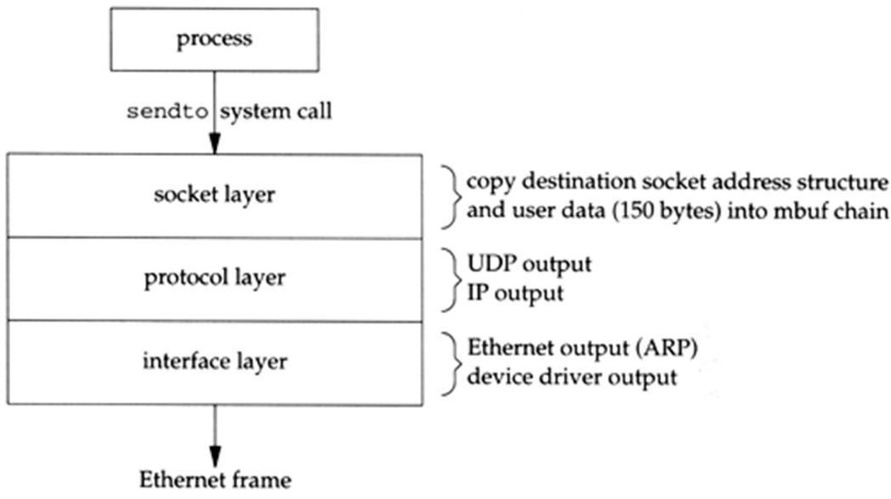

# 《TCP/IP网络设计与实现（双语）》期末复习要点

原件经识别和整理；“参考解答”是我们补的。

# TCP/IP网络设计与实现（双语）期末复习要点

本资料由识别工具读取《TCP/IP网络设计与实现（双语）》第 1–3 页内容整理而成，修正了明显的断行与乱码，按章节逻辑重组。

## Chapter 1: 代码的组织层次

### 选择 1
**题干**：mbuf 结构体的字段和其含义？
- **知识点**：数据缓冲管理

知识点：[mbuf 的用途及基本结构（m_data、m_len 等）](../../../topics/TCP-IP网络/mbuf用途与结构.md)

### 选择 2
**题干**：mdevget() 函数的功能是什么？
- **答案**：创建 mbuf 链表。
- **补充**：根据数据大小分为四种情况处理。

知识点：[mbuf 的用途及基本结构（m_data、m_len 等）](../../../topics/TCP-IP网络/mbuf用途与结构.md)

### 选择 3
**题干**：mget() 函数的作用是什么？（参考教材 P32）
- **答案**：分配 mbuf。

知识点：[带簇的 mbuf（M_EXT）包含的内容与使用场景](../../../topics/TCP-IP网络/带簇的mbuf.md)、[mbuf 的用途及基本结构（m_data、m_len 等）](../../../topics/TCP-IP网络/mbuf用途与结构.md)

### 选择 4
**题干**：mbuf 中用于放置分组的标志位是？
- **答案**：M_PKTHDR。

## Chapter 2: 接口与地址结构

知识点：[m_next 与 m_nextpkt 指针的作用与区别](../../../topics/TCP-IP网络/mbuf链表指针.md)、[mbuf 的用途及基本结构（m_data、m_len 等）](../../../topics/TCP-IP网络/mbuf用途与结构.md)、[带簇的 mbuf（M_EXT）包含的内容与使用场景](../../../topics/TCP-IP网络/带簇的mbuf.md)

### 简答 1
**题干**：ifnet 结构的作用是什么？
- **答案**：通用接口结构。

知识点：[网络接口与地址结构概览](../../../topics/TCP-IP网络/接口与地址结构概览.md)、[IPv4 地址结构 sockaddr_in](../../../topics/TCP-IP网络/sockaddr_in结构.md)

### 简答 2
**题干**：ifaddr 结构的作用是什么？
- **答案**：通用地址结构。

知识点：[接口的地址链表管理](../../../topics/TCP-IP网络/接口地址链表.md)

### 简答 3
**题干**：le\_softc 和 arpcom 分别代表什么结构？
- **答案**：
    - le\_softc：以太网的专用接口结构。
    - arpcom：通用以太网结构。

知识点：[接口的地址链表管理](../../../topics/TCP-IP网络/接口地址链表.md)、[接口层 ifnet 结构体的作用与字段](../../../topics/TCP-IP网络/ifnet结构.md)、[IPv4 地址结构 sockaddr_in](../../../topics/TCP-IP网络/sockaddr_in结构.md)

### 简答 4
**题干**：main 函数和 cpustartup 的功能是什么？（参考教材 P61）
- **答案**：系统启动时的初始化流程，具体涉及内核入口及 CPU 启动功能。

## Chapter 3: 以太网输入输出

知识点：[IP 地址分类（A/B/C/D/E 类）与子网掩码](../../../topics/TCP-IP网络/ip地址分类.md)、[子网划分与 CIDR 无类别域间路由](../../../topics/TCP-IP网络/子网划分与cidr.md)、[IPv4 地址结构 sockaddr_in](../../../topics/TCP-IP网络/sockaddr_in结构.md)

### 简答 5
**题干**：ether\_input() 函数的作用是什么？（参考教材 P82）
- **答案**：处理接收到的以太网帧，解析协议类型并分发到上层协议。需读懂其流程。

知识点：[接口层 ifnet 结构体的作用与字段](../../../topics/TCP-IP网络/ifnet结构.md)、[接口的地址链表管理](../../../topics/TCP-IP网络/接口地址链表.md)、[ARP 协议在以太网接口中的地址解析作用](../../../topics/TCP-IP网络/arp与以太网寻址.md)

### 简答 6
**题干**：ether\_output() 函数的主要步骤是什么？（参考教材 P84）
- **答案**：
    1. 验证目的地址。
    2. 进行特定协议处理。
    3. 构造帧头。
    4. 将数据放入接口排队。
    5. 调用 `arpresolve` 获取下一跳硬件地址（P85 line 93）。
       - 若成功：跳转到 P87，放入发送缓存并发送。
       - 若失败：直接 return。

## Chapter 4: IP 地址结构

知识点：[接口层 ifnet 结构体的作用与字段](../../../topics/TCP-IP网络/ifnet结构.md)、[接口的地址链表管理](../../../topics/TCP-IP网络/接口地址链表.md)、[网络接口与地址结构概览](../../../topics/TCP-IP网络/接口与地址结构概览.md)

### 简答 7
**题干**：struct in\_ifaddr 的作用是什么？（参考教材 P128）
- **答案**：IP 协议专用的地址结构。

知识点：[接口的地址链表管理](../../../topics/TCP-IP网络/接口地址链表.md)、[网络接口与地址结构概览](../../../topics/TCP-IP网络/接口与地址结构概览.md)、[IPv4 地址结构 sockaddr_in](../../../topics/TCP-IP网络/sockaddr_in结构.md)

### 简答 8
**题干**：全局变量 in\_ifaddr 和 ifnet\_addrs 指向什么？（参考教材 P126）
- **答案**：
    - `in\_ifaddr`：指向全部 IP 地址。
    - `ifnet\_addrs`：指向数据链路层地址（MAC）。
    - **补充**：数据链路层地址通常由 `ifaddr` 加上 2 个 `sockaddrdl` 组成（原文未听清具体细节，需结合教材确认）。

知识点：[接口的地址链表管理](../../../topics/TCP-IP网络/接口地址链表.md)、[IPv4 地址结构 sockaddr_in](../../../topics/TCP-IP网络/sockaddr_in结构.md)

### 简答 9
**题干**：图 6-8 和图 6-9 展示了什么内容？（参考教材 P128）
- **答案**：需看懂图中展示的地址结构关系及数据流向。

## Chapter 5: 协议初始化

知识点：[网络接口与地址结构概览](../../../topics/TCP-IP网络/接口与地址结构概览.md)、[mbuf 的用途及基本结构（m_data、m_len 等）](../../../topics/TCP-IP网络/mbuf用途与结构.md)、[IP 头部长度、字段解析与校验和错误处理](../../../topics/TCP-IP网络/ip头部格式.md)

### 简答 10
**题干**：domaininit() 函数的作用是什么？（参考教材 P153）
- **答案**：初始化协议域（Domain），注册各协议的处理函数。

知识点：[domaininit 等协议初始化过程](../../../topics/TCP-IP网络/协议初始化过程.md)、[protosw 结构的分配、初始化及 inetsw 数组中的多个条目](../../../topics/TCP-IP网络/protosw结构.md)、[Net/3 域（domain）与协议族常量的定义](../../../topics/TCP-IP网络/域与协议族常量.md)

### 简答 11
**题干**：ip\_protox 数组和 ipinit() 函数的作用是什么？（参考教材 P158）
- **答案**：
    - `ip\_protox`：用于映射 IP 头部中的协议号到对应的协议处理函数。
    - `ipinit()`：IP 协议的初始化函数。

## Chapter 6: 4.4BSD 网络支持与应用

知识点：[ip_init 初始化内容与 ip_protox 数组的作用](../../../topics/TCP-IP网络/ip_init初始化.md)、[protosw 结构的分配、初始化及 inetsw 数组中的多个条目](../../../topics/TCP-IP网络/protosw结构.md)、[domaininit 等协议初始化过程](../../../topics/TCP-IP网络/协议初始化过程.md)

### 选择 1
**题干**：4.4BSD 支持哪些通信协议族？（参考教材 P7）
- A. TCP/IP
- B. XNS (Xerox Network Systems)
- C. The OSI protocols
- D. The Unix domain protocols
- **答案**：A, B, C, D。

知识点：[mbuf 的用途及基本结构（m_data、m_len 等）](../../../topics/TCP-IP网络/mbuf用途与结构.md)

### 选择 2
**题干**：编写使用 Internet 协议的两个流行 API 是什么？（参考教材 P3）
- **答案**：Sockets 和 TLI (Transport Layer Interface)。

知识点：[mbuf 的用途及基本结构（m_data、m_len 等）](../../../topics/TCP-IP网络/mbuf用途与结构.md)

### 简答 12
**题干**：4.4BSD 内核中的网络代码分为哪三层？
- **答案**：
    1. Socket layer（套接字层）
    2. Protocol layer（协议层）
    3. Interface layer（接口层）
    - **补充**：接口层包含与网络设备通信的设备驱动程序。

知识点：[m_next 与 m_nextpkt 指针的作用与区别](../../../topics/TCP-IP网络/mbuf链表指针.md)、[第一个 mbuf 中数据量小于最小协议首部时的拉齐（pullup）调用](../../../topics/TCP-IP网络/首部拉齐机制.md)、[mbuf 的用途及基本结构（m_data、m_len 等）](../../../topics/TCP-IP网络/mbuf用途与结构.md)

### 简答 13
**题干**：当进程调用 socket 时，内核创建了哪些数据结构？
- **答案**：
    1. DTYPE SOCKET 类型的文件结构。
    2. inpcb 结构。
    3. socket 结构。

知识点：[4.4BSD 网络支持与应用接口概述](../../../topics/TCP-IP网络/bsd网络支持与应用.md)、[IPv4 地址结构 sockaddr_in](../../../topics/TCP-IP网络/sockaddr_in结构.md)、[protosw 结构的分配、初始化及 inetsw 数组中的多个条目](../../../topics/TCP-IP网络/protosw结构.md)

### 简答 14
**题干**：socket 系统调用的返回值是什么？请描述 descriptor 如何指向 socket 结构。（参考教材 P8）
- **答案**：
    - 返回值是一个 descriptor（描述符）。
    - **路径**：Descriptor -> 进程表项中的数组索引 -> 打开文件表结构 -> Socket 结构。

知识点：[4.4BSD 网络支持与应用接口概述](../../../topics/TCP-IP网络/bsd网络支持与应用.md)

### 简答 15
**题干**：当 UDP 数据报到达网络接口时，内核如何找到对应的 socket 结构？（参考教材 P10）
- **答案**：
    1. 内核遍历所有 UDP 协议控制块（PCB）。
    2. 基于目的 UDP 端口号，可能还包括目的 IP、源 IP 和源端口号进行匹配。
    3. 定位到 `inpcb` 结构后，通过 `inp_socket` 指针找到对应的 socket 结构。

知识点：[4.4BSD 网络支持与应用接口概述](../../../topics/TCP-IP网络/bsd网络支持与应用.md)、[UDP 输入（udp_input）在 4.4BSD-Lite 发行版中的处理流程](../../../topics/TCP-IP网络/udp输入处理.md)、[阻塞在 recvfrom 调用中的进程存放在套接字结构的何处以便被通知](../../../topics/TCP-IP网络/socket阻塞通知机制.md)

### 选择 3
**题干**：在 sendto 调用中，第五个参数指向 Internet 套接字地址结构，第六个参数指定长度。生成的 mbuf 的 `m_type` 成员是什么？（参考教材 P12）
- **答案**：MT_SONAME（套接字名称）。
- **补充**：该成员指定 mbuf 中包含的数据类型。

知识点：[带簇的 mbuf（M_EXT）包含的内容与使用场景](../../../topics/TCP-IP网络/带簇的mbuf.md)、[mbuf 的用途及基本结构（m_data、m_len 等）](../../../topics/TCP-IP网络/mbuf用途与结构.md)

### 简答 16
**题干**：UDP 套接字描述符对应的协议层主要做什么？（参考教材 P13）
- **答案**：
    1. 调用 UDP 输出例程（UDP output routine）。
    2. 传递已检查的 mbuf 指针作为参数。
    3. 在 150 字节数据前添加 IP 头和 UDP 头（分配新的 mbuf）。
    4. 填充头部信息。
    5. 将 mbuf 传递给 IP 输出例程。

知识点：[mbuf 的用途及基本结构（m_data、m_len 等）](../../../topics/TCP-IP网络/mbuf用途与结构.md)、[IP 头部长度、字段解析与校验和错误处理](../../../topics/TCP-IP网络/ip头部格式.md)、[UDP 输入（udp_input）在 4.4BSD-Lite 发行版中的处理流程](../../../topics/TCP-IP网络/udp输入处理.md)

### 简答 17
**题干**：对于 sendto 调用，套接字层复制目标套接字地址结构到 mbuf（图 1.6），数据复制到 mbuf 链（图 1.7）。随后调用的协议层例程是什么？（参考教材 P13）
- **答案**：(the UDP output routine) 被调用，并传递 mbuf 指针。

知识点：[UDP 输入（udp_input）在 4.4BSD-Lite 发行版中的处理流程](../../../topics/TCP-IP网络/udp输入处理.md)、[m_next 与 m_nextpkt 指针的作用与区别](../../../topics/TCP-IP网络/mbuf链表指针.md)

### 简答 18
**题干**：UDP 输出例程主要完成什么工作？（参考教材 P13）
- **答案**：
    1. 调用 UDP 输出例程，传递 mbuf 指针。
    2. 在 150 字节用户数据前预置 IP 头和 UDP 头（需分配新 mbuf）。
    3. 填充头部字段。
    4. 将 mbuf 链传递给 IP 输出例程。

## Chapter 7: 数据传输过程详解

知识点：[UDP 输入（udp_input）在 4.4BSD-Lite 发行版中的处理流程](../../../topics/TCP-IP网络/udp输入处理.md)、[Net/3 代码的组织层次与体系结构](../../../topics/TCP-IP网络/net3代码组织层次.md)

### 简答 19
**题干**：在示例程序的 sendto 调用中，内核对用户数据进行了三次完整的传输，请详细描述。（参考教材 P13）
- **答案**：
    1. **第一次**：将数据从用户缓冲区复制到内核的 mbuf 中。
    2. **第二次**：计算 UDP 校验和。
    3. **第三次**：接口处理输出队列上的 mbuf 时，将数据复制到发送缓冲区并发起输出。
       - **数据量**：共 192 字节（14 字节以太网头 + 20 字节 IP 头 + 8 字节 UDP 头 + 150 字节用户数据）。

知识点：[接口的输出队列与发送调度机制](../../../topics/TCP-IP网络/接口输出队列.md)、[mbuf 的用途及基本结构（m_data、m_len 等）](../../../topics/TCP-IP网络/mbuf用途与结构.md)、[以太网帧格式与首部解析](../../../topics/TCP-IP网络/以太网帧格式.md)

### 简答 20
**题干**：概述当进程调用 sendto 传输单个 UDP 数据报时发生的过程。（参考教材 P14）
- **答案**：
    
    *(注：此处为原图占位，实际复习需结合图示理解数据流)*

知识点：[例子程序从未为应用指定本地端口号时的自动分配机制](../../../topics/TCP-IP网络/应用本地端口号分配.md)、[UDP 输入（udp_input）在 4.4BSD-Lite 发行版中的处理流程](../../../topics/TCP-IP网络/udp输入处理.md)、[阻塞在 recvfrom 调用中的进程存放在套接字结构的何处以便被通知](../../../topics/TCP-IP网络/socket阻塞通知机制.md)

### 简答 21
**题干**：示例程序发送 UDP 数据报到 daytime 服务器并读取响应。如果调用 recvfrom 时回复尚未到达（输入队列为空），进程处于什么状态？（参考教材 P15）
- **答案**：进程进入睡眠状态（put to sleep）。

知识点：[mbuf 的用途及基本结构（m_data、m_len 等）](../../../topics/TCP-IP网络/mbuf用途与结构.md)、[阻塞在 recvfrom 调用中的进程存放在套接字结构的何处以便被通知](../../../topics/TCP-IP网络/socket阻塞通知机制.md)、[UDP 输入（udp_input）在 4.4BSD-Lite 发行版中的处理流程](../../../topics/TCP-IP网络/udp输入处理.md)

### 选择 4
**题干**：输入处理是同步的还是异步的？（参考教材 P15）
- **答案**：异步（Asynchronous）。

知识点：[m_next 与 m_nextpkt 指针的作用与区别](../../../topics/TCP-IP网络/mbuf链表指针.md)、[mbuf 的用途及基本结构（m_data、m_len 等）](../../../topics/TCP-IP网络/mbuf用途与结构.md)、[带簇的 mbuf（M_EXT）包含的内容与使用场景](../../../topics/TCP-IP网络/带簇的mbuf.md)

### 选择 5
**题干**：输入数据包的接收是由网络设备驱动器的接收完成中断触发的，还是由进程发出的系统调用触发的？（参考教材 P15）
- **答案**：由以太网设备驱动器的接收完成中断触发。

知识点：[m_next 与 m_nextpkt 指针的作用与区别](../../../topics/TCP-IP网络/mbuf链表指针.md)、[mbuf 的用途及基本结构（m_data、m_len 等）](../../../topics/TCP-IP网络/mbuf用途与结构.md)、[分配 mbuf 的函数（如 m_get、m_gethdr）](../../../topics/TCP-IP网络/mbuf分配函数.md)

### 简答 22
**题干**：在 4.4BSD-Lite 版本中，Ethernet Input 做了什么？（参考教材 P15）
- **答案**：
    1. 设备驱动程序将 mbuf 传递给通用的以太网输入例程。
    2. 查看以太网帧中的 type 字段，确定应接收数据的协议层。
    3. 若 type 指定为 IP 数据报，则将 mbuf 加入 IP 输入队列。
    4. 调度软件中断以执行 IP 输入处理例程。
    5. 设备的中断处理完成。

知识点：[收到以太网帧时设备驱动程序调用的函数及 m_devget 何时使用簇](../../../topics/TCP-IP网络/以太网帧接收处理.md)、[接口层的输入处理流程与层间通信队列](../../../topics/TCP-IP网络/接口输入处理.md)、[网络输入和输出时层间通信用哪些队列](../../../topics/TCP-IP网络/网络io层间通信队列.md)

### 简答 23
**题干**：IP 软件中断是由哪一层设置的？（socket layer / protocol layer / interface layer）
- **答案**：Interface layer（接口层）。

---
title: 《TCP/IP网络设计与实现（双语）》期末复习要点
kind: 复习要点
course: TCP/IP网络设计与实现
term: 
source: 识别工具读出内容（第 4–6 页）
---

# 《TCP/IP网络设计与实现（双语）》期末复习要点

本部分整理了《TCP/IP网络设计与实现（双语）》教材中关于 IP、UDP、mbuf 等核心机制的问答与知识点，主要涉及 BSD-Lite 实现细节及内存缓冲管理。

## 二、网络层与传输层输入处理

知识点：[阻塞在 recvfrom 调用中的进程存放在套接字结构的何处以便被通知](../../../topics/TCP-IP网络/socket阻塞通知机制.md)

### 选择 18

题干：What does the IP Input do in the 4.4BSD-Lite distribution? (IP 输入在 4.4BSD-Lite 发行版中做什么？)

参考解答：
IP 输入是异步的，由软件中断调度运行。当接口层从系统的一个接口接收到 IP 数据报时，会设置该软中断。当 IP 输入例程执行时，它会循环处理其输入队列上的每个 IP 数据报，直到整个队列处理完毕才返回。

IP 输入例程处理它接收到的每个 IP 数据报。具体步骤包括：
1. 验证 IP 头部校验和。
2. 处理任何 IP 选项。
3. 验证数据报是否交付给了正确的主机（通过比较数据报的目标 IP 地址与主机的 IP 地址）。
4. 如果系统配置为路由器且数据报发往其他 IP 地址，则转发该数据报。

如果 IP 数据报已到达最终目的地，IP 头部的协议字段指定调用哪个协议的输入例程：ICMP、IGMP、TCP 或 UDP。在示例中，调用 UDP 输入例程来处理 UDP 数据报。

知识点：[IP 输入（ip_input）在 4.4BSD-Lite 发行版中的处理流程](../../../topics/TCP-IP网络/ip输入处理.md)、[IP 头部长度、字段解析与校验和错误处理](../../../topics/TCP-IP网络/ip头部格式.md)、[路由器转发逻辑与 ip_forward 中的字节序转换](../../../topics/TCP-IP网络/ip转发逻辑.md)

### 选择 19

题干：What does the UDP input do in the 4.4BSD-Lite distribution? (UDP 输入在 4.4BSD-Lite 发行版中做什么？)

参考解答：
UDP 输入例程验证 UDP 头部中的字段（长度和可选校验和），然后确定是否有进程应该接收该数据报。

知识点：[阻塞在 recvfrom 调用中的进程存放在套接字结构的何处以便被通知](../../../topics/TCP-IP网络/socket阻塞通知机制.md)

### 简答 20

题干：在示例程序中，我们从未为应用程序指定本地端口号。我们将在练习 23.3 中看到，向尚未绑定本地端口号的套接字写入第一个 UDP 数据报的一个副作用是内核自动为该套接字分配一个本地端口号（称为临时端口）。这就是我们的套接字的 PCB 中的 `inp_lport` 成员被设置为某个非零值的原因。请在 `in_pcbconnect` 函数和 `in_pcbbind` 函数中找到相应的代码。[可以学完 23 章再做]

提示：
- P593 Figure 22.28. `in_pcbconnect` 函数：验证套接字对是否唯一。第 234-238 行：隐式绑定和临时端口的分配。
- P588 Figure 22.23. `in_pcbbind` 函数：选择一个临时端口。第 113-121 行。

知识点：[例子程序从未为应用指定本地端口号时的自动分配机制](../../../topics/TCP-IP网络/应用本地端口号分配.md)、[UDP 输入（udp_input）在 4.4BSD-Lite 发行版中的处理流程](../../../topics/TCP-IP网络/udp输入处理.md)、[阻塞在 recvfrom 调用中的进程存放在套接字结构的何处以便被通知](../../../topics/TCP-IP网络/socket阻塞通知机制.md)

### 简答 21

题干：What does the example process input do? (示例进程输入做了什么？)

参考解答：
我们的进程一直在内核中睡眠，在其对 `recvfrom` 的调用中被阻塞，现在进程唤醒。UDP 层附加到套接字接收队列上的 26 字节数据（接收到的数据报）由内核从 mbuf 复制到我们程序的缓冲区中。

注意，我们的程序将 `recvfrom` 的第 5 和第 6 个参数设置为空指针，告诉系统调用我们不关心接收发送者的 IP 地址和 UDP 端口号。这导致 `recvfrom` 系统调用跳过链中的第一个 mbuf（图 1.11），仅返回第二个 mbuf 中的 26 字节数据。内核的 `recvfrom` 代码随后释放图 1.11 中的两个 mbuf 并将它们返回到其空闲 mbuf 池中。

程序通过调用 `recvfrom` 读取服务器发送回的数据包。我们的程序用空字节覆盖回车符，并调用 `printf` 输出结果。

知识点：[mbuf 的用途及基本结构（m_data、m_len 等）](../../../topics/TCP-IP网络/mbuf用途与结构.md)、[阻塞在 recvfrom 调用中的进程存放在套接字结构的何处以便被通知](../../../topics/TCP-IP网络/socket阻塞通知机制.md)、[UDP 输入（udp_input）在 4.4BSD-Lite 发行版中的处理流程](../../../topics/TCP-IP网络/udp输入处理.md)

### 填空 22

题干：Which queues are used for communication between the layers for network input and output? (哪些队列用于网络输入和输出层之间的通信？)

答案：Socket queues, interface queues, protocol queues （套接字队列、接口队列、协议队列）

知识点：[网络输入和输出时层间通信用哪些队列](../../../topics/TCP-IP网络/网络io层间通信队列.md)、[接口的输出队列与发送调度机制](../../../topics/TCP-IP网络/接口输出队列.md)、[接口层的输入处理流程与层间通信队列](../../../topics/TCP-IP网络/接口输入处理.md)

### 简答 23

题干：Where should a process, if blocked in its call to recvfrom, be stored in a socket structure, so as to be notified? (如果一个进程在调用 recvfrom 时被阻塞，它应该存储在套接字结构的哪里以便被通知？)

参考解答：
*(注：原文仅给出问题，未直接给出答案文本，通常存储在该套接字的等待队列或阻塞列表中，具体取决于实现细节，此处保留原题供复习)*


## 三、Mbufs 内存缓冲机制

知识点：[阻塞在 recvfrom 调用中的进程存放在套接字结构的何处以便被通知](../../../topics/TCP-IP网络/socket阻塞通知机制.md)

### 选择 1

题干：What is the use of mbufs? (mbufs 的用途是什么？)

答案：The main use of mbufs is to hold the user data that travels from the process to the network interface, and vice versa. But mbufs are also used to contain a variety of other miscellaneous data: source and destination addresses, socket options, and so on.
(mbufs 的主要用途是持有从进程到网络接口以及反向传输的用户数据。但 mbufs 也用于包含各种其他杂项数据：源地址和目标地址、套接字选项等。)

知识点：[mbuf 的用途及基本结构（m_data、m_len 等）](../../../topics/TCP-IP网络/mbuf用途与结构.md)

### 选择 2

题干：In each of the mbufs, the m_data member points to the beginning of the corresponding buffer (either the mbuf buffer itself or a cluster). Can this pointer point anywhere in the corresponding buffer, not necessarily the front? Yes (Yes/No).
(在每个 mbuf 中，m_data 成员指向相应缓冲区的开头（mbuf 缓冲区本身或集群）。此指针可以指向相应缓冲区中的任意位置，而不一定是前面吗？是的（是/否）。)

答案：Yes

知识点：[mbuf 的用途及基本结构（m_data、m_len 等）](../../../topics/TCP-IP网络/mbuf用途与结构.md)

### 选择 3

题干：Mbufs with a cluster always contain the starting address of the buffer (m_ext.ext_buf) and its size (m_ext.ext_size).
(带有集群的 Mbufs 总是包含缓冲区的起始地址 (m_ext.ext_buf) 及其大小 (m_ext.ext_size)。)

答案：*(隐含正确，作为知识点陈述)*

知识点：[带簇的 mbuf（M_EXT）包含的内容与使用场景](../../../topics/TCP-IP网络/带簇的mbuf.md)、[mbuf 的用途及基本结构（m_data、m_len 等）](../../../topics/TCP-IP网络/mbuf用途与结构.md)

### 选择 4

题干：The m_next pointer links together the mbufs forming a single packet (record) into an mbuf chain, where the first mbuf has an m_flags value of M_PKTHDR, specifying a packet header.
(m_next 指针将形成单个数据包（记录）的 mbufs 链接成一个 mbuf 链，其中第一个 mbuf 具有 m_flags 值 M_PKTHDR，指定数据包头部。)

答案：*(隐含正确，作为知识点陈述)*

知识点：[m_next 与 m_nextpkt 指针的作用与区别](../../../topics/TCP-IP网络/mbuf链表指针.md)、[mbuf 的用途及基本结构（m_data、m_len 等）](../../../topics/TCP-IP网络/mbuf用途与结构.md)、[带簇的 mbuf（M_EXT）包含的内容与使用场景](../../../topics/TCP-IP网络/带簇的mbuf.md)

### 选择 5

题干：The m_nextpkt pointer links multiple packets (records) together to form a queue of mbufs.
(m_nextpkt 指针将多个数据包（记录）链接在一起以形成 mbufs 队列。)

答案：*(隐含正确，作为知识点陈述)*

知识点：[m_next 与 m_nextpkt 指针的作用与区别](../../../topics/TCP-IP网络/mbuf链表指针.md)、[mbuf 的用途及基本结构（m_data、m_len 等）](../../../topics/TCP-IP网络/mbuf用途与结构.md)、[分配 mbuf 的函数（如 m_get、m_gethdr）](../../../topics/TCP-IP网络/mbuf分配函数.md)

### 选择 7

题干：The function that allocates an mbuf is m_get.
(分配 mbuf 的函数是 m_get。)

答案：*(隐含正确，作为知识点陈述)*

知识点：[分配 mbuf 的函数（如 m_get、m_gethdr）](../../../topics/TCP-IP网络/mbuf分配函数.md)

### 选择 8

题干：When an Ethernet frame is received, the device driver calls the function m_devget to create an mbuf chain and copy the frame from the device into the chain.
(当收到以太网帧时，设备驱动程序调用函数 m_devget 来创建 mbuf 链并将帧从设备复制到链中。)

答案：*(隐含正确，作为知识点陈述)*

知识点：[收到以太网帧时设备驱动程序调用的函数及 m_devget 何时使用簇](../../../topics/TCP-IP网络/以太网帧接收处理.md)、[分配 mbuf 的函数（如 m_get、m_gethdr）](../../../topics/TCP-IP网络/mbuf分配函数.md)

### 选择 9

题干：m_devget creates an mbuf chain. If the amount of data is greater than or equal to 208 bytes (MINCLBYTES), one or more clusters are used.
(m_devget 创建 mbuf 链。如果数据量大于或等于 208 字节 (MINCLBYTES)，则使用一个或多个集群。)

答案：*(隐含正确，作为知识点陈述)*

知识点：[带簇的 mbuf（M_EXT）包含的内容与使用场景](../../../topics/TCP-IP网络/带簇的mbuf.md)、[收到以太网帧时设备驱动程序调用的函数及 m_devget 何时使用簇](../../../topics/TCP-IP网络/以太网帧接收处理.md)

### 选择 10

题干：The macro mtod returns a pointer to the data associated with an mbuf, and casts the pointer to a specified type.
(mtod 宏返回指向与 mbuf 关联的数据的指针，并将指针转换为指定类型。)

答案：*(隐含正确，作为知识点陈述)*

知识点：[宏 mtod 和 dtom 的作用](../../../topics/TCP-IP网络/mtod与dtom宏.md)

### 选择 11

题干：The macro dtom takes a pointer to data anywhere within the data portion of the mbuf and returns a pointer to the mbuf structure itself.
(dtom 宏接受指向 mbuf 数据部分中任意数据的指针，并返回指向 mbuf 结构本身的指针。)

答案：*(隐含正确，作为知识点陈述)*

知识点：[宏 mtod 和 dtom 的作用](../../../topics/TCP-IP网络/mtod与dtom宏.md)

### 简答 12

题干：When one of the protocols (IP, ICMP, IGMP, UDP, or TCP) finds that the amount of data in the first mbuf (m_len) is less than the size of the minimum protocol header (e.g., 20 for IP, 8 for UDP, 20 for TCP), m_pullup is called on the assumption that the remaining part of the header is in the next mbuf on the chain. The code is as below:
(当一个协议（IP、ICMP、IGMP、UDP 或 TCP）发现第一个 mbuf 中的数据量 (m_len) 小于最小协议头部的大小（例如，IP 为 20，UDP 为 8，TCP 为 20）时，假设头部的剩余部分在链中的下一个 mbuf 中，将调用 m_pullup。代码如下：)

Chapter 2. Mbufs: Memory Buffers


# TCP/IP网络设计与实现（双语）期末复习要点

本资料为《TCP/IP网络设计与实现（双语）》期末复习要点第 3 部分，内容涵盖 mbuf 机制、接口层、以太网接口及 IP 地址结构等相关知识点。

## 第三章 接口层

知识点：[m_next 与 m_nextpkt 指针的作用与区别](../../../topics/TCP-IP网络/mbuf链表指针.md)、[第一个 mbuf 中数据量小于最小协议首部时的拉齐（pullup）调用](../../../topics/TCP-IP网络/首部拉齐机制.md)、[mbuf 的用途及基本结构（m_data、m_len 等）](../../../topics/TCP-IP网络/mbuf用途与结构.md)

### 简答 1

当系统初始化时，为每个网络接口分配 `ifnet` 和 `ifaddr` 结构。

答案：P73 at system initialization time

知识点：[网络接口与地址结构概览](../../../topics/TCP-IP网络/接口与地址结构概览.md)、[IPv4 地址结构 sockaddr_in](../../../topics/TCP-IP网络/sockaddr_in结构.md)

### 简答 2

`ifnet` 结构链接到 `ifnet` 列表中。

答案：P73

知识点：[接口的地址链表管理](../../../topics/TCP-IP网络/接口地址链表.md)

### 简答 3

`cpu_startup` (`cpu_startup` / `pdev_attach` 函数) 定位并初始化连接到系统的所有硬件设备，包括任何网络接口。

答案：P61

知识点：[接口的地址链表管理](../../../topics/TCP-IP网络/接口地址链表.md)、[接口层 ifnet 结构体的作用与字段](../../../topics/TCP-IP网络/ifnet结构.md)、[IPv4 地址结构 sockaddr_in](../../../topics/TCP-IP网络/sockaddr_in结构.md)

### 简答 4

每个网络接口的设备驱动程序初始化一个专门的 `ifnet` 结构，并调用 `if_attach` 将该结构插入到接口链接列表中。`le_softc` 结构是 Net/3 中 LANCE Ethernet 设备驱动程序的专用 `ifnet` 结构。`arpcom` 结构是所有以太网驱动程序通用的。

答案：P60

知识点：[IP 地址分类（A/B/C/D/E 类）与子网掩码](../../../topics/TCP-IP网络/ip地址分类.md)、[子网划分与 CIDR 无类别域间路由](../../../topics/TCP-IP网络/子网划分与cidr.md)、[IPv4 地址结构 sockaddr_in](../../../topics/TCP-IP网络/sockaddr_in结构.md)

### 简答 5

内核通过为 `ifaddr` 结构和两个 `sockaddr_dl` 结构分配内存来构建链路层地址——一个用于链路层地址本身，另一个用于链路层地址掩码。

答案：P60

知识点：[接口层 ifnet 结构体的作用与字段](../../../topics/TCP-IP网络/ifnet结构.md)、[接口的地址链表管理](../../../topics/TCP-IP网络/接口地址链表.md)、[ARP 协议在以太网接口中的地址解析作用](../../../topics/TCP-IP网络/arp与以太网寻址.md)

### 简答 6

每次调用 `if_attach` 时，它向 `ifnet` 列表添加另一个 `ifnet` 结构，为接口创建包含两个 `sockaddr_dl` 结构的链路层 `ifaddr` 结构，并初始化 `ifnet_addrs` 数组中的条目。

答案：P67

## 第四章 接口：以太网

知识点：[接口层 ifnet 结构体的作用与字段](../../../topics/TCP-IP网络/ifnet结构.md)、[接口的地址链表管理](../../../topics/TCP-IP网络/接口地址链表.md)、[网络接口与地址结构概览](../../../topics/TCP-IP网络/接口与地址结构概览.md)

### 简答 1

在 `leread` 中，`m_devget` 将从缓冲区传递的数据复制到它分配的 mbuf 链中。

答案：P81

知识点：[网络接口与地址结构概览](../../../topics/TCP-IP网络/接口与地址结构概览.md)、[IPv4 地址结构 sockaddr_in](../../../topics/TCP-IP网络/sockaddr_in结构.md)

### 简答 2

`ether_input` 根据以太网类型字段进行跳转。对于 IP 数据包，`schednetisr` 调度 IP 软件中断，并选择 IP 输入队列 `ipintrq`。（请写出相应代码）。对于 ARP 数据包，调度 ARP 软件中断，并选择 `arpintrq`。

答案：P83 代码

知识点：[接口的地址链表管理](../../../topics/TCP-IP网络/接口地址链表.md)

### 简答 3

在 `ether_output` 中，`AF_INET` 情况调用 `arpresolve` 来确定对应于目标 IP 地址的以太网地址。如果以太网地址已在 ARP 缓存中，`arpresolve` 返回 1，`ether_output` 继续执行。否则，此 IP 数据包被 ARP 保持，当 ARP 确定地址时，它从 `in_arpinput` 函数中的函数调用 `ether_output`。

答案：P86

## 第五章 IP 地址结构相关

知识点：[接口的地址链表管理](../../../topics/TCP-IP网络/接口地址链表.md)、[接口层 ifnet 结构体的作用与字段](../../../topics/TCP-IP网络/ifnet结构.md)、[IPv4 地址结构 sockaddr_in](../../../topics/TCP-IP网络/sockaddr_in结构.md)

### 简答 1

IP 专用的接口地址结构和协议地址结构：`in_ifaddr` 和 `sockaddr_in`。

答案：p126

知识点：[网络接口与地址结构概览](../../../topics/TCP-IP网络/接口与地址结构概览.md)、[IPv4 地址结构 sockaddr_in](../../../topics/TCP-IP网络/sockaddr_in结构.md)

### 简答 2

`in_ifaddr` 以通用接口地址结构 `ia_ifa` 开头，后跟 IP 特定成员。

答案：p127

知识点：[接口的地址链表管理](../../../topics/TCP-IP网络/接口地址链表.md)

### 简答 3

为分配给接口的每个 IP 地址分配一个 `in_ifaddr` 结构，并将其添加到接口地址列表 `sockaddr_in` 以及全局 IP 地址列表 `in_ifaddr` 中。所有链路层地址都可以从 `ifnet_addrs` 数组访问。

答案：p127 all the link-level addresses can be accessed from the ifnet_addrs array.P125

知识点：[接口的地址链表管理](../../../topics/TCP-IP网络/接口地址链表.md)、[接口层 ifnet 结构体的作用与字段](../../../topics/TCP-IP网络/ifnet结构.md)、[IPv4 地址结构 sockaddr_in](../../../topics/TCP-IP网络/sockaddr_in结构.md)

### 简答 4

你认为为什么 `sockaddr_in` 结构中的 `sin_addr` 最初被定义为结构体？

在 IP 子网划分之前（RFC 950 [Mogul and Postel 1985]），IP 地址的网络部分和主机部分总是出现在字节边界上。`in_addr` 结构的定义为：

The Internet address could be accessed as 8-bit bytes, 16-bit words, or a single 32-bit address. The macros s_host, s_net, s_imp, and so on have names that correspond to the physical structure of early TCP/IP networks. The use of subnetting and supernetting makes the byte and word divisions obsolete.

答案：Before IP subnetting (RFC 950 [Mogul and Postel 1985]), the network and host portions of IP addresses always appeared on byte boundaries. The definition of an in_addr structure was

The Internet address could be accessed as 8-bit bytes, 16-bit words, or a single 32-bit address. The macros s_host, s_net, s_imp, and so on have names that correspond to the physical structure of early TCP/IP networks. The use of subnetting and supernetting makes the byte and word divisions obsolete.

知识点：[IP 地址分类（A/B/C/D/E 类）与子网掩码](../../../topics/TCP-IP网络/ip地址分类.md)、[子网划分与 CIDR 无类别域间路由](../../../topics/TCP-IP网络/子网划分与cidr.md)、[IPv4 地址结构 sockaddr_in](../../../topics/TCP-IP网络/sockaddr_in结构.md)

### 简答 5

既然 IP 地址已经包含在接口地址列表上的 `ifaddr` 结构中，为什么还要在 `ac_ipaddr` 中复制 IP 地址？

接口输出函数（如 `ether_output`）仅指向接口的 `ifnet` 结构指针，而不是 `ifaddr` 结构指针。使用 `arpcom` 结构中的 IP 地址（即分配给接口的最后一个 IP 地址）避免了必须从 `ifaddr` 地址列表中选择地址的需要。

答案：The interface output functions, such as ether_output, have a pointer only to the ifnet structure for the interface, and not to an ifaddr structure. Using the IP address in the arpcom structure (which is the last IP address assigned to the interface) avoids having to select an address from the ifaddr address list.

## 第六章 IP 寻址

本章标题为“Chapter 6. IP Addressing”，后续内容为空或未提供具体题目。

## 第 7 章 域与协议

知识点：[接口层 ifnet 结构体的作用与字段](../../../topics/TCP-IP网络/ifnet结构.md)、[接口的地址链表管理](../../../topics/TCP-IP网络/接口地址链表.md)、[ARP 协议在以太网接口中的地址解析作用](../../../topics/TCP-IP网络/arp与以太网寻址.md)

### 7.1

Net/3 把相关的协议组织成一个域（domain），并用协议族常量来标识每个域。（P146）

知识点：[Net/3 域（domain）与协议族常量的定义](../../../topics/TCP-IP网络/域与协议族常量.md)、[Net/3 代码的组织层次与体系结构](../../../topics/TCP-IP网络/net3代码组织层次.md)

### 7.2

在编译时，Net/3 为内核中的每个协议分配并初始化一个 `protosw` 结构，并把同一域内所有协议的结构组成一个数组。（P148）

知识点：[protosw 结构的分配、初始化及 inetsw 数组中的多个条目](../../../topics/TCP-IP网络/protosw结构.md)

### 7.3

内核可以通过提供多个 `protosw` 表项，为同一协议提供多个接口。在 Net/3 内核的 `inetsw` 数组中，哪个协议有 3 个 `protosw` 结构？（P152）

答案：IP 协议。

知识点：[protosw 结构的分配、初始化及 inetsw 数组中的多个条目](../../../topics/TCP-IP网络/protosw结构.md)

### 7.4

当进程创建套接字时，会调用 `pffindproto` 和 `pffindtype` 函数来定位合适的 `protosw` 表项。（P155）

知识点：[protosw 结构的分配、初始化及 inetsw 数组中的多个条目](../../../topics/TCP-IP网络/protosw结构.md)、[pffindproto 和 pffindtype 函数的功能、调用示例及返回值说明](../../../topics/TCP-IP网络/pffindproto与pffindtype.md)

### 7.5

在系统初始化时，`domaininit` 把各域链接到 `domains` 链表中，调用域和协议的初始化函数，并调用快速和慢速超时函数。（P153）

知识点：[domaininit 等协议初始化过程](../../../topics/TCP-IP网络/协议初始化过程.md)、[Net/3 代码的组织层次与体系结构](../../../topics/TCP-IP网络/net3代码组织层次.md)、[Net/3 域（domain）与协议族常量的定义](../../../topics/TCP-IP网络/域与协议族常量.md)

### 7.6

调用哪个 `pffindproto` 会返回指向 `inetsw[6]` 的指针？（P155）

答案：`pffindproto(PF_INET, 0, SOCK_RAW);`

调用哪个 `pffindproto` 会返回指向 `inetsw[1]` 的指针？

答案：`pffindtype(PF_INET, SOCK_DGRAM);`

调用哪个 `pffindtype` 会返回指向 `inetsw[2]` 的指针？

答案：`pffindtype(PF_INET, SOCK_STREAM);`

知识点：[protosw 结构的分配、初始化及 inetsw 数组中的多个条目](../../../topics/TCP-IP网络/protosw结构.md)、[pffindproto 和 pffindtype 函数的功能、调用示例及返回值说明](../../../topics/TCP-IP网络/pffindproto与pffindtype.md)

### 7.7

`pffindtype(PF_INET, SOCK_RAW)` 返回指向 `inetsw` 数组中的哪个 `protosw` 结构？（P156）

答案：返回指向匹配协议的 `protosw` 结构的指针，或空指针（第 7.6 节）。

知识点：[pffindproto 和 pffindtype 函数的功能、调用示例及返回值说明](../../../topics/TCP-IP网络/pffindproto与pffindtype.md)、[protosw 结构的分配、初始化及 inetsw 数组中的多个条目](../../../topics/TCP-IP网络/protosw结构.md)、[ip_init 初始化内容与 ip_protox 数组的作用](../../../topics/TCP-IP网络/ip_init初始化.md)

### 7.8

`ip_init` 初始化 IP 重组队列 `ipq`，用系统时钟为 `ip_id` 播种，并把 IP 输入队列（`ipintrq`）的最大长度设为 50（`ipqmaxlen`）。（P159）

知识点：[ip_init 初始化内容与 ip_protox 数组的作用](../../../topics/TCP-IP网络/ip_init初始化.md)、[m_next 与 m_nextpkt 指针的作用与区别](../../../topics/TCP-IP网络/mbuf链表指针.md)

### 7.9

IP 必须对到达的数据报进行分用，并交给相应的传输层协议。这由 `ip_protox` 数组完成。该数组把协议号映射到 `inetsw` 数组中的表项。（P157）

## 第 8 章 IP：网际协议

知识点：[ip_init 初始化内容与 ip_protox 数组的作用](../../../topics/TCP-IP网络/ip_init初始化.md)、[protosw 结构的分配、初始化及 inetsw 数组中的多个条目](../../../topics/TCP-IP网络/protosw结构.md)

### 8.1

标准 IP 首部长度为 20 字节，其后最多可跟 40 字节选项。IP 可以把大的数据报分片后传输，并在最终目的地重组。

知识点：[IP 头部长度、字段解析与校验和错误处理](../../../topics/TCP-IP网络/ip头部格式.md)、[IP 分片的触发条件与 MTU 限制](../../../topics/TCP-IP网络/分片触发条件.md)

### 8.2

如果系统被配置为路由器，那么尚未到达最终目的地的数据报会被送到 `ip_forward`（`ipintr`/`ip_forward`），以便朝着最终目的地进行路由。

知识点：[路由器转发逻辑与 ip_forward 中的字节序转换](../../../topics/TCP-IP网络/ip转发逻辑.md)、[TTL 递减时机与路由环路检测](../../../topics/TCP-IP网络/ttl递减.md)、[IP 路由查询过程与最长前缀匹配](../../../topics/TCP-IP网络/路由查询过程.md)

### 8.3

如果未指定 `ip_src`，那么 `ip_output` 会选择出接口的 IP 地址 `ia` 作为源地址。

知识点：[源地址选择规则与多宿主主机源地址](../../../topics/TCP-IP网络/源地址选择.md)、[为什么在特定代码路径中丢弃 ip_output 的返回值](../../../topics/TCP-IP网络/ip_output返回值丢弃.md)、[接口的输出队列与发送调度机制](../../../topics/TCP-IP网络/接口输出队列.md)

### 8.4

说明 `ip_protox` 数组何时初始化及其作用，并写出在 `ipintr` 中使用 `ip_protox` 的代码。（P157）

答案：内核在协议初始化期间构造 `ip_protox`，如 Figure 7.23 所述。像 IP 这样的网络层协议必须对到达的数据报进行分用，并交给相应的传输层协议。为此，必须根据数据报中出现的协议号导出合适的 `protosw` 结构。对于 Internet 协议，这由 `ip_protox` 数组完成。当系统初始化时由 `domaininit` 调用 `ip_init` 函数，`ip_protox` 数组即被初始化。

知识点：[ip_init 初始化内容与 ip_protox 数组的作用](../../../topics/TCP-IP网络/ip_init初始化.md)、[protosw 结构的分配、初始化及 inetsw 数组中的多个条目](../../../topics/TCP-IP网络/protosw结构.md)、[domaininit 等协议初始化过程](../../../topics/TCP-IP网络/协议初始化过程.md)

### 8.5

当没有任何接口被分配 IP 地址时，IP 应当接收广播包吗？

答案：大概不应当。由于没有可用于回复的源地址，系统无法响应任何广播。

知识点：[特殊 IP 地址（广播、组播、环回、全零）及无 IP 地址时的广播包处理](../../../topics/TCP-IP网络/特殊ip地址.md)、[源地址选择规则与多宿主主机源地址](../../../topics/TCP-IP网络/源地址选择.md)、[接口的地址链表管理](../../../topics/TCP-IP网络/接口地址链表.md)

### 8.6

当到达的 IP 包有校验和错误时，为什么不向发送方返回错误消息？

答案：由于包已被损坏，无法知道首部中的地址是否正确。

知识点：[IP 头部长度、字段解析与校验和错误处理](../../../topics/TCP-IP网络/ip头部格式.md)、[IP 差错与 ICMP 差错报文汇总（不可达、超时、参数问题等）](../../../topics/TCP-IP网络/icmp差错报文汇总.md)

### 8.7

假设多宿主主机上的某个进程为其发出的包选择了显式源地址。再假设该包的目的地是通过另一个接口到达的，而不是被选作包源地址的那个接口。当第一跳路由器发现这些包应当经过另一台路由器时会发生什么？会向该主机发送重定向消息吗？

答案：如果应用程序选择的源地址与所选出接口的地址不同，那么来自所选下一跳路由器的重定向就会失败。下一跳路由器看到的源地址与其传输所在子网的地址不同，因此不会发送重定向消息。这是实现弱端系统模型的结果，RFC 1122 中对此有说明。

知识点：[IP 重定向的产生条件与 ICMP 重定向报文发送](../../../topics/TCP-IP网络/ip重定向.md)、[源地址选择规则与多宿主主机源地址](../../../topics/TCP-IP网络/源地址选择.md)

### 8.8

在 Figure 8.17 中，为什么必须在测试 `ip_ttl` 之后（而不是之前）递减它？

答案：TTL 的递减是在与 1 比较之后进行的，以避免把收到的 TTL 值 0 递减成 255 这一潜在错误。

知识点：[TTL 递减时机与路由环路检测](../../../topics/TCP-IP网络/ttl递减.md)

### 8.9

如果两台路由器各自把对方视为某个包的最佳下一跳目的地，会发生什么？

答案：如果两台路由器各自把对方视为某个包的最佳下一跳，就存在路由环路。在环路被消除之前，原始包会在两台路由器之间来回弹跳；如果源主机与这两台路由器在同一网络上，每台路由器都会向源主机发回一个 ICMP 重定向。路由更新期间路由表暂时不一致时可能出现环路。原始包的 TTL 最终会减到 0，包被丢弃。这是 TTL 字段存在的主要原因之一。

知识点：[TTL 递减时机与路由环路检测](../../../topics/TCP-IP网络/ttl递减.md)、[IP 重定向的产生条件与 ICMP 重定向报文发送](../../../topics/TCP-IP网络/ip重定向.md)

### 8.10

`ip_forward` 在调用 `icmp_error` 之前把分片 id 从主机字节序转换为网络字节序。为什么它不也转换分片偏移？

答案：ICMP 错误消息只针对数据报的初始分片生成，而初始分片的偏移总是 0。0 的主机字节序形式和网络字节序形式相同，因此无需转换。

## 一、IP 分片与重组 (Chapter 10)

知识点：[IP 分片的触发条件与 MTU 限制](../../../topics/TCP-IP网络/分片触发条件.md)

### 节 1：分片触发条件

`ip_output` 函数在发送数据报时，如果数据报太大无法通过选定的网络传输，则将其拆分为多个片段。判断语句如下（P184）：

```c
if ((u_short) ip->ip_len > ifp->if_mtu) { ... }
```

过大的数据包被拆分成两个或更多 IP 片段，每个片段都足够小，以便在选定网络上传输。

知识点：[IP 分片的触发条件与 MTU 限制](../../../topics/TCP-IP网络/分片触发条件.md)、[如何确定每个片段中的数据字节数（分片偏移计算）](../../../topics/TCP-IP网络/片段大小确定.md)、[为何只有目的主机能重组原始数据报及重组函数实现](../../../topics/TCP-IP网络/目的主机重组.md)

### 节 2：为何只有目的主机能重组原始数据报？

因为各个片段可能通过不同的路径到达目的主机，只有目的主机才有机会看到所有的片段，从而进行重组。

知识点：[为何只有目的主机能重组原始数据报及重组函数实现](../../../topics/TCP-IP网络/目的主机重组.md)、[IP 分片的触发条件与 MTU 限制](../../../topics/TCP-IP网络/分片触发条件.md)、[路由器转发逻辑与 ip_forward 中的字节序转换](../../../topics/TCP-IP网络/ip转发逻辑.md)

### 节 3：如何确定片段大小（每个片段中的数据字节数）？

参考 P220 代码示例 10-6。

虽然分片算法本身很直接，但其实现因 mbuf 结构和链的操作而变得复杂。如果 DF 位禁止了分片，`ip_output` 会丢弃该数据包并返回 `EMSGSIZE` 错误。如果数据报是由本机生成的，传输协议会将错误传递回进程；但如果数据报正在被转发，`ip_forward` 会生成一个 ICMP“目的地不可达”错误，指示该数据包在不进行分片的情况下无法被转发（参见图 8.21）。

Net/3 不实现用于探测到目的地的路径并发现所有中间网络支持的最大传输单元的路径 MTU 发现算法。Volume 1 的第 11.8 节和 24.2 节描述了 UDP 和 TCP 的路径 MTU 发现。

知识点：[IP 分片的触发条件与 MTU 限制](../../../topics/TCP-IP网络/分片触发条件.md)、[如何确定每个片段中的数据字节数（分片偏移计算）](../../../topics/TCP-IP网络/片段大小确定.md)、[m_next 与 m_nextpkt 指针的作用与区别](../../../topics/TCP-IP网络/mbuf链表指针.md)

### 节 4：IP 处理过程中可能遇到的错误或异常及发送的 ICMP 差错报文

1.  **TTL 超时**：如果 `ip_ttl` 达到 1（执行 `IPTTLDEC`），向发送者返回一个 ICMP“时间超过”消息，并丢弃该数据包。
2.  **路由查找失败**：IP 转发算法在全局路由结构 `ipforward_rt` 中缓存最近的路由，并尽可能将其应用于当前数据包。如果缓存为空，或者当前数据包的目的地址与 `ipforward_rt` 中的路由条目不同，则丢弃之前的路由，将 `ro_dst` 初始化为新的目的地址，并由 `rtalloc` 查找通往当前数据包目的地的路由。如果找不到通往目的地的路由，返回一个 ICMP“主机不可达”错误并丢弃数据包。
3.  **重定向**：当源主机错误地将路由器选为数据包的第一跳目的地时，第一跳路由器向源主机返回一个 ICMP“重定向”消息。
4.  **转发时的 ICMP 发送**：`ip_forward` 可能需要发送 ICMP 消息，因为 `ip_output` 失败或有待处理的重定向。
5.  **DF 置位导致的分片失败**：在分片算法中，如果 DF 位禁止分片，`ip_output` 丢弃数据包并返回 `EMSGSIZE`。如果是本机生成的数据报，传输协议将错误传回进程；如果是转发数据报，`ip_forward` 生成 ICMP“目的地不可达”错误，指示不进行分片无法转发。
6.  **重组超时**：RFC 1122 建议重组时间在 60 到 120 秒之间。如果定时器过期且已接收到数据报的第一个片段，应向源主机发送 ICMP“时间超过”错误。

知识点：[IP 分片处理过程中可能遇到的错误或异常及发送的 ICMP 差错报文](../../../topics/TCP-IP网络/分片异常与icmp差错.md)、[IP 重定向的产生条件与 ICMP 重定向报文发送](../../../topics/TCP-IP网络/ip重定向.md)、[TTL 递减时机与路由环路检测](../../../topics/TCP-IP网络/ttl递减.md)

### 节 5：重组函数

`ip_reass` (`ip_reass/ip_slowtimo`) 接收传入的片段并尝试重组数据报。如果成功，数据报被传回 `ipintr`，然后传递给适当的传输协议。`ip_slowtimo` (`ip_reass/ip_slowtimo`) 在所有片段未在合理时间内全部收到时，丢弃不完整的数据报。（P238）

---

## 二、ICMP: Internet Control Message Protocol (Chapter 11)

知识点：[为何只有目的主机能重组原始数据报及重组函数实现](../../../topics/TCP-IP网络/目的主机重组.md)、[IP 分片处理过程中可能遇到的错误或异常及发送的 ICMP 差错报文](../../../topics/TCP-IP网络/分片异常与icmp差错.md)

### 节 1：IP 处理过程中的差错及 ICMP 报文（中文回答）

内容与 Chapter 10 习题 5 相同。主要涉及 `ip_forward`：

1.  可能会由于 `ip_output` 失败或重定向而发送 ICMP 报文（书 P180 第 5 点）。
2.  当收到数据报的第一个分片且定时器超时时，向源主机发送一个 ICMP 超时差错报文。
3.  当路由器收到一个需要分片的数据报，而 IP 首部 ‘DF’ 位置 1 时，发送 ICMP 不可达差错报文。

知识点：[路由器转发逻辑与 ip_forward 中的字节序转换](../../../topics/TCP-IP网络/ip转发逻辑.md)、[IP 分片处理过程中可能遇到的错误或异常及发送的 ICMP 差错报文](../../../topics/TCP-IP网络/分片异常与icmp差错.md)、[IP 差错与 ICMP 差错报文汇总（不可达、超时、参数问题等）](../../../topics/TCP-IP网络/icmp差错报文汇总.md)

### 节 2：为何 `icmp_input` 将过时的 ICMP Information Request 传递给 `rip_input` 而不是丢弃它？

通过将消息传递给 `rip_input`，用户级守护进程可以进行响应，从而继续支持依赖此行为的旧系统。

知识点：[icmp_input 函数处理流程及过时 Information Request 传递给 rip_input 的原因](../../../topics/TCP-IP网络/icmp_input处理.md)、[ICMP 报文类型（差错报告与查询报文）概览](../../../topics/TCP-IP网络/icmp报文类型.md)

### 节 3：Net/3 在将 IP 数据包包含在 ICMP 错误消息中之前，不会将偏移量和长度字段转换为网络字节序。为什么这对 IP 偏移量字段来说无关紧要？

ICMP 错误仅针对 IP 数据报的**初始片段**发送。由于初始片段的偏移值始终为 0，因此该字节的顺序并不重要。

知识点：[Net/3 构造 ICMP 差错报文时不转换 IP 偏移量和长度字段字节序的原因分析](../../../topics/TCP-IP网络/icmp字节序细节.md)、[IP 头部长度、字段解析与校验和错误处理](../../../topics/TCP-IP网络/ip头部格式.md)、[IP 分片的触发条件与 MTU 限制](../../../topics/TCP-IP网络/分片触发条件.md)

### 节 4：在图 11.30 中，如果数据包的 `ip_off` 最高位被设置，会发生什么？

最高位是保留位，必须为 0。如果设置了该位，`icmp_error` 将丢弃该数据包。

知识点：[IP 头部长度、字段解析与校验和错误处理](../../../topics/TCP-IP网络/ip头部格式.md)、[IP 分片处理过程中可能遇到的错误或异常及发送的 ICMP 差错报文](../../../topics/TCP-IP网络/分片异常与icmp差错.md)、[ICMP 报文类型（差错报告与查询报文）概览](../../../topics/TCP-IP网络/icmp报文类型.md)

### 节 5：为什么在图 11.39 中丢弃 `ip_output` 的返回值？

丢弃返回值是因为 `icmp_send` 不返回错误，但更重要的是，ICMP 处理期间生成的错误会被丢弃，以避免产生无尽的错误消息系列。

---

## 三、综合复习要点与其他章节关联

知识点：[IP 重定向的产生条件与 ICMP 重定向报文发送](../../../topics/TCP-IP网络/ip重定向.md)

### 节 1：Socket 实现机制

需掌握调用哪些函数分别创建以下结构：`file`、`socket`、`inpcb`、`tcpcb` 等。（课堂练习内容，需自行组织语言，不能照抄）

知识点：[Net/3 代码的组织层次与体系结构](../../../topics/TCP-IP网络/net3代码组织层次.md)、[4.4BSD 网络支持与应用接口概述](../../../topics/TCP-IP网络/bsd网络支持与应用.md)

### 节 2：UDP 输入输出函数

重点理解 `udp_input` 和 `udp_output` 函数。（P606, P616）

知识点：[UDP 输入（udp_input）在 4.4BSD-Lite 发行版中的处理流程](../../../topics/TCP-IP网络/udp输入处理.md)

### 节 3：ICMP 重定向发送条件

满足哪些条件才会发送 ICMP 重定向报文？（P178 图 8-19，代码行 924-927, 930-931）

知识点：[IP 重定向的产生条件与 ICMP 重定向报文发送](../../../topics/TCP-IP网络/ip重定向.md)、[路由器转发逻辑与 ip_forward 中的字节序转换](../../../topics/TCP-IP网络/ip转发逻辑.md)、[IP 路由查询过程与最长前缀匹配](../../../topics/TCP-IP网络/路由查询过程.md)

### 节 4：TCP 流量控制与窗口滑动

理解图 24.17 和图 24.18，理解 TCP 的流量控制机制以及收发窗口如何滑动，理解每个序号变量的含义。（P647, P648）

知识点：[接口的输出队列与发送调度机制](../../../topics/TCP-IP网络/接口输出队列.md)、[mbuf 的用途及基本结构（m_data、m_len 等）](../../../topics/TCP-IP网络/mbuf用途与结构.md)、[宏 mtod 和 dtom 的作用](../../../topics/TCP-IP网络/mtod与dtom宏.md)

### 节 5：IP 差错与 ICMP 报文汇总

在 IP 处理过程中可能会发生哪些差错，并发送哪些 ICMP 差错报文？（作业 10.4，需要查看 Ch8 和 Ch10 中的代码）

知识点：[IP 差错与 ICMP 差错报文汇总（不可达、超时、参数问题等）](../../../topics/TCP-IP网络/icmp差错报文汇总.md)、[路由器转发逻辑与 ip_forward 中的字节序转换](../../../topics/TCP-IP网络/ip转发逻辑.md)
