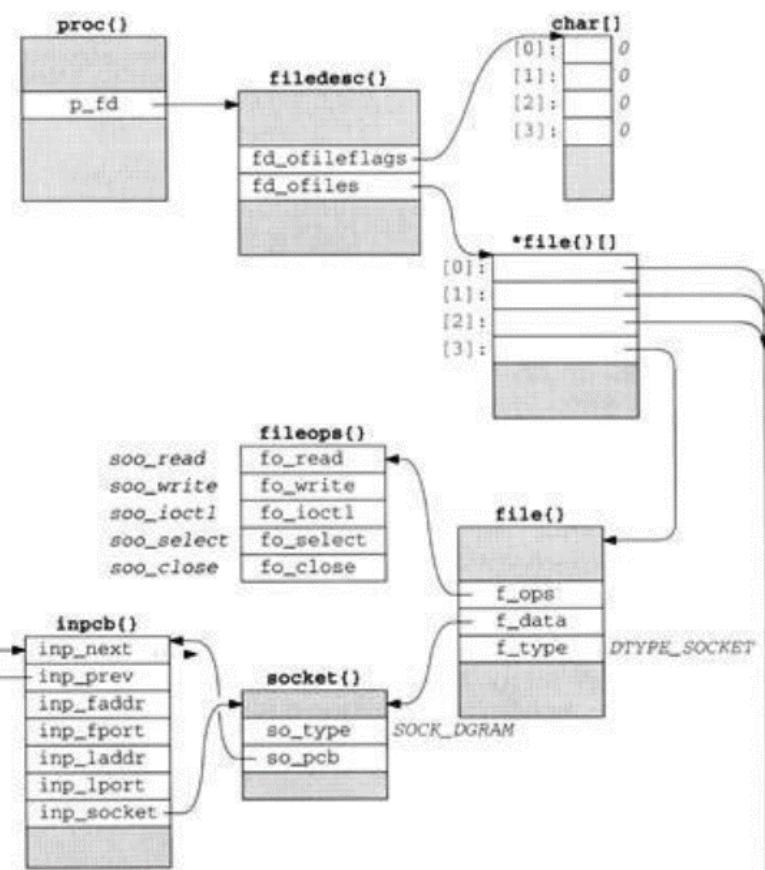
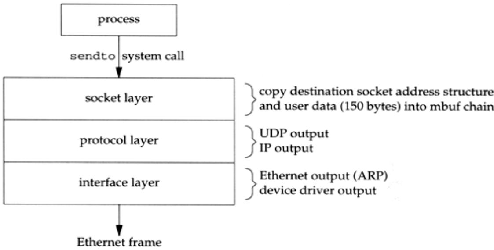
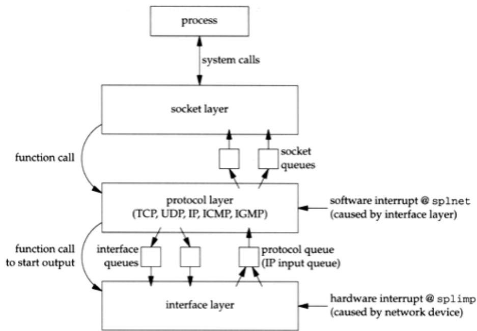

# 《TCP/IP网络设计与实现（双语）》期末复习课提要及习题答案

原件经识别和整理；“参考解答”是我们补的。

## Key point

试卷题型：填空题（12空）、判断题5题、简答题5题、综合题 3题（其中一个是程序注释题）

### 有几个知识点提醒大家掌握：

1. socket 实现 (掌握会调用哪些函数分别创建以下哪个结构：file、socket、inpcb、tcpcb等)（课堂练习）falloc（15.6）、socreate、in_pcballoc(22.1)、tcp_newtcpcb（25.8）

2. udp_input 和 udp_output 函数

3. 满足哪些条件才会发送 ICMP 重定向报文

   首先，只有在同一接口 (`rt_ifp` 和 `rcvif`)上接收或重发分组时，才能应用重定向。

   其次，被选择的路由本身必须没有被 ICMP 重定向报文创建或修改过 (`RTF_DYNAMIC | RTF_MODIFIED`)

   而且该路由也不能是到默认目的地的 (`0.0.0.0`)

   全局整数 `ipsendredirects` 指定系统是否被授权发送重定向.

   当传给 `ip_forward` 的参数 `srcrt` 指明系统是对分组路由选择的源时，禁止系统重定向

   First, redirects are applicable only when a packet is received and resent on the same interface (`rt_ifp` and `rcvif`).

   Next, the selected route must not have been itself created or modified by an ICMP redirect message (`RTF_DYNAMIC | RTF_MODIFIED`).

   Third, the route cannot be to the default destination (`0.0.0.0`).

   Forth, system need to have administrative authority to send redirects, which means the global integer `ipsendredirects` is 1.

   Five, redirects are not suppressed when the system is source routing a packet as indicated by the `srcrt` argument passed to `ip_forward`, which means the `srcrt` argument is False.

4. 理解图 24.17和图24.18,理解 TCP的流量控制机制和收发窗口如何滑动，理解每个序号变量的含义

5. 在 IP处理过程中可能会发生哪些差错，并发送哪些icmp差错报文 （作业中有,需要查看ch8 ch10中的代码）

   1、If `ip_ttl` has reached 1 (`IPTTLDEC`), an ICMP time exceeded message is returned to the sender and the packet is discarded. Otherwise, `ip_forward` decrements `ip_ttl` by `IPTTLDEC`.

   2、If no route can be found for the destination, an ICMP host unreachable error is returned and the packed discarded.

   3、If fragmentation is prohibited by the DF bit, `ip_output` discards the packet and returns `EMSGSIZE`. If the datagram was generated on this host, a transport protocol passes the error back to the process, but if the datagram is being forwarded, `ip_forward` generates an ICMP destination unreachable error with an indication that the packet could not be forwarded without fragmentation P221

   4、an ICMP time exceeded error be sent to the source host if the timer expires and the first fragment of the datagram has been received. P232

| Error code from ip_output | ICMP message generated | Description |
| :--- | :--- | :--- |
| EMSGSIZE | ICMP_UNREACH_NEEDFRAG | The outgoing packet was too large for the selected interface and fragmentation was prohibited (Chapter 10). |
| ENOBUFS | ICMP_SOURCEQUENCH | The interface queue is full or the kernel is running short of free memory. This message is an indication to the source host to lower the data rate. |
| EHOSTUNREACH ENETDOWN EHOSTDOWN default | ICMP_UNREACH_HOST | A route to the host could not be found. The outgoing interface specified by the route is not operating. The interface could not send the packet to the selected host. Any unrecognized error is reported as an ICMP_UNREACH_HOST error. |

## 复习课

知识点：[IP 重定向的产生条件与 ICMP 重定向报文发送](../../../topics/TCP-IP网络/ip重定向.md)、[IP 分片处理过程中可能遇到的错误或异常及发送的 ICMP 差错报文](../../../topics/TCP-IP网络/分片异常与icmp差错.md)、[UDP 输入（udp_input）在 4.4BSD-Lite 发行版中的处理流程](../../../topics/TCP-IP网络/udp输入处理.md)

### Chapter1

Net3 代码的组织层次

知识点：[Net/3 代码的组织层次与体系结构](../../../topics/TCP-IP网络/net3代码组织层次.md)

### Chapter2

1、mbuf结构体的字段和其含义

2、mdevget()函数：创建mbuf链表，根据数据大小四种情况

3、mget()函数，P32，分配 mbuf

4、mbuf 放分组的标志： M_PKTHDR

知识点：[mbuf 的用途及基本结构（m_data、m_len 等）](../../../topics/TCP-IP网络/mbuf用途与结构.md)、[收到以太网帧时设备驱动程序调用的函数及 m_devget 何时使用簇](../../../topics/TCP-IP网络/以太网帧接收处理.md)、[分配 mbuf 的函数（如 m_get、m_gethdr）](../../../topics/TCP-IP网络/mbuf分配函数.md)

### Chapter3

1、ifnet:通用接口结构

2、ifaddr：通用地址结构

3、le_softc ：以太网的专用接口结构，arpcom ：通用以太网结构

4、P61， main 函数，cpustartup 的功能

知识点：[接口层 ifnet 结构体的作用与字段](../../../topics/TCP-IP网络/ifnet结构.md)、[接口的地址链表管理](../../../topics/TCP-IP网络/接口地址链表.md)、[domaininit 等协议初始化过程](../../../topics/TCP-IP网络/协议初始化过程.md)

### Chapter4

1、P82，ether_input()函数 ，作用，读懂

2、P84，ether_output()函数：验证、特定协议处理、构造帧、接口排队。调用 arpresolve 获得下一跳硬件地址P85 line93，成功的话跳到P87，放到发送缓存发送。不成功 return

知识点：[ARP 协议在以太网接口中的地址解析作用](../../../topics/TCP-IP网络/arp与以太网寻址.md)、[接口的输出队列与发送调度机制](../../../topics/TCP-IP网络/接口输出队列.md)

### Chapter6

P128 struct in_ifaddr 干什么的，是 ip 协议专用地址结构

P126 图 全局变量 in_ifaddr 指向全部 ip 地址，ifnet_addrs 指向数据链路层地址(MAC)

数据链路层地址：ifaddr+2 个 sockaddrdl？（没听清）

P128 图 6-8、6-9 看懂

知识点：[接口的地址链表管理](../../../topics/TCP-IP网络/接口地址链表.md)、[网络接口与地址结构概览](../../../topics/TCP-IP网络/接口与地址结构概览.md)、[IPv4 地址结构 sockaddr_in](../../../topics/TCP-IP网络/sockaddr_in结构.md)

### Chapter7

P153 domaininit()作用

P158 ip_protox 数组是干嘛的、ipinit()函数作用

加框题目：复习课提到

加问号答案：不清楚，找不到明确答案

## Chapter 1. Introduction

知识点：[domaininit 等协议初始化过程](../../../topics/TCP-IP网络/协议初始化过程.md)、[ip_init 初始化内容与 ip_protox 数组的作用](../../../topics/TCP-IP网络/ip_init初始化.md)

### 选择 6

Which communication protocol families do 4.4BSD support?

- 1、TCP/IP
- 2、XNS (Xerox Network Systems)
- 3、The OSI protocols
- 4、The Unix domain protocols.

知识点：[pffindproto 和 pffindtype 函数的功能、调用示例及返回值说明](../../../topics/TCP-IP网络/pffindproto与pffindtype.md)、[protosw 结构的分配、初始化及 inetsw 数组中的多个条目](../../../topics/TCP-IP网络/protosw结构.md)

### 简答 7

Two popular application programming interfaces (APIs) for writing programs to use the Internet protocols are socket and TLI (Transport Layer Interface).

知识点：[IP 重定向的产生条件与 ICMP 重定向报文发送](../../../topics/TCP-IP网络/ip重定向.md)、[源地址选择规则与多宿主主机源地址](../../../topics/TCP-IP网络/源地址选择.md)

### 简答 8

The networking code in the 4.4BSD kernel is organized into three layers: socket layer, protocol layer, interface layer. The interface layer contains the device drivers that communicate with the network devices.

知识点：[TTL 递减时机与路由环路检测](../../../topics/TCP-IP网络/ttl递减.md)、[IP 输入（ip_input）在 4.4BSD-Lite 发行版中的处理流程](../../../topics/TCP-IP网络/ip输入处理.md)

### 填空 9

Data structures that are created by the kernel when the process calls socket are: filedesc, socket, vnode.

知识点：[带簇的 mbuf（M_EXT）包含的内容与使用场景](../../../topics/TCP-IP网络/带簇的mbuf.md)、[收到以太网帧时设备驱动程序调用的函数及 m_devget 何时使用簇](../../../topics/TCP-IP网络/以太网帧接收处理.md)

### 简答 10

The return value from socket is a descriptor. The socket system calls start with a descriptor. Please describe how a descriptor leads to a socket structure.

When the process executes a system call, the kernel starts with the descriptor value and uses “fd_ofiles” to index into the vector of “file” structure pointers, ending up with the “file” structure for the descriptor. The “file”

知识点：[IP 分片处理过程中可能遇到的错误或异常及发送的 ICMP 差错报文](../../../topics/TCP-IP网络/分片异常与icmp差错.md)、[路由器转发逻辑与 ip_forward 中的字节序转换](../../../topics/TCP-IP网络/ip转发逻辑.md)

### 简答 11

When a UDP datagram(数据包) arrives on a network interface, how does the kernel find the corresponding socket structure?

The kernel searches through all the UDP protocol control blocks to find the appropriate one, minimally based on the destination UDP port number and perhaps the destination IP address, source IP address, and source port numbers too. Once the inpcb structure is located, the kernel finds the corresponding socket structure through the inp_socket pointer

知识点：[源地址选择规则与多宿主主机源地址](../../../topics/TCP-IP网络/源地址选择.md)

### 简答 12

In the call to sendto, the fifth argument points to an Internet socket address structure (named serv) and the sixth argument specifies its length (which is 16 bytes). One of the first things done by the socket layer for this system call is to verify that these arguments are valid (i.e., the pointer points to a piece of memory in the address space of the process) and then copy the socket address structure into an mbuf. What is the m_type member of the resulting mbuf ? or What is the m_type member of the mbuf containing socket address structure?

The “m_type” member specifies the type of data contained in the mbuf, which for this example is MT_SONAME, name of the socket.

知识点：[domaininit 等协议初始化过程](../../../topics/TCP-IP网络/协议初始化过程.md)、[protosw 结构的分配、初始化及 inetsw 数组中的多个条目](../../../topics/TCP-IP网络/protosw结构.md)、[ip_init 初始化内容与 ip_protox 数组的作用](../../../topics/TCP-IP网络/ip_init初始化.md)

### 简答 13

What is the protocol layer corresponding to a UDP socket descriptor?

知识点：[特殊 IP 地址（广播、组播、环回、全零）及无 IP 地址时的广播包处理](../../../topics/TCP-IP网络/特殊ip地址.md)、[源地址选择规则与多宿主主机源地址](../../../topics/TCP-IP网络/源地址选择.md)、[IP 输入（ip_input）在 4.4BSD-Lite 发行版中的处理流程](../../../topics/TCP-IP网络/ip输入处理.md)

### 简答 14

For the call to sendto, the socket layer copies the destination socket address structure into an mbuf (Figure 1.6) and the data into an mbuf chain (Figure 1.7). After that, the protocol layer corresponding to the socket descriptor (a UDP socket) is called. Which routine is called?

答案：The protocol layer corresponding to the socket descriptor (a UDP socket) is called.

知识点：[IP 头部长度、字段解析与校验和错误处理](../../../topics/TCP-IP网络/ip头部格式.md)、[IP 差错与 ICMP 差错报文汇总（不可达、超时、参数问题等）](../../../topics/TCP-IP网络/icmp差错报文汇总.md)、[IP 输入（ip_input）在 4.4BSD-Lite 发行版中的处理流程](../../../topics/TCP-IP网络/ip输入处理.md)

### 简答 15

What does the UDP output routine mainly do?

答案：Specifically, the UDP output routine is called and pointers to the mbufs that we've examined are passed as arguments. This routine needs to prepend an IP header and a UDP header in front of the 150 bytes of data, fill in the headers, and pass the mbufs to the IP output routine.

知识点：[源地址选择规则与多宿主主机源地址](../../../topics/TCP-IP网络/源地址选择.md)、[路由器转发逻辑与 ip_forward 中的字节序转换](../../../topics/TCP-IP网络/ip转发逻辑.md)

### 简答 16

For the call to sendto in the example program, the kernel has made three complete passes of the user data. Please describe the detail.

答案：

1. copy the data from the user's buffer into the kernel's mbuf;
2. calculate the UDP checksum;
3. copy the data to its transmit buffer and initiates the output.

知识点：[带簇的 mbuf（M_EXT）包含的内容与使用场景](../../../topics/TCP-IP网络/带簇的mbuf.md)、[宏 mtod 和 dtom 的作用](../../../topics/TCP-IP网络/mtod与dtom宏.md)、[mbuf 的用途及基本结构（m_data、m_len 等）](../../../topics/TCP-IP网络/mbuf用途与结构.md)

### 简答 17

Give an overview of the processing that takes place when a process calls sendto to transmit a single UDP datagram.

知识点：[mbuf 的用途及基本结构（m_data、m_len 等）](../../../topics/TCP-IP网络/mbuf用途与结构.md)、[带簇的 mbuf（M_EXT）包含的内容与使用场景](../../../topics/TCP-IP网络/带簇的mbuf.md)

### 简答 18

In chapter 1, the textbook gives an example program: send a datagram to the UDP daytime server and read a response. The program calls recvfrom to read the server's reply, after it calls sendto to send a datagram to the daytime server. If the reply has not been received yet, the input queue for the specified socket is empty. What is the state of the process at this point (the program calls recvfrom)?

答案：The process is put to sleep. (Sleeping)

知识点：[阻塞在 recvfrom 调用中的进程存放在套接字结构的何处以便被通知](../../../topics/TCP-IP网络/socket阻塞通知机制.md)

### 简答 19

Is input processing synchronous or asynchronous?

答案：Asynchronous

知识点：[接口层的输入处理流程与层间通信队列](../../../topics/TCP-IP网络/接口输入处理.md)、[网络输入和输出时层间通信用哪些队列](../../../topics/TCP-IP网络/网络io层间通信队列.md)

### 简答 20

Is the reception of an input packet triggered by a receive-complete interrupt to a network device driver, or by a system call issued by the process?

答案：A receive-complete interrupt to a network device driver

知识点：[收到以太网帧时设备驱动程序调用的函数及 m_devget 何时使用簇](../../../topics/TCP-IP网络/以太网帧接收处理.md)、[接口层的输入处理流程与层间通信队列](../../../topics/TCP-IP网络/接口输入处理.md)

### 简答 21

What does the Ethernet Input do in the 4.4BSD-Lite distribution?

答案：It looks at the type field in the Ethernet frame to determine which protocol layer should receive the packet. In this example, the type field will specify an IP datagram, causing the mbuf to be added to the IP input queue.

知识点：[以太网帧格式与首部解析](../../../topics/TCP-IP网络/以太网帧格式.md)、[接口层的输入处理流程与层间通信队列](../../../topics/TCP-IP网络/接口输入处理.md)、[domaininit 等协议初始化过程](../../../topics/TCP-IP网络/协议初始化过程.md)

### 简答 22

The IP software interrupt is set by interface layer (socket layer/protocol layer/interface layer).

答案：interface layer

知识点：[接口层的输入处理流程与层间通信队列](../../../topics/TCP-IP网络/接口输入处理.md)、[m_next 与 m_nextpkt 指针的作用与区别](../../../topics/TCP-IP网络/mbuf链表指针.md)、[网络输入和输出时层间通信用哪些队列](../../../topics/TCP-IP网络/网络io层间通信队列.md)

### 简答 23

What does the IP Input do in the 4.4BSD-Lite distribution?

答案：The IP input routine processes each IP datagram that it receives. It verifies the IP header checksum, processes any IP options, verifies that the datagram was delivered to the right host (by comparing the destination IP address of the datagram with the host's IP addresses), and forwards the datagram if the system was configured as a router and the datagram is destined for some other IP address. If the IP datagram has reached its final destination, the protocol field in the IP header specifies which protocol's input routine is called: ICMP, IGMP, TCP, or UDP. In our example, the UDP input routine is called to process the UDP datagram.

知识点：[IP 输入（ip_input）在 4.4BSD-Lite 发行版中的处理流程](../../../topics/TCP-IP网络/ip输入处理.md)、[IP 头部长度、字段解析与校验和错误处理](../../../topics/TCP-IP网络/ip头部格式.md)、[UDP 输入（udp_input）在 4.4BSD-Lite 发行版中的处理流程](../../../topics/TCP-IP网络/udp输入处理.md)

### 简答 24

What does the UDP input do in the 4.4BSD-Lite distribution?

答案：The UDP input routine verifies the fields in the UDP header (the length and optional checksum) and then determines whether or not a process should receive the datagram.

知识点：[UDP 输入（udp_input）在 4.4BSD-Lite 发行版中的处理流程](../../../topics/TCP-IP网络/udp输入处理.md)

### 简答 25

In the example program we never specify the local port number for the application. We'll see in Exercise 23.3 that a side effect of writing the first UDP datagram（数据包）to a socket that has not yet bound a local port number is the automatic assignment by the kernel of a local port number (termed an ephemeral（短暂的）port) to that socket. That's how the inp_lport member of the PCB for our socket gets set to some nonzero value. Please find the corresponding codes in in_pcbconnect function, and in_pcbbind function. [可以学完 23 章再做]

知识点：[例子程序从未为应用指定本地端口号时的自动分配机制](../../../topics/TCP-IP网络/应用本地端口号分配.md)、[阻塞在 recvfrom 调用中的进程存放在套接字结构的何处以便被通知](../../../topics/TCP-IP网络/socket阻塞通知机制.md)、[domaininit 等协议初始化过程](../../../topics/TCP-IP网络/协议初始化过程.md)

### 简答 26

What does the example process input do?

答案：The program reads the datagram（数据包）that the server sends back by calling recvfrom. Our program overwrites the carriage return with a null byte and calls printf to output the result.

知识点：[阻塞在 recvfrom 调用中的进程存放在套接字结构的何处以便被通知](../../../topics/TCP-IP网络/socket阻塞通知机制.md)、[例子程序从未为应用指定本地端口号时的自动分配机制](../../../topics/TCP-IP网络/应用本地端口号分配.md)、[UDP 输入（udp_input）在 4.4BSD-Lite 发行版中的处理流程](../../../topics/TCP-IP网络/udp输入处理.md)

### 简答 27

Which queues are used for communication between the layers for network input and output?

答案：Socket queues and interface queues

知识点：[网络输入和输出时层间通信用哪些队列](../../../topics/TCP-IP网络/网络io层间通信队列.md)、[接口层的输入处理流程与层间通信队列](../../../topics/TCP-IP网络/接口输入处理.md)、[接口的输出队列与发送调度机制](../../../topics/TCP-IP网络/接口输出队列.md)

### 简答 28

Where should a process, if blocked in its call to recvfrom, be stored in a socket structure, so as to be notified?

## 第 2 章 Mbufs: Memory Buffers

知识点：[阻塞在 recvfrom 调用中的进程存放在套接字结构的何处以便被通知](../../../topics/TCP-IP网络/socket阻塞通知机制.md)

### 简答 1

What is the use of mbufs?

答案：The main use of mbufs is to hold the user data that travels from the process to the network interface, and vice versa. But mbufs are also used to contain a variety of other miscellaneous data: source and destination addresses, socket options, and so on.

知识点：[IP 分片处理过程中可能遇到的错误或异常及发送的 ICMP 差错报文](../../../topics/TCP-IP网络/分片异常与icmp差错.md)、[路由器转发逻辑与 ip_forward 中的字节序转换](../../../topics/TCP-IP网络/ip转发逻辑.md)

### 简答 2

In each of the mbufs, the m_data member points to the beginning of the corresponding buffer (either the mbuf buffer itself or external cluster). Can this pointer point anywhere in the corresponding buffer, not necessarily the front? YES

答案：YES

## 二、Chapter 2. Mbufs (Continued)

知识点：[icmp_input 函数处理流程及过时 Information Request 传递给 rip_input 的原因](../../../topics/TCP-IP网络/icmp_input处理.md)

### 填空 3
Mbufs with a cluster always contain the starting address of the buffer ($m\_ext.ext\_buf$) and its size ($m\_ext.ext\_size$).

知识点：[带簇的 mbuf（M_EXT）包含的内容与使用场景](../../../topics/TCP-IP网络/带簇的mbuf.md)、[mbuf 的用途及基本结构（m_data、m_len 等）](../../../topics/TCP-IP网络/mbuf用途与结构.md)

### 填空 4
The $m\_next$ pointer links together the mbufs forming a single packet (record) into an mbuf chain, where the first mbuf has an $m\_flags$ value of $M\_PKTHDR$, specifying a packet header.

知识点：[m_next 与 m_nextpkt 指针的作用与区别](../../../topics/TCP-IP网络/mbuf链表指针.md)、[mbuf 的用途及基本结构（m_data、m_len 等）](../../../topics/TCP-IP网络/mbuf用途与结构.md)、[domaininit 等协议初始化过程](../../../topics/TCP-IP网络/协议初始化过程.md)

### 填空 5
The $m\_nextpkt$ pointer links multiple packets (records) together to form a queue of mbufs.

知识点：[m_next 与 m_nextpkt 指针的作用与区别](../../../topics/TCP-IP网络/mbuf链表指针.md)、[mbuf 的用途及基本结构（m_data、m_len 等）](../../../topics/TCP-IP网络/mbuf用途与结构.md)、[domaininit 等协议初始化过程](../../../topics/TCP-IP网络/协议初始化过程.md)

### 填空 7
The function that allocates an mbuf is $m\_get$.

知识点：[分配 mbuf 的函数（如 m_get、m_gethdr）](../../../topics/TCP-IP网络/mbuf分配函数.md)

### 填空 8
When an Ethernet frame is received, the device driver calls the function $m\_devget$ to create an mbuf chain and copy the frame from the device into the chain.

知识点：[收到以太网帧时设备驱动程序调用的函数及 m_devget 何时使用簇](../../../topics/TCP-IP网络/以太网帧接收处理.md)、[分配 mbuf 的函数（如 m_get、m_gethdr）](../../../topics/TCP-IP网络/mbuf分配函数.md)、[带簇的 mbuf（M_EXT）包含的内容与使用场景](../../../topics/TCP-IP网络/带簇的mbuf.md)

### 填空 9
$m\_devget$ creates an mbuf chain. If the amount of data is greater than or equal to 208 bytes ($MINCLBYTES$), one or more clusters are used.

知识点：[带簇的 mbuf（M_EXT）包含的内容与使用场景](../../../topics/TCP-IP网络/带簇的mbuf.md)、[收到以太网帧时设备驱动程序调用的函数及 m_devget 何时使用簇](../../../topics/TCP-IP网络/以太网帧接收处理.md)

### 填空 10
The macro $mtod$ returns a pointer to the data associated with an mbuf, and casts the pointer to a specified type.

知识点：[宏 mtod 和 dtom 的作用](../../../topics/TCP-IP网络/mtod与dtom宏.md)、[mbuf 的用途及基本结构（m_data、m_len 等）](../../../topics/TCP-IP网络/mbuf用途与结构.md)

### 填空 11
The macro $dtom$ takes a pointer to data anywhere within the data portion of the mbuf and returns a pointer to the mbuf structure itself.

知识点：[宏 mtod 和 dtom 的作用](../../../topics/TCP-IP网络/mtod与dtom宏.md)、[mbuf 的用途及基本结构（m_data、m_len 等）](../../../topics/TCP-IP网络/mbuf用途与结构.md)

### 简答 12
When one of the protocols (IP, ICMP, IGMP, UDP, or TCP) finds that the amount of data in the first mbuf ($m\_len$) is less than the size of the minimum protocol header (e.g., 20 for IP, 8 for UDP, 20 for TCP), $m\_pullup$ is called on the assumption that the remaining part of the header is in the next mbuf on the chain. The code is as below:

What does the $m\_pullup$ do?

答案：$m\_pullup$ is called on the assumption that the remaining part of the header is in the next mbuf on the chain. $m\_pullup$ rearranges the mbuf chain so that the first N bytes of data are contiguous in the first mbuf on the chain. N is an argument to the function that must be less than or equal to 100 (MHLEN). If the first N bytes are contiguous in the first mbuf, then both of the macros $mtod$ and $dtom$ will work.

知识点：[domaininit 等协议初始化过程](../../../topics/TCP-IP网络/协议初始化过程.md)、[protosw 结构的分配、初始化及 inetsw 数组中的多个条目](../../../topics/TCP-IP网络/protosw结构.md)、[ip_init 初始化内容与 ip_protox 数组的作用](../../../topics/TCP-IP网络/ip_init初始化.md)

### 简答 13
$m\_pullup$ is called for every received IP fragment, when the IP fragment is stored in a cluster. This means that $m\_pullup$ is called for almost every received fragment, since the length of most fragments is greater than 208 bytes.

知识点：[特殊 IP 地址（广播、组播、环回、全零）及无 IP 地址时的广播包处理](../../../topics/TCP-IP网络/特殊ip地址.md)、[源地址选择规则与多宿主主机源地址](../../../topics/TCP-IP网络/源地址选择.md)、[IP 输入（ip_input）在 4.4BSD-Lite 发行版中的处理流程](../../../topics/TCP-IP网络/ip输入处理.md)

### 简答 14
If the data is contained in a cluster, does the $m\_copy$ function do a physical copy of the data?

答案：No, an additional reference is made to the cluster instead.

知识点：[IP 头部长度、字段解析与校验和错误处理](../../../topics/TCP-IP网络/ip头部格式.md)、[IP 差错与 ICMP 差错报文汇总（不可达、超时、参数问题等）](../../../topics/TCP-IP网络/icmp差错报文汇总.md)、[IP 输入（ip_input）在 4.4BSD-Lite 发行版中的处理流程](../../../topics/TCP-IP网络/ip输入处理.md)

### 简答 15
In Section 2.6 two reasons that $m\_pullup$ can fail are listed. There are really three reasons. Obtain the source code (4.4BSD-Lite\usr\src\sys\kern\uipc\_mbuf.c) for this function and discover the additional reason. Please list the three reasons.

答案：
(1) if it needs another mbuf and its call to MGET fails.
(2) if the total amount of data in the mbuf chain is less than the requested number of contiguous bytes. The second reason is the most common cause of failure.
(3) The caller asks for more than 100 (MHLEN) contiguous bytes.

知识点：[源地址选择规则与多宿主主机源地址](../../../topics/TCP-IP网络/源地址选择.md)、[路由器转发逻辑与 ip_forward 中的字节序转换](../../../topics/TCP-IP网络/ip转发逻辑.md)

### 简答 16
To avoid the problems we described in Section 2.6 with the $dtom$ macro when the data is in a cluster, why not just add a back pointer to the mbuf for each cluster?

答案：This is infeasible since clusters can be pointed to by multiple mbufs (Figure 2.26 in Section 2.9). Also, there is no room in a cluster for a back pointer.

知识点：[带簇的 mbuf（M_EXT）包含的内容与使用场景](../../../topics/TCP-IP网络/带簇的mbuf.md)、[宏 mtod 和 dtom 的作用](../../../topics/TCP-IP网络/mtod与dtom宏.md)、[mbuf 的用途及基本结构（m_data、m_len 等）](../../../topics/TCP-IP网络/mbuf用途与结构.md)

### 简答 17
Since the size of an mbuf cluster is a power of 2 (typically 1024 or 2048), space cannot be taken within the cluster for the reference count. Obtain the Net/3 sources (Appendix B) and determine where these reference counts are stored. In the macros MCLALLOC and MCLFREE in <sys/mbuf.h> we see that the reference count is an array named mclrefcnt. This array is allocated when the kernel is initialized in the file machdep.c.

## 三、Chapter 3. Interface Layer

知识点：[mbuf 的用途及基本结构（m_data、m_len 等）](../../../topics/TCP-IP网络/mbuf用途与结构.md)、[带簇的 mbuf（M_EXT）包含的内容与使用场景](../../../topics/TCP-IP网络/带簇的mbuf.md)

### 简答 1
When the ifnet and ifaddr structures are allocated for each network interface?

答案：During system initialization.

知识点：[IP 分片处理过程中可能遇到的错误或异常及发送的 ICMP 差错报文](../../../topics/TCP-IP网络/分片异常与icmp差错.md)、[路由器转发逻辑与 ip_forward 中的字节序转换](../../../topics/TCP-IP网络/ip转发逻辑.md)

### 简答 2
The ifnet structures are linked into the ifnet list.

知识点：[icmp_input 函数处理流程及过时 Information Request 传递给 rip_input 的原因](../../../topics/TCP-IP网络/icmp_input处理.md)

### 简答 3
cpu\_startup locates and initializes all the hardware devices connected to the system, including any network interfaces.

知识点：[IP 差错与 ICMP 差错报文汇总（不可达、超时、参数问题等）](../../../topics/TCP-IP网络/icmp差错报文汇总.md)、[主机字节序与网络字节序及其转换](../../../topics/TCP-IP网络/字节序转换.md)

### 简答 4
Each device driver for a network interface initializes a specialized ifnet structure and calls if\_attach to insert the structure into the linked list of interfaces. The le\_softc structure is the specialized ifnet structure for the LANCE Ethernet device driver from Net/3. The arpcom structure is common to all Ethernet drivers.

知识点：[IP 头部长度、字段解析与校验和错误处理](../../../topics/TCP-IP网络/ip头部格式.md)、[IP 差错与 ICMP 差错报文汇总（不可达、超时、参数问题等）](../../../topics/TCP-IP网络/icmp差错报文汇总.md)

### 简答 5
The kernel constructs the link-level address by allocating memory for an ifaddr structure and two sockaddr\_dl structures—one for the link-level address itself and one for the link-level address mask.

知识点：[为什么在特定代码路径中丢弃 ip_output 的返回值](../../../topics/TCP-IP网络/ip_output返回值丢弃.md)、[IP 差错与 ICMP 差错报文汇总（不可达、超时、参数问题等）](../../../topics/TCP-IP网络/icmp差错报文汇总.md)、[分配 mbuf 的函数（如 m_get、m_gethdr）](../../../topics/TCP-IP网络/mbuf分配函数.md)

### 简答 6
Each time if\_attach is called it adds another ifnet structure to the ifnet list, creates a link-level ifaddr structure for the interface (which contains two sockaddr\_dl structures), and initializes an entry in the ifnet\_addrs array.

## 四、Chapter 4. Interfaces: Ethernet

知识点：[protosw 结构的分配、初始化及 inetsw 数组中的多个条目](../../../topics/TCP-IP网络/protosw结构.md)、[pffindproto 和 pffindtype 函数的功能、调用示例及返回值说明](../../../topics/TCP-IP网络/pffindproto与pffindtype.md)

### 简答 1
In leread, $m\_devget$ copies the data from the buffer passed to leread to an mbuf chain it allocates.

知识点：[IP 分片处理过程中可能遇到的错误或异常及发送的 ICMP 差错报文](../../../topics/TCP-IP网络/分片异常与icmp差错.md)、[路由器转发逻辑与 ip_forward 中的字节序转换](../../../topics/TCP-IP网络/ip转发逻辑.md)

### 简答 2
ether\_input jumps according to the Ethernet type field. For an IP packet, schednetisr schedules an IP software interrupt and the IP input queue, ipintrq, is selected (Please write the corresponding codes). For an ARP packet, the ARP software interrupt is scheduled and arpintrq is selected. (code: next page)

知识点：[icmp_input 函数处理流程及过时 Information Request 传递给 rip_input 的原因](../../../topics/TCP-IP网络/icmp_input处理.md)

### 简答 3
In ether\_output, the AF\_INET case calls arpresolve to determine the Ethernet address corresponding to the destination IP address. If the Ethernet address is already in the ARP cache, arpresolve returns 1 and ether\_output proceeds. Otherwise this IP packet is held by ARP, and when ARP determines the address, it calls ether\_output from the function in\_arpinput.

知识点：[IP 差错与 ICMP 差错报文汇总（不可达、超时、参数问题等）](../../../topics/TCP-IP网络/icmp差错报文汇总.md)、[主机字节序与网络字节序及其转换](../../../topics/TCP-IP网络/字节序转换.md)

### 简答 4
Please explain the following codes in ether\_output:

If the code in the switch made a copy of the packet, the copy is processed as if it had been received on the output interface by calling looutput.

At this point, the mbuf contains a complete Ethernet frame except for the 32-bit CRC, which is computed by the Ethernet hardware during transmission. T output queueing.

# TCP/IP网络设计与实现（双语）复习要点

本资料整理自《TCP/IP网络设计与实现（双语）》期末复习课提要及习题答案（第 4 部分，对应原文页码 10–11），内容涵盖 IP 寻址、协议域、IP 协议详解及相关核心函数机制。

## 一、Chapter 6. IP Addressing

知识点：[IP 头部长度、字段解析与校验和错误处理](../../../topics/TCP-IP网络/ip头部格式.md)、[IP 差错与 ICMP 差错报文汇总（不可达、超时、参数问题等）](../../../topics/TCP-IP网络/icmp差错报文汇总.md)

### 选择 2

**题干**：`in_ifaddr` 结构体以通用的接口地址结构 `ia_ifa` 开始，随后是 IP 特有的成员。对于分配给接口的每个 IP 地址，会分配一个 `in_ifaddr` 结构并添加到接口地址列表 `ia_next` 以及全局 IP 地址列表 `in_ifaddr` 中。所有的链路层地址都可以从 `ifnet_addrs` 数组访问。

- A. 描述正确
- B. 描述错误

答案：A。

知识点：[接口的地址链表管理](../../../topics/TCP-IP网络/接口地址链表.md)、[接口层 ifnet 结构体的作用与字段](../../../topics/TCP-IP网络/ifnet结构.md)

### 选择 3

**题干**：为什么 `sockaddr_in` 结构中的 `sin_addr` 最初被定义为一个结构体？

在子网划分（RFC 950 [Moqul and Postel 1985]）之前，IP 地址的网络部分和主机部分总是出现在字节边界上。`in_addr` 结构的定义如下（注：原文此处省略了具体 C 代码结构定义，但描述了其特性）。

Internet 地址可以按 8 位字节、16 位字或单个 32 位地址来访问。宏 `s_host`、`s_net`、`s_imp` 等的名称对应于早期 TCP/IP 网络的物理结构。子网划分和无类别域间路由（CIDR）的使用使得字节和字的划分变得过时。

- A. 为了兼容早期的硬件架构
- B. 因为当时网络部分和主机部分必须在字节边界上
- C. 为了支持子网掩码的灵活配置
- D. 为了提高内存访问速度

答案：B。

参考解答：在 RFC 950 引入子网划分之前，IP 地址的分类（A、B、C 类）严格遵循字节边界，因此 `in_addr` 被设计为结构体以便通过宏直接访问特定的字节段。随着子网技术和 CIDR 的出现，这种基于字节的划分不再适用。

知识点：[IP 地址分类（A/B/C/D/E 类）与子网掩码](../../../topics/TCP-IP网络/ip地址分类.md)、[子网划分与 CIDR 无类别域间路由](../../../topics/TCP-IP网络/子网划分与cidr.md)

### 选择 4

**题干**：为什么当 IP 地址已经包含在接口的地址列表（`ifaddr` 结构）中时，还要将其复制一份到 `ac_ipaddr`（即 `arpcom` 结构）中？

接口输出函数（如 `ether_output`）仅拥有指向接口 `ifnet` 结构的指针，而没有指向 `ifaddr` 结构的指针。使用 `arpcom` 结构中的 IP 地址（这是分配给该接口的最后一个 IP 地址）避免了必须从 `ifaddr` 地址列表中选择一个地址的开销。

- A. 为了冗余备份
- B. 为了加快查找速度，避免遍历链表
- C. 为了支持多个 IP 地址
- D. 为了兼容旧的 ARP 协议

答案：B。

## 二、Chapter 7. Domains and Protocols

知识点：[接口的地址链表管理](../../../topics/TCP-IP网络/接口地址链表.md)、[接口层 ifnet 结构体的作用与字段](../../../topics/TCP-IP网络/ifnet结构.md)

### 简答 1

**题干**：Net/3 如何将相关协议分组？如何标识每个域？

Net/3 将相关协议分组到一个域（domain）中，并使用协议族常量（protocol family constant）来标识每个域。

知识点：[IP 分片处理过程中可能遇到的错误或异常及发送的 ICMP 差错报文](../../../topics/TCP-IP网络/分片异常与icmp差错.md)、[路由器转发逻辑与 ip_forward 中的字节序转换](../../../topics/TCP-IP网络/ip转发逻辑.md)

### 简答 2

**题干**：在编译时，Net/3 内核如何处理协议结构？

在编译时，Net/3 为内核中的每个协议分配并初始化一个 `protosw` 结构，并将同一域内所有协议的这些结构放入一个数组中。

知识点：[icmp_input 函数处理流程及过时 Information Request 传递给 rip_input 的原因](../../../topics/TCP-IP网络/icmp_input处理.md)

### 选择 5

**题干**：内核可以通过提供多个 `protosw` 条目为同一协议提供多个接口。在 Net/3 内核的 `inetsw` 数组中，哪个协议有 3 个 `protosw` 结构？

选项分析：
- A. UDP (inetsw[0])
- B. TCP (inetsw[3], inetsw[6]) -> 实际上 TCP 通常对应 SOCK_STREAM
- C. IP protocol (inetsw[0], inetsw[3] and inetsw[6])
- D. ICMP

根据原文提示：IP protocol (inetsw[0], inetsw[3] and inetsw[6])。

答案：C。

知识点：[protosw 结构的分配、初始化及 inetsw 数组中的多个条目](../../../topics/TCP-IP网络/protosw结构.md)、[Net/3 域（domain）与协议族常量的定义](../../../topics/TCP-IP网络/域与协议族常量.md)、[ip_init 初始化内容与 ip_protox 数组的作用](../../../topics/TCP-IP网络/ip_init初始化.md)

### 简答 3

**题干**：当进程创建套接字时，调用哪两个函数来定位合适的 `protosw` 条目？

调用 `pffindproto` 和 `pffindtype` 函数。

知识点：[IP 差错与 ICMP 差错报文汇总（不可达、超时、参数问题等）](../../../topics/TCP-IP网络/icmp差错报文汇总.md)、[主机字节序与网络字节序及其转换](../../../topics/TCP-IP网络/字节序转换.md)

### 简答 4

**题干**：系统初始化时，`domaininit` 执行哪些操作？

1. 将域链接到 `domains` 列表。
2. 调用域和协议初始化函数。
3. 调用快速和慢速超时函数。

知识点：[IP 头部长度、字段解析与校验和错误处理](../../../topics/TCP-IP网络/ip头部格式.md)、[IP 差错与 ICMP 差错报文汇总（不可达、超时、参数问题等）](../../../topics/TCP-IP网络/icmp差错报文汇总.md)

### 选择 6

**题干**：对 `pffindproto` 的哪个调用返回指向 `inetsw[6]` 的指针？

选项：
- A. `socket(PF_INET, SOCK_STREAM, 0)`
- B. `pffindproto(PF_INET, 27, SOCK_RAW)`
- C. `pffindtype(PF_INET, SOCK_DGRAM)`
- D. `ip_init()`

答案：B。

参考解答：原文明确指出 `pffindproto(PF_INET, 27, SOCK_RAW)` 返回指向 `inetsw[6]` 的指针（对应 RAW IP）。

知识点：[pffindproto 和 pffindtype 函数的功能、调用示例及返回值说明](../../../topics/TCP-IP网络/pffindproto与pffindtype.md)、[protosw 结构的分配、初始化及 inetsw 数组中的多个条目](../../../topics/TCP-IP网络/protosw结构.md)

### 简答 5

**题干**：对 `pffindproto` 的哪个调用返回指向 `inetsw[1]` 的指针？

调用 `socket(PF_INET, SOCK_STREAM, 0)` 会触发 `pffindtype(PF_INET, SOCK_DGRAM)`（注意：原文此处逻辑似乎有误，通常 SOCK_STREAM 对应 TCP，SOCK_DGRAM 对应 UDP，但需忠实于原文记录）。

*修正说明*：原文表述可能存在混淆，通常 `SOCK_STREAM` 对应 TCP (`inetsw[1]` 或类似索引)，`SOCK_DGRAM` 对应 UDP。根据原文文字：“socket(PF_INET, SOCK_STREAM, 0); -> pffindtype(PF_INET, SOCK_DGRAM)"，这里可能是指寻找类型时的逻辑路径。

知识点：[为什么在特定代码路径中丢弃 ip_output 的返回值](../../../topics/TCP-IP网络/ip_output返回值丢弃.md)、[IP 差错与 ICMP 差错报文汇总（不可达、超时、参数问题等）](../../../topics/TCP-IP网络/icmp差错报文汇总.md)、[分配 mbuf 的函数（如 m_get、m_gethdr）](../../../topics/TCP-IP网络/mbuf分配函数.md)

### 简答 6

**题干**：对 `pffindtype` 的哪个调用返回指向 `inetsw[2]` 的指针？

调用 `socket(PF_INET, SOCK_DGRAM, 0)` 会触发 `pffindtype(PF_INET, SOCK_STREAM)`（同上，原文逻辑如此）。

知识点：[protosw 结构的分配、初始化及 inetsw 数组中的多个条目](../../../topics/TCP-IP网络/protosw结构.md)、[pffindproto 和 pffindtype 函数的功能、调用示例及返回值说明](../../../topics/TCP-IP网络/pffindproto与pffindtype.md)

### 选择 7

**题干**：`pffindtype(PF_INET, SOCK_RAW)` 返回指向 `inetsw` 数组中的哪个结构？

选项：
- A. `inetsw[0]`
- B. `inetsw[1]`
- C. `inetsw[2]`
- D. `inetsw[6]`

答案：D。

知识点：[protosw 结构的分配、初始化及 inetsw 数组中的多个条目](../../../topics/TCP-IP网络/protosw结构.md)、[pffindproto 和 pffindtype 函数的功能、调用示例及返回值说明](../../../topics/TCP-IP网络/pffindproto与pffindtype.md)、[ip_init 初始化内容与 ip_protox 数组的作用](../../../topics/TCP-IP网络/ip_init初始化.md)

### 简答 7

**题干**：`ip_init` 函数的功能是什么？

1. 初始化 IP 重组队列 `ipq`。
2. 从系统时钟获取种子值设置 `ip_id`。
3. 设置 IP 输入队列（`ipintrq`）的最大大小为 50（`ipqmaxlen`）。

知识点：[IP 重定向的产生条件与 ICMP 重定向报文发送](../../../topics/TCP-IP网络/ip重定向.md)、[源地址选择规则与多宿主主机源地址](../../../topics/TCP-IP网络/源地址选择.md)

### 简答 8

**题干**：IP 如何解复用传入的数据报并将其交付给适当的传输层协议？

通过 `ip_protox` 数组完成。该数组将协议号映射到 `inetsw` 数组中的条目。

**协议映射表**：

| 索引 | 协议 |
| :--- | :--- |
| 0 | IP |
| 1 | UDP |
| 2 | TCP |
| 3 | IP (raw) |
| 4 | ICMP |
| 5 | IGMP |
| 6 | IP (raw) |

*(注：原文表格中使用了黑三角符号 $\blacktriangleright$ 表示箭头或特定含义，此处整理为标准文本)*

## 三、Chapter 8. IP: Internet Protocol

知识点：[TTL 递减时机与路由环路检测](../../../topics/TCP-IP网络/ttl递减.md)、[IP 输入（ip_input）在 4.4BSD-Lite 发行版中的处理流程](../../../topics/TCP-IP网络/ip输入处理.md)

### 简答 9

**题干**：标准 IP 头的长度是多少？最大选项长度是多少？IP 如何处理大数据报？

1. 标准 IP 头长度为 20 字节。
2. 后面最多可跟 40 字节的选项。
3. IP 可以将大数据报分片（fragment）进行传输，并在最终目的地重新组装（reassemble）这些分片。

知识点：[TTL 递减时机与路由环路检测](../../../topics/TCP-IP网络/ttl递减.md)、[IP 重定向的产生条件与 ICMP 重定向报文发送](../../../topics/TCP-IP网络/ip重定向.md)

### 简答 10

**题干**：如果系统配置为中间节点（非最终目的地），未到达最终目的地的数据报如何处理？

数据报会被发送到 `ip_forward` 函数进行路由，以朝向其最终目的地转发。（依据 P174 8.5）

知识点：[IP 分片处理过程中可能遇到的错误或异常及发送的 ICMP 差错报文](../../../topics/TCP-IP网络/分片异常与icmp差错.md)、[路由器转发逻辑与 ip_forward 中的字节序转换](../../../topics/TCP-IP网络/ip转发逻辑.md)

### 简答 11

**题干**：如果 `ip_src` 未指定，`ip_output` 如何选择源地址？

`ip_output` 会选择 `ia`，即传出接口的 IP 地址作为源地址。

知识点：[源地址选择规则与多宿主主机源地址](../../../topics/TCP-IP网络/源地址选择.md)

### 简答 12

**题干**：请解释 `ip_protox` 数组何时被初始化，它的功能是什么，并写出相关代码逻辑（涉及 `ip_protox` 和 `ipintr`）。

当 `ip_init` 函数在系统初始化时被 `domaininit` 调用，`ip_protox` 数组被初始化。
功能：用于将 IP 协议号映射到对应的处理函数（`inetsw` 数组入口），以便在接收数据报时能正确分发到上层协议。

知识点：[domaininit 等协议初始化过程](../../../topics/TCP-IP网络/协议初始化过程.md)、[protosw 结构的分配、初始化及 inetsw 数组中的多个条目](../../../topics/TCP-IP网络/protosw结构.md)、[ip_init 初始化内容与 ip_protox 数组的作用](../../../topics/TCP-IP网络/ip_init初始化.md)

### 简答 13

**题干**：当没有任何接口分配 IP 地址时，IP 是否应该接受广播数据包？为什么？

可能不应该。因为系统没有可用的源地址来回复任何广播，所以无法响应。

知识点：[特殊 IP 地址（广播、组播、环回、全零）及无 IP 地址时的广播包处理](../../../topics/TCP-IP网络/特殊ip地址.md)、[源地址选择规则与多宿主主机源地址](../../../topics/TCP-IP网络/源地址选择.md)、[IP 输入（ip_input）在 4.4BSD-Lite 发行版中的处理流程](../../../topics/TCP-IP网络/ip输入处理.md)

### 简答 14

**题干**：为什么当 IP 包到达时校验和出错不会向发送者返回错误消息？

由于数据包已损坏，无法确定头部中的地址是否正确，因此无法构造有效的错误消息返回给发送者。

知识点：[IP 头部长度、字段解析与校验和错误处理](../../../topics/TCP-IP网络/ip头部格式.md)、[IP 差错与 ICMP 差错报文汇总（不可达、超时、参数问题等）](../../../topics/TCP-IP网络/icmp差错报文汇总.md)、[IP 输入（ip_input）在 4.4BSD-Lite 发行版中的处理流程](../../../topics/TCP-IP网络/ip输入处理.md)

### 简答 15

**题干**：假设多宿主主机上的进程为其发出的数据包选择了显式的源地址。此外，假设数据包的目的地是通过不同于所选源地址的接口到达的。当第一跳路由器发现数据包应该通过另一个接口发送时会发生什么？

*(注：原文在此处截断，问题未完整显示。根据上下文推测，这涉及非对称路由或反向路径过滤 RPF 检查的问题。)*

原文截断内容：“What happens when the first-hop router discovers that the packets should be going through a”

# 2019 年 TCP/IP 习题答案和复习课提要（第 5 部分）

本资料整理自《TCP/IP网络设计与实现（双语）》期末复习课提要及习题答案的第 12–13 页内容，涵盖 Chapter 9、Chapter 10 和 Chapter 11 的部分习题解答。

## Chapter 9. IP Forwarding and Routing（IP 转发与路由）

知识点：[源地址选择规则与多宿主主机源地址](../../../topics/TCP-IP网络/源地址选择.md)、[路由器转发逻辑与 ip_forward 中的字节序转换](../../../topics/TCP-IP网络/ip转发逻辑.md)

### 简答 7

题干：Different router? Is a redirect message sent to the host?
（如果路由器不同？会向主机发送重定向消息吗？）

If an application selects a source address that differs from the address of the selected outgoing interface, redirects from the selected next-hop router fail. The next-hop router sees a source address different from that of the subnetwork on which it was transmitted and does not send a redirect message. This is a consequence of implementing the weak end system model and is noted in RFC 1122.

答案：如果应用程序选择的源地址与所选出站接口的地址不同，则来自选定下一跳路由器的重定向将失败。下一跳路由器看到的源地址与其传输所在的子网地址不同，因此不会发送重定向消息。这是实施弱端系统模型的结果，并在 RFC 1122 中注明。

知识点：[IP 重定向的产生条件与 ICMP 重定向报文发送](../../../topics/TCP-IP网络/ip重定向.md)、[源地址选择规则与多宿主主机源地址](../../../topics/TCP-IP网络/源地址选择.md)

### 简答 8

题干：Why is it necessary to decrement ip\_ttl after testing it (versus before) in Figure 8.17?
（为什么在图 8.17 中需要在测试后而不是测试前递减 ip\_ttl？）

The decrement of the TTL is done after the comparison for less than or equal to 1 to avoid the potential error of decrementing a received TTL of 0 to become 255.

答案：TTL 的递减是在与小于或等于 1 进行比较之后进行的，以避免将接收到的 TTL 为 0 递减后变成 255 的潜在错误。

知识点：[TTL 递减时机与路由环路检测](../../../topics/TCP-IP网络/ttl递减.md)、[IP 输入（ip_input）在 4.4BSD-Lite 发行版中的处理流程](../../../topics/TCP-IP网络/ip输入处理.md)

### 简答 9

题干：What would happen if two routers each considered the other the best next-hop destination for a packet?
（如果两个路由器各自认为对方是数据包的最佳下一跳目的地，会发生什么？）

If two routers each consider the other the best next-hop for a packet, a routing loop exists. Until the loop is removed, the original packet bounces between the two routers and each one sends an ICMP redirect back to the source host if that host is on the same network as the routers. Loops may exist when the routing tables are temporarily inconsistent during a routing update.

The TTL of the original packet eventually reaches 0 and the packet is discarded. This is one of the primary reasons why the TTL field exists.

答案：如果两个路由器各自认为对方是数据包的最佳下一跳，则存在路由环路。在环路消除之前，原始数据包会在两个路由器之间弹跳，并且如果该主机与路由器在同一网络上，每个路由器都会向源主机发送 ICMP 重定向。在路由更新期间路由表暂时不一致时可能存在环路。

原始数据包的 TTL 最终变为 0，数据包被丢弃。这是 TTL 字段存在的主要原因之一。

知识点：[TTL 递减时机与路由环路检测](../../../topics/TCP-IP网络/ttl递减.md)、[IP 重定向的产生条件与 ICMP 重定向报文发送](../../../topics/TCP-IP网络/ip重定向.md)

### 简答 10

题干：ip\_forward converts the fragment id from host byte order to network byte order before calling icmp\_error. Why does it not also convert the fragment offset?
（ip\_forward 在调用 icmp\_error 之前将片段 ID 从主机字节序转换为网络字节序。为什么它也不转换片段偏移量？）

ICMP error messages are generated only for the initial fragment of a datagram(数据包), which always has an offset of 0. The host and network forms for 0 are the same, so no conversion is necessary.

答案：ICMP 差错报文仅针对数据报的第一个分片生成，其偏移量始终为 0。0 的主机形式和网络形式相同，因此不需要转换。

## Chapter 10. IP Fragmentation and Reassembly（IP 分片与重组）

知识点：[IP 分片处理过程中可能遇到的错误或异常及发送的 ICMP 差错报文](../../../topics/TCP-IP网络/分片异常与icmp差错.md)、[路由器转发逻辑与 ip_forward 中的字节序转换](../../../topics/TCP-IP网络/ip转发逻辑.md)

### 简答 1

题干：ip\_output splits an outgoing datagram into fragments if it is too large to be transmitted on the selected network. Write the if statement
（如果发出的数据报太大无法在所选网络上传输，ip\_output 会将其拆分为分片。写出 if 语句）

*(注：原题未提供具体代码或完整陈述，仅给出背景描述)*

答案：略（题目要求编写代码，但原文未提供具体实现或标准答案文本）。

知识点：[IP 分片处理过程中可能遇到的错误或异常及发送的 ICMP 差错报文](../../../topics/TCP-IP网络/分片异常与icmp差错.md)、[路由器转发逻辑与 ip_forward 中的字节序转换](../../../topics/TCP-IP网络/ip转发逻辑.md)

### 简答 2

题干：Why only the destination host can reassemble the original datagram(数据包)?
（为什么只有目的主机才能重组原始数据报？）

Because only the destination host has a chance to see all the fragments.

答案：因为只有目的主机有机会看到所有分片。

知识点：[icmp_input 函数处理流程及过时 Information Request 传递给 rip_input 的原因](../../../topics/TCP-IP网络/icmp_input处理.md)

### 简答 3

题干：How to determine fragment size (the number of data bytes in each fragment)?
（如何确定分片大小（每个分片中的数据字节数）？）

/\*
\* Too large for interface; fragment if possible.
\*/

答案：原文仅提供了注释代码片段，未给出具体计算逻辑或公式。通常依据接口 MTU 减去 IP 头部长度，并确保数据长度为 8 字节的倍数。

知识点：[IP 差错与 ICMP 差错报文汇总（不可达、超时、参数问题等）](../../../topics/TCP-IP网络/icmp差错报文汇总.md)、[主机字节序与网络字节序及其转换](../../../topics/TCP-IP网络/字节序转换.md)

### 简答 4

题干：ip\_reass accepts incoming fragments and attempts to reassemble datagram(数据包)s. If it is successful, the datagramis passed back to ipintr and then to the appropriate transport protocol. ip\_slowtimo discards incomplete datagrams when all their fragments haven't been received within a reasonable amount of time.
（ip\_reass 接收传入的分片并尝试重组数据报。如果成功，数据报将传回 ipintr，然后传递给适当的传输协议。如果在合理时间内未收到所有分片，ip\_slowtimo 将丢弃不完整的数据报。）

*(注：此题为描述性段落，非问答形式，原文未提供额外问题或答案)*

答案：略（此为功能描述）。

## Chapter 11. ICMP: Internet Control Message Protocol（ICMP：互联网控制报文协议）

知识点：[IP 头部长度、字段解析与校验和错误处理](../../../topics/TCP-IP网络/ip头部格式.md)、[IP 差错与 ICMP 差错报文汇总（不可达、超时、参数问题等）](../../../topics/TCP-IP网络/icmp差错报文汇总.md)

### 简答 1

题干：What errors or exceptions may be encountered in the IP processing and what ICMP error messages may be sent? (Answer in Chinese)
（在 IP 处理过程中可能会遇到哪些错误或异常？可能发送哪些 ICMP 差错报文？（用中文回答）the same as Exercise 5 in Chapter 10.）

1. ip\_forward 可能会由于 ip\_output 失败或重定向而发送 ICMP 报文（书 P180 5）
2. 当收到数据报的第一个分片且定时器超时时，向源主机发送一个 ICMP 超时差错报文
3. 当路由器收到一个需要分片的数据报，而 IP 首部’DF’位置 1 时，发送 ICMP 不可达差错报文

答案：
1. ip_forward 可能会由于 ip_output 失败或重定向而发送 ICMP 报文。
2. 当收到数据报的第一个分片且定时器超时时，向源主机发送一个 ICMP 超时差错报文。
3. 当路由器收到一个需要分片的数据报，而 IP 首部‘DF’位为 1 时，发送 ICMP 不可达差错报文。

知识点：[IP 分片处理过程中可能遇到的错误或异常及发送的 ICMP 差错报文](../../../topics/TCP-IP网络/分片异常与icmp差错.md)、[路由器转发逻辑与 ip_forward 中的字节序转换](../../../topics/TCP-IP网络/ip转发逻辑.md)

### 简答 2

题干：If the ICMP information request is obsolete, why does icmp\_input pass it to rip\_input instead of discarding it?
（如果 ICMP 信息请求已过时，为什么 icmp_input 将其传递给 rip_input 而不是丢弃它？）

By passing the message to rip\_input, a process-level daemon could respond and old systems that relied on this behavior could continue to be supported.

答案：通过将消息传递给 rip_input，进程级守护进程可以响应，从而继续支持依赖此行为的旧系统。

知识点：[icmp_input 函数处理流程及过时 Information Request 传递给 rip_input 的原因](../../../topics/TCP-IP网络/icmp_input处理.md)

### 简答 3

题干：We pointed out that Net/3 does not convert the offset and length field of an IP packet to network byte order before including the packet in an ICMP error message. Why is this inconsequential in the case of the IP offset field?
（我们指出 Net/3 在将数据包包含在 ICMP 差错报文之前，不将 IP 数据包的偏移量和长度字段转换为网络字节序。在 IP 偏移量的情况下，为什么这无关紧要？）

ICMP errors are sent only for the initial fragment of an IP datagram. Since the offset value of an initial fragment is always 0, the byte ordering of the field is unimportant.

答案：ICMP 差错报文仅针对 IP 数据报的第一个分片发送。由于初始分片的偏移值始终为 0，因此该字段的字节顺序并不重要。

知识点：[IP 差错与 ICMP 差错报文汇总（不可达、超时、参数问题等）](../../../topics/TCP-IP网络/icmp差错报文汇总.md)、[主机字节序与网络字节序及其转换](../../../topics/TCP-IP网络/字节序转换.md)

### 简答 4

题干：In Figure 11.30, what happens to a packet that has the high-order bit of ip\_off set?
（在图 11.30 中，ip_off 的最高有效位被设置的包会发生什么？）

The high-order bit is reserved and must be 0. If it is sent, icmp\_error will discard the packet.

答案：最高有效位保留且必须为 0。如果发送了这样的包，icmp_error 将丢弃该包。

知识点：[IP 头部长度、字段解析与校验和错误处理](../../../topics/TCP-IP网络/ip头部格式.md)、[IP 差错与 ICMP 差错报文汇总（不可达、超时、参数问题等）](../../../topics/TCP-IP网络/icmp差错报文汇总.md)

### 简答 5

题干：Why is the return value from ip\_output discarded in Figure 11.39?
（为什么在图 11.39 中丢弃了 ip_output 的返回值？）

The return value is discarded because icmp\_send does not return an error, but more significantly, errors generated during ICMP processing are discarded to avoid generating an endless series of error messages.

答案：丢弃返回值是因为 icmp_send 不返回错误，但更重要的是，为了避免生成无尽系列的差错报文，在处理 ICMP 期间生成的差错会被丢弃。

知识点：[为什么在特定代码路径中丢弃 ip_output 的返回值](../../../topics/TCP-IP网络/ip_output返回值丢弃.md)、[IP 差错与 ICMP 差错报文汇总（不可达、超时、参数问题等）](../../../topics/TCP-IP网络/icmp差错报文汇总.md)、[分配 mbuf 的函数（如 m_get、m_gethdr）](../../../topics/TCP-IP网络/mbuf分配函数.md)
