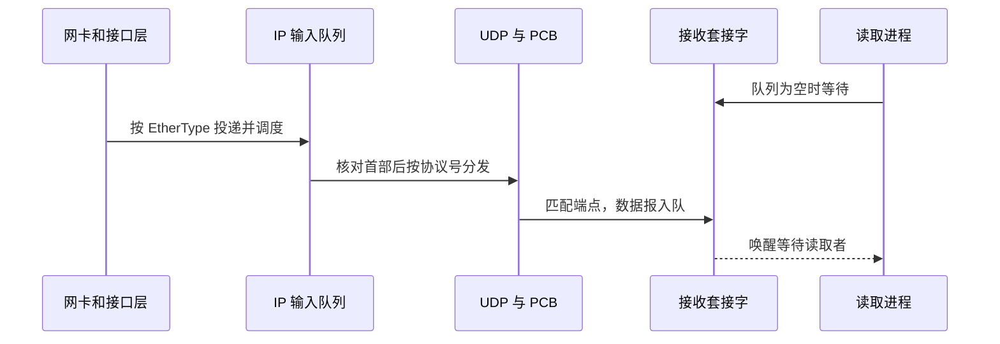

# TCP/IP 网络设计与实现（双语）期末复习题解

这份原件是 Net/3 的复习提纲和题库，不是附分值的正式试卷。一个贯穿全篇的问题是：**数据现在由谁持有，下一个接手者靠什么信息找到它？** 在套接字处，答案是描述符和协议控制块；到了链路层，是 EtherType 和接口队列；到了 IP，是协议号、目的地址和路由。以下按原题章节归并核对。题解和算例是整理者独立撰写的，历史源码的表项编号和阈值不要推广到现代系统。

## 第 1 章：一个数据报怎样穿过三层

**参考解答（1–7）。** 教材所列的历史协议族包括 Internet、XNS、OSI 和 Unix 本地域，常见程序接口为 sockets、TLI。内核按 socket 层、协议层、接口层分工，驱动和设备交互在接口层。进程拿到的描述符是本进程文件表的索引，经 open file 对象找到 socket，不是直接返回 PCB 指针。以末页的 UDP/TCP 对照为例：`falloc` 分配描述符关联的 file，`socreate` 分配 socket，协议的 `PRU_ATTACH` 通知各自初始化；UDP 用 `in_pcballoc` 分配 Internet PCB 并保留收发缓冲，TCP 的 `tcp_attach` 还经 `tcp_newtcpcb` 分配连接状态。入站 UDP 从本地目的端口开始匹配，按绑定或连接的具体程度再比较地址和对端端口，随后由 `inp_socket` 取到 socket。示例的 `sendto` 目的地址长度是 16 字节，核对用户空间参数后复制地址至 `MT_SONAME` 类型的 mbuf；这是地址元素，不是有效负载。参见 [Net/3 组织](../../../topics/TCP-IP网络/net3代码组织层次.md)。

**参考解答（8–12）。** UDP socket 的下传入口是 `udp_output`。以原件 150 字节负载为例，用户缓冲被复制到内核后，UDP 填头部及校验信息，交给 IP，IP 选择出接口并输出，链路层构帧并排入发送队列，驱动最终交给设备。原题要求数对用户数据的三次遍历：用户区拷入、计算 UDP 校验和、复制到发送缓冲，第二次访问不是又复制一遍。示例复制到发送缓冲的 192 字节是 $150+8+20+14$，不包含链路在外部加的 FCS 或前导字段。现代实现可能采用散聚 I/O 或校验和卸载，不能由这个样本断言“三次遍历”必然发生。

**参考解答（13–23）。** 阻塞式 `recvfrom` 在接收队列空时等待；接收完成由设备中断触发，是异步到来的，不是 `recvfrom` 才让网卡接收。驱动交给 Ethernet 输入，按类型排进协议队列；IP 软件中断由接口层调度，IP 例程逐个检查首部、选项、目的地址，决定本地分发还是转发；按 IPv4 协议字段调用上层。UDP 核对长度和非零校验和，匹配 PCB，再交付 payload。程序若未绑定端口，第一次发送路径可以经隐含 `in_pcbbind` 分配临时端口，`in_pcbconnect` 同时处理本地来源与端点组合。数据入队后唤醒读取者。原题回包的 26 字节是负载，`recvfrom` 最后两个参数为空表示不取发送者地址，并非地址不曾存在；读取结束释放本次取出的 mbuf。socket、协议输入和接口发送队列处在不同层，不能相互代替。见[层间队列](../../../topics/TCP-IP网络/网络io层间通信队列.md)、[UDP 输入](../../../topics/TCP-IP网络/udp输入处理.md)及[本地端口分配](../../../topics/TCP-IP网络/应用本地端口号分配.md)。

**订正（第 23 题）。** 在 [4.4BSD 的套接字缓冲实现](https://raw.githubusercontent.com/sergev/4.4BSD-Lite2/master/usr/src/sys/kern/uipc_socket2.c)中，阻塞读走 `so_rcv` 的 `sbwait`：设置 `SB_WAIT` 并在 `&sb_cc` 等待，`sowakeup` 再按该标志唤醒。原件把它写成进程存到 `sb_sel`，混同了两种通知；`sb_sel` 对应的是 `select` 的通知登记。两者都会被新的可读事件影响，不意味着公用同一个等待登记字段。

## 第 2–4 章：先看缓冲的所有权，再看包的去向

**参考解答（第 2 章 1–6）。** 一个 mbuf 可以放负载，也可以封装地址、选项等辅助信息。`m_data` 指向实际有效数据开头，既可落在内置区也可落在外部簇内，不必等于分配基址；外部区的基址及容量由扩展描述记录。`m_len` 是本节点有效长度；第一个节点带 `M_PKTHDR` 时，还保存整包的长度及接收接口。==一个包跨节点用 m_next；多个包排队用 m_nextpkt==。把两个字段对调，遍历单包时就会误读下一包。见[缓冲结构](../../../topics/TCP-IP网络/mbuf用途与结构.md)及[两类链指针](../../../topics/TCP-IP网络/mbuf链表指针.md)。

**参考解答（第 2 章 7–17）。** `m_get` 分配普通节点，驱动的 `m_devget` 从设备缓冲复制成 mbuf 链：先构造带包头的首节点，再按剩余长度、簇申请成败、是否还能在小首节点前预留链路空间，决定用内置区、尝试外部簇或继续接普通节点。题中 208 字节是该历史配置中尝试簇的阈值，不是每个内核都用的常数。`mtod` 把数据指针换成相应类型，不能自动保证首部连续；历史 `dtom` 反推所有者只对特定内置区成立。需要 $N$ 字节连续首部时用 `m_pullup`，可能沿链复制、换首节点，成功后重新取指针。需新节点而分配失败、总长度不足、走新首节点路径但请求长度超过 MHLEN 是原题的三个失败条件。历史代码也会为某些簇中分片主动拉齐以符合后续访问约束，不等于“大包必然横跨簇边界”。`m_copy` 对外部簇可以增加引用而不是复制负载；一簇可多引用，故不能给它加唯一所有者反指针。题中 Net/3 的簇引用数在独立的 `mclrefcnt` 数组中，由初始化分配，并非向簇尾偷几个字节。[4.4BSD 缓冲实现](https://raw.githubusercontent.com/sergev/4.4BSD-Lite2/master/usr/src/sys/kern/uipc_mbuf.c)；另见[首部拉齐](../../../topics/TCP-IP网络/首部拉齐机制.md)。

**参考解答（第 3 章 1–6）。** 课件讲的是开机探测及驱动注册的路径，不是所有接口永远只在开机时建立。`cpu_startup` 所在启动链组织设备初始化；驱动配置自己的接口对象（如 LANCE 的 `le_softc` 包含通用 Ethernet 私有结构 `arpcom`），通过 `if_attach` 将通用 `ifnet` 链入全局接口表。同一步建立链路 `ifaddr`，配链路地址及地址掩码两个 `sockaddr_dl`，并把入口登记进 `ifnet_addrs`。接口对象和接口上登记的地址记录不是一对一同类型。见[接口与地址](../../../topics/TCP-IP网络/接口与地址结构概览.md)。

**参考解答（第 4 章 1–4）。** `leread` 收取设备上的帧数据，通过 `m_devget` 复制为 mbuf 链。`ether_input` 读 EtherType：IP 排进 `ipintrq` 并调度相应软中断，ARP 进 `arpintrq` 并调度另一处理路径；把选择逻辑压缩成伪代码，就是“IP → IP 队列与对应软中断；ARP → ARP 队列与对应软中断；其他类型按各自处理路径”，不能把帧头的 EtherType 当成 IP 的协议号。发送时先验证接口状态，再根据协议处理并解析下一跳链路地址。IPv4 的 `arpresolve` 若有结果则继续，没有则按 ARP 处理路径等待解析，不等于 IP 程序立刻成功完成帧发送。取到链路地址后预留 14 字节帧头、按网络字节序填写类型，并写源、目的 MAC；无法预留缓冲或发送队列满时走 ENOBUFS。历史代码在保护相关临界区后入队，接口不忙则启动发送，最后恢复原优先级。见[以太网输入输出](../../../topics/TCP-IP网络/以太网输入输出.md)及[接口发送队列](../../../topics/TCP-IP网络/接口输出队列.md)。

## 第 6–7 章：同一个接口为何出现在不止一张表

**参考解答（第 6 章 1–5）。** `in_ifaddr` 是以通用 `ifaddr` 成员开头的 IPv4 接口地址记录；`sockaddr_in` 是 IPv4 socket 地址表示，不是“各接口地址链表”的名字。一个具体地址记录可通过不同链指针出现在本接口的地址链与全局 IPv4 链，`ifnet_addrs` 用于链路级索引。早期 `in_addr` 用联合体容纳按字节、半字和整字访问，适合早期按整字节分网的写法；子网与超网的边界不必落在字节上，不能把这些历史字段当作掩码算法。`arpcom` 的 `ac_ipaddr` 是历史实现为只握有接口指针的发送路径保留的便利值，不代表接口只能拥有一个 IP。见[接口地址链](../../../topics/TCP-IP网络/接口地址链表.md)和[IPv4 socket 地址](../../../topics/TCP-IP网络/sockaddr_in结构.md)。

**参考解答（第 7 章 1–9）。** 用域聚合同一协议族的多个 `protosw` 入口，表项携带协议类型及操作函数；同一协议族可有普通 IPv4 层入口、普通端点和若干原始协议入口。初始提问所说“IP 有三个入口”，要按教材所列配置识别入口角色，不把数量当作可移植常数。`domaininit` 串接域、调用各初始化钩子并启用周期处理；`ip_init` 建重组状态，用系统时钟初始化 IP 标识起点、设置输入队列上限及协议号到表项的映射，题中的 50 是教材参数。上层创建 socket 按族、类型或指定协议搜索；IP 接包之后则以 `ip_protox[ip_p]` 定位协议输入，不再从描述符反推该走哪个上层。见[协议初始化](../../../topics/TCP-IP网络/协议初始化过程.md)及[协议号映射](../../../topics/TCP-IP网络/ip_init初始化.md)。

**订正（第 7 章 6–7）。** [Berkeley 的协议表](https://raw.githubusercontent.com/sergev/4.4BSD-Lite2/master/usr/src/sys/netinet/in_proto.c)依次把 UDP 数据报和 TCP 字节流放在索引 1、2；按类型搜索会取第一个相符入口。因此 `pffindtype(PF_INET, SOCK_RAW)` 在该表取首个原始入口（`IPPROTO_RAW`，索引 3），不是末尾通配项。指定协议的 `pffindproto` 优先精确匹配；原题协议号 0 的原始通配项可处在第 6 位，但可选协议改变编译后的数组，下标不是 API。若表中无合适项则不返回有效入口。

## 第 8 章：地址能转发，不代表一定应该发重定向

**参考解答（1–6）。** IPv4 的通常首部长 20 字节，可带最多 40 字节选项。有效输入先核对首部长度和校验、处理选项，判断本地交付或转发；只有启用转发且非本地目的的数据报才走相应转发路径，后续按上层协议号分发。发送端未指定源地址时，教材实现一般取所选出口相关的源地址；显式指定时不应用这条默认算法覆盖。无本机 IPv4 地址时不能仅凭物理层广播位认定本机可处理所有 IP 广播，原件的原因是没有可用于正常 IPv4 应答的源地址。坏首部校验应丢弃，不盲目给一个不能信任的源地址发差错。见[IPv4 输入](../../../topics/TCP-IP网络/ip输入处理.md)。

**参考解答（7–10 与末页第 3 项）。** 在教材的 `ip_forward` 中，先查是否同一个接口收发、路由未由重定向创建或修改、不是默认路由、系统允许且非源路由；通过后还有==原源地址落在出口接口所对应子网==的检查。因此多宿主机指定另一网段的源地址时，第一跳并不必然回重定向。两个路由器互当下一跳会形成环路；TTL 逐跳耗尽，不能说两个路由器必然分别发送重定向。转发减 TTL **先比较是否不大于 1 再减**，避免无符号零减一成 255。生成 ICMP 差错时并非所有分片都能被拿来回报：非首片一般不产生此类差错，首片的偏移量位是零，端序不改变这部分的零值；不要由此推断 DF/MF 等整个组合字段必为零。见[TTL](../../../topics/TCP-IP网络/ttl递减.md)、[重定向条件](../../../topics/TCP-IP网络/ip重定向.md)。

## 第 10–11 章：分片大小、失败出口及 ICMP

**参考解答。** 若整包 IP 长度超过出接口 MTU 且允许 IPv4 分片，要用出接口的 MTU 减去片首部的大小，非末片数据长度还须向下对齐到 8 的倍数；偏移单位是 8 字节，不是“当前第几片”。片首部选项可能不同，应按实际片头计算。不同分片可以走不同路径，正常目标端才有条件统一重组，`ip_reass` 收集片段，齐备则交回上层输入，`ip_slowtimo` 清理超时的未完成状态。若不允许分片，本机发包把 EMSGSIZE 往上传递；转发路径才可能给原发端返回“需分片但 DF 已设置”的 ICMP。文中这条转发行为不等于该历史实现自己完整实现路径 MTU 发现。见[片段大小](../../../topics/TCP-IP网络/片段大小确定.md)及[目的端重组](../../../topics/TCP-IP网络/目的主机重组.md)。

**补充算例。** 原 IP 总长 3020 字节，首部无选项占 20，MTU=1000。非末片最大负载为 $8\lfloor(1000-20)/8\rfloor=976$ 字节。负载依次为 976、976、976、72；偏移字段为 0、122、244、366；每片总长为 996、996、996、92，最后一片才令 MF 为 0。把首部也算进偏移或把 976 直接写入偏移字段，重组都会错。

| 发生什么 | 该做什么（先判是否允许发差错） |
| --- | --- |
| 转发 TTL 耗尽 | 丢弃；合乎条件可发超时（传输中） |
| 无可用到达路径 | 丢弃；按失败类别报不可达，题中 Net/3 路由查询失败例是主机不可达 |
| DF 已置且超过出接口 MTU | 本地报告 EMSGSIZE；转发可发目的不可达中的需分片 |
| 分片重组超时 | 丢弃未完成状态；收到首片等条件成立时可回重组超时 |
| 坏首部、非首片、广播/组播、回应另一个差错等 | 先考察是否属于应静默丢弃或抑制差错的情况，不能凡丢包都报 ICMP |

第 11 章剩余题的机制：旧信息请求交给原始 IP 输入以留给兼容用户程序，不等于内核仍必须自己应答；历史代码在 ICMP 差错路径屏蔽了不合法的偏移位（保留高位应为 0），首片的偏移量位为零，所以这一部分的字节序无影响；既有 ICMP 输出失败并不再生成层层差错，避免无限回报。IP 报头检验失败与源地址是否可信有关，重定向则是符合限定条件的路由建议，不是所有失败的总称。见[ICMP 差错汇总](../../../topics/TCP-IP网络/icmp差错报文汇总.md)。

> [!WARNING]
> 看见==路由器处理失败==，先问失败发生在验证、转发、出接口还是重组环节，再问该包有没有资格触发差错；不能只背一张类型码表。

## 末页联动题：用窗口跟踪收发边界

**参考解答。** 末页前 3 个问题分别对应上文的 socket 创建、UDP 双向路径和重定向，最后一个差错汇总见上表。TCP 流量题则抽开两组序号：发送方的 `snd_una` 是最早未确认，`snd_nxt` 是当前下一发送序号（重传时不一定等于历史最大进度），`snd_max` 记录已发送范围的最高边界；接收方的 `rcv_nxt` 是下一个期望序号，公布窗口是愿意接纳的数据范围。收到累计确认会推进发送左边界，但新数据可发范围还受接收窗口与拥塞窗口共同限制。[Berkeley 的 TCP 控制块](https://raw.githubusercontent.com/sergev/4.4BSD-Lite2/master/usr/src/sys/netinet/tcp_var.h)还分别保存 `snd_wnd`（对端允许本端发送的窗口）、`rcv_wnd`（本端接收窗口）、`rcv_adv`（已对外公布的接收右边界）、`iss/irs`（两方向初始序号）、`snd_wl1/snd_wl2`（最近采纳窗口更新所用的报文序号与确认号）。它们分别描述发送进度、接收容量或更新是否够新，不能都当作“下一个包号”。**补充**：忽略拥塞和序号回绕，`snd_una=1000`、`snd_nxt=1200`，接收端允许从 1000 起再容纳 400 字节，则右边界为 1400，新发最多 200 字节；若确认推进到 1100 时，对端虽收到 100 字节，应用却尚未取走数据，若改报窗口 300，右边界仍为 1400，而下一发送序号仍为 1200，新发上限仍为 200。等应用再取走 100 字节，接收方可把右边界推进到 1500，才给发送端额外 100 字节空间。==左边界前进不保证右边界同幅前进==。见 [TCP 流量与拥塞控制](../../../topics/计算机网络/tcp_flow_congestion.md)。
