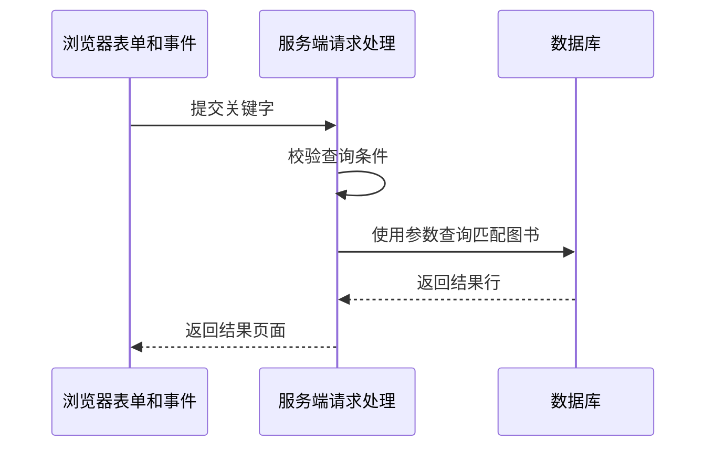

# 《Web技术（双语）》教材中文版目录与阅读导引

原始资料是教材目录节选，不是教材正文或题库：仅列教材第 **1、2、3、4、5、7、9、13** 章，缺号处不能据此推定课内不讲，也不能推定目录有误。下表页码是**教材印刷页码**，不是本 Markdown 的页号；入口节未标页码的，不从前后章节猜补。教材号和本站课程单元并非一套编号，先对主题、再看页码。

| 教材章 | 原目录可定位的小节（精选） | 读这一章要解决的问题 |
| --- | --- | --- |
| 1 基础知识 | Internet 简介 §1.1（2）；服务器 §1.4（7）；URL §1.5（9）；MIME §1.6（11）；HTTP §1.7（12）；工具箱 §1.9（17） | 同一网址的目标、请求、响应和内容类型是四件不同的事；先用 [URL](../../../topics/Web开发技术/url-structure.md) 定位，再看 [HTTP 请求](../../../topics/Web开发技术/http-request.md) 和 [响应与缓存](../../../topics/Web开发技术/http-response-cache.md)。 |
| 2 HTML/XHTML 简介 | 基本语法 §2.2（33）；结构 §2.3（34）；图片 §2.5（42）；链接 §2.6（48）；列表 §2.7（51）；表格 §2.8（55）；表单 §2.9（60）；语法差异 §2.14（77） | 文档组织、控件和数据提交各有职责。先核对 [文档结构](../../../topics/Web开发技术/html-doc-structure.md)，再看 [控件与表单](../../../topics/Web开发技术/forms-controls.md)。本章也列出音频、视频、组织元素和时间元素（§2.10–2.13）。 |
| 3 层叠样式表 | 层次 §3.2（84）；选择器 §3.4（86）；字体 §3.6（91）；盒模型 §3.10（105）；冲突 §3.13（113） | 先证实选择器有没有匹配，再查多条规则争用一个属性时谁生效，最后才算边框、内距和外距。参见 [选择器](../../../topics/Web开发技术/css-selectors.md)、[边距与背景](../../../topics/Web开发技术/css-properties-margin-bg.md)。 |
| 4 JavaScript 基础 | 对象 §4.2（122）；控制语句 §4.6（136）；数组 §4.8（144）；函数 §4.9（148）；正则 §4.12（155）；错误 §4.14（160） | 搞清值和表达式如何求值，再用控制流组织它们。涉及字符串与数字混算时先查 [类型转换](../../../topics/Web开发技术/js-type-conversion.md)，涉及数组处理再读 [数组与函数](../../../topics/Web开发技术/js-arrays-functions.md)；§4.1 和 §4.4 的小节标题未标起始页。 |
| 5 JavaScript 与 HTML 文档 | DOM §5.2（168）；元素访问 §5.3（172）；事件 §5.4（174）；输入验证 §5.7（183）；DOM 2 事件 §5.8（191）；画布 §5.9（196）；树的遍历与修改 §5.11（202） | 元素是文档树中的对象，事件把用户动作接到处理函数；从 [文档对象模型](../../../topics/Web开发技术/dom-model.md) 到 [事件处理](../../../topics/Web开发技术/event-handling.md)，区分“找不到元素”和“找到了却没注册处理器”。 |
| 7 XML 简介 | 语法 §7.3（240）；结构 §7.4（242）；命名空间 §7.5（243）；架构 §7.6（245）；XSLT §7.9（254）；解析器 §7.10（262） | 先判断文档是否符合 [XML 语法](../../../topics/Web开发技术/xml-syntax-structure.md)，再问是否符合指定结构约束；展示转换与验证不是同一件事。读到大型文档的处理取舍时对照 [流式解析与整树解析](../../../topics/Web开发技术/sax-dom.md)。本教材第 7 章对应本站课程的 XML 单元（第 8 章）。 |
| 9 PHP 简介 | 控制语句 §9.6（309）；数组 §9.7（312）；函数 §9.8（319）；表单 §9.10（325）；Cookie §9.11（331）；会话 §9.12（333） | 把 PHP 的运行位置放在服务端，理解请求数据如何到达脚本，并区别客户端保存的 Cookie 与服务端管理的会话状态。参见 [PHP 概述](../../../topics/Web开发技术/php-overview.md)、[PHP 表单处理](../../../topics/Web开发技术/php-form-handling.md)。 |
| 13 基于 Web 的数据库访问 | SQL §13.2（473）；访问体系结构 §13.3（477）；PHP/MySQL §13.5（482）；JDBC/MySQL §13.6（489）；ASP.NET/MySQL §13.7（496） | 把请求处理和持久数据分开，先理解 [数据库访问体系结构](../../../topics/Web开发技术/db-architecture.md)、[SQL 查询与插入](../../../topics/Web开发技术/sql-insert-select.md)，再看 [如何从程序请求数据库操作](../../../topics/Web开发技术/php-mysql-query.md)。这一教材章对应本站课程的数据库访问单元（Part 7）。 |

## 把四个位置串成一次排错

**补充：**做一个只读图书筛选页。HTML 表单提交书名关键字；JavaScript 可以先提示空输入；浏览器把请求交给服务端，服务端验证查询条件、读取数据库并返回结果。浏览器里的预检查改善使用体验，但服务端仍应独立发现空条件或不合法的值。下面是按功能重画的路线，不是原教材截图。

> [!TIP]
> ==样式没变==先看 CSS 是否匹配；==点击没触发==查 DOM、事件注册与处理；==请求已经发出但结果不对==再核对服务端收到的字段、查询条件和数据。教材章号是查机制的入口，不是排错时要机械照搬的执行顺序。

原目录有少量转写异形，如 §1.5 的“统—资源定定位符”、§2.1.1 的“XHIML”和 §2.9.1 的“forn”。导引按“统一资源定位符”“XHTML”“form”理解，不据这些异形衍生额外条目。目录中的历史工具保留为阅读定位，不把出现过的旧工具列为当前实践要求。
