# 《Web技术（双语）》第1章 Web基础（课件）

原件的每一页，下面附识别出的文字。

### Part 1 Fundamentals

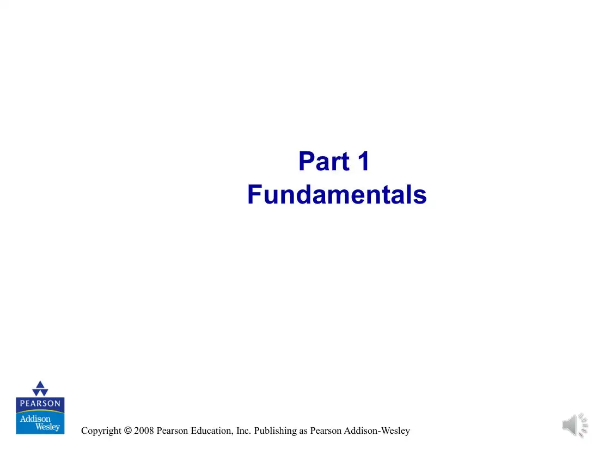

原文：

Part 1 Fundamentals

PEARSON Addison Wesley

Copyright © 2008 Pearson Education, Inc. Publishing as Pearson Addison-Wesley

### Contents (8 sections)

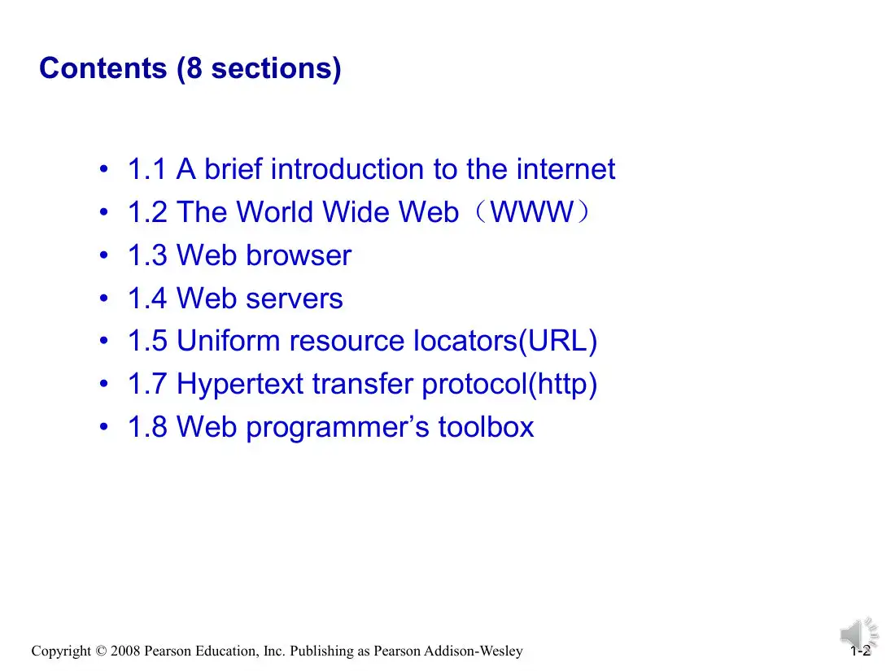

原文：

Contents (8 sections)

• 1.1 A brief introduction to the internet

• 1.2 The World Wide Web（WWW）

• 1.3 Web browser

• 1.4 Web servers

• 1.5 Uniform resource locators(URL)

• 1.7 Hypertext transfer protocol(http)

• 1.8 Web programmer’s toolbox

Copyright © 2008 Pearson Education, Inc. Publishing as Pearson Addison-Wesley

### 1.1 A Brief Introduction to the Internet

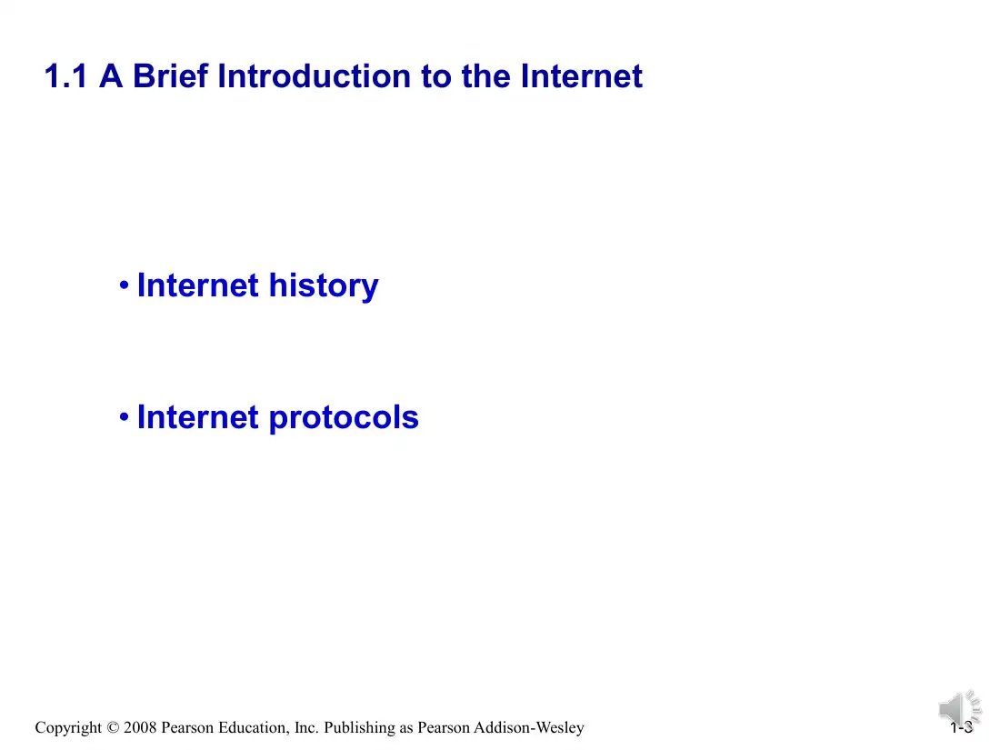

原文：

1.1 A Brief Introduction to the Internet

• Internet history

• Internet protocols

Copyright © 2008 Pearson Education, Inc. Publishing as Pearson Addison-Wesley

1-3

### 1.1 Internet History (pp.2)

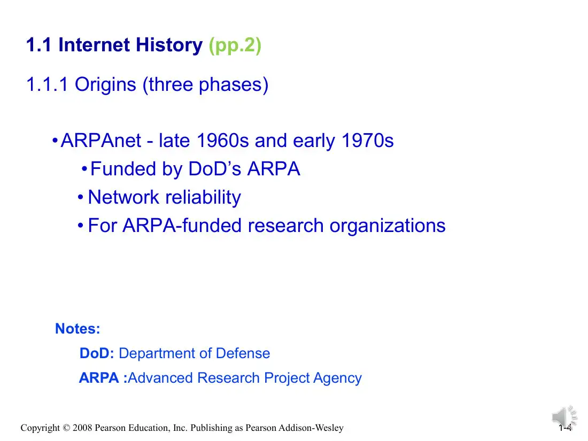

原文：

1.1 Internet History (pp.2)

1.1.1 Origins (three phases)

•ARPAnet - late 1960s and early 1970s

•Funded by DoD’s ARPA

• Network reliability

• For ARPA-funded research organizations

Notes:

DoD: Department of Defense

ARPA :Advanced Research Project Agency

Copyright © 2008 Pearson Education, Inc. Publishing as Pearson Addison-Wesley

1-4

### 1.1 Internet History (pp.2)

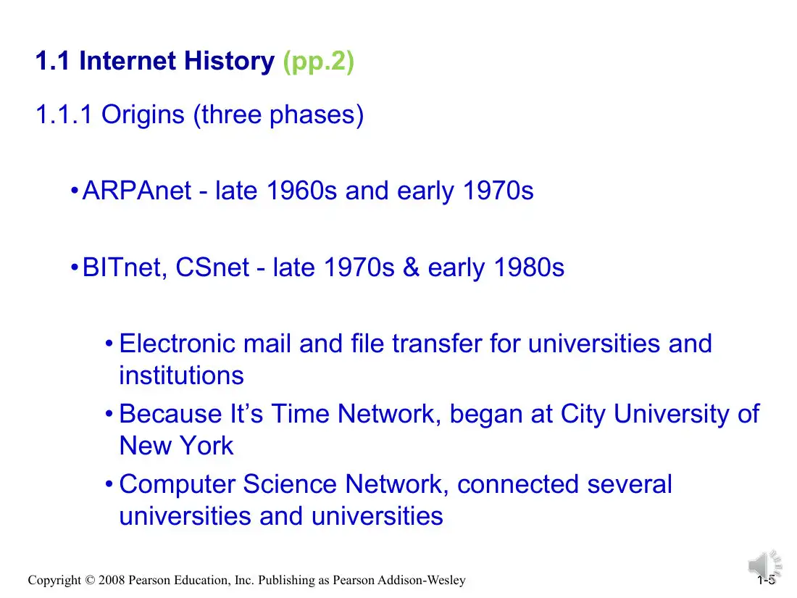

原文：

1.1 Internet History (pp.2)

1.1.1 Origins (three phases)

•ARPAnet - late 1960s and early 1970s

•BITnet, CSnet - late 1970s & early 1980s

• Electronic mail and file transfer for universities and institutions

• Because It’s Time Network, began at City University of New York

• Computer Science Network, connected several universities and universities

Copyright © 2008 Pearson Education, Inc. Publishing as Pearson Addison-Wesley

1-5

### 1.1 Internet History (pp.2)

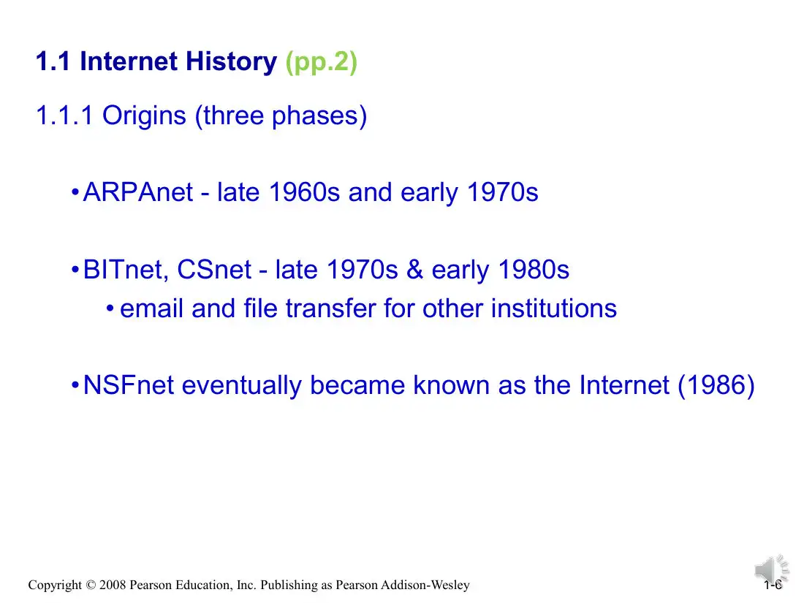

原文：

1.1 Internet History (pp.2)

1.1.1 Origins (three phases)

•ARPAnet - late 1960s and early 1970s

•BITnet, CSnet - late 1970s & early 1980s • email and file transfer for other institutions

•NSFnet eventually became known as the Internet (1986)

Copyright © 2008 Pearson Education, Inc. Publishing as Pearson Addison-Wesley

1-6

### 1.1 Internet History

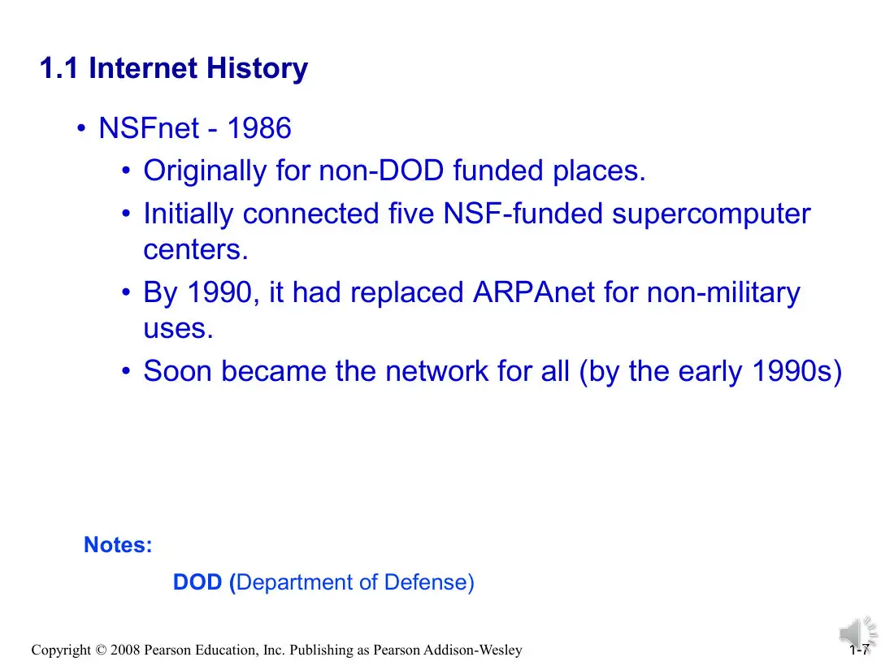

原文：

1.1 Internet History

• NSFnet - 1986

• Originally for non-DOD funded places.

• Initially connected five NSF-funded supercomputer centers.

• By 1990, it had replaced ARPAnet for non-military uses.

• Soon became the network for all (by the early 1990s)

Notes:

DOD (Department of Defense)

Copyright © 2008 Pearson Education, Inc. Publishing as Pearson Addison-Wesley

### 1.1 Internet History (pp.3)

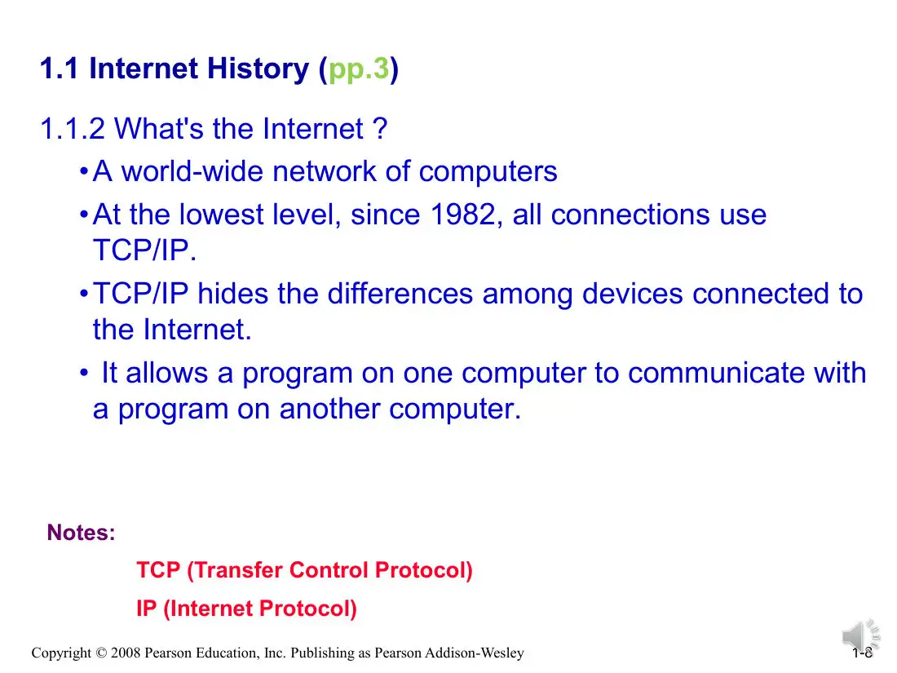

原文：

1.1 Internet History (pp.3)

1.1.2 What's the Internet ?

•A world-wide network of computers

•At the lowest level, since 1982, all connections use TCP/IP.

•TCP/IP hides the differences among devices connected to the Internet.

• It allows a program on one computer to communicate with a program on another computer.

Notes:

TCP (Transfer Control Protocol) IP (Internet Protocol)

Copyright © 2008 Pearson Education, Inc. Publishing as Pearson Addison-Wesley

1-8

### 1.1 Internet Protocols

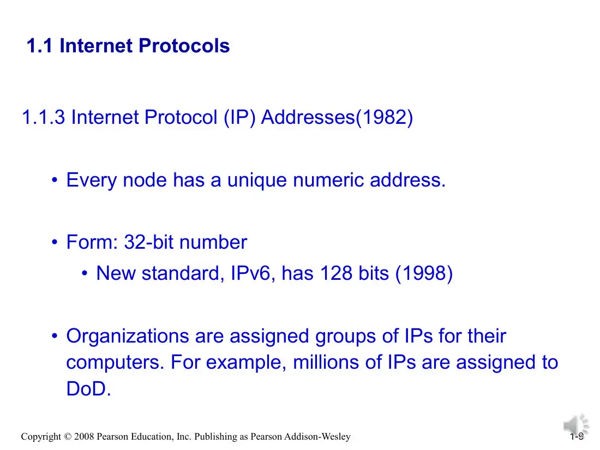

原文：

1.1 Internet Protocols

1.1.3 Internet Protocol (IP) Addresses(1982)

• Every node has a unique numeric address.

• Form: 32-bit number

• New standard, IPv6, has 128 bits (1998)

• Organizations are assigned groups of IPs for their computers. For example, millions of IPs are assigned to DoD.

Copyright © 2008 Pearson Education, Inc. Publishing as Pearson Addison-Wesley

1-9

### 1.1 Internet Protocols (pp.4)

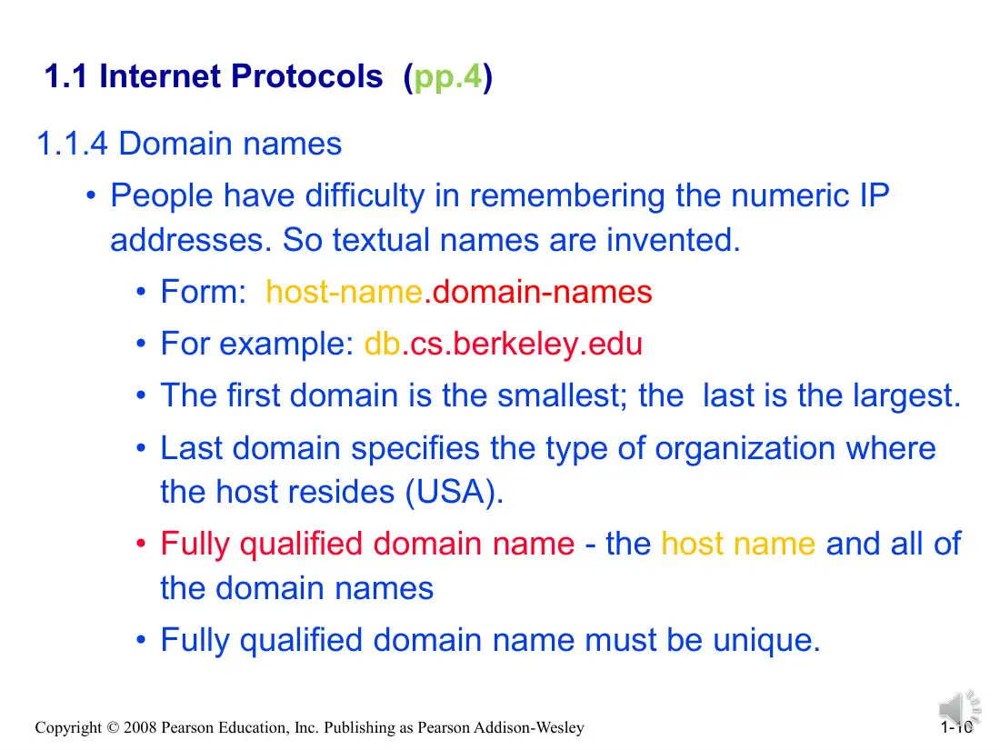

原文：

1.1 Internet Protocols (pp.4)

1.1.4 Domain names

• People have difficulty in remembering the numeric IP addresses. So textual names are invented.

• Form: host-name.domain-names

• For example: db.cs.berkeley.edu

• The first domain is the smallest; the last is the largest.

• Last domain specifies the type of organization where the host resides (USA).

• Fully qualified domain name - the host name and all of the domain names

• Fully qualified domain name must be unique.

Copyright © 2008 Pearson Education, Inc. Publishing as Pearson Addison-Wesley

1-10

### 1.1 Internet Protocols

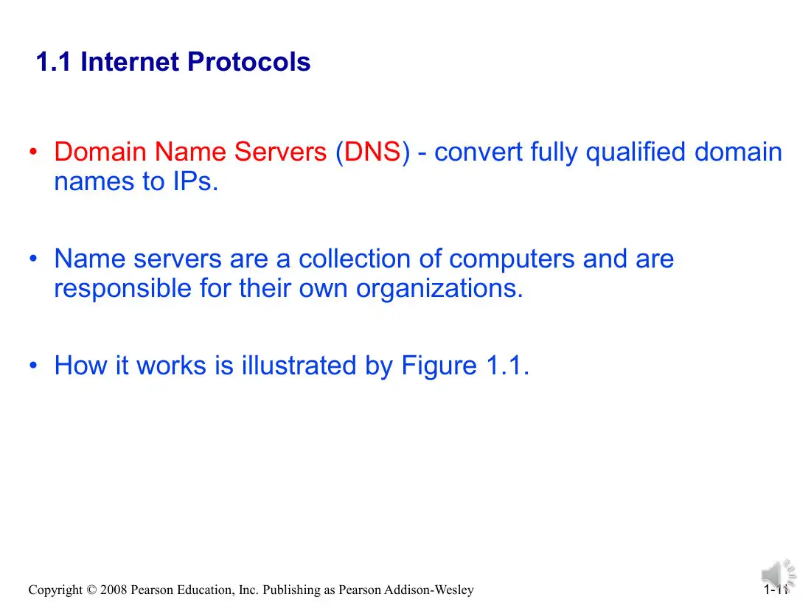

原文：

1.1 Internet Protocols

• Domain Name Servers (DNS) - convert fully qualified domain names to IPs.

Name servers are a collection of computers and are responsible for their own organizations.

• How it works is illustrated by Figure 1.1.

Copyright © 2008 Pearson Education, Inc. Publishing as Pearson Addison-Wesley

### 1-12

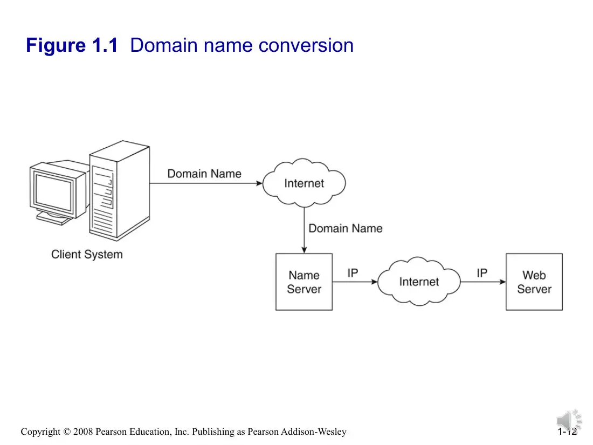

原文：

Copyright © 2008 Pearson Education, Inc. Publishing as Pearson Addison-Wesley

1-12

### 1.1 Internet Protocols

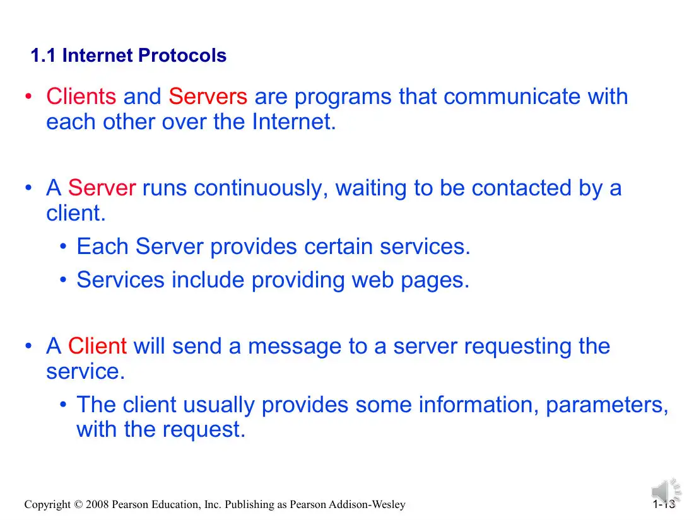

原文：

1.1 Internet Protocols

• Clients and Servers are programs that communicate with each other over the Internet.

A Server runs continuously, waiting to be contacted by a client.

• Each Server provides certain services.

• Services include providing web pages.

A Client will send a message to a server requesting the service.

• The client usually provides some information, parameters, with the request.

Copyright © 2008 Pearson Education, Inc. Publishing as Pearson Addison-Wesley

1-13

### 1.2 World-Wide Web (pp.6)

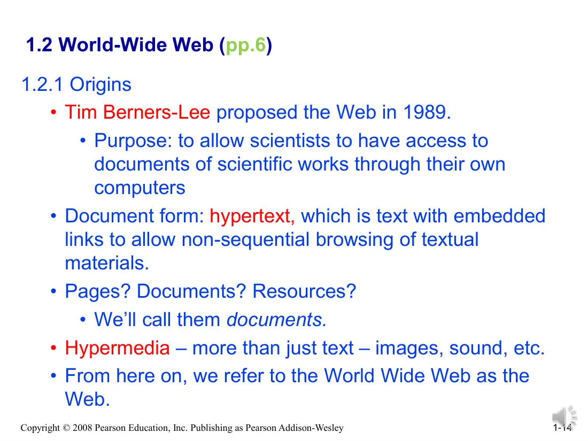

原文：

1.2 World-Wide Web (pp.6)

1.2.1 Origins

• Tim Berners-Lee proposed the Web in 1989.

Purpose: to allow scientists to have access to documents of scientific works through their own computers

Document form: hypertext, which is text with embedded links to allow non-sequential browsing of textual materials.

• Pages? Documents? Resources?

• We’ll call them documents.

• Hypermedia – more than just text – images, sound, etc.

• From here on, we refer to the World Wide Web as the Web.

Copyright © 2008 Pearson Education, Inc. Publishing as Pearson Addison-Wesley

1-14

### 1.2 The World-Wide Web

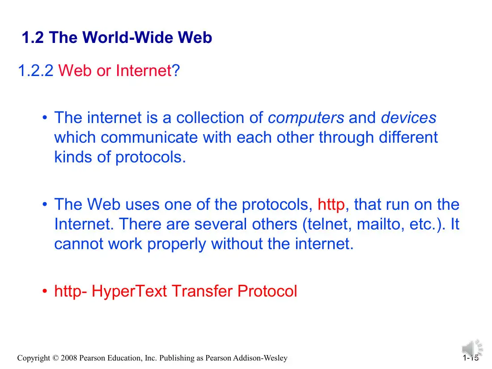

原文：

1.2 The World-Wide Web

1.2.2 Web or Internet?

The internet is a collection of computers and devices which communicate with each other through different kinds of protocols.

The Web uses one of the protocols, http, that run on the Internet. There are several others (telnet, mailto, etc.). It cannot work properly without the internet.

• http- HyperText Transfer Protocol

Copyright © 2008 Pearson Education, Inc. Publishing as Pearson Addison-Wesley

1-15

### 1.3 Web Browsers

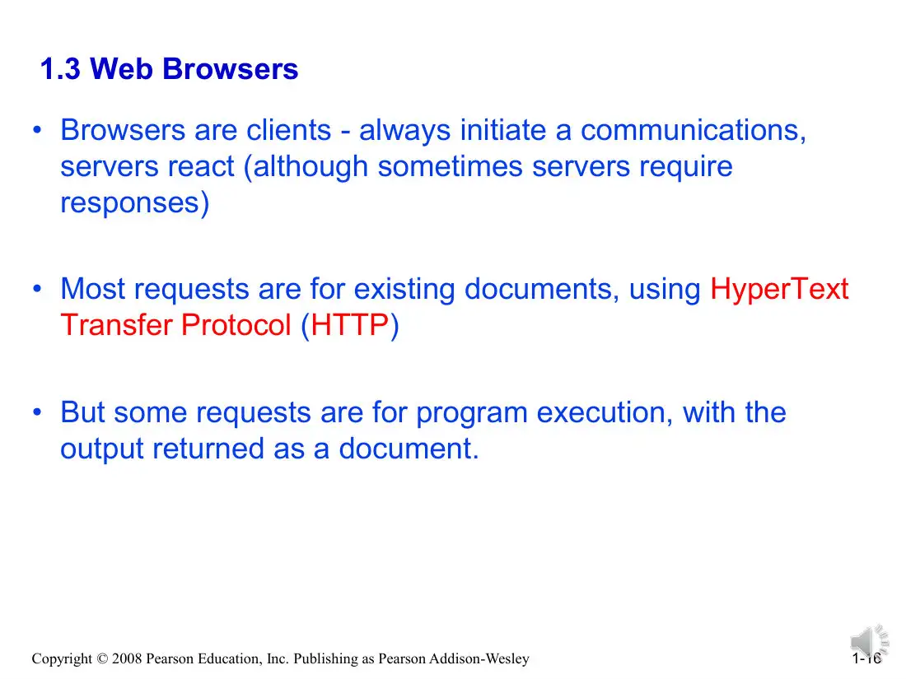

原文：

1.3 Web Browsers

Browsers are clients - always initiate a communications, servers react (although sometimes servers require responses)

• Most requests are for existing documents, using HyperText Transfer Protocol (HTTP)

But some requests are for program execution, with the output returned as a document.

Copyright © 2008 Pearson Education, Inc. Publishing as Pearson Addison-Wesley

### 1.4 Web Servers

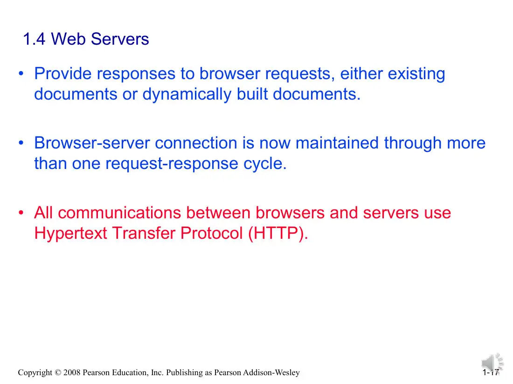

原文：

1.4 Web Servers

• Provide responses to browser requests, either existing documents or dynamically built documents.

• Browser-server connection is now maintained through more than one request-response cycle.

• All communications between browsers and servers use Hypertext Transfer Protocol (HTTP).

Copyright © 2008 Pearson Education, Inc. Publishing as Pearson Addison-Wesley

1-17

### 1.4.1 Web Server Operation

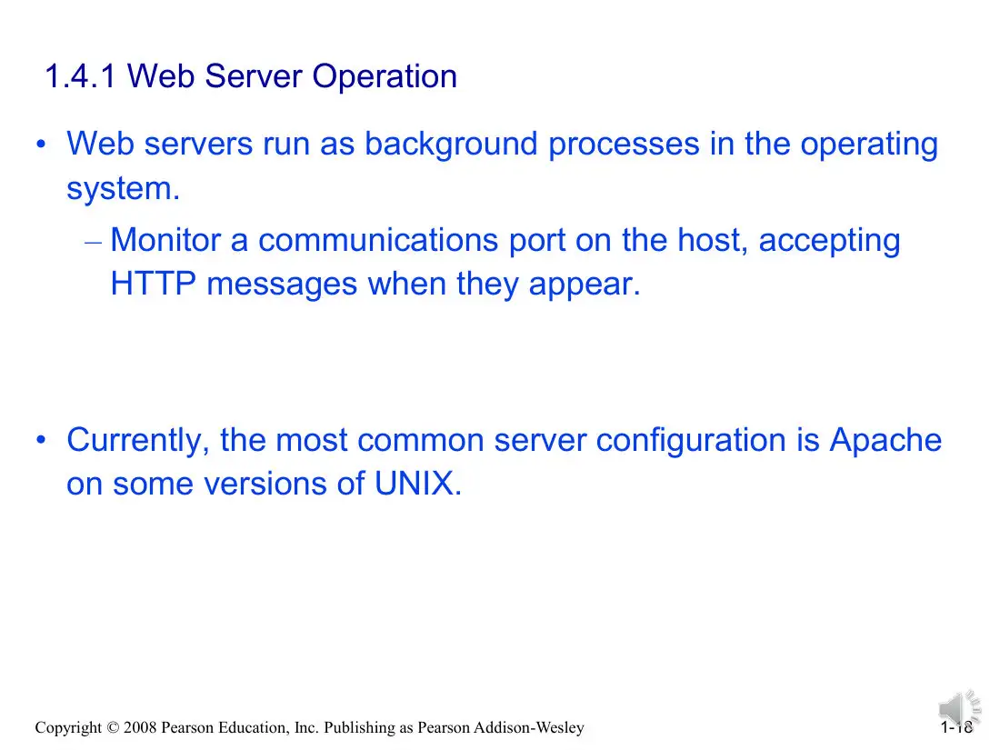

原文：

1.4.1 Web Server Operation

• Web servers run as background processes in the operating system.

– Monitor a communications port on the host, accepting HTTP messages when they appear.

• Currently, the most common server configuration is Apache on some versions of UNIX.

Copyright © 2008 Pearson Education, Inc. Publishing as Pearson Addison-Wesley

1-18

### 1.4.2 Web Server Operation Details

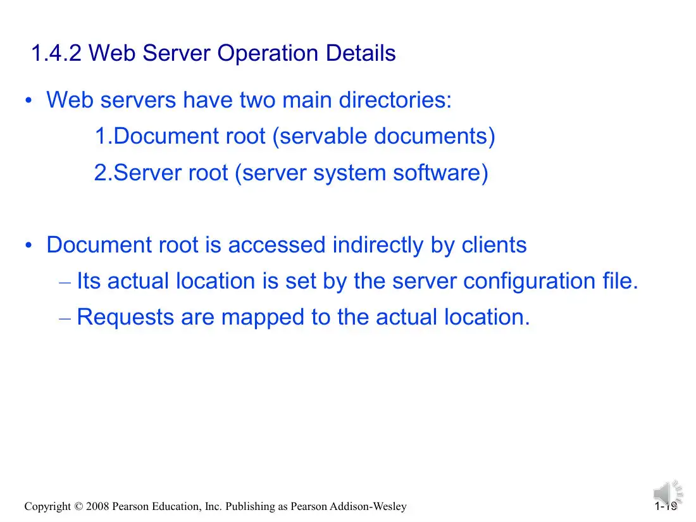

原文：

1.4.2 Web Server Operation Details

• Web servers have two main directories:

1.Document root (servable documents)

2.Server root (server system software)

Document root is accessed indirectly by clients

– Its actual location is set by the server configuration file.

– Requests are mapped to the actual location.

Copyright © 2008 Pearson Education, Inc. Publishing as Pearson Addison-Wesley

### 1.4.3 Apache

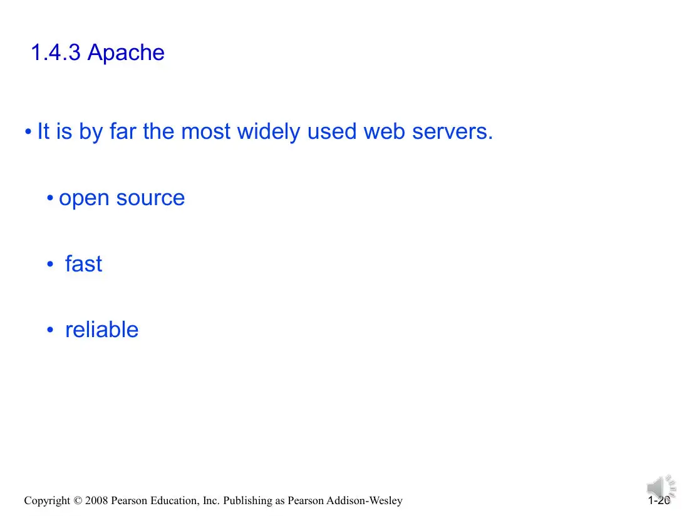

原文：

1.4.3 Apache

• It is by far the most widely used web servers.

• open source

• fast

• reliable

Copyright © 2008 Pearson Education, Inc. Publishing as Pearson Addison-Wesley

1-20

### 1.4.4 IIS

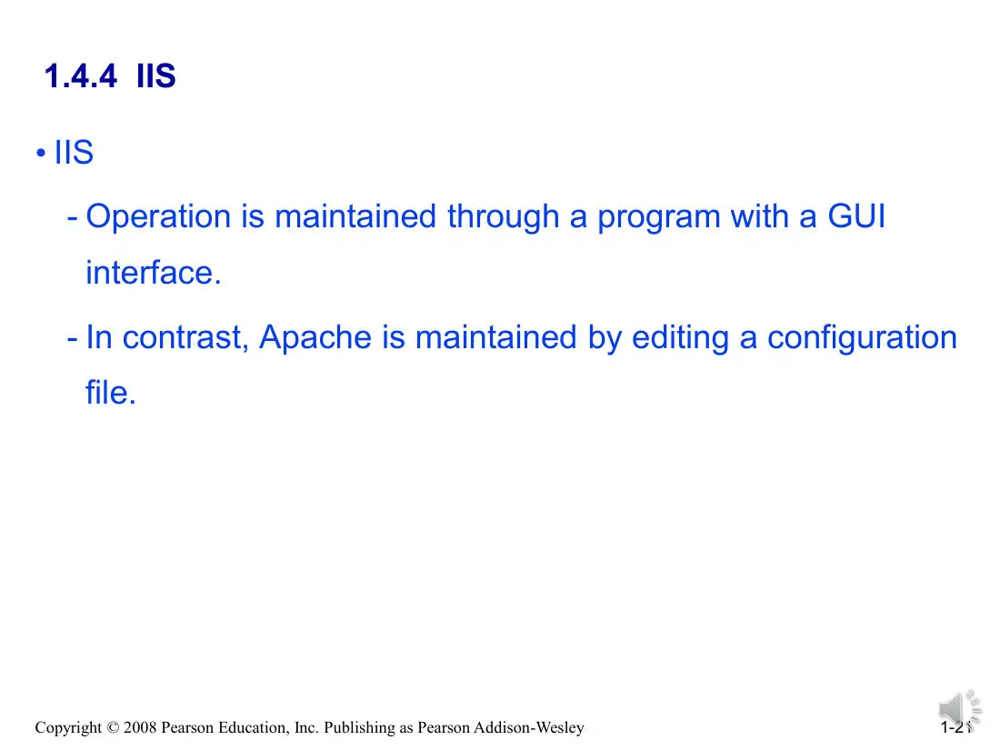

原文：

1.4.4 IIS

• IIS

\- Operation is maintained through a program with a GUI interface.

\- In contrast, Apache is maintained by editing a configuration file.

Copyright © 2008 Pearson Education, Inc. Publishing as Pearson Addison-Wesley

1-21

### 1.5 Uniform Resource Locators (URLs)

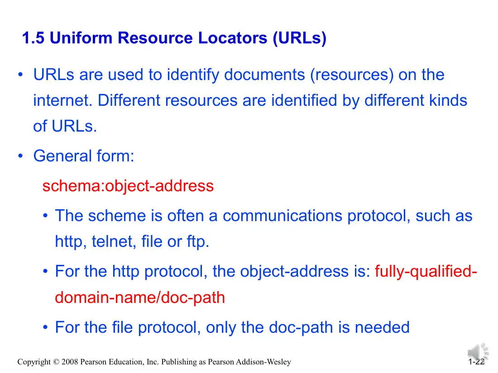

原文：

1.5 Uniform Resource Locators (URLs)

• URLs are used to identify documents (resources) on the internet. Different resources are identified by different kinds of URLs.

• General form:

schema:object-address

• The scheme is often a communications protocol, such as http, telnet, file or ftp.

• For the http protocol, the object-address is: fully-qualifieddomain-name/doc-path

• For the file protocol, only the doc-path is needed

Copyright © 2008 Pearson Education, Inc. Publishing as Pearson Addison-Wesley

1-22

### 1.5 URLs

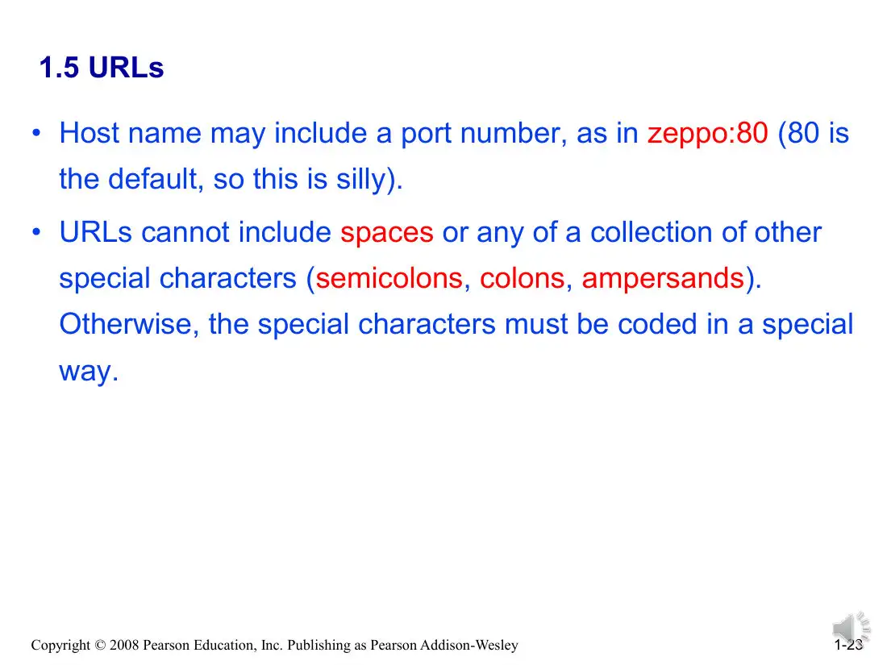

原文：

1.5 URLs

• Host name may include a port number, as in zeppo:80 (80 is the default, so this is silly).

URLs cannot include spaces or any of a collection of other special characters (semicolons, colons, ampersands). Otherwise, the special characters must be coded in a special way.

Copyright © 2008 Pearson Education, Inc. Publishing as Pearson Addison-Wesley

1-23

### 1.7 The HyperText Transfer Protocol

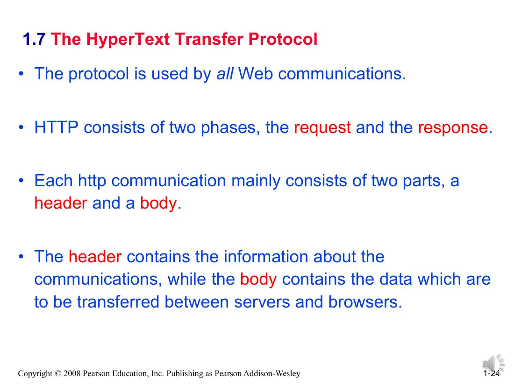

原文：

1.7 The HyperText Transfer Protocol

• The protocol is used by all Web communications.

• HTTP consists of two phases, the request and the response.

Each http communication mainly consists of two parts, a header and a body.

The header contains the information about the communications, while the body contains the data which are to be transferred between servers and browsers.

Copyright © 2008 Pearson Education, Inc. Publishing as Pearson Addison-Wesley

1-24

### 1.7.1 Request Phase

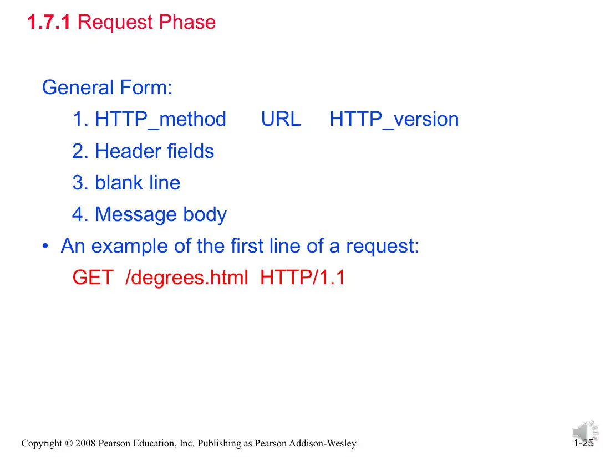

原文：

1.7.1 Request Phase

General Form:

1. HTTP\_method URL HTTP\_version

2. Header fields

3. blank line

4. Message body

• An example of the first line of a request:

GET /degrees.html HTTP/1.1

Copyright © 2008 Pearson Education, Inc. Publishing as Pearson Addison-Wesley

1-25

### • Get - fetch a document

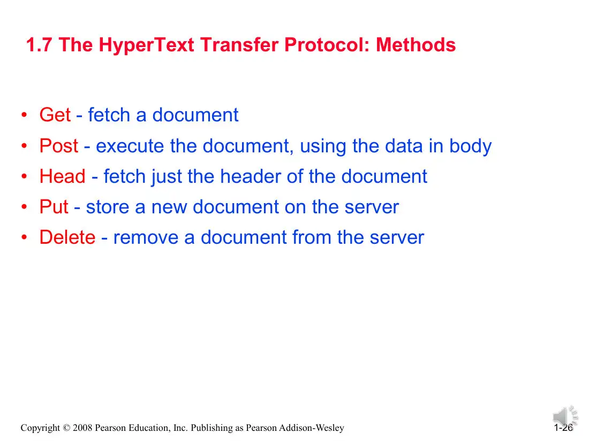

原文：

1.7 The HyperText Transfer Protocol: Methods

• Get - fetch a document

• Post - execute the document, using the data in body

• Head - fetch just the header of the document

• Put - store a new document on the server

• Delete - remove a document from the server

Copyright © 2008 Pearson Education, Inc. Publishing as Pearson Addison-Wesley

1-26

### 1.7.1 Request Phase

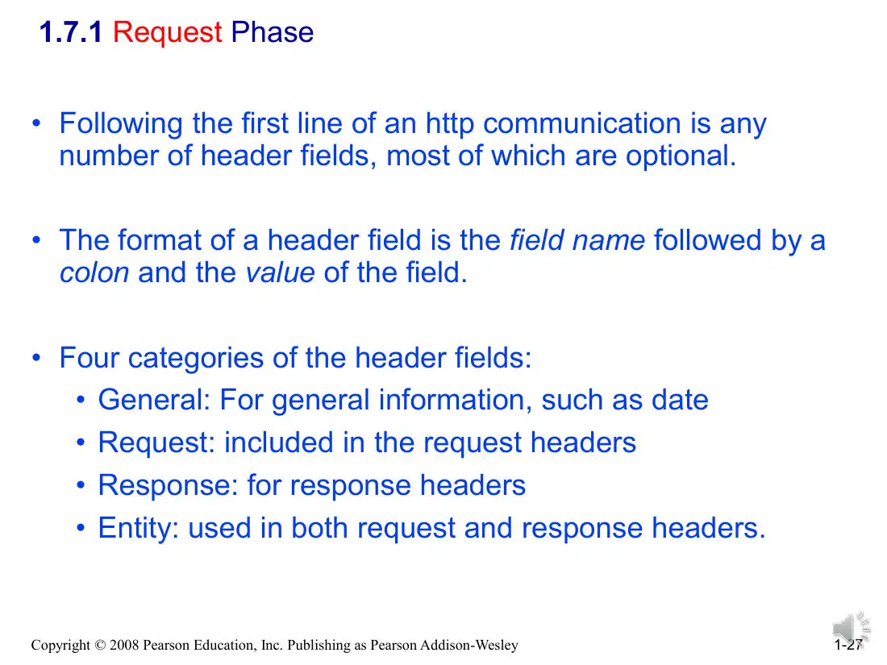

原文：

1.7.1 Request Phase

Following the first line of an http communication is any number of header fields, most of which are optional.

• The format of a header field is the field name followed by a colon and the value of the field.

• Four categories of the header fields:

• General: For general information, such as date

• Request: included in the request headers

• Response: for response headers

• Entity: used in both request and response headers.

Copyright © 2008 Pearson Education, Inc. Publishing as Pearson Addison-Wesley

1-27

### • Common request field examples:

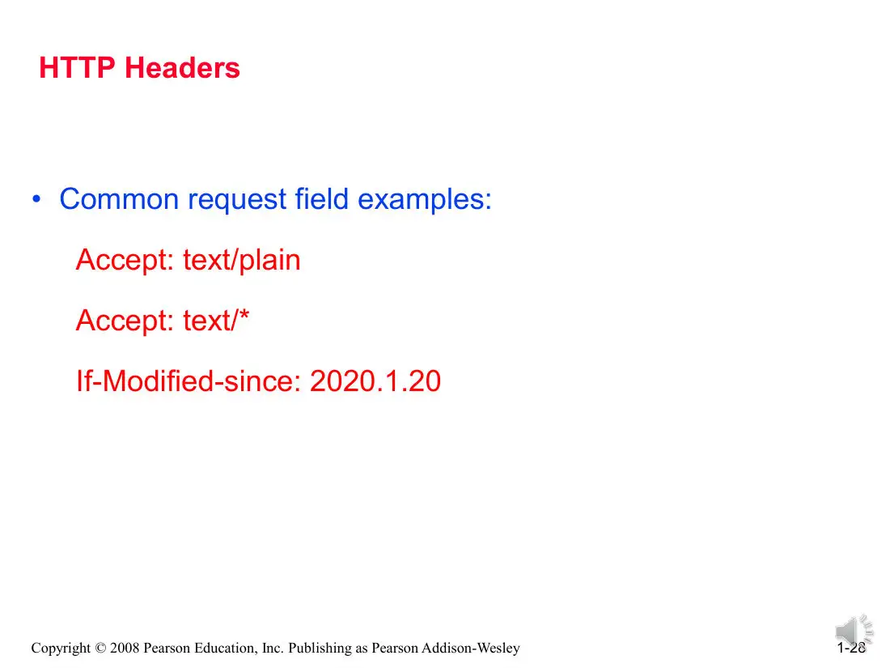

原文：

• Common request field examples:

Accept: text/plain

Accept: text/\*

If-Modified-since: 2020.1.20

HTTP Headers

Copyright © 2008 Pearson Education, Inc. Publishing as Pearson Addison-Wesley

1-28

### 1.7.2 HTTP Response

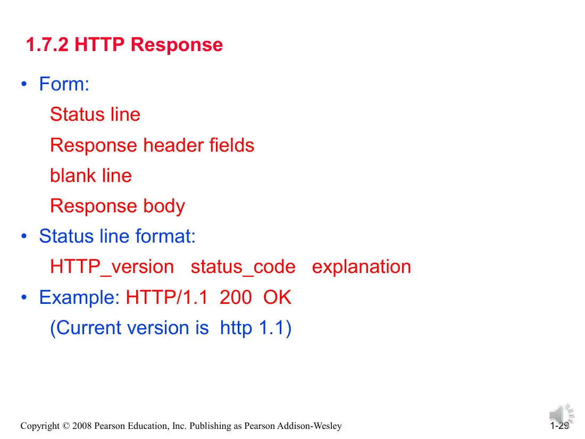

原文：

1.7.2 HTTP Response

• Form:

Status line

Response header fields

blank line

Response body

Status line format: HTTP\_version status\_code explanation

Example: HTTP/1.1 200 OK (Current version is http 1.1)

Copyright © 2008 Pearson Education, Inc. Publishing as Pearson Addison-Wesley

### 1.7.2 HTTP Response

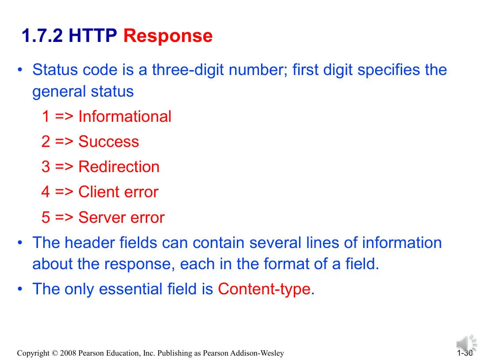

原文：

1.7.2 HTTP Response

• Status code is a three-digit number; first digit specifies the general status

1 => Informational

2 => Success

3 => Redirection

4 => Client error

5 => Server error

The header fields can contain several lines of information about the response, each in the format of a field.

• The only essential field is Content-type.

Copyright © 2008 Pearson Education, Inc. Publishing as Pearson Addison-Wesley

1-30

### • Common response fields:

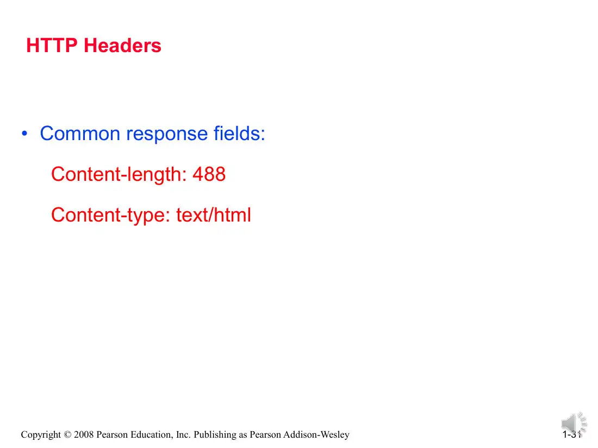

原文：

• Common response fields:

Content-length: 488

Content-type: text/html

HTTP Headers

Copyright © 2008 Pearson Education, Inc. Publishing as Pearson Addison-Wesley

1-31

### HTTP/1.1 200 OK

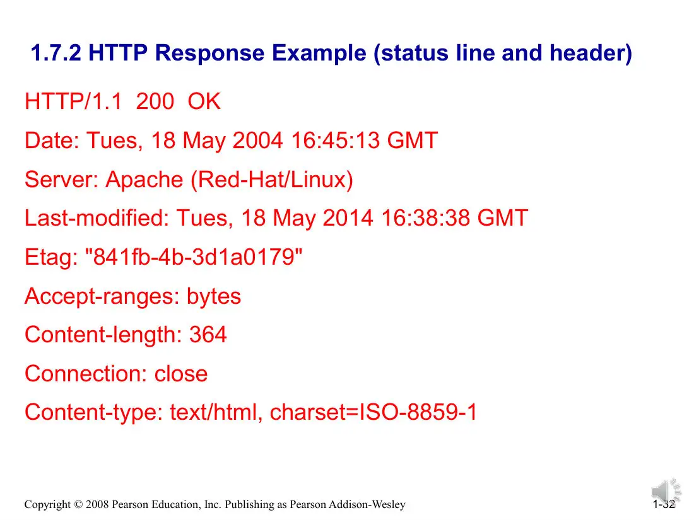

原文：

1.7.2 HTTP Response Example (status line and header)

HTTP/1.1 200 OK

Date: Tues, 18 May 2004 16:45:13 GMT

Server: Apache (Red-Hat/Linux)

Last-modified: Tues, 18 May 2014 16:38:38 GMT

Etag: "841fb-4b-3d1a0179"

Accept-ranges: bytes

Content-length: 364

Connection: close

Content-type: text/html, charset=ISO-8859-1

Copyright © 2008 Pearson Education, Inc. Publishing as Pearson Addison-Wesley

1-32

### 1.9 The Web Programmer’s Toolbox

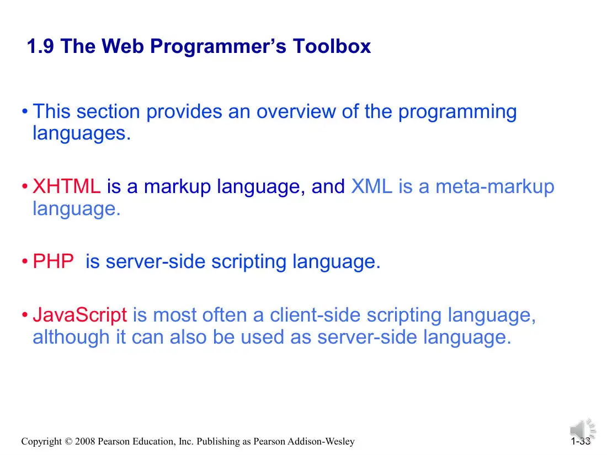

原文：

1.9 The Web Programmer’s Toolbox

• This section provides an overview of the programming languages.

• XHTML is a markup language, and XML is a meta-markup language.

• PHP is server-side scripting language.

• JavaScript is most often a client-side scripting language, although it can also be used as server-side language.

Copyright © 2008 Pearson Education, Inc. Publishing as Pearson Addison-Wesley

1-33

### 1.8.1 XHTML

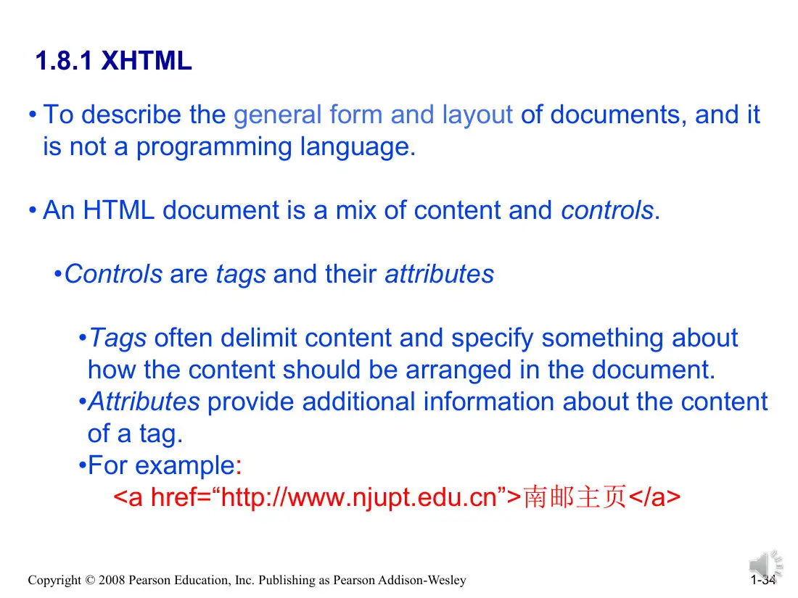

原文：

1.8.1 XHTML

• To describe the general form and layout of documents, and it is not a programming language.

• An HTML document is a mix of content and controls.

•Controls are tags and their attributes

•Tags often delimit content and specify something about how the content should be arranged in the document.

•Attributes provide additional information about the content of a tag.

•For example:

<a href=“http://www.njupt.edu.cn”>南邮主页</a>

Copyright © 2008 Pearson Education, Inc. Publishing as Pearson Addison-Wesley

1-34

### 1.8.1 Creating XHTML documents

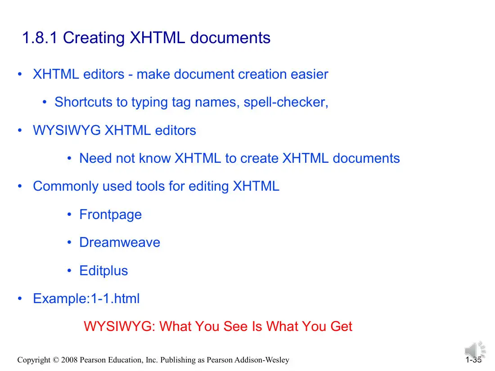

原文：

1.8.1 Creating XHTML documents

• XHTML editors - make document creation easier

• Shortcuts to typing tag names, spell-checker,

• WYSIWYG XHTML editors

• Need not know XHTML to create XHTML documents

• Commonly used tools for editing XHTML

• Frontpage

• Dreamweave

• Editplus

• Example:1-1.html

WYSIWYG: What You See Is What You Get

Copyright © 2008 Pearson Education, Inc. Publishing as Pearson Addison-Wesley

1-35

### 1.9.4 XML (eXtensible Markup Language)

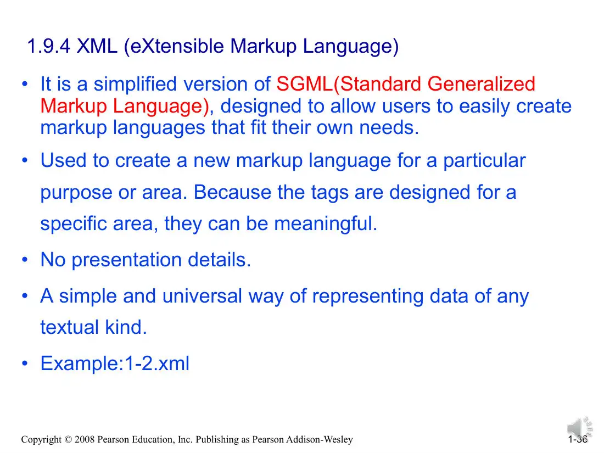

原文：

1.9.4 XML (eXtensible Markup Language)

It is a simplified version of SGML(Standard Generalized Markup Language), designed to allow users to easily create markup languages that fit their own needs.

Used to create a new markup language for a particular purpose or area. Because the tags are designed for a specific area, they can be meaningful.

• No presentation details.

A simple and universal way of representing data of any textual kind.

• Example:1-2.xml

Copyright © 2008 Pearson Education, Inc. Publishing as Pearson Addison-Wesley

1-36

### 1.9.5 JavaScript

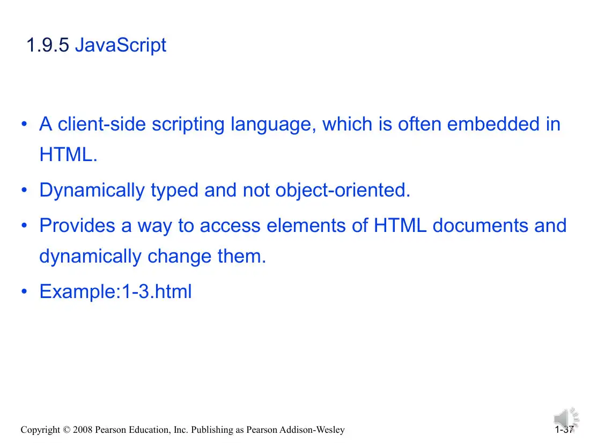

原文：

1.9.5 JavaScript

• A client-side scripting language, which is often embedded in HTML.

• Dynamically typed and not object-oriented.

• Provides a way to access elements of HTML documents and dynamically change them.

• Example:1-3.html

Copyright © 2008 Pearson Education, Inc. Publishing as Pearson Addison-Wesley

1-37

### 1.9.7 PHP

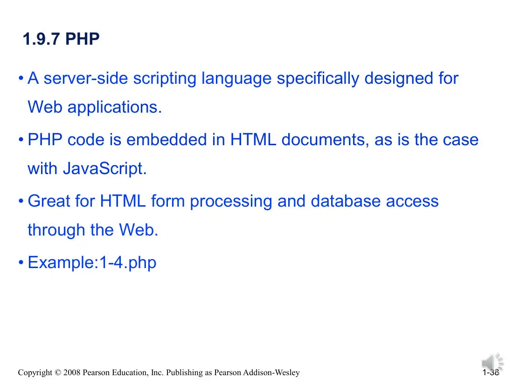

原文：

1.9.7 PHP

• A server-side scripting language specifically designed for Web applications.

• PHP code is embedded in HTML documents, as is the case with JavaScript.

• Great for HTML form processing and database access through the Web.

• Example:1-4.php

Copyright © 2008 Pearson Education, Inc. Publishing as Pearson Addison-Wesley

1-38

### Homework

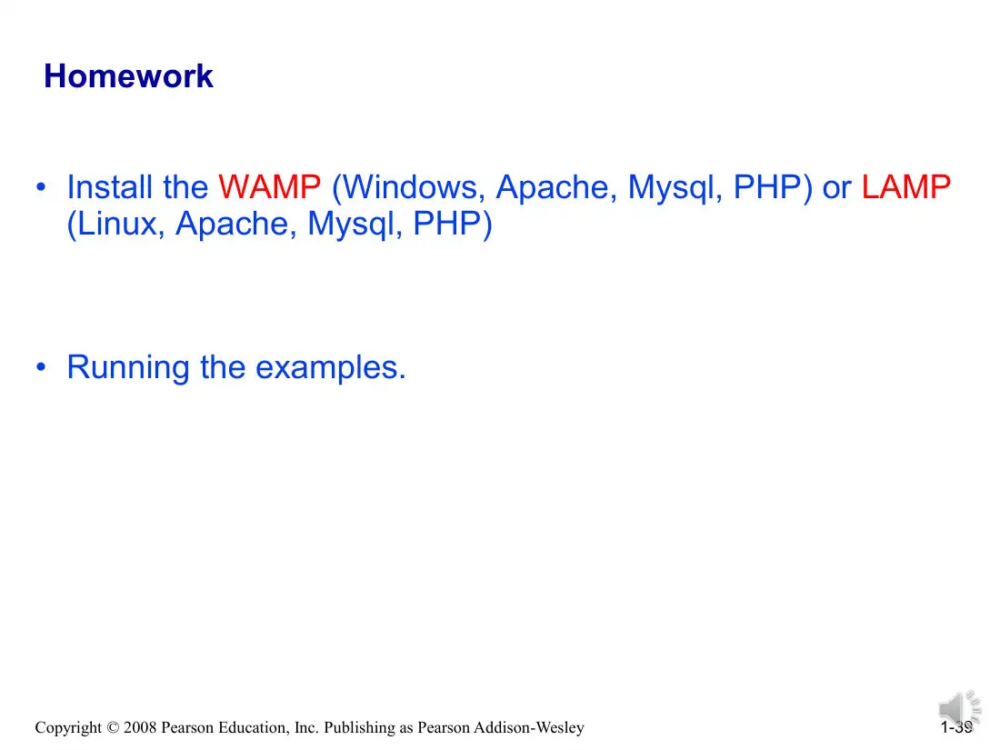

原文：

Homework

Install the WAMP (Windows, Apache, Mysql, PHP) or LAMP (Linux, Apache, Mysql, PHP)

• Running the examples.

Copyright © 2008 Pearson Education, Inc. Publishing as Pearson Addison-Wesley
