# 《Web技术（双语）》第2章 XHTML基础（课件）

原件的每一页，下面附识别出的文字。

### Part 2

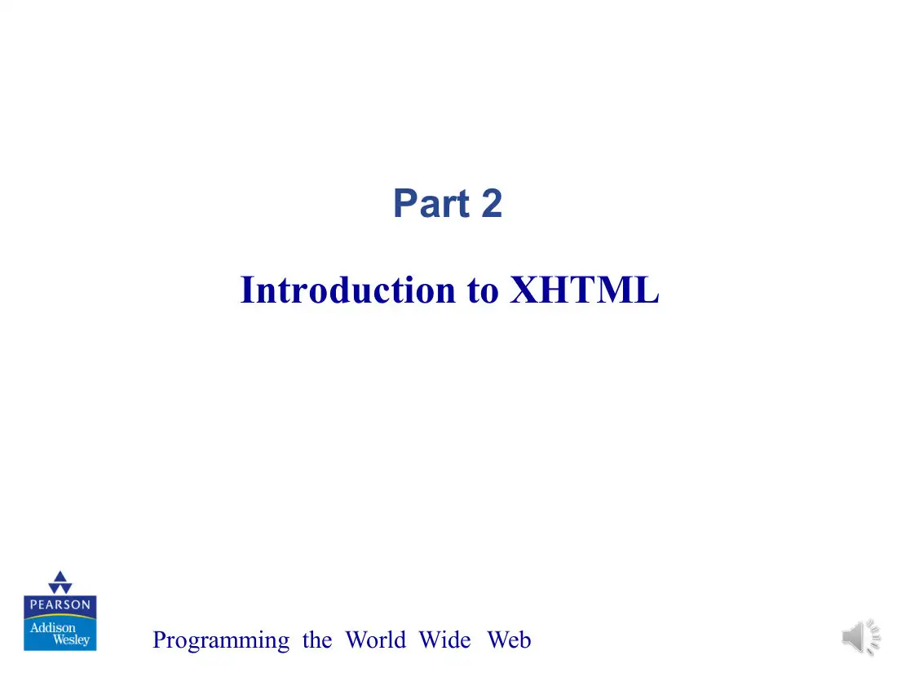

原文：

Part 2

Introduction to XHTML

PEARSON Addison Wesley

Programming the World Wide Web

### Contents

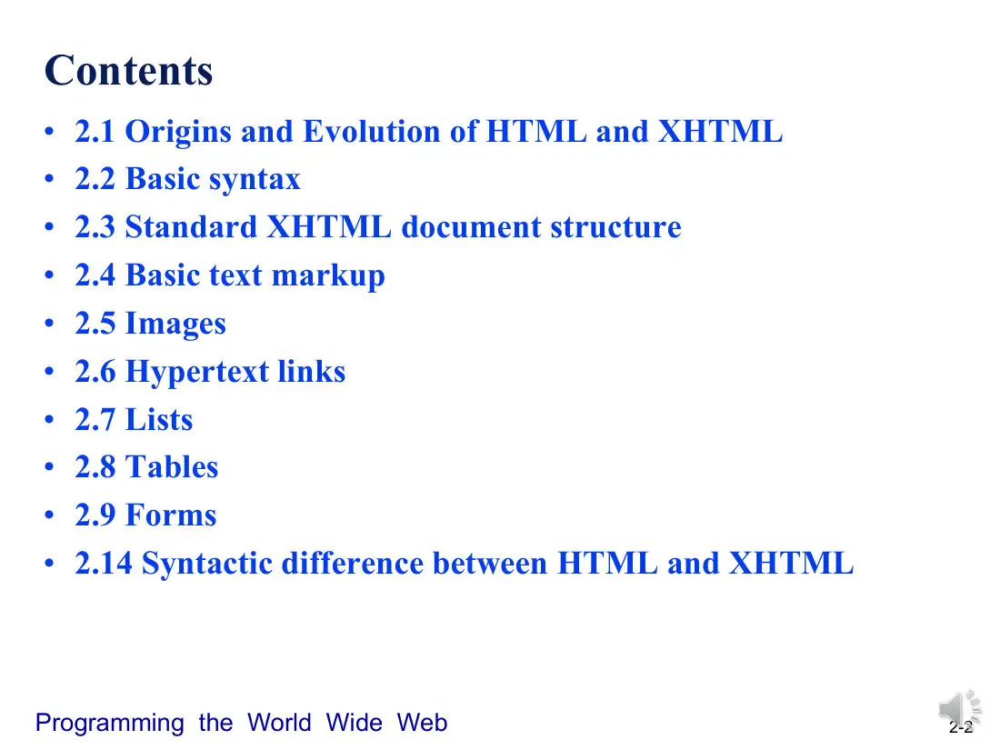

原文：

Contents

• 2.1 Origins and Evolution of HTML and XHTML

• 2.2 Basic syntax

• 2.3 Standard XHTML document structure

• 2.4 Basic text markup

• 2.5 Images

• 2.6 Hypertext links

• 2.7 Lists

• 2.8 Tables

• 2.9 Forms

• 2.14 Syntactic difference between HTML and XHTML

Programming the World Wide Web

### 2.1 Origins and Evolution of HTML

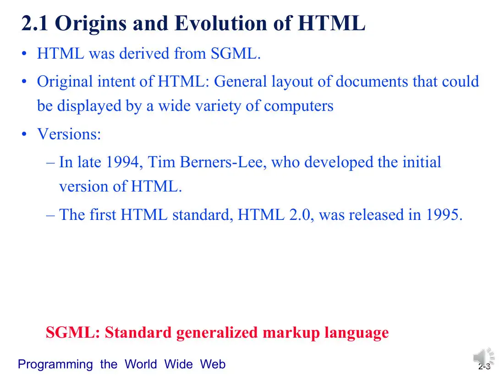

原文：

2.1 Origins and Evolution of HTML

• HTML was derived from SGML.

• Original intent of HTML: General layout of documents that could be displayed by a wide variety of computers

• Versions:

– In late 1994, Tim Berners-Lee, who developed the initial version of HTML.

– The first HTML standard, HTML 2.0, was released in 1995.

SGML: Standard generalized markup language

Programming the World Wide Web

2-3

### 2.1 Origins and Evolution of HTML

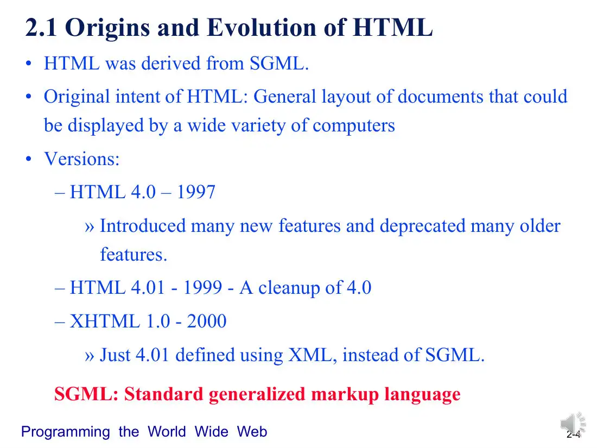

原文：

2.1 Origins and Evolution of HTML

• HTML was derived from SGML.

• Original intent of HTML: General layout of documents that could be displayed by a wide variety of computers

• Versions:

– HTML 4.0 – 1997

»Introduced many new features and deprecated many older features.

– HTML 4.01 - 1999 - A cleanup of 4.0

– XHTML 1.0 - 2000

»Just 4.01 defined using XML, instead of SGML.

SGML: Standard generalized markup language

Programming the World Wide Web

### 2.1 Origins and Evolution of HTML

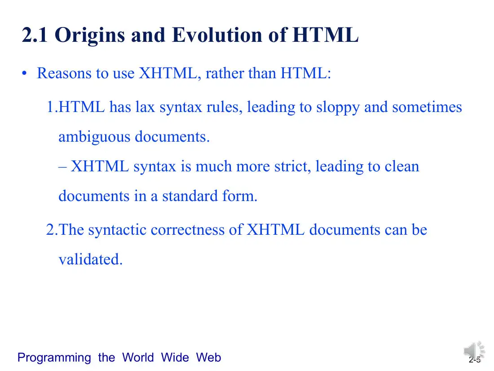

原文：

2.1 Origins and Evolution of HTML

• Reasons to use XHTML, rather than HTML:

1.HTML has lax syntax rules, leading to sloppy and sometimes ambiguous documents.

– XHTML syntax is much more strict, leading to clean documents in a standard form.

2.The syntactic correctness of XHTML documents can be validated.

Programming the World Wide Web

2-5

### 2.2 Basic Syntax

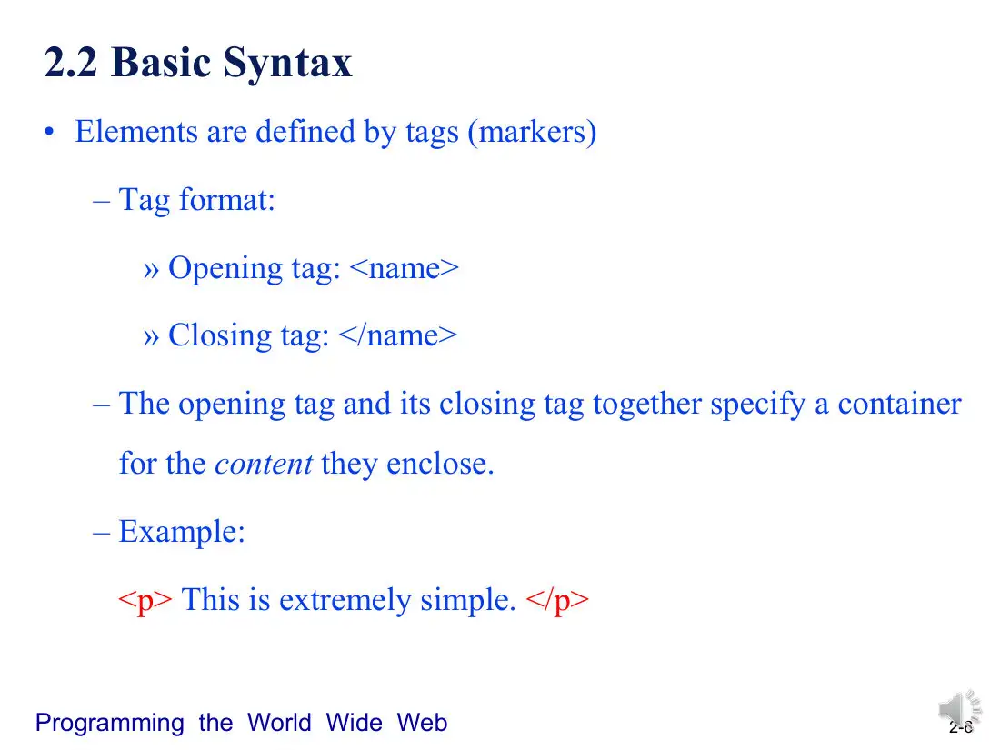

原文：

2.2 Basic Syntax

• Elements are defined by tags (markers)

– Tag format:

»Opening tag: <name>

»Closing tag: </name>

– The opening tag and its closing tag together specify a container for the content they enclose.

– Example:

 This is extremely simple. 

Programming the World Wide Web

2-6

### 2.2 Basic Syntax

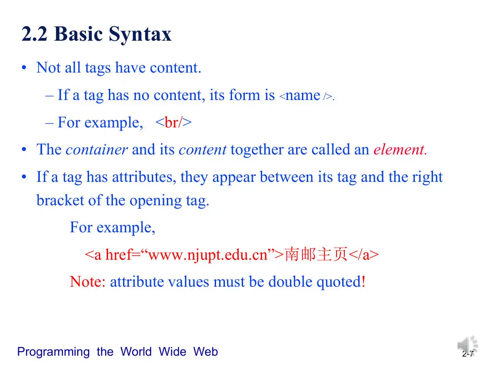

原文：

2.2 Basic Syntax

• Not all tags have content.

– If a tag has no content, its form is <name />.

– For example,  

• The container and its content together are called an element.

• If a tag has attributes, they appear between its tag and the right bracket of the opening tag.

For example,

<a href=“www.njupt.edu.cn”>南邮主页</a>

Note: attribute values must be double quoted!

Programming the World Wide Web

### 2.2 Basic Syntax

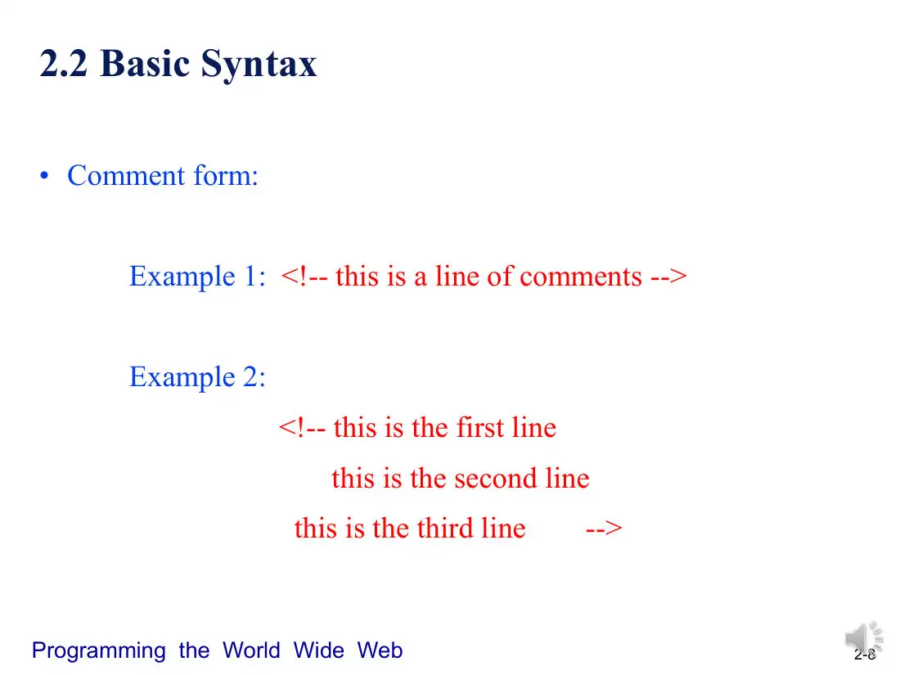

原文：

2.2 Basic Syntax

• Comment form:

Example 1: <!-- this is a line of comments -->

Example 2:

<!-- this is the first line

this is the second line

this is the third line -->

Programming the World Wide Web

### 2.2 Basic Syntax

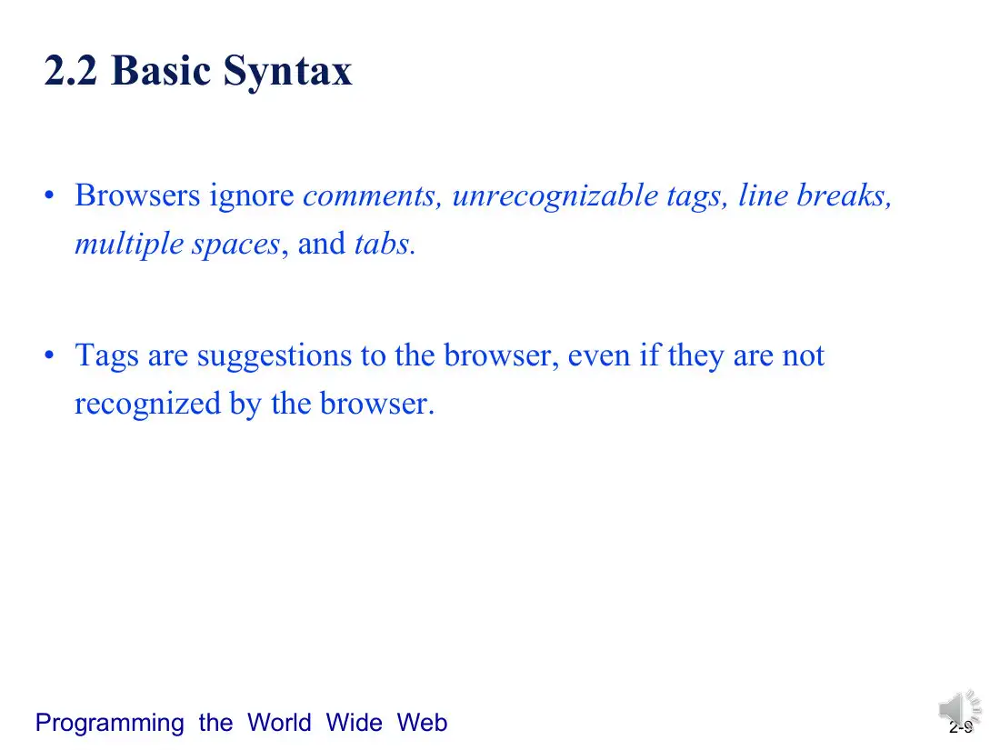

原文：

2.2 Basic Syntax

• Browsers ignore comments, unrecognizable tags, line breaks, multiple spaces, and tabs.

Tags are suggestions to the browser, even if they are not recognized by the browser.

Programming the World Wide Web

2-9

### 2.3 HTML Document Structure

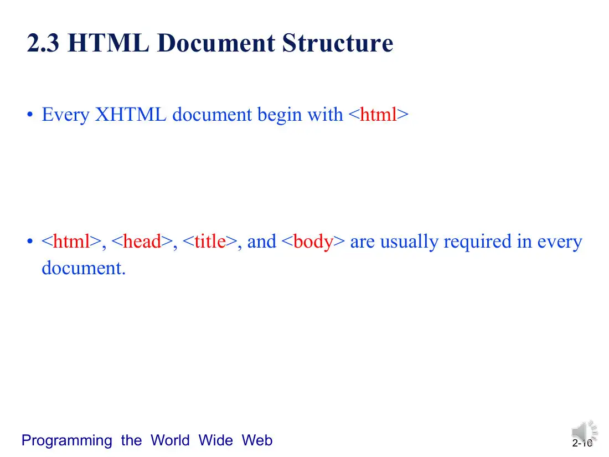

原文：

2.3 HTML Document Structure

• Every XHTML document begin with <html>

• <html>, <head>, <title>, and <body> are usually required in every document.

Programming the World Wide Web

### 2.3 HTML Document Structure

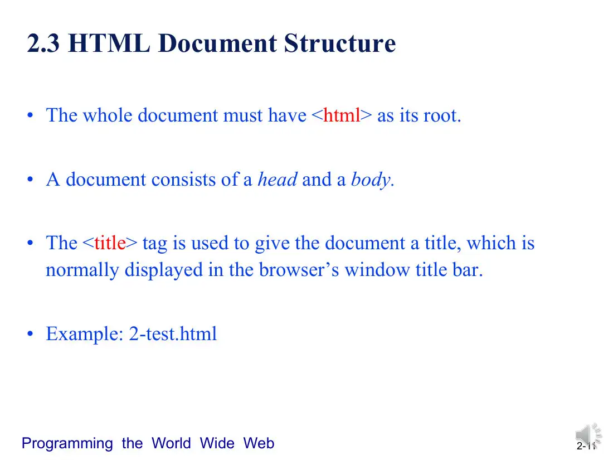

原文：

2.3 HTML Document Structure

• The whole document must have <html> as its root.

• A document consists of a head and a body.

The <title> tag is used to give the document a title, which is normally displayed in the browser’s window title bar.

• Example: 2-test.html

Programming the World Wide Web

2-11

### 2.4 Basic Text Markup-2.4.1 Paragraphs

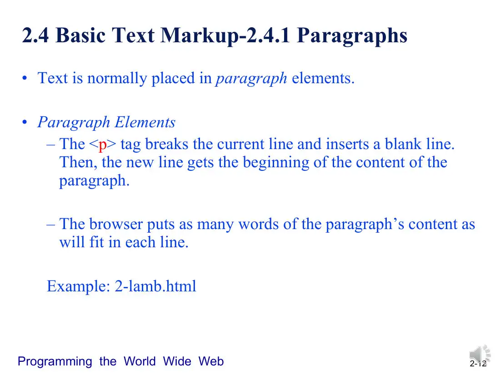

原文：

2.4 Basic Text Markup-2.4.1 Paragraphs

• Text is normally placed in paragraph elements.

• Paragraph Elements

– The 
 tag breaks the current line and inserts a blank line. Then, the new line gets the beginning of the content of the paragraph.

– The browser puts as many words of the paragraph’s content as will fit in each line.

Example: 2-lamb.html

Programming the World Wide Web

### 2.4 Basic Text Markup-2.4.1 Paragraphs

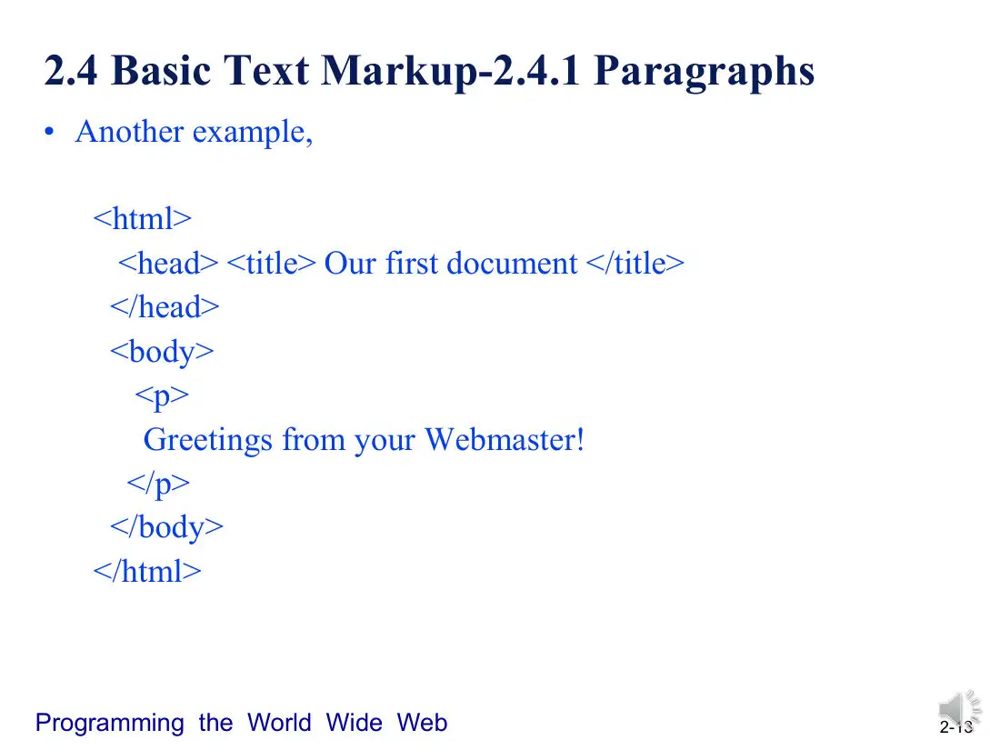

原文：

2.4 Basic Text Markup-2.4.1 Paragraphs

• Another example,

Programming the World Wide Web

### 2.4 Basic Text Markup-2.4.2 Line breaks

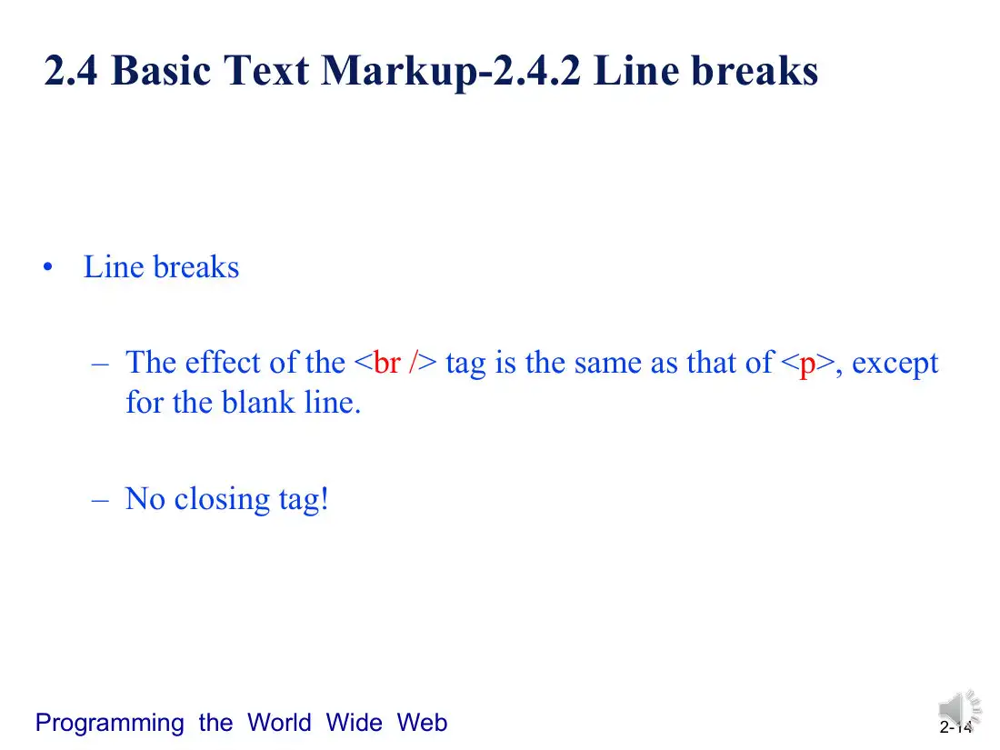

原文：

2.4 Basic Text Markup-2.4.2 Line breaks

• Line breaks

– The effect of the   tag is the same as that of 
, except for the blank line.

– No closing tag!

Programming the World Wide Web

2-14

### 2.4 Basic Text Markup-2.4.2 Line breaks

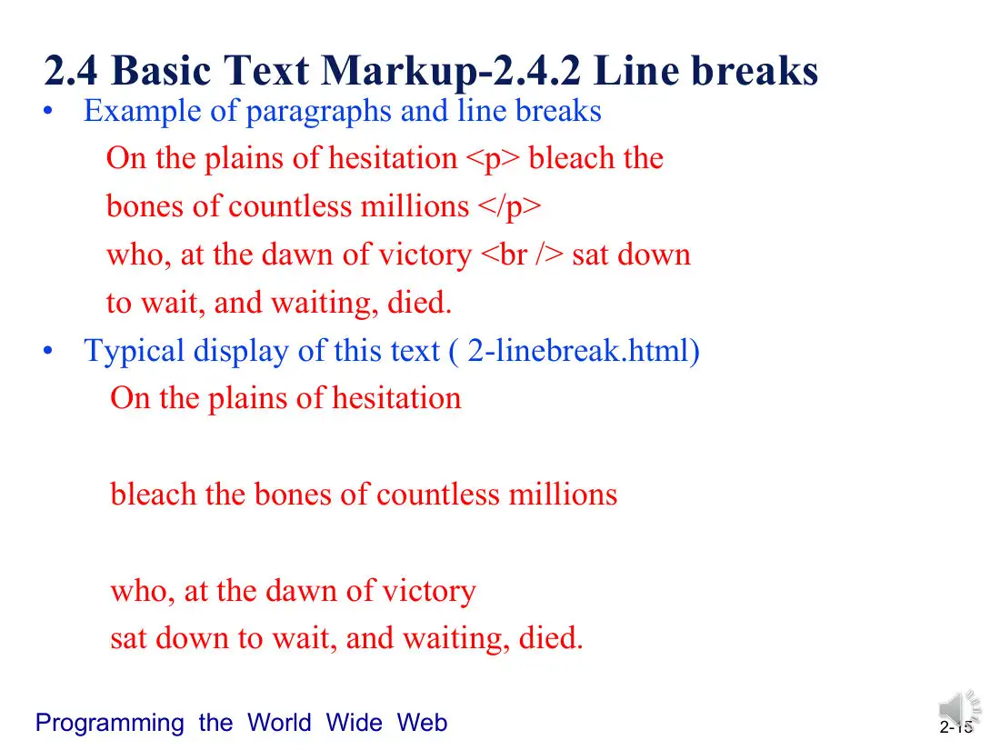

原文：

2.4 Basic Text Markup-2.4.2 Line breaks

Example of paragraphs and line breaks On the plains of hesitation 
 bleach the bones of countless millions 
 who, at the dawn of victory   sat down to wait, and waiting, died.

Typical display of this text ( 2-linebreak.html) On the plains of hesitation

bleach the bones of countless millions

who, at the dawn of victory sat down to wait, and waiting, died.

Programming the World Wide Web

2-15

### 2.4 Basic Text Markup-

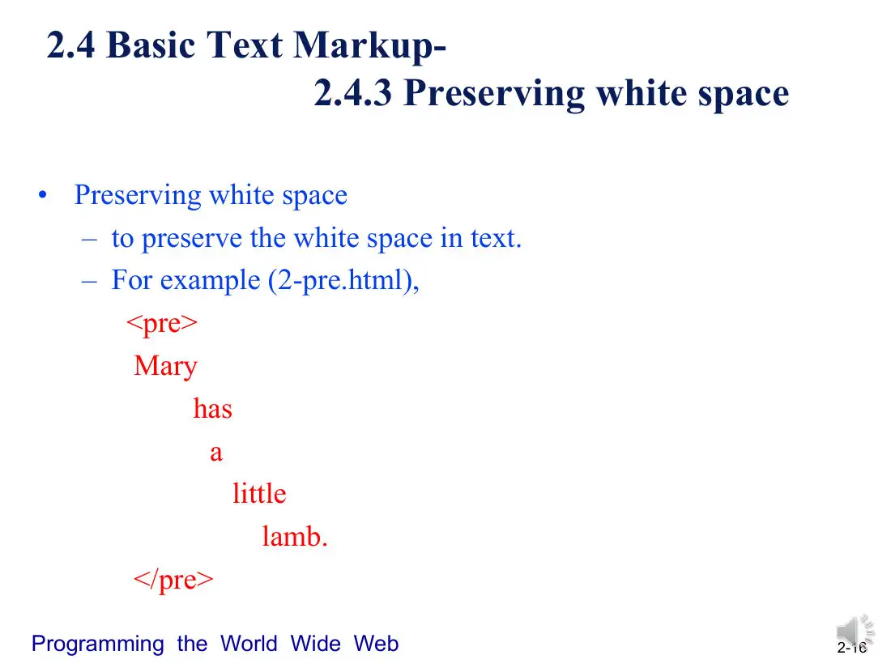

原文：

2.4 Basic Text Markup-

2.4.3 Preserving white space

• Preserving white space

– to preserve the white space in text.

– For example (2-pre.html),

Programming the World Wide Web

### 2.4 Basic Text Markup-2.4.4 Headings

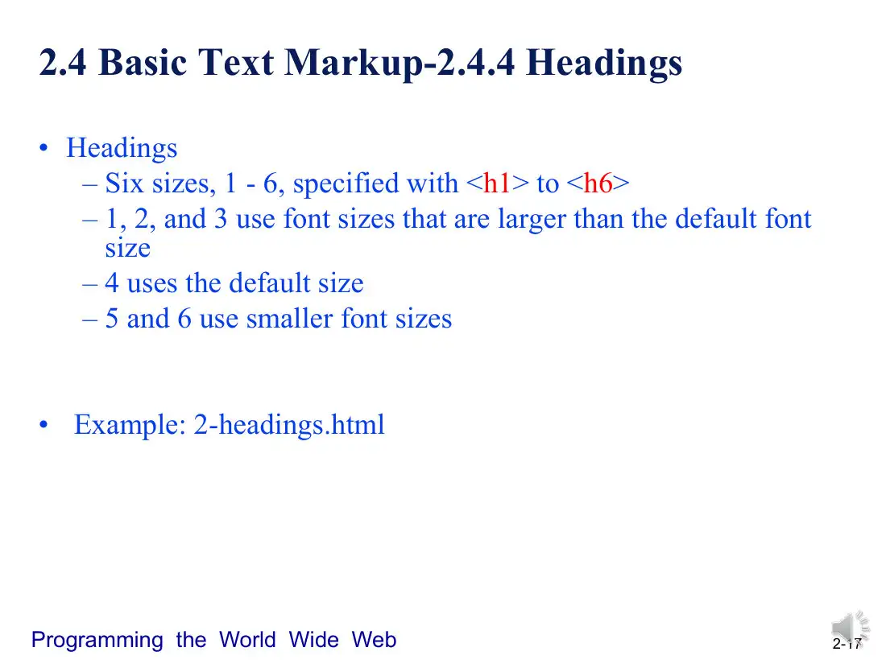

原文：

2.4 Basic Text Markup-2.4.4 Headings

• Headings

– Six sizes, 1 - 6, specified with <h1> to <h6>

– 1, 2, and 3 use font sizes that are larger than the default font size

– 4 uses the default size

– 5 and 6 use smaller font sizes

• Example: 2-headings.html

Programming the World Wide Web

### 2.4 Text Markup-2.4.5 Block Quotations

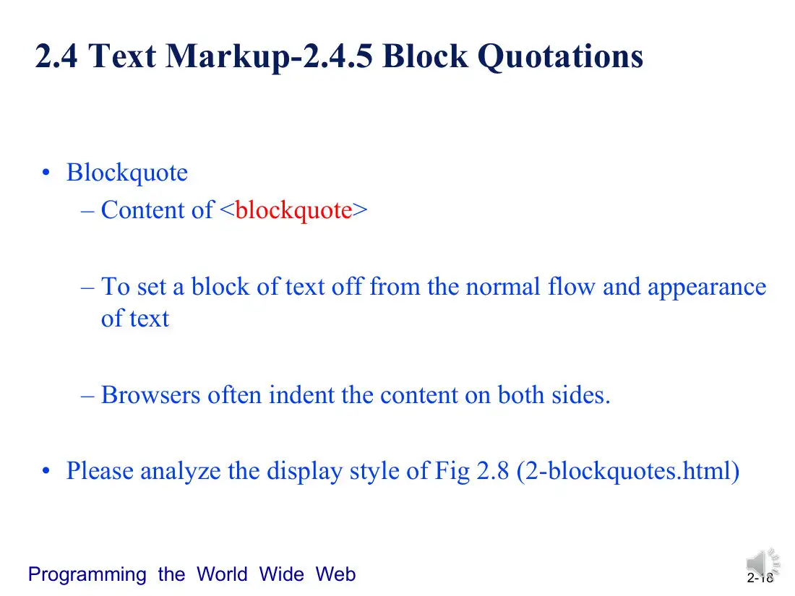

原文：

2.4 Text Markup-2.4.5 Block Quotations

• Blockquote

– Content of <blockquote>

– To set a block of text off from the normal flow and appearance of text

– Browsers often indent the content on both sides.

• Please analyze the display style of Fig 2.8 (2-blockquotes.html)

Programming the World Wide Web

2-18

### • Font Styles and Sizes (can be nested)

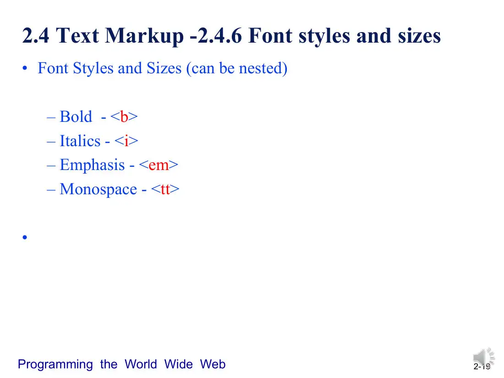

原文：

2.4 Text Markup -2.4.6 Font styles and sizes

• Font Styles and Sizes (can be nested)

– Bold - <b>

– Italics - <i>

– Emphasis - <em>

– Monospace - <tt>

Programming the World Wide Web

### • Superscripts and subscripts

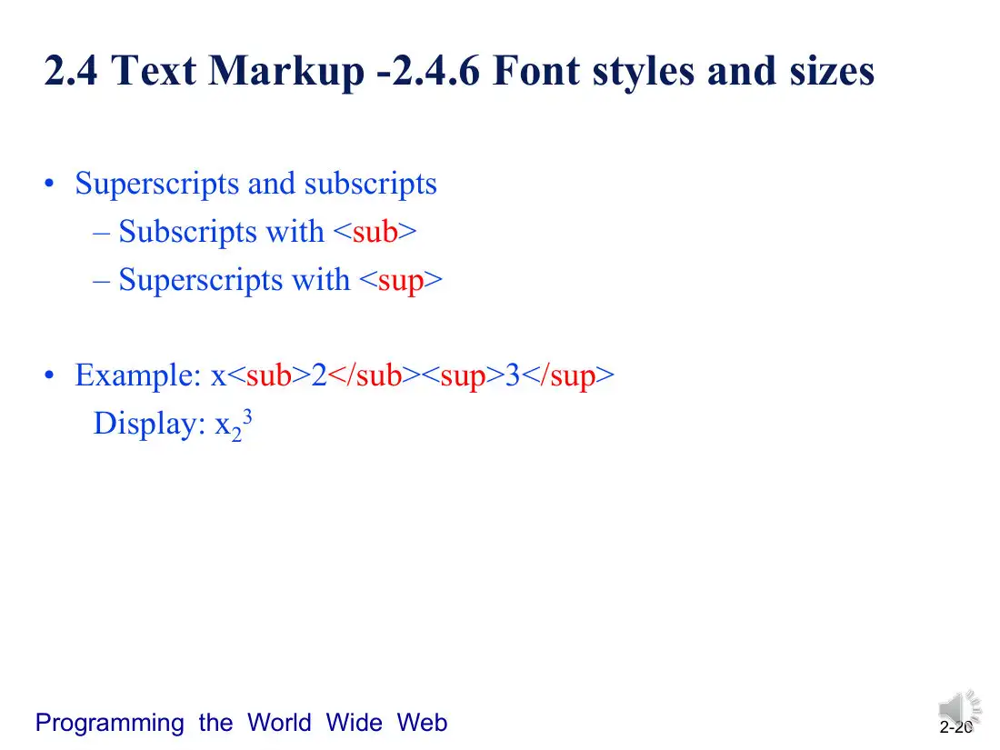

原文：

2.4 Text Markup -2.4.6 Font styles and sizes

• Superscripts and subscripts

– Subscripts with 

– Superscripts with 

• Example: $\mathrm { x < s u b } > 2 < / \mathrm { s u b } > < \mathrm { s u p } > 3 < / \mathrm { s u p } >$ Display: ${ \mathbf { X } _ { 2 } } ^ { 3 }$

Programming the World Wide Web

2-20

### • Character Entities

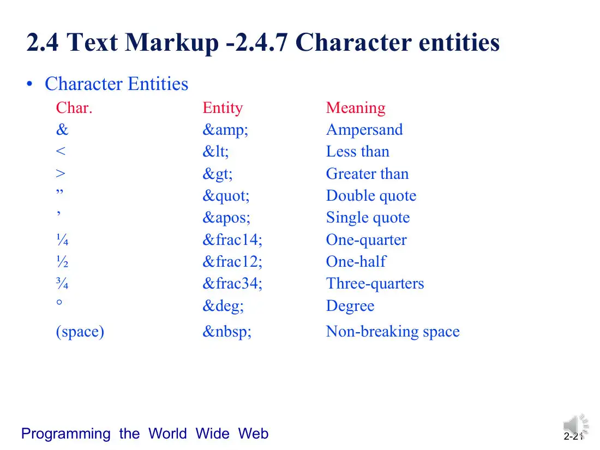

原文：

2.4 Text Markup -2.4.7 Character entities

• Character Entities

<table><tr><td>Char.</td><td>Entity</td><td>Meaning</td></tr><tr><td>&amp;</td><td>&amp;amp;</td><td>Ampersand</td></tr><tr><td>&lt;</td><td>&lt; &amp;lt;</td><td>Less than</td></tr><tr><td>&gt;</td><td>&gt; &amp;gt;</td><td>Greater than</td></tr><tr><td>”</td><td>“ &amp;quot;</td><td>Double quote</td></tr><tr><td>,</td><td>, &amp;apos;</td><td>Single quote</td></tr><tr><td> $\frac{1}{4}$ </td><td> $\frac{1}{4}$  &amp;frac14;</td><td>One-quarter</td></tr><tr><td> $\frac{1}{2}$ </td><td> $\frac{1}{2}$  &amp;frac12;</td><td>One-half</td></tr><tr><td> $\frac{3}{4}$ </td><td> $\frac{3}{4}$  &amp;frac34;</td><td>Three-quarters</td></tr><tr><td>°</td><td>° &amp;deg;</td><td>Degree</td></tr><tr><td>(space)</td><td>&amp;nbsp;</td><td>Non-breaking space</td></tr></table>

Programming the World Wide Web

2-21

### 2.4 Text Markup -2.4.8(Horizontal rule)

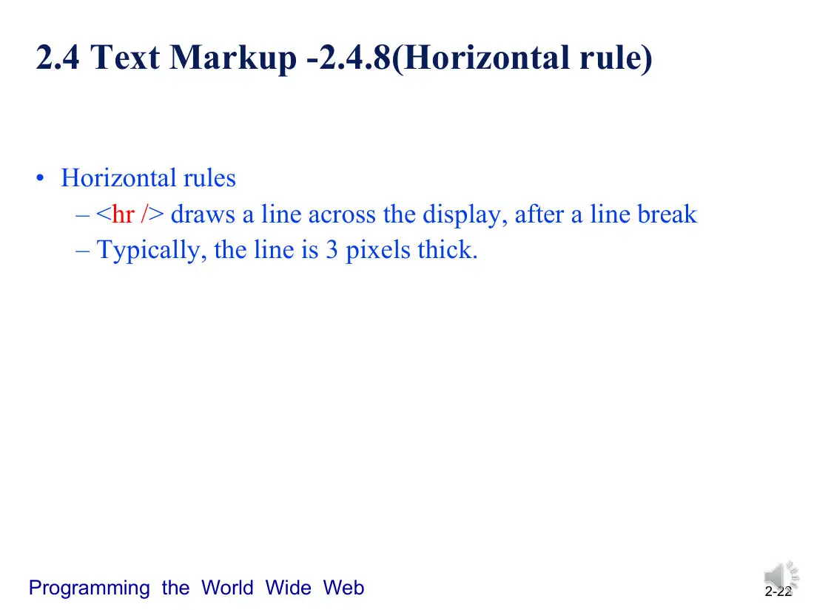

原文：

2.4 Text Markup -2.4.8(Horizontal rule)

• Horizontal rules

– 
 draws a line across the display, after a line break – Typically, the line is 3 pixels thick.

Programming the World Wide Web

### 2.4 Text Markup -2.4.9(meta element)

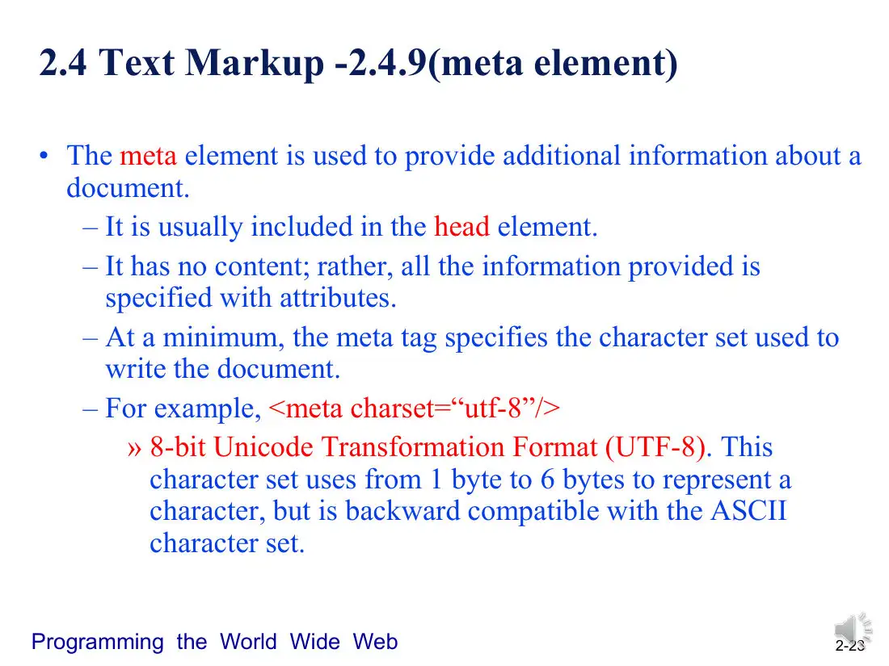

原文：

2.4 Text Markup -2.4.9(meta element)

• The meta element is used to provide additional information about a document.

– It is usually included in the head element.

– It has no content; rather, all the information provided is specified with attributes.

– At a minimum, the meta tag specifies the character set used to write the document.

– For example, <meta charset=“utf-8”/>

»8-bit Unicode Transformation Format (UTF-8). This character set uses from 1 byte to 6 bytes to represent a character, but is backward compatible with the ASCII character set.

Programming the World Wide Web

### 2.5 Images

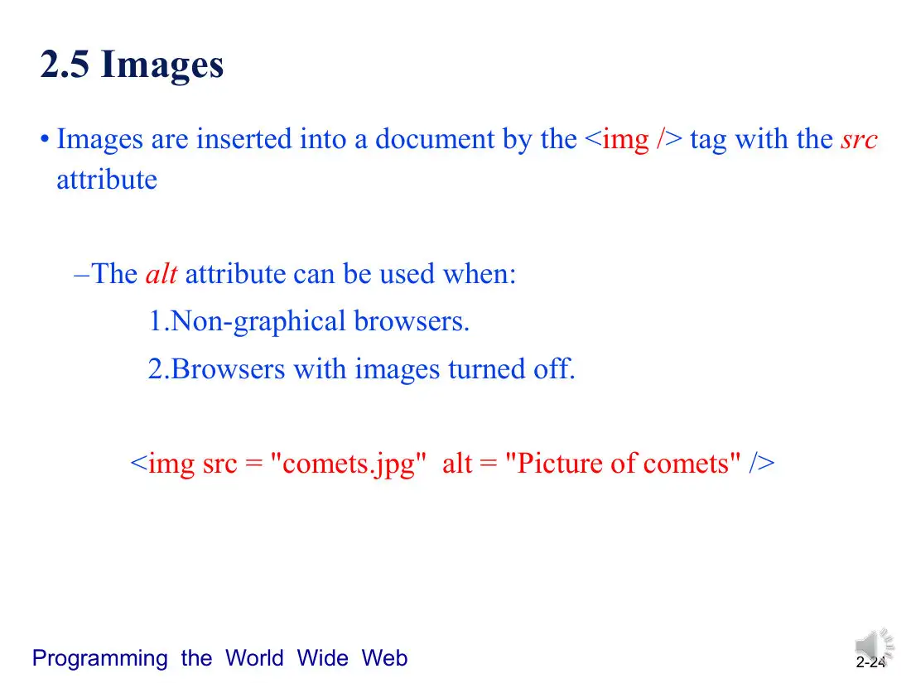

原文：

2.5 Images

• Images are inserted into a document by the  tag with the src attribute

–The alt attribute can be used when:

1.Non-graphical browsers.

2.Browsers with images turned off.

Programming the World Wide Web

2-24

### 2.5 Images

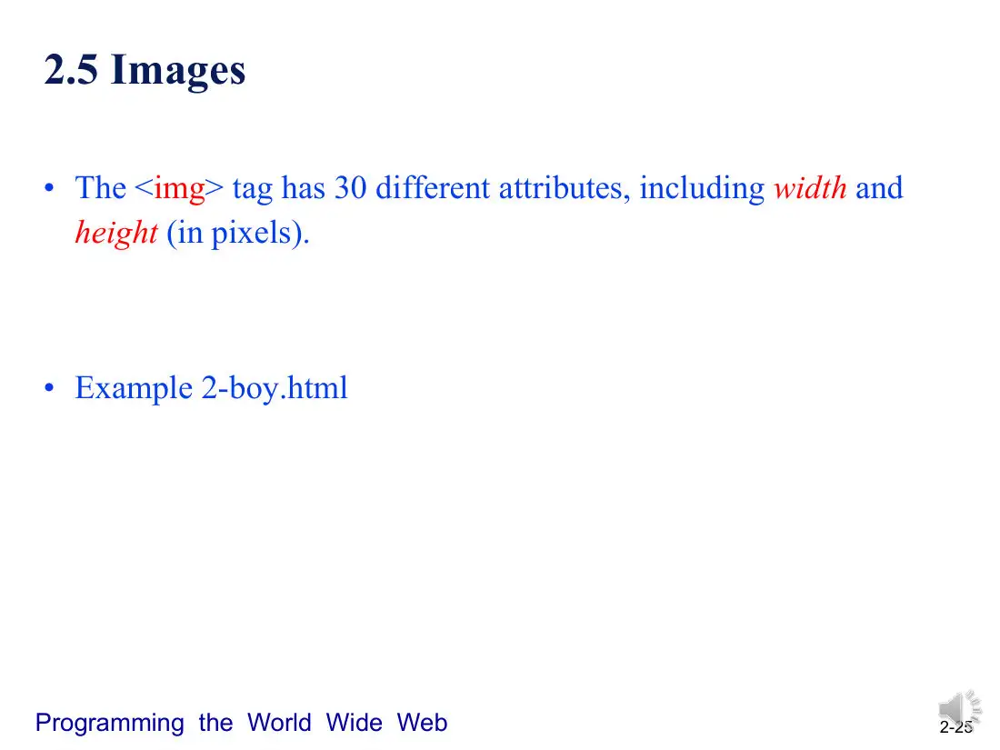

原文：

2.5 Images

The  tag has 30 different attributes, including width and height (in pixels).

• Example 2-boy.html

Programming the World Wide Web

2-25

### 2.6 Hypertext Links

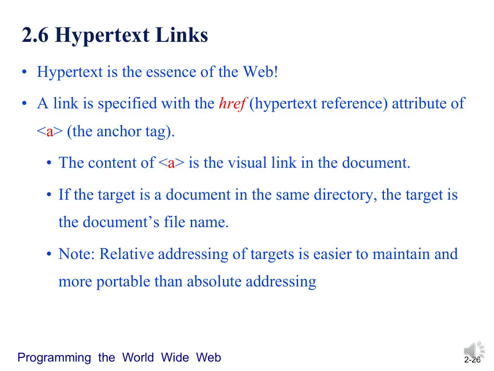

原文：

2.6 Hypertext Links

• Hypertext is the essence of the Web!

• A link is specified with the href(hypertext reference) attribute of $\mathrm { \textless { a } \mathrm { > } }$ (the anchor tag).

• The content of $\mathrm { \textless { a } \mathrm { ‰} }$ is the visual link in the document.

• If the target is a document in the same directory, the target is the document’s file name.

• Note: Relative addressing of targets is easier to maintain and more portable than absolute addressing

Programming the World Wide Web

2-26

### 2.6 Hypertext Links

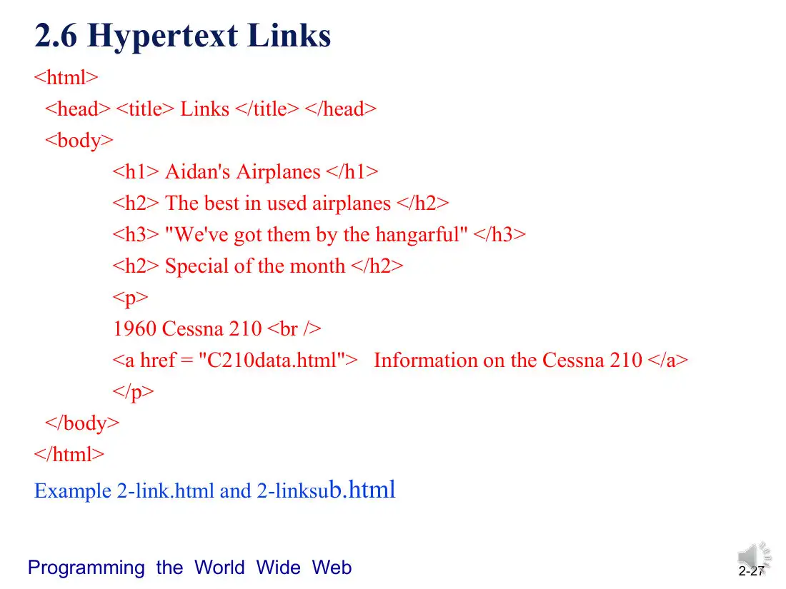

原文：

2.6 Hypertext Links

Programming the World Wide Web

2-27

### 2.6 Hypertext Links

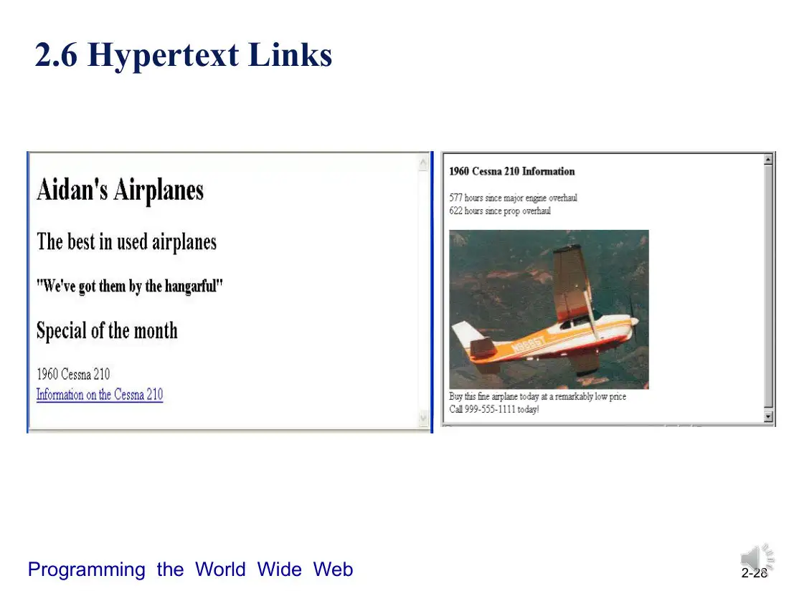

原文：

2.6 Hypertext Links

Aidan's Airplanes

The best in used airplanes

"We've got them by the hangarful"

Special of the month

1960 Cessna 210

Information on the Cessna 210

1960 Cessna 210 Information

577 hours since major engine overhaul 622 hours since prop overhaul

1D

Programming the World Wide Web

2-28

### 2.6 Hypertext Links

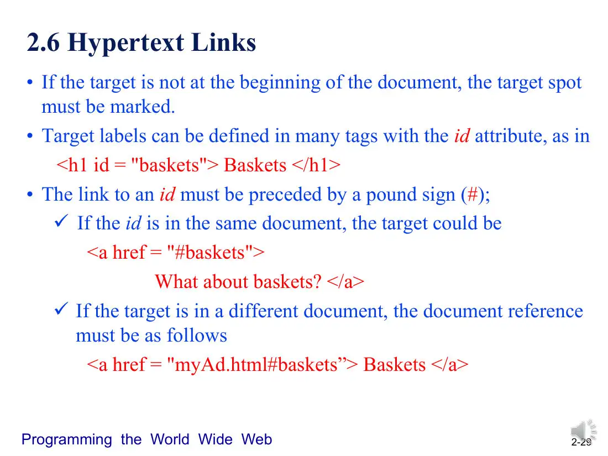

原文：

2.6 Hypertext Links

• If the target is not at the beginning of the document, the target spot must be marked.

• Target labels can be defined in many tags with the id attribute, as in $\mathrm { < h 1 ~ i d = " b a s k e t s " > B a s k e t s < / h 1 > }$

• The link to an id must be preceded by a pound sign (#);

✓ If the id is in the same document, the target could be

What about baskets? $< / { \mathrm { a } } >$

✓ If the target is in a different document, the document reference must be as follows

<a href = "myAd.html#baskets”> Baskets </a>

Programming the World Wide Web

2-29

### 2.6 Hypertext Links

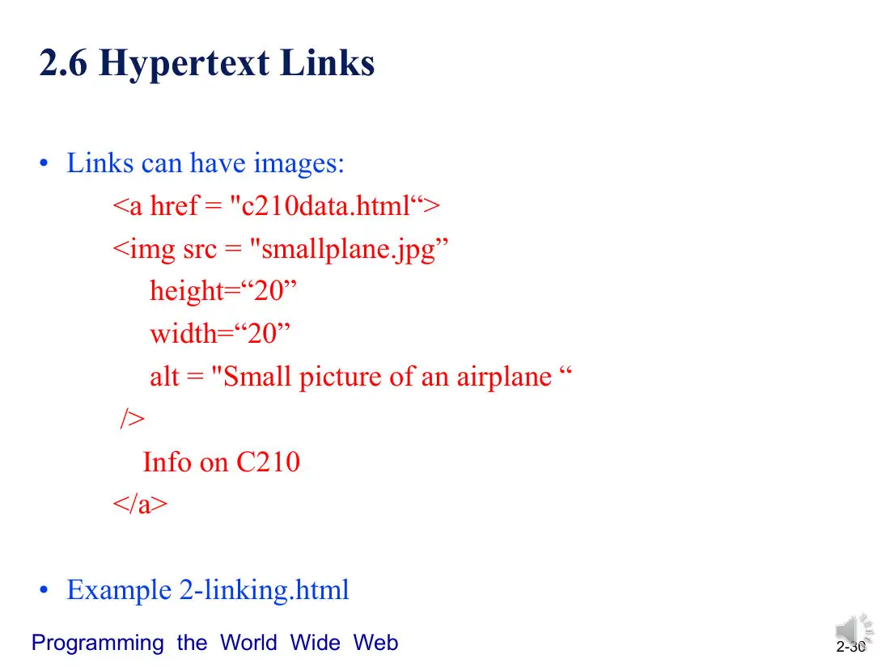

原文：

2.6 Hypertext Links

• Links can have images:

• Example 2-linking.html

Programming the World Wide Web

### Class exercises

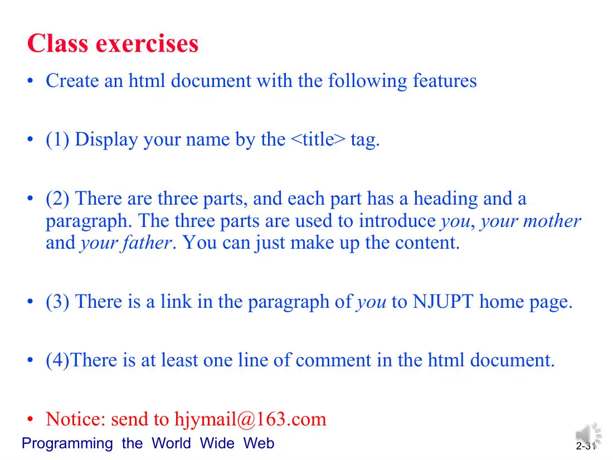

原文：

Class exercises

• Create an html document with the following features

• (1) Display your name by the <title> tag.

(2) There are three parts, and each part has a heading and a paragraph. The three parts are used to introduce you, your mother and your father. You can just make up the content.

• (3) There is a link in the paragraph of you to NJUPT home page.

• (4)There is at least one line of comment in the html document.

• Notice: send to hjymail@163.com

Programming the World Wide Web

2-31

### 2.7 Lists

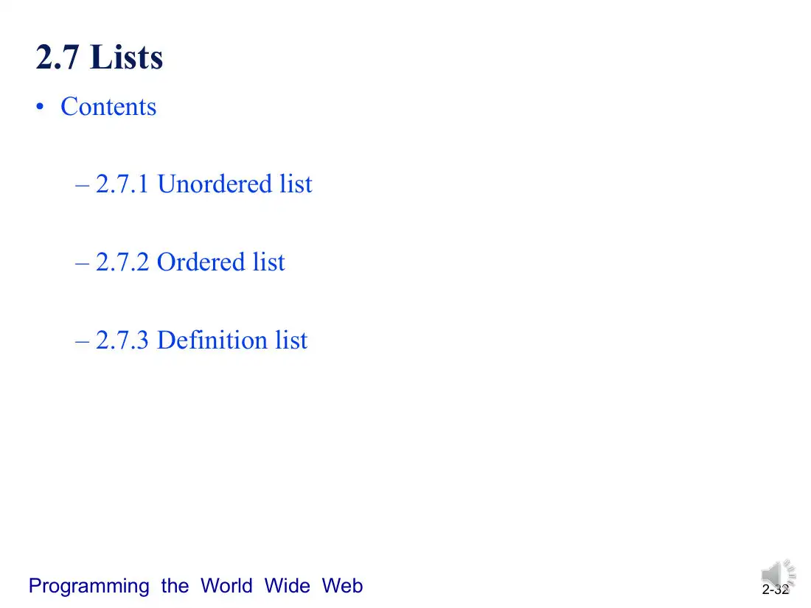

原文：

2.7 Lists

• Contents

– 2.7.1 Unordered list

– 2.7.2 Ordered list

– 2.7.3 Definition list

Programming the World Wide Web

2-32

### 2.7 Lists -2.7.1 Unordered list

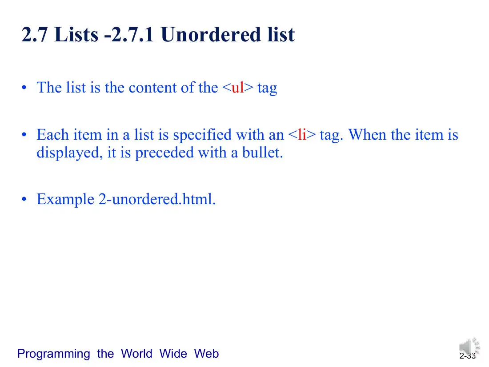

原文：

2.7 Lists -2.7.1 Unordered list

• The list is the content of the <ul> tag

• Each item in a list is specified with an <li> tag. When the item is displayed, it is preceded with a bullet.

• Example 2-unordered.html.

Programming the World Wide Web

### 2.7 Lists -2.7.2 Ordered list

原文：

2.7 Lists -2.7.2 Ordered list

• The list is the content of the <ol> tag

Each item in the display is preceded by a sequence value, such as 1, 2, 3, etc.

• Example 2-ordered.html.

Programming the World Wide Web

2-34

### 2.7 Lists -2.7.2 Ordered list

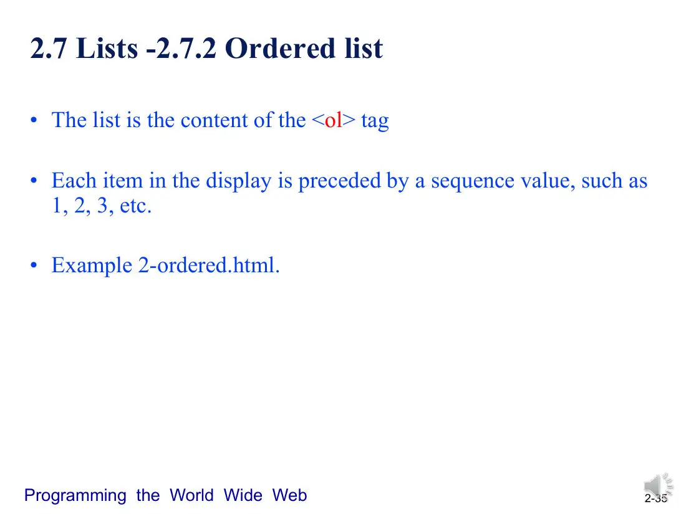

原文：

2.7 Lists -2.7.2 Ordered list

• The list is the content of the <ol> tag

Each item in the display is preceded by a sequence value, such as 1, 2, 3, etc.

• Example 2-ordered.html.

Programming the World Wide Web

### 2.7 Lists-2.7.3 Definition list

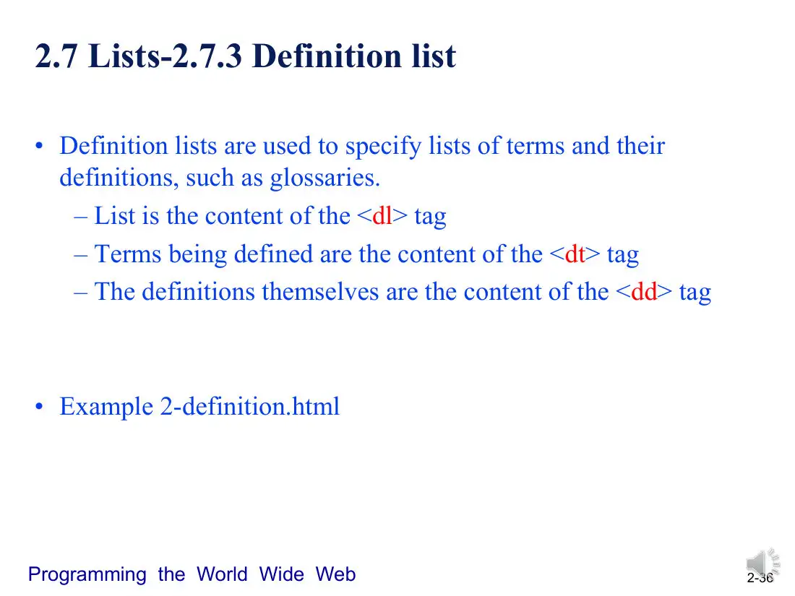

原文：

2.7 Lists-2.7.3 Definition list

Definition lists are used to specify lists of terms and their definitions, such as glossaries.

– List is the content of the <dl> tag

– Terms being defined are the content of the <dt> tag

– The definitions themselves are the content of the <dd> tag

• Example 2-definition.html

Programming the World Wide Web

2-36

### 2.8 Tables

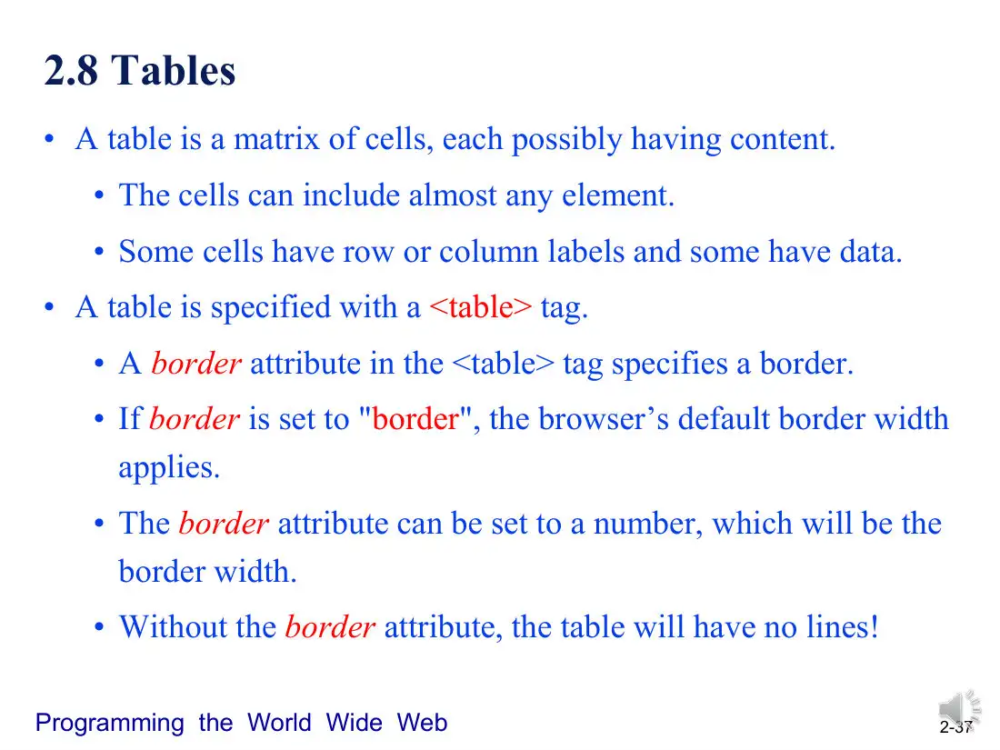

原文：

2.8 Tables

• A table is a matrix of cells, each possibly having content.

• The cells can include almost any element.

• Some cells have row or column labels and some have data.

• A table is specified with a <table> tag.

• A border attribute in the <table> tag specifies a border.

• If border is set to "border", the browser’s default border width applies.

• The border attribute can be set to a number, which will be the border width.

• Without the border attribute, the table will have no lines!

Programming the World Wide Web

### 2.8 Tables

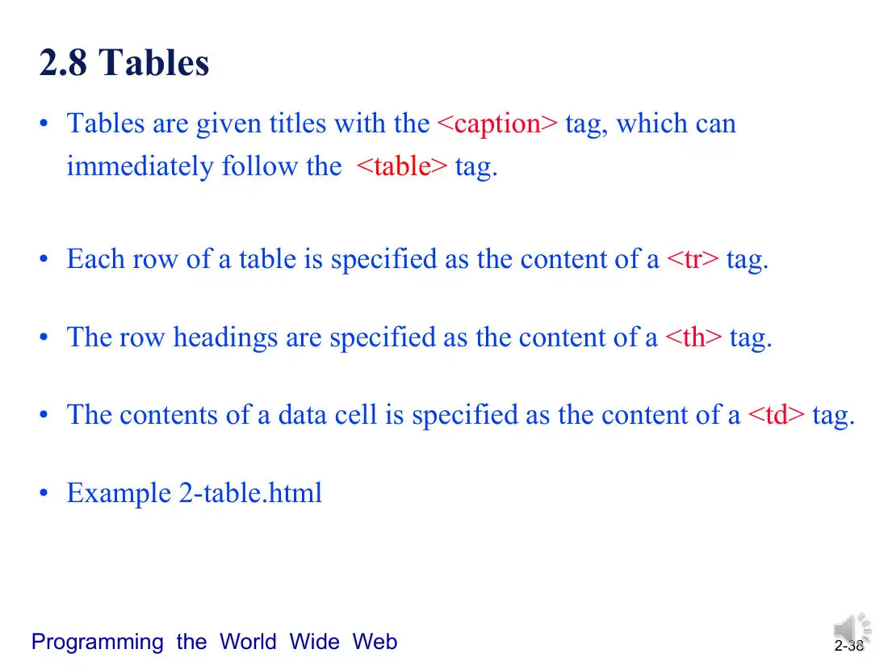

原文：

2.8 Tables

• Tables are given titles with the <caption> tag, which can immediately follow the <table> tag.

• Each row of a table is specified as the content of a <tr> tag.

• The row headings are specified as the content of a <th> tag.

• The contents of a data cell is specified as the content of a <td> tag.

• Example 2-table.html

Programming the World Wide Web

2-38

### 2.8 Tables-2.8.2 rowspan and colspan

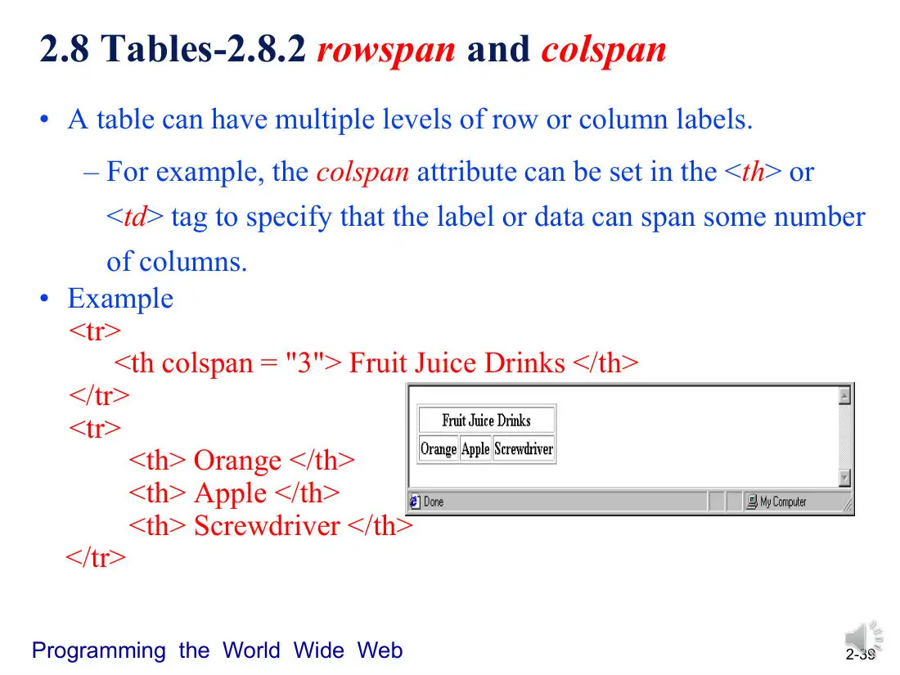

原文：

2.8 Tables-2.8.2 rowspan and colspan

• A table can have multiple levels of row or column labels.

– For example, the colspan attribute can be set in the <th> or <td> tag to specify that the label or data can span some number of columns.

• Example

<tr>

<th colspan = "3"> Fruit Juice Drinks </th>

</tr>

<tr>

<th> Orange </th>

Fruit Juice Drinks Orange Apple Screwdriver

<th> Apple </th>

Done

My Computer

<th> Screwdriver </th>

</tr>

Programming the World Wide Web

2-39

### 2.8 Tables-2.8.3 Table sections

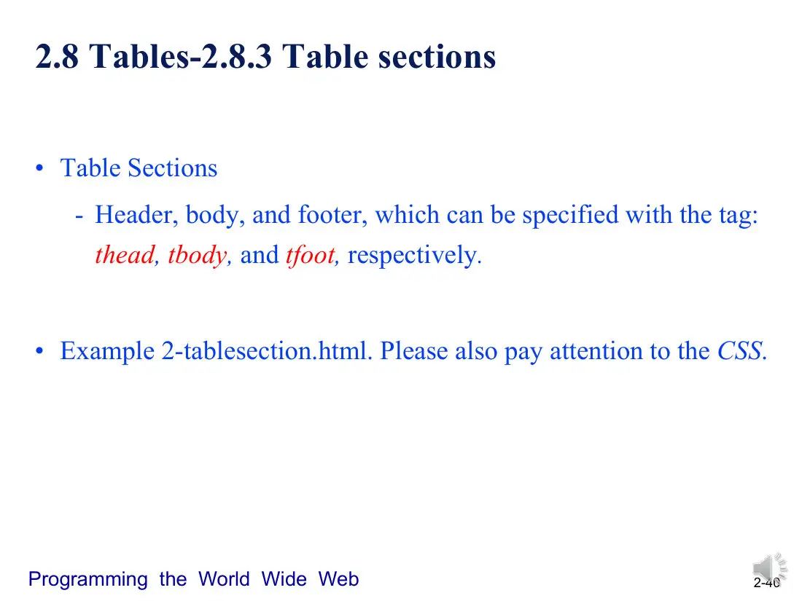

原文：

2.8 Tables-2.8.3 Table sections

• Table Sections

\- Header, body, and footer, which can be specified with the tag: thead, tbody, and tfoot, respectively.

• Example 2-tablesection.html. Please also pay attention to the CSS.

Programming the World Wide Web

2-40

### 2.8 Tables -2.8.4 align and valign(补充)

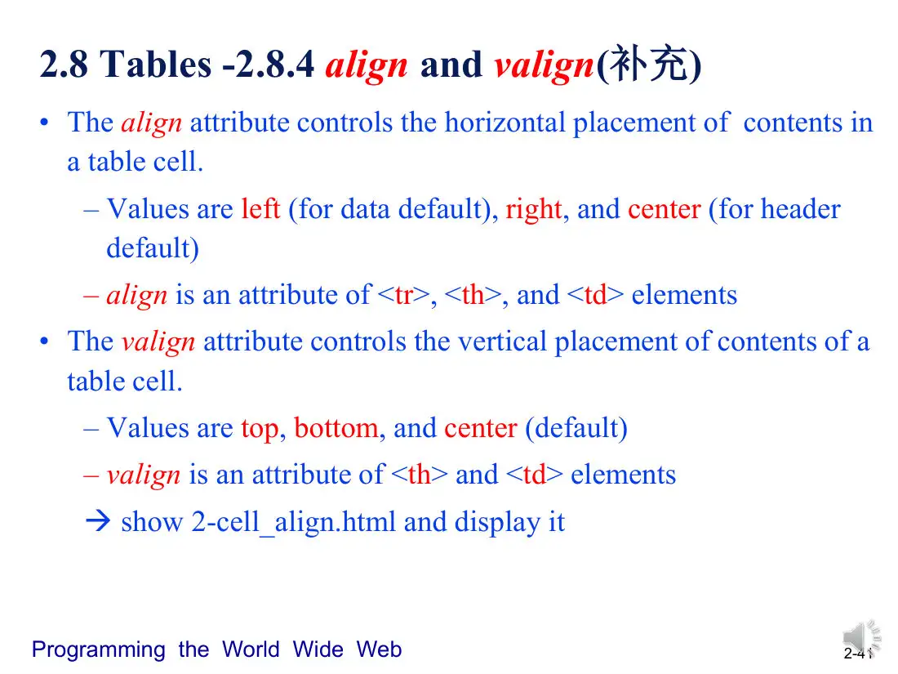

原文：

2.8 Tables -2.8.4 align and valign(补充)

• The align attribute controls the horizontal placement of contents in a table cell.

– Values are left (for data default), right, and center (for header default)

– align is an attribute of <tr>, <th>, and <td> elements

• The valign attribute controls the vertical placement of contents of a table cell.

– Values are top, bottom, and center (default)

– valign is an attribute of <th> and <td> elements

→ show 2-cell\_align.html and display it

Programming the World Wide Web

2-41

### Class exercises

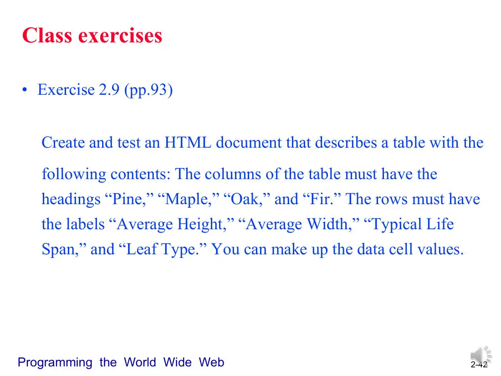

原文：

Class exercises

• Exercise 2.9 (pp.93)

Create and test an HTML document that describes a table with the following contents: The columns of the table must have the headings “Pine,” “Maple,” “Oak,” and “Fir.” The rows must have the labels “Average Height,” “Average Width,” “Typical Life Span,” and “Leaf Type.” You can make up the data cell values.

Programming the World Wide Web

2-42

### 2.9 Forms (pp.69)

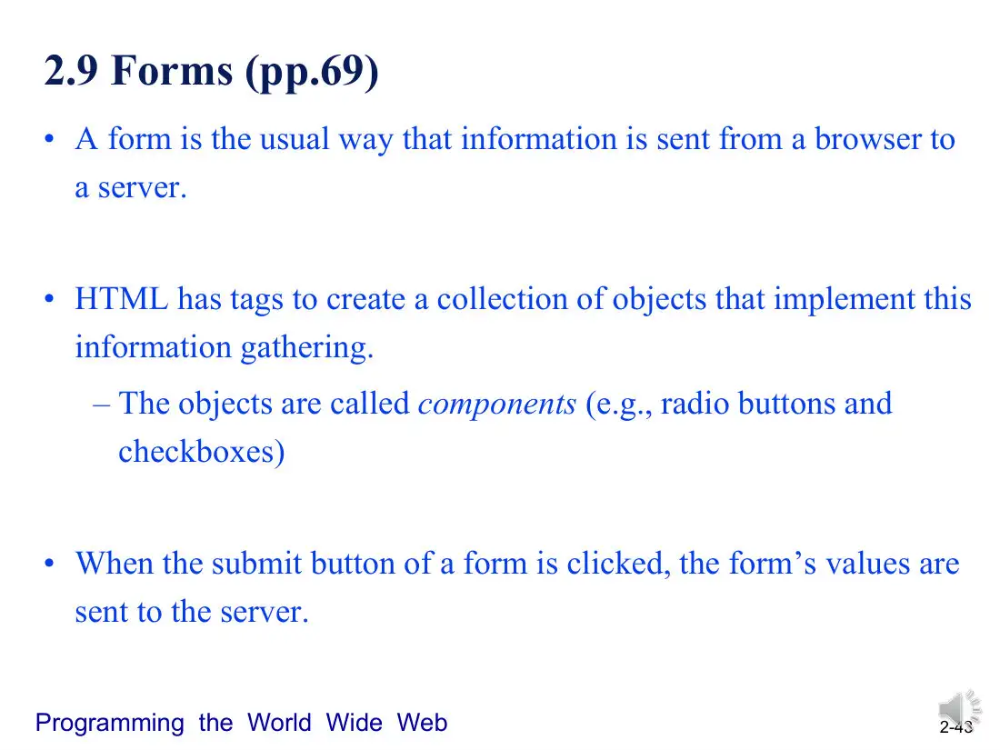

原文：

2.9 Forms (pp.69)

• A form is the usual way that information is sent from a browser to a server.

• HTML has tags to create a collection of objects that implement this information gathering.

– The objects are called components (e.g., radio buttons and checkboxes)

• When the submit button of a form is clicked, the form’s values are sent to the server.

Programming the World Wide Web

2-43

### 2.9 Forms

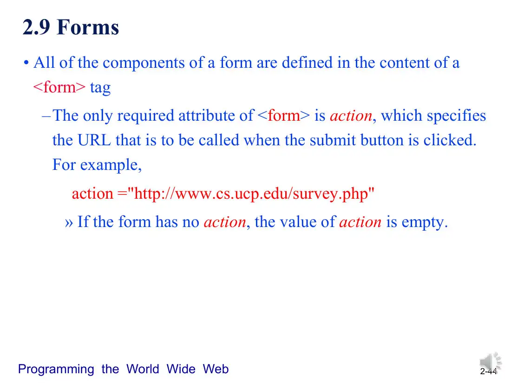

原文：

2.9 Forms

• All of the components of a form are defined in the content of a <form> tag

–The only required attribute of <form> is action, which specifies the URL that is to be called when the submit button is clicked. For example,

action ="http://www.cs.ucp.edu/survey.php"

»If the form has no action, the value of action is empty.

Programming the World Wide Web

2-44

### 2.9 Forms

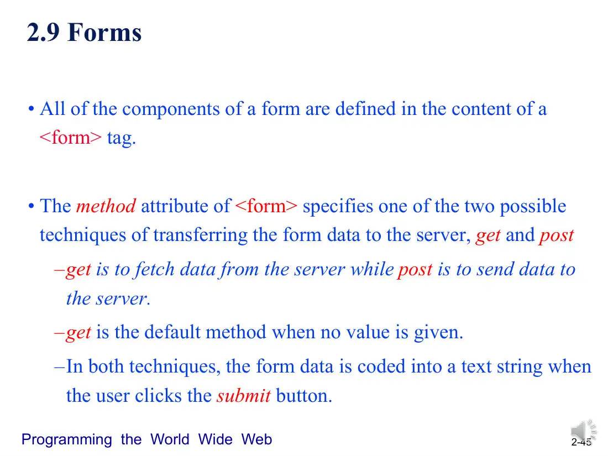

原文：

2.9 Forms

• All of the components of a form are defined in the content of a <form> tag.

• The method attribute of <form> specifies one of the two possible techniques of transferring the form data to the server, get and post –get is to fetch data from the server while post is to send data to the server.

–get is the default method when no value is given.

–In both techniques, the form data is coded into a text string when the user clicks the submit button.

Programming the World Wide Web

2-45

### 2.9 Forms

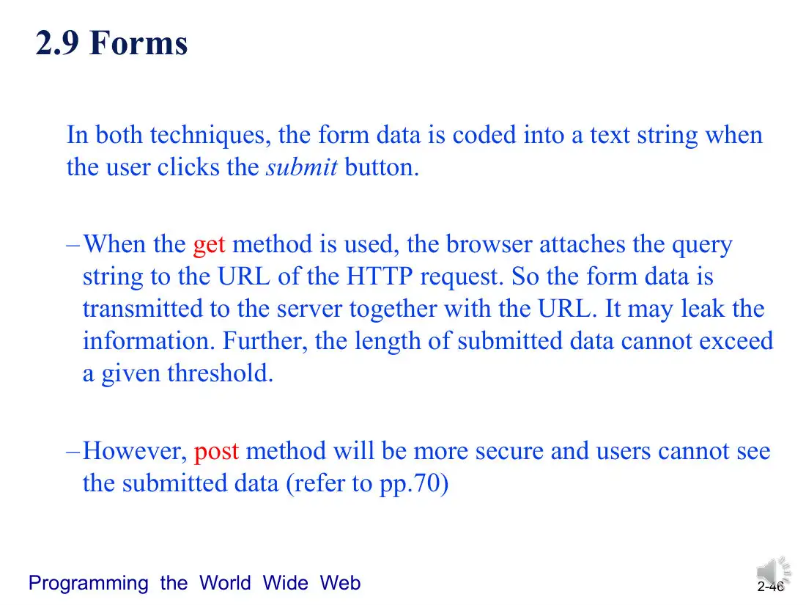

原文：

2.9 Forms

In both techniques, the form data is coded into a text string when the user clicks the submit button.

–When the get method is used, the browser attaches the query string to the URL of the HTTP request. So the form data is transmitted to the server together with the URL. It may leak the information. Further, the length of submitted data cannot exceed a given threshold.

–However, post method will be more secure and users cannot see the submitted data (refer to pp.70)

Programming the World Wide Web

2-46

### 2.9 Forms-2.9.2  tag

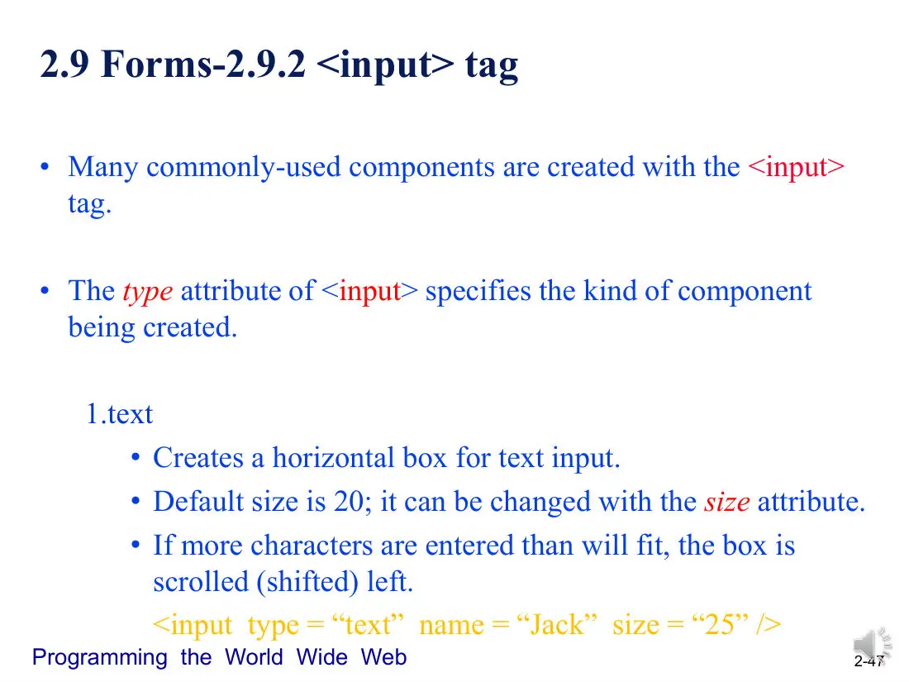

原文：

2.9 Forms-2.9.2 <input> tag

• Many commonly-used components are created with the <input> tag.

• The type attribute of <input> specifies the kind of component being created.

1.text

• Creates a horizontal box for text input.

• Default size is 20; it can be changed with the size attribute.

• If more characters are entered than will fit, the box is scrolled (shifted) left.

<input type = “text” name = “Jack” size = “25” /> Programming the World Wide Web

2-47

### 2.9 Forms -2.9.2  tag

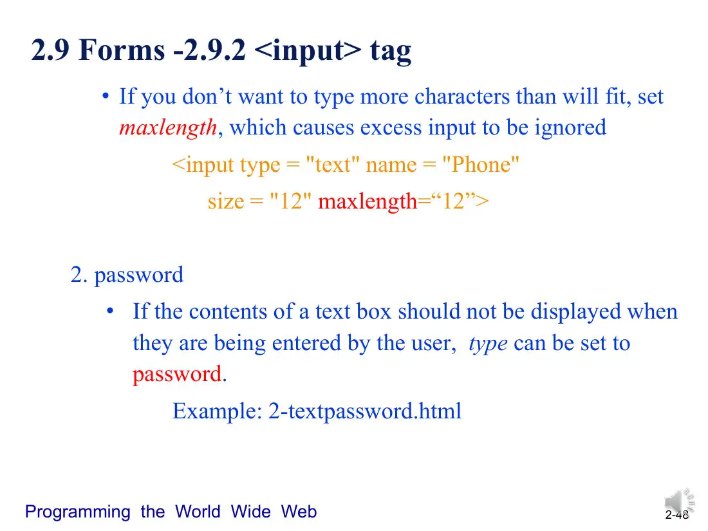

原文：

2.9 Forms -2.9.2 <input> tag

• If you don’t want to type more characters than will fit, set maxlength, which causes excess input to be ignored

$$
<   \text { input   type } = \text {" text"} \text { name } = \text {" Phone"}
$$

$$
\text { size } = \text {"12"} \text {   maxlength="12"} >
$$

2. password

If the contents of a text box should not be displayed when they are being entered by the user, type can be set to password.

Example: 2-textpassword.html

Programming the World Wide Web

2-48

### 2.9 Forms -2.9.2  tag

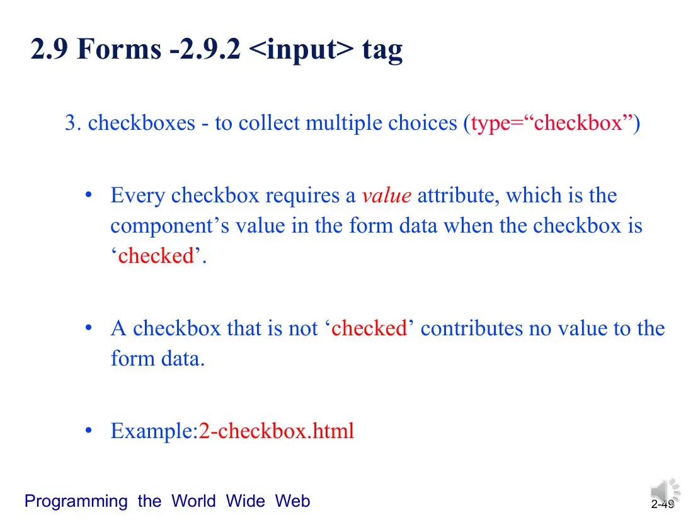

原文：

2.9 Forms -2.9.2 <input> tag

3. checkboxes - to collect multiple choices (type=“checkbox”)

Every checkbox requires a value attribute, which is the component’s value in the form data when the checkbox is ‘checked’.

A checkbox that is not ‘checked’ contributes no value to the form data.

• Example:2-checkbox.html

Programming the World Wide Web

2-49

### 2.9 Forms -2.9.2  tag

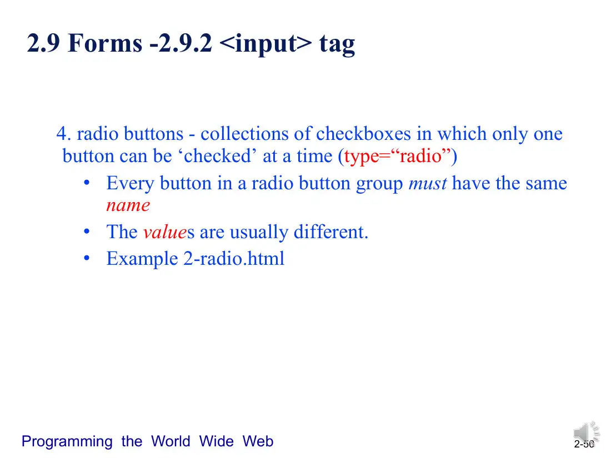

原文：

2.9 Forms -2.9.2 <input> tag

4. radio buttons - collections of checkboxes in which only one button can be ‘checked’ at a time $( \mathrm { t y p e } { = } ^ { 6 6 } \mathrm { r a d i o } ^ { 3 9 } )$

Every button in a radio button group must have the same name

• The values are usually different.

• Example 2-radio.html

Programming the World Wide Web

2-50

### 2.9 Forms -2.9.2  tag

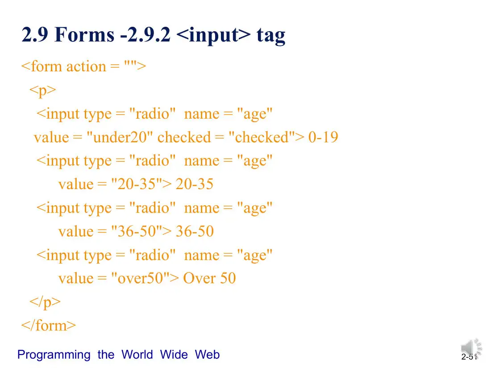

原文：

2.9 Forms -2.9.2 <input> tag

2-51

### 2.9 Forms -2.9.3  element

原文：

2.9 Forms -2.9.3 <select> element

• Checkboxes and radio buttons are effective methods for collecting multiple choice.

• However, if the number of choices is large, the form may become too long to display.

• In these cases, a menu should be used. A menu is specified with a <select> tag (rather than with the input element).

Programming the World Wide Web

2-52

### 2.9 Forms -2.9.3  element

原文：

2.9 Forms -2.9.3 <select> element

• There are two kinds of menus, those that behave like checkboxes and those that behave like radio buttons (the default).

The default option is the one relates to radio buttons. The other option can be specified by adding the multiple attribute, set to the value "multiple".

Programming the World Wide Web

2-53

### 2.9 Forms -2.9.3  element

原文：

2.9 Forms -2.9.3 <select> element

• The name attribute of <select> is required.

The size attribute of <select> can be included to specify the number of menu items that initially are to be displayed for the users (the default is 1).

Programming the World Wide Web

2-54

### 2.9 Forms -2.9.3 Menus

原文：

2.9 Forms -2.9.3 Menus

– Each item of a menu is specified with an <option> tag, whose pure text content is the value of the item.

– An <option> tag can include the selected attribute. When it is assigned "selected”, it specifies that the item is preselected.

### 2.9 Forms -2.9.3 Menus

原文：

2.9 Forms -2.9.3 Menus

- Widgets (continued)

• After clicking the menu:

• After changing size to 2:

Programming the World Wide Web

2-56

### 2.9 Forms -2.9.4  tag

原文：

2.9 Forms -2.9.4 <textarea> tag

• Text areas - created with <textarea> tag

– Usually include the rows and cols attributes to specify the size of the text area

– Default text can be included as the content of <textarea>

– Scrolling is implicit if the area is overfilled

2-57

### Both are created with

原文：

2.9 Forms -2.9.5 submit and reset buttons

Both are created with <input>

Submit has two actions:

1. Encode the data of the form

2. Request that the server executes the server-resident program specified as the value of the action attribute of <form>

3. A submit button is required in every form

--> show popcorn.html and display it （pp.80）

Programming the World Wide Web

2-58

### i. Four 25-watt light bulbs for \$2.39

原文：

Class exercises (Exercise 2.14 of textbook page 94)

Create an HTML document that has a form with the following controls:

• a. A text box to collect the user’s name

• b. Four checkboxes, one each for the following items:

i. Four 25-watt light bulbs for \$2.39

ii. Eight 25-watt light bulbs for \$4.29

iii. Four 25-watt long-life light bulbs for \$3.95

iv. Eight 25-watt long-life light bulbs for \$7.49

• c. A collection of three radio buttons that are labeled as follows:

i. Visa

ii. Master Card

iii. Discover

• d. A submit button!

Programming the World Wide Web

2-59

### 2.10  element (HTML5)

原文：

2.10 <audio> element (HTML5)

<audio> tag is used to specify the container, which can be regarded as a zip file container.

$$
<   \text { audio   controls } = ` ` \text { controls } >
$$

$$
<   \text { source   src } = " y e s t e r d a y. m p 3" >
$$

$$
<   \text { source   src } = ` ` \text { test.wav } >
$$

Your browser does not support the audio element!

</audio>

• The only required attribute is controls, which we always set to "controls”.

• It creates a display of a start/stop button, a clock, a slider of the progress of the play, the total time of the file, and a slider for volume control.

Programming the World Wide Web

2-60

### 2.10  element (HTML5)

原文：

2.10 <audio> element (HTML5)

• <audio> tag is used to specify the container.

<audio controls>

$$
<   \text { source   src } = " y e s t e r d a y. m p 3" >
$$

$$
<   \text { source   src } = ` ` \text { test.wav } >
$$

Your browser does not support the audio element!

</audio>

tips:

• <source> tag is used to specify the audio file to be played.

• A browser chooses the first audio file it can play.

• If it cannot play any of the audio files that appear in the source elements, it does nothing other than displaying its content.

Programming the World Wide Web

### 2.11  element (HTML5)

原文：

2.11 <video> element (HTML5)

• The width and height attributes set the size of the screen.

• The autoplay attribute specifies that the video plays automatically as soon as it is ready.

The preload attribute tells the browser to load the video file or files as soon as the document is loaded.

The controls attribute specifies that play, pause, and volume controls be included in the display. Programming the World Wide Web

2-62

### • Case sensitivity

原文：

2.14 Syntactic Differences HTML & XHTML (Please refer to pp.89)

• Case sensitivity

• Closing tags

• Quoted attribute values

• Explicit attribute values

• Element nesting

Programming the World Wide Web

2-63

### Homework

原文：

Homework

• Exercises 1,2,3,9,14

First, you should code and validate the html document in WAMP environment. Then, the codes are written to homework notebook.

Programming the World Wide Web

2-64
