# 《Web技术（双语）》第4章 JavaScript基础（课件）

原件的每一页，下面附识别出的文字。

### Part 4 Basics of JavaScript

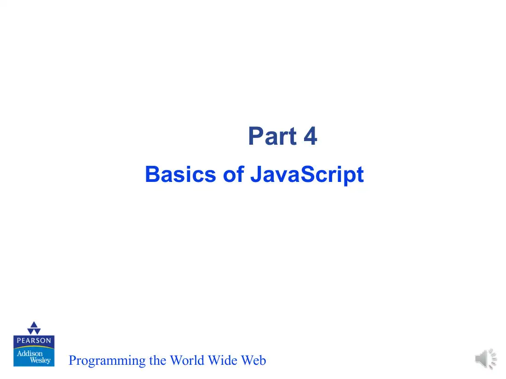

原文：

Part 4 Basics of JavaScript

PEARSON Addison Wesley

Programming the World Wide Web

### Contents

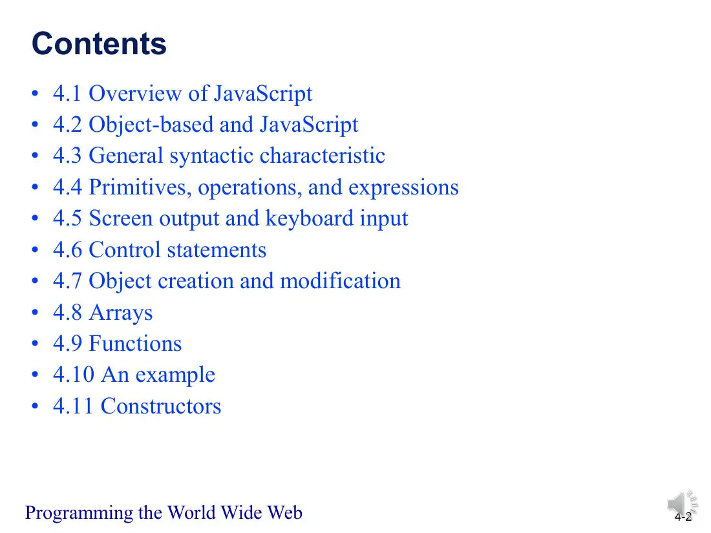

原文：

Contents

• 4.1 Overview of JavaScript
• 4.2 Object-based and JavaScript
• 4.3 General syntactic characteristic
• 4.4 Primitives, operations, and expressions
• 4.5 Screen output and keyboard input
• 4.6 Control statements
• 4.7 Object creation and modification
• 4.8 Arrays
• 4.9 Functions
• 4.10 An example
• 4.11 Constructors

Programming the World Wide Web

### 4.1 Overview of JavaScript: Origins

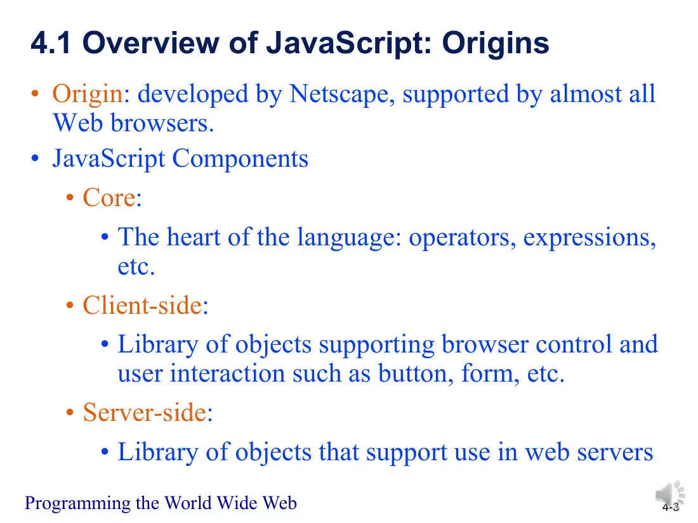

原文：

4.1 Overview of JavaScript: Origins

• Origin: developed by Netscape, supported by almost all Web browsers.

• JavaScript Components

• Core:

• The heart of the language: operators, expressions, etc.

• Client-side:

• Library of objects supporting browser control and user interaction such as button, form, etc.

• Server-side:

• Library of objects that support use in web servers

Programming the World Wide Web

### 4.1 Uses of JavaScript

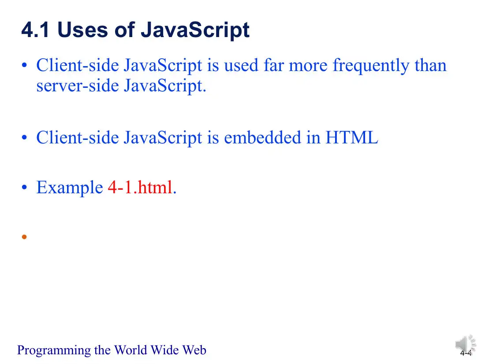

原文：

4.1 Uses of JavaScript

• Client-side JavaScript is used far more frequently than server-side JavaScript.

• Client-side JavaScript is embedded in HTML

• Example 4-1.html.

Programming the World Wide Web

### 4.1 Uses of JavaScript

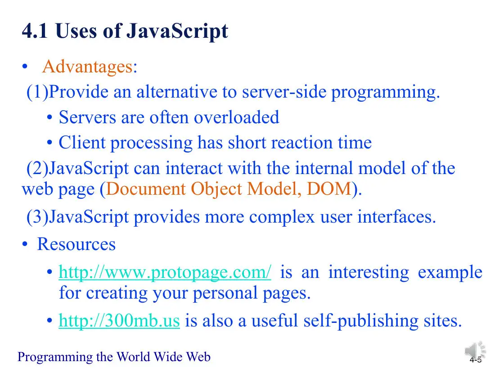

原文：

4.1 Uses of JavaScript

• Advantages:

(1)Provide an alternative to server-side programming.

• Servers are often overloaded

• Client processing has short reaction time

(2)JavaScript can interact with the internal model of the web page (Document Object Model, DOM).

(3)JavaScript provides more complex user interfaces.

• Resources

http://www.protopage.com/ is an interesting example for creating your personal pages.

• http://300mb.us is also a useful self-publishing sites.

Programming the World Wide Web

### 4.1 Event-driven Computation

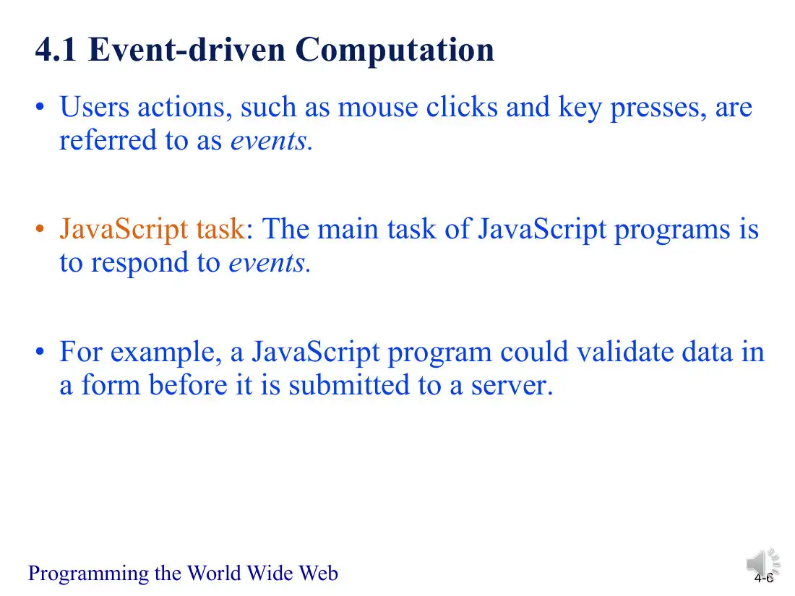

原文：

4.1 Event-driven Computation

Users actions, such as mouse clicks and key presses, are referred to as events.

• JavaScript task: The main task of JavaScript programs is to respond to events.

• For example, a JavaScript program could validate data in a form before it is submitted to a server.

Programming the World Wide Web

### 4.1 XHTML/JavaScript Documents

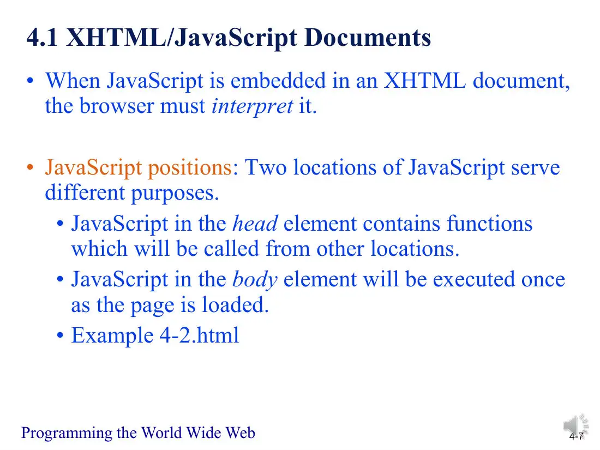

原文：

4.1 XHTML/JavaScript Documents

When JavaScript is embedded in an XHTML document, the browser must interpret it.

JavaScript positions: Two locations of JavaScript serve different purposes.

• JavaScript in the head element contains functions which will be called from other locations.

• JavaScript in the body element will be executed once as the page is loaded.

• Example 4-2.html

Programming the World Wide Web

### 4.2 Object Based and JavaScript

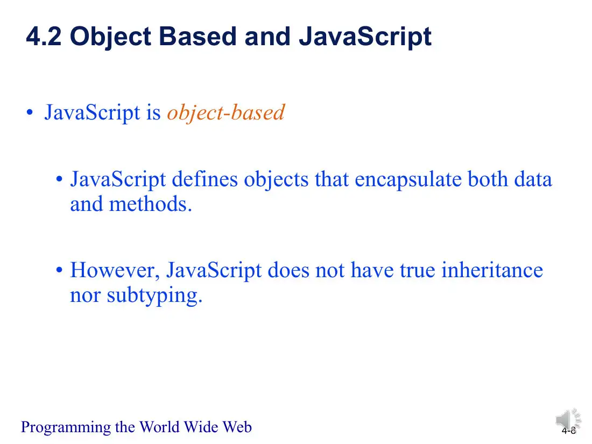

原文：

4.2 Object Based and JavaScript

• JavaScript is object-based

• JavaScript defines objects that encapsulate both data and methods.

• However, JavaScript does not have true inheritance nor subtyping.

Programming the World Wide Web

### 4.2 JavaScript Objects

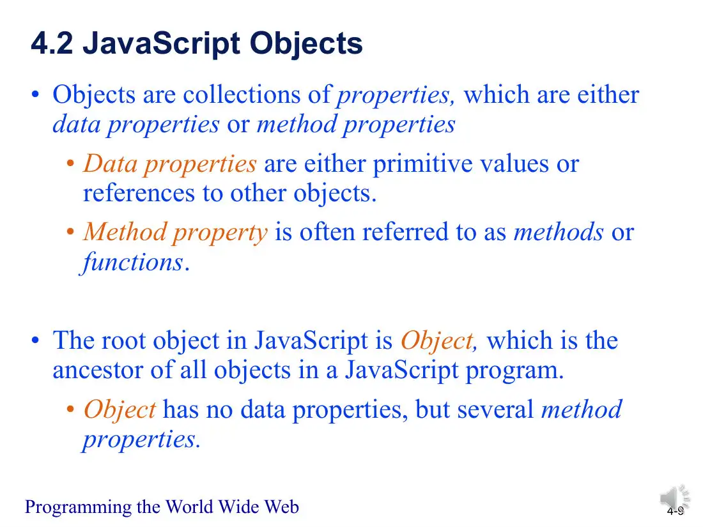

原文：

4.2 JavaScript Objects

Objects are collections of properties, which are either data properties or method properties

• Data properties are either primitive values or references to other objects.

• Method property is often referred to as methods or functions.

• The root object in JavaScript is Object, which is the ancestor of all objects in a JavaScript program.

• Object has no data properties, but several method properties.

Programming the World Wide Web

### 4.3 General Syntactic Characteristics

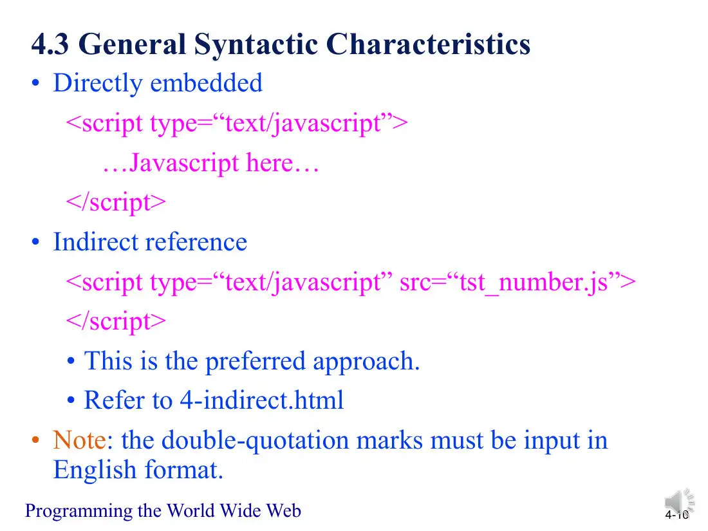

原文：

4.3 General Syntactic Characteristics

• Directly embedded

• Indirect reference

• This is the preferred approach.

• Refer to 4-indirect.html

• Note: the double-quotation marks must be input in English format.

Programming the World Wide Web

4-10

### 4.3 General Syntactic Characteristics

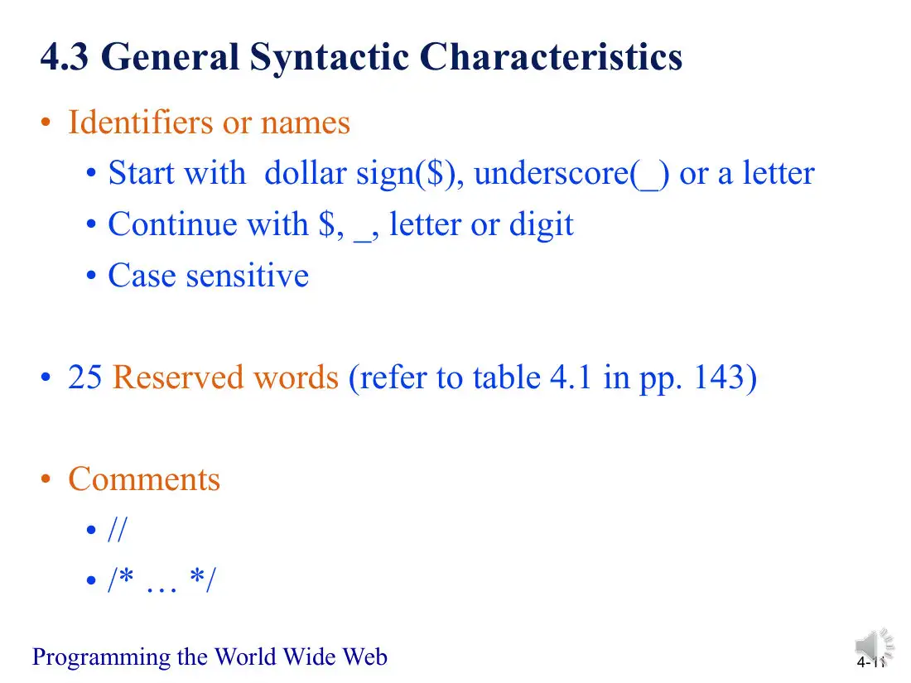

原文：

4.3 General Syntactic Characteristics

• Identifiers or names

• Start with dollar sign(\$), underscore(\_) or a letter

• Continue with \$, \_, letter or digit

• Case sensitive

• 25 Reserved words (refer to table 4.1 in pp. 143)

• Comments

• //

• /\* … \*/

Programming the World Wide Web

4-11

### 4.3 Statement Syntax

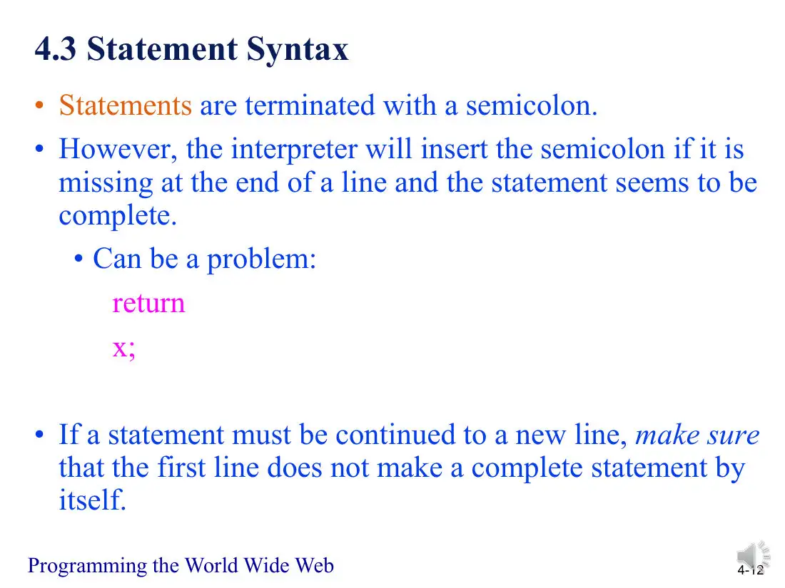

原文：

4.3 Statement Syntax

• Statements are terminated with a semicolon.

However, the interpreter will insert the semicolon if it is missing at the end of a line and the statement seems to be complete.

• Can be a problem:

return

x;

If a statement must be continued to a new line, make sure that the first line does not make a complete statement by itself.

Programming the World Wide Web

4-12

### 4.4.1 Primitive Types

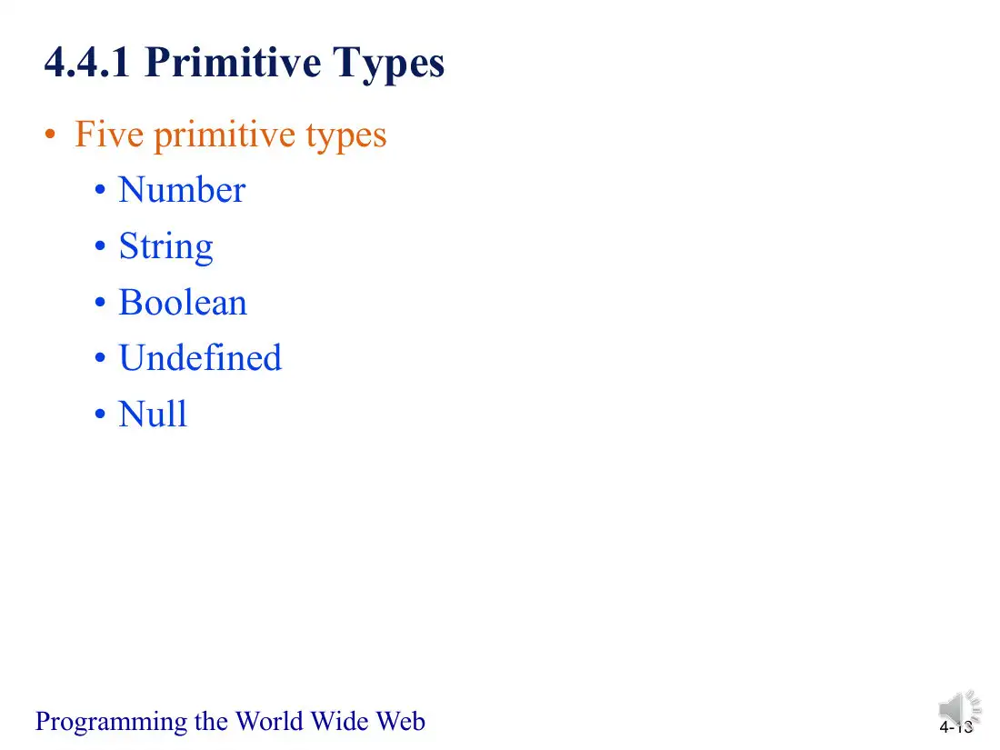

原文：

4.4.1 Primitive Types

• Five primitive types

• Number

• String

• Boolean

• Undefined

• Null

Programming the World Wide Web

### 4.4.1 Primitive Types

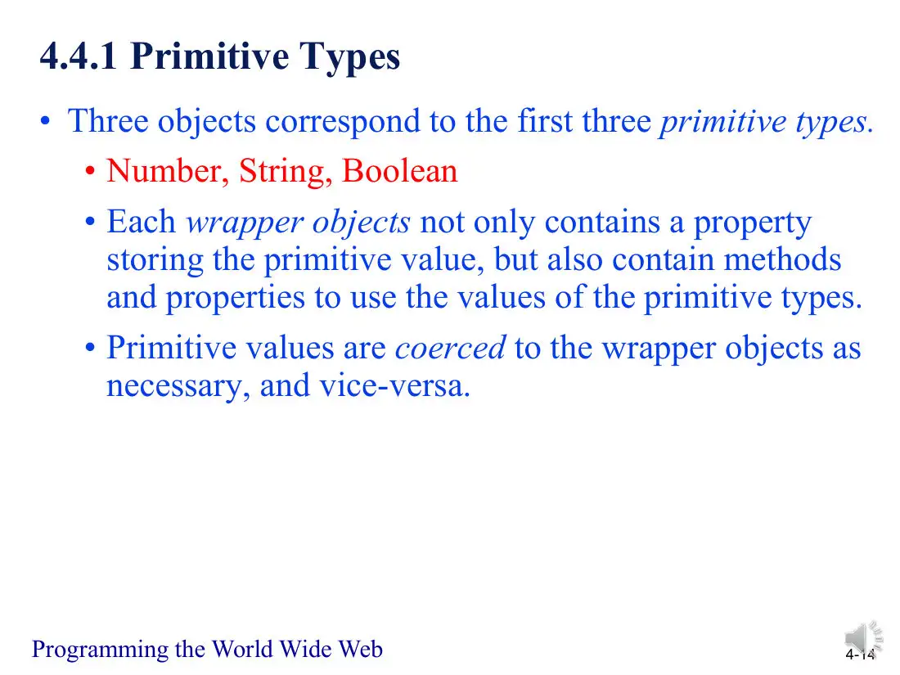

原文：

4.4.1 Primitive Types

• Three objects correspond to the first three primitive types.

• Number, String, Boolean

• Each wrapper objects not only contains a property storing the primitive value, but also contain methods and properties to use the values of the primitive types.

• Primitive values are coerced to the wrapper objects as necessary, and vice-versa.

Programming the World Wide Web

4-14

### 4.4.1 Primitive and Object Storage

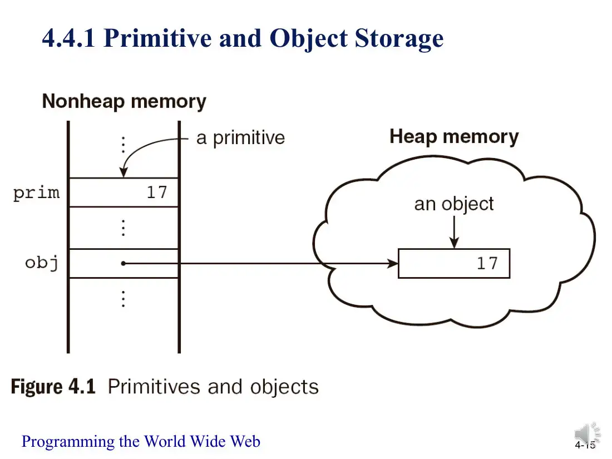

原文：

4.4.1 Primitive and Object Storage

Programming the World Wide Web

4-15

### 4.4.2 Numeric and String Literals

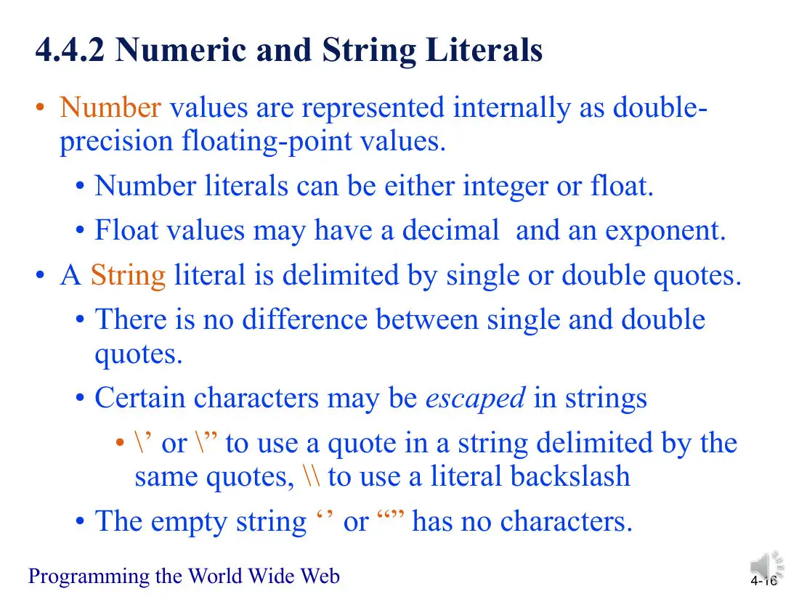

原文：

4.4.2 Numeric and String Literals

• Number values are represented internally as doubleprecision floating-point values.

• Number literals can be either integer or float.

• Float values may have a decimal and an exponent.

• A String literal is delimited by single or double quotes.

• There is no difference between single and double quotes.

• Certain characters may be escaped in strings

• \’ or \” to use a quote in a string delimited by the same quotes, \\ to use a literal backslash

• The empty string ‘’ or “” has no characters.

Programming the World Wide Web

4-16

### 4.4.3 Boolean Primitive Types

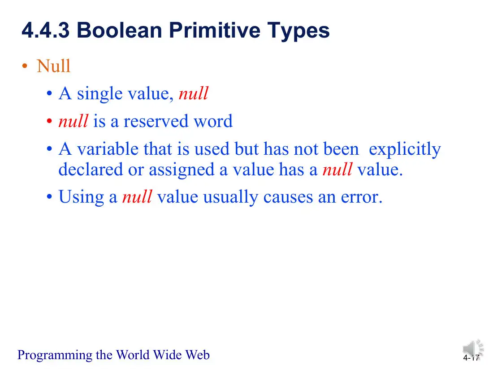

原文：

4.4.3 Boolean Primitive Types

• Null

• A single value, null

• null is a reserved word

• A variable that is used but has not been explicitly declared or assigned a value has a null value.

• Using a null value usually causes an error.

Programming the World Wide Web

4-17

### 4.4.3 Other Primitive Types

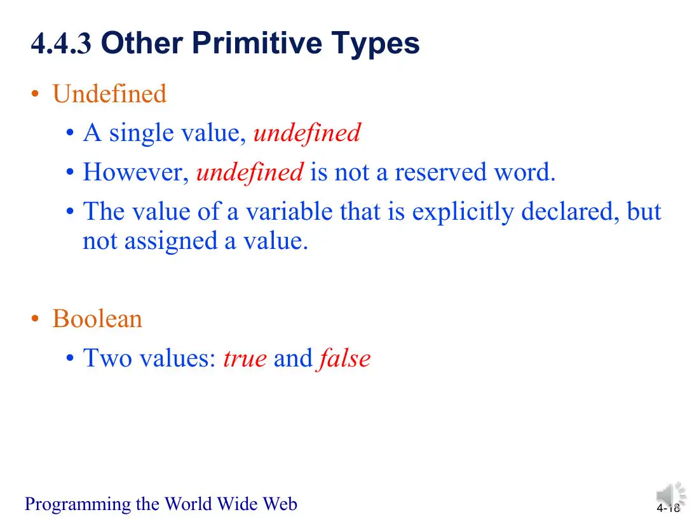

原文：

4.4.3 Other Primitive Types

• Undefined

• A single value, undefined

• However, undefined is not a reserved word.

• The value of a variable that is explicitly declared, but not assigned a value.

• Boolean

• Two values: true and false

Programming the World Wide Web

4-18

### 4.4.4 Declaring Variables

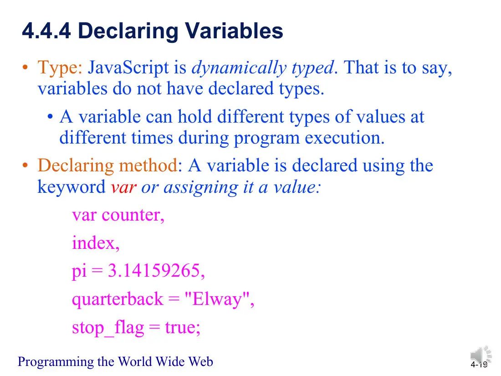

原文：

4.4.4 Declaring Variables

• Type: JavaScript is dynamically typed. That is to say, variables do not have declared types.

• A variable can hold different types of values at different times during program execution.

• Declaring method: A variable is declared using the keyword var or assigning it a value:

Programming the World Wide Web

### 4.4.5 Numeric Operators

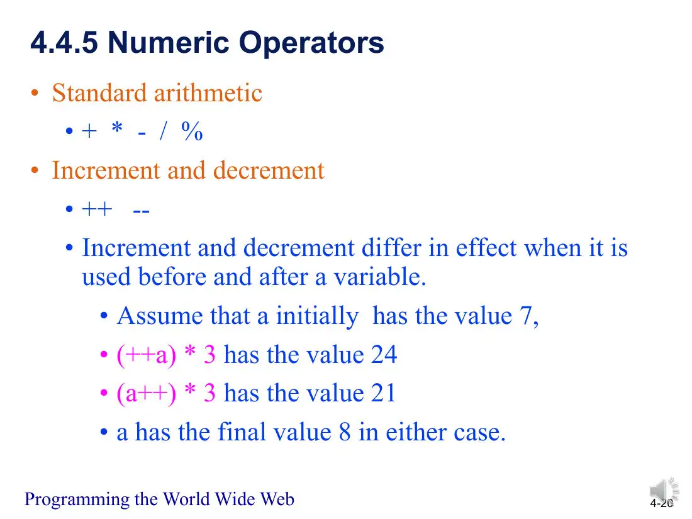

原文：

4.4.5 Numeric Operators

• Standard arithmetic

• + \* - / %

• Increment and decrement

• ++ --

• Increment and decrement differ in effect when it is used before and after a variable.

• Assume that a initially has the value 7,

• (++a) \* 3 has the value 24

• (a++) \* 3 has the value 21

• a has the final value 8 in either case.

Programming the World Wide Web

4-20

### 4.4.5 Numeric Operator

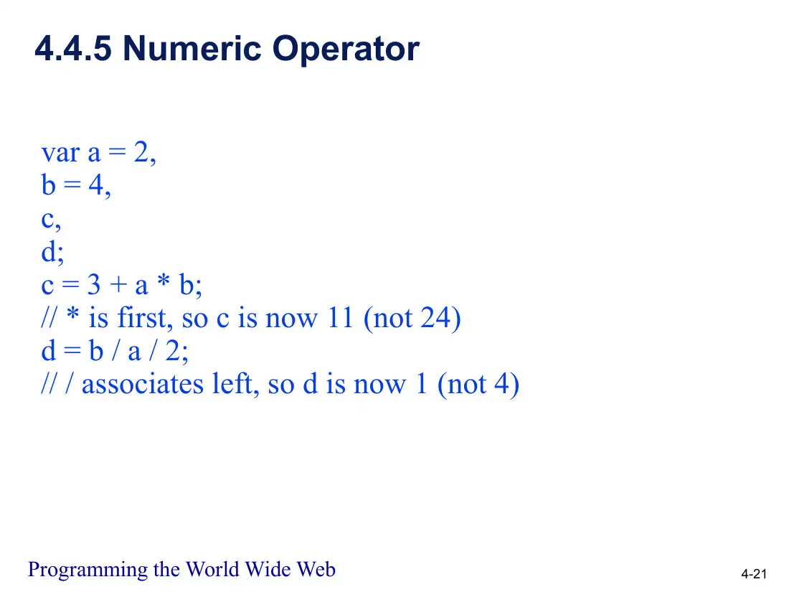

原文：

4.4.5 Numeric Operator

Programming the World Wide Web

4-21

### 4.4.6 The Math Object

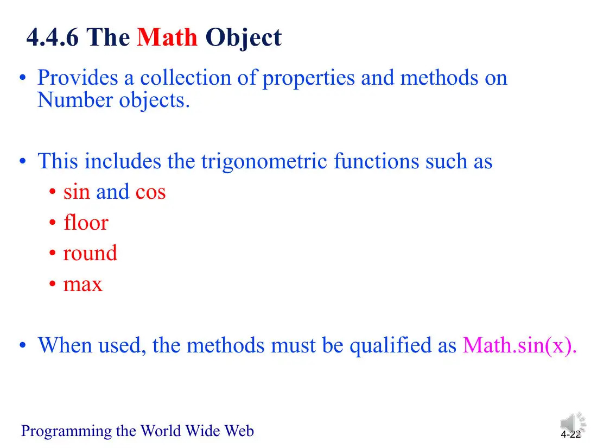

原文：

4.4.6 The Math Object

• Provides a collection of properties and methods on Number objects.

• This includes the trigonometric functions such as • sin and cos

• floor

• round

• max

• When used, the methods must be qualified as Math.sin(x).

Programming the World Wide Web

4-22

### 4.4.7 The Number Object

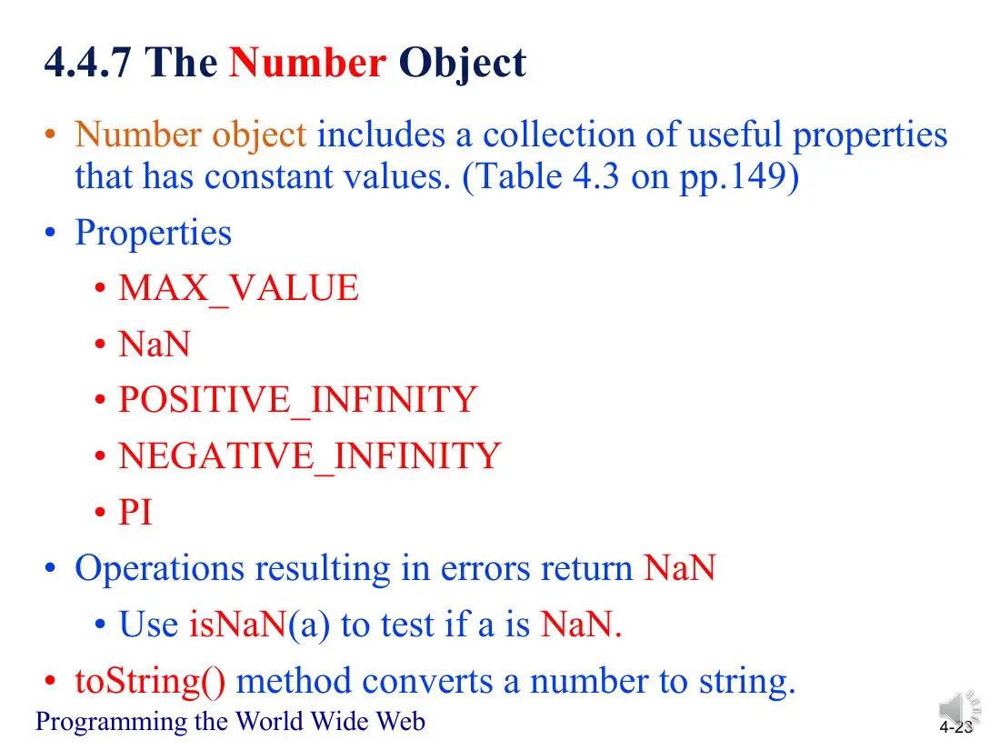

原文：

4.4.7 The Number Object

Number object includes a collection of useful properties that has constant values. (Table 4.3 on pp.149)

• Properties

• MAX\_VALUE

• NaN

• POSITIVE\_INFINITY

• NEGATIVE\_INFINITY

• PI

• Operations resulting in errors return NaN

• Use isNaN(a) to test if a is NaN.

• toString() method converts a number to string.

Programming the World Wide Web

### 4.4.8 String Catenation

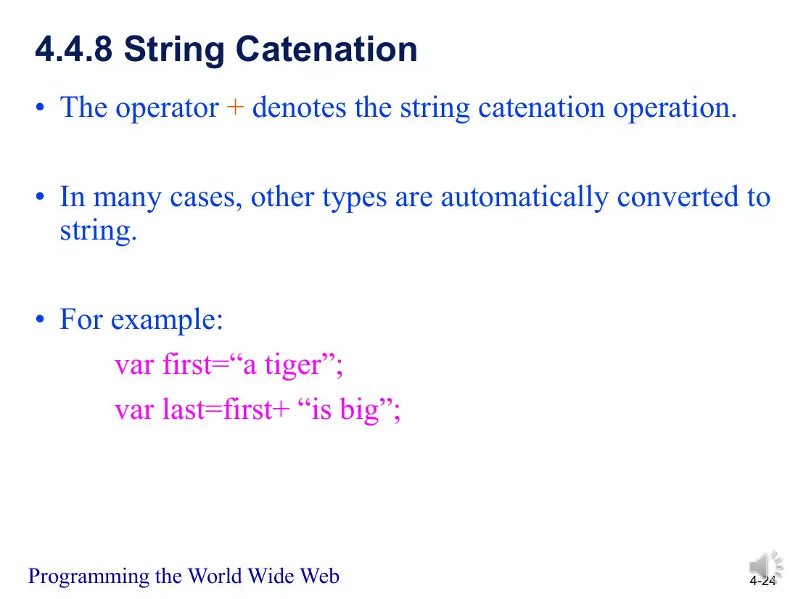

原文：

4.4.8 String Catenation

• The operator + denotes the string catenation operation.

• In many cases, other types are automatically converted to string.

• For example:

var first=“a tiger”;

var last=first+ “is big”;

Programming the World Wide Web

4-24

### 4.4.9 Implicit Type Conversion

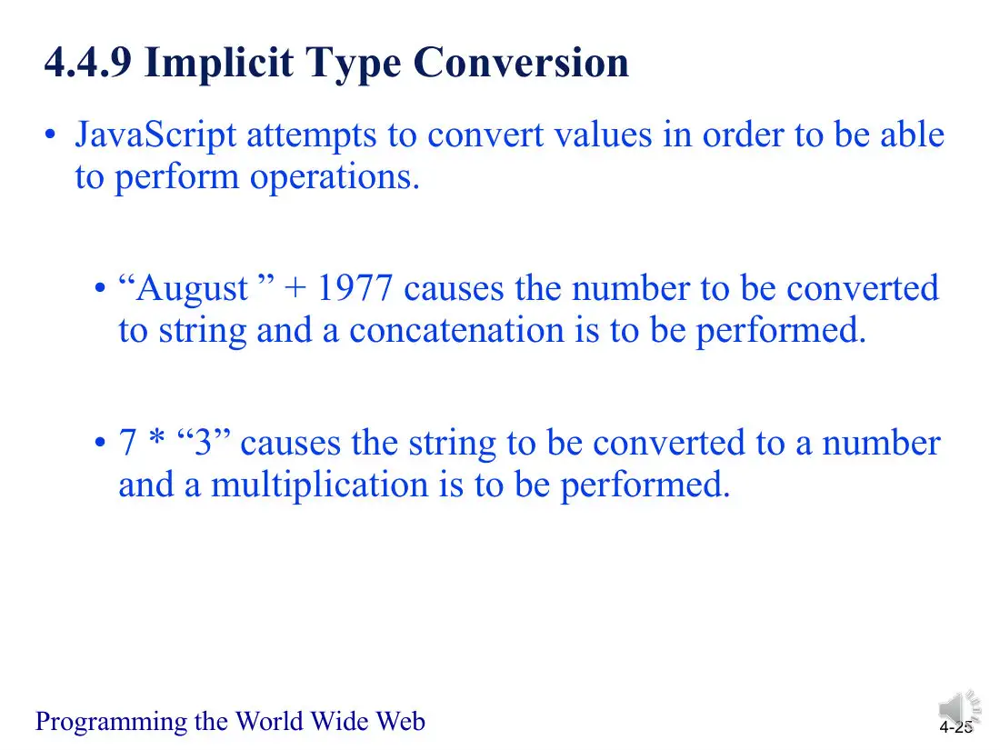

原文：

4.4.9 Implicit Type Conversion

• JavaScript attempts to convert values in order to be able to perform operations.

• “August ” + 1977 causes the number to be converted to string and a concatenation is to be performed.

• 7 \* “3” causes the string to be converted to a number and a multiplication is to be performed.

Programming the World Wide Web

4-25

### 4.4.10 Explicit Type Conversion

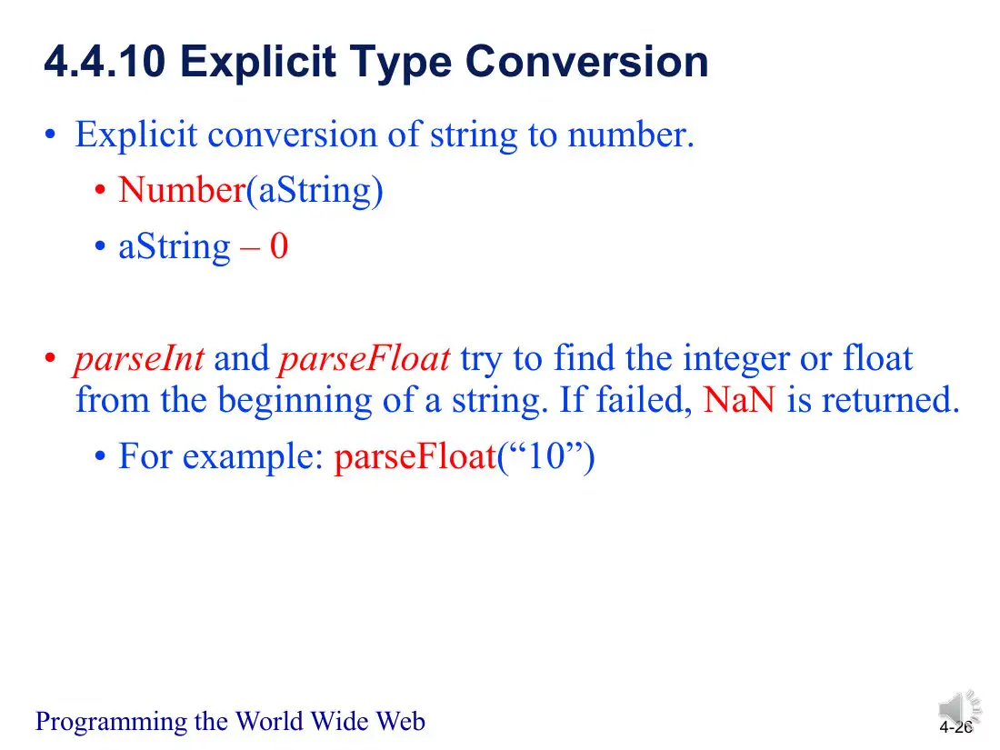

原文：

4.4.10 Explicit Type Conversion

• Explicit conversion of string to number.

• Number(aString)

• aString – 0

• parseInt and parseFloat try to find the integer or float from the beginning of a string. If failed, NaN is returned.

• For example: parseFloat(“10”)

Programming the World Wide Web

4-26

### 4.4.11 String Properties and Methods

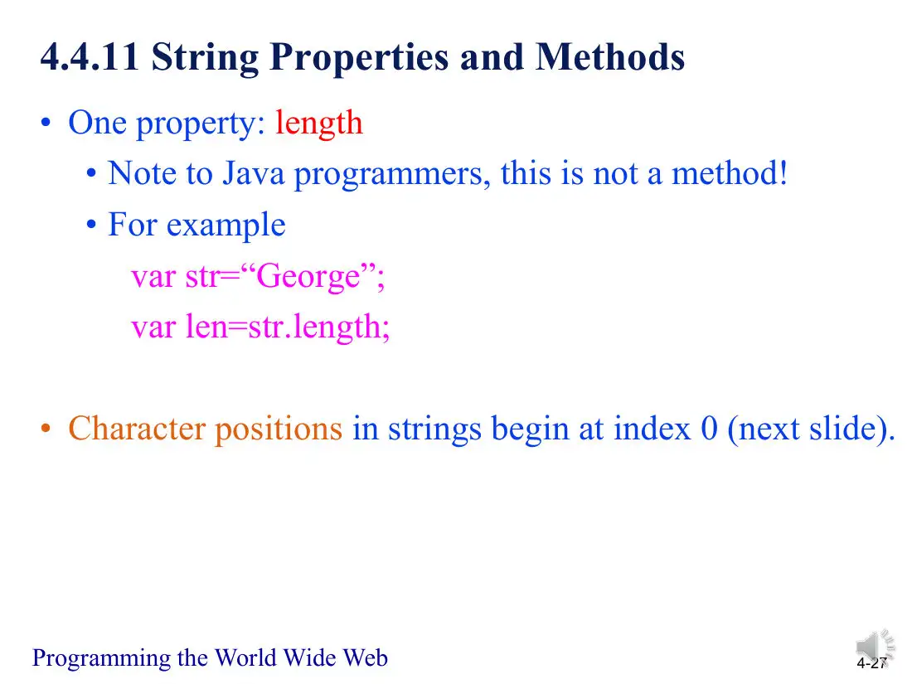

原文：

4.4.11 String Properties and Methods

• One property: length

• Note to Java programmers, this is not a method!

• For example

var str=“George”;

var len=str.length;

• Character positions in strings begin at index 0 (next slide).

Programming the World Wide Web

4-27

### 4.4.11 String Methods（pp.152 Table 4.4）

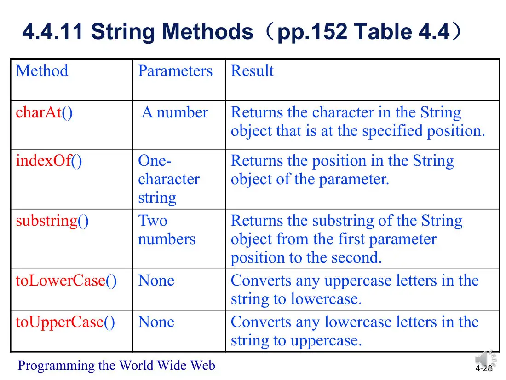

原文：

4.4.11 String Methods（pp.152 Table 4.4）

<table><tr><td>Method</td><td>Parameters</td><td>Result</td></tr><tr><td>charAt()</td><td>A number</td><td>Returns the character in the String object that is at the specified position.</td></tr><tr><td>indexOf()</td><td>One-character string</td><td>Returns the position in the String object of the parameter.</td></tr><tr><td>substring()</td><td>Two numbers</td><td>Returns the substring of the String object from the first parameter position to the second.</td></tr><tr><td>toLowerCase()</td><td>None</td><td>Converts any uppercase letters in the string to lowercase.</td></tr><tr><td>toUpperCase()</td><td>None</td><td>Converts any lowercase letters in the string to uppercase.</td></tr></table>
Programming the World Wide Web

4-28

### 4.4.11 String Methods

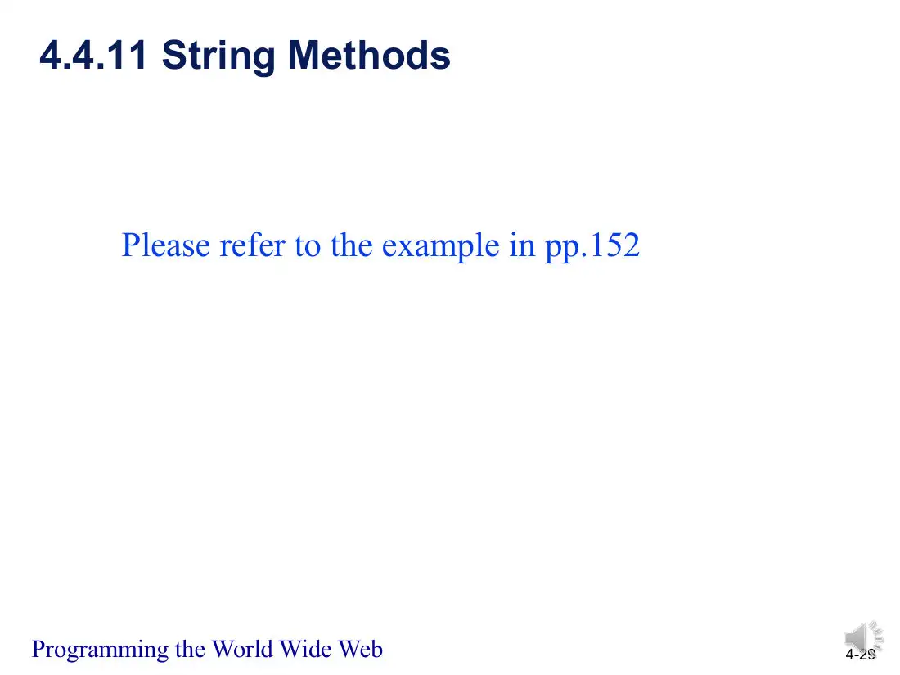

原文：

4.4.11 String Methods

Please refer to the example in pp.152

Programming the World Wide Web

### 4.4.12 The typeof Operator

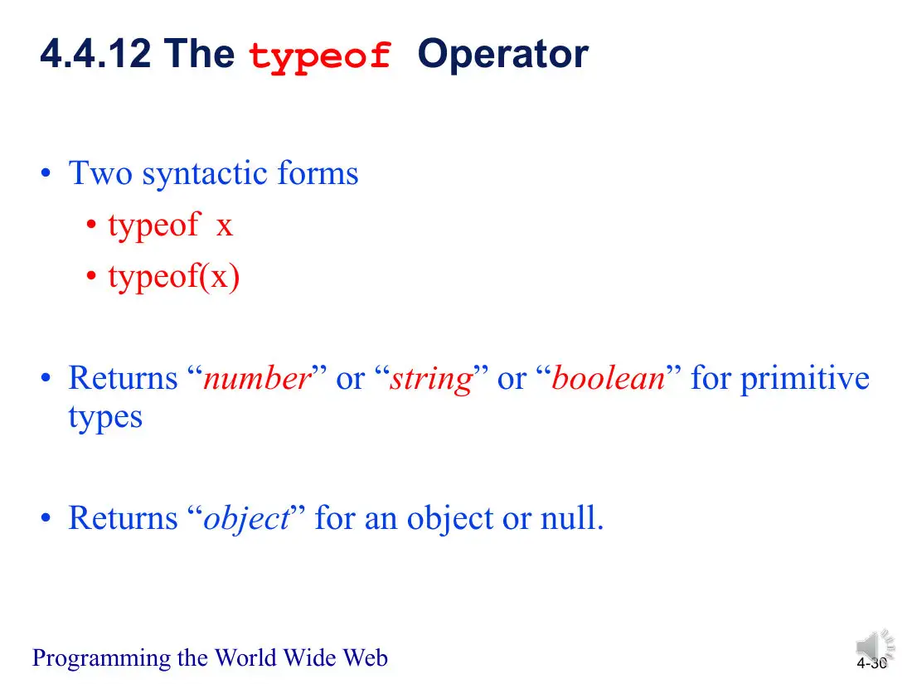

原文：

4.4.12 The typeof Operator

• Two syntactic forms

• typeof x

• typeof(x)

• Returns “number” or “string” or “boolean” for primitive types

• Returns “object” for an object or null.

Programming the World Wide Web

### 4.4.13 Assignment Statements

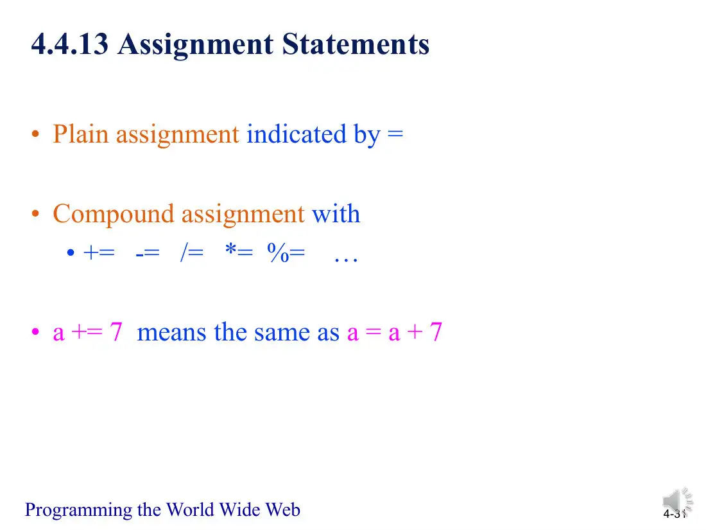

原文：

4.4.13 Assignment Statements

• Plain assignment indicated by =

• Compound assignment with

$$
\bullet + = - = / = * = \% = \dots
$$

$\mathrm { a } + = 7$ means the same as $\mathrm { a } = \mathrm { a } + 7$

Programming the World Wide Web

4-31

### 4.4.14 The Date Object

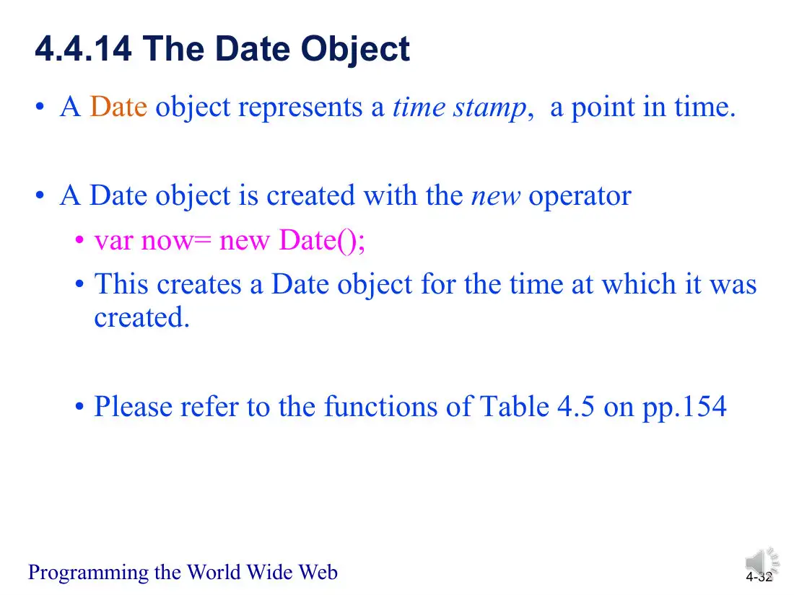

原文：

4.4.14 The Date Object

• A Date object represents a time stamp, a point in time.

• A Date object is created with the new operator

• var now= new Date();

• This creates a Date object for the time at which it was created.

• Please refer to the functions of Table 4.5 on pp.154

Programming the World Wide Web

4-32

### 4.5 Screen Output and Keyboard Input

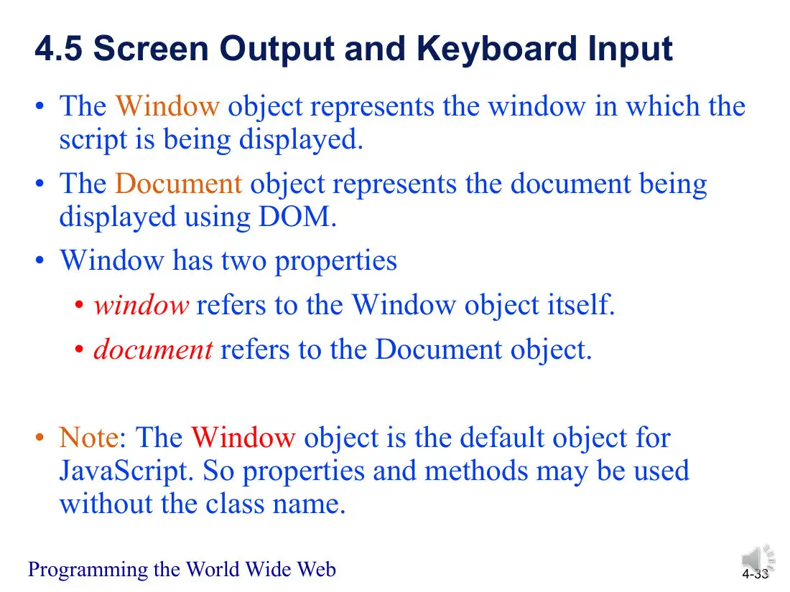

原文：

4.5 Screen Output and Keyboard Input

• The Window object represents the window in which the script is being displayed.

The Document object represents the document being displayed using DOM.

• Window has two properties

• window refers to the Window object itself.

• document refers to the Document object.

• Note: The Window object is the default object for JavaScript. So properties and methods may be used without the class name.

Programming the World Wide Web

4-33

### 4.5 Screen Output and Keyboard Input

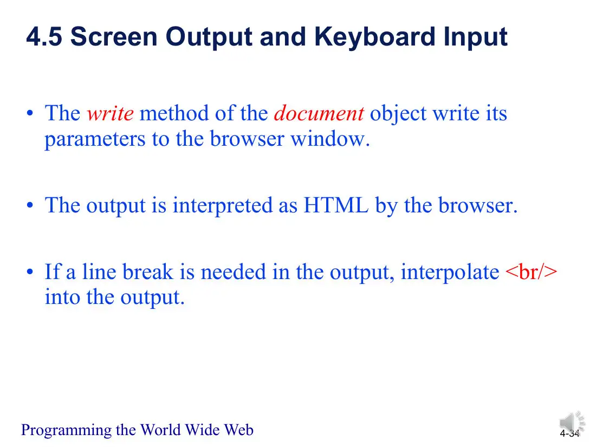

原文：

4.5 Screen Output and Keyboard Input

• The write method of the document object write its parameters to the browser window.

• The output is interpreted as HTML by the browser.

• If a line break is needed in the output, interpolate   into the output.

Programming the World Wide Web

4-34

### 4.5 The alert Method

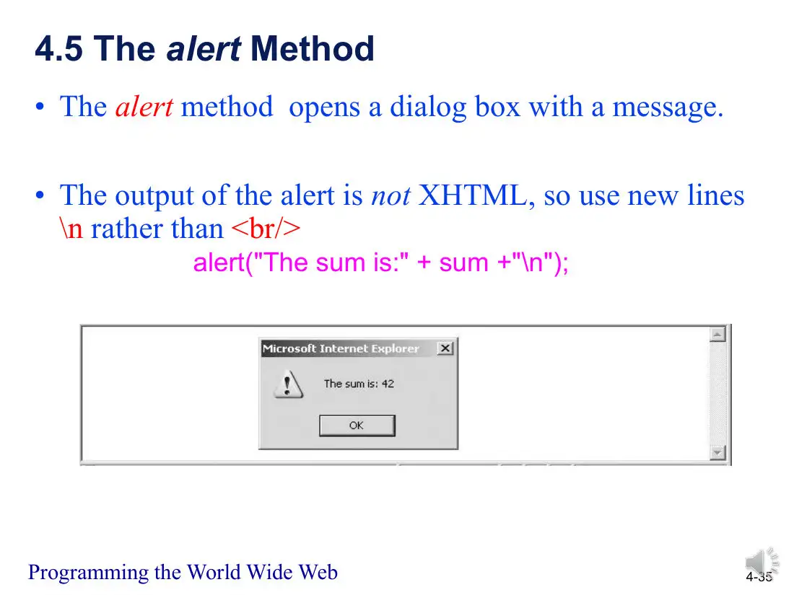

原文：

4.5 The alert Method

The alert method opens a dialog box with a message.

The output of the alert is not XHTML, so use new lines \n rather than   alert("The sum is:" + sum +"\n");

The sum is: 42

Programming the World Wide Web

4-35

### 4.5 The confirm Method

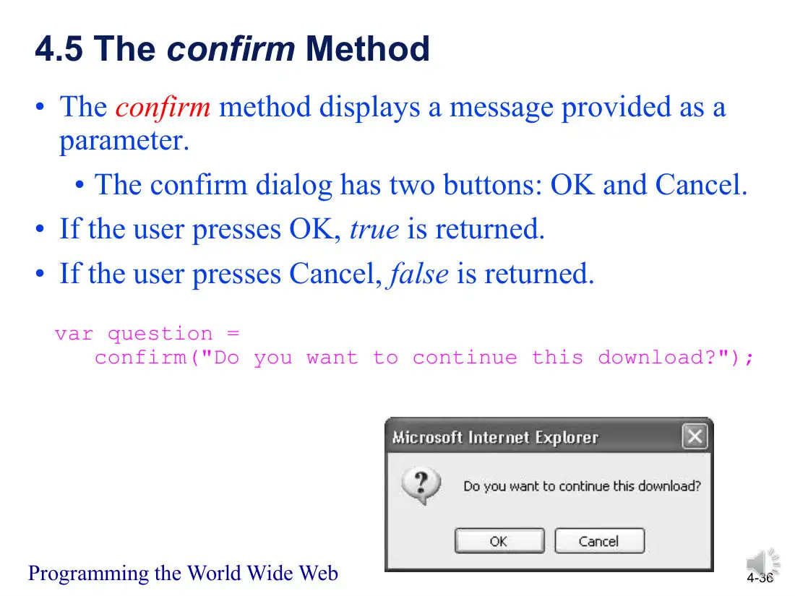

原文：

4.5 The confirm Method

• The confirm method displays a message provided as a parameter.

• The confirm dialog has two buttons: OK and Cancel.

• If the user presses OK, true is returned.

• If the user presses Cancel, false is returned.

Microsoft Internet Explorer

Programming the World Wide Web

4-36

### 4.5 The prompt Method

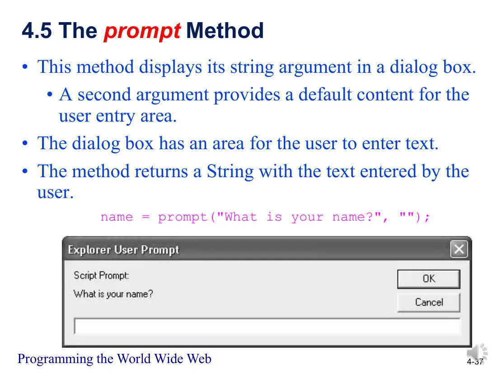

原文：

4.5 The prompt Method

• This method displays its string argument in a dialog box.

• A second argument provides a default content for the user entry area.

• The dialog box has an area for the user to enter text.

• The method returns a String with the text entered by the user.

Programming the World Wide Web

4-37

### 4.5 Example of Input and Output

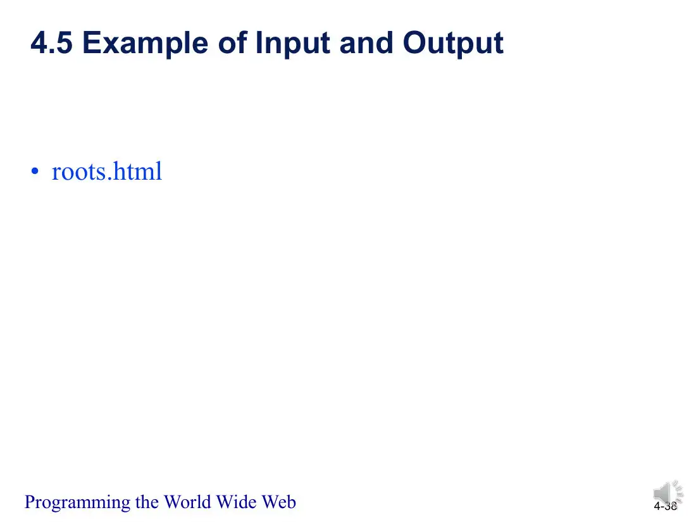

原文：

4.5 Example of Input and Output

• roots.html

Programming the World Wide Web

4-38

### 4.6.1 Control Expressions

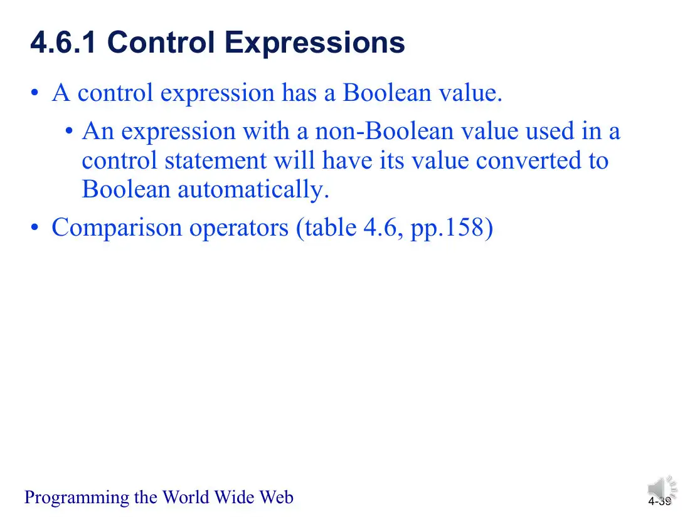

原文：

4.6.1 Control Expressions

• A control expression has a Boolean value.

• An expression with a non-Boolean value used in a control statement will have its value converted to Boolean automatically.

• Comparison operators (table 4.6, pp.158)

Programming the World Wide Web

4-39

### 4.6.1 Control Expressions

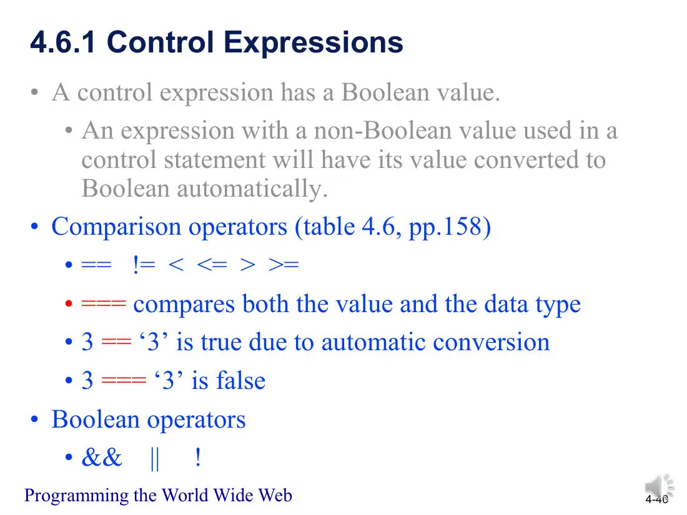

原文：

4.6.1 Control Expressions

• A control expression has a Boolean value.

• An expression with a non-Boolean value used in a control statement will have its value converted to Boolean automatically.

• Comparison operators (table 4.6, pp.158)

$$
\bullet = = \quad ! = <   <   = > > =
$$

=== compares both the value and the data type

• 3 == ‘3’ is true due to automatic conversion

• 3 === ‘3’ is false

• Boolean operators

• && ||

Programming the World Wide Web

### 4.6.2 Selection Statements

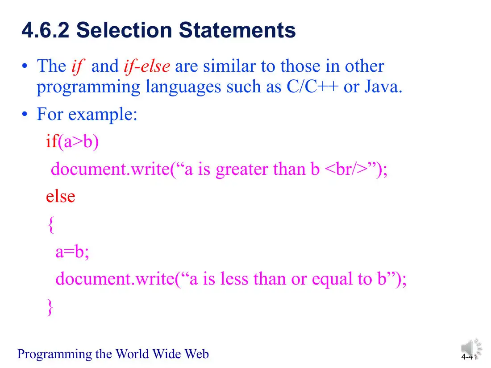

原文：

4.6.2 Selection Statements

• The if and if-else are similar to those in other programming languages such as C/C++ or Java.

Programming the World Wide Web

4-41

### 4.6.3 switch Statement Syntax

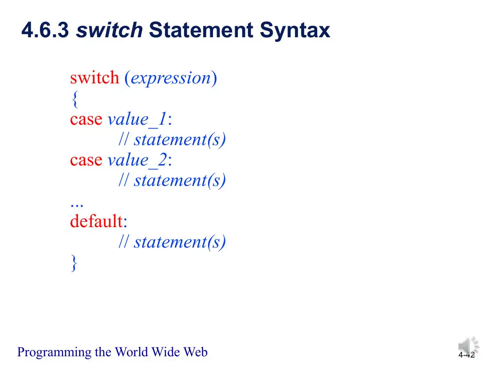

原文：

4.6.3 switch Statement Syntax

Programming the World Wide Web

4-42

### 4.6.3 switch Statement Semantics

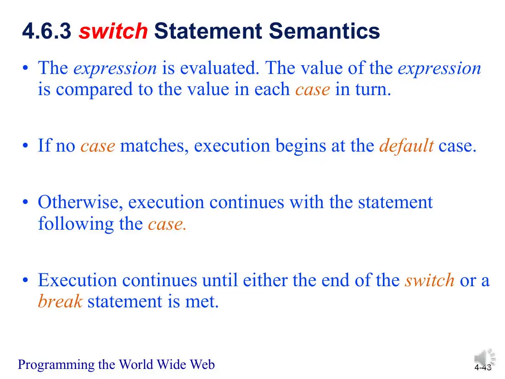

原文：

4.6.3 switch Statement Semantics

The expression is evaluated. The value of the expression is compared to the value in each case in turn.

• If no case matches, execution begins at the default case.

• Otherwise, execution continues with the statement following the case.

• Execution continues until either the end of the switch or a break statement is met.

Programming the World Wide Web

4-43

### 4.6.4 Loop Statements

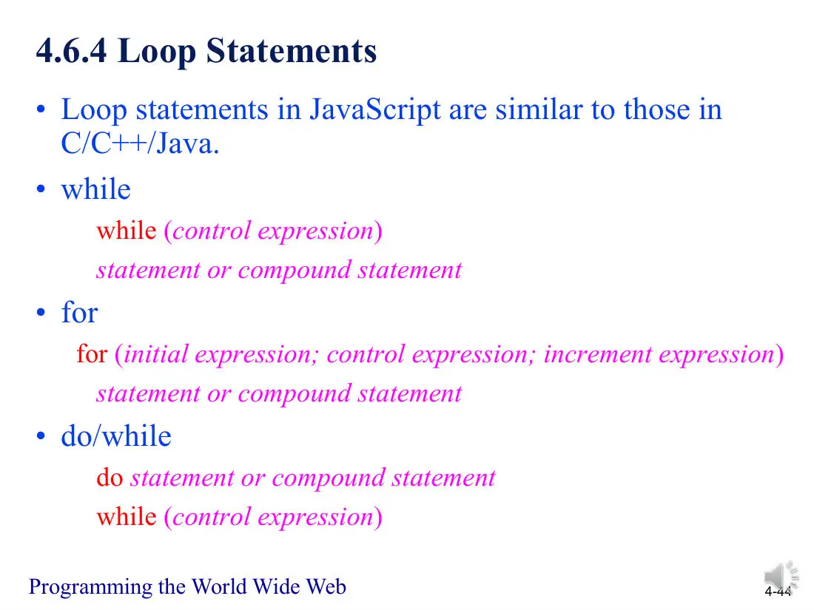

原文：

4.6.4 Loop Statements

• Loop statements in JavaScript are similar to those in C/C++/Java.

• while

while (control expression)

statement or compound statement

• for

for (initial expression; control expression; increment expression) statement or compound statement

• do/while

do statement or compound statement

while (control expression)

Programming the World Wide Web

4-44

### 4.6.4 while Statement

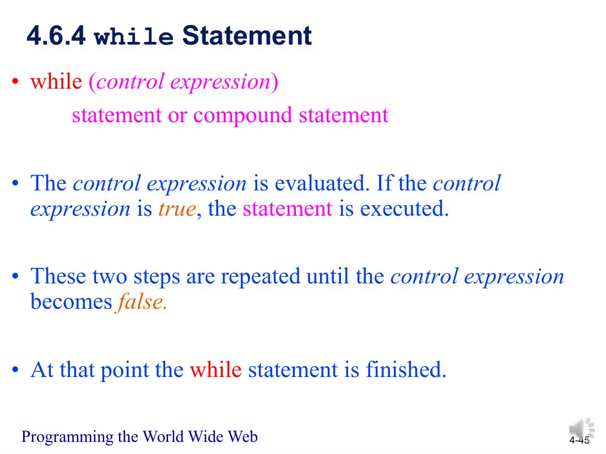

原文：

4.6.4 while Statement

• while (control expression) statement or compound statement

• The control expression is evaluated. If the control expression is true, the statement is executed.

• These two steps are repeated until the control expression becomes false.

• At that point the while statement is finished.

Programming the World Wide Web

4-45

### 4.6 for Statement

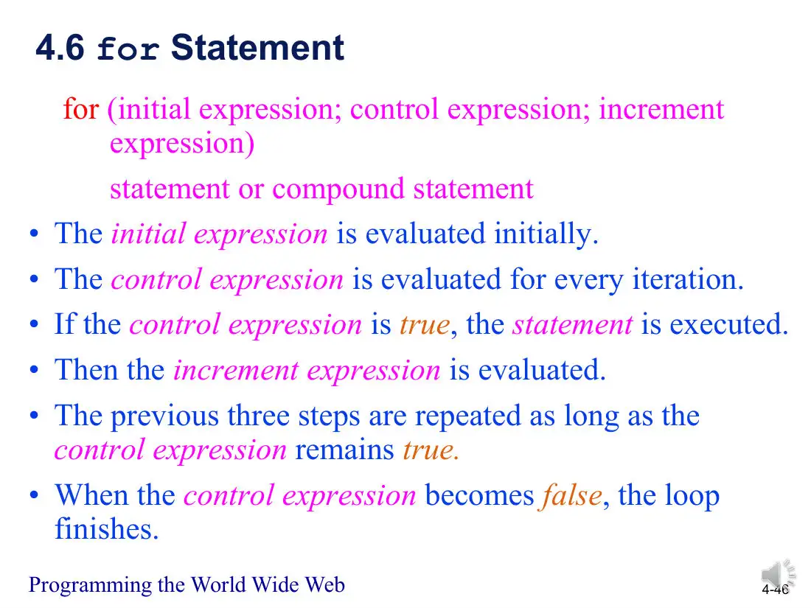

原文：

4.6 for Statement

for (initial expression; control expression; increment expression)

statement or compound statement

• The initial expression is evaluated initially.

• The control expression is evaluated for every iteration.

• If the control expression is true, the statement is executed.

• Then the increment expression is evaluated.

The previous three steps are repeated as long as the control expression remains true.

• When the control expression becomes false, the loop finishes.

Programming the World Wide Web

4-46

### 4.6 do/while Statement

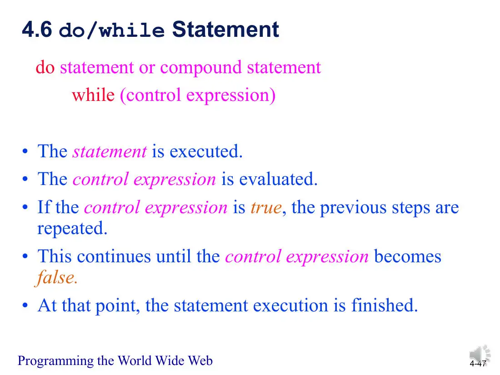

原文：

4.6 do/while Statement

do statement or compound statement while (control expression)

• The statement is executed.

• The control expression is evaluated.

• If the control expression is true, the previous steps are repeated.

• This continues until the control expression becomes false.

• At that point, the statement execution is finished.

Programming the World Wide Web

4-47

### 4.6.4 date.html Example (pp.163)

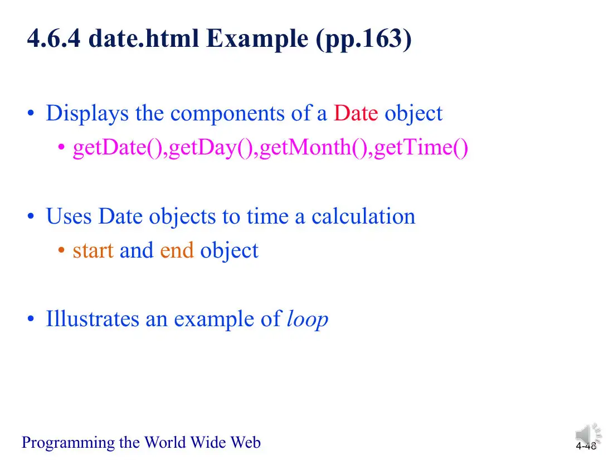

原文：

4.6.4 date.html Example (pp.163)

• Displays the components of a Date object • getDate(),getDay(),getMonth(),getTime()

• Uses Date objects to time a calculation • start and end object

• Illustrates an example of loop

Programming the World Wide Web

4-48

### Exercise

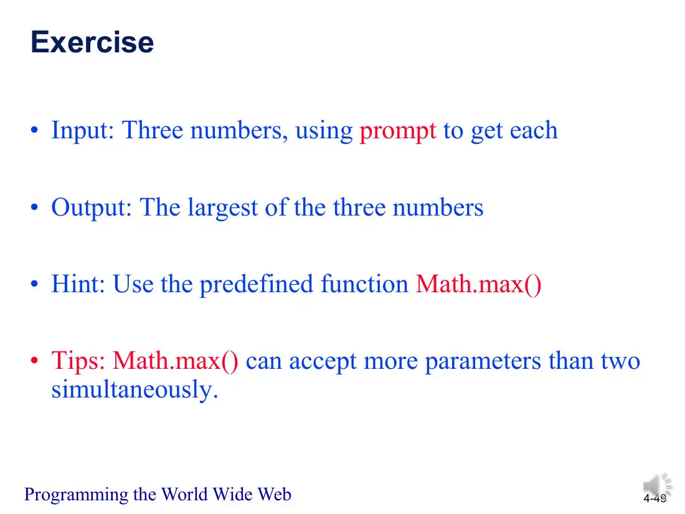

原文：

Exercise

• Input: Three numbers, using prompt to get each

• Output: The largest of the three numbers

• Hint: Use the predefined function Math.max()

• Tips: Math.max() can accept more parameters than two simultaneously.

Programming the World Wide Web

4-49

### • This includes a call to a constructor.

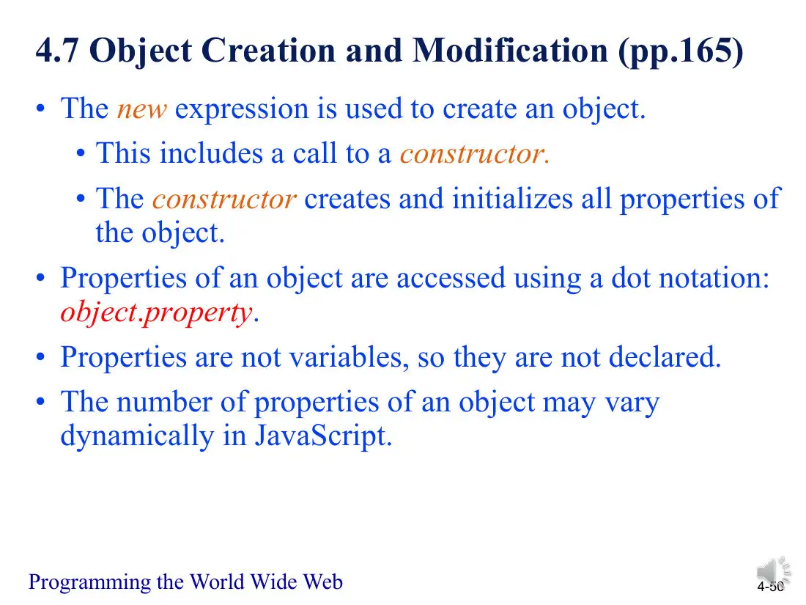

原文：

4.7 Object Creation and Modification (pp.165)

• The new expression is used to create an object.

• This includes a call to a constructor.

• The constructor creates and initializes all properties of the object.

• Properties of an object are accessed using a dot notation: object.property.

• Properties are not variables, so they are not declared.

• The number of properties of an object may vary dynamically in JavaScript.

Programming the World Wide Web

### 4.7 Dynamic Properties

原文：

4.7 Dynamic Properties

Create my\_car and add some properties // Create an Object my\_car var my\_car = new Object(); // Create and initialize the make property my\_car.make = "Ford"; // Create and initialize model my\_car.model = "Contour SVT";

The delete operator can be used to delete a property from an object.

• delete my\_car.model

Programming the World Wide Web

4-51

### 4.7 The for-in Loop

原文：

4.7 The for-in Loop

• Syntax

for (identifier in object)

statement or compound statement

• The loop lets the identifier take on each property in turn in the object.

• Printing the properties in my\_car:

for (var prop in my\_car)

document.write("Name: ", prop, "; Value: ",

• Result:

Name: make; Value: Ford

Name: model; Value: Contour SVT Programming the World Wide Web

4-52

### 4.8 Arrays

原文：

4.8 Arrays

• Arrays are lists of elements indexed by a numerical value.

• Array indexes in JavaScript begin with 0.

• Arrays can be modified in size even after they have been created.

Programming the World Wide Web

4-53

### 4.8.1 Array Object Creation

原文：

4.8.1 Array Object Creation

• Arrays can be created using the new Array() method.

new Array with one parameter creates an empty array of the specified number of elements.

• new Array(10)

• new Array with two or more parameters creates an array with the specified parameters as elements.

• new Array(10, 20)

Literal arrays can be specified using square brackets to include a list of elements.

• var alist = [1, “ii”, “gamma”, “4”];

• Elements of an array do not have to be of the same type.

Programming the World Wide Web

4-54

### 4.8.2 Characteristics of Array Objects

原文：

4.8.2 Characteristics of Array Objects

• The length of an array can be set at any time. my\_List.length=1000;

Assignment to an index greater than or equal to the current length simply increases the length of the array.

my\_List[1000]=5;

Only assigned elements of an array occupy space.

• Suppose an array were created using new Array(200)

• Suppose only elements 150 through 174 were assigned values

• Only the 25 assigned elements would be allocated storage, the other 175 would not be allocated storage.

Programming the World Wide Web

4-55

### 4.8.2 Example insert\_names.html

原文：

4.8.2 Example insert\_names.html

This example shows the dynamic nature of arrays in JavaScript.

Programming the World Wide Web

### 4.8.3 Array Methods (pp.169)

原文：

4.8.3 Array Methods (pp.169)

• join converts all the elements into a string(by copy).

• reverse does what your expect (by reference).

• sort coerces the elements in the array to strings and sort them. (by reference)

• concat catenates its actual parameters to the array (by copy).

Programming the World Wide Web

4-57

### 4.8.3 Array Methods

原文：

4.8.3 Array Methods

Programming the World Wide Web

4-58

### 4.8.3 Two-dimensional Arrays

原文：

4.8.3 Two-dimensional Arrays

• A two-dimensional array in JavaScript is an array of arrays.

• This need not even be rectangular shaped: different rows could have different length.

• Example nested\_arrays.html illustrates two-dimensional arrays.

Programming the World Wide Web

### 4.9 Function Fundamentals

原文：

4.9 Function Fundamentals

• Function definition syntax

• A function definition consists of a header followed by a compound statement.

• A function header:

• function function-name(optional-formal-parameters)

• return statements

• A return statement causes a function to cease execution and the control to pass to the caller.

• A return statement may include a value sent to caller.

• A return statement without a value implicitly returns undefined.

Programming the World Wide Web

4-60

### 4.9 Function Fundamentals

原文：

4.9 Function Fundamentals

• Function call syntax

• Function name followed by parentheses and any actual parameters.

• Function call may be used as an expression or part of an expression.

• Functions must be defined before use in the page header.

Programming the World Wide Web

4-61

### 4.9 Functions are Objects

原文：

4.9 Functions are Objects

• Functions are objects in JavaScript

• Functions may, therefore, be assigned to variables and to object properties.

Programming the World Wide Web

4-62

### 4.9.2 Local Variables

原文：

4.9.2 Local Variables

• The scope of a variable is the range of statements over which it is visible.

• A variable not declared using var has global scope, visible in the entire document, even if implicitly used inside a function definition

A variable declared with var outside a function definition has global scope.

A variable declared with var inside a function definition has local scope, visible only inside the function definition

• If a global variable has the same name, it is hidden inside the function definition

Programming the World Wide Web

4-63

### 4.9.3 Parameters

原文：

4.9.3 Parameters

• Parameters named in a function header are called formal parameters.

• Parameters used in a function call are called actual parameters.

Programming the World Wide Web

4-64

### 4.9.3 Parameters

原文：

4.9.3 Parameters

JavaScript checks neither the type nor number of parameters in a function call.

• Formal parameters have no type specified.

• Extra actual parameters are ignored.

• If there are fewer actual parameters than formal parameters, the extra formal parameters remain undefined.

• This is typical of scripting languages.

A property array named arguments holds all of the actual parameters, whether or not there are more of them than there are formal parameters.

• Example para.html

Programming the World Wide Web

4-65

### 4.11 Constructors

原文：

4.11 Constructors

• Constructors are functions that create and initialize properties for new objects

• A constructor uses the keyword this in the body to refer to the object being initialized

• Object methods are properties that refer to the functions

• A function to be used as a method may use the keyword this to refer to the object on which it is acting

• Example car\_constructor.html

Programming the World Wide Web

4-66

### Homework

原文：

Homework

• pp.191

• 4.11

Programming the World Wide Web

4-67
