# 《Web技术（双语）》第8章 XML基础与应用（课件）

原件的每一页，下面附识别出的文字。

### Part 8

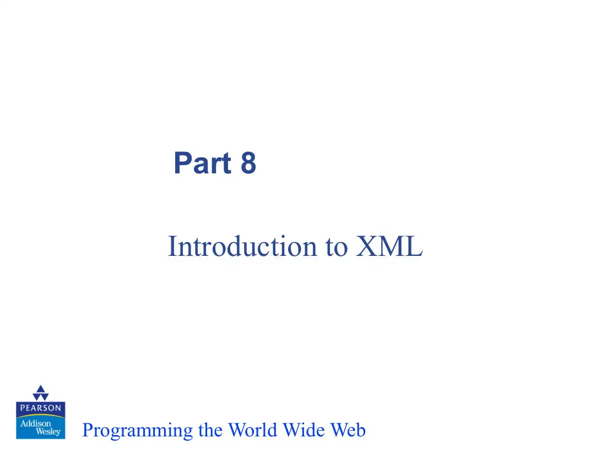

原文：

Part 8

Introduction to XML

PEARSON
Addison Wesley

Programming the World Wide Web

### contents (pp.277)

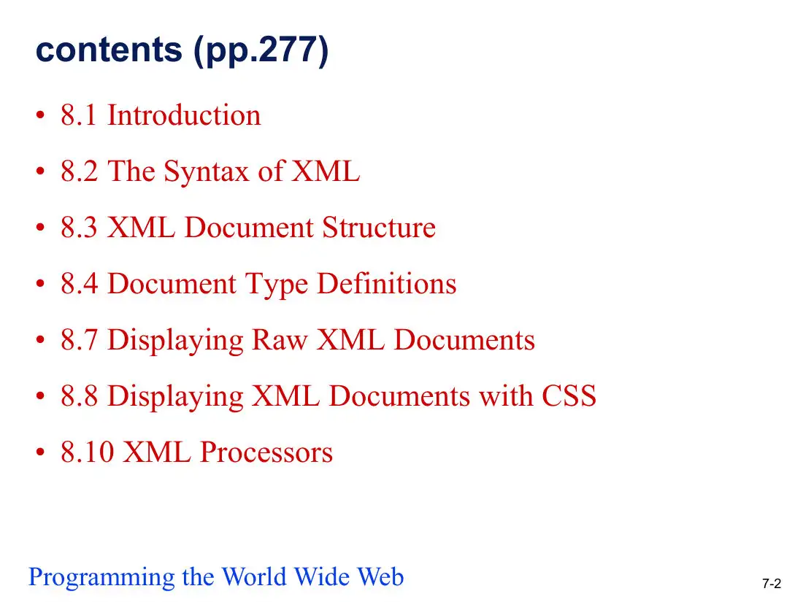

原文：

contents (pp.277)

• 8.1 Introduction

• 8.2 The Syntax of XML

• 8.3 XML Document Structure

• 8.4 Document Type Definitions

• 8.7 Displaying Raw XML Documents

• 8.8 Displaying XML Documents with CSS

• 8.10 XML Processors

Programming the World Wide Web

7-2

### 8.1 Introduction

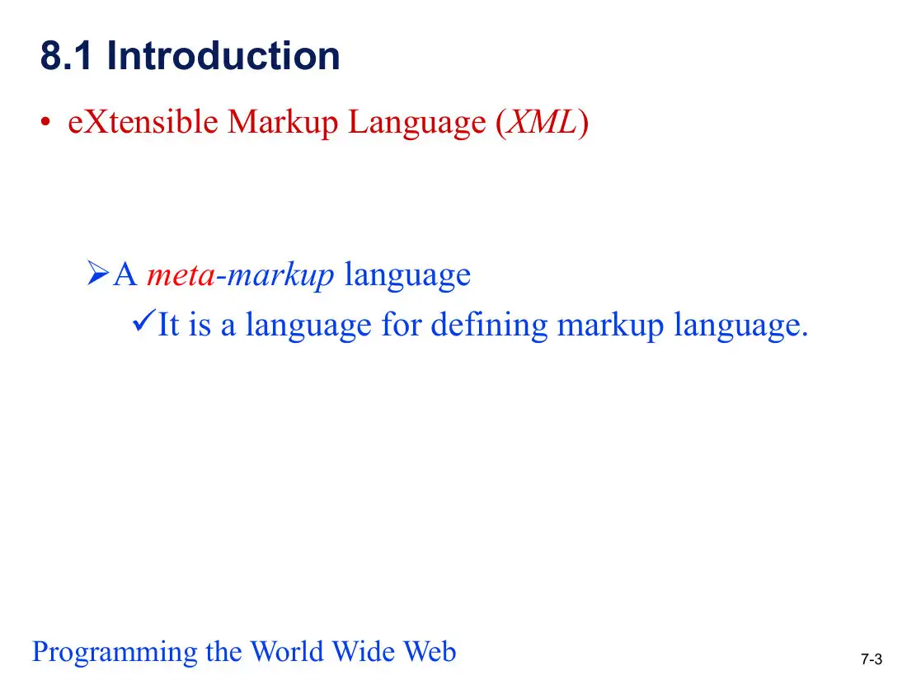

原文：

8.1 Introduction

• eXtensible Markup Language (XML)

▶A meta-markup language

√ It is a language for defining markup language.

Programming the World Wide Web

7-3

### 8.1 Introduction

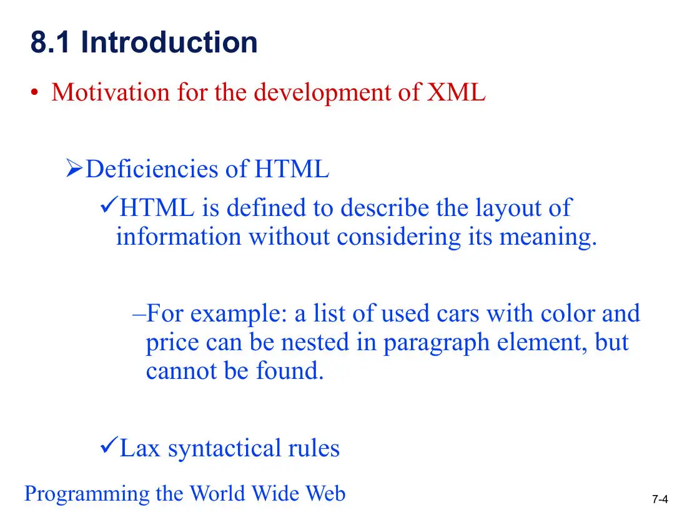

原文：

8.1 Introduction

\- Motivation for the development of XML

▶Deficiencies of HTML

√ HTML is defined to describe the layout of information without considering its meaning.

-For example: a list of used cars with color and price can be nested in paragraph element, but cannot be found.

√Lax syntactical rules

Programming the World Wide Web

7-4

### 8.1 Introduction

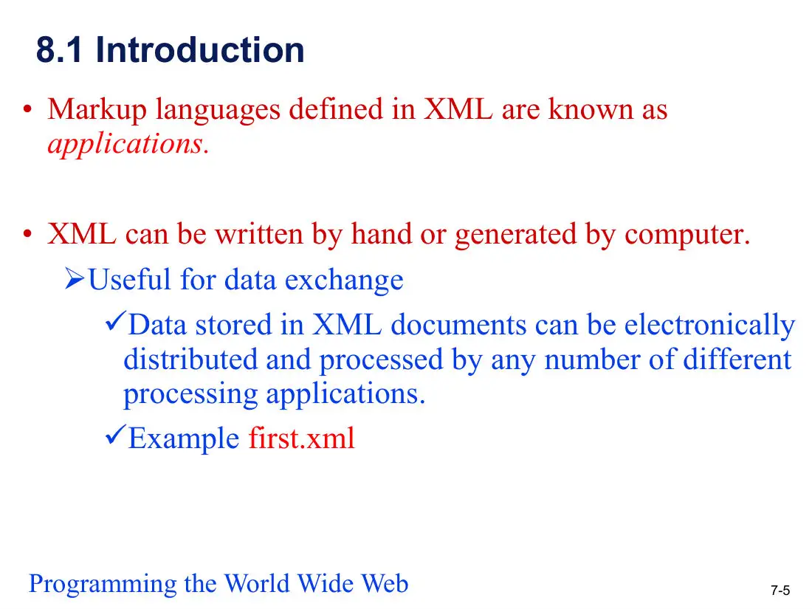

原文：

8.1 Introduction

\- Markup languages defined in XML are known as applications.

\- XML can be written by hand or generated by computer.

Useful for data exchange

√ Data stored in XML documents can be electronically distributed and processed by any number of different processing applications.

√ Example first.xml

Programming the World Wide Web

7-5

### 8.2 The Syntax of XML

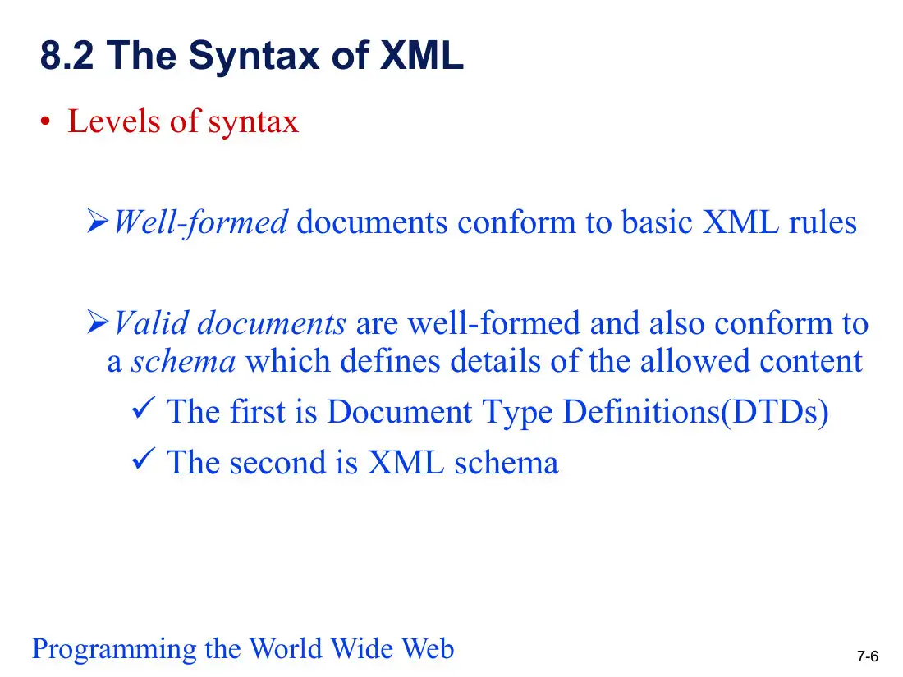

原文：

8.2 The Syntax of XML

\- Levels of syntax

Well-formed documents conform to basic XML rules

➢Valid documents are well-formed and also conform to a schema which defines details of the allowed content

√ The first is Document Type Definitions(DTDs)

√ The second is XML schema

Programming the World Wide Web

7-6

### 8.2 The Syntax of XML

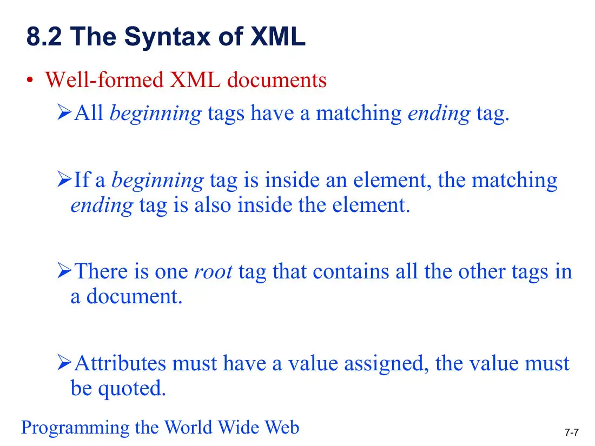

原文：

8.2 The Syntax of XML

• Well-formed XML documents

All beginning tags have a matching ending tag.

If a beginning tag is inside an element, the matching ending tag is also inside the element.

There is one root tag that contains all the other tags in a document.

➢Attributes must have a value assigned, the value must be quoted.

Programming the World Wide Web

7-7

### 8.2 The Syntax of XML

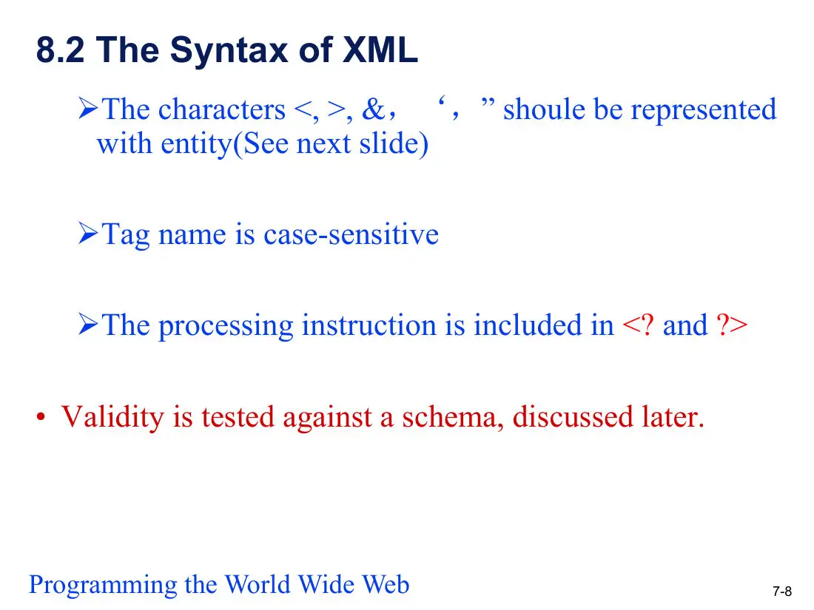

原文：

8.2 The Syntax of XML

The characters <, >, &, ‘, ’ shoule be represented with entity(See next slide)

Tag name is case-sensitive

The processing instruction is included in <? and ?>

\- Validity is tested against a schema, discussed later.

Programming the World Wide Web

7-8

### 8.2 The Syntax of XML

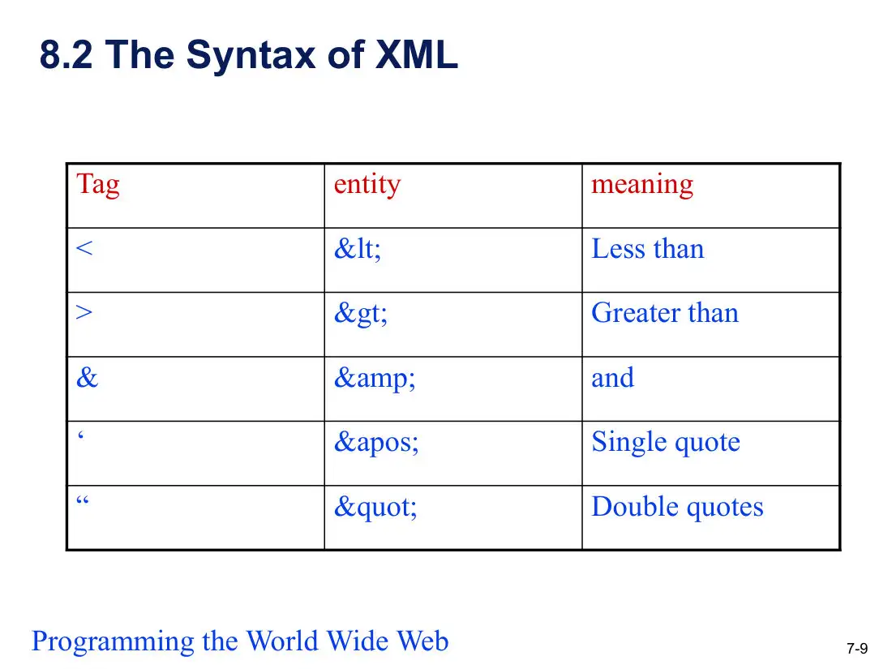

原文：

8.2 The Syntax of XML

<table><tr><td>Tag</td><td>entity</td><td>meaning</td></tr><tr><td>&lt;</td><td>&lt;</td><td>Less than</td></tr><tr><td>&gt;</td><td>&gt;</td><td>Greater than</td></tr><tr><td>&amp;</td><td>&amp;</td><td>and</td></tr><tr><td>‘</td><td>‘</td><td>Single quote</td></tr><tr><td>“</td><td>“</td><td>Double quotes</td></tr></table>

Programming the World Wide Web

7-9

### 8.3 XML Document Structure

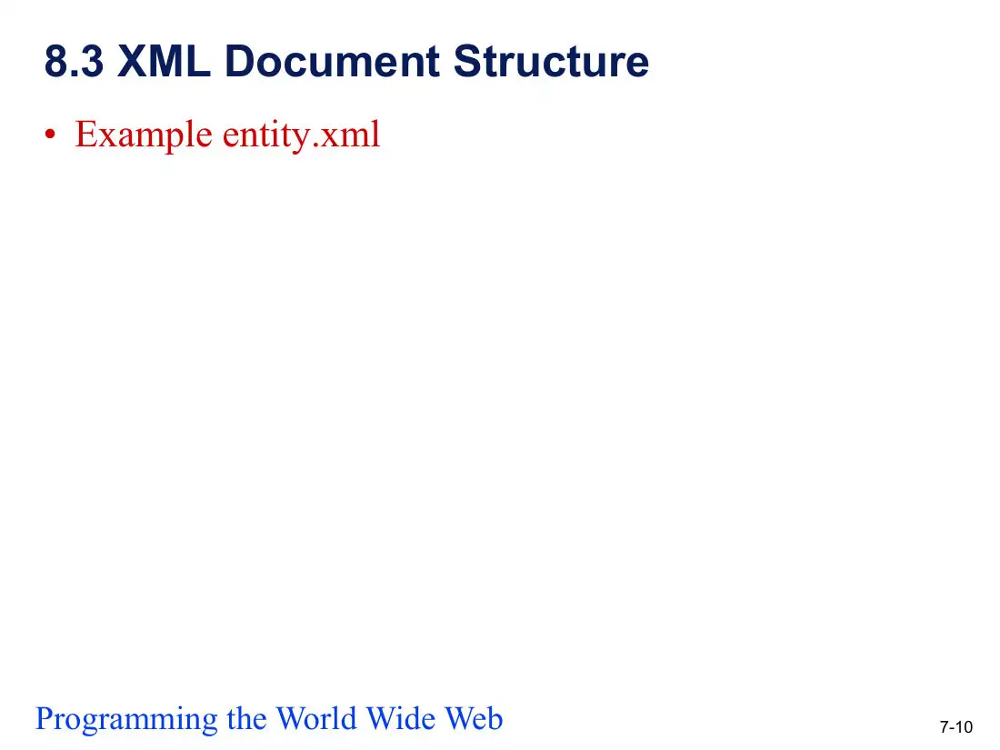

原文：

8.3 XML Document Structure

• Example entity.xml

Programming the World Wide Web

7-10

### 8.3 XML Document Structure

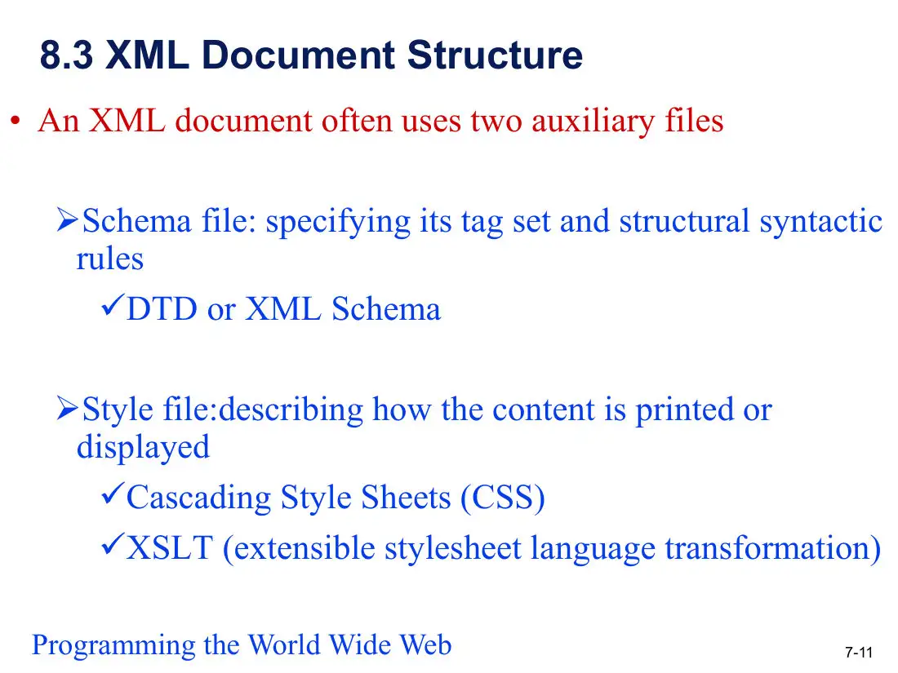

原文：

8.3 XML Document Structure

• An XML document often uses two auxiliary files

Schema file: specifying its tag set and structural syntactic rules

√ DTD or XML Schema

▶Style file:describing how the content is printed or displayed

√ Cascading Style Sheets (CSS)

√XSLT (extensible stylesheet language transformation)

Programming the World Wide Web

7-11

### 8.4 Document Type Definitions(DTD)

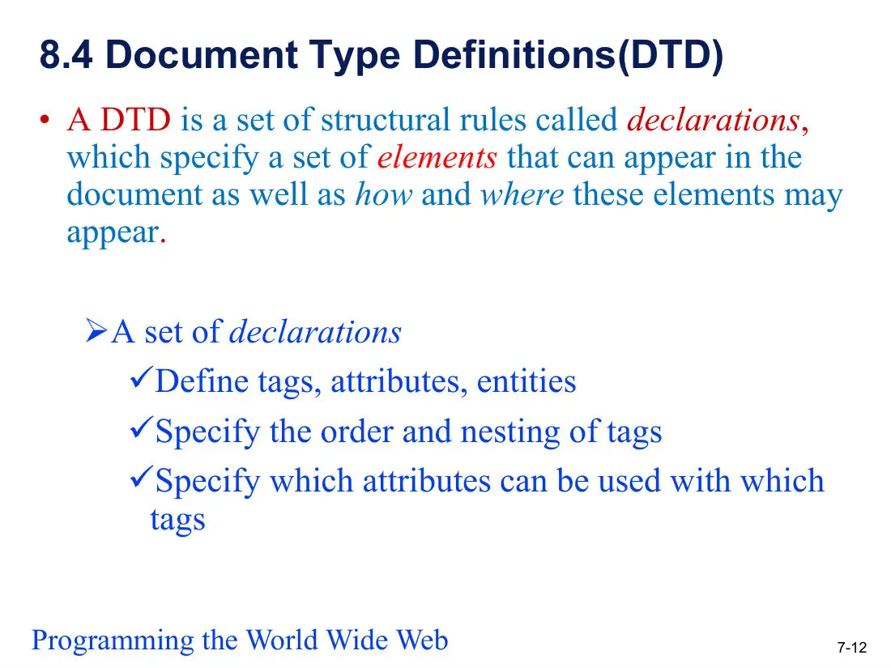

原文：

8.4 Document Type Definitions(DTD)

\- A DTD is a set of structural rules called declarations, which specify a set of elements that can appear in the document as well as how and where these elements may appear.

▶A set of declarations

√Define tags, attributes, entities

√ Specify the order and nesting of tags

√ Specify which attributes can be used with which tags

Programming the World Wide Web

7-12

### 8.4 Document Type Definitions(DTD)

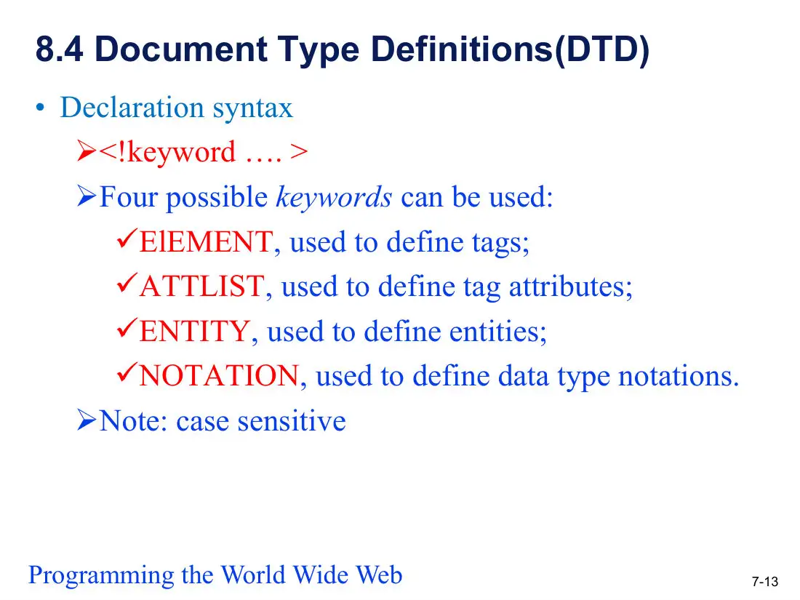

原文：

8.4 Document Type Definitions(DTD)

\- Declaration syntax

▶<!keyword ....>

▶ Four possible keywords can be used:

√ ELEMENT, used to define tags;

√ ATTLIST, used to define tag attributes;

√ ENTITY, used to define entities;

√NOTATION, used to define data type notations.

▶Note: case sensitive

Programming the World Wide Web

7-13

### 8.4.1 Declaring Elements

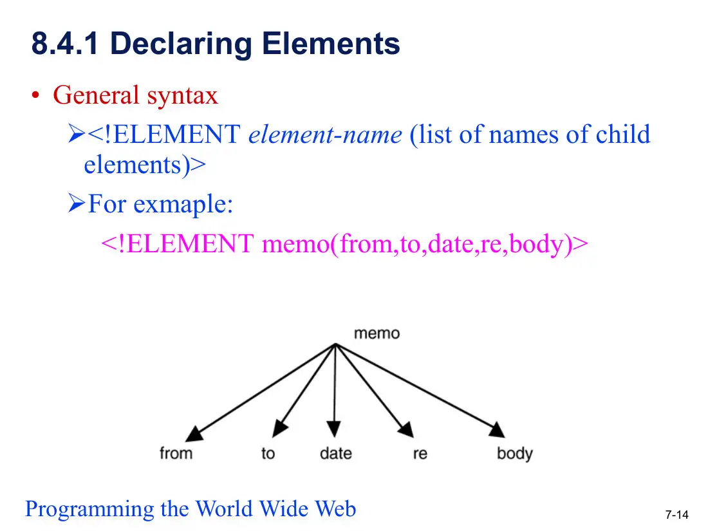

原文：

8.4.1 Declaring Elements

\- General syntax

➢<!ELEMENT element-name (list of names of child elements)>

For exmaple:

<!ELEMENT memo(from,to,date,re,body)>

Programming the World Wide Web

7-14

### 8.4.1 Declaring Elements

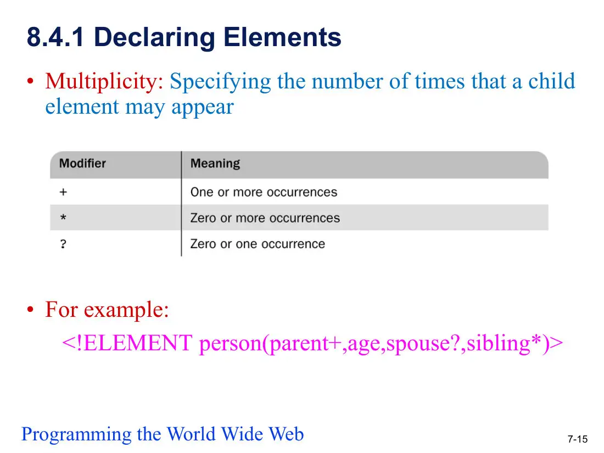

原文：

8.4.1 Declaring Elements

\- Multiplicity: Specifying the number of times that a child element may appear

<table><tr><td>Modifier</td><td>Meaning</td></tr><tr><td>+</td><td>One or more occurrences</td></tr><tr><td>*</td><td>Zero or more occurrences</td></tr><tr><td>?</td><td>Zero or one occurrence</td></tr></table>

- For example:

<!ELEMENT person(parent+,age,spouse?,sibling\*)>

Programming the World Wide Web

7-15

### 8.4.1 Declaring Elements

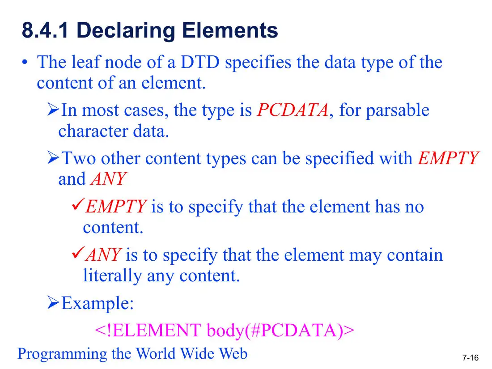

原文：

8.4.1 Declaring Elements

\- The leaf node of a DTD specifies the data type of the content of an element.

In most cases, the type is PCDATA, for parsable character data.

Two other content types can be specified with EMPTY and ANY

√ EMPTY is to specify that the element has no content.

√ ANY is to specify that the element may contain literally any content.

Example:

<!ELEMENT body(#PCDATA)>

Programming the World Wide Web

7-16

### 8.4.2 Declaring Attributes

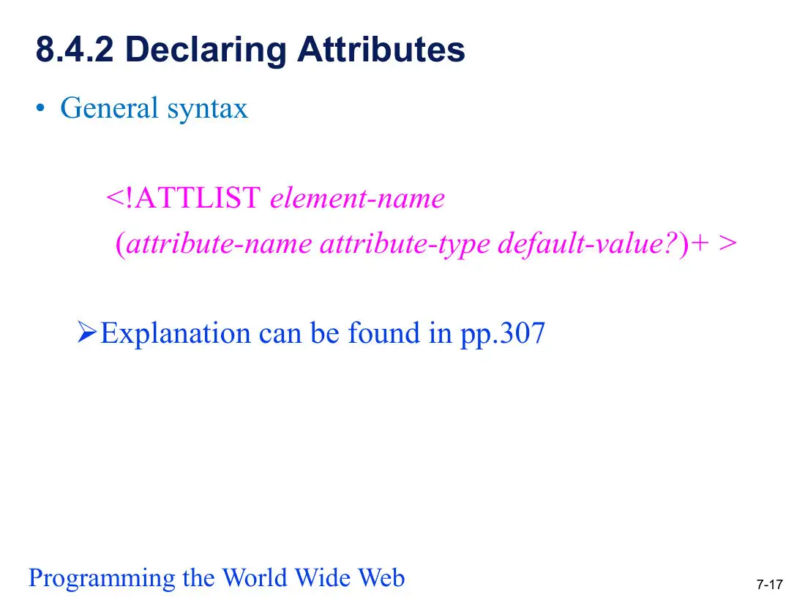

原文：

8.4.2 Declaring Attributes

\- General syntax

<!ATTLIST element-name

(attribute-name attribute-type default-value?) + >

Explanation can be found in pp.307

Programming the World Wide Web

7-17

### 8.4.2 Declaring Attributes

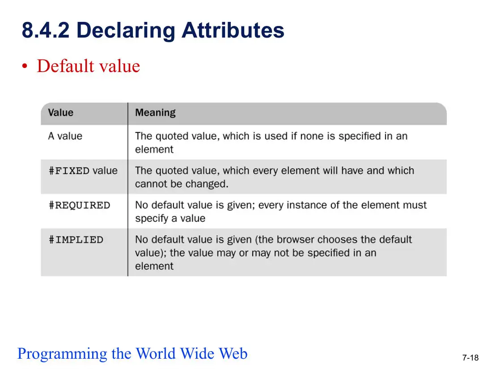

原文：

8.4.2 Declaring Attributes

- Default value

<table><tr><td>Value</td><td>Meaning</td></tr><tr><td>A value</td><td>The quoted value, which is used if none is specified in an element</td></tr><tr><td>#FIXED value</td><td>The quoted value, which every element will have and which cannot be changed.</td></tr><tr><td>#REQUIRED</td><td>No default value is given; every instance of the element must specify a value</td></tr><tr><td>#IMPLIED</td><td>No default value is given (the browser chooses the default value); the value may or may not be specified in an element</td></tr></table>

Programming the World Wide Web

7-18

### 8.4.2 Declaring Attributes

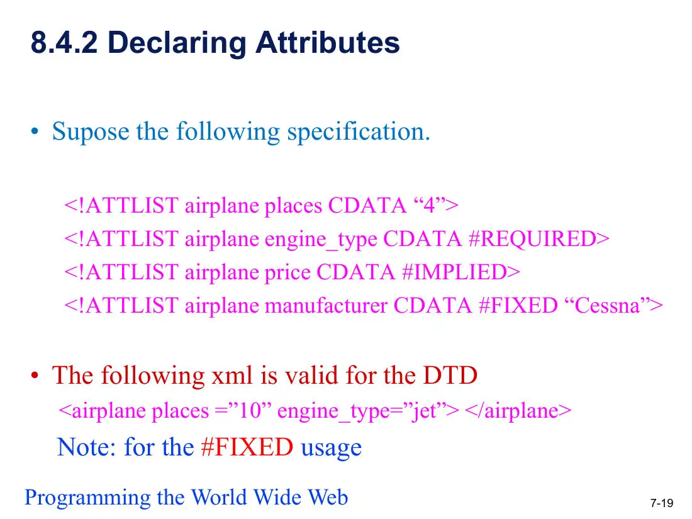

原文：

8.4.2 Declaring Attributes

\- Suppose the following specification.

<!ATTLIST airplane places CDATA “4”>

<!ATTLIST airplane engine\_type CDATA #REQUIRED>

<!ATTLIST airplane price CDATA #IMPLIED>

<!ATTLIST airplane manufacturer CDATA #FIXED “Cessna”>

\- The following xml is valid for the DTD

<airplane places="10" engine\_type="jet"></airplane>

Note: for the #FIXED usage

Programming the World Wide Web

7-19

### 8.4.3 Declaring Entities

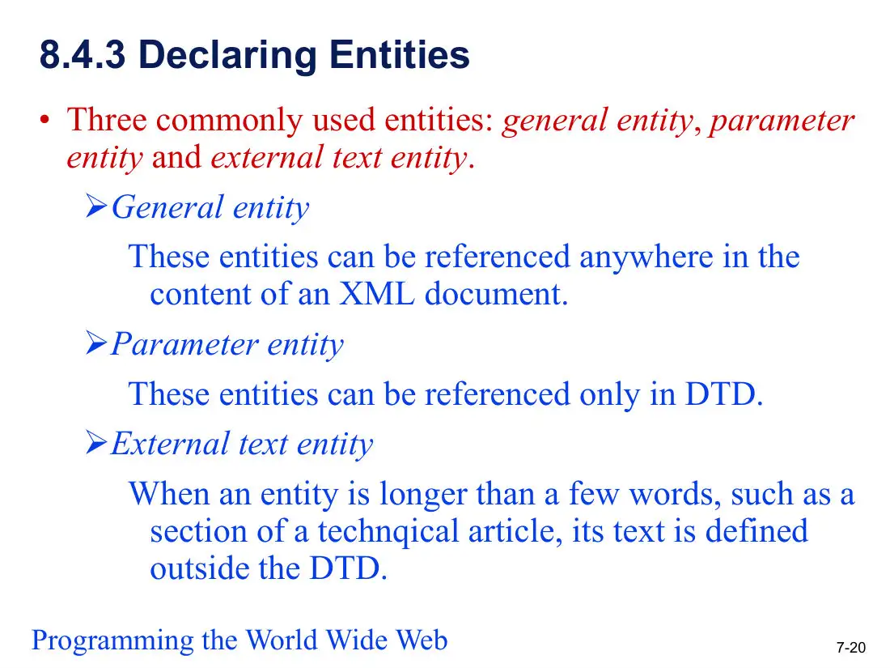

原文：

8.4.3 Declaring Entities

\- Three commonly used entities: general entity, parameter entity and external text entity.

▶General entity

These entities can be referenced anywhere in the content of an XML document.

Parameter entity

These entities can be referenced only in DTD.

External text entity

When an entity is longer than a few words, such as a section of a technical article, its text is defined outside the DTD.

Programming the World Wide Web

7-20

### 8.4.3 Declaring Entities

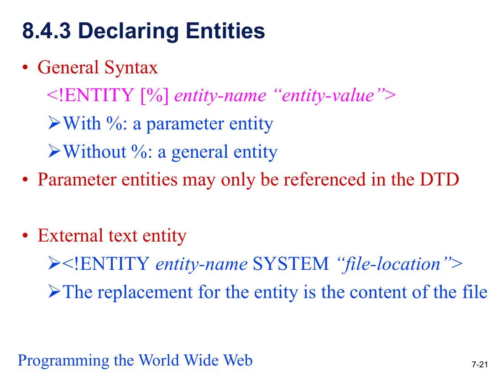

原文：

8.4.3 Declaring Entities

- General Syntax

<!ENTITY [%] entity-name “entity-value”>

With %: a parameter entity

▶ Without %: a general entity

• Parameter entities may only be referenced in the DTD

- External text entity

▶<!ENTITY entity-name SYSTEM “file-location”>

The replacement for the entity is the content of the file

Programming the World Wide Web

7-21

### 8.4.3 Declaring Entities

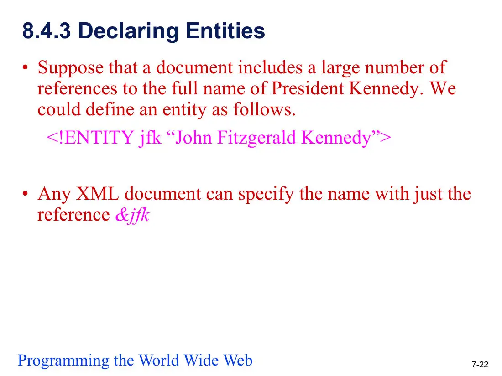

原文：

8.4.3 Declaring Entities

\- Suppose that a document includes a large number of references to the full name of President Kennedy. We could define an entity as follows.

<!ENTITY jfk “John Fitzgerald Kennedy”>

\- Any XML document can specify the name with just the reference &jfk

Programming the World Wide Web

7-22

### 8.4.4 A sample DTA

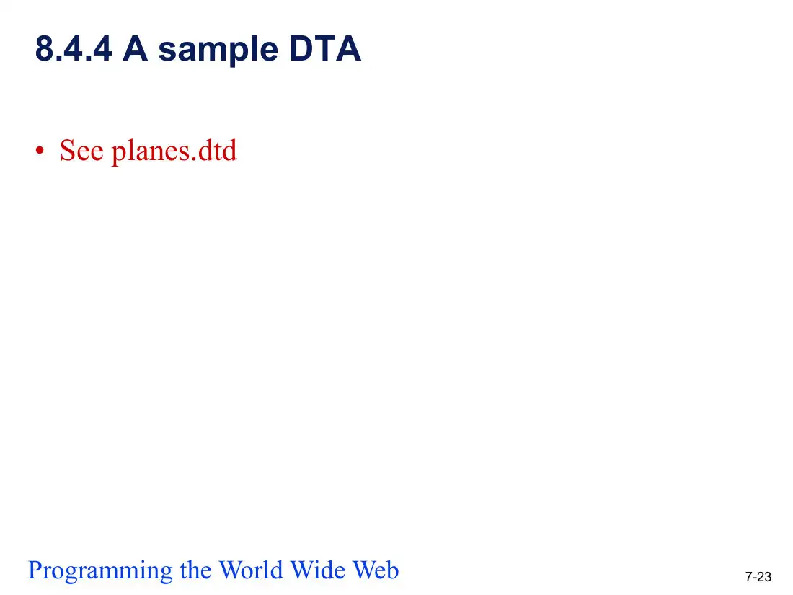

原文：

8.4.4 A sample DTA

• See planes.dtd

Programming the World Wide Web

7-23

### 8.4.5 Internal and External DTDs

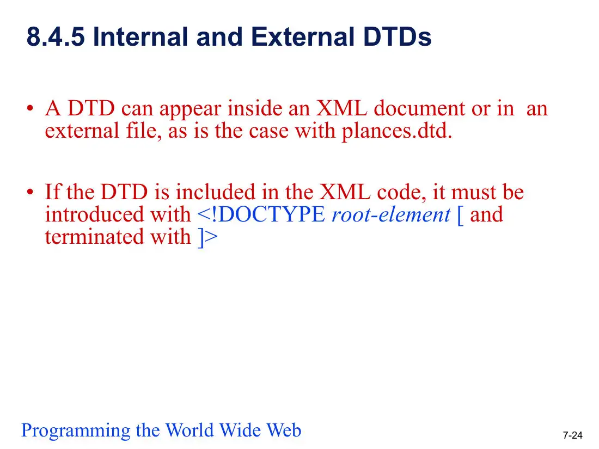

原文：

8.4.5 Internal and External DTDs

\- A DTD can appear inside an XML document or in an external file, as is the case with plances.dtd.

\- If the DTD is included in the XML code, it must be introduced with $<!DOCTYPE$ root-element [ and terminated with ]>

Programming the World Wide Web

7-24

### 8.4.5 Internal and External DTDs

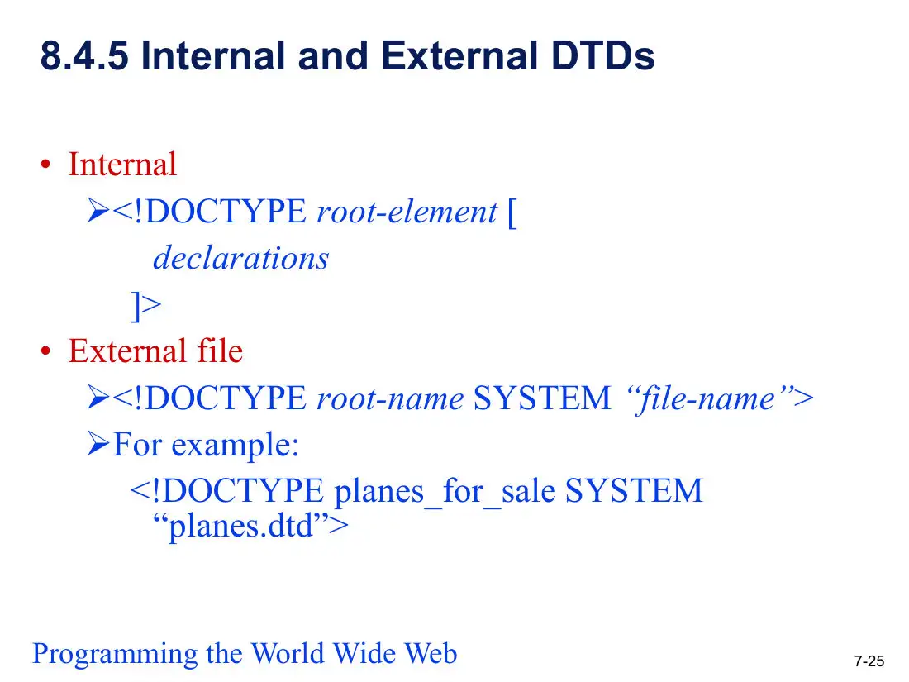

原文：

8.4.5 Internal and External DTDs

\- Internal

▶<!DOCTYPE root-element [declarations

\- External file

<!DOCTYPE root-name SYSTEM "file-name">

For example:

<!DOCTYPE planes\_for\_sale SYSTEM "planes.dtd">

Programming the World Wide Web

7-25

### 8.4.5 Internal and External DTDs

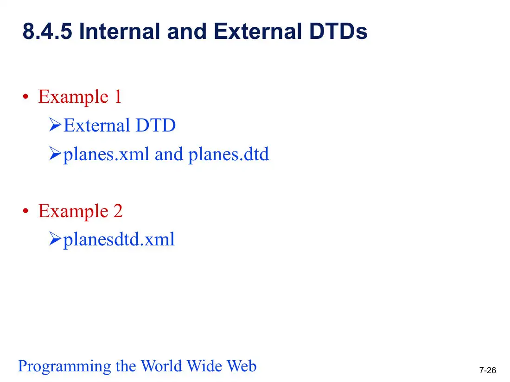

原文：

8.4.5 Internal and External DTDs

• Example 1

External DTD

planes.xml and planes.dtd

• Example 2

planesdtd.xml

Programming the World Wide Web

7-26

### 8.7 Displaying Raw XML Documents

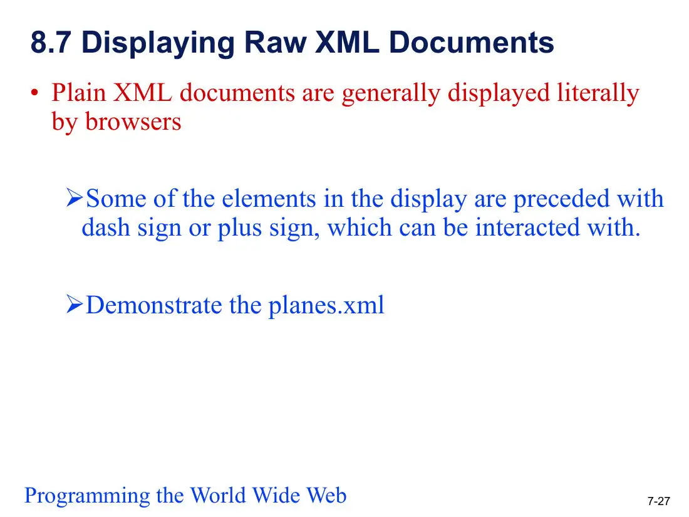

原文：

8.7 Displaying Raw XML Documents

\- Plain XML documents are generally displayed literally by browsers

Some of the elements in the display are preceded with dash sign or plus sign, which can be interacted with.

▶Demonstrate the planes.xml

Programming the World Wide Web

7-27

### 8.8 Displaying XML Documents with CSS

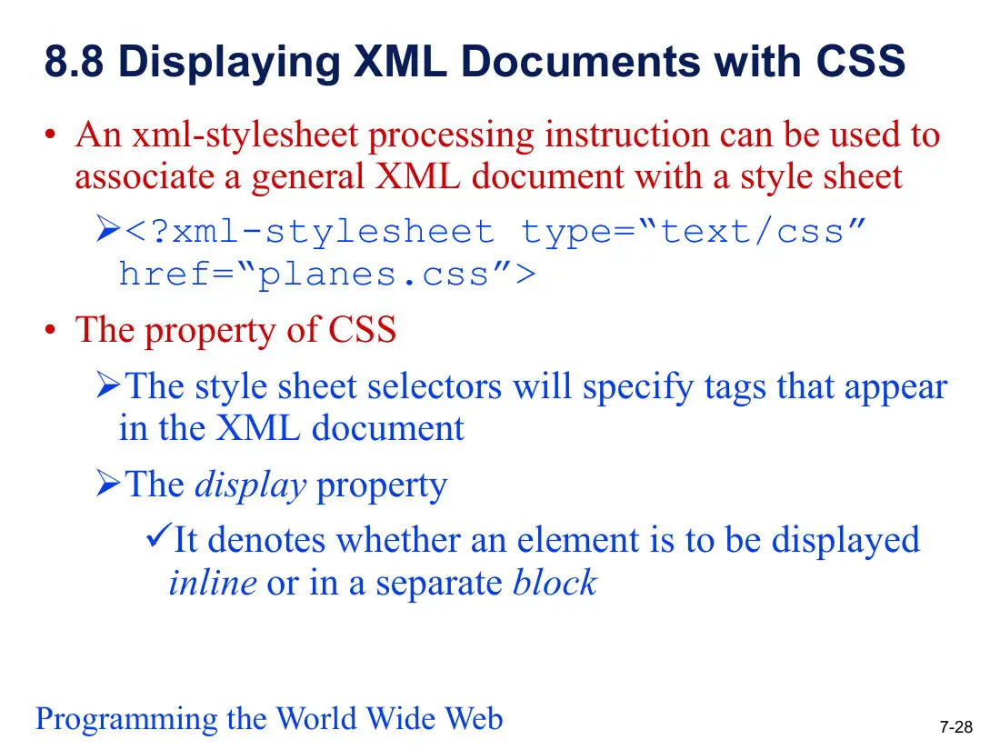

原文：

8.8 Displaying XML Documents with CSS

\- An xml-stylesheet processing instruction can be used to associate a general XML document with a style sheet

<?xml-stylesheet type="text/css" href="planes.css">

• The property of CSS

The style sheet selectors will specify tags that appear in the XML document

The display property

√ It denotes whether an element is to be displayed inline or in a separate block

Programming the World Wide Web

7-28

### 8.8 Displaying XML Documents with CSS

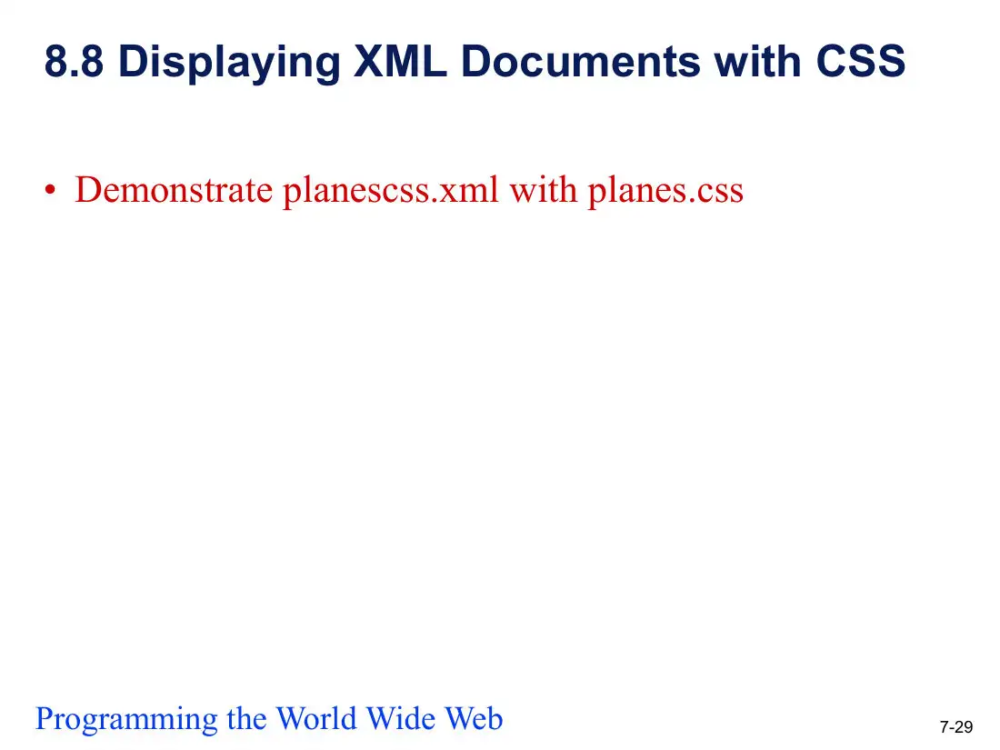

原文：

8.8 Displaying XML Documents with CSS

\- Demonstrate planescss.xml with planes.css

Programming the World Wide Web

7-29

### 8.9 XSLT Style Sheets(自学)

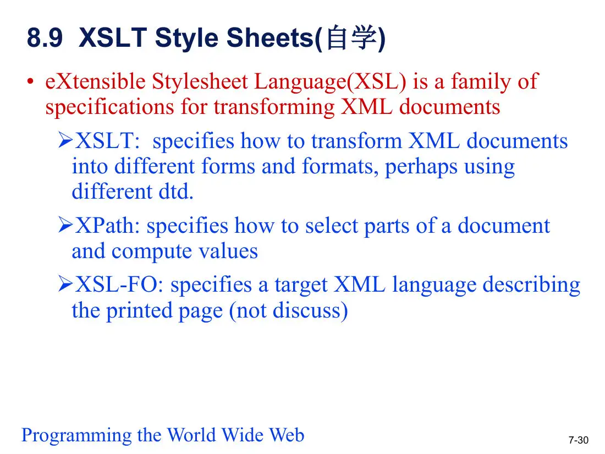

原文：

8.9 XSLT Style Sheets(自学)

\- eXtensible Stylesheet Language(XSL) is a family of specifications for transforming XML documents

XSLT: specifies how to transform XML documents into different forms and formats, perhaps using different dtd.

➢XPath: specifies how to select parts of a document and compute values

XSL-FO: specifies a target XML language describing the printed page (not discuss)

Programming the World Wide Web

7-30

### 8.9 Overview of XSLT

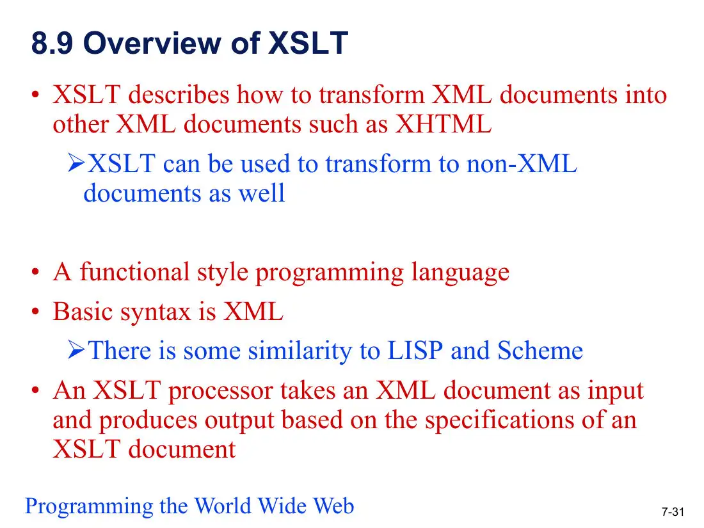

原文：

8.9 Overview of XSLT

\- XSLT describes how to transform XML documents into other XML documents such as XHTML

XSLT can be used to transform to non-XML documents as well

• A functional style programming language

\- Basic syntax is XML

There is some similarity to LISP and Scheme

\- An XSLT processor takes an XML document as input and produces output based on the specifications of an XSLT document

Programming the World Wide Web

7-31

### 8.9 XSLT Processing

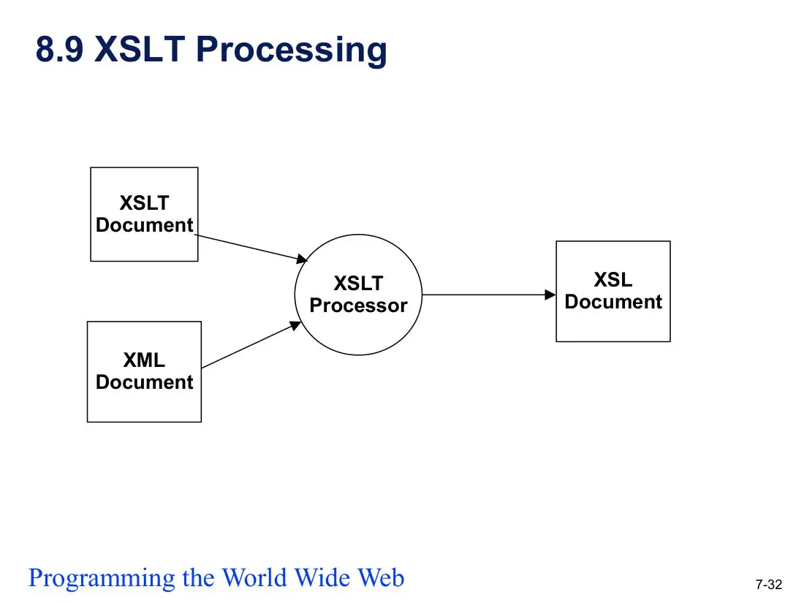

原文：

8.9 XSLT Processing

XML
Document

XSLT
Processor

XSL
Document

Programming the World Wide Web

7-32

### 8.10 XML Processors

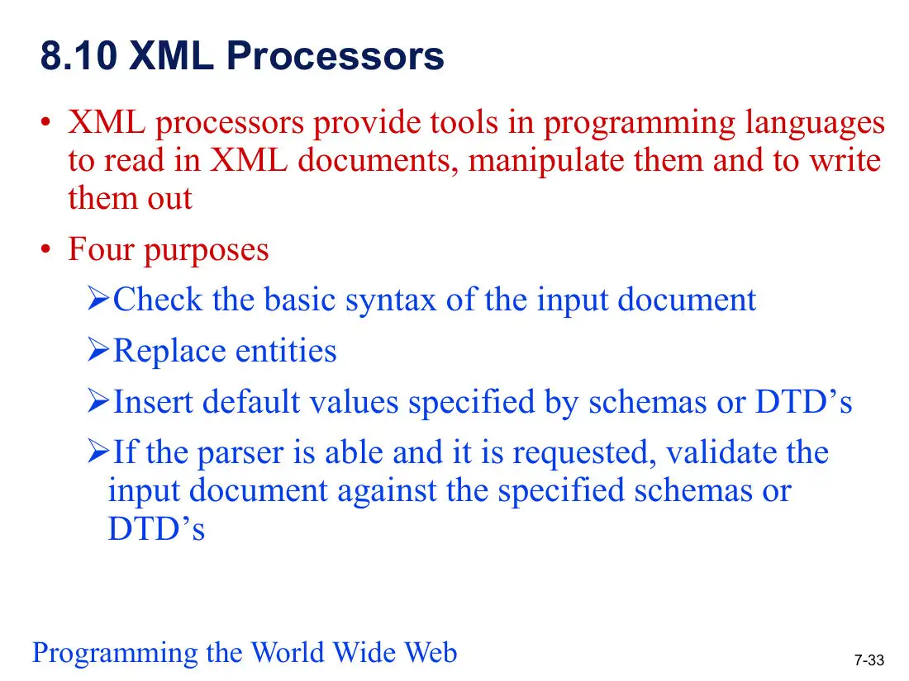

原文：

8.10 XML Processors

\- XML processors provide tools in programming languages to read in XML documents, manipulate them and to write them out

\- Four purposes

▶Check the basic syntax of the input document

Replace entities

Insert default values specified by schemas or DTD's

If the parser is able and it is requested, validate the input document against the specified schemas or DTD's

Programming the World Wide Web

7-33

### 8.10 Purposes of XML Processors

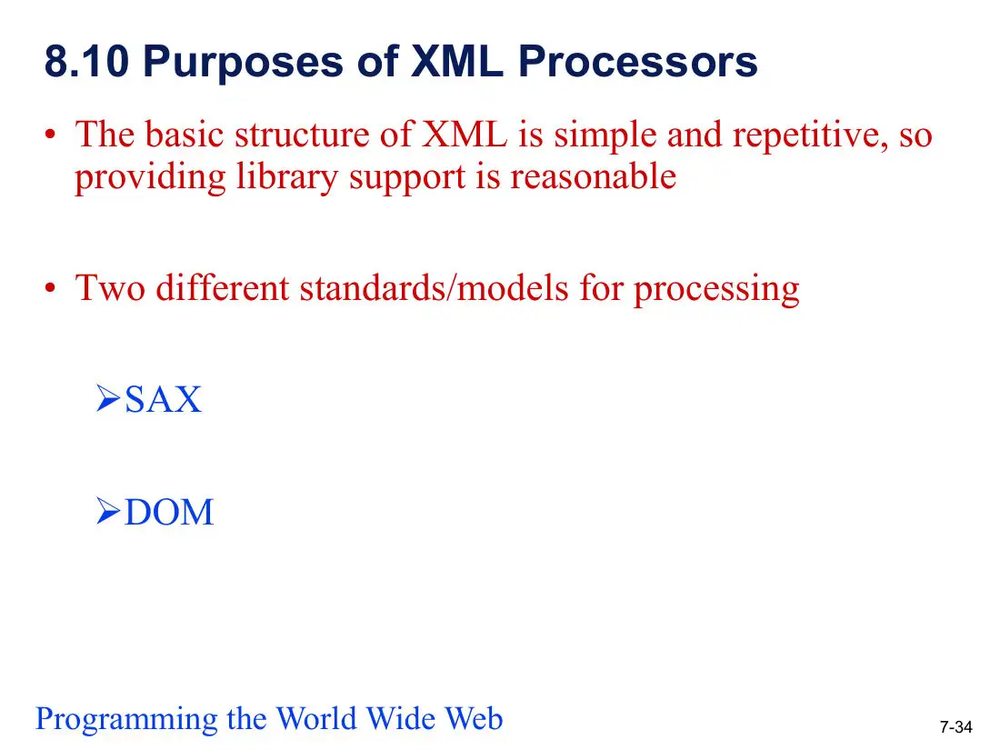

原文：

8.10 Purposes of XML Processors

\- The basic structure of XML is simple and repetitive, so providing library support is reasonable

\- Two different standards/models for processing

SAX

DOM

Programming the World Wide Web

7-34

### 8.10 Parsing

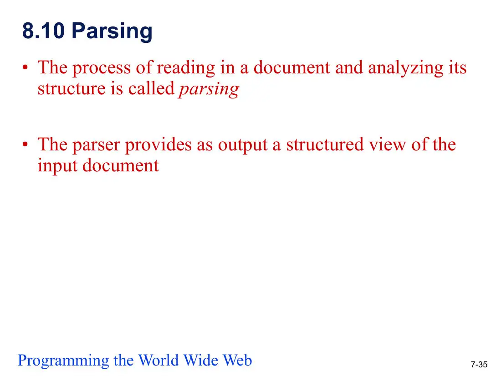

原文：

8.10 Parsing

\- The process of reading in a document and analyzing its structure is called parsing

\- The parser provides as output a structured view of the input document

Programming the World Wide Web

7-35

### 8.10 The SAX Approach

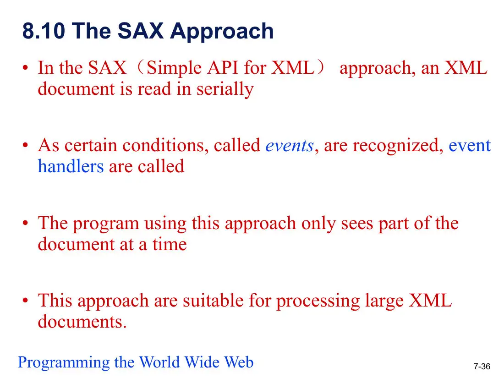

原文：

8.10 The SAX Approach

\- In the SAX (Simple API for XML) approach, an XML document is read in serially

\- As certain conditions, called events, are recognized, event handlers are called

\- The program using this approach only sees part of the document at a time

\- This approach are suitable for processing large XML documents.

Programming the World Wide Web

7-36

### 8.10 The SAX Approach (Example)

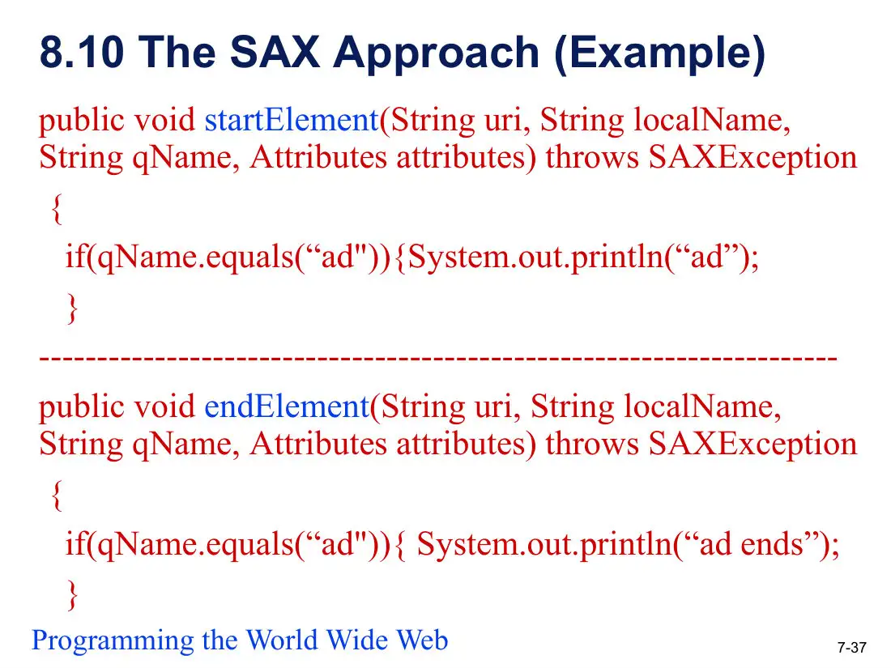

原文：

8.10 The SAX Approach (Example)

### 8.10 The DOM Approach

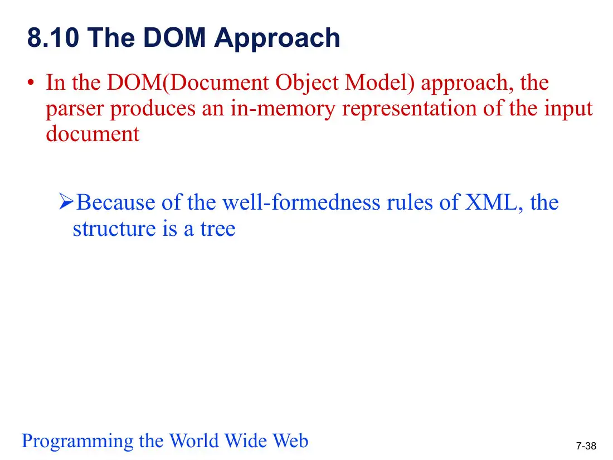

原文：

8.10 The DOM Approach

\- In the DOM(Document Object Model) approach, the parser produces an in-memory representation of the input document

Because of the well-formedness rules of XML, the structure is a tree

Programming the World Wide Web

7-38

### 8.10 The DOM Approach (Example)

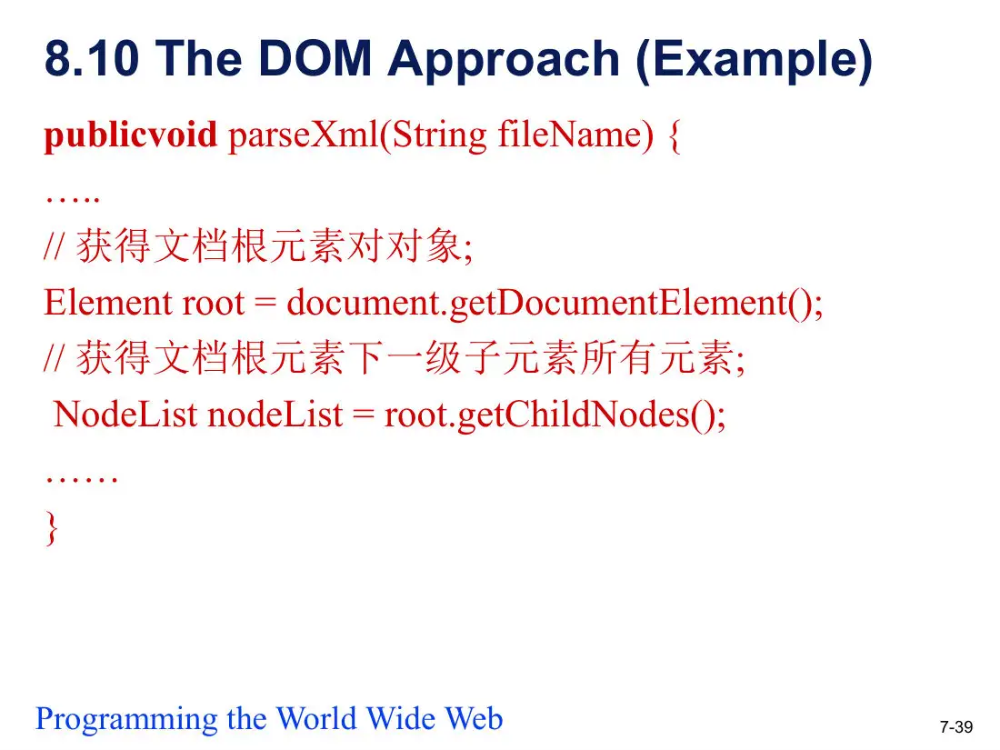

原文：

8.10 The DOM Approach (Example)

Programming the World Wide Web

7-39

### 8.10 The DOM Approach

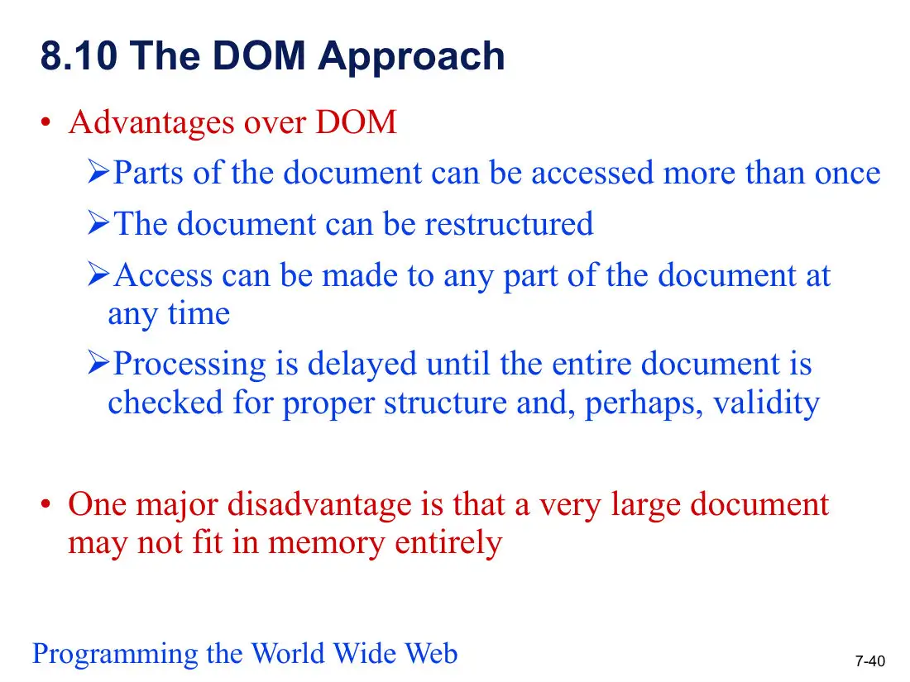

原文：

8.10 The DOM Approach

- Advantages over DOM

Parts of the document can be accessed more than once

The document can be restructured

➢Access can be made to any part of the document at any time

Processing is delayed until the entire document is checked for proper structure and, perhaps, validity

• One major disadvantage is that a very large document may not fit in memory entirely

Programming the World Wide Web

7-40

### • End!

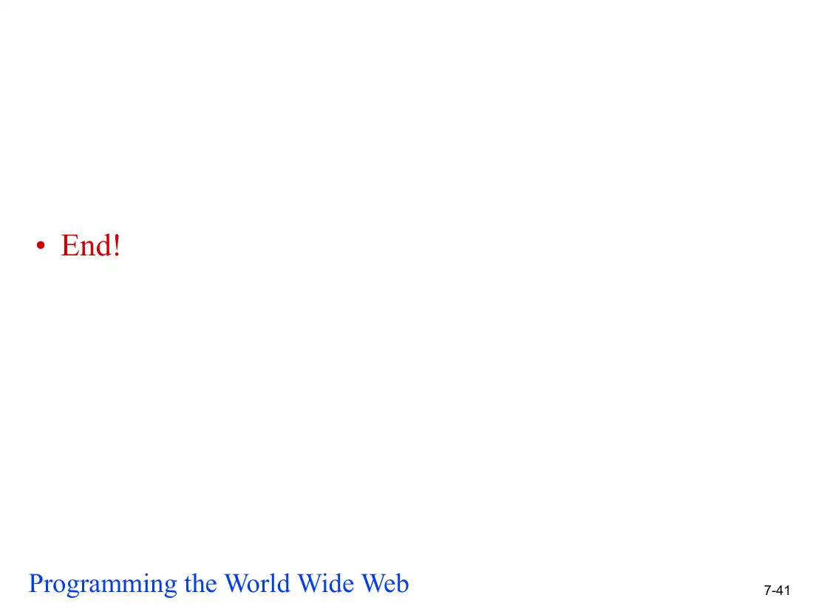

原文：

• End!

Programming the World Wide Web

7-41
