# 《Web技术（双语）》第9章 PHP语言基础（课件）

原件的每一页，下面附识别出的文字。

### Part 6

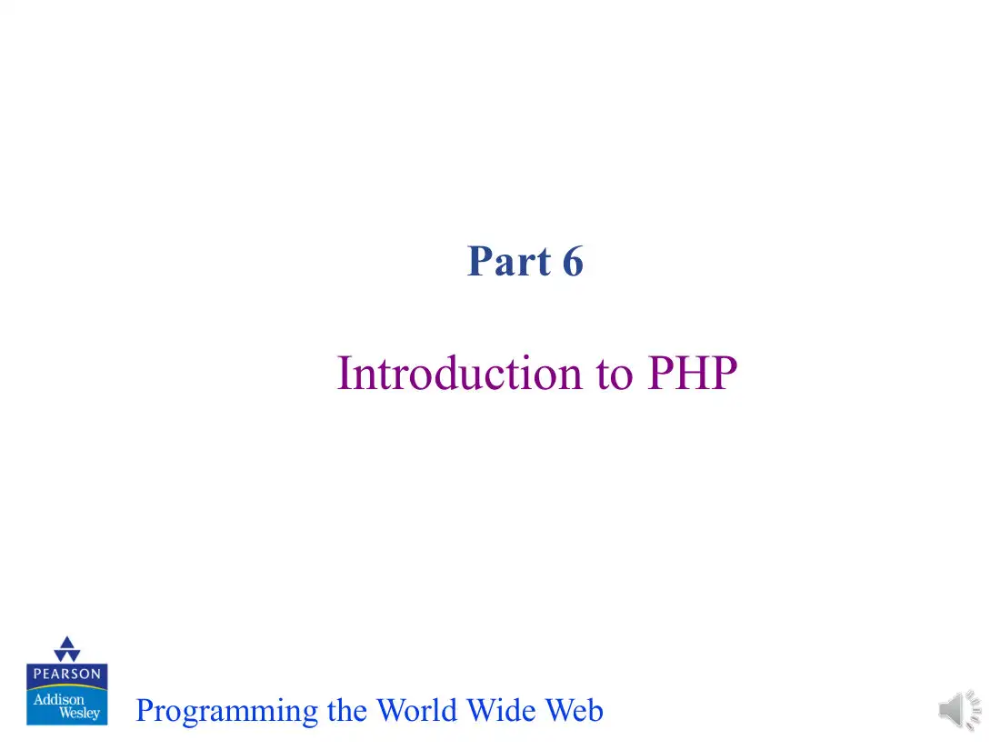

原文：

Part 6

Introduction to PHP

PEARSON Addison Wesley

Programming the World Wide Web

### Contents

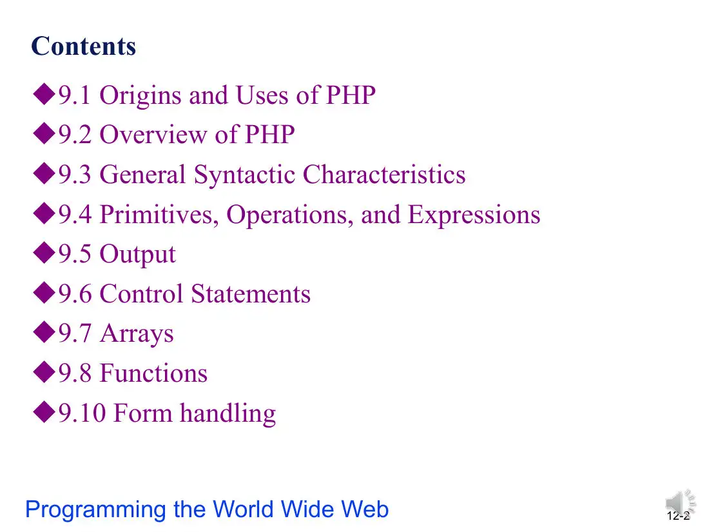

原文：

Contents

◆ 9.1 Origins and Uses of PHP

◆9.2 Overview of PHP

◆9.3 General Syntactic Characteristics

◆9.4 Primitives, Operations, and Expressions

9.5 Output

9.6 Control Statements

◆9.7 Arrays

9.8 Functions

9.10 Form handling

Programming the World Wide Web

### 9.1 Origin and Uses of PHP

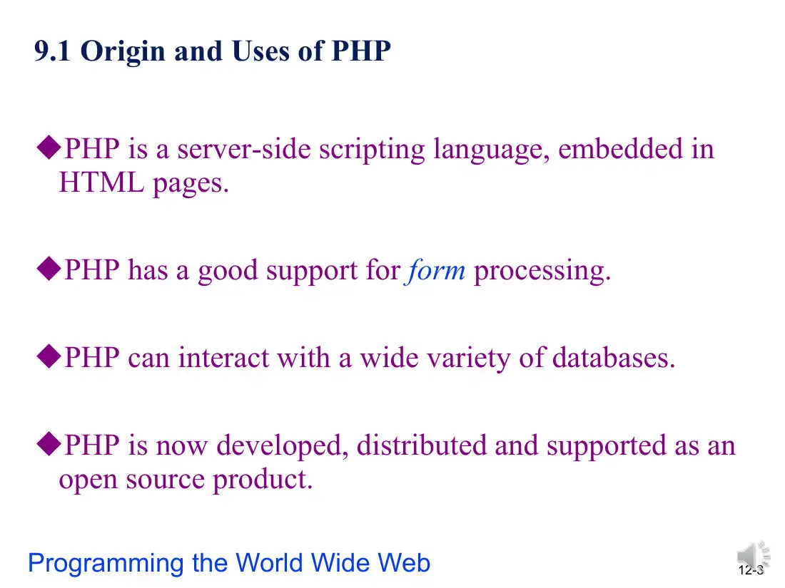

原文：

9.1 Origin and Uses of PHP

◆PHP is a server-side scripting language, embedded in HTML pages.

◆PHP has a good support for form processing.

◆PHP can interact with a wide variety of databases.

◆PHP is now developed, distributed and supported as an open source product.

Programming the World Wide Web

12-3

### 9.2 Overview of PHP

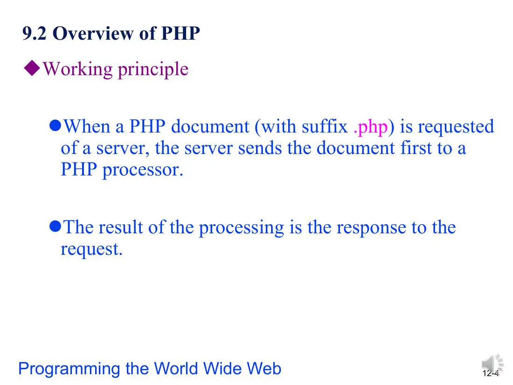

原文：

9.2 Overview of PHP

Working principle

⚫When a PHP document (with suffix .php) is requested of a server, the server sends the document first to a PHP processor.

⚫The result of the processing is the response to the request.

Programming the World Wide Web

12-4

### 9.2 Overview of PHP

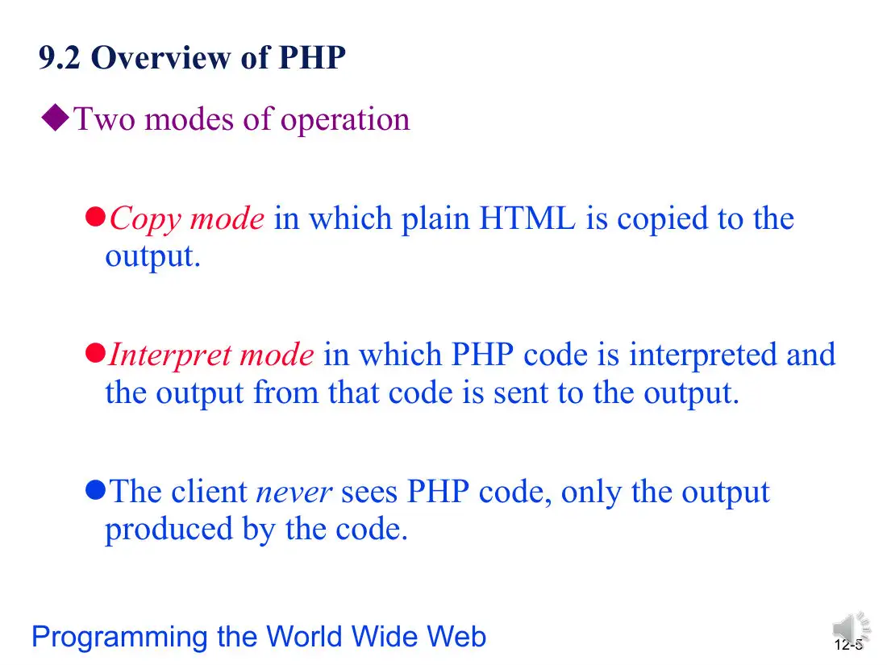

原文：

9.2 Overview of PHP

Two modes of operation

⚫Copy mode in which plain HTML is copied to the output.

⚫Interpret mode in which PHP code is interpreted and the output from that code is sent to the output.

⚫The client never sees PHP code, only the output produced by the code.

Programming the World Wide Web

12-5

### 9.2 Overview of PHP

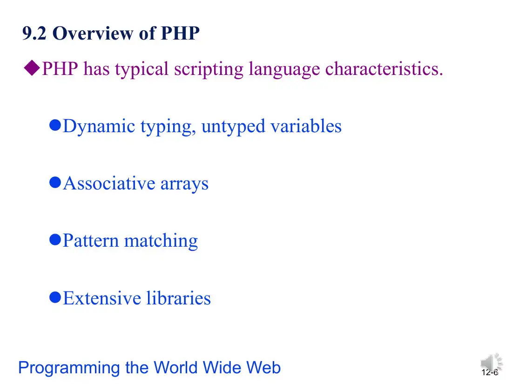

原文：

9.2 Overview of PHP

◆PHP has typical scripting language characteristics.

⚫Dynamic typing, untyped variables

⚫Associative arrays

⚫Pattern matching

⚫Extensive libraries

Programming the World Wide Web

12-6

### 9.3 General Syntactic Characteristics

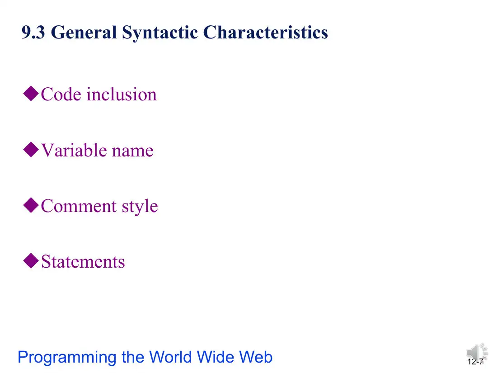

原文：

9.3 General Syntactic Characteristics

Code inclusion

◆Variable name

Comment style

◆Statements

Programming the World Wide Web

12-7

### 9.3 General Syntactic Characteristics

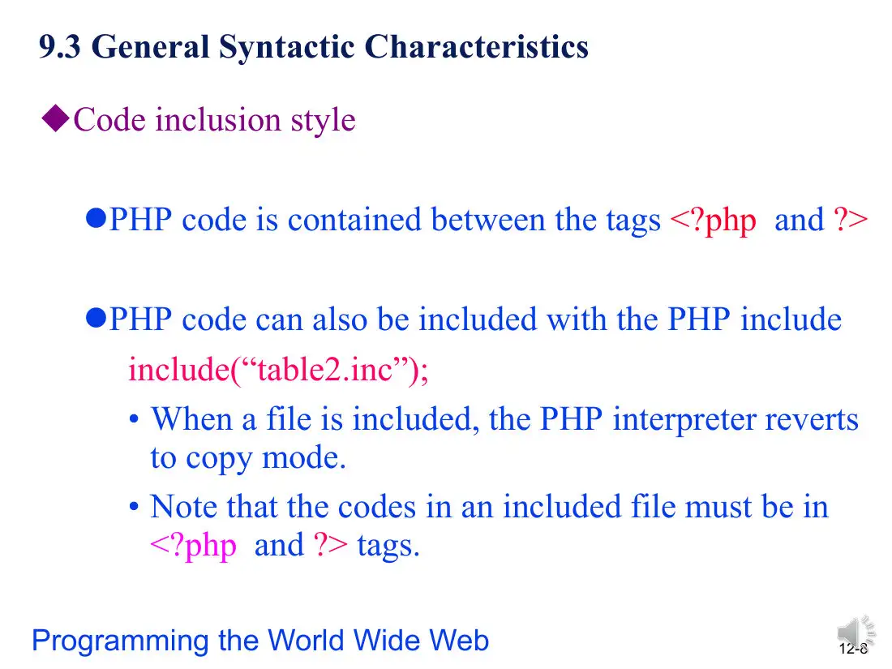

原文：

9.3 General Syntactic Characteristics

Code inclusion style

⚫PHP code is contained between the tags <?php and ?>

⚫PHP code can also be included with the PHP include include(“table2.inc”);

• When a file is included, the PHP interpreter reverts to copy mode.

• Note that the codes in an included file must be in <?php and ?> tags.

Programming the World Wide Web

12-8

### 9.3 General Syntactic Characteristics

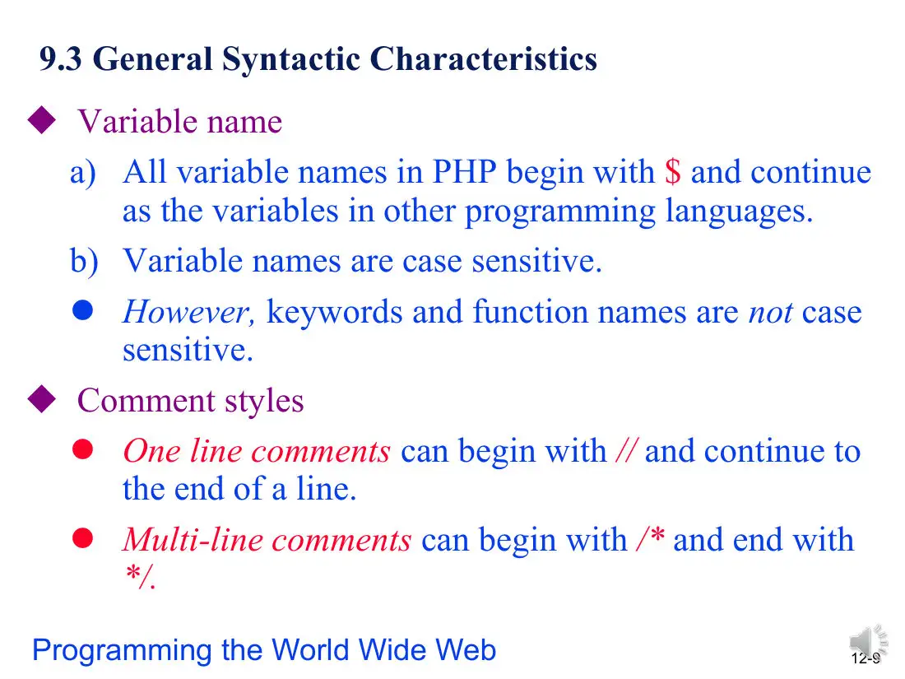

原文：

9.3 General Syntactic Characteristics

◆ Variable name

a) All variable names in PHP begin with \$ and continue as the variables in other programming languages.

b) Variable names are case sensitive.

However, keywords and function names are not case sensitive.

Comment styles

One line comments can begin with // and continue to the end of a line.

Multi-line comments can begin with /\* and end with \*/.

Programming the World Wide Web

### 9.3 General Syntactic Characteristics

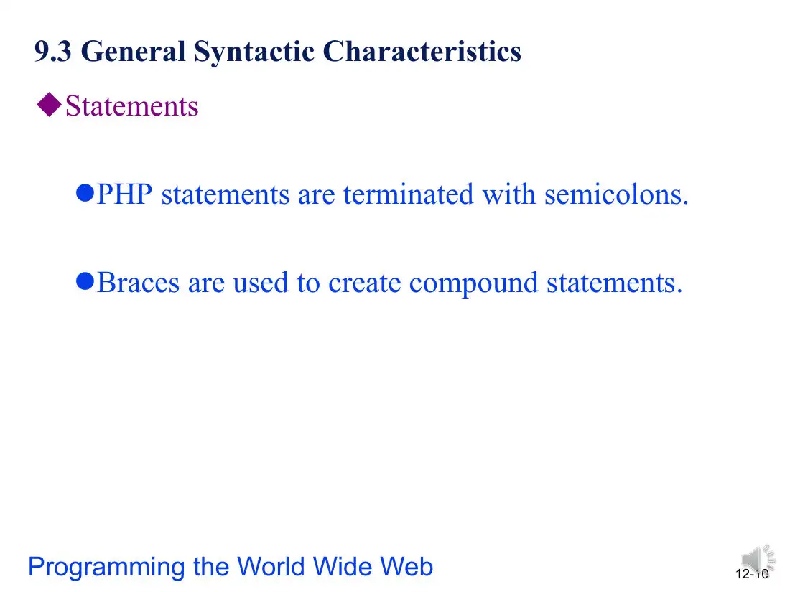

原文：

9.3 General Syntactic Characteristics

◆ Statements

⚫PHP statements are terminated with semicolons.

⚫Braces are used to create compound statements.

Programming the World Wide Web

12-10

### 9.4 Primitives, Operations, Expressions

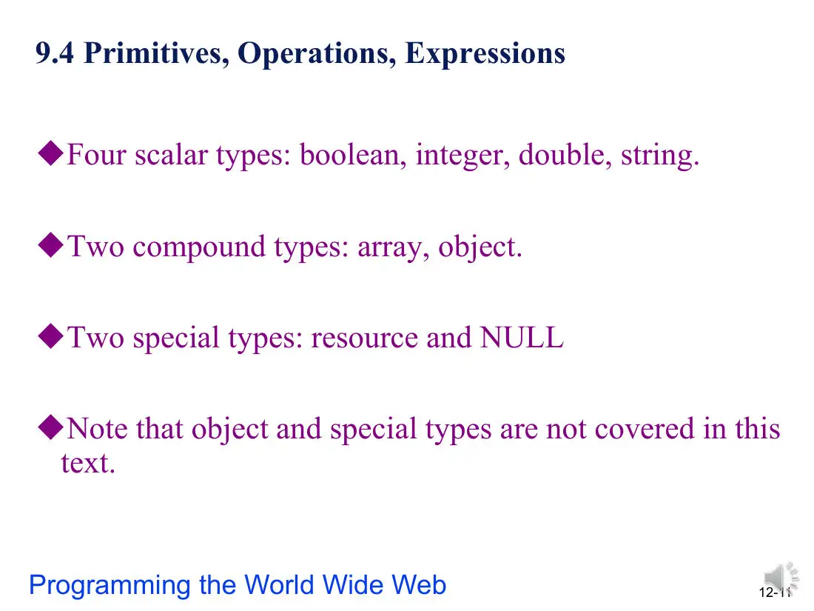

原文：

9.4 Primitives, Operations, Expressions

◆Four scalar types: boolean, integer, double, string.

◆Two compound types: array, object.

◆Two special types: resource and NULL

◆Note that object and special types are not covered in this text.

Programming the World Wide Web

12-11

### 9.4 Primitives, Operations, Expressions

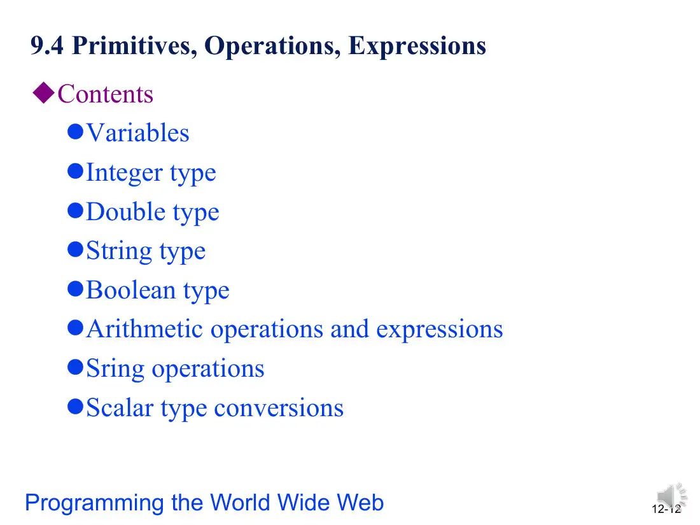

原文：

9.4 Primitives, Operations, Expressions

◆Contents

⚫Variables

⚫Integer type

⚫Double type

⚫String type

⚫Boolean type

⚫Arithmetic operations and expressions

⚫Sring operations

⚫Scalar type conversions

Programming the World Wide Web

12-12

### 9.4.1 Variables

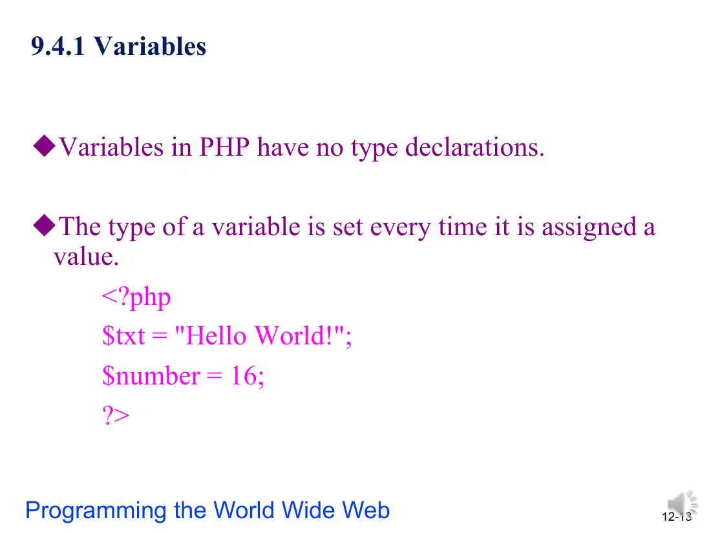

原文：

9.4.1 Variables

◆Variables in PHP have no type declarations.

Programming the World Wide Web

12-13

### 9.4.1 Variables

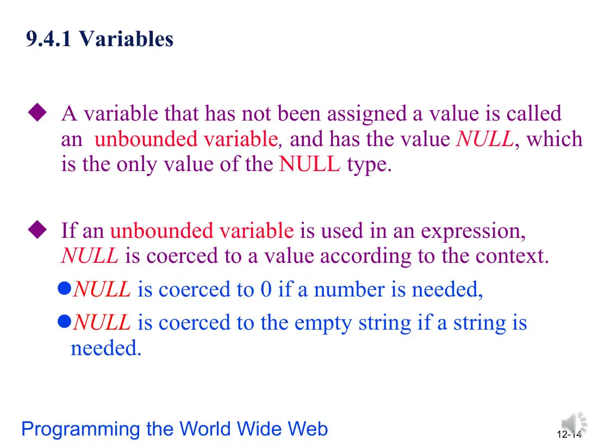

原文：

9.4.1 Variables

A variable that has not been assigned a value is called an unbounded variable, and has the value NULL, which is the only value of the NULL type.

◆ If an unbounded variable is used in an expression, NULL is coerced to a value according to the context.

⚫NULL is coerced to 0 if a number is needed,

⚫NULL is coerced to the empty string if a string is needed.

Programming the World Wide Web

12-14

### 9.4.1 Variables

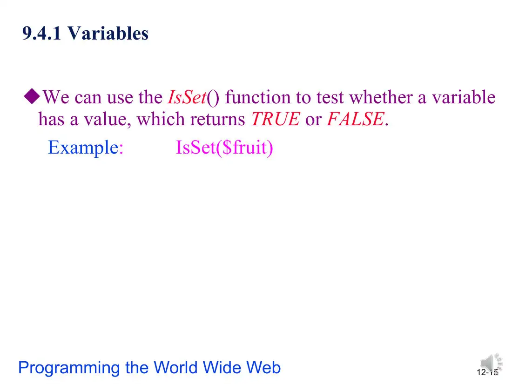

原文：

9.4.1 Variables

We can use the IsSet() function to test whether a variable has a value, which returns TRUE or FALSE.

Example: IsSet(\$fruit)

Programming the World Wide Web

12-15

### 9.4.(2-3) Integer Type and Double Type

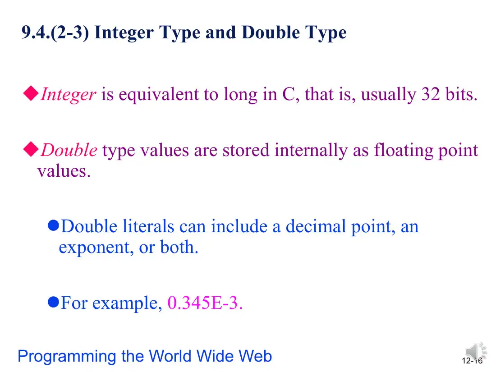

原文：

9.4.(2-3) Integer Type and Double Type

◆Integer is equivalent to long in C, that is, usually 32 bits.

◆Double type values are stored internally as floating point values.

⚫Double literals can include a decimal point, an exponent, or both.

⚫For example, 0.345E-3.

Programming the World Wide Web

12-16

### 9.4.4 String Type

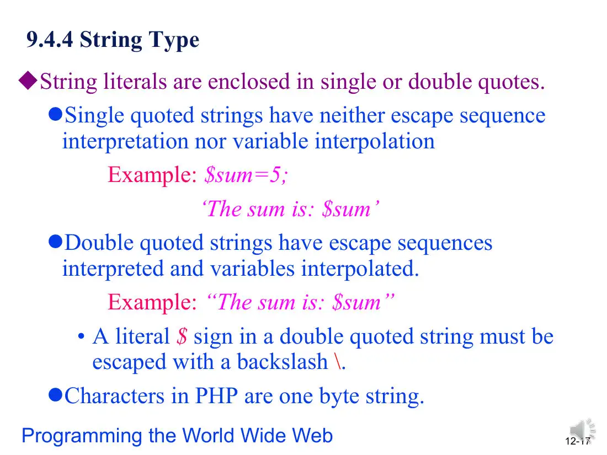

原文：

9.4.4 String Type

◆String literals are enclosed in single or double quotes.

⚫Single quoted strings have neither escape sequence interpretation nor variable interpolation

Example: \$sum=5;

The sum is: \$sum’

⚫Double quoted strings have escape sequences interpreted and variables interpolated.

Example: “The sum is: \$sum”

• A literal \$ sign in a double quoted string must be escaped with a backslash \.

⚫Characters in PHP are one byte string.

Programming the World Wide Web

12-17

### 9.4.5 Boolean Type

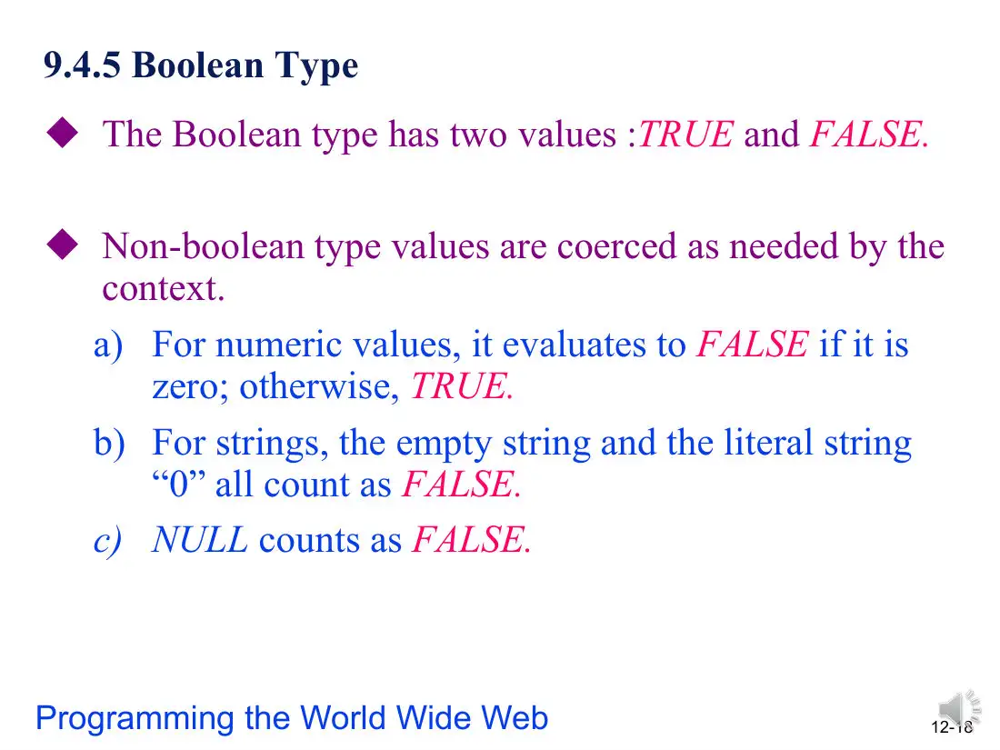

原文：

9.4.5 Boolean Type

The Boolean type has two values :TRUE and FALSE.

Non-boolean type values are coerced as needed by the context.

a) For numeric values, it evaluates to FALSE if it is zero; otherwise, TRUE.

b) For strings, the empty string and the literal string “0” all count as FALSE.

c) NULL counts as FALSE.

Programming the World Wide Web

12-18

### Programming the World Wide Web

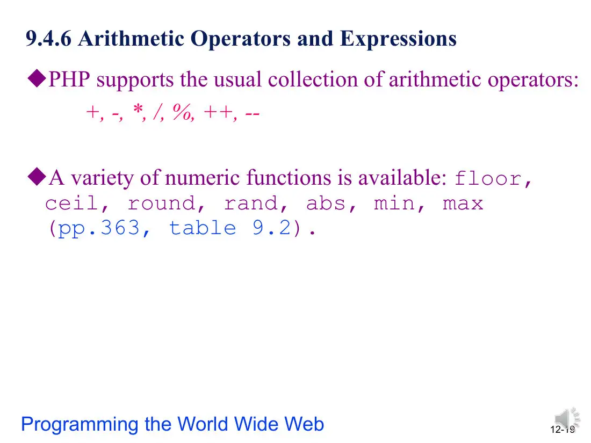

原文：

9.4.6 Arithmetic Operators and Expressions

◆PHP supports the usual collection of arithmetic operators:

A variety of numeric functions is available: floor, ceil, round, rand, abs, min, max (pp.363, table 9.2).

Programming the World Wide Web

12-19

### 9.4.7 String Operations

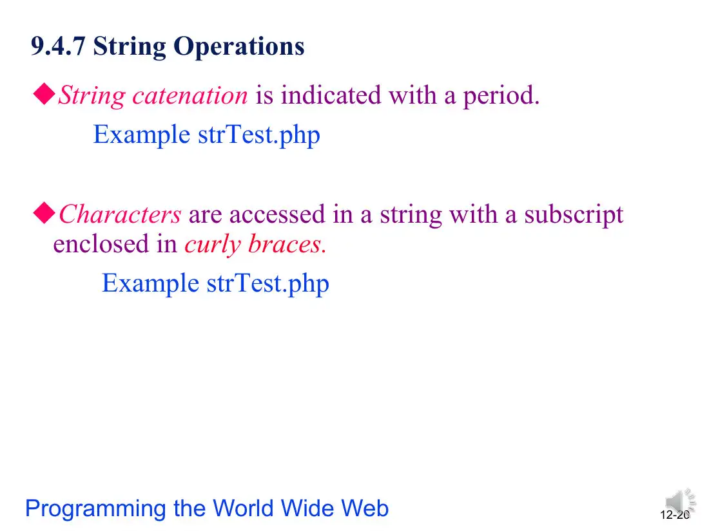

原文：

9.4.7 String Operations

◆String catenation is indicated with a period.

Example strTest.php

Characters are accessed in a string with a subscript enclosed in curly braces.

Example strTest.php

Programming the World Wide Web

12-20

### 9.4.7 String Operations

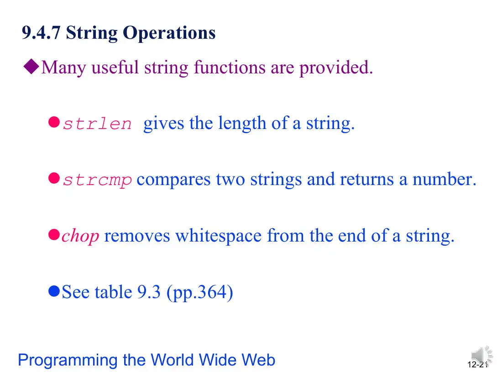

原文：

9.4.7 String Operations

◆Many useful string functions are provided.

⚫strlen gives the length of a string.

⚫strcmp compares two strings and returns a number.

⚫chop removes whitespace from the end of a string.

⚫See table 9.3 (pp.364)

Programming the World Wide Web

12-21

### 9.4.8 Scalar Type Conversions

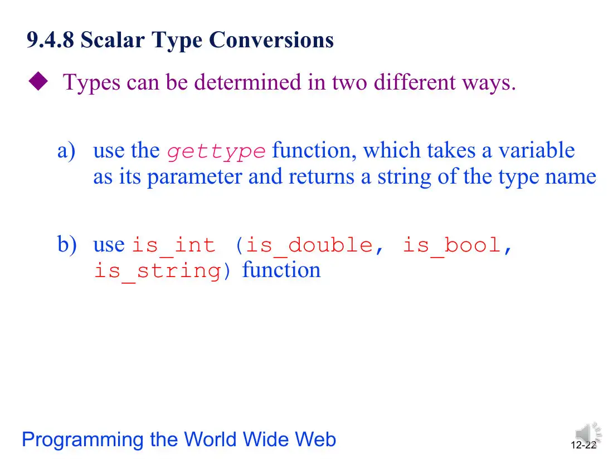

原文：

9.4.8 Scalar Type Conversions

Types can be determined in two different ways.

a) use the gettype function, which takes a variable as its parameter and returns a string of the type name

b) use is\_int (is\_double, is\_bool, is\_string) function

Programming the World Wide Web

12-22

### 9.4.8 Scalar Type Conversions

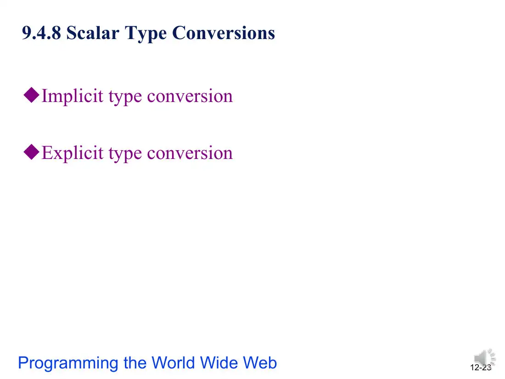

原文：

9.4.8 Scalar Type Conversions

Implicit type conversion

Explicit type conversion

Programming the World Wide Web

12-23

### 9.4.8 Scalar Type Conversions

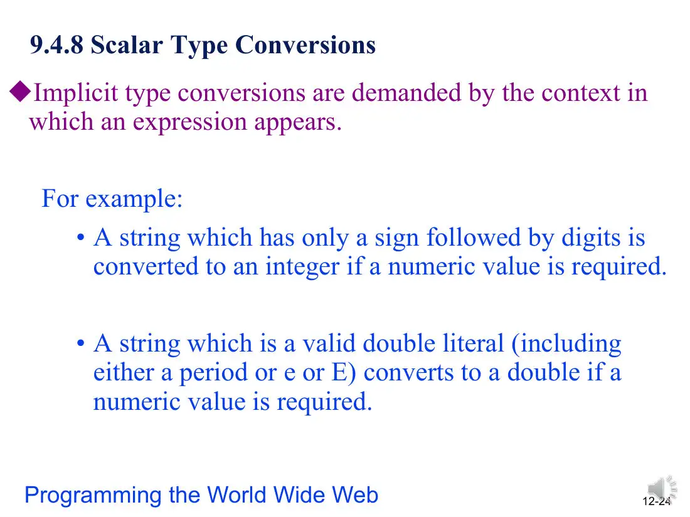

原文：

9.4.8 Scalar Type Conversions

◆Implicit type conversions are demanded by the context in which an expression appears.

For example:

• A string which has only a sign followed by digits is converted to an integer if a numeric value is required.

• A string which is a valid double literal (including either a period or e or E) converts to a double if a numeric value is required.

Programming the World Wide Web

12-24

### 9.4.8 Scalar Type Conversions

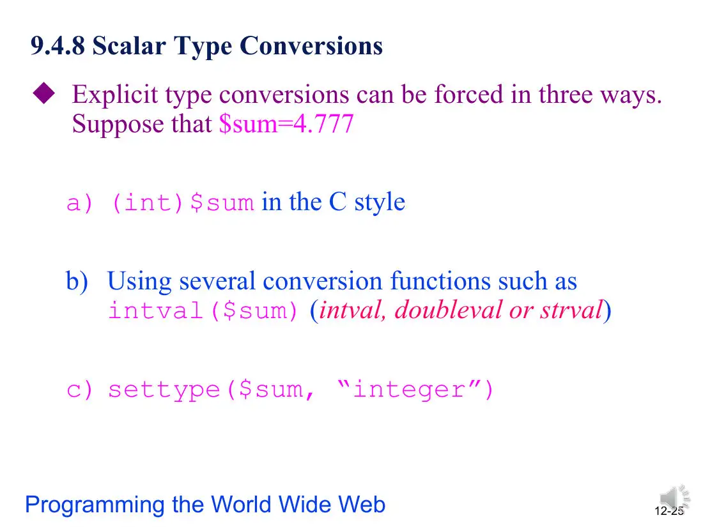

原文：

9.4.8 Scalar Type Conversions

◆ Explicit type conversions can be forced in three ways. Suppose that \$sum=4.777

a) (int)\$sum in the C style

b) Using several conversion functions such as intval(\$sum) (intval, doubleval or strval)

c) settype(\$sum, “integer”)

Programming the World Wide Web

12-25

### 9.4.9 Assignment Operators

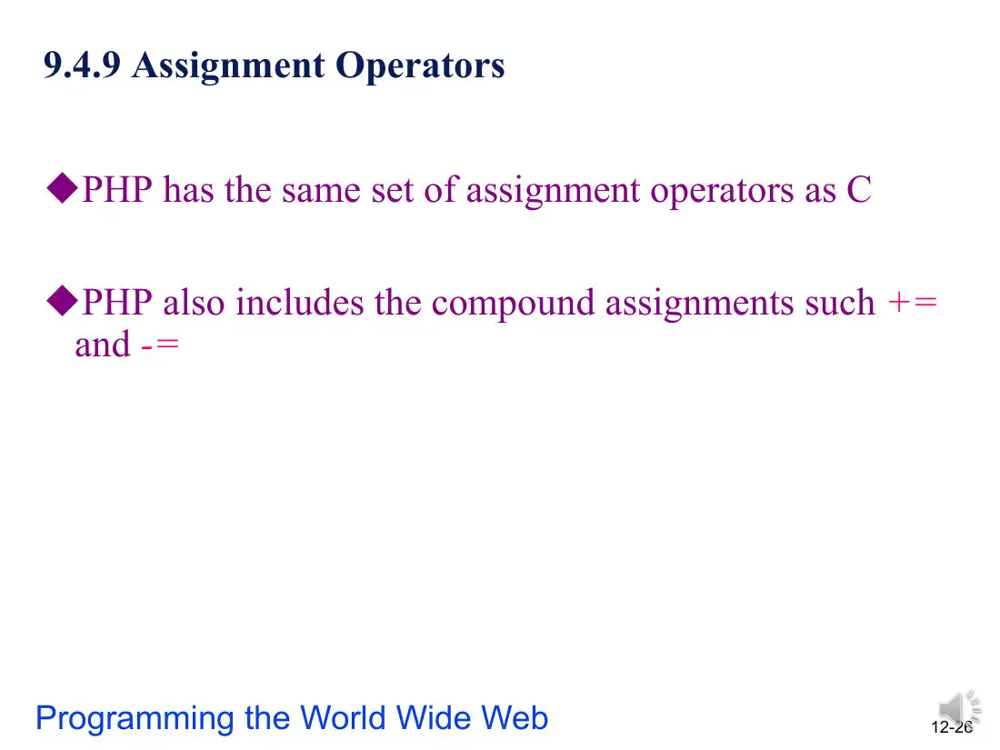

原文：

9.4.9 Assignment Operators

◆PHP has the same set of assignment operators as C

◆PHP also includes the compound assignments such += and -=

Programming the World Wide Web

12-26

### 9.5 Output

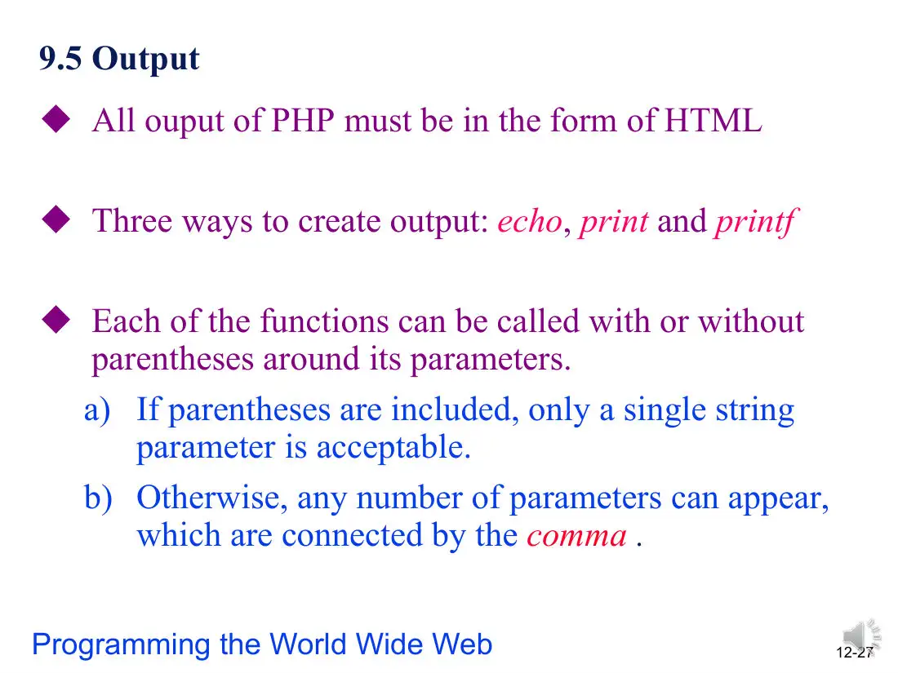

原文：

9.5 Output

◆ All ouput of PHP must be in the form of HTML

Three ways to create output: echo, print and printf

Each of the functions can be called with or without parentheses around its parameters.

a) If parentheses are included, only a single string parameter is acceptable.

b) Otherwise, any number of parameters can appear, which are connected by the comma .

Programming the World Wide Web

12-27

### 9.5 Output

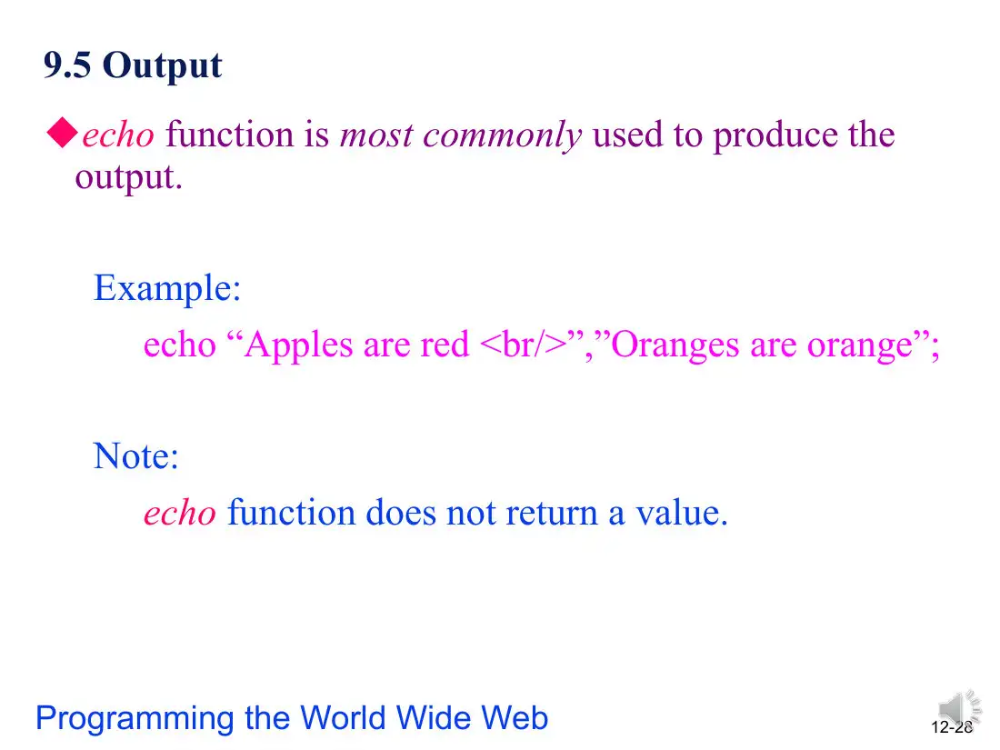

原文：

9.5 Output

◆echo function is most commonly used to produce the output.

Example:

echo “Apples are red  ”,”Oranges are orange”;

Note:

echo function does not return a value.

Programming the World Wide Web

12-28

### 9.5 Output

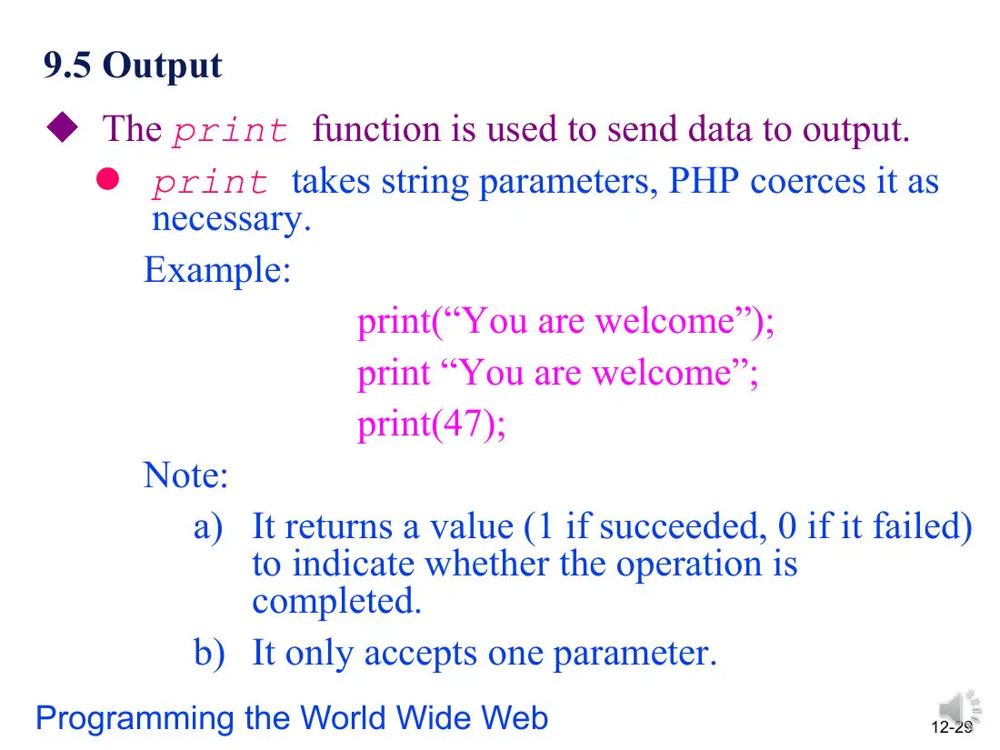

原文：

9.5 Output

The print function is used to send data to output.

print takes string parameters, PHP coerces it as necessary.

Example:

print(“You are welcome”);

print “You are welcome”;

print(47);

Note:

a) It returns a value (1 if succeeded, 0 if it failed) to indicate whether the operation is completed.

b) It only accepts one parameter.

Programming the World Wide Web

12-29

### 9.5 Output

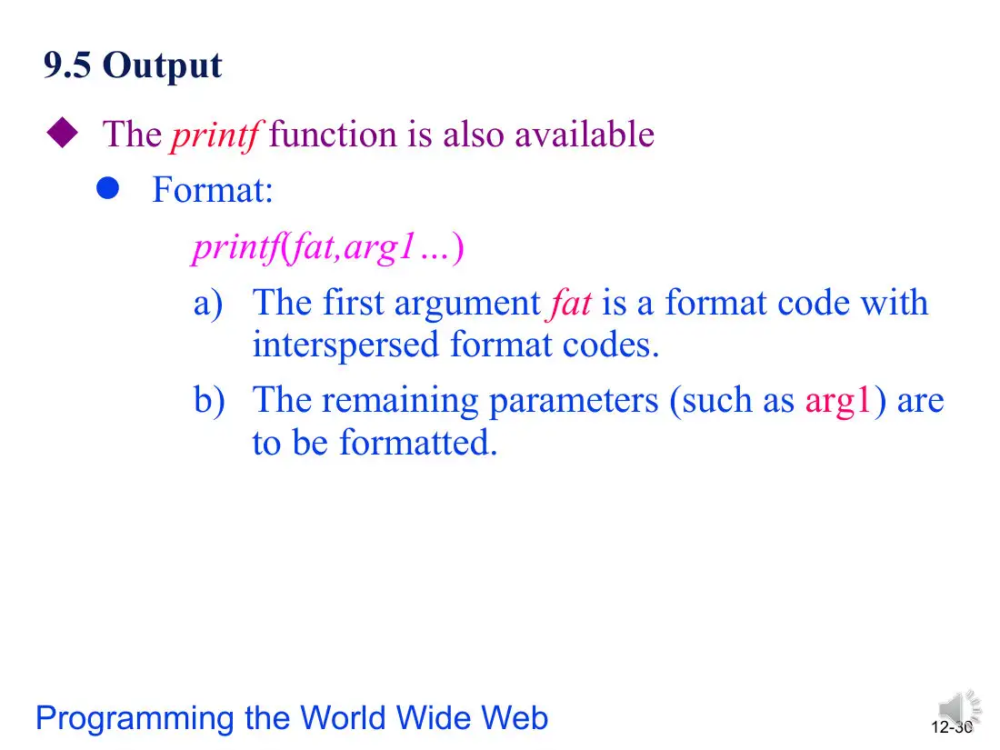

原文：

9.5 Output

◆ The printf function is also available

Format:

printf(fat,arg1…)

a) The first argument fat is a format code with interspersed format codes.

b) The remaining parameters (such as arg1) are to be formatted.

Programming the World Wide Web

12-30

### 9.5 Output

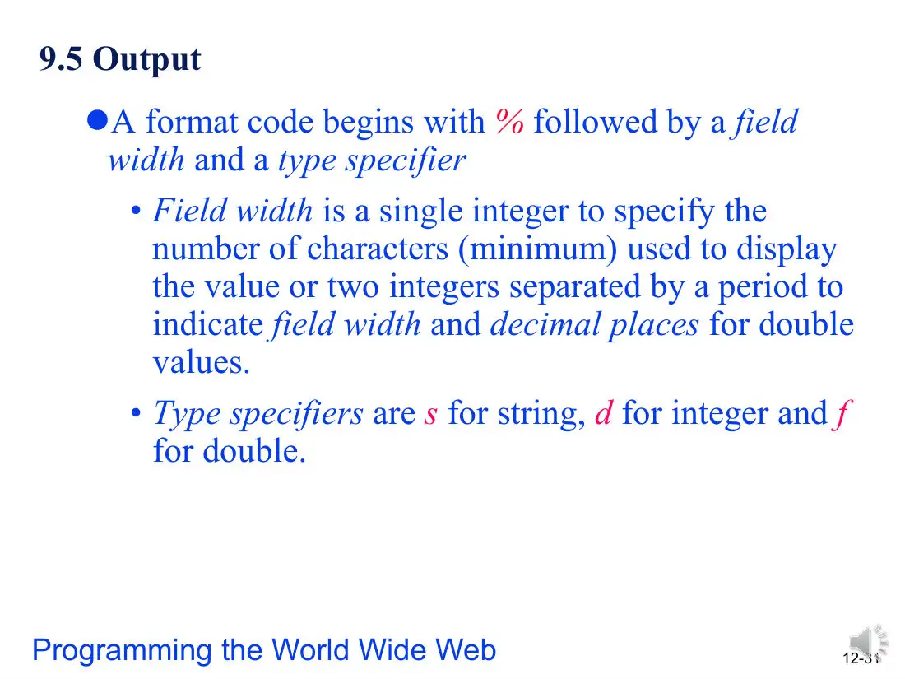

原文：

9.5 Output

⚫A format code begins with % followed by a field width and a type specifier

• Field width is a single integer to specify the number of characters (minimum) used to display the value or two integers separated by a period to indicate field width and decimal places for double values.

Type specifiers are s for string, d for integer and f for double.

Programming the World Wide Web

12-31

### 9.5 Output

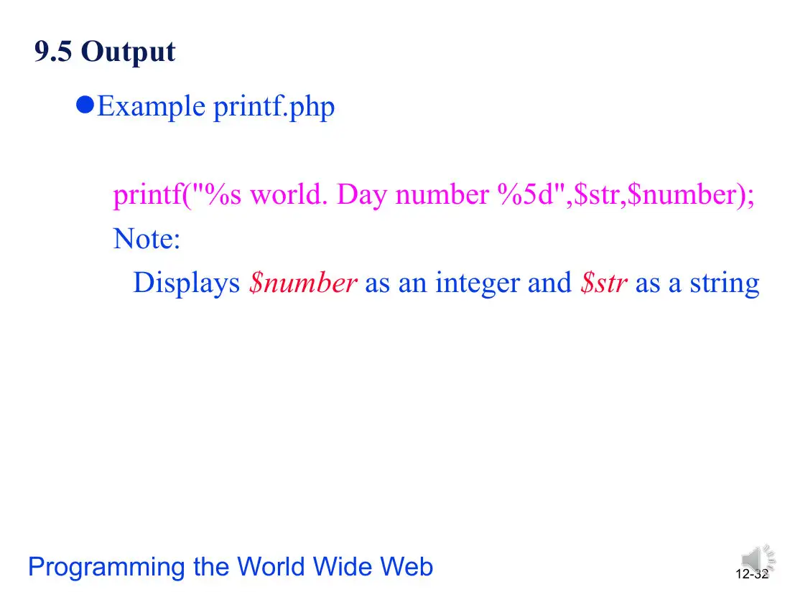

原文：

9.5 Output

⚫Example printf.php

printf("%s world. Day number %5d",\$str,\$number);

Note:

Displays \$number as an integer and \$str as a string

Programming the World Wide Web

12-32

### 9.5 Output

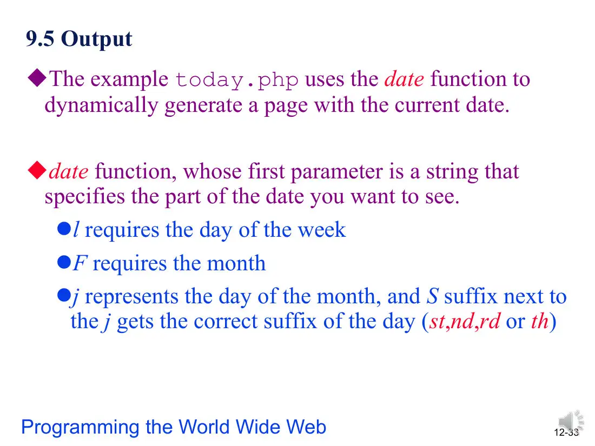

原文：

9.5 Output

The example today.php uses the date function to dynamically generate a page with the current date.

date function, whose first parameter is a string that specifies the part of the date you want to see.

⚫l requires the day of the week

⚫F requires the month

⚫j represents the day of the month, and S suffix next to the j gets the correct suffix of the day (st,nd,rd or th)

Programming the World Wide Web

12-33

### Class exercise

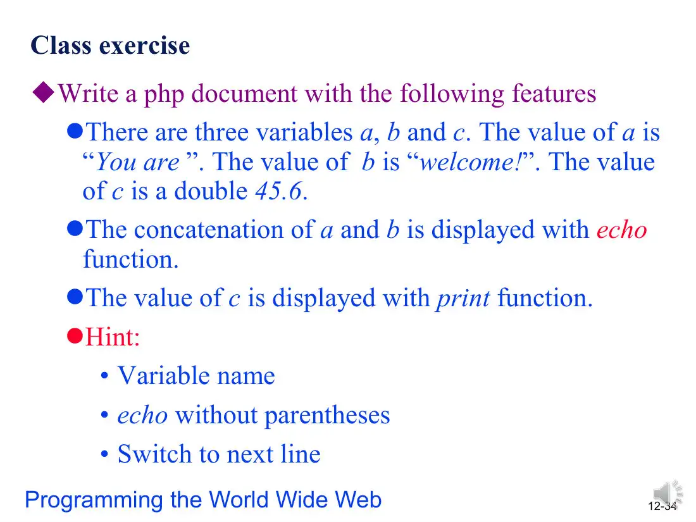

原文：

Class exercise

◆Write a php document with the following features

⚫There are three variables a, b and c. The value of a is “You are ”. The value of b is “welcome!”. The value of c is a double 45.6.

⚫The concatenation of a and b is displayed with echo function.

⚫The value of c is displayed with print function.

⚫Hint:

• Variable name

• echo without parentheses

• Switch to next line

Programming the World Wide Web

12-34

### 9.6 Control Statements

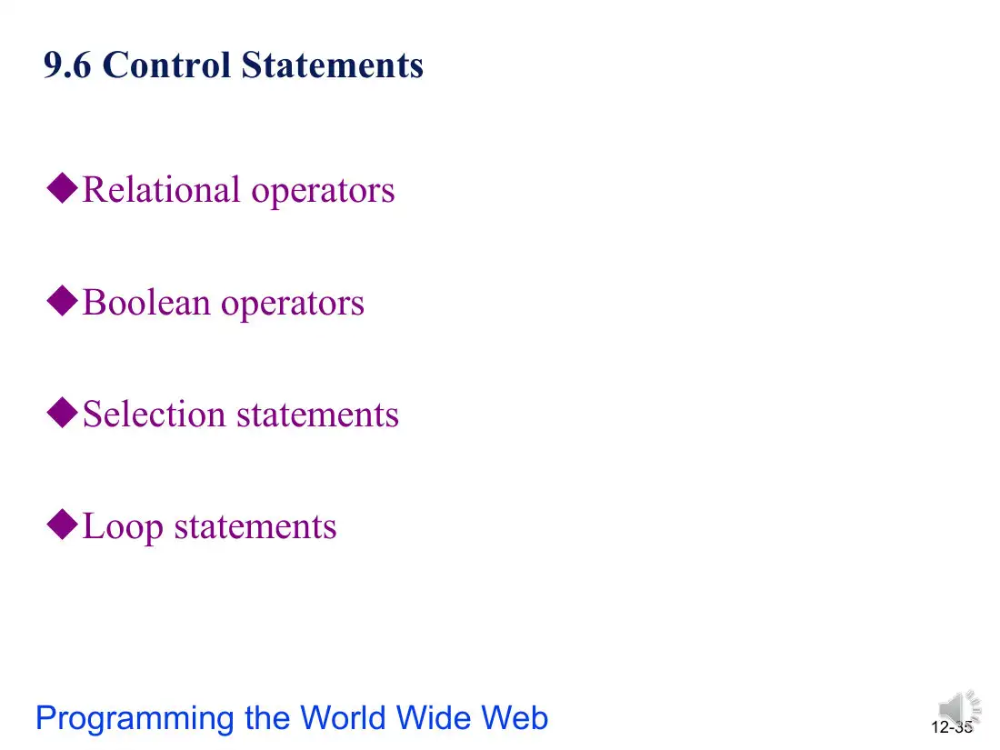

原文：

9.6 Control Statements

Relational operators

◆Boolean operators

◆ Selection statements

Loop statements

Programming the World Wide Web

12-35

### 9.6.1 Relational Operators

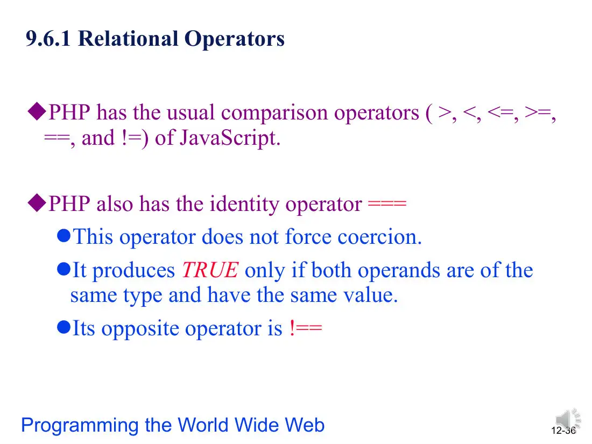

原文：

9.6.1 Relational Operators

◆PHP has the usual comparison operators ( >, <, <=, >=, ==, and !=) of JavaScript.

◆PHP also has the identity operator ===

⚫This operator does not force coercion.

⚫It produces TRUE only if both operands are of the same type and have the same value.

⚫Its opposite operator is !==

Programming the World Wide Web

12-36

### 9.6.2 Boolean Operators

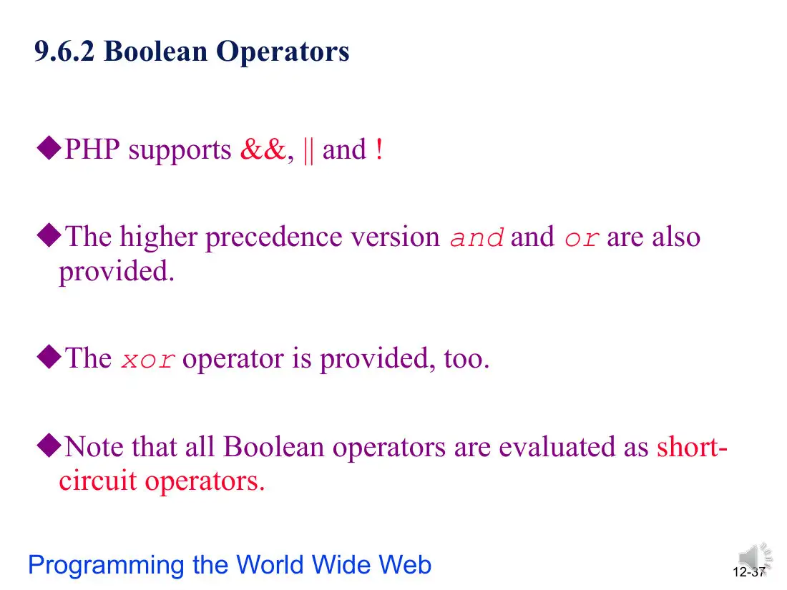

原文：

9.6.2 Boolean Operators

PHP supports &&, || and !

◆The higher precedence version and and or are also provided.

◆The xor operator is provided, too.

◆Note that all Boolean operators are evaluated as shortcircuit operators.

Programming the World Wide Web

12-37

### 9.6.3 Selection Statements

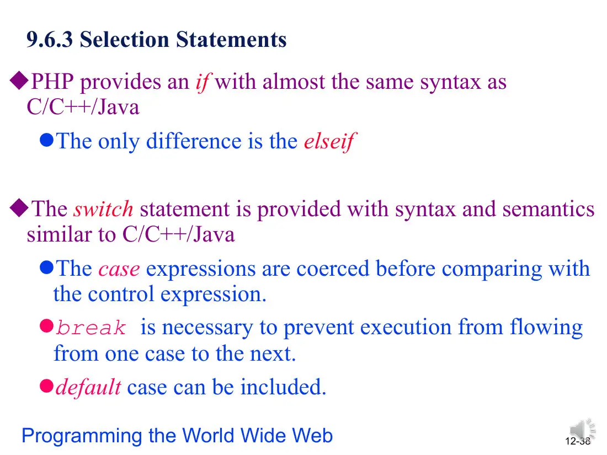

原文：

9.6.3 Selection Statements

PHP provides an if with almost the same syntax as C/C++/Java

⚫The only difference is the elseif

The switch statement is provided with syntax and semantics similar to C/C++/Java

⚫The case expressions are coerced before comparing with the control expression.

⚫break is necessary to prevent execution from flowing from one case to the next.

⚫default case can be included.

Programming the World Wide Web

12-38

### 9.6 Loop Statements

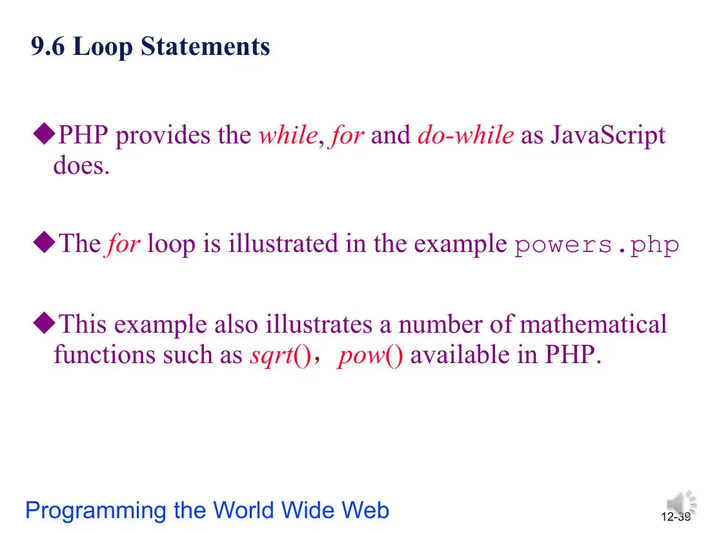

原文：

9.6 Loop Statements

◆PHP provides the while, for and do-while as JavaScript does.

◆The for loop is illustrated in the example powers.php

This example also illustrates a number of mathematical functions such as sqrt()，pow() available in PHP.

Programming the World Wide Web

12-39

### Class exercise

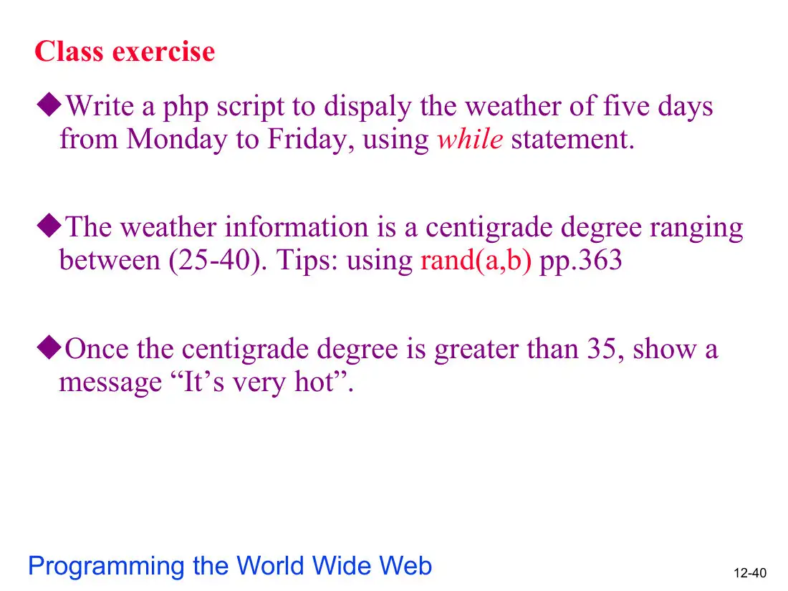

原文：

Class exercise

Write a php script to dispaly the weather of five days from Monday to Friday, using while statement.

The weather information is a centigrade degree ranging between (25-40). Tips: using rand(a,b) pp.363

◆Once the centigrade degree is greater than 35, show a message “It’s very hot”.

Programming the World Wide Web

12-40

### 9.7 Arrays

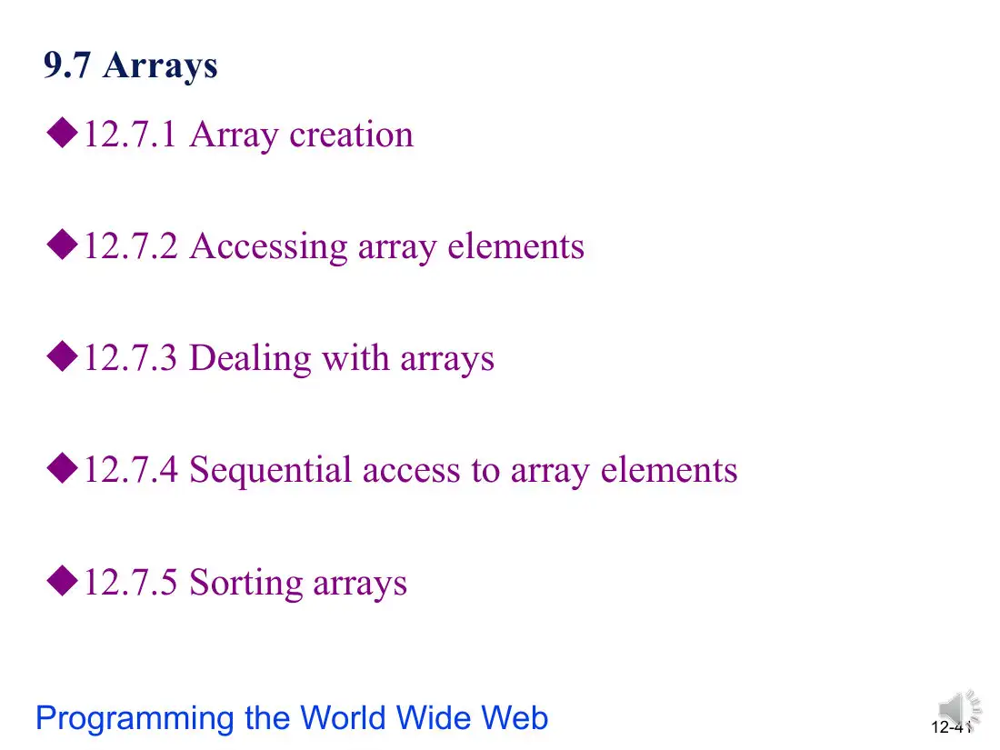

原文：

9.7 Arrays
◆ 12.7.1 Array creation
◆ 12.7.2 Accessing array elements
◆ 12.7.3 Dealing with arrays
◆ 12.7.4 Sequential access to array elements
◆ 12.7.5 Sorting arrays
Programming the World Wide Web

### 9.7 Arrays

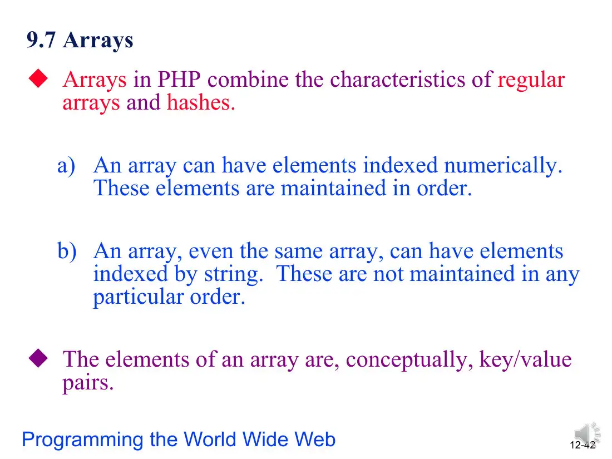

原文：

9.7 Arrays

Arrays in PHP combine the characteristics of regular arrays and hashes.

a) An array can have elements indexed numerically. These elements are maintained in order.

b) An array, even the same array, can have elements indexed by string. These are not maintained in any particular order.

◆ The elements of an array are, conceptually, key/value pairs.

Programming the World Wide Web

12-42

### 9.7.1 Array Creation

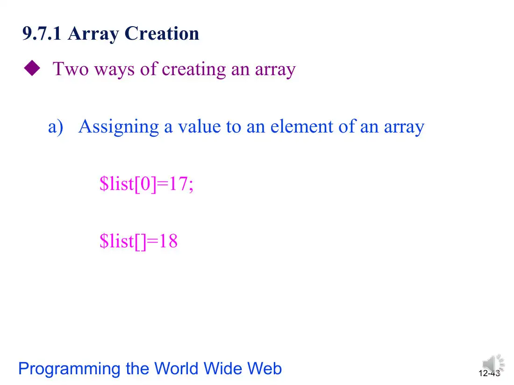

原文：

9.7.1 Array Creation

Two ways of creating an array

a) Assigning a value to an element of an array

\$list[]=18

Programming the World Wide Web

12-43

### 9.7.1 Array Creation

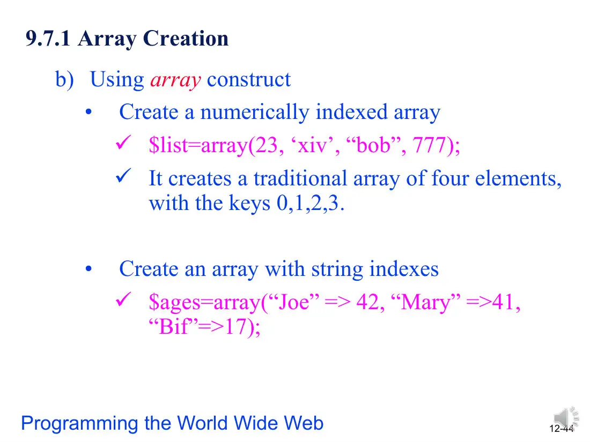

原文：

9.7.1 Array Creation

b) Using array construct

Create a numerically indexed array

✓ \$list=array(23, ‘xiv’, “bob”, 777);

✓ It creates a traditional array of four elements, with the keys 0,1,2,3.

Create an array with string indexes

Programming the World Wide Web

12-44

### 9.7.2 Accessing Array Elements

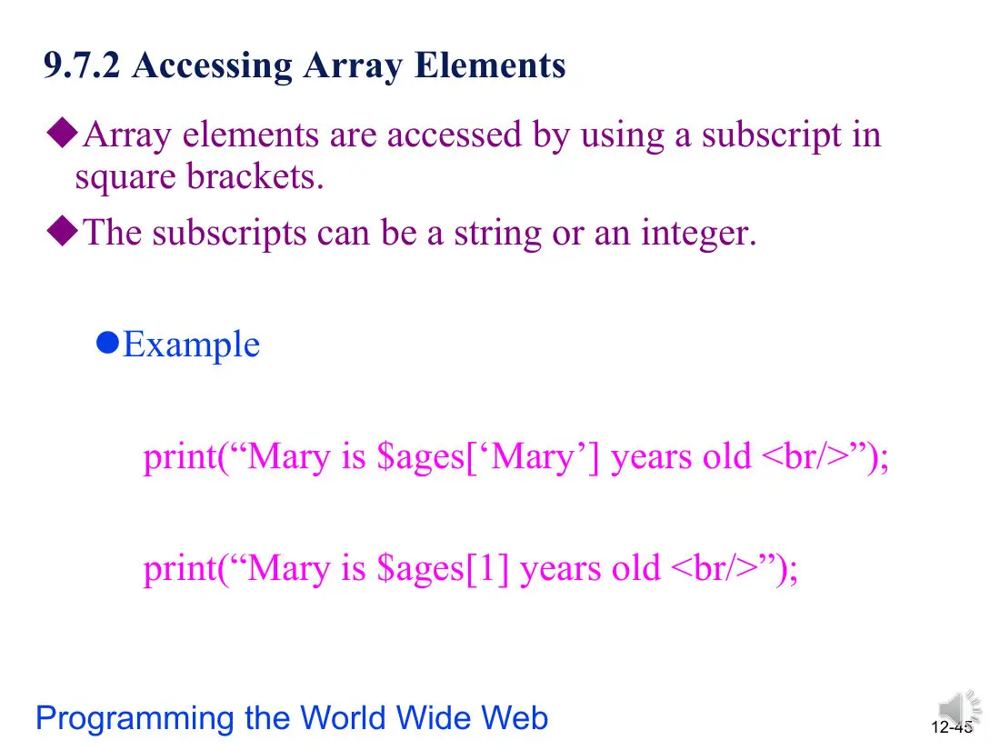

原文：

9.7.2 Accessing Array Elements

◆Array elements are accessed by using a subscript in square brackets.

◆The subscripts can be a string or an integer.

⚫Example

print(“Mary is \$ages[‘Mary’] years old  ”);

print(“Mary is \$ages[1] years old  ”);

Programming the World Wide Web

12-45

### 9.7.2 Accessing Array Elements

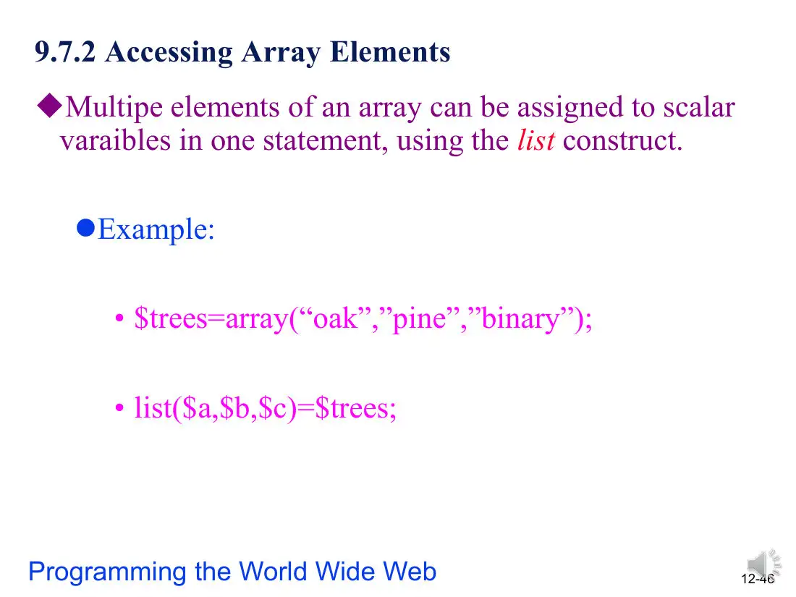

原文：

9.7.2 Accessing Array Elements

Multipe elements of an array can be assigned to scalar varaibles in one statement, using the list construct.

⚫Example:

• \$trees=array(“oak”,”pine”,”binary”);

• list(\$a,\$b,\$c)=\$trees;

Programming the World Wide Web

12-46

### 9.7.2 Accessing Array Elements

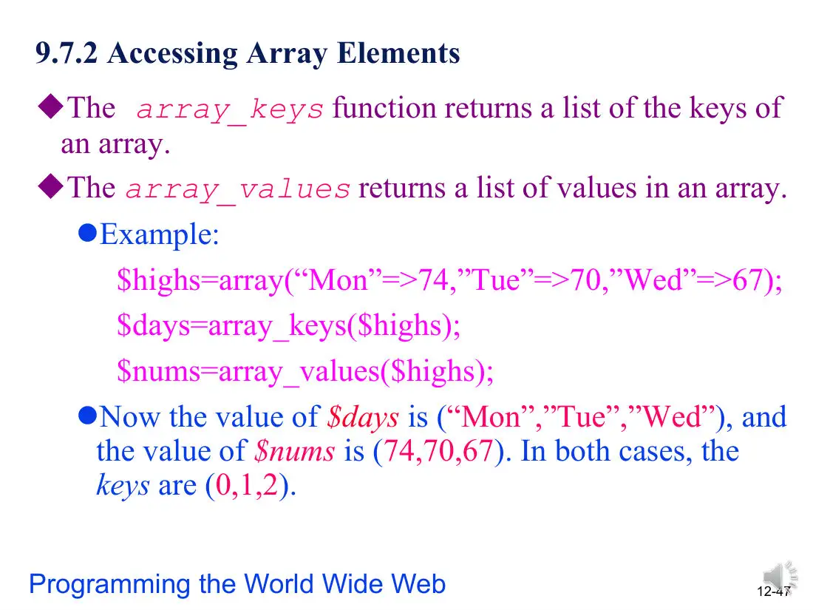

原文：

9.7.2 Accessing Array Elements

◆The array\_keys function returns a list of the keys of an array.

◆The array\_values returns a list of values in an array.

⚫Example:

\$highs=array(“Mon”=>74,”Tue”=>70,”Wed”=>67); \$days=array\_keys(\$highs);

\$nums=array\_values(\$highs);

⚫Now the value of \$days is (“Mon”,”Tue”,”Wed”), and the value of \$nums is (74,70,67). In both cases, the keys are (0,1,2).

Programming the World Wide Web

12-47

### 9.7.3 Functions with Arrays

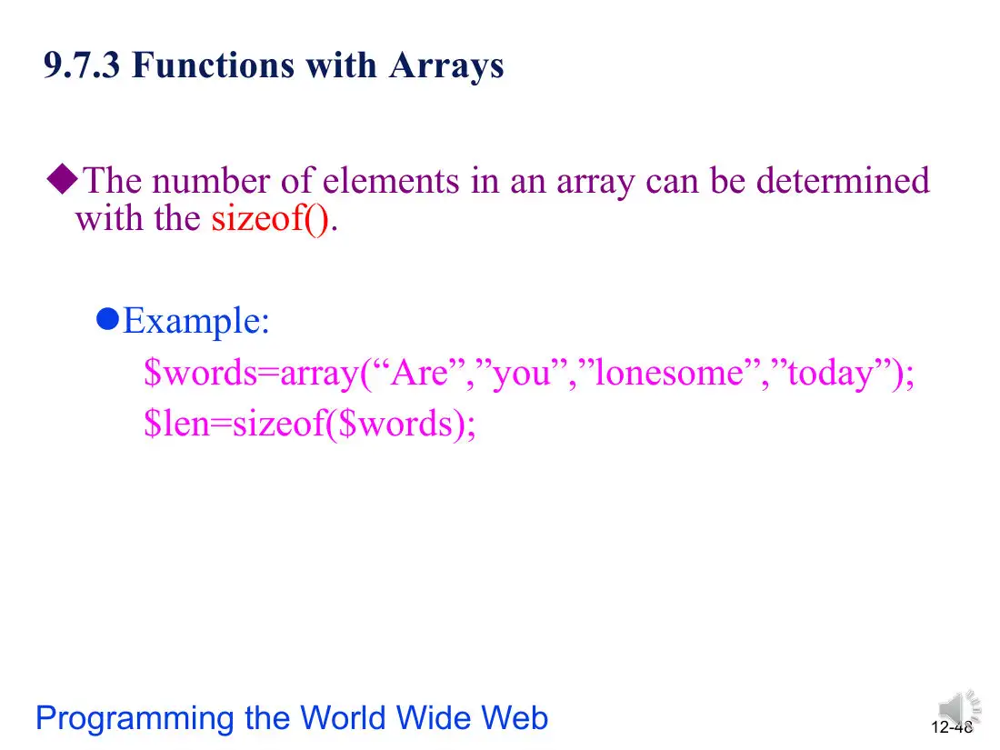

原文：

9.7.3 Functions with Arrays

◆The number of elements in an array can be determined with the sizeof().

⚫Example:

Programming the World Wide Web

12-48

### 9.7.3 Functions with Arrays

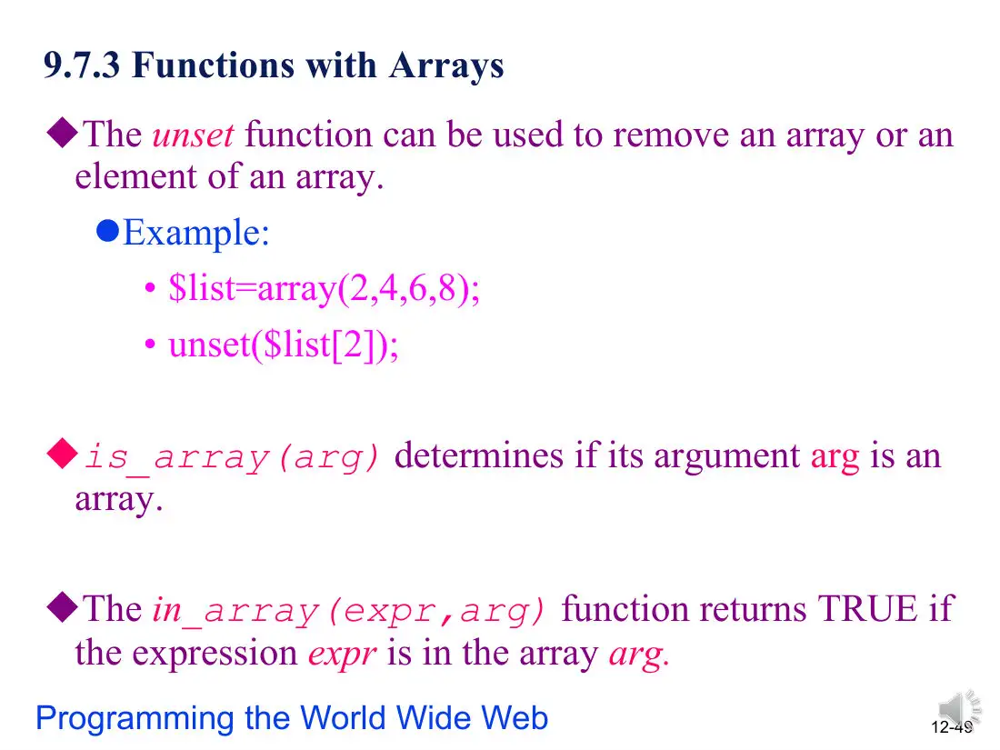

原文：

9.7.3 Functions with Arrays

◆The unset function can be used to remove an array or an element of an array.

⚫Example:

• \$list=array(2,4,6,8);

• unset(\$list[2]);

◆is\_array(arg) determines if its argument arg is an array.

The in\_array(expr,arg) function returns TRUE if the expression expr is in the array arg.

Programming the World Wide Web

12-49

### 9.7.3 Functions with Arrays

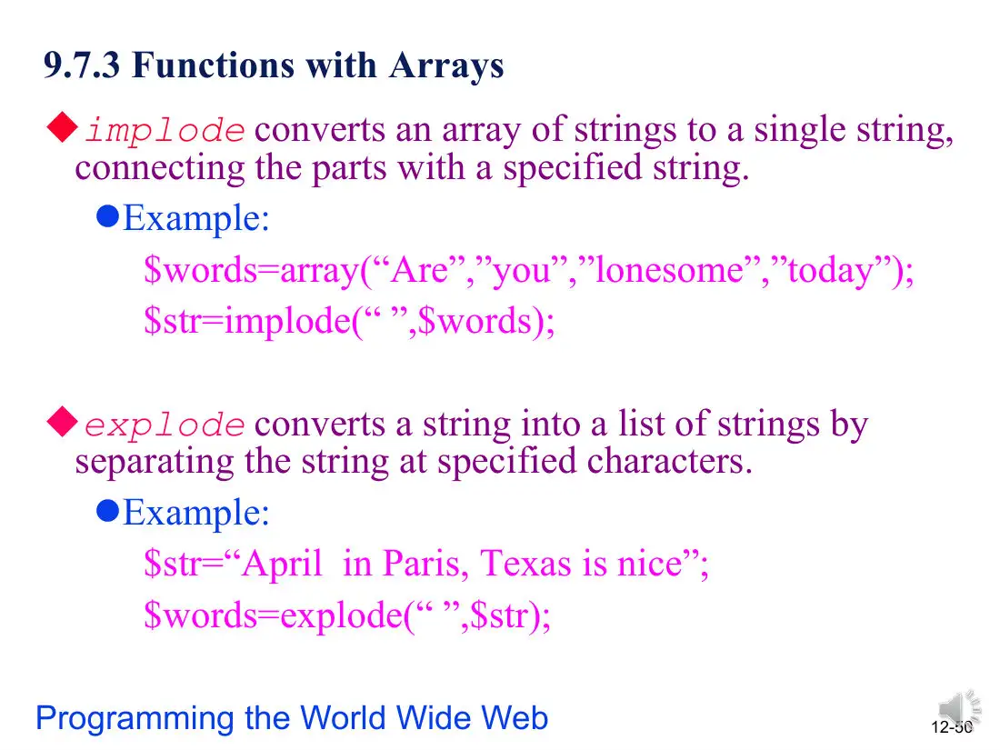

原文：

9.7.3 Functions with Arrays

implode converts an array of strings to a single string, connecting the parts with a specified string.

⚫Example:

explode converts a string into a list of strings by separating the string at specified characters.

⚫Example:

Programming the World Wide Web

12-50

### Programming the World Wide Web

原文：

9.7.4 Sequential Access to Array Elements

Programming the World Wide Web

12-51

### ⚫Example:

原文：

9.7.4 Sequential Access to Array Elements

◆PHP maintains a marker in each array, called the “current” pointer.

⚫The pointer starts at the first element when the array is created.

⚫The element being referred to by the pointer can be obtained by the current() function.

⚫Example:

Programming the World Wide Web

12-52

### Programming the World Wide Web

原文：

9.7.4 Sequential Access to Array Elements

The next function moves the pointer to the next element and returns the value (no key) there.

Programming the World Wide Web

12-53

### 第 54 页

原文：

9.7.4 Sequential Access to Array Elements

The each function returns the key/value pair and moves the pointer to the next element.

⚫The key and value can be accessed using the keys “key” and “value” on the key/value pair.

### Programming the World Wide Web

原文：

9.7.4 Sequential Access to Array Elements

◆Both functions return false if no more elements are available.

prev moves the pointer back towards the beginning of the array by one element.

◆reset moves the pointer to the beginning of the array.

Programming the World Wide Web

12-55

### 9.7.4 Arrays as Stacks

原文：

9.7.4 Arrays as Stacks

PHP provides the array\_push function that appends its arguments to a given array

⚫It takes an array as its first parameter.

⚫After the first parameter, there can be any number of additional parameters.

◆The function array\_pop removes the last element of a given array and returns it

⚫It takes an array as the single parameter.

Programming the World Wide Web

12-56

### 9.7.4 Iterating Through an Array

原文：

9.7.4 Iterating Through an Array

◆The foreach statement has two forms for iterating through an array

foreach (array as scalar\_variable) loop body

foreach (array as key => value) loop body

Programming the World Wide Web

12-57

### 9.7.4 Iterating Through an Array

原文：

9.7.4 Iterating Through an Array

The first version assigns each value in the array to the scalar\_variable in turn.

foreach (\$list as \$temp)

print("\$temp  ");

Programming the World Wide Web

12-58

### 9.7.4 Iterating Through an Array

原文：

9.7.4 Iterating Through an Array

The second version assigns each key to key and the associated value to value in turn.

◆In the following example, each day and temperature is printed.

Programming the World Wide Web

12-59

### 9.7.5 Sorting Arrays

原文：

9.7.5 Sorting Arrays

The sort() function sorts the values in an array and makes a numerically subscripted array from the sorted list.

The function asort() sorts the values in an array but keeps the original key/value association.

◆The function ksort() is similar to asort() but sorts by keys.

◆The example sorting.php illustrates the various sort functions.

Programming the World Wide Web

12-60

### 9.8 Functions

原文：

9.8 Functions

Function syntax function name([parameters]) {

⚫The parameters are optional, but not the parentheses.

⚫Function names are not case sensitive.

⚫A return statement causes the function to immediately terminate and return a value, if any.

Programming the World Wide Web

12-61

### 9.8.2 Parameters

原文：

9.8.2 Parameters

⚫A formal parameter, specified in a function declaration, is simply a variable name.

⚫If more actual parameters are supplied in a call than there are formal parameters, the extra values are ignored.

⚫If more formal parameters are specified than there are actual parameters in a call, the extra formal parameters receive no value.

Programming the World Wide Web

12-62

### 9.8.2 Parameters

原文：

9.8.2 Parameters

PHP defaults to pass by value

⚫Putting an ampersand in front of a formal parameter specifies that pass-by-reference.

⚫Example addone.php

Programming the World Wide Web

12-63

### 9.8.3 The Scope of Variables

原文：

9.8.3 The Scope of Variables

◆A variable defined in a function is, by default, local to the function.

◆A global variable of the same name is not visible in the function.

⚫Example summer.php

Declaring a variable in a function with the global keyword means that the function uses the global variable of that name which is defined outside the function.

⚫Example big\_sum.php

Programming the World Wide Web

12-64

### 9.8.4 Lifetime of Variables

原文：

9.8.4 Lifetime of Variables

The default lifetime of a local variable is from the time the function begins to execute to the time the function returns.

Declaring a variable with the static keyword means that the lifetime is from the first use of the variable to the end of the execution of the entire script.

◆In this way a function can retain some ‘history’.

⚫Example do\_it.php

Programming the World Wide Web

12-65

### 9.10 Form Handling

原文：

9.10 Form Handling

◆The values from forms can be accessed in PHP using the \$\_POST and \$\_GET arrays.

⚫If a form has a text box named “phone” and the form method is POST, the value of the element is available in the PHP script as follows:

• \$\_POST[“phone”]

The popcorn3.html and popcorn3.php implement the popcorn ordering using PHP.

⚫The printf ()function is used to get two decimal places printed for currency values.

Programming the World Wide Web

12-66

### Class practice or homework

原文：

Class practice or homework

Exercises 9 and 10 (pp.399)

Tips:

(1)Please use the sizeof() to get the length of an array .

(2) Please use strcmp() to compare two strings.

Programming the World Wide Web

12-67

### Programming the World Wide Web

原文：

Programming the World Wide Web

12-68
