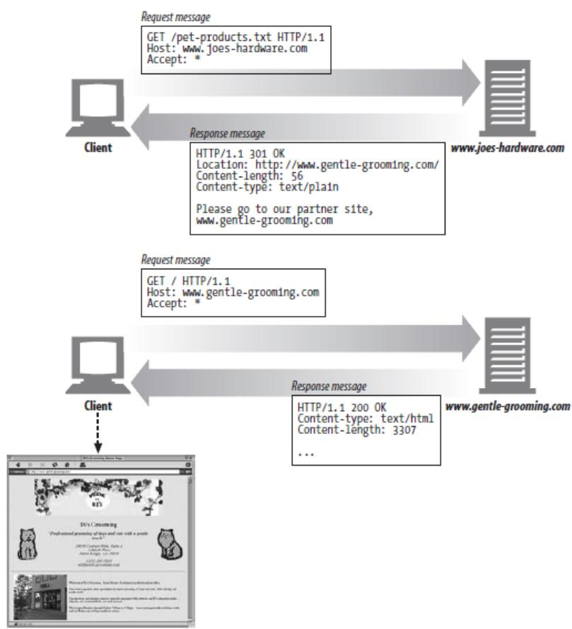

# 《Web技术（双语）》第一单元 基础概念与网络协议作业

原件经识别和整理；“参考解答”是我们补的。

---
title: 《Web技术（双语）》第一单元 基础概念与网络协议作业
kind: 习题
course: Web技术（双语）
term: 2018-2019-2
source: 识别工具读出内容（第 1–4 页）
---

# 《Web技术（双语）》第一单元 基础概念与网络协议作业

本资料为《Web技术（双语）》课程第一单元的习题，包含词汇翻译、IP地址查询、服务器排名、名词解释、端口号填写及URL解析等内容。已去除页眉、页脚、页码及无关标识，整理如下。

## 一、专业词汇翻译

### 选择 1

请写出下列专业词汇对应的中文：

- development
- Internet
- web site
- network
- IP address
- domain name
- name server
- host
- hypertext
- web page
- protocol
- configuration
- proxy server
- identify
- format
- port number
- browser
- path
- partial path
- request
- response
- message
- script
- markup
- tag


## 二、IP地址查询

参考解答：- development：开发  
- Internet：互联网  
- web site：网站  
- network：网络  
- IP address：IP 地址  
- domain name：域名  
- name server：名称服务器 / 域名服务器  
- host：主机  
- hypertext：超文本  
- web page：网页  
- protocol：协议  
- configuration：配置  
- proxy server：代理服务器  
- identify：标识；识别  
- format：格式  
- port number：端口号  
- browser：浏览器  
- path：路径  
- partial path：部分路径  
- request：请求  
- response：响应  
- message：消息  
- script：脚本  
- markup：标记  
- tag：标签

知识点：[IP地址与域名系统（DNS）](../../../topics/Web开发技术/ip-address-dns.md)、[万维网（WWW）的概念及其与Internet的区别](../../../topics/Web开发技术/www-concept.md)、[Web浏览器的工作原理](../../../topics/Web开发技术/web-browsers.md)

### 简答 1

请写下平时使用的笔记本电脑、手机的 IP 地址，并简单说明所用的查询方法。

| | 笔记本 | 手机 |
| :--- | :--- | :--- |
| IP 地址 | | |
| 查询方法 | | |


## 三、Web服务器市场份额排名

参考解答：**结论：** 以下为示例数据（实际值因网络环境而异），需区分内网 IP 与公网 IP。

| | 笔记本（以 Windows 为例） | 手机（以 Android/iOS 为例） |
| :--- | :--- | :--- |
| **IP 地址** | 内网：`192.168.1.105`<br>公网：`203.0.113.45` | 内网：`192.168.1.108`<br>公网：`203.0.113.45` |
| **查询方法** | 内网：命令行输入 `ipconfig`<br>公网：浏览器访问 `ip.cn` 等网站 | 内网：设置 → WLAN → 点击已连接网络查看详情<br>公网：浏览器访问 `ip.cn` 等网站 |

**推理与关键步骤：**

1. **内网 IP（局域网地址）**：由路由器通过 DHCP 分配，通常为 `192.168.x.x`、`10.x.x.x` 或 `172.16.x.x ~ 172.31.x.x` 等私有地址段。
   - **笔记本查询**：打开 CMD / PowerShell / Terminal，执行以下命令并查看 IPv4 Address 字段：
     ```bash
     # Windows
     ipconfig
     # macOS / Linux
     ifconfig   # 或 ip addr
     ```
   - **手机查询**：进入系统 **设置 → Wi-Fi/WLAN → 点击当前连接的 SSID**，在网络详情中直接读取 IP 地址。

2. **公网 IP（广域网地址）**：由运营商（ISP）分配给出口路由器。同一局域网下的笔记本和手机共享同一个公网 IP（经过 NAT 转换）。
   - **通用查询方法**：在任意设备的浏览器中访问提供 IP 回显的 Web 服务，例如：
     - 访问 `https://ip.cn` 或 `https://ifconfig.me`
     - 或在搜索引擎直接搜索“IP”
   - 这些 Web 服务器会读取 HTTP 请求头中的源 IP 并返回给客户端，从而获得公网 IP。

知识点：[IP地址与域名系统（DNS）](../../../topics/Web开发技术/ip-address-dns.md)

### 简答 2

请上网查阅资料，给下列 WEB 服务器的市场占有份额进行排名。（数字越小表示份额越高，填入 1-4）

| web 服务器 | 排名(填入数字 1-4) |
| :--- | :--- |
| IIS | |
| Apache | |
| nginx | |
| GWS (Google Web Server) | |

*注：此处需结合具体年份（如题目所示为2018-2019学年）的市场数据作答，原件未提供标准答案。*


## 四、Web服务器相关名词解释

参考解答：| web 服务器 | 排名(填入数字 1-4) |
| :--- | :--- |
| IIS | 3 |
| Apache | 2 |
| nginx | 1 |
| GWS (Google Web Server) | 4 |

**简要说明：** 根据2018-2019年前后的市场数据（如W3Techs或Netcraft统计），nginx市场份额最高，Apache次之，IIS再次，GWS份额最小。

知识点：[Web服务器操作与常见服务器（Apache、IIS）](../../../topics/Web开发技术/web-servers.md)

### 简答 3

请阅读教材 1.4.2 小节，解释以下名词：

- document root
- Server root
- virtual document tree
- virtual host
- proxy servers
- home page


## 五、应用层协议端口号

参考解答：- **document root**：Web 服务器文件系统中用于存放对外可访问网页文件的顶层目录。它是 URL 路径到服务器本地文件系统路径映射的基准点，所有公开资源的请求都相对于此目录解析。
- **Server root**：Web 服务器软件安装及运行时配置、日志、模块等内部文件的顶层目录。它包含 document root，但还涵盖服务器自身运行所需的非公开资源，是服务器进程的工作根目录。
- **virtual document tree**：通过服务器配置将多个物理目录或不同来源的内容逻辑上组织成一棵统一的文档树。用户通过单一命名空间访问资源，而实际文件可能分散在不同位置，实现内容与物理存储的解耦。
- **virtual host**：在同一台物理服务器上托管多个独立网站的技术，每个站点拥有独立的域名、document root 和配置。服务器根据请求中的 `Host` 头字段区分并路由到对应站点，提高硬件资源利用率。
- **proxy servers**：位于客户端与源服务器之间的中间服务器，代表客户端转发请求并缓存响应。其主要功能包括加速访问、过滤内容、负载均衡及隐藏客户端真实地址，分为正向代理与反向代理两类。
- **home page**：网站的默认入口页面，通常命名为 `index.html` 或类似名称，当用户访问站点根路径时由服务器自动返回。它作为导航起点，提供站点核心信息与链接结构。

知识点：[Web服务器操作与常见服务器（Apache、IIS）](../../../topics/Web开发技术/web-servers.md)、[Internet协议栈与应用层协议端口号](../../../topics/Web开发技术/internet-protocols.md)、[万维网（WWW）的概念及其与Internet的区别](../../../topics/Web开发技术/www-concept.md)

### 填空 1

请写出下列应用层协议对应的端口号：

| 应用层协议 | 端口号 |
| :--- | :--- |
| FTP | |
| HTTP | |
| SMTP | |


## 六、URL结构解析

参考解答：| 应用层协议 | 端口号 |
| :--- | :--- |
| FTP | 21（控制连接），数据连接用 20 |
| HTTP | 80 |
| SMTP | 25 |

**说明**：FTP 的控制端口固定为 21，数据连接默认使用 20；HTTP 默认使用 80 端口；SMTP 默认使用 25 端口。

知识点：[Internet协议栈与应用层协议端口号](../../../topics/Web开发技术/internet-protocols.md)、[统一资源定位符（URL）的结构解析与本地文件URL构建规则](../../../topics/Web开发技术/url-structure.md)

### 简答 4

请观察这个 URL（`HTTP://FOOD.COM:8080/RECIPES/BROCCOLI/`），填写下面的表格：

| 组成部分 | 内容 |
| :--- | :--- |
| scheme (协议) | |
| object-address (对象地址/主机名) | |
| port number (端口号) | |
| FQDN (完全限定域名) | |
| path-to-document (文档路径) | |


## 七、本地文件URL构建

参考解答：| 组成部分 | 内容 |
| :--- | :--- |
| scheme (协议) | `HTTP` |
| object-address (对象地址/主机名) | `FOOD.COM:8080` |
| port number (端口号) | `8080` |
| FQDN (完全限定域名) | `FOOD.COM` |
| path-to-document (文档路径) | `/RECIPES/BROCCOLI/` |

URL 通用语法为 $\text{scheme}://\text{host}:\text{port}/\text{path}$。其中 `HTTP` 为协议标识；`object-address` 指代资源所在服务器位置，包含主机与端口（即 `FOOD.COM:8080`）；端口显式指定为 `8080`；FQDN 仅为主机域名部分 `FOOD.COM`，不含端口；文档路径为第一个 `/` 及其后的层级目录 `/RECIPES/BROCCOLI/`。注意 URL 解析时保留原始大小写（尽管实际访问中 scheme、host、port 通常不区分大小写，但结构拆分题应按字面值填写）。

知识点：[统一资源定位符（URL）的结构解析与本地文件URL构建规则](../../../topics/Web开发技术/url-structure.md)

### 简答 5

请在本地文件系统中随意找一个文件，按照 `FILE://PATH-TO-DOCUMENT` 的格式写出它对应的 URL。


## 八、URL规则与路径

参考解答：**答案：**

```text
file:///home/user/example.txt
```

**简析：**

`file` 协议使用 `file://` 表示本地文件。若文件路径为 `/home/user/example.txt`，则对应 URL 为：


$$
\texttt{file:///home/user/example.txt}
$$


其中 `file://` 后依次为 URL 规定的斜杠、空主机标识和绝对文件路径。

知识点：[统一资源定位符（URL）的结构解析与本地文件URL构建规则](../../../topics/Web开发技术/url-structure.md)

### 简答 6

请阅读教材 1.5.1 和 1.5.2 小节 URL 格式和路径的内容，回答以下问题：

| 问题 | 解答 |
| :--- | :--- |
| 是否任意字符都可以出现在 URL? | |
| 如何判断一个 URL 指向的是目录还是文件? | |
| URL 中的路径是否必须从服务器的文档根路径开始定义? | |


## 九、HTTP交互过程分析（图1）

参考解答：| 问题 | 解答 |
| :--- | :--- |
| 是否任意字符都可以出现在 URL? | 否。URL 只允许使用 ASCII 字符集中的部分安全字符；其他字符（如空格、中文、`/`、`?`、`#` 等保留字符）必须经过百分号编码后才能出现。 |
| 如何判断一个 URL 指向的是目录还是文件? | 通常看路径最后一段是否以 `/` 结尾：以 `/` 结尾指向目录，否则指向文件。但最终由服务器根据资源类型决定，不能仅凭 URL 形式绝对判断。 |
| URL 中的路径是否必须从服务器的文档根路径开始定义? | 否。URL 中的路径是相对于服务器文档根目录的虚拟路径，并不要求与服务器文件系统的真实绝对路径一一对应，也不必须以物理根路径的形式书写。 |

知识点：[统一资源定位符（URL）的结构解析与本地文件URL构建规则](../../../topics/Web开发技术/url-structure.md)

### 简答 7

请观察右图所示 HTTP 交互过程，回答下列问题：



*注：原题在此处提出具体问题，但识别文本中未列出具体子问题。通常此类题目涉及请求方法、状态码、头部信息等。*


## 十、HTTP缓存机制分析（图2）

参考解答：**结论：**

1. **请求方法**：`GET`（用于从服务器获取资源，无请求体）。
2. **状态码**：`200 OK`（请求成功，服务器已返回请求的资源）。
3. **关键头部信息**：
   - **请求报文**：`Host`（指定目标服务器域名）、`User-Agent`（客户端标识）、`Accept`（可接受的响应内容类型）。
   - **响应报文**：`Content-Type`（返回资源的MIME类型，如`text/html`）、`Content-Length`（响应体字节长度）、`Date`（响应生成时间）。
4. **缓存机制**：若响应包含`Cache-Control: max-age=3600`，则客户端可缓存资源1小时；若包含`ETag`或`Last-Modified`，后续请求可通过`If-None-Match`或`If-Modified-Since`实现条件请求，服务器可能返回`304 Not Modified`减少传输。

**推理过程：**

1. **请求报文分析**：
   - 首行格式为`方法 路径 HTTP/版本`，图中若为`GET /index.html HTTP/1.1`，则方法为`GET`，目标资源为`/index.html`。
   - `Host`字段是HTTP/1.1强制要求，用于虚拟主机路由；`User-Agent`标识浏览器类型；`Accept`告知服务器客户端可处理的内容类型。

2. **响应报文分析**：
   - 首行格式为`HTTP/版本 状态码 状态描述`，图中若为`HTTP/1.1 200 OK`，则状态码`200`表示成功。
   - `Content-Type`决定浏览器如何解析响应体（如`text/html`渲染为网页，`application/json`解析为数据）。
   - `Content-Length`或`Transfer-Encoding: chunked`定义响应体长度或分块传输方式。

3. **缓存机制**：
   - **强缓存**：通过`Cache-Control: max-age=秒数`或`Expires`（绝对时间）控制，有效期内直接使用本地缓存，不发送请求。
   - **协商缓存**：通过`ETag`（资源唯一标识）或`Last-Modified`（资源最后修改时间）实现。客户端后续请求携带`If-None-Match`（对应ETag）或`If-Modified-Since`（对应Last-Modified），若资源未修改，服务器返回`304 Not Modified`，客户端使用缓存。
   - 若响应无缓存头部，默认每次请求均需从服务器获取完整资源。

知识点：[HTTP请求阶段（GET方法、常见请求字段）](../../../topics/Web开发技术/http-request.md)、[HTTP响应（状态码如200 OK、常见响应字段、缓存机制）](../../../topics/Web开发技术/http-response-cache.md)

### 简答 8

请观察下图所示 HTTP 交互过程，回答问题：服务器端的 HTTP 响应有无返回客户端请求的资源？


参考解答：根据图片替代文字 "Browser displays local copy, since the original has not changed since we last requested it." 可知，浏览器显示的是本地副本，因为自上次请求以来原始资源未发生变化。这通常对应 HTTP 状态码 304 Not Modified，此时服务器**没有**返回完整的资源正文，而是告知客户端可以使用缓存。

知识点：[HTTP响应（状态码如200 OK、常见响应字段、缓存机制）](../../../topics/Web开发技术/http-response-cache.md)
