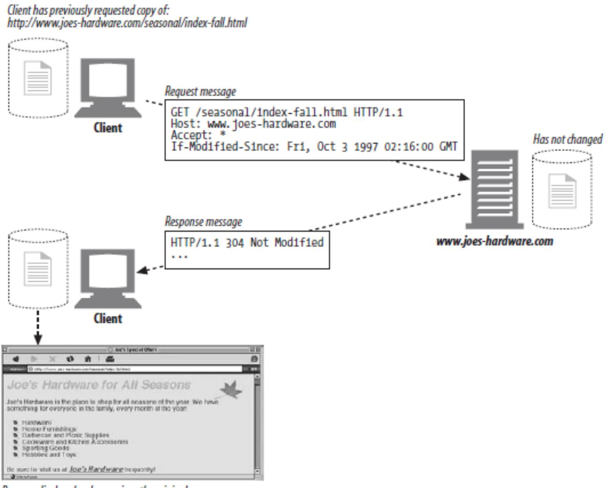

# 《Web技术（双语）》第一单元 基础概念与网络协议作业

原件经识别和整理；“参考解答”是我们补的。

## 一、专业词汇翻译

### 选择 1

请写出下列专业词汇对应的中文：

- development
- Internet
- web site
- network
- IP address
- domain name
- name server
- host
- hypertext
- web page
- protocol
- configuration
- proxy server
- identify
- format
- port number
- browser
- path
- partial path
- request
- response
- message
- script
- markup
- tag

## 二、IP地址查询

知识点：[IP地址与域名系统（DNS）](../../../topics/Web开发技术/ip-address-dns.md)、[万维网（WWW）的概念及其与Internet的区别](../../../topics/Web开发技术/www-concept.md)、[Web浏览器的工作原理](../../../topics/Web开发技术/web-browsers.md)

### 简答 1

请写下平时使用的笔记本电脑、手机的 IP 地址，并简单说明所用的查询方法。

| | 笔记本 | 手机 |
| :--- | :--- | :--- |
| IP 地址 | | |
| 查询方法 | | |

## 三、Web服务器市场份额排名

知识点：[IP地址与域名系统（DNS）](../../../topics/Web开发技术/ip-address-dns.md)

### 简答 2

请上网查阅资料，给下列 WEB 服务器的市场占有份额进行排名。（数字越小表示份额越高，填入 1-4）

| web 服务器 | 排名(填入数字 1-4) |
| :--- | :--- |
| IIS | |
| Apache | |
| nginx | |
| GWS (Google Web Server) | |

*注：此处需结合具体年份（如题目所示为2018-2019学年）的市场数据作答，原件未提供标准答案。*

## 四、Web服务器相关名词解释

知识点：[Web服务器操作与常见服务器（Apache、IIS）](../../../topics/Web开发技术/web-servers.md)

### 简答 3

请阅读教材 1.4.2 小节，解释以下名词：

- document root
- Server root
- virtual document tree
- virtual host
- proxy servers
- home page

## 五、应用层协议端口号

知识点：[Web服务器操作与常见服务器（Apache、IIS）](../../../topics/Web开发技术/web-servers.md)、[Internet协议栈与应用层协议端口号](../../../topics/Web开发技术/internet-protocols.md)、[万维网（WWW）的概念及其与Internet的区别](../../../topics/Web开发技术/www-concept.md)

### 填空 1

请写出下列应用层协议对应的端口号：

| 应用层协议 | 端口号 |
| :--- | :--- |
| FTP | |
| HTTP | |
| SMTP | |

## 六、URL结构解析

知识点：[Internet协议栈与应用层协议端口号](../../../topics/Web开发技术/internet-protocols.md)、[统一资源定位符（URL）的结构解析与本地文件URL构建规则](../../../topics/Web开发技术/url-structure.md)

### 简答 4

请观察这个 URL（`HTTP://FOOD.COM:8080/RECIPES/BROCCOLI/`），填写下面的表格：

| 组成部分 | 内容 |
| :--- | :--- |
| scheme (协议) | |
| object-address (对象地址/主机名) | |
| port number (端口号) | |
| FQDN (完全限定域名) | |
| path-to-document (文档路径) | |

## 七、本地文件URL构建

知识点：[统一资源定位符（URL）的结构解析与本地文件URL构建规则](../../../topics/Web开发技术/url-structure.md)

### 简答 5

请在本地文件系统中随意找一个文件，按照 `FILE://PATH-TO-DOCUMENT` 的格式写出它对应的 URL。

## 八、URL规则与路径

知识点：[统一资源定位符（URL）的结构解析与本地文件URL构建规则](../../../topics/Web开发技术/url-structure.md)

### 简答 6

请阅读教材 1.5.1 和 1.5.2 小节 URL 格式和路径的内容，回答以下问题：

| 问题 | 解答 |
| :--- | :--- |
| 是否任意字符都可以出现在 URL? | |
| 如何判断一个 URL 指向的是目录还是文件? | |
| URL 中的路径是否必须从服务器的文档根路径开始定义? | |

## 九、HTTP交互过程分析（图1）

知识点：[统一资源定位符（URL）的结构解析与本地文件URL构建规则](../../../topics/Web开发技术/url-structure.md)

### 简答 7

请观察右图所示 HTTP 交互过程，回答下列问题：

*注：原题在此处提出具体问题，但识别文本中未列出具体子问题。通常此类题目涉及请求方法、状态码、头部信息等。*

## 十、HTTP缓存机制分析（图2）

知识点：[HTTP请求阶段（GET方法、常见请求字段）](../../../topics/Web开发技术/http-request.md)、[HTTP响应（状态码如200 OK、常见响应字段、缓存机制）](../../../topics/Web开发技术/http-response-cache.md)

### 简答 8

请观察下图所示 HTTP 交互过程，回答问题：服务器端的 HTTP 响应有无返回客户端请求的资源？

知识点：[HTTP响应（状态码如200 OK、常见响应字段、缓存机制）](../../../topics/Web开发技术/http-response-cache.md)
