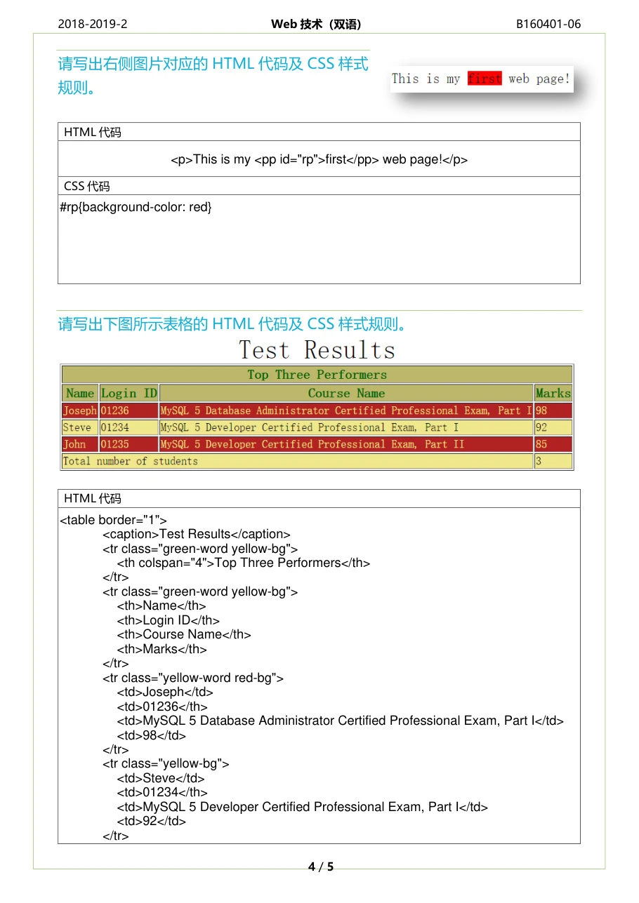

# 《Web技术（双语）》第三单元 Cascading Style Sheets（Part I）作业及答案

原件经识别和整理；“参考解答”是我们补的。

## 专业词汇中译

| 专业词汇 | 中文 |
| --- | --- |
| presentation | 呈现（表示） |
| style sheet | 样式表 |
| property | 属性 |
| cascading | 层叠 |
| level | 层（级） |
| precedence | 优先级 |
| conflict | 冲突 |
| selector | 选择器 |
| rule | 规则 |

## 简答

### 简答 1

（Review Questions 3.1）What is the advantage of document-level style sheets over inline style sheets?

知识点：[样式表的三个级别（内联级Inline、文档级Document、外部External）](../../../topics/Web开发技术/style-levels.md)、[CSS简介与作用](../../../topics/Web开发技术/css-intro.md)

### 简答 2

（Review Questions 3.8）What is the purpose of a style class selector?

知识点：[CSS简介与作用](../../../topics/Web开发技术/css-intro.md)、[选择器形式（简单选择器、类选择器Class、通用选择器Generic、id选择器、上下文选择器Contextual、伪类Pseudo class、通配符Universal）](../../../topics/Web开发技术/css-selectors.md)

### 简答 3

（Review Questions 3.10）What is the difference between the two selectors `ol ul` and `ol > ul`?

知识点：[选择器形式（简单选择器、类选择器Class、通用选择器Generic、id选择器、上下文选择器Contextual、伪类Pseudo class、通配符Universal）](../../../topics/Web开发技术/css-selectors.md)、[CSS简介与作用](../../../topics/Web开发技术/css-intro.md)、[Web浏览器的工作原理](../../../topics/Web开发技术/web-browsers.md)

### 简答 4

（Exercise 3.1）Create an external style sheet for the chapters of this book.

补充：请编写一个 HTML 文档呈现教材的二级目录结构，然后写一个外部 CSS 文件定义其外观。

HTML 代码

```html

```

CSS 代码

```css

```

知识点：[样式表的三个级别（内联级Inline、文档级Document、外部External）](../../../topics/Web开发技术/style-levels.md)、[选择器形式（简单选择器、类选择器Class、通用选择器Generic、id选择器、上下文选择器Contextual、伪类Pseudo class、通配符Universal）](../../../topics/Web开发技术/css-selectors.md)、[列表（无序列表、有序列表、定义列表）](../../../topics/Web开发技术/lists.md)

### 简答 5

请问下面的选择器分别选中哪些元素？

```css
p.specials {color: red;}
p#footer {color: red;}
p.featured.new { }
```

知识点：[选择器形式（简单选择器、类选择器Class、通用选择器Generic、id选择器、上下文选择器Contextual、伪类Pseudo class、通配符Universal）](../../../topics/Web开发技术/css-selectors.md)

### 简答 6

请问如何将右侧数字表示为分数形式？写出 HTML 代码和 CSS 样式规则。

HTML 代码

```html

```

CSS 代码

```css

```

知识点：[CSS属性：字体属性（Font Properties）](../../../topics/Web开发技术/css-properties-font.md)、[基本文本标记（段落、换行、标题、块引用、水平线、字符实体、上下标）](../../../topics/Web开发技术/text-markup.md)

### 简答 7

请写出右侧图片对应的 HTML 代码及 CSS 样式规则。

This is my first web page!

| HTML 代码 |
| --- |
|  |

| CSS 代码 |
| --- |
|  |



答案：原件给出的 HTML 与 CSS 为：

```html
<p>This is my <pp id="r">first</pp> web page!</p>
```

```css
#r { background-color: red; }
```

订正：`pp` 不是标准 HTML 文本标签，此处应使用行内元素 `span`，避免嵌套段落造成结构错误；CSS 中的 ID 选择器不变。

```html
<p>This is my <span id="r">first</span> web page!</p>
```

`id="r"` 只标记单词 first，因此红色背景只作用于这个单词。

知识点：[HTML文档结构（head、body、meta元素）](../../../topics/Web开发技术/html-doc-structure.md)、[基本文本标记（段落、换行、标题、块引用、水平线、字符实体、上下标）](../../../topics/Web开发技术/text-markup.md)、[CSS简介与作用](../../../topics/Web开发技术/css-intro.md)

### 简答 8

请写出下图所示表格的 HTML 代码及 CSS 样式规则。

Test Results

| Top Three Performers | | | |
| --- | --- | --- | --- |
| Name | Login ID | Course Name | Marks |
| Joseph | 01236 | MySQL 5 Database Administrator Certified Professional Exam, Part I | 98 |
| Steve | 01234 | MySQL 5 Developer Certified Professional Exam, Part I | 92 |
| John | 01235 | MySQL 5 Developer Certified Professional Exam, Part II | 85 |
| Total number of students | | | 3 |

| HTML 代码 |
| --- |
|  |

CSS 代码

```css

知识点：[表格（基本标签、rowspan与colspan、表格分块、align与valign）](../../../topics/Web开发技术/tables.md)、[CSS属性：边距（Margins）与背景图像（Background images）](../../../topics/Web开发技术/css-properties-margin-bg.md)
