# 《Web技术（双语）》课程介绍（课件）

原件的每一页，下面附识别出的文字。

### Web技术（双语）

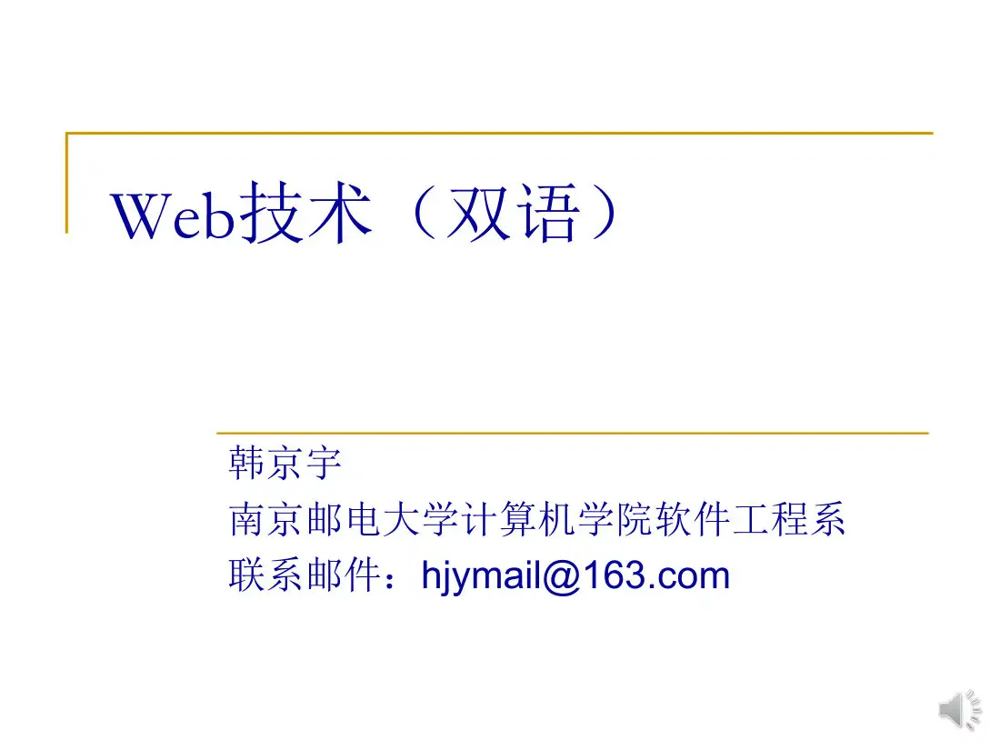

原文：

Web技术（双语）

韩京宇

南京邮电大学计算机学院软件工程系

联系邮件：hjymail@163.com

### 课程介绍

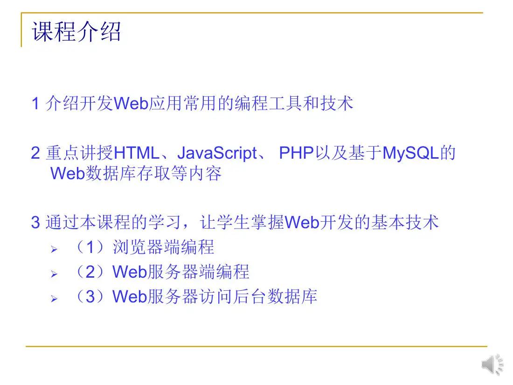

原文：

课程介绍

1 介绍开发Web应用常用的编程工具和技术

2 重点讲授HTML、JavaScript、 PHP以及基于MySQL的Web数据库存取等内容

3 通过本课程的学习，让学生掌握Web开发的基本技术

➢ （1）浏览器端编程

（2）Web服务器端编程

➢ （3）Web服务器访问后台数据库

### 课程介绍

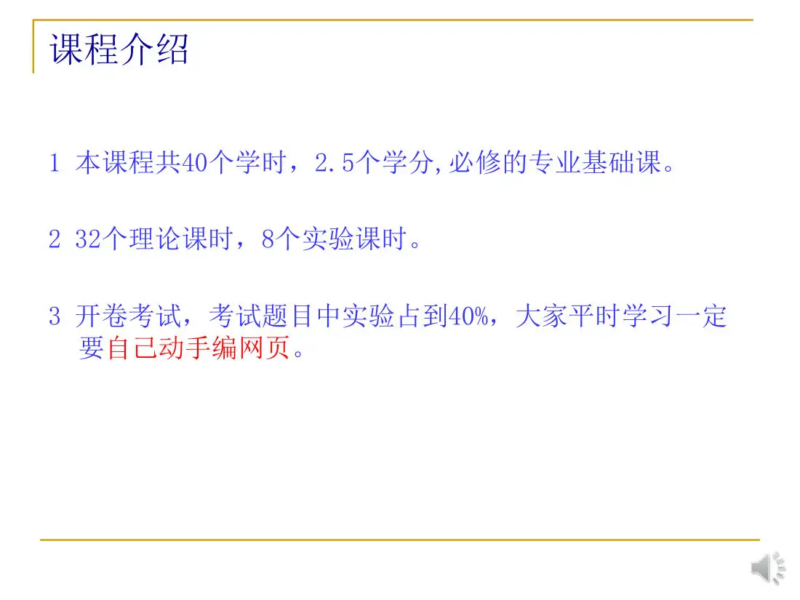

原文：

课程介绍

1 本课程共40个学时，2.5个学分,必修的专业基础课。

2 32个理论课时，8个实验课时。

3 开卷考试，考试题目中实验占到40%，大家平时学习一定要自己动手编网页。

### 学习方法

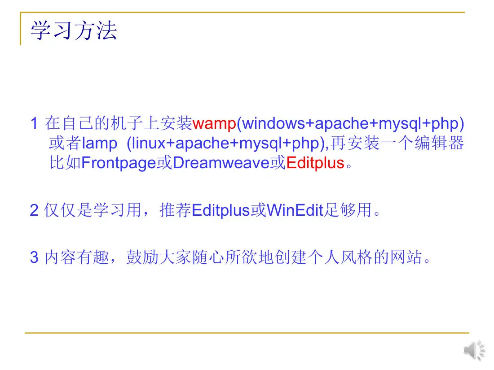

原文：

学习方法

1 在自己的机子上安装wamp(windows+apache+mysql+php)或者lamp (linux+apache+mysql+php),再安装一个编辑器比如Frontpage或Dreamweave或Editplus。

2 仅仅是学习用，推荐Editplus或WinEdit足够用。

3 内容有趣，鼓励大家随心所欲地创建个人风格的网站。

### 学习方法

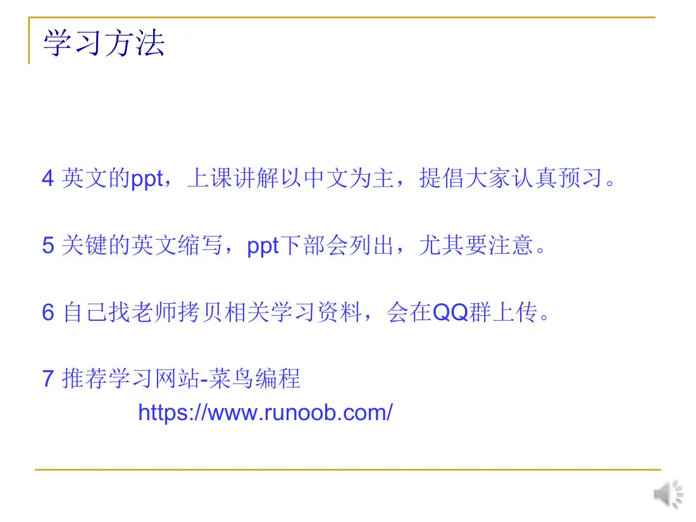

原文：

学习方法

4 英文的ppt，上课讲解以中文为主，提倡大家认真预习。

5 关键的英文缩写，ppt下部会列出，尤其要注意。

6 自己找老师拷贝相关学习资料，会在QQ群上传。

7 推荐学习网站-菜鸟编程

https://www.runoob.com/

### 教材和实验指导书

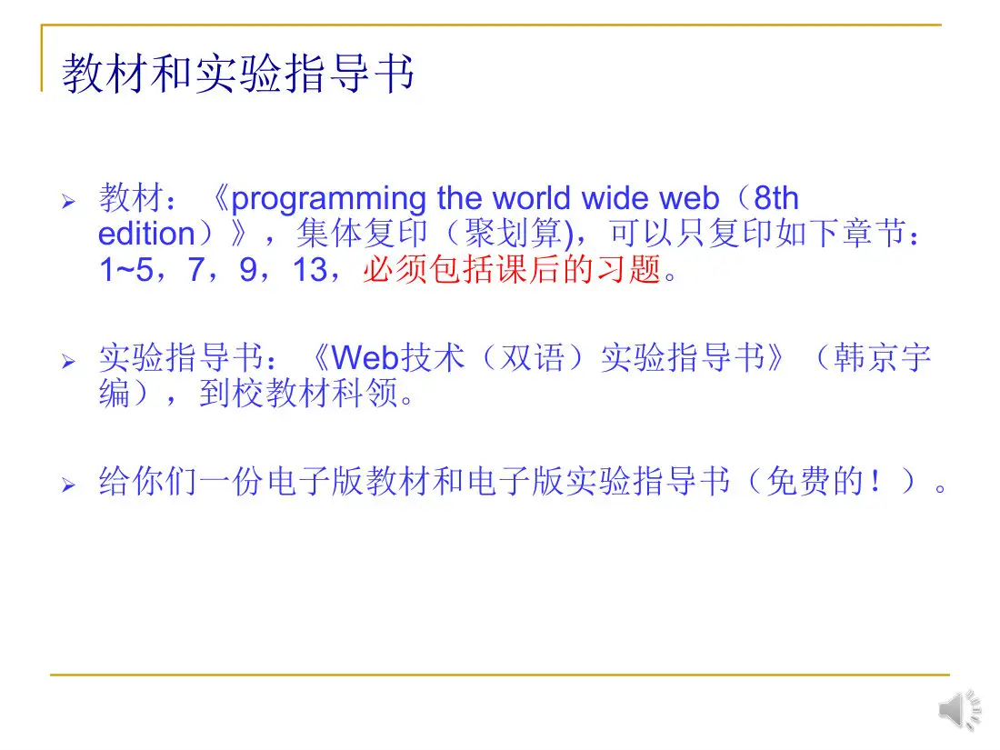

原文：

教材和实验指导书

➢ 教材：《programming the world wide web（8thedition）》，集体复印（聚划算)，可以只复印如下章节：1\~5，7，9，13，必须包括课后的习题。

实验指导书：《Web技术（双语）实验指导书》（韩京宇编），到校教材科领。

➢ 给你们一份电子版教材和电子版实验指导书（免费的！）。

### 学习要求（5点）

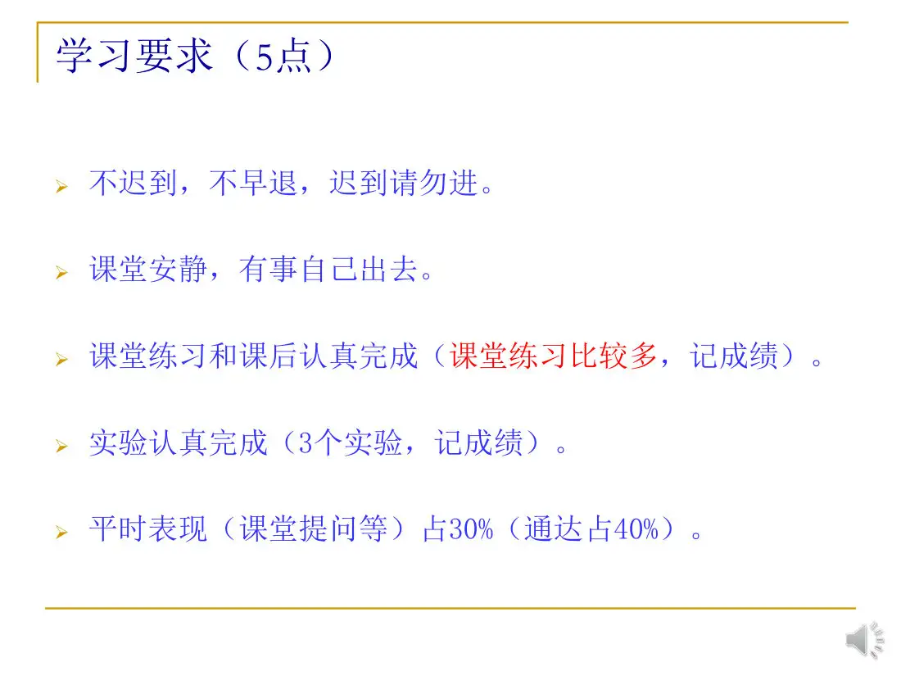

原文：

学习要求（5点）

➢ 不迟到，不早退，迟到请勿进。

➢ 课堂安静，有事自己出去。

课堂练习和课后认真完成（课堂练习比较多，记成绩）。

实验认真完成（3个实验，记成绩）。

➢ 平时表现（课堂提问等）占30%（通达占40%）。

### 答疑安排

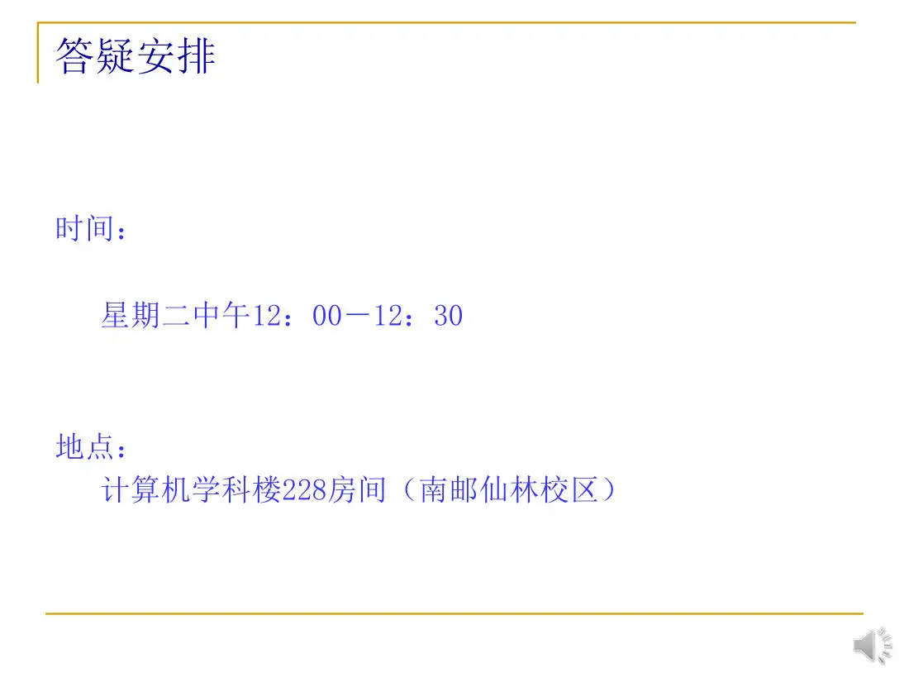

原文：

答疑安排

时间：

星期二中午12：00－12：30

地点：

计算机学科楼228房间（南邮仙林校区）

### 掌握五块核心内容

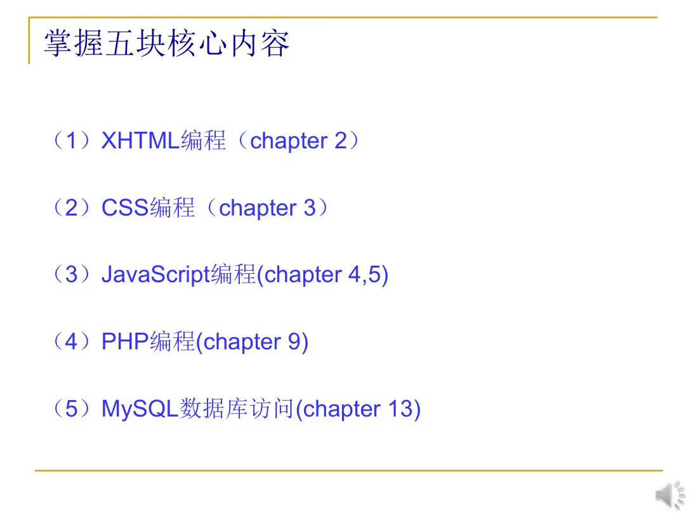

原文：

掌握五块核心内容

（1）XHTML编程（chapter 2）

（2）CSS编程（chapter 3）

（3）JavaScript编程(chapter 4,5)

（4）PHP编程(chapter 9)

（5）MySQL数据库访问(chapter 13)

### 了解一块内容（最后讲）

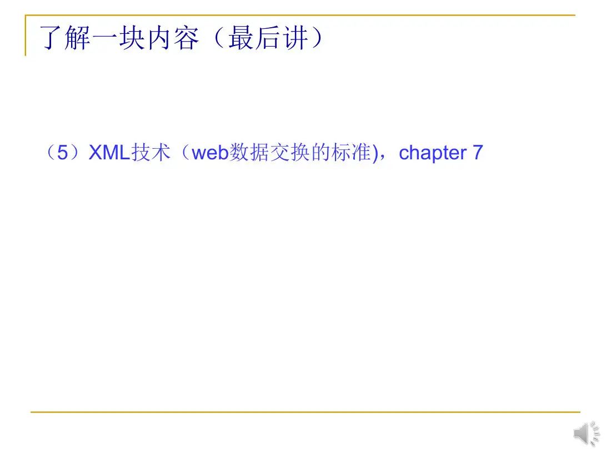

原文：

了解一块内容（最后讲）

（5）XML技术（web数据交换的标准)，chapter 7

### ◼ 祝大家掌握技能，学有所成！

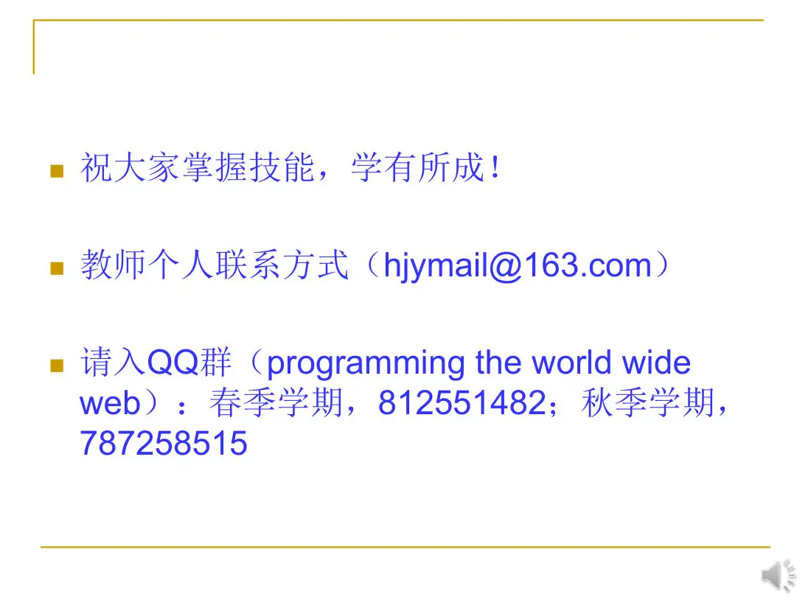

原文：

◼ 祝大家掌握技能，学有所成！

◼ 教师个人联系方式（hjymail@163.com）

请入QQ群（programming the world wideweb）：春季学期，812551482；秋季学期，787258515
