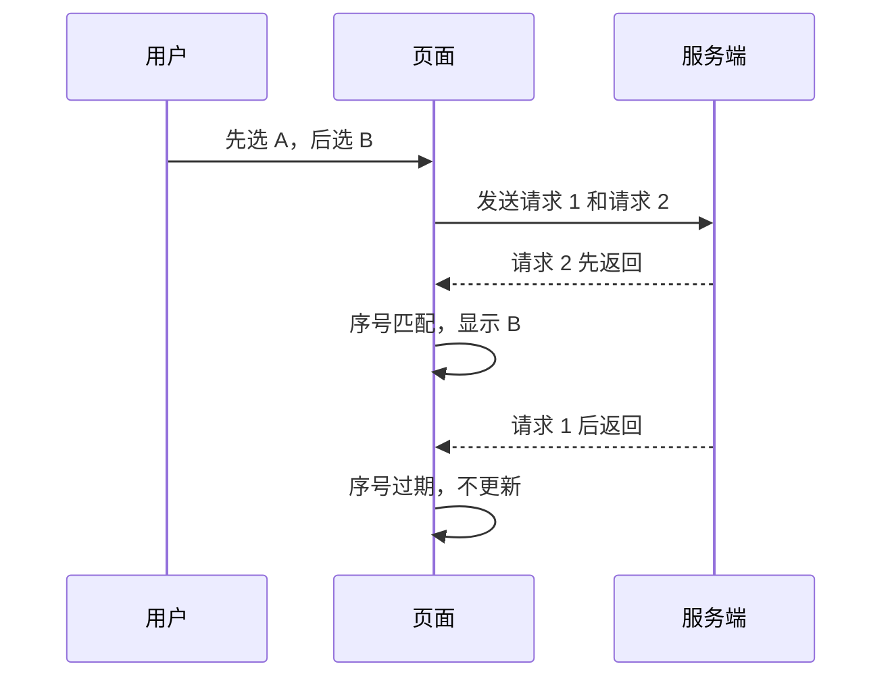

# 《Web程序设计》第8版中文目录扫描核对与阅读路线

这份 PDF 是 7 页目录扫描，不是教材正文，也不是当期课程大纲。它从教材第 1 章开始，末页止于第 15 章 §15.7.3“参数”（印刷页 570），不能据此断定全书到此结束。下文只列需要定位的少量页码和章节线索，不重排整份目录。页面上的数字是==教材印刷页码==，不是 PDF 文件里的页序，例如第 10 章从印刷页 339 开始，在这份扫描的第 5 页能看到对应条目。

同来源目录的 Markdown 转写只选了第 1、2、3、4、5、7、9、13 章。原扫描还可确认客户端动态页面、第 8 章的历史富媒体、第 10 章 Ajax、两套服务端框架路线、Android 与 Ruby。它证明这些内容进入过这本书的目录，不证明它们都在本地课程内授课、考试，或需要安装旧工具。

## 从要解决的问题选入口

| 想弄清什么 | 原扫描可用的导航线索 | 应用时先区分什么 |
| --- | --- | --- |
| 地址如何变成一次请求，返回内容又如何被解释 | 第 1 章；印刷页 9 附近进入 URL，12 附近进入 HTTP | [URL](../../../topics/Web开发技术/url-structure.md) 标识资源或端点；[HTTP 请求](../../../topics/Web开发技术/http-request.md) 决定这次具体做什么；[响应](../../../topics/Web开发技术/http-response-cache.md) 带有状态和内容属性 |
| 页面长什么样，用户操作如何作用到它 | 第 2–6 章；目录先列文档结构、样式、脚本、DOM，再专列页面动态行为。第 6 章入口在 207 | [HTML 文档结构](../../../topics/Web开发技术/html-doc-structure.md)、[选择器](../../../topics/Web开发技术/css-selectors.md)、[DOM](../../../topics/Web开发技术/dom-model.md) 与[动态修改](../../../topics/Web开发技术/dynamic-dom.md)是不同层次 |
| 结构化内容如何读取、变换与交换 | 第 7 章入口在 237；第 10 章入口在 339，目录的响应格式小节列有 HTML、XML 和 JSON | [XML 结构](../../../topics/Web开发技术/xml-syntax-structure.md)关心内容组织；[转换](../../../topics/Web开发技术/xslt.md)关心生成另一种表示；异步请求则关心何时拿到响应，和格式选择不是一回事 |
| 表单如何进入服务端，状态和数据又放在哪 | 第 9 章入口在 301，表单、Cookie、会话在其后半；第 11–12 章是 Java 与 ASP.NET 的路线，入口分别是 363、417 | [PHP 表单处理](../../../topics/Web开发技术/php-form-handling.md)是服务端入口的一例。脚本语言与框架不同，仍要分别处理请求、状态和响应；Cookie 不等于整个服务端会话 |
| 应用程序如何同持久数据通信 | 第 13 章入口在 471，按 SQL、访问体系、PHP/JDBC/ASP.NET 的接口路线展开 | [数据访问体系](../../../topics/Web开发技术/db-architecture.md)与 [SQL 查询](../../../topics/Web开发技术/sql-insert-select.md)分别回答“谁负责访问”和“要取什么数据” |
| 哪些条目只是技术史或邻接方向 | 第 8 章 Flash（269）、第 14 章 Android（507）、第 15 章 Ruby（549） | 不能从书中的历史实例推出现行浏览器的支持，也不能把移动端界面生命周期当成服务端请求流程 |

### 扫描如何补上三条容易混淆的路

第 6 章可用于追踪不向服务器发请求的动态效果：修改元素的位置、文字、显示状态，或者处理鼠标事件。第 10 章另有网络请求和响应的交互路径；它也可以在得到响应后更新同一 DOM。两章都会出现“改变页面”，但前者的观察点是本地文档树，后者还要看网络状态和响应内容。只因为页面异步变化就认定后端已收到请求，会走错排错路径。见[事件处理](../../../topics/Web开发技术/event-handling.md)。

第 11 章目录可定位 Servlet/JSP 的职责分工及有状态应用，第 12 章则提供 .NET/C#、ASP.NET 控件与服务的另一条示例路线；第 13 章再比较若干访问同类数据的接口。阅读时不必先学会每套框架才研究共同约束。先问请求由谁接收、谁决定输出、谁长期持有数据，再对照它们把同一职责放在哪个对象或接口。

> [!NOTE]
> 扫描末页在第 15 章的方法部分中断。扫描中还出现旧式富媒体、历史开发环境及框架版本。这些入口用于回看当时的技术组织，既不是当前工具清单，也不是必须照做的安装步骤。

### 一个互动页为什么会出现“新输入显示旧结果”

**补充算例。** 一个商品筛选页先收到用户选择 A（请求 1），随后收到选择 B（请求 2）。若请求 2 先完成，页面应显示 B；随后请求 1 返回不应覆盖当前选择。只给 DOM 注册可点击处理器不够，因为==发出请求的顺序，不是得到响应的顺序==。给当前选择保留一个本地序号：只把同当前序号匹配的成功响应写回页面；请求失败可以提示，但过期失败也不能覆盖当前状态。这是为串联第 5、6、10 章设计的独立例子，不是扫描中的正文或习题。

