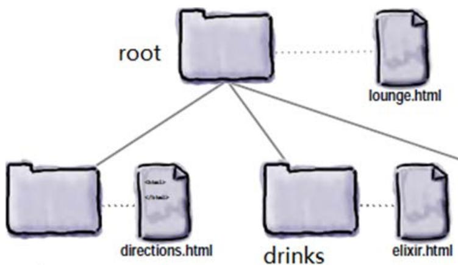

# 南京邮电大学《Web技术（双语）》作业3：HTML/XHTML基础与表格练习

原件经识别和整理；“参考解答”是我们补的。

## 第二单元 INTRODUCTION TO HTML/XHTML

### 词汇 1

请写出下列专业词汇对应的中文。

| 词汇 | 中文 |
|---|---|
| hyperlink | |
| absolute | |
| relative | |
| target | |
| resource | |
| attribute | |
| layout | |
| border | |
| caption | |
| form | |
| query string | |
| control | |

知识点：[统一资源定位符（URL）的结构解析与本地文件URL构建规则](../../../topics/Web开发技术/url-structure.md)、[HTML文档结构（head、body、meta元素）](../../../topics/Web开发技术/html-doc-structure.md)、[表单与控件（form标签、input元素、菜单select、label的for属性、placeholder属性）](../../../topics/Web开发技术/forms-controls.md)

### 简答 1

观察下图所示网站结构，在 ELIXIR.HTML 中添加一个超链接指向 LOUNG.HTML。

知识点：[图像（img）与超文本链接（a标签、文档内部目标）](../../../topics/Web开发技术/images-links.md)、[统一资源定位符（URL）的结构解析与本地文件URL构建规则](../../../topics/Web开发技术/url-structure.md)、[HTML文档结构（head、body、meta元素）](../../../topics/Web开发技术/html-doc-structure.md)

### 简答 2

假设一个 HTML 文档中有三个 1 级标题，请使用超链接编写一个目录，分别指向这三个一级标题。请给出两个方案：第一个方案目录和内容在同一个 HTML 文档；第二个方案目录和内容在不同的 HTML 文档。

方案一：

方案二：

知识点：[图像（img）与超文本链接（a标签、文档内部目标）](../../../topics/Web开发技术/images-links.md)、[HTML文档结构（head、body、meta元素）](../../../topics/Web开发技术/html-doc-structure.md)、[统一资源定位符（URL）的结构解析与本地文件URL构建规则](../../../topics/Web开发技术/url-structure.md)

### 简答 3

这个表格的标题会出现在什么位置？

|  |  |
|---|---|
| ... | 表格上方 |
| ... |  |
| Sachin Tendulkar | 表格下方 |
|  |  |

知识点：[表格（基本标签、rowspan与colspan、表格分块、align与valign）](../../../topics/Web开发技术/tables.md)

### 综合 1

请写出下图所示表格的 HTML 代码。

TV Schedule

| Time | Mon | Tue | Wed |
|---|---|---|---|
| 8 pm | Staring Contest | Celebrity Hoedown（跨两列） | |
| 9 pm | Hardy, Har, Har | What's for Lunch? | Movie of the Week（跨两行） |
| 10 pm | Healers, Wheelers & Dealers | It's a Crime | |

知识点：[表格（基本标签、rowspan与colspan、表格分块、align与valign）](../../../topics/Web开发技术/tables.md)

### 简答 4

（REVIEW QUESTIONS 2.9）WHAT ARE THE TWO REQUIRED ATTRIBUTES OF AN IMG ELEMENT?

知识点：[图像（img）与超文本链接（a标签、文档内部目标）](../../../topics/Web开发技术/images-links.md)

### 简答 5

（REVIEW QUESTIONS 2.11&12&13）WHAT TAG IS USED TO DEFINE A LINK? WHAT ATTRIBUTE IS REQUIRED IN ALL ANCHOR TAGS? DOES HTML ALLOW NESTED LINKS?

知识点：[图像（img）与超文本链接（a标签、文档内部目标）](../../../topics/Web开发技术/images-links.md)、[HTML文档结构（head、body、meta元素）](../../../topics/Web开发技术/html-doc-structure.md)、[XHTML基本语法规则与大小写敏感性](../../../topics/Web开发技术/xhtml-syntax.md)

### 简答 6

（REVIEW QUESTIONS 2.15）WHAT IS THE FORM OF THE VALUE OF THE HREF ATTRIBUTE IN AN ANCHOR TAG WHEN THE TARGET IS A FRAGMENT OF A DOCUMENT OTHER THAN THE ONE IN WHICH THE LINK APPEARS?

知识点：[图像（img）与超文本链接（a标签、文档内部目标）](../../../topics/Web开发技术/images-links.md)、[统一资源定位符（URL）的结构解析与本地文件URL构建规则](../../../topics/Web开发技术/url-structure.md)、[HTML文档结构（head、body、meta元素）](../../../topics/Web开发技术/html-doc-structure.md)

### 简答 7

（REVIEW QUESTIONS 2.16&17）WHAT IS THE DEFAULT BULLET FORM FOR THE ITEMS IN AN UNORDERED LIST? WHAT ARE THE DEFAULT SEQUENCE VALUES FOR THE ITEMS IN AN ORDERED LIST?

知识点：[列表（无序列表、有序列表、定义列表）](../../../topics/Web开发技术/lists.md)、[HTML文档结构（head、body、meta元素）](../../../topics/Web开发技术/html-doc-structure.md)、[基本文本标记（段落、换行、标题、块引用、水平线、字符实体、上下标）](../../../topics/Web开发技术/text-markup.md)

### 简答 8

（REVIEW QUESTIONS 2.19&20）WHAT IS THE PURPOSE OF THE COLSPAN ATTRIBUTE OF THE TH ELEMENT? WHAT IS THE PURPOSE OF THE ROWSPAN ATTRIBUTE OF THE TD ELEMENT?

知识点：[表格（基本标签、rowspan与colspan、表格分块、align与valign）](../../../topics/Web开发技术/tables.md)

### 综合 2

CREATE AND TEST AN HTML DOCUMENT THAT DESCRIBES AN UNORDERED LIST EQUIVALENT TO YOUR TYPICAL GROCERY SHOPPING LIST.

知识点：[列表（无序列表、有序列表、定义列表）](../../../topics/Web开发技术/lists.md)、[HTML文档结构（head、body、meta元素）](../../../topics/Web开发技术/html-doc-structure.md)
