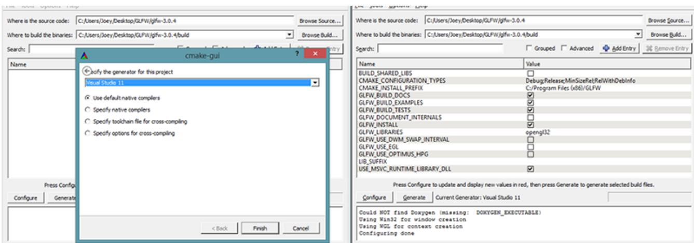
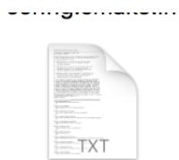

# 《计算机图形学（全英文）》OpenGL Assimp库配置实验指南

原件经识别和整理；“参考解答”是我们补的。

---
title: 《计算机图形学（全英文）》OpenGL Assimp库配置实验指南
kind: 实验
course: 计算机图形学
source: <原件地址或来源路径>
---

# 《计算机图形学（全英文）》OpenGL Assimp库配置实验指南

本文档整理了关于在 Windows 和 Mac 环境下配置 Assimp 库的实验步骤。

## ASSIMP

Download Assimp Terminal-> brew install assimp

### Windows User:

Download CMake from the website

Download assimp

Open CMake

Here browse source code of assimp until you can find the file CmakeList

Create a folder called build in the same place.

Browse to this folder for “Where to build the binaries option”.

Mac User:

Click Configure in the left bottom, Choose Visual Studio 14. Finsih and Click Generate.

### If you have this error message

Could not locate Directx CMake Error at cmake-modules/FindPkgMacros.cmake:110 (message): Required library DirectX not found! Install the library (including dev packages) and try again. If the library is already installed, set the missing variables manualiy in cmake.

Install DXSDK\_Jun 10.exe

If you have problem installing DX, check this website

https://blogs.msdn.microsoft.com/b/chuckw/archive/2011/12/09/knownissue-directx-sdk-june-2010-setup-and-the-s1023-error.aspx

After compiling, in the build folder, you will find assimp.sln.

Build the solution. You will get assimp.dll, assimp.lib file.

Configure it like what we have done before for glew.
