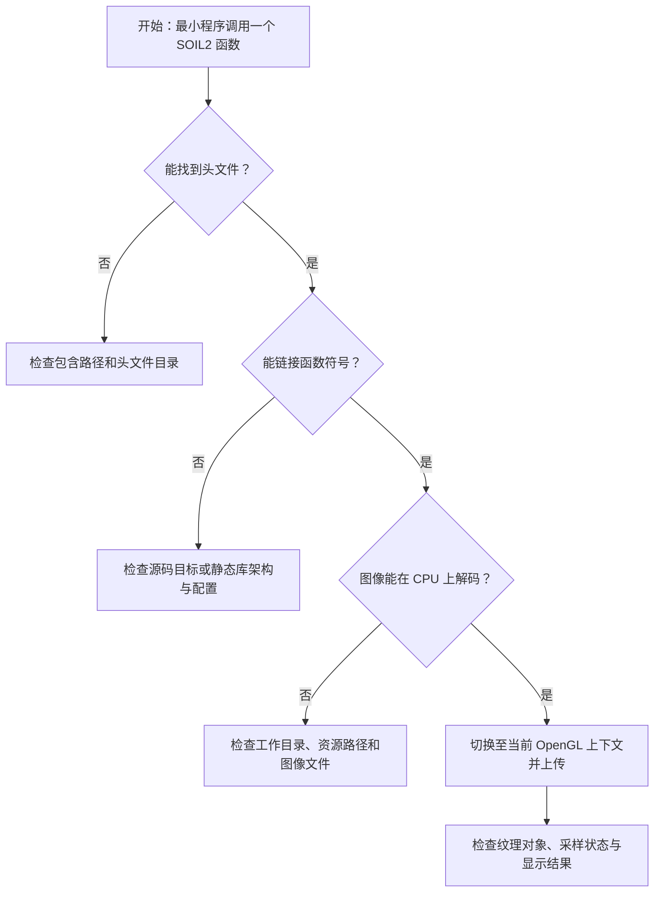

# 《计算机图形学（全英文）》OpenGL SOIL2 图像加载库配置与使用（实验指导）

这份三页实验指导解决的是“怎样把 SOIL2 接入课程工程”。第 1 页给出 macOS 的源码接入方式，第 1–3 页给出 Windows 旧版工具链的静态库方式。原件没有纹理示例代码或试题。下文“补充”是为了验证接入是否真正成功，不是原讲义内容。

## 原件操作：两条路只选一条

- **macOS／Xcode（第 1 页）**：取 SOIL2 发布包 `src/` 下的 `SOIL2/` 文件夹，连同其源码和头文件拖入实验工程；需要把文件复制进工程时勾选复制选项，并为源码选中应用的 target。源码出现在项目导航栏里，不等于它会进入应用的编译；若头文件可见但函数符号找不到，先看 target 的 **Build Phases → Compile Sources**。
- **Windows／Visual Studio（第 1–3 页）**：这是原讲义所用的历史流程。把 Premake 4.4 beta 的 `premake4.exe` 放到含 `premake4.lua` 的 SOIL2 源码根目录，在命令提示符运行 `premake4.exe vs2012`。打开原件示例中 `make/windows` 的解决方案；若使用 Visual Studio 2015，按原件示意完成解决方案升级。构建 `soil2-static-lib`，从 `lib/windows` 找到当时生成的 `soil2-debug.lib`。接入实验工程时，保留完整头文件目录，在 **Linker → General → Additional Library Directories** 填入库所在目录，在 **Linker → Input → Additional Dependencies** 填入实际库名。最后用 `#include "SOIL2/SOIL2.h"` 引入头文件。

> [!IMPORTANT]
> 原件的 `vs2012`、`make/windows` 和 `soil2-debug.lib` 是那套旧版工具的参数和产物，不是固定接口。使用新版仓库要按所检出版本的 [SOIL2 构建说明](https://github.com/SpartanJ/soil2#build) 和 [项目脚本](https://github.com/SpartanJ/soil2/blob/master/premake5.lua) 选生成器与实际产物，例如新版示例使用 `premake5 vs2022` 或 `premake5 xcode4`。目标平台、架构和 Debug/Release 配置要与应用匹配。同一个应用不要既把同一份实现编入 target，又链接含这份实现的静态库。

## 补充：能包含头文件，为什么还不算接通？

头文件给编译器的是函数声明，不能交付函数实现；静态库或 target 源码才交付实现。程序链接后，图像字节还必须先解码，再在当前 OpenGL 上下文中上传。每一步输入对象都不同，所以一个阶段成功并不能替另一个阶段作保证。

| 症状 | 先查哪一层 | 反证方法 |
| --- | --- | --- |
| 报头文件不存在 | 编译器的包含路径 | 包含路径指向装有 `SOIL2/` 的父目录，而不是再把目录名多写一遍。 |
| 只包含头文件能编译，一调用函数就找不到符号 | 链接器 | 用一个实际函数调用做链接测试；检查 Xcode target 归属，或检查 Windows 库目录、文件名和架构。 |
| 能运行，但纹理 ID 为 `0` | 运行时 | 记录当前工作目录；先用绝对路径或应用资源路径排除文件问题，确认 OpenGL 上下文已设为当前，再读取 `SOIL_last_result()` 诊断。 |
| 有纹理 ID，但显示不对 | 上传或采样 | 检查手动上传的像素行对齐、着色器采样器对应的纹理单元，以及过滤方式是否要求 mipmap。不要仅凭非零 ID 判定画面正确。 |

[SOIL2 的公开头文件](https://github.com/SpartanJ/soil2/blob/master/src/SOIL2/SOIL2.h) 区分两条调用路径：`SOIL_load_image` 是 CPU 端解码，成功后返回像素指针，使用完交给 `SOIL_free_image_data`；`SOIL_load_OGL_texture` 则直接创建或复用 OpenGL 纹理，失败返回 `0`。查明是哪条路径失败，比在多个工程设置中同时试错更快。若已知只有第 0 级纹理，先选不要求 mipmap 的 `GL_LINEAR` 或 `GL_NEAREST` 作为缩小过滤，待基本画面验明后再引入 mipmap。

> [!TIP]
> 遇到 ==第一行对、第二行起颜色错位==，先看每行实际字节数是否符合解包对齐约定；若图案只是完整地上下倒置，先看坐标约定。用颜色不重复的非对称小图，把“读错字节”和“采样方向翻转”分开。

## 补充：一组能区分错位与倒置的验证数据

手动上传一张宽 3、高 2 的紧凑 RGB8 小图。每行有 $3 \times 3=9$ 字节；将有效像素字节依次填为 `0–17`。每行首像素的 RGB 理应分别是 `(0,1,2)`、`(9,10,11)`。若把这段紧凑数据交给默认的 `GL_UNPACK_ALIGNMENT=4`，OpenGL 会以 12 字节为行步长，因而去偏移 12 处找第二行，把 `(12,13,14)` 当成其首像素。计算从第一行到第二行的步长，即可在看图前预测错在何处。

| 输入布局 | 解包对齐 | 第二行起点 |
| --- | ---: | ---: |
| 紧凑 RGB8，宽 3 | 4 | 12，错误：源缓冲区的第二行本应从 9 开始 |
| 紧凑 RGB8，宽 3 | 1 | 9，正确 |
| 紧凑 RGBA8，宽 3 | 4 | 12，正确：每行本来就是 12 字节 |

可在调用 `glTexImage2D` 前设 `glPixelStorei(GL_UNPACK_ALIGNMENT, 1)`，上传紧凑 RGB 数据后恢复先前的对齐设置。此例针对**手动上传**，不是给 SOIL2 整体加载函数强加额外参数。独立核验在 Mesa 软件 OpenGL 上执行了三组上传与读回；RGB 错位组在有效像素之后额外分配保护字节，以免故意错配时读出缓冲区。行对齐用 [OpenGL 核心规范](https://registry.khronos.org/OpenGL/specs/gl/glspec33.core.pdf) 的像素解包规则解释；这不是在旧版 Visual Studio 或 Xcode 上重新安装 SOIL2 的实测。

> [!WARNING]
> ==单色纹理看起来正常==不是方向正确的证据；翻转同一颜色仍得到同一颜色。若非对称图能完整显示但朝向相反，统一坐标或翻转图像一次即可，别把两处一起反转。若第二行颜色本身已经错位，改纹理坐标也无法恢复读错的字节。

关联：[OpenGL 环境配置](../../../topics/计算机图形学/OpenGL环境配置.md)、[SOIL2 库](../../../topics/计算机图形学/SOIL2库.md)、[SOIL2 加载纹理](../../../topics/计算机图形学/SOIL2加载纹理.md)、[纹理坐标](../../../topics/计算机图形学/纹理坐标.md)、[纹理滤波](../../../topics/计算机图形学/纹理滤波.md)。
