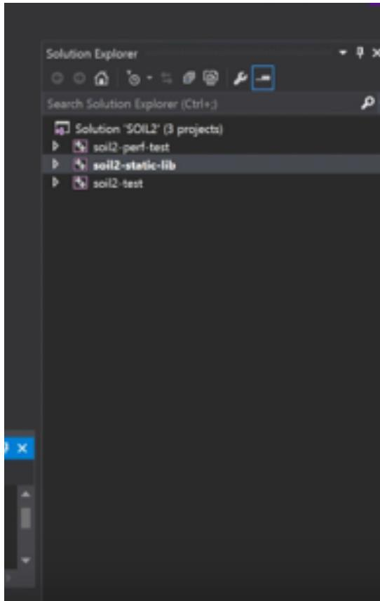

# 《计算机图形学（全英文）》OpenGL SOIL2 图像加载库配置与使用（实验指导）

原件经识别和整理；“参考解答”是我们补的。

## Mac 用户

下载 SOIL2。

将 SpartanJ SOIL2.xxx 解压到 src 目录，复制整个 SOIL2 文件夹，粘贴到与项目中 main 函数相同的目录下。像之前处理 res 文件夹那样把它拖入 Xcode，但勾选 copy file（复制文件）。不要忘记添加到 target（Add to target）。

## Windows 用户

从网站下载 SOIL2（在 Google 搜索 SOIL2，点击左下角的 download，然后点击……）。

## 概述

| 项目 | 值 |
| --- | --- |
| Last updated | 2017-08-05 |
| Language | C |
| Access level | Read |
| Open PRs | 0 |
| Watchers | 38 |
| Branch | 1 |
| Forks | 14 |

## Simple OpenGL Image Library 2

### 简介

SOIL2 是 Jonathan Dummer 的 Simple OpenGL Image Library 的一个分支（fork）。

SOIL2 是一个很小的 C 语言库，主要用于把纹理上传到 OpenGL。它基于 stb_image——Sean Barrett 的公共领域（public domain）代码。

SOIL2 把 stb_image 扩展到支持 DDS 文件，并实现了加载 OpenGL 纹理时常用的一些函数。

SOIL2 还可用于以多种格式保存和加载图像（对加载高度图、非 OpenGL 应用等很有用）。

下载仓库（repository）。

它可能被命名为 SpartanJ-soil2-xxxxx。

从网站下载 Premake 4.4 beta 版本（beta 版总是更好）。

解压这两个 zip 文件。

进入 premake 4.4 beta5 的 windows 文件夹，复制 premake4.exe，粘贴到 SOIL2 文件夹中（即你能看到 premake4.lua、README.md 的那个文件夹）。

现在从 Windows 开始菜单 -> 搜索 -> 输入 Command Prompt 打开“命令提示符”。

在命令提示符中，进入你刚粘贴文件的那个文件夹。最好把 SOIL2 文件夹放在 C: 盘下，所以直接输入 `cd filepath`。如果 SOIL2 在 D: 盘，先输入 `D:`，再输入 `cd filepath`。

输入 `premake4.exe vs2012`（我们用 vs2015 也没关系，之后会更新它）。

进入上图所示的文件夹，你会看到一个名为 make 的文件夹，双击它，可以看到一个名为 windows 的文件夹，再次双击。打开 SOIL2.sln，弹出 Review Solution Actions 窗口，这就是我们前面提到的更新。点击 OK。

右键单击 soil2-static-lib 并选择 build，即可构建该项目。现在可以关闭 VS2015 了。回到 SOIL2 文件夹，其中有一个 lib 文件夹，里面可以看到 windows 文件夹和 soil2-debug.lib 文件。

进入你放置 glew 和 glfw 文件夹的位置，新建一个名为 SOIL2 的文件夹，在其中新建一个名为 lib 的文件夹，把 soil2-debug.lib 文件复制到这里。

回到 SpartanJ SOIL2 文件夹 -> src，复制 SOIL2 文件夹，粘贴到你项目中 main.cpp 所在的目录。

在你的项目中，为该工程设置 lib 文件。右键单击项目，选择 property，Linker -> General -> Additional Library Directories，新建并添加包含 soil2-debug.lib 的 lib 文件所在路径。

Linker -> Input -> Additional Dependencies，输入 soil2-debug.lib。

现在 `#include "SOIL2/SOIL2.h"`，应当不再报错。
