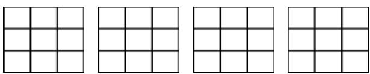

# 2021-2022学年第二学期《算法分析与设计》期末试卷（A卷）答题纸

原件经识别和整理；“参考解答”是我们补的。

# 2021-2022 学年第二学期《算法分析与设计》期末试卷（A卷）

## 一、证明题（本大题共 2 小题，每小题 10 分，共 20 分）

### 选择 1

题干：请完成题目要求（原件此处内容为空白，仅有序号）。

答案：无

知识点：[算法的概念与基本特性（确定性、有限性等）](../../../topics/算法分析/算法概念与特性.md)

### 选择 2

题干：请完成题目要求（原件此处内容为空白，仅有序号）。

答案：无

## 二、算法题（本大题共 5 小题，共 60 分）

知识点：[算法的概念与基本特性（确定性、有限性等）](../../../topics/算法分析/算法概念与特性.md)、[问题和问题求解方法与系统生命周期](../../../topics/算法分析/问题求解过程.md)

### 选择 1

**题目描述：**
迭代两路合并排序：
输入序列：`[30] [17] [25] [48] [19] [18] [56] [33]`
要求写出第一趟排序后的结果。

答案：无

知识点：[算法的概念与基本特性（确定性、有限性等）](../../../topics/算法分析/算法概念与特性.md)

### 选择 2

题干：请完成题目要求（原题序号存在，但具体内容缺失，仅显示后续表格结构）。

答案：无

知识点：[算法的概念与基本特性（确定性、有限性等）](../../../topics/算法分析/算法概念与特性.md)、[问题和问题求解方法与系统生命周期](../../../topics/算法分析/问题求解过程.md)

### 选择 3

**题目描述：**
请填写 $c$ 数组的值（对应一个 6x6 的二维表格，行标和列标均为 0-5）。

| | 0 | 1 | 2 | 3 | 4 | 5 |
|---|---|---|---|---|---|---|
| **0** | | | | | | |
| **1** | | | | | | |
| **2** | | | | | | |
| **3** | | | | | | |
| **4** | | | | | | |
| **5** | | | | | | |

$c$ 数组

答案：无

知识点：[动态规划法的基本要素（最优子结构、重叠子问题）与设计步骤](../../../topics/算法分析/动态规划基本要素.md)、[矩阵连乘问题的动态规划求解（完全加括号、递推关系、备忘录方法）](../../../topics/算法分析/矩阵连乘.md)、[递推方程的求解方法（替换法、迭代法、递归树、主方法）](../../../topics/算法分析/递推方程求解.md)

### 选择 4

**题目描述：**
给定如下初始矩阵（3x3）：

| 1 | 2 | 3 |
|---|---|---|
| 4 | | 5 |
| 7 | 8 | 6 |

*(注：原识别内容中包含图片占位符，代表具体的算法执行过程图示)*

答案：无

知识点：[回溯法的基本概念（解空间、状态空间树、显式约束与隐式约束）](../../../topics/算法分析/回溯法基本概念.md)、[子集树与排列树的搜索结构](../../../topics/算法分析/子集树与排列树.md)、[n-皇后问题的回溯法求解及状态空间树分析](../../../topics/算法分析/N皇后问题.md)

### 选择 5

题干：请完成题目要求（原题序号存在，但具体内容缺失）。

答案：无

## 三、综合题（本大题共 2 小题，每小题 10 分，共 20 分）

知识点：[算法按时间复杂度分类（多项式时间算法与指数时间算法）](../../../topics/算法分析/算法按时间复杂度分类.md)、[使用程序步分析算法的时间复杂度](../../../topics/算法分析/程序步分析法.md)

### 选择 1

题干：请完成题目要求（原题序号存在，但具体内容缺失）。

答案：无

知识点：[算法的概念与基本特性（确定性、有限性等）](../../../topics/算法分析/算法概念与特性.md)

### 选择 2

**题目描述：**
(1) ...
(2) ...
(3) ① ... ② ... ③ ...

*(注：原题具体内容在识别文本中未完整呈现，仅保留了子题编号结构)*

答案：无

知识点：[算法的概念与基本特性（确定性、有限性等）](../../../topics/算法分析/算法概念与特性.md)、[问题和问题求解方法与系统生命周期](../../../topics/算法分析/问题求解过程.md)
