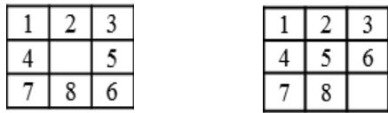

# 2021—2022 学年第二学期《算法分析与设计》期末试卷（A卷）

原件经识别和整理；“参考解答”是我们补的。

## 一、证明题（本大题共 2 小题，每小题 10 分，共 20 分）

### 证明 1

对下面搜索算法的正确性进行证明，并举例说明。

知识点：[二分搜索（对半搜索）的递归与迭代实现](../../../topics/算法分析/二分搜索.md)、[递归概念与归纳证明（斐波那契数列、Hanoi塔问题）](../../../topics/算法分析/递归与归纳证明.md)、[对半搜索的二叉判定树性质及基于关键字比较的搜索算法时间下界](../../../topics/算法分析/二叉判定树.md)

### 证明 2

已知 $f_1(n)=\mathrm{O}(g_1(n))$，$f_2(n)=\mathrm{O}(g_2(n))$，证明 $f_1(n)+f_2(n)=\mathrm{O}(g_1(n)+g_2(n))$。

## 二、算法题（本大题共 5 小题，共 60 分）

知识点：[渐近表示法：大O记号（紧上界）](../../../topics/算法分析/大O记号.md)、[算法的时间复杂度定义（最好、最坏、平均情况）](../../../topics/算法分析/时间复杂度定义.md)

### 算法 1

迭代两路合并排序算法思想是：将有 $n$ 个元素的序列看成是 $n$ 个长度为 1 的有序子序列，然后两两合并长度为 1 的子序列，得到 $\lceil n/2 \rceil$ 个长度为 2 或 1 的有序子序列；再两两合并长度为 2 的子序列……直到有序。（10 分）

（1）结合上述算法说明它采用的是哪种算法设计策略。为了实现该算法，需要额外设计什么数据结构。

（2）对关键字序列（30, 19, 17, 33, 20, 9, 56, 48）进行迭代两路合并排序，给出各趟排序结果和最坏情况下的时间复杂度。

知识点：[两路合并排序算法及其时间与空间复杂度分析](../../../topics/算法分析/合并排序.md)、[分治法的一般思想与算法框架（分解、解决、合并）](../../../topics/算法分析/分治法一般框架.md)、[算法的时间复杂度定义（最好、最坏、平均情况）](../../../topics/算法分析/时间复杂度定义.md)

### 算法 2

子集和数问题的回溯法算法 SumOfSub 的前置条件是 $n$ 个正数 $w_i$ 已按非减次序排列。现有两组数据 $W_1=(1,2,3,4)$ 和 $W_2=(4,3,2,1)$，正整数 $M=5$。若对这两组数据执行 SumOfSub 算法（不对 $W_2$ 排序），试分析它们在执行时间上的差异。（10 分）

知识点：[子集和数问题的回溯法求解（固定长度元组解）](../../../topics/算法分析/子集和数问题.md)、[回溯法的基本概念（解空间、状态空间树、显式约束与隐式约束）](../../../topics/算法分析/回溯法基本概念.md)、[剪枝函数设计与回溯法效率分析（蒙特卡罗估计算法）](../../../topics/算法分析/剪枝函数与效率分析.md)

### 算法 3

设有两个序列 $(x_1,\cdots,x_5)=(\mathrm{a},\mathrm{c},\mathrm{b},\mathrm{c},\mathrm{a})$，$(y_1,\cdots,y_4)=(\mathrm{a},\mathrm{b},\mathrm{a},\mathrm{c})$。（15 分）

（1）计算最长公共子序列长度的二维数组 $c$ 的值，并给出最长公共子序列的长度。

（2）在上述计算出的 $c$ 数组上，求最长公共子序列。需用箭头画出回溯的路径。

知识点：[最长公共子序列（LCS）的最优子结构证明、递推公式与构造最优解](../../../topics/算法分析/最长公共子序列.md)、[动态规划法的基本要素（最优子结构、重叠子问题）与设计步骤](../../../topics/算法分析/动态规划基本要素.md)、[递推方程的求解方法（替换法、迭代法、递归树、主方法）](../../../topics/算法分析/递推方程求解.md)

### 算法 4

下图是 8-迷问题的初始状态和目标状态。（15 分）



（1）判断该初始状态能否到达目标状态（需给出计算过程）。

（2）设计用 LC 分枝限界法求解 8 迷问题的算法步骤。

（3）用 LC 分枝限界法，从上述初始状态出发，画出实际生成的状态空间树。要求在结点旁标上 $\hat{c}$ 的值。

知识点：[15谜问题的可解性判定（定理9-1）与状态空间树搜索](../../../topics/算法分析/十五谜问题.md)、[LC（优先队列式）分枝限界法与代价估计函数](../../../topics/算法分析/LC分枝限界法.md)、[求最优解的上下界函数设计与剪枝方法](../../../topics/算法分析/上下界函数.md)

### 算法 5

$n$-皇后问题要求在一个 $n\times n$ 的棋盘上放置 $n$ 个皇后，使得它们彼此不受“攻击”。由于皇后问题的解具有对称性，因此可以不必搜索状态空间树中的全部结点，达到提高算法效率之目的。具体做法是，当输出一个解时，即利用对称性输出另一个解。请编程实现该算法（Place 函数可直接调用，不用编程）。（10 分）

## 三、应用题（本大题共 2 小题，每小题 10 分，共 20 分）

知识点：[n-皇后问题的回溯法求解及状态空间树分析](../../../topics/算法分析/N皇后问题.md)、[回溯法的基本概念（解空间、状态空间树、显式约束与隐式约束）](../../../topics/算法分析/回溯法基本概念.md)

### 应用 1

RSA 是第一个较完善的公开密钥算法，其中的加密公式为 $C=M^e \bmod n$。请编程实现对明文 $M$ 加密的函数 encrypt。已知 $e=5$，$n=35$，$M=12$，计算密文 $C$（含过程）。（10 分）

知识点：[RSA机制的密钥产生、加解密过程与扩展Euclid算法](../../../topics/算法分析/RSA算法.md)、[数论初步（同余定义、按模计算原理、欧拉函数）](../../../topics/算法分析/数论初步.md)

### 应用 2

会场安排问题描述如下：

设有 $n$ 个活动的集合 $E=\{1,2,\dots,n\}$，其中每个活动都要求占有同一资源（会场），而在同一时间内只能有一个活动占有该资源。每个活动给出其占有该资源的起始时间 $s_i$ 和结束时间 $f_i$，且 $s_i<f_i$。若选择了活动 $i$，则它在半开半闭区间 $[s_i,f_i)$ 内占用资源。若区间 $[s_i,f_i)$ 与 $[s_j,f_j)$ 不相交，即 $s_i\geqslant f_j$ 或 $s_j\geqslant f_i$，则称活动 $i$ 与 $j$ 是相容的。会场安排问题就是要在所给的活动集合中选出最大的相容活动子集合使得可以安排的活动数最多，即从整体上看，就是使会场（子集合）的数量最少。

运用所学知识求解会场安排问题。（10 分）

（1）说明该问题可用哪种算法设计方法（策略）求解，并说明理由，给出求解该问题的策略。

（2）给出会场安排问题算法的前置条件。

（3）请补充完成下面的会场安排问题算法：

```c
int Algo(int *s, int *f, int n){
    int i, j;
    int sum;    // 需要的会场个数
    ① sum=0;
    for(i=0; i<n; i++){
        if( ② )
            sum++;  // 另开辟一个会场，取下一个活动 i
        else
            j++;    // 取前面会场的最后一个活动 j
    }
    ③
}

知识点：[贪心法的基本要素（贪心选择性质/最优量度标准、最优子结构性质）](../../../topics/算法分析/贪心法基本要素.md)、[贪心法的一般算法框架（按量度标准排序后逐步决策）](../../../topics/算法分析/贪心法一般框架.md)、[算法的时间复杂度定义（最好、最坏、平均情况）](../../../topics/算法分析/时间复杂度定义.md)
