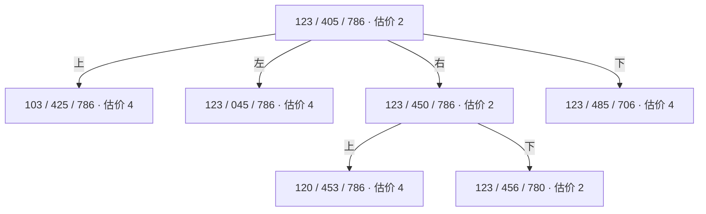

# 2021—2022 学年第二学期《算法分析与设计》期末试卷（A卷）

以下保留原卷三部分题意；文末“参考解答”与“订正”均为补写，不是原卷答案。

## 一、证明题（本大题共 2 小题，每小题 10 分，共 20 分）

### 证明 1

对下面搜索算法的正确性进行证明，并举例说明。原卷程序的关键步骤如下（保留原卷的右移更新式）：

```text
left <- 0; right <- n-1
while left <= right:
    m <- (left+right) // 2
    if x < l[m]: right <- m-1
    else if x > l[m]: left <- m+2
    else: return m
return -1
```

知识点：[二分搜索（对半搜索）的递归与迭代实现](../../../topics/算法分析/二分搜索.md)、[递归概念与归纳证明（斐波那契数列、Hanoi塔问题）](../../../topics/算法分析/递归与归纳证明.md)、[对半搜索的二叉判定树性质及基于关键字比较的搜索算法时间下界](../../../topics/算法分析/二叉判定树.md)

### 证明 2

已知 $f_1(n)=\mathrm{O}(g_1(n))$，$f_2(n)=\mathrm{O}(g_2(n))$，证明 $f_1(n)+f_2(n)=\mathrm{O}(g_1(n)+g_2(n))$。

## 二、算法题（本大题共 5 小题，共 60 分）

知识点：[渐近表示法：大O记号（紧上界）](../../../topics/算法分析/大O记号.md)、[算法的时间复杂度定义（最好、最坏、平均情况）](../../../topics/算法分析/时间复杂度定义.md)

### 算法 1

迭代两路合并排序算法思想是：将有 $n$ 个元素的序列看成是 $n$ 个长度为 1 的有序子序列，然后两两合并长度为 1 的子序列，得到 $\lceil n/2 \rceil$ 个长度为 2 或 1 的有序子序列；再两两合并长度为 2 的子序列……直到有序。（10 分）

（1）结合上述算法说明它采用的是哪种算法设计策略。为了实现该算法，需要额外设计什么数据结构。

（2）对关键字序列（30, 19, 17, 33, 20, 9, 56, 48）进行迭代两路合并排序，给出各趟排序结果和最坏情况下的时间复杂度。

知识点：[两路合并排序算法及其时间与空间复杂度分析](../../../topics/算法分析/合并排序.md)、[分治法的一般思想与算法框架（分解、解决、合并）](../../../topics/算法分析/分治法一般框架.md)、[算法的时间复杂度定义（最好、最坏、平均情况）](../../../topics/算法分析/时间复杂度定义.md)

### 算法 2

子集和数问题的回溯法算法 SumOfSub 的前置条件是 $n$ 个正数 $w_i$ 已按非减次序排列。现有两组数据 $W_1=(1,2,3,4)$ 和 $W_2=(4,3,2,1)$，正整数 $M=5$。若对这两组数据执行 SumOfSub 算法（不对 $W_2$ 排序），试分析它们在执行时间上的差异。（10 分）

知识点：[子集和数问题的回溯法求解（固定长度元组解）](../../../topics/算法分析/子集和数问题.md)、[回溯法的基本概念（解空间、状态空间树、显式约束与隐式约束）](../../../topics/算法分析/回溯法基本概念.md)、[剪枝函数设计与回溯法效率分析（蒙特卡罗估计算法）](../../../topics/算法分析/剪枝函数与效率分析.md)

### 算法 3

设有两个序列 $(x_1,\cdots,x_5)=(\mathrm{a},\mathrm{c},\mathrm{b},\mathrm{c},\mathrm{a})$，$(y_1,\cdots,y_4)=(\mathrm{a},\mathrm{b},\mathrm{a},\mathrm{c})$。（15 分）

（1）计算最长公共子序列长度的二维数组 $c$ 的值，并给出最长公共子序列的长度。

（2）在上述计算出的 $c$ 数组上，求最长公共子序列。需用箭头画出回溯的路径。

知识点：[最长公共子序列（LCS）的最优子结构证明、递推公式与构造最优解](../../../topics/算法分析/最长公共子序列.md)、[动态规划法的基本要素（最优子结构、重叠子问题）与设计步骤](../../../topics/算法分析/动态规划基本要素.md)、[递推方程的求解方法（替换法、迭代法、递归树、主方法）](../../../topics/算法分析/递推方程求解.md)

### 算法 4

下图是 8-迷问题的初始状态和目标状态。（15 分）


（1）判断该初始状态能否到达目标状态（需给出计算过程）。

（2）设计用 LC 分枝限界法求解 8 迷问题的算法步骤。

（3）用 LC 分枝限界法，从上述初始状态出发，画出实际生成的状态空间树。要求在结点旁标上 $\hat{c}$ 的值。

知识点：[15谜问题的可解性判定（定理9-1）与状态空间树搜索](../../../topics/算法分析/十五谜问题.md)、[LC（优先队列式）分枝限界法与代价估计函数](../../../topics/算法分析/LC分枝限界法.md)、[求最优解的上下界函数设计与剪枝方法](../../../topics/算法分析/上下界函数.md)

### 算法 5

$n$-皇后问题要求在一个 $n\times n$ 的棋盘上放置 $n$ 个皇后，使得它们彼此不受“攻击”。由于皇后问题的解具有对称性，因此可以不必搜索状态空间树中的全部结点，达到提高算法效率之目的。具体做法是，当输出一个解时，即利用对称性输出另一个解。请编程实现该算法（Place 函数可直接调用，不用编程）。（10 分）

## 三、应用题（本大题共 2 小题，每小题 10 分，共 20 分）

知识点：[n-皇后问题的回溯法求解及状态空间树分析](../../../topics/算法分析/N皇后问题.md)、[回溯法的基本概念（解空间、状态空间树、显式约束与隐式约束）](../../../topics/算法分析/回溯法基本概念.md)

### 应用 1

RSA 是第一个较完善的公开密钥算法，其中的加密公式为 $C=M^e \bmod n$。请编程实现对明文 $M$ 加密的函数 encrypt。已知 $e=5$，$n=35$，$M=12$，计算密文 $C$（含过程）。（10 分）

知识点：[RSA机制的密钥产生、加解密过程与扩展Euclid算法](../../../topics/算法分析/RSA算法.md)、[数论初步（同余定义、按模计算原理、欧拉函数）](../../../topics/算法分析/数论初步.md)

### 应用 2

会场安排问题描述如下：

设有 $n$ 个活动的集合 $E=\{1,2,\dots,n\}$，其中每个活动都要求占有同一资源（会场），而在同一时间内只能有一个活动占有该资源。每个活动给出其占有该资源的起始时间 $s_i$ 和结束时间 $f_i$，且 $s_i<f_i$。若选择了活动 $i$，则它在半开半闭区间 $[s_i,f_i)$ 内占用资源。若区间 $[s_i,f_i)$ 与 $[s_j,f_j)$ 不相交，即 $s_i\geqslant f_j$ 或 $s_j\geqslant f_i$，则称活动 $i$ 与 $j$ 是相容的。会场安排问题就是要在所给的活动集合中选出最大的相容活动子集合使得可以安排的活动数最多，即从整体上看，就是使会场（子集合）的数量最少。

运用所学知识求解会场安排问题。（10 分）

（1）说明该问题可用哪种算法设计方法（策略）求解，并说明理由，给出求解该问题的策略。

（2）给出会场安排问题算法的前置条件。

（3）请补充完成下面的会场安排问题算法：

```c
int Algo(int *s, int *f, int n){
    int i, j;
    int sum;    // 需要的会场个数
    ① sum=0;
    for(i=0; i<n; i++){
        if( ② )
            sum++;  // 另开辟一个会场，取下一个活动 i
        else
            j++;    // 取前面会场的最后一个活动 j
    }
    ③;
}
```

知识点：[贪心法的基本要素（贪心选择性质/最优量度标准、最优子结构性质）](../../../topics/算法分析/贪心法基本要素.md)、[贪心法的一般算法框架（按量度标准排序后逐步决策）](../../../topics/算法分析/贪心法一般框架.md)、[算法的时间复杂度定义（最好、最坏、平均情况）](../../../topics/算法分析/时间复杂度定义.md)

## 参考解答

### 一、证明题

1. **原程序不正确。订正：** 纸卷明确印的是 `left=m+2`。升序表 `[1, 2]` 搜索 2 时，首次中点下标为 0，更新后 `left=2>right=1`，错误返回 -1。排除的是中点及其左边，不能连中点右邻元素一起排除。应改为 `left=m+1`，中点宜写成 `left+(right-left)/2` 避免相加溢出。

   对订正版本，循环不变量为：每轮开始时，若目标存在，则尚未排除的闭区间内仍有一个目标。初始化覆盖整表；若中点值较大，则中点及其右方均不可能，缩至左侧；若较小则对称缩至右侧；相等可直接返回。每轮未返回时区间都严格缩短；空区间与不变量合起来说明目标不存在。空输入自然返回 -1。
2. 对通常的非负复杂度函数，分别取大 O 定义给出的正常数 $C_1,C_2$ 与阈值 $n_1,n_2$。令 $C=\max(C_1,C_2)$，当 $n\ge\max(n_1,n_2)$，
   $$
   f_1(n)+f_2(n)\le C_1g_1(n)+C_2g_2(n)\le C(g_1(n)+g_2(n)).
   $$
   两项共用同一个常数、同一个阈值，正是大 O 定义需要的结论。若改用任意有符号函数，需以 $|g_1|+|g_2|$ 为上界，不能无条件保留可相消的 $g_1+g_2$。

### 二、算法题

**1. 自底向上的两路合并。** 单元素段已排序，每趟把相邻的两个有序段合为一个更长的有序段，这是把分治的合并阶段按层迭代执行。数组实现准备长度 $n$ 的辅助数组及扫描下标，一趟从原数组读、向辅助数组写，再交换两者角色；末尾没有配对的段原样复制。遇到相等键优先取左段，保持稳定。

| 段宽 | 当趟输出 |
|---:|---|
| 1 | 19, 30, 17, 33, 9, 20, 48, 56 |
| 2 | 17, 19, 30, 33, 9, 20, 48, 56 |
| 4 | 9, 17, 19, 20, 30, 33, 48, 56 |

每趟线性扫描，共 $\lceil\log_2 n\rceil$ 趟（$n\ge1$），最坏时间 $\Theta(n\log_2 n)$，辅助空间 $\Theta(n)$。

**2. 子集和的输入顺序。** 排序的价值不在于改变可行集合，而在于证明剪枝：若当前和为 $s$，有序后缀的最小候选为 $w_i$，则 $s+w_i>M$ 说明后缀任取一个都会超限。顺序无关的另一个剪枝是“当前和 + 后缀所有数的和仍不足目标”，两者不可混淆。

对 $W_1$，可行子集为 $\{1,4\}$、$\{2,3\}$。对 $W_2$，若先选 4，当前候选变成 3；照搬有序剪枝会用 $4+3>5$ 关闭这支，却漏掉后面的 1。==运行得更早结束不等于更快解出同一问题==：降序输入不满足题设前置条件，不能从比较结果推出原算法的性能结论。可先排序，或者取消依赖最小值的剪枝再比较正确实现的访问结点数；题干未给代码，不存在唯一时间差。

**3. 最长公共子序列。** 用 $c[i,j]$ 表示两个前缀的最佳长度。末位相等取左上角加 1，否则删去任一序列的末位，取上方和左方中的较大者。空前缀整行整列为 0。算出的 6 行 5 列如下：

| $X$ 前缀末位 | 空 | a | b | a | c |
|---|---:|---:|---:|---:|---:|
| 空 | 0 | 0 | 0 | 0 | 0 |
| a | 0 | 1 | 1 | 1 | 1 |
| c | 0 | 1 | 1 | 1 | 2 |
| b | 0 | 1 | 2 | 2 | 2 |
| c | 0 | 1 | 2 | 2 | 3 |
| a | 0 | 1 | 2 | 3 | 3 |

终值是 3。选择上方处理最后一格的并列，回溯坐标为 $(5,4)\to(4,4)\to(3,3)\to(3,2)\to(2,1)\to(1,1)\to(0,0)$。三个对角步依次记下 c、b、a，反向得到 `abc`；若最后一格先向左，还可以得到 `aba`，题目不要求唯一解。

**4. 8 谜的可达性和搜索树。** 用 0 表示空格。起始盘面按行读作 `123/405/786`，目标为 `123/456/780`。去掉空格后，初态逆序对是 $(7,6)$、$(8,6)$，目标无逆序对。奇数宽棋盘每次合法移步不改变逆序奇偶性，对标准目标同奇偶即通过可解性判定；本题向右再向下也直接证实可达。

选 $\hat c(X)=g(X)+h(X)$：$g$ 为已走步数，$h$ 为每块非空数字到目标位置的曼哈顿距离之和。每次仅移动一块一格，所以 $h$ 不高估余下步数，且沿一步下降至多 1。用最小优先队列选择 $\hat c$ 最小的活结点；维护每个盘面的最小 $g$，不加入更差的重复盘面；目标出队时终止。此规则下实际入队的结点如下，箭头指空格移动方向。



右移后若再向左会回到根，被去重、不入队。终止时只展开起点和右移结点，不需要展开估价为 4 的结点。如果换成另一个合格下界，展开树可以不同，图中数值以本解定义为准。

**5. 皇后反射去重。** 棋盘左右镜像保持同列与对角线冲突，映射为 `mirror(q)[r] = n-1-q[r]`。偶数宽只为首行左半列搜索，记录找到的解及镜像。奇数宽还须搜索首行中列；这棵子树镜像后仍落在自身，这时只让字典序不大于镜像的解担当代表。

```text
for first in range(0, (n+1)//2):
    置首行于 first；用 Place 逐行搜索后续合法列
    每得到一个完整列向量 q：
        p <- mirror(q)
        if n 是奇数且 first == n//2 且 q > p:
            continue
        输出 q
        if p != q: 输出 p
```

> [!CAUTION]
> 奇数宽遗漏中列会漏解；对中列支路的每个完整解都再输出镜像会重报。最小自镜像情形是 $n=1$，只能输出一次。验算中 $n=4,5,8$ 的输出分别为 2、10、92 个，均同普通逐行搜索一致。

### 三、应用题

**1. 模幂。** 维护 `result × base^remaining ≡ M^e (mod n)`；当前指数为奇数就先乘入一个 `base`，再平方底数并把指数折半。指数变 0 时不变量只剩结果。不在固定宽度机器整数里直接形成 $M^e$；大参数需要大整数或防溢出模乘。

```python
def encrypt(m, e, n):
    assert e >= 0 and n > 0
    result = 1 % n
    base = m % n
    while e:
        if e & 1:
            result = result * base % n
        base = base * base % n
        e //= 2
    return result
```

$12^2\equiv4$，$12^4\equiv16$，所以 $12^5\equiv12\times16\equiv17\pmod{35}$。这里是在做题设的整数模幂，不把裸模幂当作现代应用的完整加密协议。

**2. 会场安排。订正：** 原题把两个不等价的优化目标写成等价。==一间会场选尽量多活动==用最早结束时间贪心；==安排全部活动且会场最少==等于最大同时占用数，原卷的 `sum` 注释与空格骨架问的是后者。三个互相重叠的活动时，前者为 1，后者为 3。

| 题面信号 | 选谁、为什么 |
|---|---|
| 一间会场，舍弃部分活动，选最多 | 按结束时间排序；将任一最优解最早选的活动换成全局最早结束者不会挤掉后续活动，递归重复这个交换论证。 |
| 所有活动都要安排，使用最少会场 | 按开始时间处理，任何结束时间不晚于当前开始的会场都能复用，否则同时占用数打破先前峰值，新增会场不可避免。 |

只计算数量时，前置条件是每个活动 $s_i<f_i$、使用半开区间，并将开始时间数组与结束时间数组**分别**按非降序排列。三个空分别为 `j=0`、`s[i]<f[j]` 和 `return sum`（第 3 空后原有分号）。已处理的开始事件数为 $i$，已用于复用的结束数为 $j$。若最早未使用的结束晚于新活动的开始，则旧会场全满，只能新增；否则消耗一个结束事件。对同一开始时刻连续考察时，未用的旧结束会依次被消耗；只有其中没有可用者时，才必须新增房间。相等时可复用而不是新增。第 $i$ 次检查前 $j\le i<n$，不会越界；空列表直接返回 0。若要给每个活动具体分配会场，保留区间配对，另用按结束时刻排序的最小堆记录会场编号。
