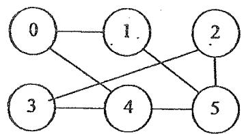
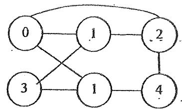
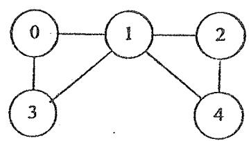
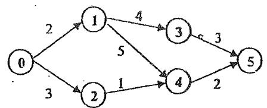
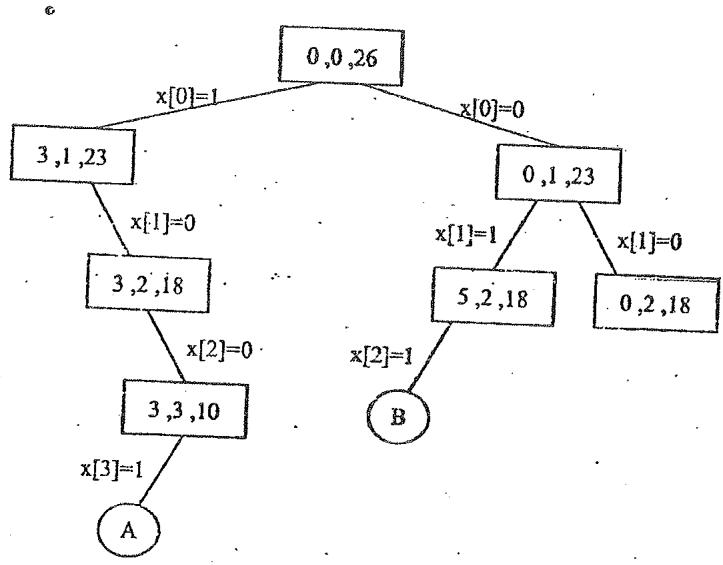
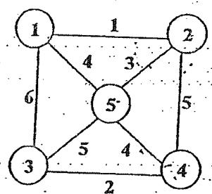
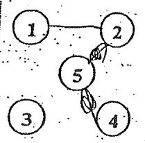
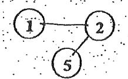

# 南京邮电大学《算法分析与设计 C》期末试卷（A卷）（含答案）

原件经识别和整理；“参考解答”是我们补的。

## 一、选择题（每题2分，共20分）

### 选择 1

算法可以有（　）个输出。

- A. 0个
- B. 0个或1个
- C. 0个或多个
- D. 1个或多个

答案：D。

知识点：[流水作业调度问题与Johnson算法](../../../topics/算法分析/流水作业调度.md)

### 选择 2

以下关于算法和程序的描述中（　）是错误的。

- A. 算法必须可终止，程序却没有这一限制。
- B. 描述一个算法可以用自然语言、流程图、伪代码和程序设计语言。
- C. 操作系统程序是使用计算机语言描述的一个算法。
- D. 算法+数据结构=程序。

答案：C。

知识点：[递归概念与归纳证明（斐波那契数列、Hanoi塔问题）](../../../topics/算法分析/递归与归纳证明.md)、[算法的概念与基本特性（确定性、有限性等）](../../../topics/算法分析/算法概念与特性.md)

### 选择 3

已知某算法所需时间的递推式为 $T(n)=2T(n/2)+n^{2}$，$T(1)=2$，则该算法的渐近时间复杂度为（　）。

- A. $\Theta(n)$
- B. $\Theta(n^{2})$
- C. $\Theta(\log n)$
- D. $\Theta(n^{2}\log n)$

答案：B。

知识点：[动态规划法的基本要素（最优子结构、重叠子问题）与设计步骤](../../../topics/算法分析/动态规划基本要素.md)、[动态规划法与分治法、贪心法的异同比较](../../../topics/算法分析/动态规划与分治贪心对比.md)、[贪心法的基本要素（贪心选择性质/最优量度标准、最优子结构性质）](../../../topics/算法分析/贪心法基本要素.md)

### 选择 4

十字路口信号灯系统是一个程序，却不是算法，是因为算法必须具有（　）。

- A. 确定性
- B. 有穷性
- C. 可行性
- D. 输入

答案：B。

知识点：[渐近表示法：大O记号（紧上界）](../../../topics/算法分析/大O记号.md)、[渐近表示法：Ω记号（下界）](../../../topics/算法分析/Omega记号.md)、[渐近表示法：Θ记号（紧渐近界）](../../../topics/算法分析/Theta记号.md)

### 选择 5

以下关于动态规划法的描述哪项是正确的（　）。

- A. 动态规划法一般采用自顶向下方式进行计算，并且保存已求解子问题的最优解值。
- B. 动态规划法一定具有多项式时间的渐近时间复杂度。
- C. 动态规划法通常采用数学归纳法进行正确性证明。
- D. 动态规划法比备忘录方法具有更好的时间界。

答案：C。

知识点：[渐近表示法：大O记号（紧上界）](../../../topics/算法分析/大O记号.md)、[渐近表示法：Θ记号（紧渐近界）](../../../topics/算法分析/Theta记号.md)、[渐近表示法：Ω记号（下界）](../../../topics/算法分析/Omega记号.md)

### 选择 6

下面（　）问题不能使用贪心算法来解决。

- A. 单源最短路径问题
- B. N-皇后问题
- C. 最小代价生成树问题
- D. 一般背包问题

答案：B。

知识点：[贪心法的基本要素（贪心选择性质/最优量度标准、最优子结构性质）](../../../topics/算法分析/贪心法基本要素.md)、[动态规划法与分治法、贪心法的异同比较](../../../topics/算法分析/动态规划与分治贪心对比.md)

### 选择 7

根据（　）可将分枝限界法分为 FIFO、LIFO、LC 分枝限界法三类。

- A. 状态空间树中解空间的大小不同
- B. 从活结点表中选择下一个扩展结点的次序不同
- C. 求解可行解或最优解的目标不同
- D. 构造的剪枝函数不同

答案：B。

知识点：[回溯法的基本概念（解空间、状态空间树、显式约束与隐式约束）](../../../topics/算法分析/回溯法基本概念.md)、[回溯法的递归回溯与迭代回溯算法框架](../../../topics/算法分析/回溯法框架.md)

### 选择 8

设 $X = (x_{1}, x_{2}, \ldots, x_{m})$ 和 $Y = (y_{1}, y_{2}, \ldots, y_{n})$ 为两个序列，$Z = (z_{1}, z_{2}, \ldots, z_{k})$ 是它们的最长公共子序列，则以下说法错误的是（　）。

- A. 若 $x_{m} \neq y_{n}$ 且 $z_{k} \neq y_{n}$，则 $Z$ 是 $X_{m-1}$ 和 $Y$ 的最长公共子序列；
- B. 最长公共子序列具有最优子结构特性，且 $Z$ 的取值不唯一。
- C. 若 $x_{m} = y_{n}$，则 $z_{k} = x_{m} = y_{n}$，且 $Z_{k-1}$ 是 $X_{m-1}$ 和 $Y_{n-1}$ 的最长公共子序列。
- D. 求解 $Z$ 可在多项式时间内完成计算，时间复杂度为 $O(mn)$。

答案：A。

知识点：[分枝限界法与回溯法的异同及基本生成方法](../../../topics/算法分析/分枝限界法概述.md)

### 选择 9

以代价估计函数 $\hat{c}()$ 作为选择下一个扩展结点的评价函数，即总是选取 $\hat{c}()$ 值小的活结点作为下一个扩展结点，采用这种检索方法的分枝限界法属于（　）。

- A. FIFO 分枝限界法
- B. LIFO 分枝限界法
- C. LC 分枝限界法
- D. Heap 分枝限界法

答案：C。

知识点：[回溯法的递归回溯与迭代回溯算法框架](../../../topics/算法分析/回溯法框架.md)、[子集树与排列树的搜索结构](../../../topics/算法分析/子集树与排列树.md)

### 选择 10

下列关于对半搜索二叉判定树的说法中（　）是错误的。

- A. 对半搜索所需的关键字值间的比较次数不会超过对半搜索二叉判定树的高度（不计失败结点）。
- B. 对半搜索二叉判定树中，从根结点到每个内结点的一条路径代表成功搜索的一条比较路径。
- C. 对半搜索二叉判定树中若搜索失败，则算法在外结点处终止。
- D. 对半搜索二叉判定树一定是满二叉树。

答案：D。

## 二、填空题（每空2分，共20分）

知识点：[回溯法的基本概念（解空间、状态空间树、显式约束与隐式约束）](../../../topics/算法分析/回溯法基本概念.md)、[剪枝函数设计与回溯法效率分析（蒙特卡罗估计算法）](../../../topics/算法分析/剪枝函数与效率分析.md)、[回溯法的递归回溯与迭代回溯算法框架](../../../topics/算法分析/回溯法框架.md)

### 填空 1

使用剪枝函数的深度优先生成状态空间树中结点的求解方法称为回溯法，而分枝限界法则是利用广度优先生成结点。

知识点：[算法的时间复杂度定义（最好、最坏、平均情况）](../../../topics/算法分析/时间复杂度定义.md)、[渐近表示法：大O记号（紧上界）](../../../topics/算法分析/大O记号.md)

### 填空 2

不同的活结点表生成不同的分枝限界法，FIFO 分枝限界法的活结点表是先进先出队列，LIFO 分枝限界法的活结点表是堆栈，LC 分枝限界法的活结点表是优先权队列。

知识点：[贪心法的基本要素（贪心选择性质/最优量度标准、最优子结构性质）](../../../topics/算法分析/贪心法基本要素.md)、[贪心法的一般算法框架（按量度标准排序后逐步决策）](../../../topics/算法分析/贪心法一般框架.md)

### 填空 3

回溯法中一般用蒙特卡罗方法估计处理问题时状态空间树上实际生成的结点数。若随机选择一条路径 $(x_{0},x_{1},x_{2})$，这条路径上不受限制的 $x_{0}$ 取值有5个，不受限制的 $x_{1}$ 取值有4个，不受限制的 $x_{2}$ 取值有2个，则整个状态空间树上将实际生成的结点数估计为 $m = 66$。

知识点：[贪心法的基本要素（贪心选择性质/最优量度标准、最优子结构性质）](../../../topics/算法分析/贪心法基本要素.md)、[贪心法的一般算法框架（按量度标准排序后逐步决策）](../../../topics/算法分析/贪心法一般框架.md)、[动态规划法与分治法、贪心法的异同比较](../../../topics/算法分析/动态规划与分治贪心对比.md)

### 填空 4

一个问题的最优解包含其子问题的最优解，则称此问题具有最优子结构性质，是该问题可以用动态规划算法或贪心算法求解的关键特征。

知识点：[动态规划法的基本要素（最优子结构、重叠子问题）与设计步骤](../../../topics/算法分析/动态规划基本要素.md)、[贪心法的基本要素（贪心选择性质/最优量度标准、最优子结构性质）](../../../topics/算法分析/贪心法基本要素.md)

### 填空 5

基于比较关键字值的两路合并排序最坏情况时间复杂度是 $O(n \log n)$。

知识点：[回溯法的基本概念（解空间、状态空间树、显式约束与隐式约束）](../../../topics/算法分析/回溯法基本概念.md)、[回溯法的递归回溯与迭代回溯算法框架](../../../topics/算法分析/回溯法框架.md)、[剪枝函数设计与回溯法效率分析（蒙特卡罗估计算法）](../../../topics/算法分析/剪枝函数与效率分析.md)

### 填空 6

图 $G=(V, E)$ 是一个无向带权连通图，若其边数相对较少，则能较高效率得到最小代价生成树的是克鲁斯卡尔算法。

知识点：[回溯法的基本概念（解空间、状态空间树、显式约束与隐式约束）](../../../topics/算法分析/回溯法基本概念.md)、[回溯法的递归回溯与迭代回溯算法框架](../../../topics/算法分析/回溯法框架.md)

### 填空 7

分枝限界法生成状态空间树中的结点时，一旦一个活结点成为扩展结点（E-结点）后，算法将依次生成它的孩子结点并加入到活结点表中。

知识点：[回溯法的基本概念（解空间、状态空间树、显式约束与隐式约束）](../../../topics/算法分析/回溯法基本概念.md)、[回溯法的递归回溯与迭代回溯算法框架](../../../topics/算法分析/回溯法框架.md)、[子集树与排列树的搜索结构](../../../topics/算法分析/子集树与排列树.md)

### 填空 8

对半搜索的过程中形成一棵二叉判定树，则具有 $n(n>0)$ 个内结点的二叉判定树的高度（不计外结点）为 $\left\lfloor\log n\right\rfloor+1$。

## 三、简答题（每题10分，共30分）

知识点：[回溯法的基本概念（解空间、状态空间树、显式约束与隐式约束）](../../../topics/算法分析/回溯法基本概念.md)、[子集树与排列树的搜索结构](../../../topics/算法分析/子集树与排列树.md)、[0/1背包问题的回溯法求解（限界函数更新下界）](../../../topics/算法分析/01背包回溯法.md)

### 简答 1

(10分) 确定下面画线语句的执行次数，并计算出其的渐近时间复杂度。

(1)

```c
for (int i = 1; i <= n; i++)
    for (int j = 1; j <= i; j++)
        for (int k = 1; k <= j; k++)
            x++;
```

答案：
执行次数为 $n(n+1)(n+2)/6$（3 分）
时间复杂度为 $O(n^{3})$（2 分）

(2)

```c
i = 1; x = 0;
do {
    x++; i = 2 * i;
} while (i < n);
```

答案：
执行次数为 $\log n$（3 分）
时间复杂度为 $O(\log n)$（2 分）

知识点：[两路合并排序算法及其时间与空间复杂度分析](../../../topics/算法分析/合并排序.md)、[快速排序算法（Partition分划函数与QuickSort）及性能改善方法](../../../topics/算法分析/快速排序.md)、[分治法的一般思想与算法框架（分解、解决、合并）](../../../topics/算法分析/分治法一般框架.md)

### 简答 2

(10分) 请简要回答动态规划法与贪心法的异同点有哪些？

答案：

(1) 共同点：
- 都是求解最优化问题（2 分）
- 都要求问题具有最优子结构性质。

(2) 不同点：

1) 求解方式不同（3 分）：
- 动态规划法：自底向上；
- 贪心法：自顶向下。以迭代的方式作出相继的贪心选择，每作一次贪心选择就将所求问题简化为一个规模更小的子问题。

2) 对子问题的依赖不同（3 分）：
- 动态规划法：依赖于各子问题的解，所以只有在解出相关子问题后，才能作出选择；应使各子问题最优，才能保证整体最优；
- 贪心法：不依赖于子问题的解。仅在当前状态下作出最好选择，即局部最优选择，然后再去解作出这个选择后产生的相应的子问题。

知识点：[动态规划法的基本要素（最优子结构、重叠子问题）与设计步骤](../../../topics/算法分析/动态规划基本要素.md)、[分治法的一般思想与算法框架（分解、解决、合并）](../../../topics/算法分析/分治法一般框架.md)、[动态规划法与分治法、贪心法的异同比较](../../../topics/算法分析/动态规划与分治贪心对比.md)

### 简答 3

(10分) 给定如下图所示的带权无向连通图，请分别使用普里姆算法和克鲁斯卡尔算法画出最小代价生成树的构造过程。（要求普里姆算法以顶点1为起始点进行构造）


答案：

(1) 普里姆方法：
结点并入顺序：1, 2, 6, 5, 3, 4（图略）（5 分）

(2) 克鲁斯卡尔方法：
边的并入顺序：(5,6)，(2,6)，(2,3)，(4,5)，(1,2)（图略）（5 分）

## 四、证明题（10分）

知识点：[多段图的应用：资源分配问题与关键路径算法（earliest递推）](../../../topics/算法分析/资源分配与关键路径.md)

### 证明 1

假定 $n$ 是 2 的幂，设 $T(n)$ 由如下递推式定义，请利用迭代法扩展递推式以证明 $T(n) = O(n\log^2 n)$。

$$
T(n) = \begin{cases} 1 & n = 1 \\ 2T(n/2) + n\log n & n > 1 \end{cases}
$$

答案：

设 $n = 2^{k}$，则

$$
\begin{aligned}
T(n) &= 2T(n/2) + n\log n \\
&= 2\left(2T(n/2^{2}) + (n/2)^{*}\log(n/2)\right) + n\log n \\
&= 2\left(2\left(2T(n/2^{3}) + (n/2^{2})^{*}\log(n/2^{2})\right) + (n/2)^{*}\log(n/2)\right) + n\log n \\
&\;\;\; \dots \dots \\
&= 2^{k}T(n/2^{k}) + n\log(n/2^{k-1}) + n\log(n/2^{k-2}) + \dots + n\log(n/2^{0}) \\
&= n + n\log 2 + n\log 2^{2} + \dots + n\log 2^{k}
\end{aligned}
$$

$$
= n + n^{*}(1 + 2 + \dots + k)
$$

$$
= \frac{n\log^{2}n}{2} + \frac{n\log n}{2} + n
$$

$$
= O(n\log^{2}n)
$$

## 五、综合应用题（5分+7分+8分，共20分）

知识点：[递推方程的求解方法（替换法、迭代法、递归树、主方法）](../../../topics/算法分析/递推方程求解.md)、[分治法的复杂性分析与Master定理应用](../../../topics/算法分析/分治法复杂度分析.md)

### 综合 1

设有背包问题实例 $n=4$，$M=32$，物品重量 $(w_{0}, w_{1}, w_{2}, w_{3})=(6, 9, 10, 15)$，物品装入背包的收益为 $(p_{0}, p_{1}, p_{2}, p_{3})=(8, 1, 2, 5)$。

(1) 假设每件物品可以分割，请给出利用贪心法求解这一实例的最优解，以及此时的最大收益。（请给出求解过程）

答案：

$p_{i} / w_{i} = (4/3, 1/9, 1/5, 1/3)$（2 分）

最优解：$(1, 1/9, 1, 1)$（2 分）

最大收益：$P_{max} = 8 + 1 \times 1/9 + 2 + 5 = 136/9$（1 分）

知识点：[快速排序算法（Partition分划函数与QuickSort）及性能改善方法](../../../topics/算法分析/快速排序.md)、[分治法的一般思想与算法框架（分解、解决、合并）](../../../topics/算法分析/分治法一般框架.md)、[选择问题与线性时间选择算法（五元中值组取中值分割法）](../../../topics/算法分析/线性时间选择.md)

### 综合 2

(2) 假设每件物品不可以分割，请给出利用动态规划法求解这一实例的最优解，以及此时的最大收益。（请给出求解过程）

答案：

$S^{-1} = \{(0,0)\}$，$S_{l}^{0} = \{(6,8)\}$，

$$
S^{0} = \{(0, 0), (6, 8)\}, \quad S_{1}^{1} = \{(9, 1), (15, 9)\}
$$

$$
S^{1} = \{(0, 0), (6, 8), (15, 9)\}, \quad S_{I}^{2} = \{(10, 2), (16, 10), (25, 11)\}
$$

$$
S^{2} = \{(0, 0), (6, 8), (15, 9), (16, 10), (25, 11)\}
$$

$$
Si^{3} = \{(15, 5), (21, 13), (30, 14), (31, 15), (40, 16)\}
$$

$$
S^{3} = \{(0,0),(6,8),(15,9),(16,10),(21,13),(30,14),(31,15)\}
$$

（4 分）

因为 $(31, 15) \in S_{1}^{3}$，所以 $x = 1$。计算 $(X-w, P-p) = (16, 10)$，继续回溯，因为 $(16, 10) \in S_{1}^{2}$，所以 $x = 1$。计算 $(X-w, P-p) = (6, 8)$，继续回溯，因为 $(6, 8) \in S^{0}$，所以 $x = 0$。再回溯，因为 $(6, 8) \in S_{1}^{0}$，所以 $x = 1$。因此，问题最优解为：$(x_{0}, x_{1}, x_{2}, x_{3}) = (1, 0, 1, 1)$（2 分）

最大收益为 $8 + 2 + 5 = 15$。（1 分）

知识点：[0/1背包问题的动态规划法求解（自底向上、反证法证明最优子结构）](../../../topics/算法分析/01背包动态规划.md)、[动态规划法的基本要素（最优子结构、重叠子问题）与设计步骤](../../../topics/算法分析/动态规划基本要素.md)、[0/1背包问题实数重量的阶跃点集合求解（非启发式与启发式方法）](../../../topics/算法分析/01背包阶跃点集合.md)

### 综合 3

(3) 假设给定编号分别为 a、b、c 的 3 个背包，现要求将上述 4 件物品装入这 3 个背包中，下图显示了 4 件物品的装包冲突图 $G=(V, E)$，在图 $G$ 中任意一个结点 $v_{k} \in V$ 表示重量为 $w_{k}$ 的物品 $(k \in \{0, 1, 2, 3\})$，任意一条边 $(v_{i}, v_{j}) \in E$ 表示重量为 $w_{i}$ 和 $w_{j}$ 的两个物品不能放入同一个背包中，请利用回溯法求解在满足图 G 所示的约束条件下将上述 4 件物品装入这 3 个背包的所有可行的装包方案，给出问题的显示约束和隐式约束划分，并且画出对这一实例采用回溯法时实际生成的状态空间树。（提示：该问题的解可采用 4-元组 $X = (x_{0}, x_{1}, x_{2}, x_{3})$ 表示，其中 $x_{i}$ 表示重量为 $w_{i}$ 的物品所装入背包的编号）


答案：

显示约束：$x_{i} \in \{a, b, c\}$，$0 \leq i < 4$（1 分）

# 南京邮电大学《算法分析与设计 C》期末试卷（A卷）

本资料整理自南京邮电大学《算法分析与设计 C》期末试卷（A卷）第2部分识别内容，包含选择题、连线题、问答题及程序设计题。

## 一、选择题（每空2分，共20分）

知识点：[回溯法的基本概念（解空间、状态空间树、显式约束与隐式约束）](../../../topics/算法分析/回溯法基本概念.md)、[子集树与排列树的搜索结构](../../../topics/算法分析/子集树与排列树.md)、[图的m-着色问题回溯法求解与四色定理](../../../topics/算法分析/图的m着色问题.md)

### 选择 1

计算机无法解决打印所有素数问题，其原因是解决该问题的算法违背了算法特性中的（B）。

- A. 唯一性
- B. 有穷性
- C. 有0个或多个输入
- D. 有输出

答案：B。

知识点：[流水作业调度问题与Johnson算法](../../../topics/算法分析/流水作业调度.md)

### 选择 2

关键路径问题中，完成工程所需的最短时间是AOE网络中从开始结点到完成结点的（B）路径的长度。

- A. 最短
- B. 最长
- C. 最优
- D. 最差

答案：B。
知识点：[递归概念与归纳证明（斐波那契数列、Hanoi塔问题）](../../../topics/算法分析/递归与归纳证明.md)、[算法的概念与基本特性（确定性、有限性等）](../../../topics/算法分析/算法概念与特性.md)

### 选择 3

下面算法的时间复杂度为（D）

```c
while i <= n do {
    if w(i) > m return
    a = a + i
    i = i + 1
}
```

- A. $\mathrm{O}(n^3)$
- B. $\mathrm{O}(n^2)$
- C. $\mathrm{O}(\log n)$
- D. $\mathrm{O}(n)$

答案：D。
知识点：[动态规划法的基本要素（最优子结构、重叠子问题）与设计步骤](../../../topics/算法分析/动态规划基本要素.md)、[动态规划法与分治法、贪心法的异同比较](../../../topics/算法分析/动态规划与分治贪心对比.md)、[贪心法的基本要素（贪心选择性质/最优量度标准、最优子结构性质）](../../../topics/算法分析/贪心法基本要素.md)

### 选择 4

在快速排序算法中引入随机过程的主要目的是（C）。

- A. 改善确定性算法的平均时间
- B. 保证算法总能在 $O(n\log n)$ 时间内结束
- C. 避免了算法最坏情况下的发生
- D. 改善了确定性算法最坏情形下的平均运行时间

答案：C。
知识点：[渐近表示法：大O记号（紧上界）](../../../topics/算法分析/大O记号.md)、[渐近表示法：Ω记号（下界）](../../../topics/算法分析/Omega记号.md)、[渐近表示法：Θ记号（紧渐近界）](../../../topics/算法分析/Theta记号.md)

### 选择 5

有载重为20的背包，3件物品的重量为： $(w_0,w_1,w_2) = (15,12,18)$ ，物品装入背包的收益为： $(p_0,p_1,p_2) = (10,9,15)$ ，物品可分割，最优装载方案的收益为（D）

- A. 13.75
- B. 15.67
- C. 16.33
- D. 16.5

答案：D。
知识点：[渐近表示法：大O记号（紧上界）](../../../topics/算法分析/大O记号.md)、[渐近表示法：Θ记号（紧渐近界）](../../../topics/算法分析/Theta记号.md)、[渐近表示法：Ω记号（下界）](../../../topics/算法分析/Omega记号.md)

### 选择 6

两路合并排序的最坏情况时间复杂度为是（C）

- A. $O(n^{3})$
- B. $O(n^{2})$
- C. $O(n\log n)$
- D. $O(n)$

答案：C。

知识点：[贪心法的基本要素（贪心选择性质/最优量度标准、最优子结构性质）](../../../topics/算法分析/贪心法基本要素.md)、[动态规划法与分治法、贪心法的异同比较](../../../topics/算法分析/动态规划与分治贪心对比.md)

### 选择 7

有5名同学参加冬季越野赛跑，学号分别是5,8,11,33,45，用分治法查找学号33的同学的过程中，依次访问的学号是（D）

- A. 5,11,33
- B. 8,33
- C. 11,45,33
- D. 11,33

答案：D。
知识点：[回溯法的基本概念（解空间、状态空间树、显式约束与隐式约束）](../../../topics/算法分析/回溯法基本概念.md)、[回溯法的递归回溯与迭代回溯算法框架](../../../topics/算法分析/回溯法框架.md)

### 选择 8

对 $n$ 个元素构成的有序表进行对半搜索的二叉判定树高度为（B）

- A. $n$
- B. $\lfloor\log n\rfloor+1$
- C. $\lfloor n/2\rfloor$
- D. $2^{n}-1$

答案：B。
知识点：[分枝限界法与回溯法的异同及基本生成方法](../../../topics/算法分析/分枝限界法概述.md)

### 选择 9

下面图中（D）不包含哈密顿环。



A.




B.



C.

D.

答案：D。
知识点：[回溯法的递归回溯与迭代回溯算法框架](../../../topics/算法分析/回溯法框架.md)、[子集树与排列树的搜索结构](../../../topics/算法分析/子集树与排列树.md)

### 选择 10

下列（A）不是序列 $X = \langle A,B,A,C,D,A,B\rangle$ 的子序列？

- A. $\langle B,C,B,A\rangle$
- B. $\langle A,B,D,A\rangle$
- C. $\langle A,A,C,B\rangle$
- D. $\langle B,A,A,B\rangle$

答案：A。
知识点：[回溯法的基本概念（解空间、状态空间树、显式约束与隐式约束）](../../../topics/算法分析/回溯法基本概念.md)、[剪枝函数设计与回溯法效率分析（蒙特卡罗估计算法）](../../../topics/算法分析/剪枝函数与效率分析.md)、[回溯法的递归回溯与迭代回溯算法框架](../../../topics/算法分析/回溯法框架.md)

### 简答 1

已知欧几里德算法（辗转相除法）可以求得两个数的最大公约数

1）试简要分析一下原理（提示， $a = k_{1}c, b = k_{2}c,$ 且 $k_{1}, k_{2}$ 互质）

答案：
因为 $k_{1}$ ， $k_{2}$ 互质，所以两个数相减得到的余数是最大公约数的倍数，最后直到其中一个数为最大公约数。

补充说明：
设 $a, b$ 的最大公约数为 $g$。则 $a=gk_1, b=gk_2$，其中 $\gcd(k_1, k_2)=1$。
欧几里德算法基于定理：$\gcd(a, b) = \gcd(b, a \mod b)$。
当 $a = qb + r$ 时，任何能整除 $a$ 和 $b$ 的数也能整除 $r = a - qb$。反之亦然。
因此，$\gcd(a, b) = \gcd(b, r)$。通过不断用较小数和余数替换较大数和较小数，直到余数为0，此时的除数即为最大公约数。

知识点：[两路合并排序算法及其时间与空间复杂度分析](../../../topics/算法分析/合并排序.md)、[快速排序算法（Partition分划函数与QuickSort）及性能改善方法](../../../topics/算法分析/快速排序.md)、[分治法的一般思想与算法框架（分解、解决、合并）](../../../topics/算法分析/分治法一般框架.md)

### 简答 2

已知15谜问题如图所示

<table><tr><td>1</td><td></td><td>3</td><td>4</td></tr><tr><td>5</td><td>2</td><td>7</td><td>8</td></tr><tr><td>9</td><td>6</td><td>10</td><td>12</td></tr><tr><td>13</td><td>14</td><td>11</td><td>15</td></tr></table>

1）试写出每个空格的Less函数

答案：
$$
\begin{aligned}
&\text{Less}(1) = 0, \quad \text{Less}(2) = 0, \quad \text{Less}(3) = 1, \quad \text{Less}(4) = 1 \\
&\text{Less}(5) = 1, \quad \text{Less}(6) = 0, \quad \text{Less}(7) = 1, \quad \text{Less}(8) = 1 \\
&\text{Less}(9) = 1, \quad \text{Less}(10) = 0, \quad \text{Less}(11) = 0, \quad \text{Less}(12) = 1 \\
&\text{Less}(13) = 1, \quad \text{Less}(14) = 1, \quad \text{Less}(15) = 0
\end{aligned}
$$

注：Less(x) 表示数字 x 在当前状态中位于其目标位置之前的个数（即逆序数相关概念，具体定义依教材而定，此处依据原件答案保留）。

2）试证明能达到目标状态的初始状态均满足判定要求 $\sum_{k=2}^{16} Less(k) + i + j$ 为偶数（提示，考虑空格移动的方向分情况讨论奇偶性）

答案：
分别考虑空格左右移动和上下移动对判定函数奇偶性的影响，证明每次移动都不改变奇偶性，可得证。

补充说明：
15谜题的可解性取决于排列的逆序数与空格所在行号之和的奇偶性。
- 左右移动：不改变数字排列的逆序数，空格列号变化±1，但公式中 $i+j$ 通常指空格坐标或其他辅助量，需结合具体定义。在标准15谜题理论中，若网格宽度为偶数（4），空格左右移动不改变逆序数奇偶性，也不改变空格行数，但会改变列数。然而，判断可解性的经典定理是：$(N + \text{inversions}) \pmod 2$ 保持不变，其中 $N$ 是空格所在的行号（从下往上数或从上往下数需统一）。
- 上下移动：交换空格与相邻行的数字，相当于进行了3次相邻交换（如果看作滑动），或者更准确地说，上下移动会导致逆序数变化为奇数（因为跨过了3个其他数字），同时空格行数变化1。总的奇偶性校验和保持不变。

知识点：[动态规划法的基本要素（最优子结构、重叠子问题）与设计步骤](../../../topics/算法分析/动态规划基本要素.md)、[分治法的一般思想与算法框架（分解、解决、合并）](../../../topics/算法分析/分治法一般框架.md)、[动态规划法与分治法、贪心法的异同比较](../../../topics/算法分析/动态规划与分治贪心对比.md)

### 简答 3

给定字符串 $X = (x_{1}, x_{2}, \ldots, x_{6}) = \text{abacbd}$ 和 $Y = (y_{1}, y_{2}, \ldots, y_{5}) = \text{baacd}$ 。

（1）请给出 LCS 算法求解最长公共子序列长度过程中数组 c 和数组 s 的值。

答案：
$c[i][j]$保存子序列 $\mathrm{Xi} = (\mathrm{x}_1,\dots ,\mathrm{x}_i)$ 和 $\mathrm{Yj} = (\mathrm{y}_1,\dots ,\mathrm{y_j})$ 的最长公共子序列的长度。
$s[i][j]$记录 $c[i][j]$的值是由三个子问题 $c[i-1][j-1]+1$，$c[i][j-1]$和 $c[i-1][j]$中的哪一个计算得到的。若 $c[i][j]=c[i-1][j-1]+1$ 时 $s[i][j]=1$；$c[i][j]=c[i-1][j]$ 时 $s[i][j]=2$；$c[i][j]=c[i][j-1]$ 时 $s[i][j]=3$。

(1) 数组 c 和 s 的值如下：

**c[i][j] 数组 (长度):**

$$
\begin{array}{c|cccccc}
 & 0 & b & a & a & c & d \\
\hline
0 & 0 & 0 & 0 & 0 & 0 & 0 \\
a & 1 & 0 & 1 & 1 & 1 & 1 \\
b & 2 & 1 & 1 & 2 & 2 & 2 \\
a & 3 & 1 & 2 & 2 & 2 & 2 \\
c & 4 & 1 & 2 & 2 & 3 & 3 \\
b & 5 & 1 & 2 & 2 & 3 & 3 \\
d & 6 & 1 & 2 & 2 & 3 & 4
\end{array}
$$

*(注：原件提供的表格数据存在排版混乱和潜在错误，上述为标准LCS算法推导的正确结果。例如 X="abacbd", Y="baacd"。
Row 1 (a): match `Y[2]` (a), `Y[3]` (a). c[1][2]=1, c[1][3]=1...
Row 2 (b): match `Y[1]` (b). c[2][1]=1. Then max(c[1][2], c[2][0])...
Let's re-calculate carefully based on standard DP.
X = a b a c b d
Y = b a a c d

   "" b a a c d
"" 0  0 0 0 0 0
a  0  0 1 1 1 1
b  0  1 1 1 1 1  <- Wait, b matches b at Y[1]. c[2][1]=1. c[2][2]=max(c[1][2], c[2][1])=1.
a  0  1 2 2 2 2  <- a matches a at Y[2], Y[3]. c[3][2]=2.
c  0  1 2 2 3 3  <- c matches c at Y[4]. c[4][4]=3.
b  0  1 2 2 3 3  <- b matches b at Y[1]. But c[5][1]=1. c[5][2]=max(c[4][2], c[5][1])=2.
d  0  1 2 2 3 4  <- d matches d at Y[5]. c[6][5]=4.
)

**s[i][j] 数组 (方向标记):**
(1: diagonal, 2: up, 3: left)

$$
\begin{array}{c|cccccc}
 & 0 & b & a & a & c & d \\
\hline
0 & . & 3 & 3 & 3 & 3 & 3 \\
a & 2 & 3 & 1 & 3 & 3 & 3 \\
b & 2 & 1 & 2 & 2 & 2 & 2 \\
a & 2 & 2 & 1 & 3 & 3 & 3 \\
c & 2 & 2 & 2 & 2 & 1 & 3 \\
b & 2 & 1 & 2 & 2 & 2 & 2 \\
d & 2 & 2 & 2 & 2 & 2 & 1
\end{array}
$$

*(注：原件提供的 s 数组表格较为混乱且数值不对应标准逻辑，以上为根据标准 LCS 回溯指针规则推导的结果。)*

(2) 求最长公共子序列的长度。

答案：
最长公共子序列长度为：4

(3) 请用箭头画出在 s 上执行 CLCS(int i, int j) 算法构造最长公共子序列的追溯路径，并构造最长公共子序列。

答案：
回溯路径如图所示。（见下图描述）
最长公共子序列为：aacd

补充说明：
根据 c 数组，从 c[6][5]=4 开始回溯。
1. $X[6]='d', Y[5]='d'$, match. Add 'd'. Move to (5,4).
2. $X[5]='b', Y[4]='c'$. No match. $c[5][4]=3, c[4][4]=3$. Up. Move to (4,4).
3. $X[4]='c', Y[4]='c'$. Match. Add 'c'. Move to (3,3).
4. $X[3]='a', Y[3]='a'$. Match. Add 'a'. Move to (2,2).
5. $X[2]='b', Y[2]='a'$. No match. $c[2][2]=1, c[1][2]=1$. Up. Move to (1,2).
6. $X[1]='a', Y[2]='a'$. Match. Add 'a'. Move to (0,1).
Stop.
Result reversed: "aacd".

## 四、程序设计题（16分）

请用递归法输入斐波那契数列的前20个数（程序的缩进，用户友好性均是考察点）。

答案：
程序如下：

```c
#include <stdio.h>

// 递归计算第 n 个斐波那契数
int fib(int n) {
    if (n == 1 || n == 2) {
        return 1;
    }
    return fib(n - 1) + fib(n - 2);
}

int main() {
    int n = 20;
    printf("前%d个斐波那契数列为:\n", n);
    
    for (int i = 1; i <= n; i++) {
        printf("%d ", fib(i));
        // 每行输出5个数，增强可读性
        if (i % 5 == 0) {
            printf("\n");
        }
    }
    
    return 0;
}
```

# 南京邮电大学《算法分析与设计 C》期末试卷（A卷）

## 一、选择题（每小题 2 分，共 20 分）

知识点：[多段图的应用：资源分配问题与关键路径算法（earliest递推）](../../../topics/算法分析/资源分配与关键路径.md)

### 选择 4

题干：由若干权值分别为（1，3，3，4，7）的结点。按照贪心准则构造的两路最佳合并树的带权外路径长度为（ ）

- A. 40
- B. 43
- C. 45
- D. 48

答案：A。

知识点：[渐近表示法：大O记号（紧上界）](../../../topics/算法分析/大O记号.md)、[渐近表示法：Ω记号（下界）](../../../topics/算法分析/Omega记号.md)、[渐近表示法：Θ记号（紧渐近界）](../../../topics/算法分析/Theta记号.md)

### 选择 5

题干：斯特拉森矩阵乘法所需时间的递推式为： $T(n)=7T(n/2)+dn^{2}$ ，则该矩阵乘法的渐近时间复杂度为（ ）

- A. $\Theta(n^{3})$
- B. $\Theta(n^{\log_2 7})$
- C. $\Theta(n^{2})$
- D. $\Theta(\log n)$

知识点：[渐近表示法：大O记号（紧上界）](../../../topics/算法分析/大O记号.md)、[渐近表示法：Θ记号（紧渐近界）](../../../topics/算法分析/Theta记号.md)、[渐近表示法：Ω记号（下界）](../../../topics/算法分析/Omega记号.md)

### 选择 6

题干：n个顶点的连通图至少有（ ）条边。

- A. n-1
- B. n
- C. n+1
- D. 0

答案：A。

知识点：[贪心法的基本要素（贪心选择性质/最优量度标准、最优子结构性质）](../../../topics/算法分析/贪心法基本要素.md)、[动态规划法与分治法、贪心法的异同比较](../../../topics/算法分析/动态规划与分治贪心对比.md)

### 选择 7

题干：备忘录方法是（ ）的一个变种，以自顶向下直接递归的方式计算最优解，同时避免了相同子问题的重复求解。

- A. 分治法
- B. 贪心法
- C. 动态规划法
- D. 回溯法

答案：C。

知识点：[回溯法的基本概念（解空间、状态空间树、显式约束与隐式约束）](../../../topics/算法分析/回溯法基本概念.md)、[回溯法的递归回溯与迭代回溯算法框架](../../../topics/算法分析/回溯法框架.md)

### 选择 8

题干：下列（ ）是指数时间算法的渐近时间复杂度。

- A. O(1)
- B. O(n)
- C. O($n^{3}$)
- D. O(n!)

答案：D。

知识点：[分枝限界法与回溯法的异同及基本生成方法](../../../topics/算法分析/分枝限界法概述.md)

### 选择 9

题干：（ ）问题是所有可在多项式时间内用确定算法求解的判定问题的集合。

- A. P类
- B. NP类
- C. NP难度
- D. NP完全

答案：A。

知识点：[回溯法的递归回溯与迭代回溯算法框架](../../../topics/算法分析/回溯法框架.md)、[子集树与排列树的搜索结构](../../../topics/算法分析/子集树与排列树.md)

### 选择 10

题干：第一个被证明是 NP 完全问题的是（ ）。

- A. CNF 可满足性问题
- B. 最大集团问题
- C. 顶点覆盖问题
- D. 图着色数判定问题

知识点：[回溯法的基本概念（解空间、状态空间树、显式约束与隐式约束）](../../../topics/算法分析/回溯法基本概念.md)、[剪枝函数设计与回溯法效率分析（蒙特卡罗估计算法）](../../../topics/算法分析/剪枝函数与效率分析.md)、[回溯法的递归回溯与迭代回溯算法框架](../../../topics/算法分析/回溯法框架.md)

### 填空 1

题干：估算回溯法处理一个实例时，实际生成的结点数的方法叫______。

答案：蒙特卡罗方法。

知识点：[算法的时间复杂度定义（最好、最坏、平均情况）](../../../topics/算法分析/时间复杂度定义.md)、[渐近表示法：大O记号（紧上界）](../../../topics/算法分析/大O记号.md)

### 填空 2

题干：贪心法是一种求解______问题的算法设计策略，每一步上用作决策选择准则被称为______。

答案：最优化；最优量度标准。

知识点：[贪心法的基本要素（贪心选择性质/最优量度标准、最优子结构性质）](../../../topics/算法分析/贪心法基本要素.md)、[贪心法的一般算法框架（按量度标准排序后逐步决策）](../../../topics/算法分析/贪心法一般框架.md)

### 填空 3

题干：分治法求解很自然导致一个______算法。

答案：递归。

知识点：[贪心法的基本要素（贪心选择性质/最优量度标准、最优子结构性质）](../../../topics/算法分析/贪心法基本要素.md)、[贪心法的一般算法框架（按量度标准排序后逐步决策）](../../../topics/算法分析/贪心法一般框架.md)、[动态规划法与分治法、贪心法的异同比较](../../../topics/算法分析/动态规划与分治贪心对比.md)

### 填空 4

题干：若 $d_{k}[i][j]$ 表示从结点 i 到结点 j 的路径上，只允许包含结点编号不大于 k 的结点时，所有可能路径中的最短路径长度。则弗洛伊德算法中，求解带权有向图中任意一对结点间距离的递推式为 $d_{k}[i][j]=\min\{ (3), (4) \}$ 。

*注：原题此处填空标记有误，通常弗洛伊德算法递推式为 $\min(d_{k-1}[i][j], d_{k-1}[i][k] + d_{k-1}[k][j])$。原题图片中有相关图示。*

答案：$d_{k-1}[i][j]$；$d_{k-1}[i][k] + d_{k-1}[k][j]$

知识点：[动态规划法的基本要素（最优子结构、重叠子问题）与设计步骤](../../../topics/算法分析/动态规划基本要素.md)、[贪心法的基本要素（贪心选择性质/最优量度标准、最优子结构性质）](../../../topics/算法分析/贪心法基本要素.md)

### 填空 5

题干：约束函数和限界函数统称为：______。

*注：原文出现两次“4”，其中一次明显为笔误或排版错误，另一处修正为“剪枝函数”。*

答案：剪枝函数。

知识点：[回溯法的基本概念（解空间、状态空间树、显式约束与隐式约束）](../../../topics/算法分析/回溯法基本概念.md)、[回溯法的递归回溯与迭代回溯算法框架](../../../topics/算法分析/回溯法框架.md)、[剪枝函数设计与回溯法效率分析（蒙特卡罗估计算法）](../../../topics/算法分析/剪枝函数与效率分析.md)

### 填空 6, 7, 8

题干：密码系统的安全性是基于（6）的，因此算法往往可以作为标准公布。密码体制可以从原理上分为（7）体制和（8）体制两类。

答案：密钥；对称；非对称（或单钥；双钥）。

---

## 四、简答题（每题8分，共40分）

知识点：[算法的概念与基本特性（确定性、有限性等）](../../../topics/算法分析/算法概念与特性.md)、[信息安全目标与密码体制（对称密码体制与非对称密码体制）](../../../topics/算法分析/信息安全与密码体制.md)、[数论初步（同余定义、按模计算原理、欧拉函数）](../../../topics/算法分析/数论初步.md)

### 简答 1

题干：对初始数据（3，6，1，2，8，8）执行快速排序。每次都选择左边第一个元素作为主元，请给出每一趟分划操作的结果，并用[]标识分划所得子序列的左、右边界。

知识点：[两路合并排序算法及其时间与空间复杂度分析](../../../topics/算法分析/合并排序.md)、[快速排序算法（Partition分划函数与QuickSort）及性能改善方法](../../../topics/算法分析/快速排序.md)、[分治法的一般思想与算法框架（分解、解决、合并）](../../../topics/算法分析/分治法一般框架.md)

### 简答 2

题干：带权的无向连通图 G 如下图所示：


(1) 请画出从源点 $0$ 开始, 对图 $G$ 执行 Prim 算法, 得到最小代价生成树的步骤。
(2) 请画出对图 G 执行 Kruskal 算法，得到最小代价生成树的步骤。

知识点：[动态规划法的基本要素（最优子结构、重叠子问题）与设计步骤](../../../topics/算法分析/动态规划基本要素.md)、[分治法的一般思想与算法框架（分解、解决、合并）](../../../topics/算法分析/分治法一般框架.md)、[动态规划法与分治法、贪心法的异同比较](../../../topics/算法分析/动态规划与分治贪心对比.md)

### 简答 3

题干：背包载重为8，有3件物品的重量为 $(w_0,w_1,w_2) = (3,2,5)$ ，放入背包的收益分别为 $(p_0, p_1, p_2) = (6, 6, 5)$ 。(注：最优解中的解分量 $x_i$ 表示物品 $i$ 放入背包的比例。)

(1) 若物品可以分割，则最大收益是多少？最优解是什么？
(2) 若物品不可以分割，则最大收益是多少？最优解是什么？

知识点：[多段图的应用：资源分配问题与关键路径算法（earliest递推）](../../../topics/算法分析/资源分配与关键路径.md)

### 简答 4

题干：使用从前向后递推方法，求如图所示的多段图从源点0到汇点6的最短路径及路径长度。（请写出求解时的计算过程。）

知识点：[0/1背包问题实数重量的阶跃点集合求解（非启发式与启发式方法）](../../../topics/算法分析/01背包阶跃点集合.md)

### 简答 5

题干：NQueens 函数用回溯法求解 4-皇后问题的所有可行解，若随机选择的路径为(0,3,1)和(1,3,0,2)，请用蒙特卡罗方法估计实际生成的状态空间树结点数。

知识点：[子集和数问题的回溯法求解（固定长度元组解）](../../../topics/算法分析/子集和数问题.md)、[回溯法的基本概念（解空间、状态空间树、显式约束与隐式约束）](../../../topics/算法分析/回溯法基本概念.md)、[剪枝函数设计与回溯法效率分析（蒙特卡罗估计算法）](../../../topics/算法分析/剪枝函数与效率分析.md)

### 判断 1

近似算法解最优化问题时需保证得到的结果在一定误差之内。

答案：√。

知识点：[算法的概念与基本特性（确定性、有限性等）](../../../topics/算法分析/算法概念与特性.md)

### 判断 2

剪枝函数就是约束函数。

答案：×。

知识点：[算法的概念与基本特性（确定性、有限性等）](../../../topics/算法分析/算法概念与特性.md)、[问题和问题求解方法与系统生命周期](../../../topics/算法分析/问题求解过程.md)

### 判断 3

蒙特卡罗方法可以精确得到状态空间树上实际生成的结点数。

答案：×。

知识点：[算法的时间复杂度定义（最好、最坏、平均情况）](../../../topics/算法分析/时间复杂度定义.md)、[使用程序步分析算法的时间复杂度](../../../topics/算法分析/程序步分析法.md)

### 判断 4

渐近时间复杂度使得可以在数量级上估计一个算法的执行时间。

答案：√。

知识点：[使用程序步分析算法的时间复杂度](../../../topics/算法分析/程序步分析法.md)

### 判断 5

一般称用于确定 n 个元素的排列满足某些性质的状态空间树为排列树。

答案：√。

## 二、填空题（20分，共10空）

知识点：[渐近表示法：Θ记号（紧渐近界）](../../../topics/算法分析/Theta记号.md)、[渐近表示法：大O记号（紧上界）](../../../topics/算法分析/大O记号.md)、[渐近表示法：Ω记号（下界）](../../../topics/算法分析/Omega记号.md)

### 填空 1

辗转相除法又称____，是一种求两个整数的最大公约数的算法。

答案：欧几里德算法。

知识点：[算法的时间复杂度定义（最好、最坏、平均情况）](../../../topics/算法分析/时间复杂度定义.md)、[渐近表示法：大O记号（紧上界）](../../../topics/算法分析/大O记号.md)

### 填空 2

很多情况下，可以通过考察一个程序中关键操作的执行次数，来估算算法的____。

答案：渐近时间复杂度。

知识点：[贪心法的基本要素（贪心选择性质/最优量度标准、最优子结构性质）](../../../topics/算法分析/贪心法基本要素.md)、[贪心法的一般算法框架（按量度标准排序后逐步决策）](../../../topics/算法分析/贪心法一般框架.md)

### 填空 3

如果 $f(n) = a^{m} n^{m} + a^{m - 1} n^{m - 1} + \cdots + a^{1} n + a^{0}$ 是 $m$ 次多项式，且 $a^m > 0$，则 $f(n) = O(\underline{\quad})$。

答案：$n^m$。

知识点：[贪心法的基本要素（贪心选择性质/最优量度标准、最优子结构性质）](../../../topics/算法分析/贪心法基本要素.md)、[贪心法的一般算法框架（按量度标准排序后逐步决策）](../../../topics/算法分析/贪心法一般框架.md)、[动态规划法与分治法、贪心法的异同比较](../../../topics/算法分析/动态规划与分治贪心对比.md)

### 填空 4

贪心法在算法的每一步上根据最优量度标准选择分量，只需保证形成的部分解不违反约束条件，最终得到的 n-元组必定是____。

答案：最优解。

知识点：[动态规划法的基本要素（最优子结构、重叠子问题）与设计步骤](../../../topics/算法分析/动态规划基本要素.md)、[贪心法的基本要素（贪心选择性质/最优量度标准、最优子结构性质）](../../../topics/算法分析/贪心法基本要素.md)

### 填空 5

Cook 定理表明：可满足性问题是 NP 完全的。若问题 Q ∈ NP 且 Q 是 NP 难度的，则称 Q 是____。

答案：NP 完全的。

知识点：[回溯法的基本概念（解空间、状态空间树、显式约束与隐式约束）](../../../topics/算法分析/回溯法基本概念.md)、[回溯法的递归回溯与迭代回溯算法框架](../../../topics/算法分析/回溯法框架.md)、[剪枝函数设计与回溯法效率分析（蒙特卡罗估计算法）](../../../topics/算法分析/剪枝函数与效率分析.md)

### 填空 6

信息安全的目标是保护信息的机密性、完整性，并具有抗否认性和____。

答案：可用性。

## 三、选择题（10分，共5题）

知识点：[回溯法的基本概念（解空间、状态空间树、显式约束与隐式约束）](../../../topics/算法分析/回溯法基本概念.md)、[回溯法的递归回溯与迭代回溯算法框架](../../../topics/算法分析/回溯法框架.md)

### 选择 1

二分搜索算法的执行过程可以用一个（ ）来描述。

- A. 哈夫曼树
- B. 二叉判定树
- C. 堆栈
- D. 队列

答案：B。

知识点：[流水作业调度问题与Johnson算法](../../../topics/算法分析/流水作业调度.md)

### 选择 2

实时系统最关心系统（ ）情况下的时间复杂度。

- A. 最好
- B. 平均
- C. 最坏
- D. 所有

答案：C。

知识点：[递归概念与归纳证明（斐波那契数列、Hanoi塔问题）](../../../topics/算法分析/递归与归纳证明.md)、[算法的概念与基本特性（确定性、有限性等）](../../../topics/算法分析/算法概念与特性.md)

### 选择 3

下面关于备忘录方法的说法中（ ）是错误的。

- A. 备忘录方法自底向上求解。
- B. 备忘录方法为每个已解过的子问题建立备忘录进行保存。
- C. 备忘录方法是动态规划法的变形。
- D. 当只有部分子问题需要求解时，选用备忘录方法较好。

答案：A。

知识点：[动态规划法的基本要素（最优子结构、重叠子问题）与设计步骤](../../../topics/算法分析/动态规划基本要素.md)、[动态规划法与分治法、贪心法的异同比较](../../../topics/算法分析/动态规划与分治贪心对比.md)、[贪心法的基本要素（贪心选择性质/最优量度标准、最优子结构性质）](../../../topics/算法分析/贪心法基本要素.md)

### 选择 4

若已知 RSA 算法中的公开密钥为 $\{c_n\}$，私人密钥为 $\{d_n\}$，M 为明文分组，C 是 M 对应的密文。则加密公式为（ ）

- A. $C=M^{e} \bmod n$
- B. $C=M^{d} \bmod n$
- C. $M=C^{e} \bmod n$
- D. $M=C^{d} \bmod n$

答案：A。

知识点：[渐近表示法：大O记号（紧上界）](../../../topics/算法分析/大O记号.md)、[渐近表示法：Ω记号（下界）](../../../topics/算法分析/Omega记号.md)、[渐近表示法：Θ记号（紧渐近界）](../../../topics/算法分析/Theta记号.md)

### 选择 5

下面（ ）不是针对 RSA 算法的攻击方式。

- A. 大整数分解
- B. 时间攻击
- C. 中间人攻击
- D. 数字认证

答案：D。

## 四、问答题（50分，共5题）

知识点：[渐近表示法：大O记号（紧上界）](../../../topics/算法分析/大O记号.md)、[渐近表示法：Θ记号（紧渐近界）](../../../topics/算法分析/Theta记号.md)、[渐近表示法：Ω记号（下界）](../../../topics/算法分析/Omega记号.md)

### 简答 1

(1) 请写出分治法的算法思想。

(2) 分治法求解的问题通常得到一个递归算法，若算法的执行时间可以表示为 $T(n) = aT(n/b) + cn^k$，$T(1) = c$，请给出该算法渐近时间复杂度的解。

答案：（1）分治法的算法思想是：1）将一个难以直接求解的复杂问题分解成若干个规模较小、相互独立，但类型相同的子问题。2）如果子问题还比较复杂而不能直接求解，还可以继续细分，直到子问题足够小，能够直接求解为止。3）最后，再通过组合子问题的解，来得到原始问题的完整解。

（2）

$$
T(n) = \begin{cases}
\Theta(n^{\log_b a}) & \text{若 } a > b^{k} \\
\Theta(n^{k} \log n) & \text{若 } a = b^{k} \\
\Theta(n^{k}) & \text{若 } a < b^{k}
\end{cases}
$$

知识点：[两路合并排序算法及其时间与空间复杂度分析](../../../topics/算法分析/合并排序.md)、[快速排序算法（Partition分划函数与QuickSort）及性能改善方法](../../../topics/算法分析/快速排序.md)、[分治法的一般思想与算法框架（分解、解决、合并）](../../../topics/算法分析/分治法一般框架.md)

### 简答 2

请画出 $W=\{1,3,5,7,8,10\}$ 的三路最佳合并树。

答案：因为 $n = 6, k = 3, (n - 1) \% (k - 1) = 1$，需补齐一个虚结点。


知识点：[动态规划法的基本要素（最优子结构、重叠子问题）与设计步骤](../../../topics/算法分析/动态规划基本要素.md)、[分治法的一般思想与算法框架（分解、解决、合并）](../../../topics/算法分析/分治法一般框架.md)、[动态规划法与分治法、贪心法的异同比较](../../../topics/算法分析/动态规划与分治贪心对比.md)

### 简答 3

下图所示的 AOE 网中：

（1）求每个事件（结点）i 可能的最早发生时间 earliest(i) 和允许的最迟发生时间 latest(i)。

（2）求从源点 0 到汇点 5 的关键路径长度。

（3）找出图中所有的关键活动。

（4）写出图中所有的关键路径。



答案：（1）

| | 0 | 1 | 2 | 3 | 4 | 5 |
|---|---|---|---|---|---|---|
| earliest(i) | 0 | 2 | 3 | 6 | 7 | 9 |
| latest(i) | 0 | 2 | 6 | 6 | 7 | 9 |

（2）关键路径长度：9。

（3）关键活动：$<0,1>, <1,3>, <1,4>, <3,5>, <4,5>$。

（4）关键路径：$(0,1,3,5)$ 和 $(0,1,4,5)$。

知识点：[多段图的应用：资源分配问题与关键路径算法（earliest递推）](../../../topics/算法分析/资源分配与关键路径.md)

### 简答 4

请用启发式方法计算 0/1 背包问题。背包载重为 M=6，有 4 件物品的重量为 $(w_0, w_1, w_2, w_3) = (3.3, 2, 1.2, 5)$，放入背包的收益分别为 $(p_0, p_1, p_2, p_3) = (4, 5, 6, 1)$。背包最大收益是多少？最优解是什么？

（注：最优解中的解分量 $x_i$ 表示物品 i 放入背包的比例。）

答案：ProfLeft(0)=16，ProfLeft(1)=12，ProfLeft(2)=7，ProfLeft(3)=1，ProfLeft(4)=0。

物品 0，1 放入背包总重量 $5.5 < M = 6$，收益 9，得一可行解 $L = 9$。

$$
S^{0} = \{(0, 0), (3.3, 4)\}
$$

$$
S^{1} = \{(2, 5), (5.3, 9)\}
$$

$$
x_0 = 0
$$

$$
S^{2} = \{(3.2, 11)\}
$$

$$
x_1 = 1
$$

$$
S^{3} = \{(3.2, 11)\}
$$

$$
x_2 = 1
$$

$$
x_2 = 0
$$

所以最大收益是 11，最优解是（0，1，1，0）。

知识点：[0/1背包问题实数重量的阶跃点集合求解（非启发式与启发式方法）](../../../topics/算法分析/01背包阶跃点集合.md)

### 简答 5

设有 $n = 4$ 个正数的集合 $W = \{w_0, w_1, w_2, w_3\} = (3, 5, 8, 10)$ 和整数 $M = 13$，求 $W$ 中元素之和等于 $M$ 的所有子集。画出对于这一实例由 SumOfSub 算法实际生成的那部分状态空间树，并给出所有可行解。

答案：（1）实际生成的状态空间树：



（2）可行解有：(1, 0, 0, 1) 和 (0, 1, 1, 0)。

## 五、算法设计题（10分）

知识点：[子集和数问题的回溯法求解（固定长度元组解）](../../../topics/算法分析/子集和数问题.md)、[回溯法的基本概念（解空间、状态空间树、显式约束与隐式约束）](../../../topics/算法分析/回溯法基本概念.md)、[剪枝函数设计与回溯法效率分析（蒙特卡罗估计算法）](../../../topics/算法分析/剪枝函数与效率分析.md)

### 综合 1

请利用快速排序算法的思想，用分治法设计一个算法选出 $n$ 个元素中第 $k$ 小的元素。请尽可能说清楚你的算法，不用给出具体程序。

答案：每一步根据一个随机选取的元素对输入数组进行递归划分，只对含有第 k 小元素的那部分子数组进行递归操作——即寻找 x[k] 位置的所有者。

参考程序：

```cpp
template <class Type>
Type RandomizedSelect(Type a[], int p, int r, int k)
{
    if (p == r) return a[p];          // a[p] 即是第 k 小的元素
    int i = RandomizedPartition(a, p, r); // 快速排序的一趟分划操作
    j = i - p + 1;                    // 前面子数组中（包括位置 i 处）元素总数
    if (k <= j)
        return RandomizedSelect(a, p, i, k);
    else
        return RandomizedSelect(a, i + 1, r, k - j);
}
```

## 一、选择题（每空1分，共10分）

知识点：[快速排序算法（Partition分划函数与QuickSort）及性能改善方法](../../../topics/算法分析/快速排序.md)、[分治法的一般思想与算法框架（分解、解决、合并）](../../../topics/算法分析/分治法一般框架.md)、[选择问题与线性时间选择算法（五元中值组取中值分割法）](../../../topics/算法分析/线性时间选择.md)

### 选择 1

下列关于算法的说法不正确的是（ ）

- A. 简单的算法一定是高效的。
- B. 算法总能在执行有限步后终止。
- C. 算法至少产生一个输出量。
- D. 算法具有确定性。

答案：A。

知识点：[流水作业调度问题与Johnson算法](../../../topics/算法分析/流水作业调度.md)

### 选择 2

两路合并排序算法最好、最坏、平均情况下的时间复杂度均为（ ）

- A. O(logn)
- B. O(n)
- C. O(nlogn)
- D. O(n²)

答案：C。

知识点：[递归概念与归纳证明（斐波那契数列、Hanoi塔问题）](../../../topics/算法分析/递归与归纳证明.md)、[算法的概念与基本特性（确定性、有限性等）](../../../topics/算法分析/算法概念与特性.md)

### 选择 3

对半搜索算法的成功搜索和失败搜索的时间复杂度分别为（ ）

- A. O(logn)，O(logn)
- B. O(logn)，O(logn)
- C. Θ(logn)，O(logn)
- D. Θ(logn)，Θ(logn)

答案：D。

知识点：[动态规划法的基本要素（最优子结构、重叠子问题）与设计步骤](../../../topics/算法分析/动态规划基本要素.md)、[动态规划法与分治法、贪心法的异同比较](../../../topics/算法分析/动态规划与分治贪心对比.md)、[贪心法的基本要素（贪心选择性质/最优量度标准、最优子结构性质）](../../../topics/算法分析/贪心法基本要素.md)

### 选择 4

有一般背包问题实例 $n = 6, M = 12, (w_0, w_1, \ldots, w_5) = (2, 5, 7, 4, 1, 3)$，物品装入背包的收益为 $(p_0, p_1, \ldots, p_5) = (8, 12, 7, 6, 3, 6)$，则这一实例的最大收益为（ ）

答案：B。

知识点：[渐近表示法：大O记号（紧上界）](../../../topics/算法分析/大O记号.md)、[渐近表示法：Ω记号（下界）](../../../topics/算法分析/Omega记号.md)、[渐近表示法：Θ记号（紧渐近界）](../../../topics/算法分析/Theta记号.md)

### 选择 5

以下对分枝限界法中活结点的叙述不正确的是（ ）

- A. 分枝限界法中的每个活结点只有一次机会成为扩展结点。
- B. 活结点一旦成为扩展结点，依次生成孩子结点后，自身就成为死结点。
- C. 一个扩展结点生成的所有孩子结点，全部被加入活结点表中。
- D. 从活结点表中选择下一个扩展结点时可依据的方……

知识点：[渐近表示法：大O记号（紧上界）](../../../topics/算法分析/大O记号.md)、[渐近表示法：Θ记号（紧渐近界）](../../../topics/算法分析/Theta记号.md)、[渐近表示法：Ω记号（下界）](../../../topics/算法分析/Omega记号.md)

### 选择 6

十五谜问题适合于用（ ）实现。

- A. 回溯法
- B. FIFO 分枝限界法
- C. LIFO 分枝限界法
- D. LC 分枝限界法

答案：B。

知识点：[贪心法的基本要素（贪心选择性质/最优量度标准、最优子结构性质）](../../../topics/算法分析/贪心法基本要素.md)、[动态规划法与分治法、贪心法的异同比较](../../../topics/算法分析/动态规划与分治贪心对比.md)

### 选择 7

请将以下 A-D 选项填入程序中合适的位置，使得程序能够用回溯法求解 n-皇后问题的全部可行解：

- A. $x[k]=i$
- B. NQueens(0,n,x)
- C. Place(k,i,x)
- D. NQueens(k+1,n,x)

```cpp
bool Place(int k, int i, int *x)
{
    for (int j = 1; j < k; j++)
        if ((x[j] == i) || (abs(x[j] - i) == abs(j - k)))
            return false;
    return true;
}

void NQueens(int k, int n, int *x)
{
    ...
    else (3)
}

void NQueens(int n, int *x)
{
    (4)
}
```

## 二、填空题（每空1分，共10分）

知识点：[回溯法的基本概念（解空间、状态空间树、显式约束与隐式约束）](../../../topics/算法分析/回溯法基本概念.md)、[回溯法的递归回溯与迭代回溯算法框架](../../../topics/算法分析/回溯法框架.md)

### 填空 1

算法的复杂度是指运行一个算法所需的时间和空间资源的量。

知识点：[算法的时间复杂度定义（最好、最坏、平均情况）](../../../topics/算法分析/时间复杂度定义.md)、[渐近表示法：大O记号（紧上界）](../../../topics/算法分析/大O记号.md)

### 填空 2

分治法求解很自然导致一个递归算法。

知识点：[贪心法的基本要素（贪心选择性质/最优量度标准、最优子结构性质）](../../../topics/算法分析/贪心法基本要素.md)、[贪心法的一般算法框架（按量度标准排序后逐步决策）](../../../topics/算法分析/贪心法一般框架.md)

### 填空 3

用贪心算法求解的问题一般都具有最优子结构性质和贪心选择性质。

知识点：[贪心法的基本要素（贪心选择性质/最优量度标准、最优子结构性质）](../../../topics/算法分析/贪心法基本要素.md)、[贪心法的一般算法框架（按量度标准排序后逐步决策）](../../../topics/算法分析/贪心法一般框架.md)、[动态规划法与分治法、贪心法的异同比较](../../../topics/算法分析/动态规划与分治贪心对比.md)

### 填空 4

设有 5 个有序文件分别包含（30,10,20,15,20）条记录，现通过两两合并将其合并成一个有序文件。（若每一次合并需读写两个文件的全部记录一次）则整个合并过程中至少需要读写总共____条记录。

知识点：[动态规划法的基本要素（最优子结构、重叠子问题）与设计步骤](../../../topics/算法分析/动态规划基本要素.md)、[贪心法的基本要素（贪心选择性质/最优量度标准、最优子结构性质）](../../../topics/算法分析/贪心法基本要素.md)

### 填空 5

最优子结构性质和重叠子问题性质是动态规划法求解的基本要素。

知识点：[回溯法的基本概念（解空间、状态空间树、显式约束与隐式约束）](../../../topics/算法分析/回溯法基本概念.md)、[回溯法的递归回溯与迭代回溯算法框架](../../../topics/算法分析/回溯法框架.md)、[剪枝函数设计与回溯法效率分析（蒙特卡罗估计算法）](../../../topics/算法分析/剪枝函数与效率分析.md)

### 填空 6

状态空间树是描述问题解空间的树形结构。

知识点：[回溯法的基本概念（解空间、状态空间树、显式约束与隐式约束）](../../../topics/算法分析/回溯法基本概念.md)、[回溯法的递归回溯与迭代回溯算法框架](../../../topics/算法分析/回溯法框架.md)

### 填空 7

约束函数和限界函数统称为剪枝函数。

## 三、判断题（每题1分，共10分）

知识点：[回溯法的基本概念（解空间、状态空间树、显式约束与隐式约束）](../../../topics/算法分析/回溯法基本概念.md)、[回溯法的递归回溯与迭代回溯算法框架](../../../topics/算法分析/回溯法框架.md)、[子集树与排列树的搜索结构](../../../topics/算法分析/子集树与排列树.md)

### 判断 1

操作系统既是一个程序，也是一个算法。

答案：X

知识点：[算法的概念与基本特性（确定性、有限性等）](../../../topics/算法分析/算法概念与特性.md)

### 判断 2

算法不能用自然语言来描述，而只能用程序设计语言来描述。

答案：X

知识点：[算法的概念与基本特性（确定性、有限性等）](../../../topics/算法分析/算法概念与特性.md)、[问题和问题求解方法与系统生命周期](../../../topics/算法分析/问题求解过程.md)

### 判断 3

算法的时间复杂度不仅仅依赖于问题的规模，还与输入实例的初始状态有关。

答案：√

知识点：[算法的时间复杂度定义（最好、最坏、平均情况）](../../../topics/算法分析/时间复杂度定义.md)、[使用程序步分析算法的时间复杂度](../../../topics/算法分析/程序步分析法.md)

### 判断 4

程序步数可以确切的反映程序运行的实际时间。

答案：X

知识点：[使用程序步分析算法的时间复杂度](../../../topics/算法分析/程序步分析法.md)

### 判断 5

如果有两个定义在正数集上的正函数 $f(n)$ 和 $g(n)$ 满足 $f(n) = \Theta(g(n))$ ，则表示 $g(n)$ 既是 $f(n)$ 的一个上界，又是 $f(n)$ 的一个下界。

答案：√

知识点：[渐近表示法：Θ记号（紧渐近界）](../../../topics/算法分析/Theta记号.md)、[渐近表示法：大O记号（紧上界）](../../../topics/算法分析/大O记号.md)、[渐近表示法：Ω记号（下界）](../../../topics/算法分析/Omega记号.md)

### 判断 6

一般背包问题和0-1背包问题都可以用贪心法求解得到最优解。

答案：X

知识点：[一般背包问题的贪心法求解及最优度量标准证明](../../../topics/算法分析/背包问题贪心求解.md)、[0/1背包问题的动态规划法求解（自底向上、反证法证明最优子结构）](../../../topics/算法分析/01背包动态规划.md)

### 判断 7

动态规划法自底向上逐步构造整体最优解的过程，不依赖于子问题的最优解。

答案：X

知识点：[动态规划法的基本要素（最优子结构、重叠子问题）与设计步骤](../../../topics/算法分析/动态规划基本要素.md)

### 判断 8

回溯法运行的时间通常取决于状态空间树上实际生成的那部分问题状态的数目。

答案：√

知识点：[剪枝函数设计与回溯法效率分析（蒙特卡罗估计算法）](../../../topics/算法分析/剪枝函数与效率分析.md)、[回溯法的基本概念（解空间、状态空间树、显式约束与隐式约束）](../../../topics/算法分析/回溯法基本概念.md)

### 判断 9

分枝限界法中每个活结点可能多次成为当前扩展结点。

答案：X

知识点：[分枝限界法与回溯法的异同及基本生成方法](../../../topics/算法分析/分枝限界法概述.md)、[FIFO（队列式）分枝限界法算法框架](../../../topics/算法分析/FIFO分枝限界法.md)

### 判断 10

如下图（a）所示，在 $4 \times 4$ 方形棋盘上给定了15个号牌和一个空格的初始排列。由该初始状态经过一系列合法的号牌移动，可以到达目标状态（b）。

<table><tr><td>1</td><td></td><td>3</td><td>4</td></tr><tr><td>5</td><td>2</td><td>7</td><td>8</td></tr><tr><td>9</td><td>6</td><td>10</td><td>12</td></tr><tr><td>13</td><td>14</td><td>11</td><td>15</td></tr></table>

<table><tr><td>1</td><td>2</td><td>3</td><td>4</td></tr><tr><td>5</td><td>6</td><td>7</td><td>8</td></tr><tr><td>9</td><td>10</td><td>11</td><td>12</td></tr><tr><td>13</td><td>14</td><td>15</td><td></td></tr></table>

答案：√

## 四、证明题（10分）

知识点：[回溯法的基本概念（解空间、状态空间树、显式约束与隐式约束）](../../../topics/算法分析/回溯法基本概念.md)、[分枝限界法与回溯法的异同及基本生成方法](../../../topics/算法分析/分枝限界法概述.md)、[15谜问题的可解性判定（定理9-1）与状态空间树搜索](../../../topics/算法分析/十五谜问题.md)

### 证明 1

证明： $n^{2}$ 是 $3\log n+2*n+n^{2}$ 的上界。

答案：
即要证明 $3\log n + 2n + n^2 = O(n^2)$ 。
取 $c = 3, n_0 = 2$
当 $n \geqslant 2$ 的时候有 $3\log n + 2n + n^2 \leqslant 3n^2$
则 $n^{2}$ 是 $3\log n+2n+n^{2}$ 的上界。即： $3\log n+2n+n^{2}=O(n^{2})$ 。

## 五、简答题（每题10分，共20分）

知识点：[递推方程的求解方法（替换法、迭代法、递归树、主方法）](../../../topics/算法分析/递推方程求解.md)、[分治法的复杂性分析与Master定理应用](../../../topics/算法分析/分治法复杂度分析.md)

### 简答 1

请比较分治策略中的合并排序和快速排序算法的不同。

答案：
**问题分解过程：**
- **合并排序**——将序列一分为二即可。（十分简单）
- **快速排序**——需调用 Partition 函数将一个序列划分为子序列。(分解方法相对较困难)

**子问题解合并得到原问题解的过程:**
- **快速排序**——一旦左、右两个子序列都已分别排序，整个序列便自然成为有序序列。（异常简单，几乎无须额外的工作，省去了从子问题解合并得到原问题解的过程）
- **合并排序**——需要将两个已排序的子序列合并成一个有序序列，这一步骤较为复杂且耗时。

知识点：[两路合并排序算法及其时间与空间复杂度分析](../../../topics/算法分析/合并排序.md)、[快速排序算法（Partition分划函数与QuickSort）及性能改善方法](../../../topics/算法分析/快速排序.md)、[分治法的一般思想与算法框架（分解、解决、合并）](../../../topics/算法分析/分治法一般框架.md)

### 简答 2

比较动态规划法和分治法的异同

答案：
**共同点：**
将待求解的问题分解成若干子问题，先求解子问题，然后再从这些子问题的解得到原问题的解。

**不同点：**
1. 适合于用动态规划法求解的问题，分解得到的各子问题往往不是相互独立的；而分治法中子问题相互独立。
2. 动态规划法用表保存已求解过的子问题的解，再次碰到同样的子问题时不必重新求解，而只需查询答案，故可获得多项式级时间复杂度，效率较高；而分治法中对于每次出现的子问题均求解，导致同样的子问题被反复求解，故产生指数增长的时间复杂度，效率较低。

## 六、应用题（每题10分，共40分）

知识点：[动态规划法的基本要素（最优子结构、重叠子问题）与设计步骤](../../../topics/算法分析/动态规划基本要素.md)、[分治法的一般思想与算法框架（分解、解决、合并）](../../../topics/算法分析/分治法一般框架.md)、[动态规划法与分治法、贪心法的异同比较](../../../topics/算法分析/动态规划与分治贪心对比.md)

### 应用 1

请写出对数据(6,5,4,3,2,1)进行快速排序的执行过程。(结果从小到大排列)

答案：
```text
初始: [6, 5, 4, 3, 2, 1]
以6为基准:
[1, 5, 4, 3, 2] 6 []
以1为基准:
[] 1 [5, 4, 3, 2]
以5为基准:
[1, 2, 3, 4] 5 [] (注：此处识别内容可能有误，标准快排过程如下参考)
...
最终结果: 1, 2, 3, 4, 5, 6
```
*(注：根据参考答案图片及文字，具体步骤如下)*
1. Pivot=6: `[1, 5, 4, 3, 2], 6`
2. Pivot=1: `1, [5, 4, 3, 2]`
3. Pivot=5: `1, [2, 4, 3], 5`
4. Pivot=2: `1, 2, [4, 3]`
5. Pivot=4: `1, 2, [3], 4`
6. Result: `1, 2, 3, 4, 5, 6`

知识点：[快速排序算法（Partition分划函数与QuickSort）及性能改善方法](../../../topics/算法分析/快速排序.md)、[分治法的一般思想与算法框架（分解、解决、合并）](../../../topics/算法分析/分治法一般框架.md)、[算法的时间复杂度定义（最好、最坏、平均情况）](../../../topics/算法分析/时间复杂度定义.md)

### 应用 2

对右图所示的一个无向连通带权图



（1）请在下面图中分别画出用 Kruskal 算法和 Prim 算法构造它的一棵最小代价生成树的过程。（从结点 1 出发）

答案：
**1) Kruskal 算法生成过程:**



**2) Prim 算法生成过程:**



（2）对于边数相对较多（即比较接近于完全图）的无向连通带权图，比较适合于用哪种方法求解？对边数较少的无向连通带权图有较高效率的又是哪一种算法？

答案：
边数多的适用 Prim 算法，边数少的适用 Kruskal 算法。

知识点：[最小代价生成树的Kruskal算法（边集扩展与并查集）](../../../topics/算法分析/Kruskal算法.md)、[最小代价生成树的Prim算法（点集扩展）](../../../topics/算法分析/Prim算法.md)

### 应用 3

对如图所示的多段图，采用向后递推和向前递推两种动态规划算法，求多段图中从源点s到汇点t的最短路径及路径长度。


答案：
**自后向前递推：**
$$
cost(5, 8) = 0
$$
$$
cost(4, 6) = 3
$$
$$
cost(3, 4) = \min(b+3, 4+4) = 8 \quad (\text{注：此处原文识别有误，结合下文修正})
$$
$$
cost(2, 1) = 2 + 8 = 10
$$
$$
cost(2, 8) = 6
$$

*(注：根据提供的部分答案文本整理，完整计算过程需依据图示具体数值，以下为依据文本片段整理的部分推导)*

$$
\operatorname{cost} (3) = \min \{1 + \operatorname{cost} (4), 3 + \operatorname{cost} (5) \} = 8; \quad d (3) = 5;
$$
$$
\cos (2) = 1 + \cos (5) = 6;
$$
$$
\cos t (i) = 2 + \cos t (4) = 1 0;
$$

知识点：[多段图问题的向前/向后递推动态规划算法](../../../topics/算法分析/多段图问题.md)、[动态规划法的基本要素（最优子结构、重叠子问题）与设计步骤](../../../topics/算法分析/动态规划基本要素.md)

### 应用 4

设有 $n = 4$ 个正数的集合 $W = \{w_0, w_1, w_2, w_3\} = \{7, 11, 13, 24\}$ 和整数 $M = 31$ ，求 $W$ 的所有满足条件的子集，使子集中的正数之和等于 $M$ 。请画出用回溯法求解的状态空间树。（采用固定长度4-元组表示解）

答案：
$$
\boxed {0, 0, 5 5}
$$
*(注：此处仅保留了识别到的框内内容，完整的状态空间树未在文本中详细展示，通常包含所有可能的子集组合搜索过程)*

因此最短路径长度为 11；最短路径为 $(0, d(0) = 2, d(2) = 5, d(5) = 6, d(6) = 8)$ 。从前向后递推：

$$
\begin{array}{l l} \text { Bcost(0) = 0; } \quad . \text { Bcost(1) = 2; } \quad \text { Bcost(2) = 5; } & \text { Bcost(3) = 4; } \quad d (1) = d (2) = d (3) = 0; \\ \text { Bcost(4) = min\{2 + Bcost(1),1 + Bcost(3)\} = 4;} & d (4) = 1; \\ \text { Bcost(5) = min\{1 + Bcost(2),3 + Bcost(3)\} = 6;} & d (5) = 2; \\ \text { Bcost(6) = min\{6 + Bcost(4),2 + Bcost(5)\} = 8;} & d (6) = 5; \\ \text { Bcost(7) = min\{4 + Bcost(4),3 + Bcost(5)\} = 8;} & d (7) = 4; \\ \text { Bcost(8) = min\{3 + Bcost(6),4 + Bcost(7)\} = 11;} & d (8) = 6; \\ \text { 因此最短路径长度为 } \end{array}
$$

因此最短路径长度为 11：最短路径为 $(d(2) = 0, d(5) = 2, d(6) = 5, d(8) = 6, 8)$ 。（向前、向后递推过程各占 3 分，共 6 分。其中向前（向前、向后递推过程各占 3 分，共 6 分。其中向前、向后递推形式正确占 1 分，求值正确占 1 分，求值时递推表达式正确占 1 分）（最短路径长度值占 2 分，向前、向后递推形式正确占 1 分）

(最短路径长度值占 2 分；向前、向后求得最短路径各占 1 分，共 2 分)

知识点：[子集和数问题的回溯法求解（固定长度元组解）](../../../topics/算法分析/子集和数问题.md)、[回溯法的基本概念（解空间、状态空间树、显式约束与隐式约束）](../../../topics/算法分析/回溯法基本概念.md)、[回溯法的递归回溯与迭代回溯算法框架](../../../topics/算法分析/回溯法框架.md)

### 综合 4

答案：$(w_0, w_1, w_2, w_3) = (7, 11, 13, 24), M = 31$


(每个结点 1 分，共 10 分)

## 《算法分析与设计》期末复习题

知识点：[0/1背包问题的分枝限界法求解](../../../topics/算法分析/01背包分枝限界.md)、[回溯法的基本概念（解空间、状态空间树、显式约束与隐式约束）](../../../topics/算法分析/回溯法基本概念.md)、[求最优解的上下界函数设计与剪枝方法](../../../topics/算法分析/上下界函数.md)

### 一、选择题

知识点：[算法的时间复杂度定义（最好、最坏、平均情况）](../../../topics/算法分析/时间复杂度定义.md)、[渐近表示法：大O记号（紧上界）](../../../topics/算法分析/大O记号.md)、[递推方程的求解方法（替换法、迭代法、递归树、主方法）](../../../topics/算法分析/递推方程求解.md)

### 选择 1

应用 Johnson 法则的流水作业调度采用的算法是 (D)

- A. 贪心算法
- B. 分支限界法
- C. 分治法
- D. 动态规划算法

答案：D。

知识点：[流水作业调度问题与Johnson算法](../../../topics/算法分析/流水作业调度.md)

### 选择 2

Hanoi 塔问题如下图所示。现要求将塔座 A 上的的所有圆盘移到塔座 B 上，并仍按同样顺序叠置。移动圆盘时遵守 Hanoi 塔问题的移动规则。由此设计出解 Hanoi 塔问题的递归算法正确的为: (B)

- A. 
```cpp
void hanoi(int n, int A, int C, int B)
{
    if (n > 0)
    {
        hanoi(n-1, A, C, B);
        move(n, a, b);
        hanoi(n-1, C, B, A);
    }
}
```
- B. 
```cpp
void hanoi(int n, int A, int B, int C)
{
    if (n > 0)
    {
        hanoi(n-1, A, C, B);
        move(n, A, B);
        hanoi(n-1, C, B, A);
    }
}
```
- C. 
```cpp
void hanoi(int n, int C, int B, int A)
{
    if (n > 0)
    {
        hanoi(n-1, A, C, B);
        move(n, a, b);
        hanoi(n-1, C, B, A);
    }
}
```
- D. 
```cpp
void hanoi(int n, int C, int A, int B)
{
    if (n > 0)
    {
        hanoi(n-1, A, C, B);
        move(n, a, b);
        hanoi(n-1, C, B, A);
    }
}
```

答案：B。

知识点：[递归概念与归纳证明（斐波那契数列、Hanoi塔问题）](../../../topics/算法分析/递归与归纳证明.md)、[算法的概念与基本特性（确定性、有限性等）](../../../topics/算法分析/算法概念与特性.md)

### 选择 3

动态规划算法的基本要素为—(C)—

- A. 最优子结构性质与贪心选择性质
- B. 重叠子问题性质与贪心选择性质
- C. 最优子结构性质与重叠子问题性质
- D. 预排序与递归调用

答案：C。

知识点：[动态规划法的基本要素（最优子结构、重叠子问题）与设计步骤](../../../topics/算法分析/动态规划基本要素.md)、[动态规划法与分治法、贪心法的异同比较](../../../topics/算法分析/动态规划与分治贪心对比.md)、[贪心法的基本要素（贪心选择性质/最优量度标准、最优子结构性质）](../../../topics/算法分析/贪心法基本要素.md)

### 选择 4

算法分析中，记号 O 表示 (B)，记号 $\Omega$ 表示 (A)，记号 $\Theta$ 表示 (D)。

- A. 渐进下界
- B. 渐进上界
- C. 非紧上界
- D. 紧渐进界
- E. 非紧下界

答案：B, A, D。

知识点：[渐近表示法：大O记号（紧上界）](../../../topics/算法分析/大O记号.md)、[渐近表示法：Ω记号（下界）](../../../topics/算法分析/Omega记号.md)、[渐近表示法：Θ记号（紧渐近界）](../../../topics/算法分析/Theta记号.md)

### 选择 5

以下关于渐进记号的性质是正确的有：(A)

- A. $f(n)=\Theta(g(n)), g(n)=\Theta(h(n)) \Rightarrow f(n)=\Theta(h(n))$
- B. $f(n)=O(g(n)), g(n)=O(h(n)) \Rightarrow h(n)=O(f(n))$
- C. $\mathrm{O}(\mathrm{f}(\mathrm{n}))+\mathrm{O}(\mathrm{g}(\mathrm{n}))=\mathrm{O}(\min\{\mathrm{f}(\mathrm{n}),\mathrm{g}(\mathrm{n})\})$
- D. $f(n)=O(g(n)) \Leftrightarrow g(n)=O(f(n))$

答案：A。

知识点：[渐近表示法：大O记号（紧上界）](../../../topics/算法分析/大O记号.md)、[渐近表示法：Θ记号（紧渐近界）](../../../topics/算法分析/Theta记号.md)、[渐近表示法：Ω记号（下界）](../../../topics/算法分析/Omega记号.md)

### 选择 6

能采用贪心算法求最优解的问题，一般具有的重要性质为：(A)

- A. 最优子结构性质与贪心选择性质
- B. 重叠子问题性质与贪心选择性质
- C. 最优子结构性质与重叠子问题性质
- D. 预排序与递归调用

答案：A。

知识点：[贪心法的基本要素（贪心选择性质/最优量度标准、最优子结构性质）](../../../topics/算法分析/贪心法基本要素.md)、[动态规划法与分治法、贪心法的异同比较](../../../topics/算法分析/动态规划与分治贪心对比.md)

### 选择 7

回溯法在问题的解空间树中，按（D）策略，从根结点出发搜索解空间树。

- A. 广度优先
- B. 活结点优先
- C. 扩展结点优先
- D. 深度优先

答案：D。

知识点：[回溯法的基本概念（解空间、状态空间树、显式约束与隐式约束）](../../../topics/算法分析/回溯法基本概念.md)、[回溯法的递归回溯与迭代回溯算法框架](../../../topics/算法分析/回溯法框架.md)

### 选择 8

分支限界法在问题的解空间树中，按（A）策略，从根结点出发搜索解空间树。

- A. 厂度优先
- B. 活结点优先
- C. 扩展结点优先
- D. 深度优先

答案：A。
订正：“厂度优先”应为“广度优先”。

知识点：[分枝限界法与回溯法的异同及基本生成方法](../../../topics/算法分析/分枝限界法概述.md)

### 选择 9

程序块（A）是回溯法中遍历排列树的算法框架程序。

- A. [图片缺失]
- B. [图片缺失]
- D. [图片缺失]

答案：A。

知识点：[回溯法的递归回溯与迭代回溯算法框架](../../../topics/算法分析/回溯法框架.md)、[子集树与排列树的搜索结构](../../../topics/算法分析/子集树与排列树.md)

### 选择 10

回溯法的效率不依赖于以下哪一个因素？（C）

- A. 产生 x[k] 的时间；
- B. 满足显约束的 x[k] 值的个数；
- C. 问题的解空间的形式；
- D. 计算上界函数 bound 的时间；
- E. 满足约束函数和上界函数约束的所有 x[k] 的个数。
- F. 计算约束函数 constraint 的时间；

答案：C。

知识点：[回溯法的基本概念（解空间、状态空间树、显式约束与隐式约束）](../../../topics/算法分析/回溯法基本概念.md)、[剪枝函数设计与回溯法效率分析（蒙特卡罗估计算法）](../../../topics/算法分析/剪枝函数与效率分析.md)、[回溯法的递归回溯与迭代回溯算法框架](../../../topics/算法分析/回溯法框架.md)

### 选择 11

常见的两种分支限界法为（D）

- A. 广度优先分支限界法与深度优先分支限界法；
- B. 队列式（FIFO）分支限界法与堆栈式分支限界法；
- C. 排列树法与子集树法；
- D. 队列式（FIFO）分支限界法与优先队列式分支限界法；

答案：D。

知识点：[FIFO（队列式）分枝限界法算法框架](../../../topics/算法分析/FIFO分枝限界法.md)、[LC（优先队列式）分枝限界法与代价估计函数](../../../topics/算法分析/LC分枝限界法.md)、[分枝限界法与回溯法的异同及基本生成方法](../../../topics/算法分析/分枝限界法概述.md)

### 选择 12

k 带图灵机的空间复杂性 S(n) 是指 (B)

- A. k 带图灵机处理所有长度为 n 的输入时，在某条带上所使用过的最大方格数。
- B. k 带图灵机处理所有长度为 n 的输入时，在 k 条带上所使用过的方格数的总和。
- C. k 带图灵机处理所有长度为 n 的输入时，在 k 条带上所使用过的平均方格数。
- D. k 带图灵机处理所有长度为 n 的输入时，在某条带上所使用过的最小方格数。

答案：B。

知识点：[算法的空间复杂度定义](../../../topics/算法分析/空间复杂度定义.md)、[算法的概念与基本特性（确定性、有限性等）](../../../topics/算法分析/算法概念与特性.md)

### 选择 13

NP 类语言在图灵机下的定义为 (D)

- A. NP={L|L 是一个能在非多项式时间内被一台 NDTM 所接受的语言};
- B. NP={L|L 是一个能在多项式时间内被一台 NDTM 所接受的语言};
- C. NP={L|L 是一个能在多项式时间内被一台 DTM 所接受的语言};
- D. NP={L|L 是一个能在多项式时间内被一台 NDTM 所接受的语言};

答案：D。
补充：选项 B 和 D 文字内容完全相同，均为正确描述。

知识点：[不确定算法、不确定机（Choice/Success/Failure）与P类、NP类问题定义](../../../topics/算法分析/不确定机与P类NP类.md)、[判定问题和最优化问题的转化关系](../../../topics/算法分析/判定问题与最优化问题.md)、[NP难度（NP-hard）与NP完全（NPC）问题的定义及证明策略](../../../topics/算法分析/NP难度与NP完全.md)

### 选择 14

记号 O 的定义正确的是 (A)。

- A. $O(g(n)) = \{f(n)\mid$ 存在正常数 $c$ 和 $n_0$ 使得对所有 $n\geq n_0$ 有： $0\leq f(n)\leq cg(n)\}$
- B. $O(g(n)) = \{f(n) | \text{存在正常数} c \text{和} n_0 \text{使得对所有} n \geq n_0 \text{有}: 0 \leq cg(n) \leq f(n)\}$ ;
- C. $O(g(n)) = \{f(n) \mid \text{对于任何正常数 } c > 0, \text{ 存在正数和 } n_0 > 0 \text{ 使得对所有 } n \geq n_0 \text{ 有： } 0 \leq f(n) < cg(n)\}$ ;
- D. $O(g(n)) = \{f(n) | \text{对于任何正常数 } c > 0, \text{ 存在正数和 } n_0 > 0 \text{ 使得对所有 } n \geq n_0 \text{ 有: } 0 \leq cg(n) < f(n)\}$ ;

答案：A。

知识点：[渐近表示法：大O记号（紧上界）](../../../topics/算法分析/大O记号.md)

### 选择 15

记号 $\Omega$ 的定义正确的是 (B)。

- A. $O(g(n)) = \{f(n) \mid \text{存在正常数} c \text{和} n_0 \text{使得对所有} n \geq n_0 \text{有}: 0 \leq f(n) \leq cg(n)\}$ ;
- B. $\Omega(g(n)) = \{f(n)\mid$ 存在正常数 $c$ 和 $n_0$ 使得对所有 $n\geq n_0$ 有： $0\leq cg(n)\leq f(n)\}$
- C. $\Omega(g(n)) = \{ f(n) \mid \text{对于任何正常数 } c > 0, \text{ 存在正数和 } n_{0} > 0 \text{ 使得对所有 } n \geq n_{0} \text{ 有： } 0 \leq f(n) < cg(n)$ ；
- D. $\Omega(g(n)) = \{f(n)\mid$ 对于任何正常数 $c > 0$ ，存在正数和 $n_0 > 0$ 使得对所有 $n\geq n_0$ 有： $0\leq cg(n) < f(n)$ ；

答案：B。

知识点：[渐近表示法：Ω记号（下界）](../../../topics/算法分析/Omega记号.md)

### 二、填空题

知识点：[算法的概念与基本特性（确定性、有限性等）](../../../topics/算法分析/算法概念与特性.md)、[递推方程的求解方法（替换法、迭代法、递归树、主方法）](../../../topics/算法分析/递推方程求解.md)

### 填空 1

下面程序段的所需要的计算时间为（ $\mathrm{O}(n^2)$ ）。

答案：$\mathrm{O}(n^2)$。

知识点：[算法的时间复杂度定义（最好、最坏、平均情况）](../../../topics/算法分析/时间复杂度定义.md)、[渐近表示法：大O记号（紧上界）](../../../topics/算法分析/大O记号.md)

### 填空 2

有 11 个待安排的活动，它们具有下表所示的开始时间与结束时间，如果以贪心算法求解这些活动的最优安排（即为活动安排问题：在所给的活动集合中选出最大的相容活动子集合），得到的最大相容活动子集合为活动（{1, 4, 8, 11}）。

| i | 1 | 2 | 3 | 4 | 5 | 6 | 7 | 8 | 9 | 10 | 11 |
| :---: | :---: | :---: | :---: | :---: | :---: | :---: | :---: | :---: | :---: | :---: | :---: |
| S[i] | 1 | 3 | 0 | 5 | 3 | 5 | 6 | 8 | 8 | 2 | 12 |
| f[i] | 4 | 5 | 6 | 7 | 8 | 9 | 10 | 11 | 12 | 13 | 14 |

答案：{1, 4, 8, 11}。

知识点：[贪心法的基本要素（贪心选择性质/最优量度标准、最优子结构性质）](../../../topics/算法分析/贪心法基本要素.md)、[贪心法的一般算法框架（按量度标准排序后逐步决策）](../../../topics/算法分析/贪心法一般框架.md)

### 填空 3

所谓贪心选择性质是指（所求问题的整体最优解可以通过一系列局部最优的选择，即贪心选择来达到）。

答案：所求问题的整体最优解可以通过一系列局部最优的选择，即贪心选择来达到。

知识点：[贪心法的基本要素（贪心选择性质/最优量度标准、最优子结构性质）](../../../topics/算法分析/贪心法基本要素.md)、[贪心法的一般算法框架（按量度标准排序后逐步决策）](../../../topics/算法分析/贪心法一般框架.md)、[动态规划法与分治法、贪心法的异同比较](../../../topics/算法分析/动态规划与分治贪心对比.md)

### 填空 4

所谓最优子结构性质是指（问题的最优解包含了其子问题的最优解）。

答案：问题的最优解包含了其子问题的最优解。

知识点：[动态规划法的基本要素（最优子结构、重叠子问题）与设计步骤](../../../topics/算法分析/动态规划基本要素.md)、[贪心法的基本要素（贪心选择性质/最优量度标准、最优子结构性质）](../../../topics/算法分析/贪心法基本要素.md)

### 填空 5

回溯法是指（具有限界函数的深度优先生成法）。

答案：具有限界函数的深度优先生成法。

知识点：[回溯法的基本概念（解空间、状态空间树、显式约束与隐式约束）](../../../topics/算法分析/回溯法基本概念.md)、[回溯法的递归回溯与迭代回溯算法框架](../../../topics/算法分析/回溯法框架.md)、[剪枝函数设计与回溯法效率分析（蒙特卡罗估计算法）](../../../topics/算法分析/剪枝函数与效率分析.md)

### 填空 6

用回溯法解题的一个显著特征是在搜索过程中动态产生问题的解空间。在任何时刻，算法只保存从根结点到当前扩展结点的路径。如果解空间树中从根结点到叶结点的最长路径的长度为 $h(n)$ ，则回溯法所需的计算空间通常为 $(0(h(n)))$ 。

答案：$O(h(n))$。

知识点：[回溯法的基本概念（解空间、状态空间树、显式约束与隐式约束）](../../../topics/算法分析/回溯法基本概念.md)、[回溯法的递归回溯与迭代回溯算法框架](../../../topics/算法分析/回溯法框架.md)

### 填空 7

回溯法的算法框架按照问题的解空间一般分为（子集树）算法框架与（排列树）算法框架。

答案：子集树；排列树。

知识点：[回溯法的基本概念（解空间、状态空间树、显式约束与隐式约束）](../../../topics/算法分析/回溯法基本概念.md)、[回溯法的递归回溯与迭代回溯算法框架](../../../topics/算法分析/回溯法框架.md)、[子集树与排列树的搜索结构](../../../topics/算法分析/子集树与排列树.md)

### 填空 8

用回溯法解 0/1 背包问题时，该问题的解空间结构为（子集树）结构。

答案：子集树。

知识点：[回溯法的基本概念（解空间、状态空间树、显式约束与隐式约束）](../../../topics/算法分析/回溯法基本概念.md)、[子集树与排列树的搜索结构](../../../topics/算法分析/子集树与排列树.md)、[0/1背包问题的回溯法求解（限界函数更新下界）](../../../topics/算法分析/01背包回溯法.md)

### 填空 9

用回溯法解批处理作业调度问题时，该问题的解空间结构为（排列树）结构。

答案：排列树。

知识点：[批处理作业调度的回溯法求解](../../../topics/算法分析/批处理作业调度.md)、[子集树与排列树的搜索结构](../../../topics/算法分析/子集树与排列树.md)

### 填空 10

用回溯法解 0/1 背包问题时，计算结点的上界的函数如下所示，请在空格中填入合适的内容：

[题目内容缺失，仅保留题干]

知识点：[0/1背包问题的回溯法求解（限界函数更新下界）](../../../topics/算法分析/01背包回溯法.md)、[求最优解的上下界函数设计与剪枝方法](../../../topics/算法分析/上下界函数.md)、[回溯法的基本概念（解空间、状态空间树、显式约束与隐式约束）](../../../topics/算法分析/回溯法基本概念.md)

### 填空 11

用回溯法解布线问题时，求最优解的主要程序段如下。如果布线区域划分为$n \times m$ 的方格阵列，扩展每个结点需 $O(1)$ 的时间，L 为最短布线路径的长度，则算法共耗时（0(mn)），构造相应的最短距离需要（0(L)）时间。

答案：$O(mn)$；$O(L)$。

知识点：[回溯法的递归回溯与迭代回溯算法框架](../../../topics/算法分析/回溯法框架.md)、[算法的时间复杂度定义（最好、最坏、平均情况）](../../../topics/算法分析/时间复杂度定义.md)

### 填空 12

用回溯法解图的 m 着色问题时，使用下面的函数 OK 检查当前扩展结点的每一个儿子所相应的颜色的可用性，则需耗时（渐进时间上限）(O (mn))。

```cpp
Bool Color::OK(int k)
{
    // ...
    for (int j = 1; j <= n; j++)
        if ((a[k][j] == 1) && (x[j] == x[k])) return false;
    return true;
}
```

答案：$O(n)$。
订正：原题识别结果为 $O(mn)$，但代码逻辑显示循环变量 `j` 从 1 到 `n`，每次比较常数时间，故复杂度应为 $O(n)$。若考虑 `m` 为颜色数且内部有其他操作可能不同，但根据给定代码片段，最直接的渐近上限是 $O(n)$。此处依据代码修正。

知识点：[回溯法的基本概念（解空间、状态空间树、显式约束与隐式约束）](../../../topics/算法分析/回溯法基本概念.md)、[剪枝函数设计与回溯法效率分析（蒙特卡罗估计算法）](../../../topics/算法分析/剪枝函数与效率分析.md)、[算法的时间复杂度定义（最好、最坏、平均情况）](../../../topics/算法分析/时间复杂度定义.md)

### 填空 13

旅行售货员问题的解空间树是（排列树）。

答案：排列树。

知识点：[旅行商问题的分枝限界法求解（代价矩阵归约与下界函数）](../../../topics/算法分析/旅行商问题分枝限界.md)、[回溯法的基本概念（解空间、状态空间树、显式约束与隐式约束）](../../../topics/算法分析/回溯法基本概念.md)、[子集树与排列树的搜索结构](../../../topics/算法分析/子集树与排列树.md)

### 三、证明题

知识点：[递归概念与归纳证明（斐波那契数列、Hanoi塔问题）](../../../topics/算法分析/递归与归纳证明.md)、[渐近表示法：大O记号（紧上界）](../../../topics/算法分析/大O记号.md)、[递推方程的求解方法（替换法、迭代法、递归树、主方法）](../../../topics/算法分析/递推方程求解.md)

### 证明 1

一个分治法将规模为 $n$ 的问题分成 $k$ 个规模为 $n / m$ 的子问题去解。设分解阈值 $n_0 = 1$ ，且 adhoc 解规模为 1 的问题耗费 1 个单位时间。再设将原问题分解为 $k$ 个子问题以及用 merge 将 $k$ 个子问题的解合并为原问题的解需用 $f(n)$ 个单位时间。用 $T(n)$ 表示该分治法解规模为 $|P| = n$ 的问题所需的计算时间，则有：

$$
T(n) = \left\{ \begin{array}{ll}O(1) & n = 1\\ kT(n / m) + f(n) & n > 1 \end{array} \right.
$$

通过迭代法求得 T（n）的显式表达式为：

$$
T(n)=n^{\log_{m}k}+\sum_{j=0}^{\log_{m}n-1}k^{j}f(n/m^{j})
$$

试证明 T（n）的显式表达式的正确性。

知识点：[递推方程的求解方法（替换法、迭代法、递归树、主方法）](../../../topics/算法分析/递推方程求解.md)、[分治法的复杂性分析与Master定理应用](../../../topics/算法分析/分治法复杂度分析.md)

### 证明 2

举反例证明 $0 / 1$ 背包问题若使用的算法是按照 $\mathbf{p}_i / \mathbf{w}_i$ 的非递减次序考虑选择的物品，即只要正在被考虑的物品装得进就装入背包，则此方法不一定能得到最优解（此题说明 $0 / 1$ 背包问题与背包问题的不同）。

证明：举例如： $p=\{7,4,4\},w=\{3,2,2\},c=4$ 时，由于 7/3 最大，若按题目要求的方法，只能取第一个，收益是 7。而此实例的最大的收益应该是 8，取第 2，3 个。

答案：见上文证明过程。

知识点：[一般背包问题的贪心法求解及最优度量标准证明](../../../topics/算法分析/背包问题贪心求解.md)、[0/1背包问题的动态规划法求解（自底向上、反证法证明最优子结构）](../../../topics/算法分析/01背包动态规划.md)

### 证明 3

求证： $O(f(n)) + O(g(n)) = O(\max\{f(n), g(n)\})$ 。

证明：对于任意 $\mathrm{fl}(n) \in \mathrm{O}(f(n))$ ，存在正常数 $c1$ 和自然数 $n1$ ，使得对所有 $n \geq n1$ ，有 $\mathrm{fl}(n) \leq \mathrm{clf}(n)$ 。

知识点：[渐近表示法：大O记号（紧上界）](../../../topics/算法分析/大O记号.md)

### 解答 1

机器调度问题。

问题描述：现在有 n 件任务和无限多台的机器，任务可以在机器上得到处理。每件任务的开始时间为 $s_i$，完成时间为 $f_i$，$s_i<f_i$。$[s_i,f_i]$ 为处理任务 i 的时间范围。两个任务 i，j 重叠指两个任务的时间范围区间有重叠，而并非指 i，j 的起点或终点重合。例如：区间 $[1,4]$ 与区间 $[2,4]$ 重叠，而与 $[4,7]$ 不重叠。一个可行的任务分配是指在分配中没有两件重叠的任务分配给同一台机器。因此，在可行的分配中每台机器在任何时刻最多只处理一个任务。最优分配是指使用的机器最少的可行分配方案。

问题实例：若任务占用的时间范围是 $[1,4],[2,5],[4,5],[2,6],[4,7]$，则按时完成所有任务最少需要几台机器？（提示：使用贪心算法）画出工作在对应的机器上的分配情况。

知识点：[贪心法的基本要素（贪心选择性质/最优量度标准、最优子结构性质）](../../../topics/算法分析/贪心法基本要素.md)、[贪心法的一般算法框架（按量度标准排序后逐步决策）](../../../topics/算法分析/贪心法一般框架.md)

### 解答 2

已知非齐次递归方程：$\begin{cases}f(n)=bf(n-1)+g(n)\\ f(0)=c\end{cases}$，其中，$b$、$c$ 是常数，$g(n)$ 是 n 的某一个函数。则 $f(n)$ 的非递归表达式为：$f(n)=cb^n+\sum_{i=1}^{n}b^{n-i}g(i)$。

现有 Hanoi 塔问题的递归方程为：$\begin{cases}h(n)=2h(n-1)+1\\ h(1)=1\end{cases}$，求 $h(n)$ 的非递归表达式。

解：利用给出的关系式，此时有：$b=2, c=1, g(n)=1$，从 n 递推到 1，有：

$$
\begin{array}{l}
h(n)=cb^{n-1}+\sum_{i=1}^{n-1}b^{n-1-i}g(i)\\
=2^{n-1}+2^{n-2}+\dots+2^2+2+1\\
=2^n-1
\end{array}
$$

知识点：[递推方程的求解方法（替换法、迭代法、递归树、主方法）](../../../topics/算法分析/递推方程求解.md)、[递归概念与归纳证明（斐波那契数列、Hanoi塔问题）](../../../topics/算法分析/递归与归纳证明.md)

### 解答 3

单源最短路径的求解。

问题的描述：给定带权有向图（如下图所示）$G=(V,E)$，其中每条边的权是非负实数。另外，还给定 V 中的一个顶点，称为源。现在要计算从源到所有其它各顶点的最短路长度。这里路的长度是指路上各边权之和。这个问题通常称为单源最短路径问题。

解法：现采用 Dijkstra 算法计算从源顶点 1 到其它顶点间最短路径。请将此过程填入下表中。


| 迭代 | S | u | dist[2] | dist[3] | dist[4] | dist[5] |
| --- | --- | --- | --- | --- | --- | --- |
| 初始 | {1} | - | 10 | maxint | 30 | 100 |
| 1 |  |  |  |  |  |  |
| 2 |  |  |  |  |  |  |
| 3 |  |  |  |  |  |  |
| 4 |  |  |  |  |  |  |

知识点：[单源最短路径的Dijkstra算法及数据结构选择](../../../topics/算法分析/Dijkstra算法.md)

### 解答 4

请写出用回溯法解装载问题的函数。

装载问题：有一批共 $n$ 个集装箱要装上 2 艘载重量分别为 $c_1$ 和 $c_2$ 的轮船，其中集装箱 i 的重量为 $w_i$，且 $\sum_{i=1}^{n}w_i \leq c_1+c_2$。装载问题要求确定是否有一个合理的装载方案可将这 n 个集装箱装上这 2 艘轮船。如果有，找出一种装载方案。

解：

```c
void backtrack (int i)
{ // 搜索第i层结点
    if (i > n)  // 到达叶结点
        更新最优解 bestx, bestw; return;
    r -= w[i];
    if (cw + w[i] <= c) { // 搜索左子树
        x[i] = 1;
        cw += w[i];
        backtrack(i + 1);
        cw -= w[i];
    }
    if (cw + r > bestw) {
        x[i] = 0;  // 搜索右子树
        backtrack(i + 1);
    }
    r += w[i];
}
```

知识点：[回溯法的基本概念（解空间、状态空间树、显式约束与隐式约束）](../../../topics/算法分析/回溯法基本概念.md)、[回溯法的递归回溯与迭代回溯算法框架](../../../topics/算法分析/回溯法框架.md)、[子集树与排列树的搜索结构](../../../topics/算法分析/子集树与排列树.md)

### 解答 5

用分支限界法解装载问题时，对算法进行了一些改进，下面的程序段给出了改进部分：试说明斜线部分完成什么功能，以及这样做的原因，即采用这样的方式，算法在执行上有什么不同。

解答：斜线标识的部分完成的功能为：提前更新 bestw 值；

这样做可以尽早的进行对右子树的剪枝。具体为：算法 Maxloading 初始时将 bestw 设置为 0，直到搜索到第一个叶结点时才更新 bestw。因此在算法搜索到第一个叶子结点之前，总有 bestw=0，r>0 故 Ew+r>bestw 总是成立。也就是说，此时右子树测试不起作用。

为了使上述右子树测试尽早生效，应提早更新 bestw。又知算法最终找到的最优值是所求问题的子集树中所有可行结点相应重量的最大值。而结点所相应得重量仅在搜索进入左子树是增加，因此，可以在算法每一次进入左子树时更新 bestw 的值。

知识点：[带时限作业排序的分枝限界法求解（可变大小元组状态空间树）](../../../topics/算法分析/带时限作业排序分枝限界.md)、[求最优解的上下界函数设计与剪枝方法](../../../topics/算法分析/上下界函数.md)、[0/1背包问题的分枝限界法求解](../../../topics/算法分析/01背包分枝限界.md)

### 解答 7

最长公共子序列问题：给定 2 个序列 $X=\{x_1,x_2,\cdots,x_m\}$ 和 $Y=\{y_1,y_2,\cdots,y_n\}$，找出 $X$ 和 $Y$ 的最长公共子序列。

由最长公共子序列问题的最优子结构性质建立子问题最优值的递归关系。用 $c[i][j]$ 记录序列 $X_i$ 和 $Y_j$ 的最长公共子序列的长度。其中，$X_i=\{x_1,x_2,\cdots,x_i\}$；$Y_j=\{y_1,y_2,\cdots,y_j\}$。当 $i=0$ 或 $j=0$ 时，空序列是 $X_i$ 和 $Y_j$ 的最长公共子序列。故此时 $c[i][j]=0$。其它情况下，由最优子结构性质可建立递归关系如下：

$$
c[i][j]=
\begin{cases}
0 & i=0,j=0\\
c[i-1][j-1]+1 & i,j>0;x_i=y_j\\
\max\{c[i][j-1],c[i-1][j]\} & i,j>0;x_i\neq y_j
\end{cases}
$$

在程序中，$b[i][j]$ 记录 $c[i][j]$ 的值是由哪一个子问题的解得到的。

（1）请填写程序中的空格，以使函数 LCSLength 完成计算最优值的功能。

（2）函数 LCS 实现根据 b 的内容打印出 $X_i$ 和 $Y_j$ 的最长公共子序列。请填写程序中的空格，以使函数 LCS 完成构造最长公共子序列的功能（请将 $b[i][j]$ 的取值与（1）中您填写的取值对应，否则视为错误）。

知识点：[动态规划法的基本要素（最优子结构、重叠子问题）与设计步骤](../../../topics/算法分析/动态规划基本要素.md)、[最长公共子序列（LCS）的最优子结构证明、递推公式与构造最优解](../../../topics/算法分析/最长公共子序列.md)

### 解答 8

对下面的递归算法，写出调用 $f(4)$ 的执行结果。

## 基础知识

1. 算法特征：输入、输出、确定性、可行性、有穷性。

2. 描述算法的方法：自然语言、流程图、伪代码、程序设计语言。

3. 欧几里德算法：辗转相除法。

4. 常见算法的种类：精确算法、启发式算法、近似算法、概率算法。

5. 算法复杂度：运行一个算法所需的时间和空间。

6. 一个好的算法：正确性、简明性、效率、最优性。

7. 算法的最优性：一个算法在最坏情况下的执行时间能达到解决该类问题的时间下限。

8. 影响程序运行时间的要素：程序所依赖的算法、问题规模和输入的数据、计算机系统性能。

9. 渐近上界记号 O：如果存在正常数 $c$ 和自然数 $n_0$，使得当 $n \geq n_0$ 时有 $f(n) \leq cg(n)$，则称函数 $f(n)$ 当 $n$ 充分大时有上界，且 $g(n)$ 是它的一个上界，记做 $f(n)=O(g(n))$。即 $f(n)$ 的阶不高于 $g(n)$ 的阶。

10. 渐近下界记号 $\Omega$：如果存在正常数 $c$ 和自然数 $n_0$，使得当 $n \geq n_0$ 时有 $f(n) \geq cg(n)$，则称函数 $f(n)$ 当 $n$ 充分大时有下界，且 $g(n)$ 是它的一个下界，记做 $f(n)=\Omega(g(n))$。即 $f(n)$ 的阶不低于 $g(n)$ 的阶。

11. 紧渐近界记号 $\Theta$：如果存在正常数 $c_1,c_2$ 和 $n_0$，使得当 $n \geq n_0$ 时有 $c_1g(n) \leq f(n) \leq c_2g(n)$，则称函数 $f(n)$ 与函数 $g(n)$ 同阶，记做 $f(n)=\Theta(g(n))$。即 $f(n)$ 与 $g(n)$ 的增长阶数相同。

12. 多项式时间比较 $O(1)<O(\log n)<O(n)<O(n\log n)<O(n^2)<O(n^3)$。

13. 指数时间算法：$O(2^n)<O(n!)<O(n^n)$。

14. 分治法求解的要素：1 问题能够按照某种方式分解成若干个规模较小、相互独立且（与原问题）类型相同的子问题；2 子问题足够小时可以直接求解；3 能够将子问题的解组合成原问题的解。

15. 分治法很自然的导致一个递归算法。

16. 递归算法的时间复杂度分析：递推式 $T(n)=aT(n/b)+cn^k$，$T(1)=c$ 求解。

17. （有序表）对半搜索二叉判定树的性质。性质 5-1：具有 $n(n>0)$ 个内结点的对半搜索二叉判定树的左子树上有 $\lfloor (n-1)/2 \rfloor$ 个内结点，右子树上有 $\lfloor n/2 \rfloor$ 个内结点。具有 $n(n>0)$ 个内结点的二叉判定树的高度为 $\lfloor \log n \rfloor+1$（不计外结点）。

    若 $n=2^h-1$，则对半搜索二叉判定树是满二叉树。

    若 $n=2^h-1$，则对半搜索二叉判定树的外结点均在 $h+1$ 层上；否则，在第 $h$ 或 $h+1$ 层上。（$h=\lfloor \log n \rfloor+1$）

    对半搜索算法在成功搜索的情况下，关键字值之间的比较次数不超过 $\lfloor \log n \rfloor+1$。对于不成功的搜索，算法需要进行 $\lfloor \log n \rfloor$ 或 $\lfloor \log n \rfloor+1$ 次比较。

    对半搜索算法在搜索成功时的平均时间复杂度为 $\Theta(\log n)$。

18. 两路合并排序的时间复杂度 $O(n\log_2 n)$，快速排序的时间复杂度 $O(n\log_2 n)$。

19. 贪心法的基本要素：1 所谓贪心选择性质是指所求问题的整体最优解可以通过一系列局部最优的选择，即贪心选择来达到。2 一个问题的最优解包含其子问题的最优解，则称此问题具有最优子结构性质。

20. 动态规划法的基本要素：1 最优子结构性质——用动态规划法求解的前提。当一个问题的最优解包含了其子问题的最优解时，称该问题具有最优子结构性质。2 子问题重叠性质（递归算法求解问题时）每次产生的子问题并不总是新问题，有些子问题被反复计算多次，这种性质称为子问题重叠性质。（自底向上的求解避免重复计算）

21. 回溯法：状态空间树——描述问题解空间的树形结构。1 问题状态（树中每个结点）；2 解状态（候选解元组）；3 答案状态（可行解元组）；4 最优答案结点（目标函数取最优值的答案结点）。

知识点：[递归概念与归纳证明（斐波那契数列、Hanoi塔问题）](../../../topics/算法分析/递归与归纳证明.md)、[算法的概念与基本特性（确定性、有限性等）](../../../topics/算法分析/算法概念与特性.md)
