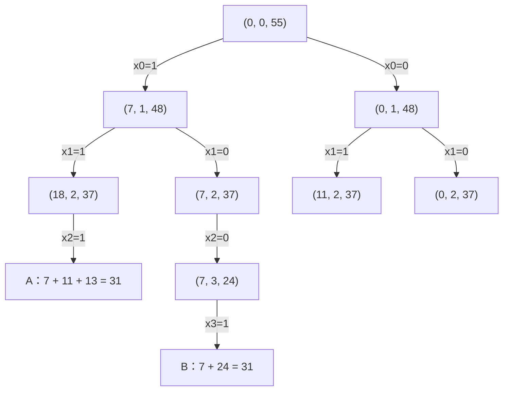

# 《算法分析与设计》习题答案（01背包+子集和数+十五谜）

原件为十页习题讲解幻灯片。以下保留原件的三组题目、答案、图示分支与代价标记；额外的推导、判定口径与核对分别标作“补充”或“订正”。两道题在原件中都标作 7-15，此处不另编题号。

## 7-15：0/1 背包的两种阶跃点算法（第 2–3 页）

原题有四件物品，重量 $(10,15,6,9)$，收益 $(2,5,8,1)$，容量 $M=32$。每件物品只能选一次。点 $(W,P)$ 记录一种可达的总重量及收益。

> [!NOTE]
> **订正：**题干写到 $S^4$，答案却从放完第一件时的 $S^0$ 写至放完第四件时的 $S^3$。下表沿用答案的编号，另外把还未处理任何物品的状态记为 $S^{-1}$。若按“已处理件数”编号，五行依次是 $T^0$ 到 $T^4$，不会多出第五件物品。

| 处理至 | 非启发式阶跃点（原件） | 启发式保留点（原件） |
| --- | --- | --- |
| 尚未放物品 | $S^{-1}=\{(0,0)\}$（补充初始条件） | $\{(0,0)\}$（补充初始条件） |
| 物品 0 | $S^0=\{(0,0),(10,2)\}$ | $\{(10,2)\}$ |
| 物品 1 | $S^1=\{(0,0),(10,2),(15,5),(25,7)\}$ | $\{(25,7)\}$ |
| 物品 2 | $S^2=\{(0,0),(6,8),(16,10),(21,13),(31,15)\}$ | $\{(31,15)\}$ |
| 物品 3 | $S^3=\{(0,0),(6,8),(15,9),(16,10),(21,13),(30,14),(31,15)\}$ | $\{(31,15)\}$ |

**补充：**[阶跃点集合](../../../topics/算法分析/01背包阶跃点集合.md)每轮都从旧集合分两路：不选则原样保留，选择则每点加 $(w_i,p_i)$。合并后先丢掉超容量的点，再丢掉重量不少、收益却不高于另一点的被支配点。为什么不会错过后面的最优组合？同一组未处理物品能接在较重的点之后，也能接在较轻的点之后，后者至少一样赚钱。例如 $S^2$ 中 $(21,13)$ 压掉 $(25,7)$，但 $(25,7)$ **在上一层**仍是生成 $(31,15)$ 的前身，回推时不能把两层混成一层。

**补充：**原件在启发式一列另利用已知可行解 $(1,1,1,0)$ 的收益下界 $L=15$。课件的 `profleft(0..3)` 为 $16,14,9,1$，是**处理该件之前**尚未处理的收益之和；处理某一件**之后**比较的余量依次为 $14,9,1,0$。即使不管剩余容量，把余下各件的收益全加上，若仍有 $P+\text{余量}<L$，该点就不可能达到已知收益。例如处理完物品 1 后，$(15,5)$ 的上界是 $5+9=14$，必删；$(25,7)$ 的上界是 $7+9=16$，只能暂留，在下一轮才用容量和真实收益继续筛。==上界低于已知收益才排除；等于时仍有可能打平。==

原件结果：最大收益 $15$，重量 $31$，最优向量 $(1,1,1,0)$。**补充：**从最终 $(31,15)$ 倒查，物品 3 不取；其余三件依次回减，沿 $(31,15)\to(25,7)\to(10,2)\to(0,0)$ 回到初态。

## 7-15：子集和数的 SumOfSub 状态空间树（第 4 页）

原题列出 $(11,13,24,7)$，目标和 $31$。图中第一层取值是 $7$，第二层取值是 $11$，故图的决策顺序实际是从小到大的 $(7,11,13,24)$，不是题干列出元素的顺序。三元组表示（已选和、下一决策下标、未决元素之和），左枝取该元素，右枝不取。

**补充：**按原图重算，当前已选和为 $s$、下一件为 $w_k$、未决总和为 $r$：

- 取 $w_k$，若 $s+w_k=M$ 就记录答案；否则，只有还有下一件且 $s+w_k+w_{k+1}\le M$ 才递归。因为元素都是正数且已排序，下一件已经是最小的可选补量。
- 跳过 $w_k$，继续搜索必须同时满足 $s+r-w_k\ge M$ 和 $s+w_{k+1}\le M$，并且确实还有下一件。这两项分别排除“全取也不够”和“只取最小的一件也超目标”。

例如 $(7,2,37)$ 若取 $13$，只能得到 $20$，再取剩下唯一的 $24$ 就超界；若不取，$7+24=31$，所以保留右枝并得到 B。已经得出 A 也必须回溯，因为题目要求==所有子集==。答案只有 $\{7,11,13\}$ 和 $\{7,24\}$；按图用的排序，完整向量是 $(1,1,1,0)$、$(1,0,0,1)$。若误按题干顺序使用“下一件是最小补量”来剪，取了 $11$、$13$ 后会因 $24+24>31$ 错剪掉后面选 $7$ 的 A。

## 十五谜：先判可解，再求最短（第 5–10 页）

原件起点如下，`□` 表示空格。原图终点为编号按行从 1 到 15 排列、空格在右下角的棋盘。

| 第 1 列 | 第 2 列 | 第 3 列 | 第 4 列 |
| --- | --- | --- | --- |
| 1 | □ | 3 | 4 |
| 5 | 2 | 7 | 8 |
| 9 | 6 | 10 | 12 |
| 13 | 14 | 11 | 15 |

**原件判定：**把空格当作 16，按行展开后，对编号 $k$ 统计其右边比它小的牌数。按编号 1 到 16 分别为 $(0,0,1,1,1,0,1,1,1,0,0,1,1,1,0,14)$，总和 $23$。空格位置是 $(1,2)$（从 1 起数），故 $23+1+2=26$ 为偶数，可达目标。**补充：**每一步交换空格和一张牌，完整排列的逆序数奇偶性翻转；空格的行列和也翻转。二者之和的奇偶性不变，目标态为偶数。这里要把空格计进逆序数，不能混用[十五谜的另一种判定口径](../../../topics/算法分析/十五谜问题.md)。

**原件图示重排：**方向指空格移动，括号内是移入空格的编号。每一行从上一次加粗选择所到的棋盘出发，压缩记录该页绘出的全部子棋盘，可由初始棋盘和“方向（牌号）”重放。原图不画立即返回父结点的动作。估价 $\hat c=g+h$ 中，$g$ 是已经走的步数，$h$ 是位置仍错误的**编号牌**数，空格不计。

| 原件页 | 已走步数 $g$ | 图中各分支的增量方向（移入牌）及 $\hat c$ |
| --- | ---: | --- |
| 6 | 0 | 左（1）：$1+6=7$；**下（2）：$1+4=5$**；右（3）：$1+6=7$ |
| 7 | 1 | 左（5）：$2+5=7$；**下（6）：$2+3=5$**；右（7）：$2+5=7$ |
| 8 | 2 | 左（9）：$3+4=7$；下（14）：$3+4=7$；**右（10）：$3+2=5$** |
| 9 | 3 | 上（7）：$4+3=7$；**下（11）：$4+1=5$**；右（12）：$4+3=7$ |
| 10 | 4 | 左（14）：$5+2=7$；**右（15）：到达目标**（补算 $5+0=5$） |

> [!IMPORTANT]
> **订正：**最后一页的 $5+2=7$ 属于**左**枝，不是目标的代价。原图右枝是目标；旧识别版还把其空格列为第 2 列，实际右下角才是空格。

**补充：**起点有 5 张编号牌错位。一次只移动一张编号牌，至多纠正一张，所以任意解都至少要 5 步；原图的“下、下、右、下、右”刚好 5 步，已经证明最短。这里 $h$ 不是实际剩余步数：它只是这个下界；某一步也可能把正确的牌移错，使 $h$ 增加而不是减少。用奇偶性只回答“能不能到”，用错位数回答“至少几步”。

| 第 1 列 | 第 2 列 | 第 3 列 | 第 4 列 |
| --- | --- | --- | --- |
| 1 | 2 | 3 | 4 |
| 5 | 6 | 7 | 8 |
| 9 | 10 | 11 | 12 |
| 13 | 14 | 15 | □ |

**补充：**判断哪些状态值得继续，三题用的不是同一把尺。背包要把收益做大，所以拿“此路最多赚多少”和已知可行收益比较；十五谜要把步数做小，所以估计“此路至少走几步”；子集和不是求最大或最小，而是看 $31$ 是否仍可能夹在可达范围内。
