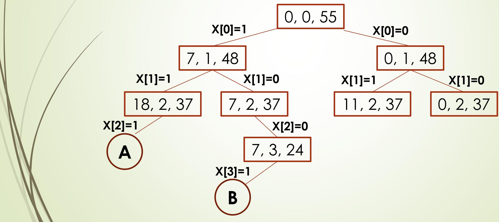
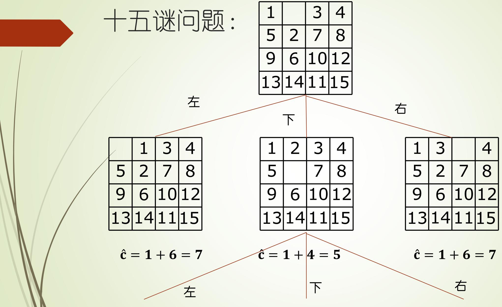
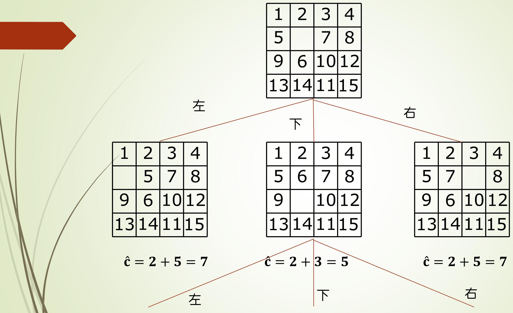
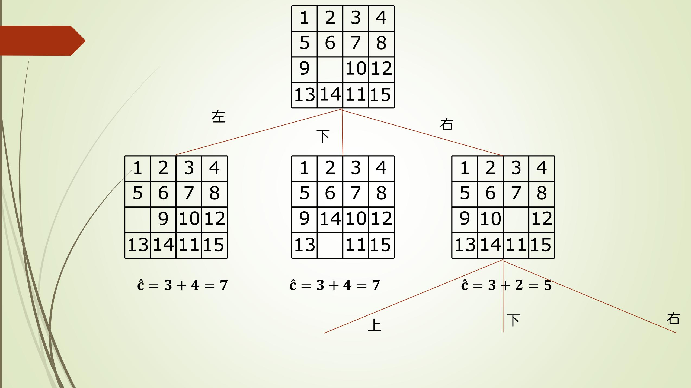
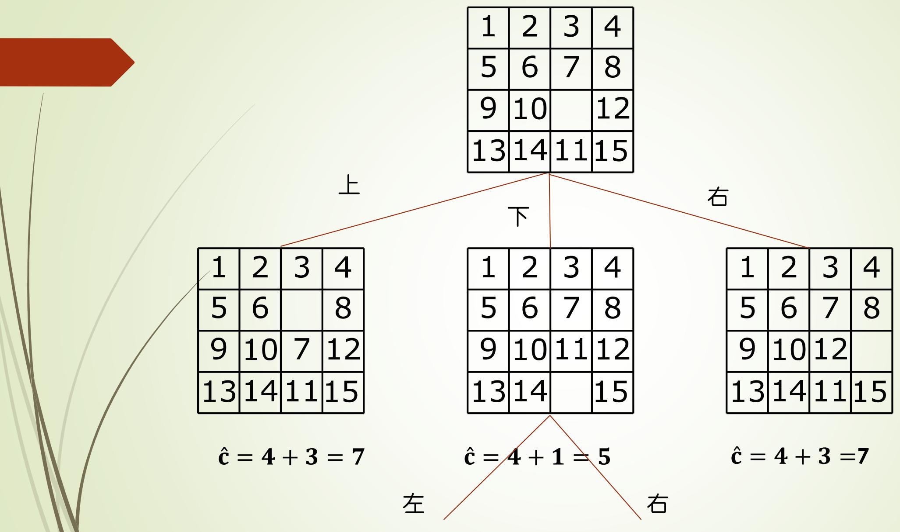
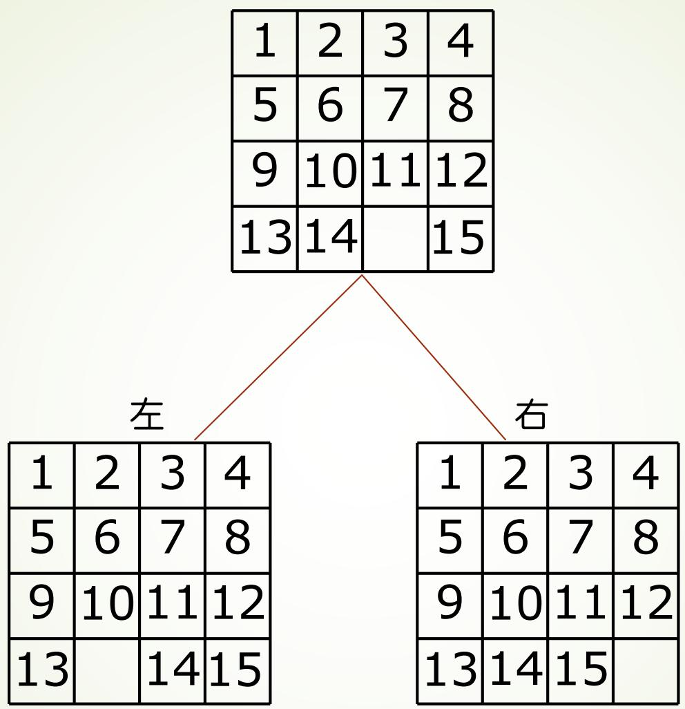

# 《算法分析与设计》习题答案（01背包+子集和数+十五谜）

原件经识别和整理；“参考解答”是我们补的。

## 7-15 设有0/1背包实例（非启发式）

$(w_{0},w_{1},w_{2},w_{3})=(10,15,6,9),(p_{0},p_{1},p_{2},p_{3})=(2,5,8,1)$ 和 M=32。试计算 $S^{i}$，$0\leq i\leq4$。另使用启发式方法再计算一次。

非启发式：

$$
\rightarrow S^{0} = \{(0,0),(10,2)\}
$$

$$
X_{1} = 1
$$

$$
S^{1} = \{(0,0),(10,2),(15,5),(25,7)\}
$$

$$
X_{2} = 1
$$

$$
S^{2} = \{(0,0),(6,8),(16,10),(21,13),(31,15)\}
$$

$$
X_{3} = 0
$$

$$
S^{3} = \{(0,0),(6,8),(15,9),(16,10),(21,13),(30,14),(31,15)\}
$$

答案：最大收益为 15，最优解 $(1,1,1,0)$。

## 7-15 设有0/1背包实例（启发式）

$(w_{0},w_{1},w_{2},w_{3})=(10,15,6,9),(p_{0},p_{1},p_{2},p_{3})=(2,5,8,1)$ 和 M=32。试计算 $S^{i}$，$0\leq i\leq4$。另使用启发式方法再计算一次。

启发式：$\text{profileft}(0)=16$，$\text{profileft}(1)=14$，$\text{profileft}(2)=9$，$\text{profileft}(3)=1$，取可行解 $(1,1,1,0)$ 时 L=15。

$$
\begin{array}{l l}
\text{▶ } S^{0} = \{(10,2)\} & X_{0} = 1 \\
\text{▶ } S^{1} = \{(25,7)\} & X_{1} = 1 \\
\text{▶ } S^{2} = \{(31,15)\} & X_{2} = 1 \\
\text{▶ } S^{3} = \{(31,15)\} & X_{3} = 0
\end{array}
$$

答案：最大收益为 15，最优解 $(1,1,1,0)$。

## 7-15 子集和数（SumOfSub 状态空间树）

设有 $n=4$ 个正数的集合 $W=\{w_{0},w_{1},w_{2},w_{3}\}=(11,13,24,7)$ 和整数 M=31。求 W 的所有满足条件的子集，画出对于这一实例由 SumOfSub 算法实际生成的那部分状态空间树。

## 十五谜问题（可解性判定）

| 1 |   | 3 | 4 |
|---|---|---|---|
| 5 | 2 | 7 | 8 |
| 9 | 6 | 10 | 12 |
| 13 | 14 | 11 | 15 |

$$
\begin{array}{l}
\sum_{k=1}^{16} Less(k) + i + j \\
= (0+0+1+1+1+0+1+1+1+0+0+1+1+1+0+14) + 1 + 2 \\
= 26 \\
\text{为偶数，因此可以到达目标状态。}
\end{array}
$$

## 十五谜问题（求解过程）

| 1 |   | 3 | 4 |
|---|---|---|---|
| 5 | 2 | 7 | 8 |
| 9 | 6 | 10 | 12 |
| 13 | 14 | 11 | 15 |

|   | 1 | 3 | 4 |
|---|---|---|---|
| 5 | 2 | 7 | 8 |
| 9 | 6 | 10 | 12 |
| 13 | 14 | 11 | 15 |

| 1 | 3 |   | 4 |
|---|---|---|---|
| 5 | 2 | 7 | 8 |
| 9 | 6 | 10 | 12 |
| 13 | 14 | 11 | 15 |

$\hat{\mathbf{c}} = \mathbf{5} + \mathbf{2} = \mathbf{7}$ 目标状态

| 1 | 2 | 3 | 4 |
|---|---|---|---|
| 5 | 6 | 7 | 8 |
| 9 | 10 | 11 | 12 |
| 13 |   | 14 | 15 |
