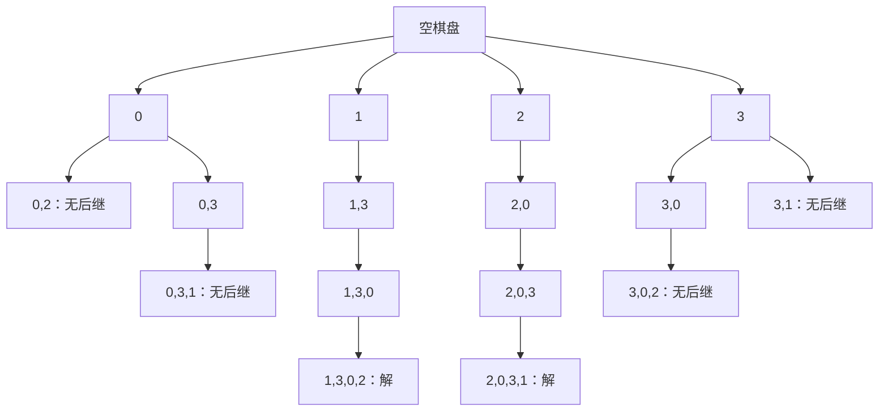

# 《算法分析与设计》习题答案（4 皇后蒙特卡罗）

原件要求用回溯法列全 4 皇后的解，并利用给定样本路径 $(0,2)$、$(1,3,0,2)$ 估计结点总数。原件只给了两次估算的算式和平均值，未列出棋盘解。以下补全搜索，区分两种结点计数口径。

## 一条路径是四个列号，不是四次独立选择

**参考解答。** 逐行从第 0 行放到第 3 行，用 $x_i$ 记第 $i$ 行皇后的列号（0 至 3）。同一行本来就只有一个皇后，新增列 $c$ 只需和已放的每个 $x_j$ 比较：$c=x_j$ 是同列，$|c-x_j|=i-j$ 是同斜线。两种冲突都不能靠放后续皇后消除，这才是剪枝能保全答案的原因。见 [回溯法框架](../../../topics/算法分析/回溯法框架.md)与 [N 皇后问题](../../../topics/算法分析/N皇后问题.md)。

每条边上只保留当前无冲突的选择；图中左右两半可用棋盘镜像 $c\mapsto 3-c$ 交叉检查。所有可行解为 $(1,3,0,2)$ 和 $(2,0,3,1)$。例如 $(0,2)$ 中两枚皇后暂时不冲突，但第三行任何一列都会冲突。==暂时合法==不是“保证能完成”。

## 为什么走一条路径，乘上分支数就能估整层？

记当前部分棋盘有 $m_i$ 个合法后继。从中等概率选一个继续。不只保留“我走过了几步”，还给所走的子树加权：若有两个合法子树，每个只以一半概率被选到，把被选中的子树估值乘以 2 再求期望，恰好加回两个子树。一般地，走到第 $k$ 层某个前缀的概率是路径上 $m_i$ 的倒数逐项相乘；该结点只在被抽中时计入估值，权重取 $m_0m_1\cdots m_{k-1}$，平均贡献正好为 1。这便是 [蒙特卡罗结点估计](../../../topics/算法分析/剪枝函数与效率分析.md)在本题里的含义。若不再等概率抽样，权重应改为实际路径概率的倒数，不能照抄乘法式。

| 样本路径 | 沿途合法后继数（末结点也列出） | 只计合法结点的估值 |
|---|---|---:|
| $(0,2)$ | $4,2,0$ | $1+4+4\times2=13$ |
| $(1,3,0,2)$ | $4,1,1,1,0$ | $1+4+4+4+4=17$ |

两次的样本平均为 $(13+17)/2=15$，保留原件数值。完整遍历时，合法树的各层宽度是 $1,4,6,4,2$，合计 17 个结点。两次抽样不必等于实数，第二条路径单次命中实数也只是巧合。

> [!TIP]
> ==“估计”与“列全”==提示两套不同的验算。列全的结果由剪枝树和层数复核；估算则先写明分支抽样规则与计数口径，再给各次权重和样本均值，不能用均值替代精确计数。

**订正（计数术语）。** 原件把 13、17 和 15 都写成“实际生成”结点数，其算式只累计合法结点。若课程把==先枚举、再判冲突==的候选也记为生成结点，则在每个合法且非完整的前缀下测试 4 个列号，计数应为 $1+4(1+4+6+4)=61$。此时留在合法树上抽样，但要给每个访问到的非完整前缀计入四个候选，并乘以到达该前缀的概率倒数。两条指定路径都估 $1+4+16+32=53$ 或 $1+4+16+16+16=53$；前一条路径虽已无合法后继，四次冲突测试仍必须计入。若实现只枚举未占用列，候选数又不同，不应混用这些口径。
