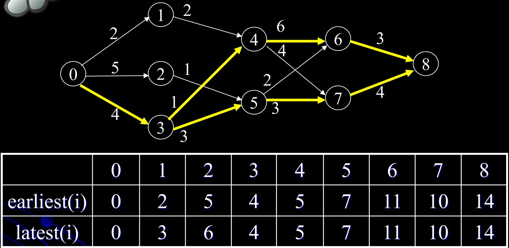

# 《算法分析与设计》关键路径习题答案（课件）

原件经识别和整理；“参考解答”是我们补的。

| | 0 | 1 | 2 | 3 | 4 | 5 | 6 | 7 | 8 |
|---|---|---|---|---|---|---|---|---|---|
| earliest(i) | 0 | 2 | 5 | 4 | 5 | 7 | 11 | 10 | 14 |
| latest(i) | 0 | 3 | 6 | 4 | 5 | 7 | 11 | 10 | 14 |

$\langle 0,3 \rangle, \langle 3,4 \rangle, \langle 3,5 \rangle, \langle 4,6 \rangle, \langle 5,7 \rangle, \langle 6,8 \rangle, \langle 7,8 \rangle$ 是关键活动。因此关键路径有 $(0,3,4,6,8)$ 和 $(0,3,5,7,8)$，长度为 14。

## 课堂练习

求下图中的关键路径和关键活动
