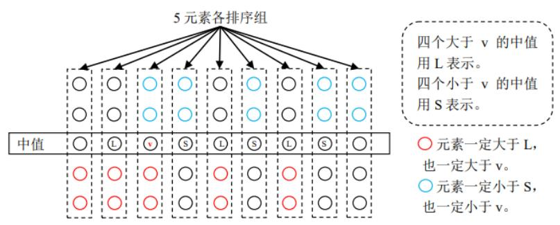

# 《算法分析与设计》分治策略实验报告模板

原件经识别和整理；“参考解答”是我们补的。

## 实验目的和任务

实验目的：理解分治法的算法思想，阅读实现书上已有的部分程序代码并完善程序，加深对分治法的算法原理及实现过程的理解。

实验任务：

1. 用分治法实现一组无序序列的两路合并排序和快速排序。要求清楚合并排序及快速排序的基本原理，编程实现分别用这两种方法将输入的一组无序序列排序为有序序列后输出。
2. 采用基于“五元中值组取中值分割法”（median-of-median-of-five partitioning）的线性时间选择算法，找出 $N$ 个元素集合 $S$ 中的第 $k$ 个最小的元素，使其在线性时间内解决。（参考教材 5.5.3 节）

## 实验环境（实验设备）

笔记本制造商：DELL

处理器：Intel(R) Core(TM) i5-9300H CPU @ 2.40GHz 2.40 GHz

机带：RAM 8.00 GB（7.79 GB 可用）

系统：64 位操作系统，基于 x64 的处理器

Windows 规格：版本 Windows 10 家庭中文版，版本号 20H2

编程工具：Visual Studio 2019、Dev-C++

## 实验原理及内容（包括操作过程、结果分析等）

### 介绍

排序是指将一个元素序列调整为按指定关键字值的递增（或递减）次序排列的有序序列。

用分治法求解排序问题的思路是：按某种方式将序列分成两个或多个子序列，分别进行排序，再将已排序的子序列合并成一个有序序列。

本次实验采用顺序存储的可排序表作为算法实现的数据结构，定义一个可排序表类 SortableList，两路合并算法和快速排序算法均由定义在该类上的函数实现。

### 算法思想

#### 两路合并排序算法的基本思想

将待排序元素平分成大小大致相同的两个子序列，然后对每个子序列分别使用递归的方法进行两路合并排序，直到子序列长度变为 1，最后利用合并算法将得到的已排序好的两个子序列合并成一个有序的序列。

两路合并排序算法的核心部分是将子问题的解组合成原问题解的合并操作。常用的操作是新建一个序列，序列的大小等于要合并的两个子序列的长度之和。比较两个子序列中的最小值，输出其中较小者到新建的序列中，重复此过程直到其中一个子序列为空。如果另一个子序列中还有元素未输出，则将剩余元素依次输出到新建序列中即可。最终得到一个有序序列。因此类中应定义成员函数 MergeSort 来完成递归两路合并排序的调用和成员函数 Merge 来完成两个子序列的合并操作。



### 比较合并排序和快速排序两种算法的异同

#### 问题分解过程

- 合并排序——将序列一分为二即可。（十分简单）
- 快速排序——需调用 Partition 函数将一个序列划分为子序列。（分解方法相对较困难）

#### 子问题解合并得到原问题解的过程

- 合并排序——需要调用 Merge 函数来实现。（Merge 函数时间复杂度为 $O(n)$）
- 快速排序——一旦左、右两个子序列都已分别排序，整个序列便自然成为有序序列。（异常简单，几乎无须额外的工作，省去了从子问题解合并得到原问题解的过程）

### 时间复杂度分析

#### 合并排序

最好、最坏、平均情况下的时间复杂度均为 $O(n\log n)$。

#### 快速排序

最好、平均情况下的时间复杂度为 $O(n\log n)$，最坏情况下为 $O(n^2)$。

#### 线性时间选择排序

1. 寻找枢纽元的时间分析：寻找 5 元素的中值为常数时间，这样的运算进行 $[N/5]$ 次，因此这一步花费 $O(N)$ 时间。然后若采用常见排序算法在有 $[N/5]$ 个元素的中值组中再寻找中值（枢纽元），时间复杂度仍然要达到 $O([N/5]\log[N/5]) = O(N\log N)$。所以需要递归地调用自身，寻找枢纽元的时间为 $T([N/5]) + O(N)$。
2. 快速选择的时间分析：对规模最多为 $0.7N$ 的子表继续求解，寻找第 $k$ 小元素的时间 $\leq T(0.7N)$。
3. 寻找第 $k$ 小元素时间分析：总的时间递推式为 $T(N) \leq O(N) + T(N/5) + T(0.7N)$。则寻找第 $k$ 小元素总的时间为 $O(N)$ 线性时间。

```cpp
//在右子表求第 k-(j-left+1)小元素
```

## 实验小结（包括问题和解决方法、心得体会等）

1. 关于快速排序，实验指导 pdf 中针对“有顺序”的数列会导致划分时 Partition() 函数中无限循环 do...while() 语句，但实际操作并没有报错，这里说明一下调试后得出的原因分析：由于当临时变量 i 遍历到数组指针范围之外时，C++ 会自动为它分配一个随机数，因此总有一个随机数会满足终止条件，使程序跳出 do...while() 循环语句。
2. 关于线性时间选择排序，笔者提供了两种 Select() 函数，其中与实验指导 pdf 中不同的一份是利用普通排序去得到枢纽点，这样子会导致时间复杂度上升到 $O(n\log n)$，实验指导 pdf 中提供的算法显然更好。

## 指导教师评语

| 成绩 |  | 批阅人 |  | 日期 |  |
| --- | --- | --- | --- | --- | --- |
