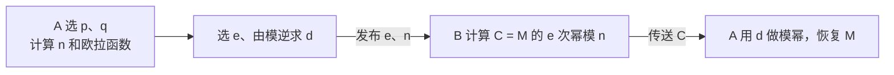

# 《算法分析与设计》实验4 密码算法（RSA）

## 实验要求（原件第 1–3 页）

通过 RSA 理解公开密钥、私有密钥和模运算的关系，并编写一个小型加解密演示。原件设接收方为 A、发送方为 B：A 生成并公布公开密钥，B 用它对明文整数做模幂，A 用自己的私有密钥恢复明文。

下面先整理原件的算法和示例输入，再单独给出推导、订正和参考程序。**这是数论实验，不是可部署的加密方案。**

## 原件的密钥与加解密流程

1. A 选择两个素数 $p,q$，取 $n=pq$。使用 $\varphi(n)=(p-1)(q-1)$ 时，须取**互不相同**的素数。
2. 选择 $1<e<\varphi(n)$ 且 $\gcd(e,\varphi(n))=1$。用扩展欧几里德算法求 $ed\equiv1\pmod{\varphi(n)}$ 的正代表元 $d$。公开密钥为 $(e,n)$，私有密钥为 $(d,n)$。
3. B 取明文整数 $0\le M<n$，计算 $C=M^e\bmod n$；A 计算 $C^d\bmod n$。



> [!IMPORTANT]
> **订正：** 整数取值范围是 $0\le M<n$；原件代码提示的「不能超过」不应把 $M=n$ 算作合法。若要让所有 $b$ 位无符号块都能直接作为明文整数，须有 $2^b\le n$。例如本题的 $n=11413$，所有 13 位无符号值都小于 $n$，但并非所有 14 位值都合法。给教具输入整数时，直接检验 $0\le M<n$。

### 补充：为什么消息与 n 不互素也能还原？

设 $ed=1+k\varphi(n)$。直接对模 $n$ 使用欧拉定理只处理与 $n$ 互素的 $M$；若题目说「所有 $0\le M<n$」，就应==分开对模 $p$ 和模 $q$ 证明==。

- 对模 $p$，若 $p\mid M$，则 $M^{ed}$ 和 $M$ 都等于 0 模 $p$；否则由费马小定理，$M^{p-1}\equiv1\pmod p$，又因 $p-1\mid(ed-1)$，所以仍有 $M^{ed}\equiv M\pmod p$。
- 对模 $q$ 同理。于是 $p$ 与 $q$ 都整除差 $M^{ed}-M$；它们互素，故 $pq$ 整除此差。$C^d\bmod n$ 与 $M$ 同余，而且二者同在 $[0,n-1]$，因此相等。

密钥生成时需要的是 $\gcd(e,\varphi(n))=1$，否则模逆不存在。由逆元等式也能推出 $\gcd(d,\varphi(n))=1$；不要求 $e$ 和 $d$ 彼此互素。**订正原件代码标题：** 扩展欧几里德算法接收的是 $e$ 和 $\varphi(n)$，不是仅接收公开的 $e$ 和 $n$。

知识点：[欧几里德算法](../../../topics/算法分析/欧几里德算法.md)。

## 参考解答：原件给定参数的演算

原件第 2–3 页的示例输入为 $p=101,\ q=113,\ e=3533,\ M=9726$。先有 $n=11413$、$\varphi(n)=100\cdot112=11200$。

| 被除数 | 除数 | 商 | 余数 |
| --- | --- | --- | --- |
| 11200 | 3533 | 3 | 601 |
| 3533 | 601 | 5 | 528 |
| 601 | 528 | 1 | 73 |
| 528 | 73 | 7 | 17 |
| 73 | 17 | 4 | 5 |
| 17 | 5 | 3 | 2 |
| 5 | 2 | 2 | 1 |
| 2 | 1 | 2 | 0 |

从最后一个非零余数 1 回代，得 $1=6597\cdot3533-2081\cdot11200$，故 $d=6597$。再做模幂得 $9726^{3533}\bmod11413=5761$、$5761^{6597}\bmod11413=9726$。另取 $M=101$，虽有 $\gcd(M,n)=101$，仍能从密文 5656 解回 101，检验了上面不能直接用欧拉定理的一支。

**订正原件代码。** 第 2 页的非终止分支调用了 `ext_euclid` 却没有返回递归结果；还应先处理不可逆输入。下列参考程序保留扩展欧几里德的思路、每步保留余数，但把逐次乘法换成平方求幂。指数每除以 2 只需一次平方和至多一次额外乘法，模乘次数随指数的二进制位数增长。

```python
from math import isqrt

def egcd(a, b):
    r0, r1 = a, b
    s0, s1 = 1, 0
    t0, t1 = 0, 1
    while r1:
        q, r2 = divmod(r0, r1)
        r0, r1 = r1, r2
        s0, s1 = s1, s0 - q * s1
        t0, t1 = t1, t0 - q * t1
    return r0, s0, t0

def modexp(m, k, n):
    if n <= 1 or not 0 <= m < n or k < 0:
        raise ValueError("invalid residue, modulus or exponent")
    acc = 1
    while k:
        if k % 2:
            acc = (acc * m) % n
        m = (m * m) % n
        k //= 2
    return acc

def toy_params(p, q, e):
    # 仅用于本实验的小整数；不是实际密钥生成。
    def small_prime(x):
        return 2 <= x <= 1000 and all(x % i for i in range(2, isqrt(x) + 1))
    if p == q or not small_prime(p) or not small_prime(q):
        raise ValueError("expected two distinct small primes")
    n, phi = p * q, (p - 1) * (q - 1)
    if not 1 < e < phi:
        raise ValueError("e out of range")
    g, coefficient, _ = egcd(e, phi)
    if g != 1:
        raise ValueError("e has no inverse")
    return n, phi, coefficient % phi

n, phi, d = toy_params(101, 113, 3533)
assert (n, phi, d) == (11413, 11200, 6597)
for m in (9726, 101, 0, n - 1):
    c = modexp(m, 3533, n)
    print(m, c, modexp(c, d, n))
```

读 `egcd` 的一个检查点：初始两行分别表示 $a=1a+0b$、$b=0a+1b$；每次做余数替换时，系数也做相同的线性组合。最后余数为最大公约数；当它等于 1 时，$e$ 的系数取模就是逆元。原件还建议尝试随机选素数、检查互素和使用大整数，这些是扩展方向，不是这组固定参数的必要步骤。

## 思考题（原件第 4 页）及补充

1. **安全性怎样理解？** 大整数因式分解困难与 RSA 的数学基础有关；能得到因子确实能计算本例的模逆所需信息，但不能据此说「攻破任意 RSA 方案与因式分解已经证明等价」。数学假设、实际编码方案、实现安全是不同层次。
2. **速度为什么慢？** 主要计算是大整数模幂。原件和 DES 比较的「慢 100 倍」是历史描述，不是跨软硬件、不同参数的性能结论。实验可比较同一组参数下逐次乘法与平方求幂的模乘次数。
3. **有什么局限？** 需要正确产生和保存密钥，且公钥运算代价较高；实际系统常让公钥机制处理密钥而把大量数据交给对称加密。原件的「600 位」不是现代部署参数建议，本实验不提供生产密钥配置。
4. **原件讨论哪些攻击类别？** 密钥猜测、基于数论结构的数学分析、以及实现泄漏（例如运行时间）。这个分类提醒我们：公式正确不等于实现安全，不在本实验实现攻击。
5. **数字签名是什么？** 签名用私钥对符合签名方案的消息表示生成签名，公钥用来验证这条消息与签名是否匹配；它不是「用私钥把明文加密，再用公钥解密」。签名不提供保密性，也不能只凭一个未经信任验证的公钥就确认人的真实身份。

> [!WARNING]
> 原始 RSA 模幂是确定性的，同一公钥下相同明文总得到相同结果。本页小素数和不带加密／签名专用编码的演示只能用于理解数学，不能用于保护数据。
