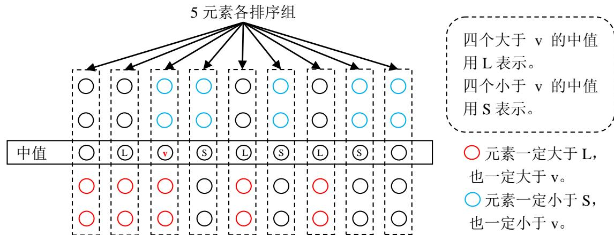
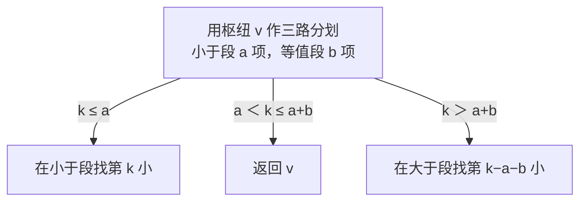

# 《算法分析与设计》实验一 分治策略（2017）

## 实验要求（原件第 1 页）

理解分治法的算法思想，阅读并完善教材的部分代码。本实验有两项任务：

1. 编程实现两路合并排序和快速排序，对同一组无序数据分别排序并输出。
2. 用「五元中值组取中值分割法」在线性时间内找出 $N$ 个元素中的第 $k$ 小元（教材 5.5.3 节）。

原件第 1–4 页以顺序存储的 `SortableList` 为例，要求补写负责读入和输出的 `Input`、`Output`；第 5–6 页给出线性选择的推导和程序提示；第 6–7 页还有三道思考题。下文按这两项实验要求整理，订正与补写的代码另行标明。

## 一、两路合并排序和快速排序（原件第 1–5 页）

**两路合并排序。** `MergeSort(left, right)` 先平分下标区间，分别递归排序，区间大小不超过 1 时停止；随后 `Merge(left, mid, right)` 比较两个有序段的当前首元，将较小者搬入临时数组。一段耗尽后搬完另一段，再写回原数组。相等时取左段，能保留相等关键字的原相对次序。原件的 `Merge` 每次用 `new[]` 分配临时区却未释放；下文参考程序复用一个由 `vector` 管理的临时数组。

**快速排序。** 原件选区间首元作为主元，`Partition(left, right)` 从两端向内扫描，交换放错边的元素，最后把主元交换到位置 $j$；左侧元素不大于主元，右侧不小于主元。随后分别处理 $[left,j-1]$ 与 $[j+1,right]$，不再合并。区间长度不超过 1 时停止。

| 比较 | 两路合并排序 | 快速排序 |
| --- | --- | --- |
| 分解 | 按下标平分，无须比较关键字 | 按主元大小分划，一趟线性扫描 |
| 组合 | 把两个有序段线性合并 | 不需要再合并 |
| 容易失衡的地方 | 不受主元影响 | 主元长期取到极值时，可能反复剩下 $n-1$ 个 |

知识点：[合并排序](../../../topics/算法分析/合并排序.md)。

## 二、五元中值组取中值分割法（原件第 5–6 页）

原件把元素每五个分为一组，只用完整组的中值组成中值表，再递归找其中值 $v$ 作为枢纽元。分组最后不足五项的元素不参与取枢纽，但**仍参加分划**。原件的 `Select(k,left,right,r)` 以组大小 `r` 表示分组，子问题很小时直接排序；原版返回第 $k$ 小元所在的下标。以下固定组大小为 5，第 $k$ 小从 1 开始计数。



原件先以互异的 $N=10q+5$ 个元素推导：有 $2q+1$ 组，中值在 $v$ 两侧各有 $q$ 个。每个中值大于 $v$ 的组至少贡献三个更大的元素；枢纽所在组还贡献两个，所以严格大于 $v$ 的至少有 $3q+2$ 个；严格小于同理。于是递归保留的一侧最多有 $7q+2$ 个。

> [!IMPORTANT]
> **订正：** 约 $0.3N$ 和 $0.7N$ 是==分划两侧的数量界==，不是每次实际得到的大小。比如原图的九组共 45 项，能保证每侧至少有 $3\cdot4+2=14$ 项，不妨碍实际两侧各有 22 项。

**补充：一般长度和重复值。** 设完整组数为 $m=\lfloor N/5\rfloor$，用完整组中值表的第 $\lceil m/2\rceil$ 小元当枢纽。中值不大于 $v$ 的完整组至少有 $\lceil m/2\rceil$ 个，每组都保证三个不大于 $v$ 的元素；同样至少有这么多组各保证三个不小于它。用三路分划把所有元素分成“小于、等于、大于”三段，进入任一严格不等的子问题时，规模至多 $N-3\lceil m/2\rceil\le 0.7N+2$。全都等于枢纽时直接返回，不必继续递归分划后的子问题。

若小于段有 $a$ 项、等值段有 $b$ 项，则 $k\le a$ 时在小于段找第 $k$ 小；$a<k\le a+b$ 时答案就是枢纽；否则在大于段找第 $k-a-b$ 小。比如序列 $(9,1,5,3,7,6,2,8,4,0,5)$ 的两个完整组中值是 5、4，以较小者 4 为枢纽；三段大小分别为 4、1、6。找第 7 小时转到大于段找第 $7-4-1=2$ 小，得 5。



**为何是线性时间？** 每组排序最多五个元素，找中值和对全表分划这一层合计 $\Theta(N)$。找枢纽只在 $m$ 个中值上递归一次，然后只递归到可能包含答案的一段：

$$
T(N)\le T(\lfloor N/5\rfloor)+T(\lfloor 0.7N+2\rfloor)+O(N).
$$

两个子规模的主项系数和是 $0.2+0.7=0.9<1$。对大于固定阈值的子问题，把常数 2 吸收到这 $0.1N$ 的余量中，递归树每层总规模按固定比例收缩，线性工作量求和为 $O(N)$。若为了找中值先给整个中值表作常规比较排序，则这一层会增加 $\Theta(N\log N)$ 的最坏代价，不能继续用上述递推。

## 三、思考题（原件第 6–7 页）

1. **递减输入为什么越界，怎么避免？** 原件的左指针先 `++i`，再直接读 `l[i]`。例如对子段 `[5,4,3,2,1]` 以 5 为主元，左扫描会尝试读取 `right+1`，小于主元的判定本身不会挡住它。原件提出在容量多出的一个位置设置大哨兵；参考程序不用哨兵，先检查 `i <= right`，再读 `l[i]`。右扫描有未移走的 `l[left]` 等于主元作边界。两个方向遇到等值都停止，交换后下一轮仍各移动一步，不会卡住。
2. **比较时间复杂度。** 未跳过合并的两路合并排序在最好、平均、最坏情形均为 $\Theta(N\log N)$；首元快速排序最好为 $\Theta(N\log N)$，对互异元素的均匀随机排列平均为 $\Theta(N\log N)$，逆序等极端分划下最坏为 $\Theta(N^2)$。
3. **如何改选主元？** 原件列出中间下标取元、随机取元、三数取中三种办法，并选择随机法写例。**订正：** 原式 `rand() % (right-left) + left` 不会抽到 `right`，而在每次分划时用时钟重新设种子也可能反复产生相同序列。参考程序为整次排序只建一个随机引擎，每次用它均匀抽取闭区间 $[left,right]$ 的下标。随机选择改善期望时间，不消除最坏情况。

## 参考解答：可运行的 C++17 实现

输入为 `n k`，后接 $n$ 个整数，$1\le k\le n$。三行输出分别为合并排序结果、随机主元快速排序结果、原序列的第 $k$ 小元。`QuickSort()` 也可用首元，与原件对应。原件的 `Select` 返回下标；这里的 `Kth` 返回值，选择过程会重排工作数组，所以各任务用输入的独立副本。固定种子使本示例可以重做相同测试。

```cpp
#include <algorithm>
#include <cstdint>
#include <iostream>
#include <random>
#include <stdexcept>
#include <utility>
#include <vector>

class SortableList {
    std::vector<int> l, temp;

    void Merge(int left, int mid, int right) {
        int i = left, j = mid + 1, out = left;
        while (i <= mid && j <= right)
            temp[out++] = (l[i] <= l[j]) ? l[i++] : l[j++];
        while (i <= mid) temp[out++] = l[i++];
        while (j <= right) temp[out++] = l[j++];
        std::copy(temp.begin() + left, temp.begin() + right + 1, l.begin() + left);
    }

    void MergeSort(int left, int right) {
        if (left >= right) return;
        int mid = left + (right - left) / 2;
        MergeSort(left, mid);
        MergeSort(mid + 1, right);
        Merge(left, mid, right);
    }

    int Partition(int left, int right) {
        const int v = l[left];
        int i = left, j = right + 1;
        for (;;) {
            do { ++i; } while (i <= right && l[i] < v);
            do { --j; } while (l[j] > v); // l[left] 仍等于 v
            if (i >= j) break;
            std::swap(l[i], l[j]);
        }
        std::swap(l[left], l[j]);
        return j;
    }

    void QuickSort(int left, int right, std::mt19937* rng) {
        while (left < right) {
            if (rng) {
                std::uniform_int_distribution<int> pick(left, right);
                std::swap(l[left], l[pick(*rng)]);
            }
            const int j = Partition(left, right);
            // 递归较短段，迭代较长段，限制调用栈深度。
            if (j - left < right - j) {
                QuickSort(left, j - 1, rng);
                left = j + 1;
            } else {
                QuickSort(j + 1, right, rng);
                right = j - 1;
            }
        }
    }

    std::pair<int, int> Partition3(int left, int right, int v) {
        int lt = left, i = left, gt = right;
        while (i <= gt) {
            if (l[i] < v) std::swap(l[lt++], l[i++]);
            else if (l[i] > v) std::swap(l[i], l[gt--]);
            else ++i;
        }
        return {lt, gt}; // 等值段闭区间
    }

    int Select(int left, int right, int k) {
        for (;;) {
            const int n = right - left + 1;
            if (n <= 5) {
                std::sort(l.begin() + left, l.begin() + right + 1);
                return l[left + (k - 1)];
            }
            const int m = n / 5;
            for (int g = 0; g < m; ++g) {
                const int first = left + 5 * g;
                std::sort(l.begin() + first, l.begin() + first + 5);
                std::swap(l[left + g], l[first + 2]);
            }
            const int v = Select(left, left + m - 1, (m + 1) / 2);
            const auto [lt, gt] = Partition3(left, right, v);
            const int smaller = lt - left, no_greater = gt - left + 1;
            if (k <= smaller) right = lt - 1;
            else if (k <= no_greater) return v;
            else {
                k -= no_greater;
                left = gt + 1;
            }
        }
    }

    int Last() const { return static_cast<int>(l.size()) - 1; }

public:
    bool Input(std::istream& in, int n) {
        if (n < 0) return false;
        l.resize(n);
        for (int& x : l) if (!(in >> x)) return false;
        return true;
    }

    void Output(std::ostream& out) const {
        for (std::size_t i = 0; i < l.size(); ++i) {
            if (i) out << ' ';
            out << l[i];
        }
        out << '\n';
    }

    void MergeSort() {
        temp.resize(l.size());
        MergeSort(0, Last());
    }

    void QuickSort() { QuickSort(0, Last(), nullptr); }

    void RandomizedQuickSort(std::uint32_t seed) {
        std::mt19937 rng(seed);
        QuickSort(0, Last(), &rng);
    }

    int Kth(int k) {
        if (k < 1 || k > static_cast<int>(l.size()))
            throw std::out_of_range("rank");
        return Select(0, Last(), k);
    }
};

int main() {
    int n, k;
    SortableList original;
    if (!(std::cin >> n >> k) || k < 1 || k > n || !original.Input(std::cin, n))
        return 1;
    auto merged = original, quick = original, selection = original;
    merged.MergeSort();
    quick.RandomizedQuickSort(42);
    merged.Output(std::cout);
    quick.Output(std::cout);
    std::cout << selection.Kth(k) << '\n';
    return 0;
}
```

例如输入第一行为 `11 7`，第二行为 `9 1 5 3 7 6 2 8 4 0 5`；前两行都输出 `0 1 2 3 4 5 5 6 7 8 9`，第三行输出 `5`。还可以用递减、全相等、含重复值和含最小／最大 `int` 的数据检验边界。
