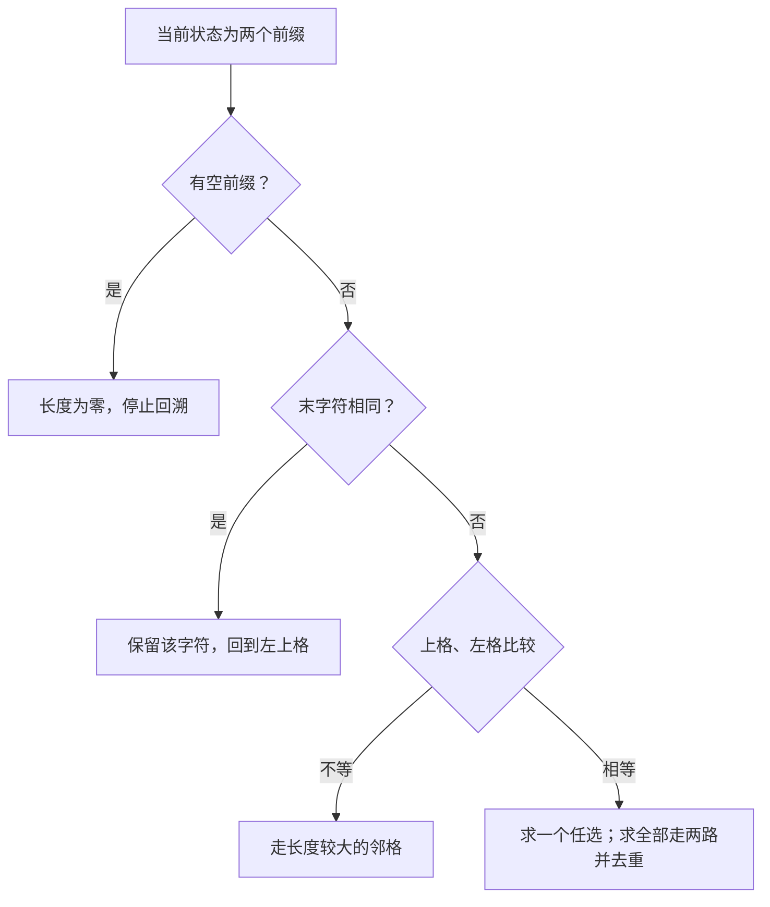

# 《算法分析与设计》实验二 动态规划法（2017）

原件要求给[最长公共子序列](../../../topics/算法分析/最长公共子序列.md)和[矩阵连乘](../../../topics/算法分析/矩阵连乘.md)各写两种实现：自底向上填表、自顶向下用备忘录，并输出一个最优方案，而不只是最优值。下文的讲解、实现及补算为**参考解答**；与原件提示不同的地方标为**订正**。

## **参考解答**：先问子问题必须记住什么

如果直接枚举一个长度为 $m$ 的序列的子序列，要面对 $2^m$ 种下标选取；如果枚举 $n$ 个矩阵的完整括号化，方案数按卡特兰数增长。难点却不在记录整条候选路径，而在识别哪部分历史已经不影响下一步。子序列一旦限定到两段前缀，剩下的可能性只取决于它们的长度；矩阵连乘一旦限定到一段下标区间，不管内部怎样括号化，乘积的外形只取决于两个端点。这就是两个问题可以使用同一套[动态规划基本要素](../../../topics/算法分析/动态规划基本要素.md)的原因。

| 问题 | 子问题的状态 | 最后一步的选择 | 自底向上的顺序 | 重建方案 |
| --- | --- | --- | --- | --- |
| 公共子序列 | 两个前缀长度 $(i,j)$ | 配对末字符，或舍去一侧末字符 | 先短前缀，再长前缀 | 在长度表中沿最优转移走回边界 |
| 矩阵连乘 | 连乘区间 $[i,j]$ | 最后一次乘法在 $k$ 处分开 | 先短区间，再长区间 | 对每段最优切点递归加括号 |

> [!TIP]
> 题干说==保相对顺序，可以跳过元素==，先试两个前缀。说==顺序固定，只能加括号==，先找连续区间与最后一次合并。两者都可以记忆化，但前者最多看三条局部边，后者需要枚举整段切点，时间阶因此不同。

## 一、最长公共子序列

记 $c(i,j)$ 为两个前缀的最长公共子序列长度。只要一个前缀为空就返回 $0$。末字符相同，斜上邻格的一个最优子序列可以接上这个字符；反过来，一个最优子序列若不以它结尾，可以把两侧末字符接上而变得更长，所以斜上加一既可达又最优。末字符不同，两侧的末位置不可能同时被保留：保留的位置中最后一对必须相等。至少舍掉一侧末位置，故取上、左两个邻格的较大值。



原件测试 $X=\mathtt{abcbdab}$、$Y=\mathtt{bdcaba}$，长度为 $4$。若不匹配且上下分支并列时优先舍掉 $X$ 的尾字符，可得到 `bcba`，在 $X$ 中是一基位置 $(2,3,4,6)$，在 $Y$ 中是 $(1,3,5,6)$。全部不同的串是 `bcab`、`bcba`、`bdab`。若只求一个，回溯每步至少减少一个下标，至多 $m+n$ 步，不需要再建原件的方向表。

**订正**：原件备忘录样例用 `c[i][j] != 0` 识别「已算」。但 `aaa` 和 `bbb` 等不相交前缀的正确长度就是 $0$；不缓存这样的状态，会反复访问同一个格子，最坏仍会指数级展开。用缓存键是否存在或单独的未计算标记区分。另一个容易忽视的区别是求「所有不同的串」和求「所有位置配对」：相同末字符时，为所有不同的串只取斜上已足够；但 `aa` 对 `a` 有两个不同下标配对，仍只产生一个串 `a`。

下列版本共享同一转移。只求长度时交换输入让较短序列当列，再滚动两行，辅助空间从 $O((m+1)(n+1))$ 降为 $O(\min(m,n)+1)$；直接丢掉旧行后，不能拿这两行沿原路径作普通回溯。

```python
from functools import lru_cache


def lcs(x, y, form="table", all_strings=False):
    m, n = len(x), len(y)

    def step(i, j, at):
        if i == 0 or j == 0:
            return 0
        if x[i - 1] == y[j - 1]:
            return at(i - 1, j - 1) + 1
        return max(at(i - 1, j), at(i, j - 1))

    if form == "memo":
        @lru_cache(maxsize=None)
        def at(i, j):
            return step(i, j, at)
    elif form == "table":
        table = [[0] * (n + 1) for _ in range(m + 1)]

        def at(i, j):
            return table[i][j]

        for i in range(1, m + 1):
            for j in range(1, n + 1):
                table[i][j] = step(i, j, at)
    else:
        raise ValueError("unknown DP form")

    length = at(m, n)

    if all_strings:
        @lru_cache(maxsize=None)
        def strings(i, j):
            best = at(i, j)
            if best == 0:
                return frozenset({""})
            if x[i - 1] == y[j - 1]:
                return frozenset(s + x[i - 1] for s in strings(i - 1, j - 1))
            out = set()
            if at(i - 1, j) == best:
                out.update(strings(i - 1, j))
            if at(i, j - 1) == best:
                out.update(strings(i, j - 1))
            return frozenset(out)

        return length, strings(m, n)

    i, j = m, n
    rev = []
    while i and j:
        if x[i - 1] == y[j - 1]:
            rev.append(x[i - 1])
            i, j = i - 1, j - 1
        elif at(i - 1, j) >= at(i, j - 1):
            i -= 1
        else:
            j -= 1
    return length, "".join(reversed(rev))


def lcs_length(x, y):
    if len(y) > len(x):
        x, y = y, x
    prev = [0] * (len(y) + 1)
    for a in x:
        cur = [0] * (len(y) + 1)
        for j, b in enumerate(y, 1):
            cur[j] = prev[j - 1] + 1 if a == b else max(prev[j], cur[j - 1])
        prev = cur
    return prev[-1]
```

填表和正确记忆化的求值上界均为 $O((m+1)(n+1))$；自顶向下只算访问过的状态，但还需递归栈。求全部不同的串不能套用单解复杂度，结果集本身可能是指数级的。

## 二、矩阵连乘

设第 $i$ 个矩阵尺寸为 $p_i\times p_{i+1}$（这里矩阵与尺寸均从 $1$ 编号）。在普通三重循环的数乘计数下，$m(i,j)$ 的可选代价为
$$
m(i,k)+m(k+1,j)+p_i p_{k+1}p_{j+1},\qquad i\le k<j.
$$
两边的最优子结果可以独立替换：左侧始终是 $p_i\times p_{k+1}$、右侧始终是 $p_{k+1}\times p_{j+1}$，所以内部的括号化不会改变合并代价。单矩阵无须数乘，故 $m(i,i)=0$。这一模型优化的是数乘次数，不等于实际运行时间最短，也不适用于直接替代其他矩阵乘法实现的代价模型。

原件第一组尺寸为 $(50,10,40,30,5)$。完整枚举可独立检查填表结果：

| 括号化 | 数乘次数 |
| --- | ---: |
| `(((A1 A2) A3) A4)` | 87,500 |
| `((A1 A2) (A3 A4))` | 36,000 |
| `((A1 (A2 A3)) A4)` | 34,500 |
| `(A1 ((A2 A3) A4))` | 16,000 |
| `(A1 (A2 (A3 A4)))` | **10,500** |

第二组尺寸 $(30,35,15,5,10,20,25)$ 的最优括号化为 `((A1 (A2 A3)) ((A4 A5) A6))`。从内到外的两侧各花 $2625+5250$ 和 $1000+2500$ 次，最后将 $30\times5$ 乘 $5\times25$ 花 $3750$ 次，合计 **15,125**。这恰好也说明为什么只看一次局部乘法的成本不够：哪怕局部合并低价，输出的中间矩阵尺寸仍会影响其余计算。

> [!WARNING]
> 不要把「可独立优化子区间」理解成「应先乘当前最便宜的一对」。尺寸 $(3,2,9,4)$ 时，左边一对当前花 $54$ 次，低于右边一对的 $72$；但左边先乘总计 $54+108=162$，右边先乘却只要 $72+24=96$。贪心忽略了第一次乘法改变的中间矩阵尺寸。

实现对应原件第五题的备忘录与填表解。Python 下标从 $0$ 开始，因此代码中的乘法项为 `p[i] * p[k + 1] * p[j + 1]`。等成本时选较小切点，只要求输出一个最优括号化。

```python
def matrix_chain(p, form="table"):
    n = len(p) - 1
    if n < 1 or any(d <= 0 for d in p):
        raise ValueError("supply the positive dimensions of at least one matrix")

    def step(i, j, at):
        if i == j:
            return 0, i
        return min(
            (at(i, k)[0] + at(k + 1, j)[0] + p[i] * p[k + 1] * p[j + 1], k)
            for k in range(i, j)
        )

    if form == "memo":
        @lru_cache(maxsize=None)
        def at(i, j):
            return step(i, j, at)
    elif form == "table":
        table = [[(0, i) for _ in range(n)] for i in range(n)]

        def at(i, j):
            return table[i][j]

        for width in range(2, n + 1):
            for i in range(n - width + 1):
                j = i + width - 1
                table[i][j] = step(i, j, at)
    else:
        raise ValueError("unknown DP form")

    cost = at(0, n - 1)[0]
    pieces = []

    def emit(i, j):
        if i == j:
            pieces.append(f"A{i + 1}")
            return
        k = at(i, j)[1]
        pieces.append("(")
        emit(i, k)
        pieces.append(" ")
        emit(k + 1, j)
        pieces.append(")")

    emit(0, n - 1)
    return cost, "".join(pieces)
```

两种求值顺序均至多处理 $O(n^2)$ 个区间，每个枚举至多 $n-1$ 个切点，故时间 $O(n^3)$、表或缓存空间 $O(n^2)$。输出括号式访问 $2n-1$ 个树结点。若把每个子结果的字符串直接逐层相加，极度偏斜的括号树会产生不必要的拷贝；先积累片段，最后一次连接。
