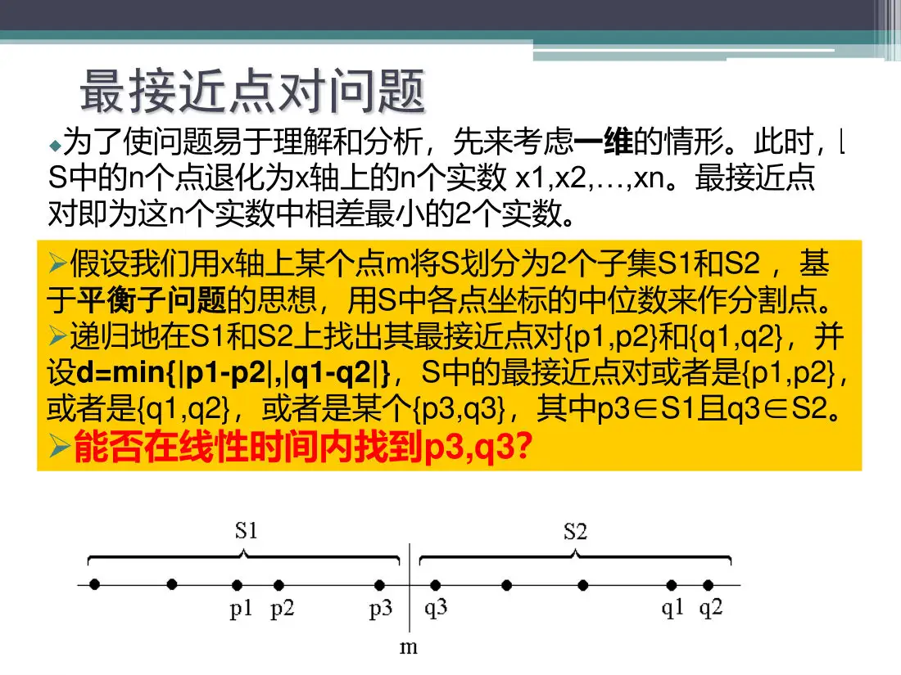
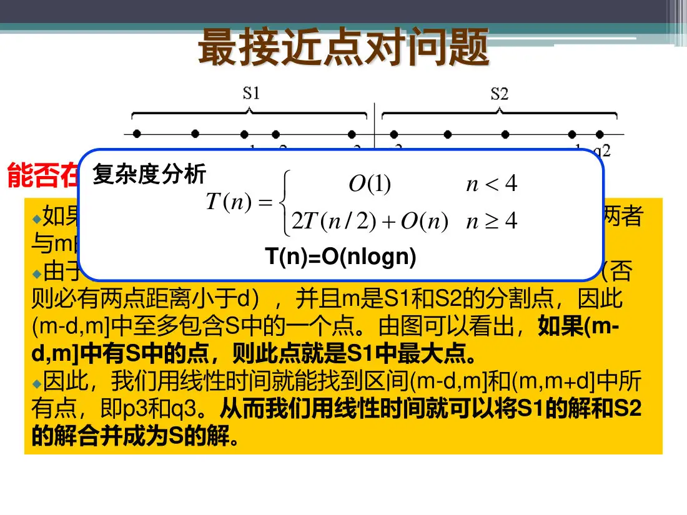
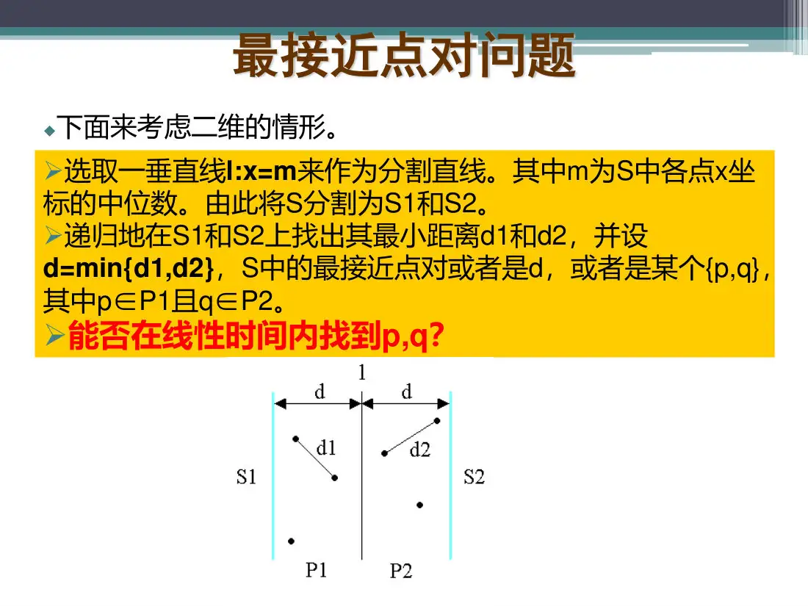
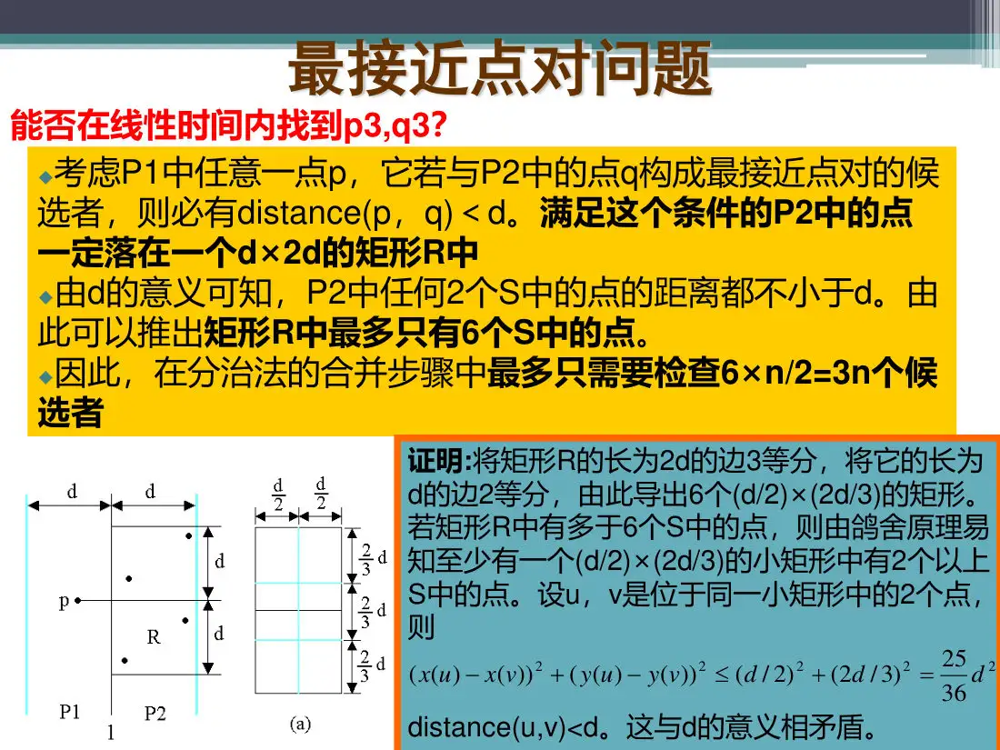
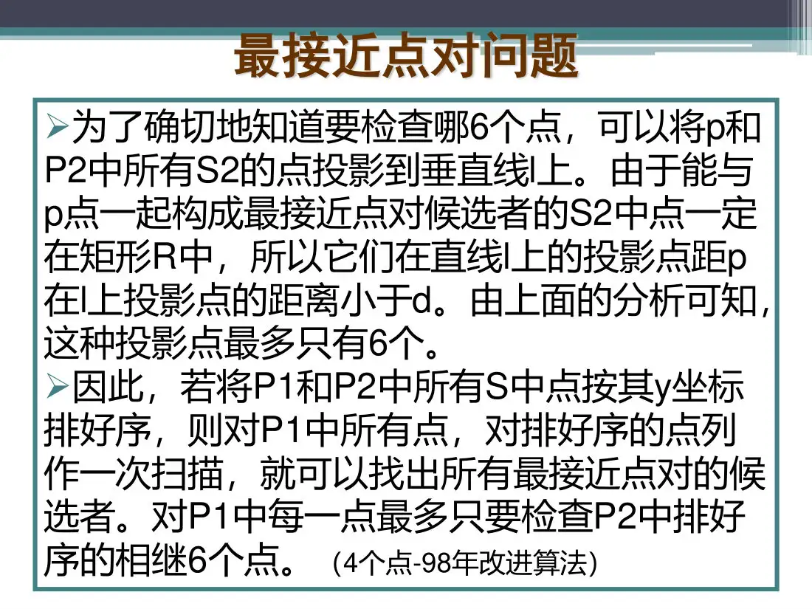
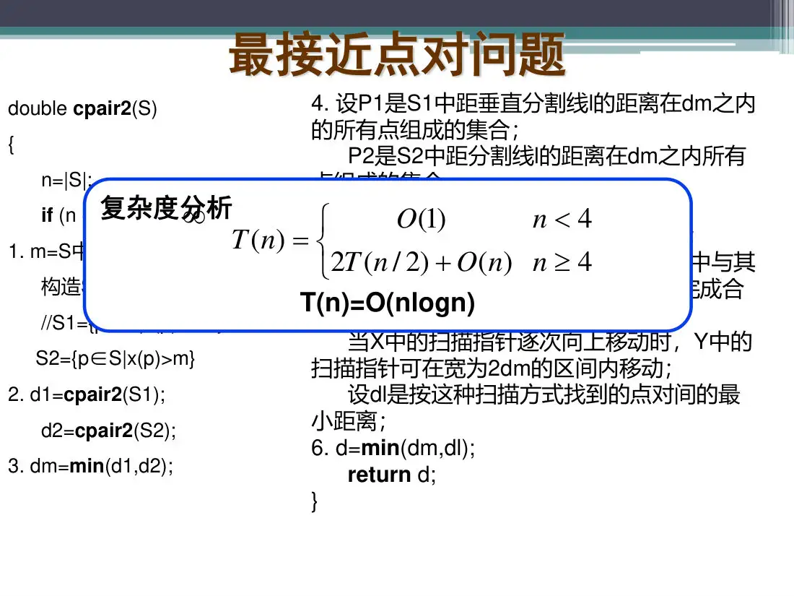

# 《算法分析与设计》最接近点对问题（课件）

原件的每一页，下面附识别出的文字。

### 最接近点对问题

原文：

最接近点对问题

给定平面上n个点的集合S，找其中的一对点，使得在n个点组◆为了使问题易于理解和分析，先来考虑一维的情形。此时，成的所有点对中，该点对间的距离最S中的n个点退化为x轴上的n个实数 $\times 1 , \times 2 , \ldots , \times \mathsf { n }$ 。最接近点对即为这n个实数中相差最小的2个实数。

➢假设我们用x轴上某个点m将S划分为2个子集S1和S2 ，基于平衡子问题的思想，用S中各点坐标的中位数来作分割点。➢递归地在S1和S2上找出其最接近点对{p1,p2}和{q1,q2}，并设 $\mathsf { d } { = } \mathsf { m i n } \{ | \mathsf { p } 1 { - } \mathsf { p } 2 | , | \mathsf { q } 1 { - } \mathsf { q } 2 | \}$ ，S中的最接近点对或者是{p1,p2}，或者是{q1,q2}，或者是某个{p3,q3}，其中p3∈S1且 ${ \mathsf { q } } 3 \in { \mathsf { S } } 2$ ➢能否在线性时间内找到p3,q3？

### 最接近点对问题

原文：

最接近点对问题

能否在

◆如果与m◆由于线性时间内复杂度分析

$$
\begin{array}{c} \mathbf {\hat {T}} \\ T (n) = \left\{ \begin{array}{c c} O (1) & n <   4 \\ 2 T (n / 2) + O (n) & n \geq 4 \end{array} \right. \\ \mathbf {T} (\mathsf {n}) = \mathbf {O} (\mathsf {n l o g n}) \end{array}
$$

两者

则必有两点距离小于d），并且m是S1和S2的分割点，因此(m-d,m]中至多包含S中的一个点。由图可以看出，如果(m-d,m]中有S中的点，则此点就是S1中最大点。

◆因此，我们用线性时间就能找到区间(m-d,m]和(m,m+d]中所有点，即p3和q3。从而我们用线性时间就可以将S1的解和S2的解合并成为S的解。

### 最接近点对问题

原文：

最接近点对问题

◆下面来考虑二维的情形。

➢选取一垂直线l:x=m来作为分割直线。其中m为S中各点x坐标的中位数。由此将S分割为S1和S2。

➢递归地在S1和S2上找出其最小距离d1和d2，并设d=min{d1,d2}，S中的最接近点对或者是d，或者是某个{p,q}，其中p∈P1且 ${ \tt q } \in { \sf P } 2$

能否在线性时间内找到p,q？

### 最接近点对问题

原文：

最接近点对问题

能否在线性时间内找到p3,q3？

◆考虑P1中任意一点p，它若与P2中的点q构成最接近点对的候选者，则必有 $\mathsf { d i s t a n c e ( p , \mathsf { q } ) < d }$ 满足这个条件的P2中的点一定落在一个 ${ \bf d } \times 2 0$ 的矩形R中

◆由d的意义可知，P2中任何2个S中的点的距离都不小于d。由此可以推出矩形R中最多只有6个S中的点。

◆因此，在分治法的合并步骤中最多只需要检查 ${ \bf 6 } \times { \bf n } / 2 = 3 { \bf n }$ 个候选者

证明:将矩形R的长为2d的边3等分，将它的长为d的边2等分，由此导出6个 $( \mathsf { d } / 2 ) \times ( 2 \mathsf { d } / 3 )$ 的矩形。若矩形R中有多于6个S中的点，则由鸽舍原理易知至少有一个 $( \mathsf { d } / 2 ) \times ( 2 \mathsf { d } / 3 )$ 的小矩形中有2个以上S中的点。设u，v是位于同一小矩形中的2个点，则

$\left( x ( u ) - x ( \nu ) \right) ^ { 2 } + \left( y ( u ) - y ( \nu ) \right) ^ { 2 } \leq \left( d / 2 \right) ^ { 2 } + \left( 2 d / 3 \right) ^ { 2 } = \frac { 2 5 } { 3 6 } d ^ { 2 }$ $\mathsf { d i s t a n c e ( u , v ) < d }$ 。这与d的意义相矛盾。

### 最接近点对问题

原文：

最接近点对问题

➢为了确切地知道要检查哪6个点，可以将p和P2中所有S2的点投影到垂直线l上。由于能与p点一起构成最接近点对候选者的S2中点一定在矩形R中，所以它们在直线l上的投影点距p在l上投影点的距离小于d。由上面的分析可知，这种投影点最多只有6个。

➢因此，若将P1和P2中所有S中点按其y坐标排好序，则对P1中所有点，对排好序的点列作一次扫描，就可以找出所有最接近点对的候选者。对P1中每一点最多只要检查P2中排好序的相继6个点。（4个点-98年改进算法）

### 最接近点对问题

原文：

最接近点对问题

double cpair2(S)

< 2) return ;复杂度分析

4. 设P1是S1中距垂直分割线l的距离在dm之内的所有点组成的集合；

P2是S2中距分割线l的距离在dm之内所有

$$
\begin{array}{c} \hat {\mathbf {T}} (n) = \left\{ \begin{array}{c c} O (1) & n <   4 \\ 2 T (n / 2) + O (n) & n \geq 4 \end{array} \right. \\ \mathbf {T} (\mathsf {n}) = \mathbf {O} (\mathsf {n l o g n}) \end{array}
$$

中与其完成合

当X中的扫描指针逐次向上移动时，Y中的扫描指针可在宽为2dm的区间内移动；

设dl是按这种扫描方式找到的点对间的最小距离；
