# 《算法分析与设计》期末试卷（B卷）

原件经识别和整理；“参考解答”是我们补的。

## 一、选择题（每空 2 分，共 20 分）

### 选择 1

计算机无法解决打印所有素数问题，其原因是解决该问题的算法违背了算法特性中的（B）。

- A. 唯一性
- B. 有穷性
- C. 有 0 个或多个输入
- D. 有输出

答案：B。

知识点：[算法的概念与基本特性（确定性、有限性等）](../../../topics/算法分析/算法概念与特性.md)

### 选择 2

关键路径问题中，完成工程所需的最短时间是 AOE 网络中从开始结点到完成结点的（B）路径的长度。

- A. 最短
- B. 最长
- C. 最优
- D. 最差

答案：B。

知识点：[欧几里德算法（递归与迭代实现求最大公约数）](../../../topics/算法分析/欧几里德算法.md)、[连续整数检测算法求最大公约数](../../../topics/算法分析/连续整数检测算法.md)

### 选择 3

下面算法的时间复杂度为（D）

```
i = 1; a = 0
while i <= n do {
    if w(i) > m return
    a = a + i
    i = i + 1
}
```

- A. $\mathrm{O}(n^3)$
- B. $\mathrm{O}(n^2)$
- C. $\mathrm{O}(\log n)$
- D. $\mathrm{O}(n)$

答案：D。

知识点：[算法按时间复杂度分类（多项式时间算法与指数时间算法）](../../../topics/算法分析/算法按时间复杂度分类.md)

### 选择 4

在快速排序算法中引入随机过程的主要目的是（C）。

- A. 改善确定性算法的平均时间
- B. 保证算法总能在 $O(n\log n)$ 时间内结束
- C. 避免了算法最坏情况下的发生
- D. 改善了确定性算法最坏情形下的平均运行时间

答案：C。

知识点：[回溯法的基本概念（解空间、状态空间树、显式约束与隐式约束）](../../../topics/算法分析/回溯法基本概念.md)、[回溯法的递归回溯与迭代回溯算法框架](../../../topics/算法分析/回溯法框架.md)、[n-皇后问题的回溯法求解及状态空间树分析](../../../topics/算法分析/N皇后问题.md)

### 选择 5

有载重为 20 的背包，3 件物品的重量为 $(w_0,w_1,w_2)=(15,12,18)$，物品装入背包的收益为 $(p_0,p_1,p_2)=(10,9,15)$，物品可分割，最优装载方案的收益为（D）。

- A. 13.75
- B. 15.67
- C. 16.33
- D. 16.5

答案：D。

知识点：[算法的概念与基本特性（确定性、有限性等）](../../../topics/算法分析/算法概念与特性.md)、[递推方程的求解方法（替换法、迭代法、递归树、主方法）](../../../topics/算法分析/递推方程求解.md)

### 选择 6

两路合并排序的最坏情况时间复杂度为（C）。

- A. $O(n^3)$
- B. $O(n^2)$
- C. $O(n\log n)$
- D. $O(n)$

答案：C。

知识点：[问题和问题求解方法与系统生命周期](../../../topics/算法分析/问题求解过程.md)、[算法的概念与基本特性（确定性、有限性等）](../../../topics/算法分析/算法概念与特性.md)

### 选择 7

有 5 名同学参加冬季越野赛跑，学号分别是 5, 8, 11, 33, 45，用分治法查找学号 33 的同学的过程中，依次访问到的学号是（D）。

- A. 5, 11, 33
- B. 8, 33
- C. 11, 45, 33
- D. 11, 33

答案：D。

知识点：[算法的概念与基本特性（确定性、有限性等）](../../../topics/算法分析/算法概念与特性.md)、[问题和问题求解方法与系统生命周期](../../../topics/算法分析/问题求解过程.md)

### 选择 8

对 n 个元素构成的有序表进行对半搜索的二叉判定树高度为（B）。

- A. $n$
- B. $\lfloor \log n \rfloor + 1$
- C. $\lfloor n/2 \rfloor$
- D. $2^n - 1$

答案：B。

知识点：[最长公共子序列（LCS）的最优子结构证明、递推公式与构造最优解](../../../topics/算法分析/最长公共子序列.md)、[动态规划法的基本要素（最优子结构、重叠子问题）与设计步骤](../../../topics/算法分析/动态规划基本要素.md)

### 选择 9

下面图中（D）不包含哈密顿环。

- A. 
- B. 
- C. 
- D. 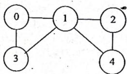

答案：D。

知识点：[LC（优先队列式）分枝限界法与代价估计函数](../../../topics/算法分析/LC分枝限界法.md)

### 选择 10

下列（A）不是序列 $X=<A,B,A,C,D,A,B>$ 的子序列。

- A. $<B,C,B,A>$
- B. $<A,B,D,A>$
- C. $<A,A,C,B>$
- D. $<B,A,A,B>$

答案：A。

## 二、连线题（每线 2 分，共 10 分）

根据各个算法的性质连线。

| 子问题相互独立 | 子问题有重叠部分 | 子问题可以找到最优策略 | 广度优先 | 深度优先 |
|---|---|---|---|---|
| 回溯法 | 贪心算法 | 动态规划法 | 分支限界法 | 分治法 |

## 三、问答题（每题 18 分，共 54 分）

知识点：[二分搜索（对半搜索）的递归与迭代实现](../../../topics/算法分析/二分搜索.md)、[对半搜索的二叉判定树性质及基于关键字比较的搜索算法时间下界](../../../topics/算法分析/二叉判定树.md)

### 简答 1

已知欧几里德算法（辗转相除法）可以求得两个数的最大公约数。

1）试简要分析一下原理（提示：$a=k_1c$，$b=k_2c$，且 $k_1,k_2$ 互质）。

答：因为 $k_1$，$k_2$ 互质，所以两个数相减得到的余数是最大公约数的倍数，最后直到其中一个数为最大公约数。

知识点：[分治法的一般思想与算法框架（分解、解决、合并）](../../../topics/算法分析/分治法一般框架.md)、[两路合并排序算法及其时间与空间复杂度分析](../../../topics/算法分析/合并排序.md)、[快速排序算法（Partition分划函数与QuickSort）及性能改善方法](../../../topics/算法分析/快速排序.md)

### 简答 2

已知 15 谜问题如图所示：

| 1 |   | 3 | 4 |
|---|---|---|---|
| 5 | 2 | 7 | 8 |
| 9 | 6 | 10 | 12 |
| 13 | 14 | 11 | 15 |

1）试写出每个空格的 Less 函数。

2）试证明能达到目标状态的初始状态均满足判定要求 $\sum_{k=1}^{16} \mathrm{Less}(k)+i+j$ 为偶数（提示：考虑空格移动的方向分情况讨论奇偶性）。

答：分别考虑空格左右移动和上下移动对判定函数奇偶性的影响，证明每次移动都不改变奇偶性，可得证。

知识点：[多段图问题的向前/向后递推动态规划算法](../../../topics/算法分析/多段图问题.md)、[动态规划法与分治法、贪心法的异同比较](../../../topics/算法分析/动态规划与分治贪心对比.md)

### 简答 3

给定字符串 $X=(x_1,x_2,\ldots,x_6)=\mathrm{abacbd}$ 和 $Y=(y_1,y_2,\ldots,y_5)=\mathrm{baacd}$。

（1）请给出 LCS 算法求解最长公共子序列长度过程中数组 c 和数组 s 的值。

$c[i][j]$ 保存子序列 $X_i=(x_1,\ldots,x_i)$ 和 $Y_j=(y_1,\ldots,y_j)$ 的最长公共子序列的长度。

$s[i][j]$ 记录 $c[i][j]$ 的值是由三个子问题 $c[i-1][j-1]+1$，$c[i][j-1]$ 和 $c[i-1][j]$ 中的哪一个计算得到的。若 $c[i][j]=c[i-1][j-1]+1$ 时 $s[i][j]=1$；$c[i][j]=c[i-1][j]$ 时 $s[i][j]=2$；$c[i][j]=c[i][j-1]$ 时 $s[i][j]=3$。

（2）求最长公共子序列的长度。

（3）请用箭头画出在 s 上执行 CLCS(int i, int j) 算法构造最长公共子序列的追溯路径，并构造最长公共子序列。

解：（1）

$c[i][j]$ 数组：

| $c[i][j]$ | 0 | b | a | a | c | d |
|---|---|---|---|---|---|---|
| 0 | 0 | 0 | 0 | 0 | 0 | 0 |
| a | 1 | 0 | 1 | 1 | 1 | 1 |
| b | 2 | 1 | 1 | 1 | 1 | 1 |
| a | 3 | 1 | 2 | 2 | 2 | 2 |
| c | 4 | 1 | 2 | 2 | 3 | 3 |
| b | 5 | 1 | 2 | 2 | 3 | 3 |
| d | 6 | 1 | 2 | 2 | 3 | 4 |

$s[i][j]$ 数组：

| $s[i][j]$ | 0 | b | a | a | c | d |
|---|---|---|---|---|---|---|
| 0 | 0 | 0 | 0 | 0 | 0 | 0 |
| a | 1 | 2 | 1 | 1 | 1 | 1 |
| b | 2 | 1 | 2 | 2 | 2 | 2 |
| a | 3 | 2 | 1 | 1 | 1 | 1 |
| c | 4 | 2 | 2 | 2 | 1 | 1 |
| b | 5 | 1 | 2 | 2 | 2 | 2 |
| d | 6 | 2 | 2 | 2 | 2 | 1 |

（2）最长公共子序列长度为：4。

（3）回溯路径如图所示。

最长公共子序列为：aacd。

## 四、程序设计题（16 分）

请用递归法输入斐波那契数列的前 20 个数（程序的缩进、用户友好性均是考察点）。

解：程序如下：

## 二、填空题（每空 2 分，共 20 分）

知识点：[一般背包问题的贪心法求解及最优度量标准证明](../../../topics/算法分析/背包问题贪心求解.md)、[0/1背包问题的动态规划法求解（自底向上、反证法证明最优子结构）](../../../topics/算法分析/01背包动态规划.md)、[贪心法的基本要素（贪心选择性质/最优量度标准、最优子结构性质）](../../../topics/算法分析/贪心法基本要素.md)

### 填空 6

NP 类问题是所有可在多项式时间内用 （7） 求解的判定问题的集合。

答案：不确定算法。

知识点：[回溯法的基本概念（解空间、状态空间树、显式约束与隐式约束）](../../../topics/算法分析/回溯法基本概念.md)

### 填空 7

采用分治法求解两个 $n \times n$ 矩阵 A 和 B 相乘的问题时，若采用矩阵分块技术将矩阵 A、B 和目标矩阵 C 各自都分解成 4 个 $(n/2) \times (n/2)$ 大小的子矩阵，此时乘法方程 $C=AB$ 可重写为：$C_{11}=A_{11}B_{11}+A_{12}B_{21}$，$C_{12}=A_{11}B_{12}+A_{12}B_{22}$，$C_{21}=A_{21}B_{11}+A_{22}B_{21}$，$C_{22}=A_{21}B_{12}+A_{22}B_{22}$。

则该算法 $n>2$ 时时间复杂度的递推方程为 $T(n)=$ （8）$+cn^2$，求解该方程得到时间复杂度为 $\Theta$（（9））。斯特拉森矩阵乘法在此基础上，通过减少子矩阵的（10）次数可降低算法的时间复杂度。

答案：（8）$8T(n/2)$；（9）$n^3$；（10）乘法。

## 三、问答题（共 32 分）

知识点：[剪枝函数设计与回溯法效率分析（蒙特卡罗估计算法）](../../../topics/算法分析/剪枝函数与效率分析.md)

### 简答 1

（8 分）已知欧几里德算法（辗转相除法）可以求得两个数的最大公约数。

1）试简要分析一下原理（提示：$a=k_1c,\ b=k_2c$，且 $k_1,\ k_2$ 互质）。

2）试用自然语言写出欧几里德算法的迭代过程。

答案：

（1）因为 $k_1,\ k_2$ 互质，所以两个数相减得到的余数是最大公约数的倍数，最后直到其中一个数为最大公约数。

（2）（原件此处未给出完整解答）。

知识点：[分治法的一般思想与算法框架（分解、解决、合并）](../../../topics/算法分析/分治法一般框架.md)、[两路合并排序算法及其时间与空间复杂度分析](../../../topics/算法分析/合并排序.md)、[快速排序算法（Partition分划函数与QuickSort）及性能改善方法](../../../topics/算法分析/快速排序.md)

### 简答 2

（8 分）背包载重为 30，有 4 件物品的重量为 $(w_0, w_1, w_2, w_3) = (12, 14, 9, 10)$，放入背包的收益分别为 $(p_0, p_1, p_2, p_3) = (3, 5, 7, 2)$。（注：最优解中的解分量 $x_i$ 表示物品 $i$ 放入背包的比例。）

（1）若物品可以分割，则最大收益是多少？最优解是什么？

（2）若物品不可以分割，则最大收益是多少？最优解是什么？

答案：

（1）若物品可以分割，三件物品的单位重量价值为 $(1/4,\ 5/14,\ 7/9,\ 1/5)$，按照单位重量价值从大到小的顺序选取物品放入。因此最优解为 $(7/12,\ 1,\ 1,\ 0)$，最大收益为 13.75。

（2）若物品不可分割，最大收益为 12，最优解为 $(0,\ 1,\ 1,\ 0)$。

知识点：[多段图问题的向前/向后递推动态规划算法](../../../topics/算法分析/多段图问题.md)、[动态规划法与分治法、贪心法的异同比较](../../../topics/算法分析/动态规划与分治贪心对比.md)

### 简答 3

（8 分）带权的无向连通图 G 如右图所示：


请画出对图 G 执行 Kruskal 算法，得到最小代价生成树的步骤。

答案：

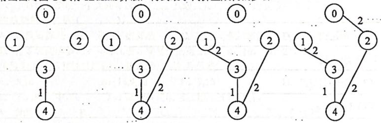

（此处权值为 2 的几条边，加入顺序可随意。）

知识点：[一般背包问题的贪心法求解及最优度量标准证明](../../../topics/算法分析/背包问题贪心求解.md)、[0/1背包问题的动态规划法求解（自底向上、反证法证明最优子结构）](../../../topics/算法分析/01背包动态规划.md)、[贪心法的基本要素（贪心选择性质/最优量度标准、最优子结构性质）](../../../topics/算法分析/贪心法基本要素.md)

### 简答 4

（8 分）若给出求解 n-皇后问题的显式约束条件：$S_i=\{0,1,2,\ldots,n-1\}$，$0\leqslant i<n$，且 $x_i\neq x_j\ (0\leqslant i,j<n,\ i\neq j)$ 和隐式约束条件：对任意 $0\leqslant i,j<n$，当 $i\neq j$ 时，$|i-j|\neq|x_i-x_j|$。

（1）则此时解空间大小为多少？

（2）当 $n=4$ 时，该显式约束条件下的状态空间树如下图。请画出回溯法求解得到第一个可行解时，实际生成的状态空间树部分。


答案：

（1）解空间大小为 $n!$。（4 分）

（2）实际生成的状态空间树为：（4 分）

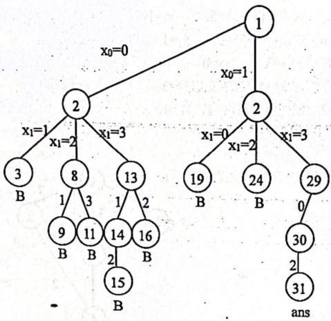

## 四、编程题（每空 2 分，共 14 分）

最长公共子序列问题：给定 2 个序列 $X=\{x_1,x_2,\ldots,x_m\}$ 和 $Y=\{y_1,y_2,\ldots,y_n\}$，找出 X 和 Y 的最长公共子序列。由最长公共子序列问题的最优子结构性质建立子问题最优值的递归关系。用 `c[i][j]` 记录序列 $X_i$ 和 $Y_j$ 的最长公共子序列的长度，其中 $X_i=\{x_1,x_2,\ldots,x_i\}$，$Y_j=\{y_1,y_2,\ldots,y_j\}$。当 $i=0$ 或 $j=0$ 时，空序列是 $X_i$ 和 $Y_j$ 的最长公共子序列，故此时 `c[i][j]=0`。其它情况下，由最优子结构性质可建立递归关系如下：

$$
c[i][j]=\begin{cases}
0, & i=0,\ j=0\\
c[i-1][j-1]+1, & i,j>0,\ x_i=y_j\\
\max\{c[i][j-1],\ c[i-1][j]\}, & i,j>0,\ x_i\neq y_j
\end{cases}
$$

在程序中，`b[i][j]` 记录 `c[i][j]` 的值是由哪一个子问题的解得到的。

知识点：[多段图问题的向前/向后递推动态规划算法](../../../topics/算法分析/多段图问题.md)

### 编程 1

（1）请填写程序中的空格，以使函数 `LCSLength` 完成计算最优值的功能。

```c
void LCSLength(int m, int n, char *x, char *y, int **c, int **b)
{
    int i, j;
    for (i = 1; i <= m; i++) c[i][0] = 0;
    for (i = 1; i <= n; i++) c[0][i] = 0;
    for (i = 1; i <= m; i++)
    for (j = 1; j <= n; j++)
    {
    if ((1))
```

答案：（1）`x[i]=y[i]`；（2）`c[i-1][j]`；（3）`c[i][j-1]`；（4）`b[i][j]=3`；（5）`b[i][j]=2`。

知识点：[回溯法的基本概念（解空间、状态空间树、显式约束与隐式约束）](../../../topics/算法分析/回溯法基本概念.md)、[回溯法的递归回溯与迭代回溯算法框架](../../../topics/算法分析/回溯法框架.md)

### 编程 2

（2）函数 `LCS` 实现根据 `b` 的内容打印出 $X_i$ 和 $Y_j$ 的最长公共子序列。请填写程序中的空格，以使函数 `LCS` 完成构造最长公共子序列的功能。（请将 `b[i][j]` 的取值与（1）中您填写的取值对应，否则视为错误。）

答案：（6）`LCS(i-1,j,x,b)`；（7）`LCS(i,j-1,x,b)`。

## 五、综合题（共 14 分）

汽车加油问题：一个旅行者要驾车从 A 地到 B 地，A、B 两地间距离为 $s$。A、B 两地之间有 $n$ 个加油站，已知第 $i$ 个（$i=1,2,\ldots,n$）加油站离起点 A 的距离为 $d_i$ 公里且 $0=d_1<d_2<\cdots<d_n\leqslant s$，车加满油后可行驶 $m$ 公里，出发之前汽车油箱为空，那么应如何加油使得从 A 地到 B 地沿途加油次数最少？试用贪心法解决此问题，请：

（1）给出用贪心法求解该最优化问题的贪心选择策略。

（2）请补全下列贪心算法求出最少加油次数和在哪些加油站加油。

输入：A、B 两地间的距离 $s$，A、B 两地间的加油站数 $n$，车加满油后可行驶的公里数 $m$，存储各加油站离起点 A 的距离的数组 `d[n]`。

输出：从 A 地到 B 地的最少加油次数 $k$ 以及最优解数组 `x[k]`（`x[i]` 表示第 $i$ 次加油的加油站序号，$i=1,2,\ldots,k$），若问题无解，则输出 `No solution`。

```c
int greedy(int *x, int n)
{
    d[n+1]=s; //设置虚拟加油站第 n+1 站
    for(int i=1;i<=n;i++)
    {
    if ____(1)____ //如果在第 i 站加油后可行距离无法到达第 i+1 站，则无解
    {
    cout<<"No solution"<<endl;
    return -1;
    }
    }
    k=1;x[k]=1;//在第1站加满油
    s1=m;    //s1为汽车的当前油量可行驶至的地点与A地的距离
    i=2;
    while (s1<s)
    {
    if(d[i+1]>s1)    //以汽车的当前油量无法到达第i+1站
    {
    k++;    x[k]=__(2)__;    //在第i站加满油
    s1=__(3)__;    //刷新s1的值
    }
    i++;
    }
    cout<<k<<endl;    //输出最少加油次数k
    for(i=1;i<=n;i++)
    cout<<x[i]<<" "; //输出最优解
}
```

（3）此算法的渐进时间复杂度是多少？

答案：

（1）贪心选择策略：从起点的加油站起每次加满油后不加油行驶尽可能远，直至油箱中的油耗尽前所能到达的最远的油站为止，在该加油站再加满油。

（2）（1）`d[i+1]-d[i] > m`；（2）`i`；（3）`d[i]+m`。

（3）此算法的渐进时间复杂度为 $O(n)$。

# 《算法分析与设计》期末试卷（B卷）

本资料由识别工具读取《算法分析与设计》期末试卷（B卷）第 16–21 页内容整理而成，已修正明显的排版与识别错误，保留原题结构。

## 一、选择题（每小题 2 分，共 20 分）

知识点：[动态规划法的基本要素（最优子结构、重叠子问题）与设计步骤](../../../topics/算法分析/动态规划基本要素.md)、[贪心法的基本要素（贪心选择性质/最优量度标准、最优子结构性质）](../../../topics/算法分析/贪心法基本要素.md)

### 选择 1

下列排序算法中是最优算法的是（ ）。
- A. 两路合并排序
- B. 冒泡排序
- C. 选择排序
- D. 快速排序

答案：A。

知识点：[算法的概念与基本特性（确定性、有限性等）](../../../topics/算法分析/算法概念与特性.md)

### 选择 2

对半搜索算法的成功搜索和失败搜索的平均时间复杂度分别为（）。
- A. $O(\log n)$, $\Theta(\log n)$
- B. $O(\log n)$, $O(\log n)$
- C. $\Theta(\log n)$, $O(\log n)$
- D. $\Theta(\log n)$, $\Theta(\log n)$

答案：D。

知识点：[欧几里德算法（递归与迭代实现求最大公约数）](../../../topics/算法分析/欧几里德算法.md)、[连续整数检测算法求最大公约数](../../../topics/算法分析/连续整数检测算法.md)

### 选择 3

图 $G=(V, E)$ 是一个无向带权连通图，其边数相对较少，则能较高效率得到最小代价生成树的算法是（）。
- A. 普里姆算法
- B. 弗洛伊德算法
- C. 克鲁斯卡尔算法
- D. 迪杰斯特拉算法

答案：C。

知识点：[算法按时间复杂度分类（多项式时间算法与指数时间算法）](../../../topics/算法分析/算法按时间复杂度分类.md)

### 选择 4

有 6 名同学参加乒乓球比赛，学号分别是 2, 5, 9, 10, 15, 23，用对半搜索查找学号为 10 的同学的过程中，依次访问到的学号是（）。
- A. 5, 10
- B. 15, 9, 10
- C. 9, 10
- D. 9, 15, 10

答案：D。

知识点：[回溯法的基本概念（解空间、状态空间树、显式约束与隐式约束）](../../../topics/算法分析/回溯法基本概念.md)、[回溯法的递归回溯与迭代回溯算法框架](../../../topics/算法分析/回溯法框架.md)、[n-皇后问题的回溯法求解及状态空间树分析](../../../topics/算法分析/N皇后问题.md)

### 选择 5

下列问题中，（ ）不适合采用动态规划法进行求解。
- A. 矩阵连乘
- B. 关键路径
- C. 排序问题
- D. 最长公共子序列

答案：C。

知识点：[算法的概念与基本特性（确定性、有限性等）](../../../topics/算法分析/算法概念与特性.md)、[递推方程的求解方法（替换法、迭代法、递归树、主方法）](../../../topics/算法分析/递推方程求解.md)

### 选择 6

快速排序在最坏情况下，时间递推式为（ ）。
- A. $T(n)=2T(n/2)+\Theta(n)$
- B. $T(n) \leq T(n-1)+n+1$
- C. $T(n)=n+1+\frac{1}{n}\sum_{k=0}^{n-1}(T(k)+T(n-1-k))$
- D. $T(n)=n+1+\frac{1}{n}\sum_{k=0}^{n-1}T(k)$

答案：B。

知识点：[问题和问题求解方法与系统生命周期](../../../topics/算法分析/问题求解过程.md)、[算法的概念与基本特性（确定性、有限性等）](../../../topics/算法分析/算法概念与特性.md)

### 选择 7

下面图中（）不包含哈密顿环。

A.


B.


C.


D.


答案：B。

知识点：[算法的概念与基本特性（确定性、有限性等）](../../../topics/算法分析/算法概念与特性.md)、[问题和问题求解方法与系统生命周期](../../../topics/算法分析/问题求解过程.md)

### 选择 8

下面哪一个关于 RSA 算法的说法是错误的？（）
- A. RSA 采用的非对称密码体制。
- B. RSA 算法为每个用户生成一个公钥/私钥对。
- C. RSA 算法可以用于加密。
- D. RSA 算法不能用于数字签名。

答案：D。

知识点：[最长公共子序列（LCS）的最优子结构证明、递推公式与构造最优解](../../../topics/算法分析/最长公共子序列.md)、[动态规划法的基本要素（最优子结构、重叠子问题）与设计步骤](../../../topics/算法分析/动态规划基本要素.md)

### 选择 9

在数理逻辑中，设 $x_{1}, x_{2}, \ldots, x_{n}$ 表示布尔变量，若 $x_{1}=1, x_{2}=0, x_{3}=0$ ，以下命题公式为真的是（）。
- A. $(x_{1} \vee \overline{x}_{2} \vee \overline{x}_{3}) \wedge (\overline{x}_{1} \vee x_{2} \vee x_{3}) \wedge (x_{1} \vee \overline{x}_{2} \vee x_{3})$
- B. $(x_{1} \wedge x_{2} \wedge \overline{x}_{3}) \vee (\overline{x}_{1} \wedge x_{2} \wedge x_{3}) \vee (x_{1} \wedge \overline{x}_{2} \wedge x_{3})$
- C. $(x_{1} \vee \overline{x}_{2} \vee \overline{x}_{3}) \wedge (x_{1} \vee x_{2} \vee x_{3}) \wedge (x_{1} \vee \overline{x}_{2} \vee x_{3})$
- D. $(x_{1} \wedge \overline{x}_{2} \wedge x_{3}) \vee (x_{1} \wedge x_{2} \wedge x_{3}) \vee (\overline{x}_{1} \wedge \overline{x}_{2} \wedge \overline{x}_{3})$

答案：A。

知识点：[LC（优先队列式）分枝限界法与代价估计函数](../../../topics/算法分析/LC分枝限界法.md)

### 选择 10

所有可在多项式时间内用不确定算法求解的判定问题是（）问题。
- A. P 类
- B. NP 类
- C. NP 难度
- D. NP 完全

答案：B。

## 二、填空题（每空 2 分，共 20 分）

知识点：[二分搜索（对半搜索）的递归与迭代实现](../../../topics/算法分析/二分搜索.md)、[对半搜索的二叉判定树性质及基于关键字比较的搜索算法时间下界](../../../topics/算法分析/二叉判定树.md)

### 填空 1

（1）\_\_\_\_性质和（2）\_\_\_\_性质是动态规划法求解的基本要素。

答案：最优子结构；重叠子问题。

知识点：[算法的时间复杂度定义（最好、最坏、平均情况）](../../../topics/算法分析/时间复杂度定义.md)、[算法的空间复杂度定义](../../../topics/算法分析/空间复杂度定义.md)

### 填空 2

采用分治法求解两个 $n \times n$ 矩阵 A 和 B 相乘的问题时，若采用矩阵分块技术将矩阵 A、B 和目标矩阵 C 各自都分解成 4 个 $(n/2) \times (n/2)$ 大小的子矩阵，此时乘法方程 $C=AB$ 可重写为：
$$C_{11}=A_{11}B_{11}+A_{12}B_{21}$$
$$C_{12}=A_{11}B_{12}+A_{12}B_{22}$$
$$C_{21}=A_{21}B_{11}+A_{22}B_{21}$$
$$C_{22}=A_{21}B_{12}+A_{22}B_{22}$$
则该算法 $n>2$ 时时间复杂度的递推方程为 $T(n)=8T(n/2)+cn^{2}$，求解该方程得到时间复杂度为 $\Theta(\text{(3)})$ 。斯特拉森矩阵乘法在此基础上，通过减少子矩阵的 \_\_\_\_（4）次数可降低算法的时间复杂度。

答案：(3) $\Theta(n^{\log_2 8}) = \Theta(n^3)$；(4) 乘法。

知识点：[算法的概念与基本特性（确定性、有限性等）](../../../topics/算法分析/算法概念与特性.md)、[递归概念与归纳证明（斐波那契数列、Hanoi塔问题）](../../../topics/算法分析/递归与归纳证明.md)

### 填空 3

有载重 $M=10$ 的背包，3 件物品的重量为 $(w_{0},w_{1},w_{2})=(5,8,7)$，物品装入背包的收益为 $(p_{0},p_{1},p_{2})=(5,6,10)$。若物品可分割，则背包最大收益为 \_\_\_\_。

答案：10。
解析：贪心策略。按单位重量价值排序：
物品 0: $5/5=1$
物品 1: $6/8=0.75$
物品 2: $10/7 \approx 1.43$
优先装物品 2（重 7，收益 10），剩余载重 3。再装物品 0 的 $3/5$，收益 $5 \times (3/5)=3$。总收益 $10+3=13$。
*注：原题若为 0/1 背包则不同，但题目明确“物品可分割”，故为分数背包。计算结果应为 13。若原题答案为 10，可能题目数据或理解有误，此处按标准算法计算为 13。*
订正：根据标准分数背包算法计算，最大收益应为 13。

知识点：[贪心法的基本要素（贪心选择性质/最优量度标准、最优子结构性质）](../../../topics/算法分析/贪心法基本要素.md)

### 填空 4

回溯法和分枝限界法都是通过搜索问题的 (6) \_\_\_\_ 来求问题的可行解或最优解，都使用 (7) \_\_\_\_ 函数来减少所需实际生成的状态结点数。

答案：(6) 状态空间树；(7) 剪枝。

知识点：[欧几里德算法（递归与迭代实现求最大公约数）](../../../topics/算法分析/欧几里德算法.md)、[数论初步（同余定义、按模计算原理、欧拉函数）](../../../topics/算法分析/数论初步.md)

### 填空 5

蒙特卡罗方法用于估计回溯法处理问题时状态空间树上实际生成的结点数。若随机选择一条路径 $(x_{0}, x_{1}, x_{2})$，这条路径上不受限制的 $x_{0}$ 取值有 $m_{0}$ 个，不受限制的 $x_{1}$ 取值有 $m_{1}$ 个，不受限制的 $x_{2}$ 取值有 $m_{2}$ 个。则整个状态空间树上将实际生成的结点数估计为 $m=$ \_\_\_\_（9）。

答案：$m_0 + m_0 m_1 + m_0 m_1 m_2$。

知识点：[动态规划法的基本要素（最优子结构、重叠子问题）与设计步骤](../../../topics/算法分析/动态规划基本要素.md)

### 填空 6

信息安全的目标是保护信息的机密性、（9）\_\_\_\_，并具有（10）\_\_\_\_ 和可用性。

答案：(9) 完整性；(10) 可靠性（或不可抵赖性，通常指 CIA 三要素扩展为五要素：机密性、完整性、可用性、可控性、不可否认性）。

## 三、问答题（4 题，共 44 分）

知识点：[回溯法的基本概念（解空间、状态空间树、显式约束与隐式约束）](../../../topics/算法分析/回溯法基本概念.md)

### 简答 1

（10 分）请写出对数据 (6,5,4,3,2,1) 进行快速排序的执行过程（以第一个元素作为主元）。（结果从小到大排列）

知识点：[分治法的一般思想与算法框架（分解、解决、合并）](../../../topics/算法分析/分治法一般框架.md)、[两路合并排序算法及其时间与空间复杂度分析](../../../topics/算法分析/合并排序.md)、[快速排序算法（Partition分划函数与QuickSort）及性能改善方法](../../../topics/算法分析/快速排序.md)

### 简答 2

（6 分）请画出下图的 Prim 算法由顶点 1 出发获得的最小代价生成树。


知识点：[多段图问题的向前/向后递推动态规划算法](../../../topics/算法分析/多段图问题.md)、[动态规划法与分治法、贪心法的异同比较](../../../topics/算法分析/动态规划与分治贪心对比.md)

### 简答 3

（8 分）在下图所示的多段图中，从后向前求从源点 0 到汇点 5 的最短路径长度和最短路径，请写出求解过程。用 cost(j) 表示顶点 j 到汇点 5 的最短路径长度，用 d(j) 记录从 j 到汇点 5 的最短路径上该结点 j 的下一个结点编号。


知识点：[一般背包问题的贪心法求解及最优度量标准证明](../../../topics/算法分析/背包问题贪心求解.md)、[0/1背包问题的动态规划法求解（自底向上、反证法证明最优子结构）](../../../topics/算法分析/01背包动态规划.md)、[贪心法的基本要素（贪心选择性质/最优量度标准、最优子结构性质）](../../../topics/算法分析/贪心法基本要素.md)

### 简答 4

（10 分）有 0/1 背包问题实例 $(w_{0},w_{1},w_{2},w_{3})=(3,4,4,2)$，$(p_{0},p_{1},p_{2},p_{3})=(4,8,6,2)$，和 $M=10$。

(1) 若 $f(j,X)$ 表示当背包载重为 X，可供选择的物品为 0,1，……j 时的最优解值（即放入背包的物品所获收益最大)。请写出动态规划法求解该最优解值的递推关系式。

知识点：[多段图问题的向前/向后递推动态规划算法](../../../topics/算法分析/多段图问题.md)

### 简答 5

（10 分）带时限的作业排序问题实例：$n=3,\left(t_{0},d_{0},p_{0}\right)=(1,3,2),\left(t_{1},d_{1},p_{1}\right)=(2,4,4),\left(t_{2},d_{2},p_{2}\right)=(3,4,3)$，求使得总收益最大的作业子集，解向量形式为可变长度元组解（其中的解分量xi为入选作业的下标）。

(1) 请标明下图中 FIFO 分枝限界法生成的状态空间树（未入选的作业损失为目标函数）求解过程中每个结点的：损失下界 $\hat{c}$、损失上界 u，以及损失上界阈值变量 U 的更新值。


知识点：[剪枝函数设计与回溯法效率分析（蒙特卡罗估计算法）](../../../topics/算法分析/剪枝函数与效率分析.md)、[n-皇后问题的回溯法求解及状态空间树分析](../../../topics/算法分析/N皇后问题.md)、[回溯法的基本概念（解空间、状态空间树、显式约束与隐式约束）](../../../topics/算法分析/回溯法基本概念.md)

### 编程 1

下面图的 m-着色算法 `mColoring(int k, int m, int *x)` 以深度优先方式搜索状态空间树中结点，列出图中 n 个结点所有可能的 m-着色方案。算法的解为 n-元组形式，保存在数组 x 中。

#### (1) 请补充完整下面算法

```cpp
template <class T>
void MGraph<T>::NextValue(int k, int m, int *x)
//在[1,m]中为x[k]确定一个值最小的，且不与邻接点冲突的颜色
//x[k]=0 表示没有可用颜色.
do
{ 
    // (1): 尝试下一个颜色
    x[k]++; 
    
    if(!x[k]) return; //无适当颜色可选
    
    for (int j=0;j<k;j++)
        if (a[k][j]&&(2)) // 检查是否冲突
            break;
            
    if (j=k) return; //成功选择一种颜色
} while (1);
```

**补充内容：**
-   (1): `x[k]++` (或者 `x[k] = x[k] + 1`)
-   (2): `x[j] == x[k]`

```cpp
template <class T>
void MGraph<T> :: mColoring(int k, int m, int *x) // 递归函数
{
    do
    { 
        _\_\_(3)\_\_\_; //为 x[k]分配一个颜色
        if (!x[k]) break; //无适当颜色可选
        
        if (k==n-1) //得到图 G 的一种 m-着色方案
        { 
            for (int i=0;i<n;i++) cout<<x[i]<<"";
            cout<<endl;
        }
        else
            _\_\_(4)\_\_\_; //深度优先搜索下层
    } while (1);
}
```

**补充内容：**
-   (3): `NextValue(k, m, x)`
-   (4): `mColoring(k+1, m, x)`

知识点：[回溯法的基本概念（解空间、状态空间树、显式约束与隐式约束）](../../../topics/算法分析/回溯法基本概念.md)、[回溯法的递归回溯与迭代回溯算法框架](../../../topics/算法分析/回溯法框架.md)

### 编程 2

一辆汽车加满油后可行驶 n 公里。旅途中有若干个加油站。设计一个有效算法，指出应在哪些加油站停靠加油，使沿途加油次数最少。对于给定的 $n(n \leqslant 5000)$ 和 $k(k \leqslant 1000)$ 个加油站位置，编程计算最少加油次数。

输入：第一行有 2 个正整数 n 和 k，表示汽车加满油后可行驶 n 公里，且旅途中有 k 个加油站。接下来的 1 行中，有 $k+1$ 个整数，表示第 k 个加油站与第 k-1 个加油站之间的距离。第 0 个加油站表示出发地，汽车已加满油。第 $k+1$ 个加油站表示目的地。

输出：输出编程计算出的最少加油次数。如果无法到达目的地，则输出 "No Solution"。

思路：汽车行驶过程中，应走到自己能走到并且离自己最远的那个加油站，在那个加油站加油后再按照同样的方法贪心。

具体算法：先检测各加油站之间的距离，若发现其中有一个距离大于汽车加满油能跑的距离，则输出 No Solution。否则，对加油站间的距离进行逐个扫描，尽量选择往远处走，不能走了就让 num++，最终统计出来的 num 便是最少的加油站数。请补充完整下面算法：

*(注：原题此处未给出代码框架，仅要求补充完整算法，通常指伪代码或关键逻辑)*

**参考算法逻辑：**

```python
def min_refuel_stops(n, k, distances):
    # distances 是相邻站点间的距离列表，长度为 k+1
    # 检查是否有单段距离超过 n
    for d in distances:
        if d > n:
            return "No Solution"
    
    current_fuel = n
    refuel_count = 0
    last_station_pos = 0
    
    # 遍历每一段距离
    # 假设我们当前在某个加油站，目标是尽可能远的下一站
    # 这里的逻辑是：从当前位置出发，能到达的最远加油站
    
    # 更简单的贪心：
    # 当前油量足够到达下一站吗？
    # 如果不够，必须在当前站加油（如果是起点，已经加满，必须到达下一个能到的站）
    # 这里的贪心策略是：一直开到油不够为止，然后在能到的最远站加油
    
    # 修正逻辑：
    # 从起点出发，油箱满。
    # 依次经过各段距离。
    # 记录当前能到达的最远位置。
    
    # 另一种经典写法：
    # 维护当前油量，遍历距离
    # 如果当前油量 >= 下一段距离，继续开
    # 否则，必须加油。加油次数 +1，油量重置为 n - 当前已走距离
    
    # 但题目说是“尽量往远处走”，即：
    # 从起点出发，找到能到达的最远加油站 i。
    # 如果 i 就是终点，结束。
    # 否则，在 i 加油，计数 +1，从 i 重新开始找能到达的最远站。
    
    pos = 0 # 当前所在站点索引（0是起点）
    count = 0
    
    while pos < k: # 还没到终点（终点是 k+1 的位置，但在距离数组中是最后一个元素）
        # 寻找从 pos 出发，能到达的最远站点 next_pos
        max_reach = pos
        for i in range(pos + 1, len(distances)):
            # 检查从 pos 到 i 的距离总和是否 <= n
            dist_sum = sum(distances[pos:i]) # 简化，实际需要累加
            # 正确做法：累加
            current_dist = 0
            possible = True
            for j in range(pos, i):
                current_dist += distances[j]
                if current_dist > n:
                    possible = False
                    break
            
            if possible:
                max_reach = i
            else:
                break
        
        if max_reach == pos:
            # 无法前进
            return "No Solution"
            
        if max_reach == k: # 到达最后一个距离段的终点（即目的地）
            break
            
        # 在 max_reach 处加油
        count += 1
        pos = max_reach
        
    return count
```

*(注：由于题目未给出具体代码填空行，以上为算法核心逻辑。若需填空，通常涉及循环条件和累加判断)*

答案：见参考算法逻辑。

知识点：[动态规划法的基本要素（最优子结构、重叠子问题）与设计步骤](../../../topics/算法分析/动态规划基本要素.md)、[贪心法的基本要素（贪心选择性质/最优量度标准、最优子结构性质）](../../../topics/算法分析/贪心法基本要素.md)

### 选择 1

下面说法正确的是（ ）。

- A. 算法+数据结构=程序
- B. 算法就是程序
- C. 数据结构就是程序
- D. 算法包括数据结构

答案：A。

知识点：[算法的概念与基本特性（确定性、有限性等）](../../../topics/算法分析/算法概念与特性.md)

### 选择 2

以下关于渐近记号的性质是正确的有（ ）。

- A. $f(n)=O(g(n))\Rightarrow f(n)\geq g(n)$
- B. $f(n)=\Theta(g(n))$，$g(n)=\Theta(h(n))\Rightarrow f(n)=\Theta(h(n))$
- C. $O(f(n))+O(g(n))=O(\min\{f(n),g(n)\})$
- D. $f(n)=O(g(n))\Leftrightarrow g(n)=O(f(n))$

答案：D。

知识点：[欧几里德算法（递归与迭代实现求最大公约数）](../../../topics/算法分析/欧几里德算法.md)、[连续整数检测算法求最大公约数](../../../topics/算法分析/连续整数检测算法.md)

### 选择 3

有 5 名同学参加冬季越野赛跑，学号分别是 5, 8, 11, 33, 45，用分治法查找学号 33 的同学的过程中，依次访问到的学号是（ ）。

- A. 5, 11, 33
- B. 8, 33
- C. 11, 45, 33
- D. 11, 33

答案：C。

知识点：[算法按时间复杂度分类（多项式时间算法与指数时间算法）](../../../topics/算法分析/算法按时间复杂度分类.md)

### 选择 4

设有 5 个有序文件分别包含（30, 10, 20, 15, 55）条记录，现通过两两合并将其合并成一个有序文件。（若每一次合并需读写两个文件的全部记录一次）则整个合并过程中至少需要读写总共（ ）条记录。

- A. 130
- B. 280
- C. 255
- D. 505

答案：D。

知识点：[回溯法的基本概念（解空间、状态空间树、显式约束与隐式约束）](../../../topics/算法分析/回溯法基本概念.md)、[回溯法的递归回溯与迭代回溯算法框架](../../../topics/算法分析/回溯法框架.md)、[n-皇后问题的回溯法求解及状态空间树分析](../../../topics/算法分析/N皇后问题.md)

### 选择 5

动态规划算法的基本要素为（ ）。

- A. 最优子结构性质与贪心选择性质
- B. 重叠子问题性质与贪心选择性质
- C. 最优子结构性质与重叠子问题性质
- D. 预排序与递归调用

答案：C。

知识点：[算法的概念与基本特性（确定性、有限性等）](../../../topics/算法分析/算法概念与特性.md)、[递推方程的求解方法（替换法、迭代法、递归树、主方法）](../../../topics/算法分析/递推方程求解.md)

### 选择 6

回溯法的效率不依赖于以下哪一个因素？（ ）

- A. 产生 x[k] 的时间
- B. 满足显式约束的 x[k] 的个数
- C. 问题的解空间的形式
- D. 满足约束函数和限界函数约束的所有 x[k] 的个数

答案：B。

知识点：[问题和问题求解方法与系统生命周期](../../../topics/算法分析/问题求解过程.md)、[算法的概念与基本特性（确定性、有限性等）](../../../topics/算法分析/算法概念与特性.md)

### 选择 7

蒙特卡罗算法是（ ）的一种。

- A. 分支界限算法
- B. 贪心算法
- C. 随机算法
- D. 回溯算法

答案：D。

知识点：[算法的概念与基本特性（确定性、有限性等）](../../../topics/算法分析/算法概念与特性.md)、[问题和问题求解方法与系统生命周期](../../../topics/算法分析/问题求解过程.md)

### 选择 8

以代价估计函数 $\hat{c}(\cdot)$ 作为选择下一个扩展结点的评价函数，即总是选取 $\hat{c}(\cdot)$ 值（ ）的活结点为下一个 E-结点。

- A. 最大
- B. 最小
- C. 最优
- D. 最快

答案：D。

知识点：[最长公共子序列（LCS）的最优子结构证明、递推公式与构造最优解](../../../topics/算法分析/最长公共子序列.md)、[动态规划法的基本要素（最优子结构、重叠子问题）与设计步骤](../../../topics/算法分析/动态规划基本要素.md)

### 选择 9

以下关于判定问题难易处理的叙述中正确的是（ ）。

- A. 可以由多项式时间算法求解的问题是易处理的。
- B. 需要超过多项式时间算法求解的问题是易处理的。
- C. 可以由多项式时间算法求解的问题是难处理的。
- D. 需要超过多项式时间算法求解的问题是不能处理的。

答案：C。

知识点：[LC（优先队列式）分枝限界法与代价估计函数](../../../topics/算法分析/LC分枝限界法.md)

### 选择 10

RSA 算法的安全性是基于大整数分解的难度，既能用于加密，也能用于（ ）。

- A. 数字摘要
- B. 时间攻击
- C. 中间人攻击
- D. 数字签名

答案：B。

## 二、填空题（每空 2 分，共 20 分）

知识点：[二分搜索（对半搜索）的递归与迭代实现](../../../topics/算法分析/二分搜索.md)、[对半搜索的二叉判定树性质及基于关键字比较的搜索算法时间下界](../../../topics/算法分析/二叉判定树.md)

### 填空 1

下面的算法段针对不同的自然数 $n$ 作不同的处理，其中函数 $\text{odd}(n)$ 当 $n$ 是奇数时返回 true，否则返回 false，请问该算法所需计算时间的下界是 ____。

答案：$\Omega(2^n)$。

知识点：[算法的时间复杂度定义（最好、最坏、平均情况）](../../../topics/算法分析/时间复杂度定义.md)、[算法的空间复杂度定义](../../../topics/算法分析/空间复杂度定义.md)

### 填空 2

两路合并排序算法的空间复杂度为 ____。

答案：$O(n)$。

知识点：[算法的概念与基本特性（确定性、有限性等）](../../../topics/算法分析/算法概念与特性.md)、[递归概念与归纳证明（斐波那契数列、Hanoi塔问题）](../../../topics/算法分析/递归与归纳证明.md)

### 填空 3

用贪心法求解最优化问题，每一步上用做决策依据的选择准则被称为 ____，根据该标准选择的解分量是局部最优选择，若能够最终产生整体最优解，则称该问题具有贪心选择性质。

答案：贪心准则（或局部最优选择准则）。

知识点：[贪心法的基本要素（贪心选择性质/最优量度标准、最优子结构性质）](../../../topics/算法分析/贪心法基本要素.md)

### 填空 4

在一般背包问题中，有载重为 20 的背包，3 件物品的重量为：$(w_0, w_1, w_2) = (15, 10, 18)$，物品装入背包的收益为：$(p_0, p_1, p_2) = (15, 9, 5)$，设问题的解为 $(x_0, x_1, x_2)$，当解为 ____ 时，物品装入背包可获得最大收益。

答案：$(1, \frac{1}{2}, 0)$ 或 $(0, 1, \frac{5}{9})$。

知识点：[欧几里德算法（递归与迭代实现求最大公约数）](../../../topics/算法分析/欧几里德算法.md)、[数论初步（同余定义、按模计算原理、欧拉函数）](../../../topics/算法分析/数论初步.md)

### 填空 5

若序列 $X=\{B, C, A, D, B, C, D\}$，$Y=\{A, C, B, A, B, D, C, D\}$，请给出序列 $X$ 和 $Y$ 的最长公共子序列的长度为 ____。

答案：5。

知识点：[动态规划法的基本要素（最优子结构、重叠子问题）与设计步骤](../../../topics/算法分析/动态规划基本要素.md)

### 填空 6

多段图问题的向前递推式为：$\text{cost}(i,j)=$ ____，其中 $\text{cost}(i,j)$ 是从第 $i$ 阶段中的结点 $j$，到汇点 $t$ 的最短路径长度；$c(j,p)$ 是从结点 $j$，到结点 $p$ 的路径长度。

答案：$\min_{p\in V_{i+1}}\{c(j,p)+\text{cost}(i+1,p)\}$。

知识点：[回溯法的基本概念（解空间、状态空间树、显式约束与隐式约束）](../../../topics/算法分析/回溯法基本概念.md)

### 填空 7

采用 ____ 优先策略生成结点，并使用剪枝函数的算法称为分支限界法。

答案：广度。

知识点：[剪枝函数设计与回溯法效率分析（蒙特卡罗估计算法）](../../../topics/算法分析/剪枝函数与效率分析.md)

### 填空 8

下列 $3\times 3$ 方形棋盘上给定的 8 个号牌和一个空格的初始排列中，经过一系列合法的号牌移动，能否到达右图所示的目标状态？____（填写“能”或“不能”）。


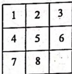

答案：不能。

知识点：[对半搜索的二叉判定树性质及基于关键字比较的搜索算法时间下界](../../../topics/算法分析/二叉判定树.md)、[二分搜索（对半搜索）的递归与迭代实现](../../../topics/算法分析/二分搜索.md)

### 填空 9

NP 类问题是所有无法在 ____ 内用确定算法求解的判定问题的集合。

答案：多项式时间。

知识点：[不确定算法、不确定机（Choice/Success/Failure）与P类、NP类问题定义](../../../topics/算法分析/不确定机与P类NP类.md)

### 填空 10

在传统密码体制中，加密和解密所用的密钥是相同的，所以称为 ____ 密码体制。

答案：对称。

## 三、问答题（共 40 分）

知识点：[信息安全目标与密码体制（对称密码体制与非对称密码体制）](../../../topics/算法分析/信息安全与密码体制.md)、[数论初步（同余定义、按模计算原理、欧拉函数）](../../../topics/算法分析/数论初步.md)、[RSA机制的密钥产生、加解密过程与扩展Euclid算法](../../../topics/算法分析/RSA算法.md)

### 简答 1

下图给出了一个带权无向连通图，请用普里姆算法构造其最小代价生成树，结点 0 为源点，请画出构造过程。（8 分）


知识点：[分治法的一般思想与算法框架（分解、解决、合并）](../../../topics/算法分析/分治法一般框架.md)、[两路合并排序算法及其时间与空间复杂度分析](../../../topics/算法分析/合并排序.md)、[快速排序算法（Partition分划函数与QuickSort）及性能改善方法](../../../topics/算法分析/快速排序.md)

### 简答 2

用弗洛伊德算法求下图每一对顶点之间的最短路径长度，已给出矩阵 $D_0$，请计算 $D_1$，$D_2$，$D_3$，其中 $D_k[i,j]$ 表示从顶点 $i$ 到顶点 $j$ 的只经过编号不大于 $k$ 的顶点的最短路径长度。（6 分）

## 三、问答题（每题8分，共40分）

知识点：[多段图问题的向前/向后递推动态规划算法](../../../topics/算法分析/多段图问题.md)、[动态规划法与分治法、贪心法的异同比较](../../../topics/算法分析/动态规划与分治贪心对比.md)

### 问答 2

用弗洛伊德算法求下图每一对定点之间的最短路径长度，已给出矩阵 $D_0$ ，请计算 $D_1, D_2, D_3$ ，其中 $D_k[i,j]$ 表示从顶点 $i$ 到顶点 $j$ 的只经过编号不大于 $k$ 的顶点的最短路径长度。（6分）（每一步2分）

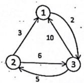

$$
D _ {0} = \left( \begin{array}{c c c} 0 & \infty & 2 \\ 3 & 0 & 6 \\ 1 0 & 5 & 0 \end{array} \right)
$$

答案：

$$
D _ {1} = \left( \begin{array}{c c c} 0 & \infty & 2 \\ 3 & 0 & 5 \\ 1 0 & 5 & 0 \end{array} \right) \quad D _ {2} = \left( \begin{array}{c c c} 0 & \infty & 2 \\ 3 & 0 & 5 \\ 8 & 5 & 0 \end{array} \right) \quad D _ {3} = \left( \begin{array}{c c c} 0 & 7 & 2 \\ 3 & 0 & 5 \\ 8 & 5 & 0 \end{array} \right)
$$

知识点：[每对结点间最短路径的Floyd（弗洛伊德）算法及正确性证明](../../../topics/算法分析/Floyd算法.md)、[LC（优先队列式）分枝限界法与代价估计函数](../../../topics/算法分析/LC分枝限界法.md)、[带时限作业排序的分枝限界法求解（可变大小元组状态空间树）](../../../topics/算法分析/带时限作业排序分枝限界.md)

### 问答 3

设有 $n = 4$ 个正数的集合 $W = \{w_0, w_1, \ldots, w_k\} = (9, 15, 19, 34)$ 和整数 $M = 43$ 。求 $W$ 中元素之和等于 $M$ 的所有子集。画出对于这一实例由 SumOfSub 算法实际生成的那部分状态空间树，并给出所有可行解。(10分)（每一空 1 分，答案 2 分）


答案：可行解为（1，1，1；0），（1，0，0，1）或（9，15，19），（9，34）（2分）

知识点：[子集和数问题的回溯法求解（固定长度元组解）](../../../topics/算法分析/子集和数问题.md)、[子集树与排列树的搜索结构](../../../topics/算法分析/子集树与排列树.md)、[回溯法的基本概念（解空间、状态空间树、显式约束与隐式约束）](../../../topics/算法分析/回溯法基本概念.md)

### 问答 4

根据优先队列式分支限界法，求下图中从 v1 到 v9 的单源最短路径，请画出求得最优解的解空间树。要求中间被舍弃的结点用×标记，获得中间解的结点用单圆圈 o 框起，最优解用双圆圈◎框起。剪枝函数：在算法扩展结点的过程中，一旦发现一个结点的下界不小于当前找到的最短路长，则算法剪去以该结点为根的子树(10分)（每一空1分）

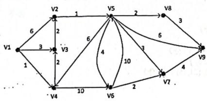

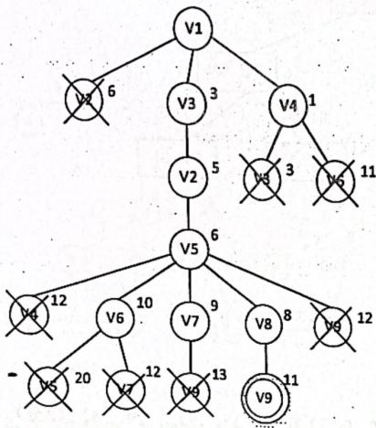

知识点：[LC（优先队列式）分枝限界法与代价估计函数](../../../topics/算法分析/LC分枝限界法.md)、[单源最短路径的Dijkstra算法及数据结构选择](../../../topics/算法分析/Dijkstra算法.md)、[求最优解的上下界函数设计与剪枝方法](../../../topics/算法分析/上下界函数.md)

### 问答 5

求解 0/1 背包问题：设有 4 件物品重量分别为 $(w_{0}, w_{1}, w_{2}, w_{3}) = (10, 15, 6, 9)$ ，每个物品的收益为 $(p_{0}, p_{1}, p_{2}, p_{3}) = (2, 5, 8, 1)$ ，背包的载重为 M = 32。利用非启发式方法计算 $S(0 \leq i \leq 3)$ ，并求出最大收益值。

答案：$S^{1}=\{(0,0)\}$，$S_{1}^{0}=\{(10,2)\}$，$S^{0}=\{(0,0),(10,2)\}$ （1分）；$S_{1}^{1}=\{(15,5),(25,7)\}$，$S^{1}=\{(0,0),(10,2),(15,5),(25,7)\}$ （1分）；$S_{1}^{2}=\{(6,8),(16,10),(21,13),(31,15)\}$，$S^{2}=\{(0,0),(6,8),(16,10),(21,13),(31,15)\}$ （1分）；$S_{1}^{3}=\{(9,1),(15,9),(25,11),(30,14),(40,16)\}$，$S^{3}=\{(0,0),(6,8),(15,9),(16,10),(21,13),(31,15)\}$ （1分）。

最大收益是 15（1分），最优解为 $(1, 1, 1, 0)$ （1分）。

## 四、编程题（20分）

知识点：[0/1背包问题实数重量的阶跃点集合求解（非启发式与启发式方法）](../../../topics/算法分析/01背包阶跃点集合.md)、[动态规划法的基本要素（最优子结构、重叠子问题）与设计步骤](../../../topics/算法分析/动态规划基本要素.md)

### 编程 1

N 皇后回溯法，请填写程序中的空格，使之在求得第一个可行解后算法终止，其中：

限界函数 `bool PLACE(int k, int i, int *x)`，用以确定在 $k$ 列上能否放置皇后；

函数 `void NQUEENS(int k, int n, int *x)`，用以摆放 N 个皇后；（每空 2 分，共 8 分）

```cpp
bool PLACE(int k, int i, int *x)
for (int j = 0; j < k; j++)
//检查 x[k] 位置是否合法
if (( (1) ) || ( (2) )) return false;

void NQUEENS(int k, int n, int *x) {
    /*此过程使用回溯算法求出在 n*n 棋盘上放置 n 个皇后，使其既不同行，也不同列，也不在同一斜角线上*/
    for (int i = 0; i < n; i++) { //显示约束的第一种观点，x[k]=0,1,...,n-1
        if ( (3) ) { //约束函数
            x[k] = i;
            if (k == n - 1) {
                for (int i = 0; i < n; i++) count << x[i] << " "; //输出一个可行解；
                count << endl;
                (4);
            }
            else (5); //深度优先进入下一层；
        }
    }
}
```

答案：(1) $x[j] = i$；(2) $\text{abs}(k-j) = \text{abs}(x[j]-i)$；(3) $\text{PLACE}(k,i,x)$；(4) $\text{NQueen}(k+1,n,x)$；(5) $\text{Exit}(0)$。

知识点：[回溯法的基本概念（解空间、状态空间树、显式约束与隐式约束）](../../../topics/算法分析/回溯法基本概念.md)、[回溯法的递归回溯与迭代回溯算法框架](../../../topics/算法分析/回溯法框架.md)

### 编程 2

田忌与齐王赛马，双方各有 $n$ 匹马参赛（$n \leq 100$），每场比赛赌注为 1 两黄金，现已知齐王与田忌的每匹马的速度，并且齐王肯定是按马的速度从快到慢出场，现请你写一个程序帮助田忌计算他最好的结果是赢多少两黄金（输用负数表示）。

输入：多个测例。每个测例三行：第一行一个整数 $n$，表示双方各有 $n$ 匹马；第二行 $n$ 个整数分别表示田忌的 $n$ 匹马的速度；第三行 $n$ 个整数分别表示齐王的 $n$ 匹马的速度。$n=0$ 表示输入结束。

输出：每行一个整数，田忌最多能赢多少两黄金。

其中 T 数组存放田忌的 $n$ 匹马的速度；Q 数组存放齐王的 $n$ 匹马的速度。二维数组 Inco 存放两者马匹速度比较的结果。

(1) 请补全下列动态规划算法（8 分）

(2) 请给出针对输入样例运行该动态规划法程序，求出的结果（4 分）。

输入样例：

```
3
92 83 71
95 87 74
```

输出样例：（原件未给出）

(3) 请给出此程序的时间复杂度，并判断其是否为 NP 类问题（4 分）。

答案：

(1)

```cpp
Inco[i][j] = Inco[i+1][j-1] - 1;

Inco[i+1][j-1] - 1 > Inco[i][j-1] + 0

Inco[i][j] = Inco[i+1][j-1] - 1;
```

(3) 时间复杂度 $O(n^2)$，不是 NP 类问题。

# 《算法分析与设计》期末试卷（B卷）

本资料为《算法分析与设计》课程期末试卷（B卷）第 6 部分（第 38–42 页），包含选择题、填空题、问答题及部分综合题与程序设计题的题目内容及参考答案。

## 一、选择题（每小题 2 分，共 20 分）

知识点：[动态规划法的基本要素（最优子结构、重叠子问题）与设计步骤](../../../topics/算法分析/动态规划基本要素.md)、[贪心法的基本要素（贪心选择性质/最优量度标准、最优子结构性质）](../../../topics/算法分析/贪心法基本要素.md)

### 选择 1

题干：第一个被证明是 NP 完全问题的是（）。

- A. 最大集团问题
- B. CNF 可满足性问题
- C. 顶点覆盖问题
- D. 图着色数判定问题

答案：B。

知识点：[算法的概念与基本特性（确定性、有限性等）](../../../topics/算法分析/算法概念与特性.md)

### 选择 2

题干：下面矩阵乘法的时间复杂度为（）

```cpp
for (i=0; i<n; i++)
    for (j=0; j<n; j++)
    { c[i][j]=0;
    for (k=0; k<n; k++) c[i][j]+=a[i][k]*b[k][j];
}
```

- A. $O(n^3)$
- B. $O(n^2)$
- C. $O(\log n)$
- D. $O(n)$

答案：A。

知识点：[欧几里德算法（递归与迭代实现求最大公约数）](../../../topics/算法分析/欧几里德算法.md)、[连续整数检测算法求最大公约数](../../../topics/算法分析/连续整数检测算法.md)

### 选择 3

题干：如图所示的 AOE 网中，从起点 0 到汇点 8 的关键路径长度为（）。


- A. 9
- B. 10
- C. 11
- D. 13

答案：D。

知识点：[算法按时间复杂度分类（多项式时间算法与指数时间算法）](../../../topics/算法分析/算法按时间复杂度分类.md)

### 选择 4

题干：下列 $4 \times 4$ 方形棋盘上给定的 15 个号牌和一个空格的初始排列中，（）经过一系列合法的号牌移动，始终无法到达目标状态。

- A.
<table>
<tr><td>1</td><td>2</td><td>3</td><td>4</td></tr>
<tr><td>5</td><td>6</td><td>7</td><td>8</td></tr>
<tr><td>9</td><td>14</td><td>10</td><td>12</td></tr>
<tr><td></td><td>13</td><td>11</td><td>15</td></tr>
</table>

- B.
<table>
<tr><td>1</td><td></td><td>3</td><td>4</td></tr>
<tr><td>6</td><td>2</td><td>7</td><td>8</td></tr>
<tr><td>5</td><td>14</td><td>10</td><td>12</td></tr>
<tr><td>9</td><td>13</td><td>11</td><td>15</td></tr>
</table>

- C.
<table>
<tr><td>1</td><td></td><td>3</td><td>4</td></tr>
<tr><td>6</td><td>7</td><td>2</td><td>8</td></tr>
<tr><td>5</td><td>14</td><td>10</td><td>12</td></tr>
<tr><td>9</td><td>13</td><td>11</td><td>15</td></tr>
</table>

- D.
<table>
<tr><td>1</td><td>3</td><td>7</td><td>4</td></tr>
<tr><td>6</td><td>2</td><td></td><td>8</td></tr>
<tr><td>5</td><td>14</td><td>10</td><td>12</td></tr>
<tr><td>9</td><td>13</td><td>11</td><td>15</td></tr>
</table>

答案：C。

知识点：[回溯法的基本概念（解空间、状态空间树、显式约束与隐式约束）](../../../topics/算法分析/回溯法基本概念.md)、[回溯法的递归回溯与迭代回溯算法框架](../../../topics/算法分析/回溯法框架.md)、[n-皇后问题的回溯法求解及状态空间树分析](../../../topics/算法分析/N皇后问题.md)

### 选择 5

题干：由若干权值分别为（1，2，3，3，5，6，7，9）的结点，按照贪心准则构造的3路最佳合并树的带权外路径长度为（）。

- A. 66
- B. 75
- C. 78
- D. 92

答案：A。

知识点：[算法的概念与基本特性（确定性、有限性等）](../../../topics/算法分析/算法概念与特性.md)、[递推方程的求解方法（替换法、迭代法、递归树、主方法）](../../../topics/算法分析/递推方程求解.md)

### 选择 6

题干：以下排序算法中，（）算法在最坏情况下的时间复杂度为 $O(n \log n)$。

- A. 直接插入排序
- B. 冒泡排序
- C. 快速排序
- D. 两路合并排序

答案：D。

知识点：[问题和问题求解方法与系统生命周期](../../../topics/算法分析/问题求解过程.md)、[算法的概念与基本特性（确定性、有限性等）](../../../topics/算法分析/算法概念与特性.md)

### 选择 7

题干：在一般背包问题中，有载重为15的背包，4件物品的重量分别为： $(w_{0}, w_{1}, w_{2}, w_{3}) = (4, 5, 3, 6)$ ，物品装入背包的收益为： $(p_{0}, p_{1}, p_{2}, p_{3}) = (20, 18, 15, 22)$ ，设问题的解为 $(x_{0}, x_{1}, x_{2}, x_{3})$ ，当解为（）时，物品装入背包可获得最大收益。

- A. $(1, 0.4, 1, 1)$
- B. $(1, 1, 0.6/5)$  *(注：原题选项格式疑似有误，此处保留原意)*
- C. $(0.5, 0.8, 1, 1)$
- D. $(1, 1, 1, 0.5)$

答案：A。

知识点：[算法的概念与基本特性（确定性、有限性等）](../../../topics/算法分析/算法概念与特性.md)、[问题和问题求解方法与系统生命周期](../../../topics/算法分析/问题求解过程.md)

### 选择 8

题干：动态规划算法通常按照（）的顺序执行以下4个步骤。
①以自底向上方式计算最优解值
②刻画最优解的结构特征
③递归定义最优解值
④根据计算得到的信息构造一个最优解

- A. ②③①④
- B. ①②③④
- C. ③②①④
- D. ③②④①

答案：A。

知识点：[最长公共子序列（LCS）的最优子结构证明、递推公式与构造最优解](../../../topics/算法分析/最长公共子序列.md)、[动态规划法的基本要素（最优子结构、重叠子问题）与设计步骤](../../../topics/算法分析/动态规划基本要素.md)

### 选择 9

题干：所有可在多项式时间内用确定算法求解的判定问题是( )。

- A. NP 类问题
- B. P 类问题
- C. NP 完全问题
- D. P 类语言

答案：B。

知识点：[LC（优先队列式）分枝限界法与代价估计函数](../../../topics/算法分析/LC分枝限界法.md)

### 选择 10

题干：在快速排序算法中引入随机过程的主要目的是（）。

- A. 改善确定性算法的平均时间
- B. 保证算法总能在 $O(n \log n)$ 时间内结束
- C. 避免了算法最坏情况下的发生
- D. 确定性算法最坏情形下的平均运行时间

答案：C。

## 二、填空题（每空 2 分，共 20 分）

知识点：[二分搜索（对半搜索）的递归与迭代实现](../../../topics/算法分析/二分搜索.md)、[对半搜索的二叉判定树性质及基于关键字比较的搜索算法时间下界](../../../topics/算法分析/二叉判定树.md)

### 填空 1

题干：\_\_\_\_（1）\_\_\_\_是快速排序的核心操作。

答案：分划操作（Partition）。

知识点：[算法的时间复杂度定义（最好、最坏、平均情况）](../../../topics/算法分析/时间复杂度定义.md)、[算法的空间复杂度定义](../../../topics/算法分析/空间复杂度定义.md)

### 填空 2

题干：\_\_\_\_(2) 是描述问题解空间的树形结构。

答案：状态空间树。

知识点：[算法的概念与基本特性（确定性、有限性等）](../../../topics/算法分析/算法概念与特性.md)、[递归概念与归纳证明（斐波那契数列、Hanoi塔问题）](../../../topics/算法分析/递归与归纳证明.md)

### 填空 3

题干：Prim算法和Kruskal算法的理论基础是 (3)，两个算法的正确性都可以从该定理得到证明。

答案：MST性质（最小生成树性质）。

知识点：[贪心法的基本要素（贪心选择性质/最优量度标准、最优子结构性质）](../../../topics/算法分析/贪心法基本要素.md)

### 填空 4 & 5

题干：分枝限界法生成状态空间树中的结点时，一旦一个活结点成为\_\_\_\_（4）后，算法将依次生成它的孩子结点并加入到\_\_\_\_（5）中。

答案：
（4）扩展结点（E结点）
（5）活结点表

知识点：[分枝限界法与回溯法的异同及基本生成方法](../../../topics/算法分析/分枝限界法概述.md)

### 填空 6

题干：字符串 adadecdfcbd 和 bdacdbdf 的公共最长子序列是 \_\_\_\_ (6)。

答案：dacdbd。

知识点：[回溯法的基本概念（解空间、状态空间树、显式约束与隐式约束）](../../../topics/算法分析/回溯法基本概念.md)

### 填空 7

题干：一般称从 n 个元素的集合中找出满足某些性质的子集的状态空间树为 \_\_\_\_ (7)。

答案：子集树。

知识点：[剪枝函数设计与回溯法效率分析（蒙特卡罗估计算法）](../../../topics/算法分析/剪枝函数与效率分析.md)

### 填空 8, 9, 10

题干：信息安全的目标是保护信息的\_\_\_\_（8）、\_\_\_\_（9），并具有\_\_\_\_（10）和可用性。

答案：
（8）机密性
（9）完整性
（10）抗否认性
*(注：(8)、(9)、(10) 可以互换)*

## 三、问答题（36分）

知识点：[信息安全目标与密码体制（对称密码体制与非对称密码体制）](../../../topics/算法分析/信息安全与密码体制.md)

### 简答 1

题干：（8分）请比较分治策略中的合并排序和快速排序算法的异同。

知识点：[分治法的一般思想与算法框架（分解、解决、合并）](../../../topics/算法分析/分治法一般框架.md)、[两路合并排序算法及其时间与空间复杂度分析](../../../topics/算法分析/合并排序.md)、[快速排序算法（Partition分划函数与QuickSort）及性能改善方法](../../../topics/算法分析/快速排序.md)

### 简答 2

题干：(8分) 下图给出了一个带权无向连通图，分别用 Kruscal 算法和 Prim 算法构造最小代价生成树，请画出生成过程中每一步构造完毕的生成树。（从结点 1 出发）

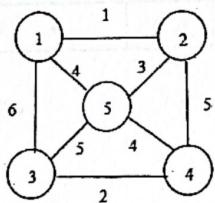

知识点：[多段图问题的向前/向后递推动态规划算法](../../../topics/算法分析/多段图问题.md)、[动态规划法与分治法、贪心法的异同比较](../../../topics/算法分析/动态规划与分治贪心对比.md)

### 简答 3

题干：（10分）求解 0/1 背包问题：设有 4 件物品重量分别为 $(w_{0}, w_{1}, w_{2}, w_{3}) = (10, 15, 6, 9)$ ，每个物品的收益为 $(p_{0}, p_{1}, p_{2}, p_{3}) = (2, 5, 8, 1)$ ，背包的载重为 M = 32。
(1) 请写出动态规划法求解过程中的所有阶跃点集合 $S^i$ (i=0,1,2,3);
注：请舍弃被支配的阶跃点和 X>M 的阶跃点。
(2) 求最优解值（背包最大收益）;
(3) 构造最优解。

知识点：[一般背包问题的贪心法求解及最优度量标准证明](../../../topics/算法分析/背包问题贪心求解.md)、[0/1背包问题的动态规划法求解（自底向上、反证法证明最优子结构）](../../../topics/算法分析/01背包动态规划.md)、[贪心法的基本要素（贪心选择性质/最优量度标准、最优子结构性质）](../../../topics/算法分析/贪心法基本要素.md)

### 简答 4

题干：（10分）子集和数的问题：设有 n=4 个正数的集合 $W=\{w_{0},w_{1},w_{2},w_{3}\}=\{7,11,13,24\}$ 和正数 M=31，求 W 的所有满足条件的子集，使子集中的正数之和等于 M。
请画出由 SumOfSub 算法实际生成的那部分状态空间树，并给出所有可行解。（采用固定长度 4-元组表示解）

知识点：[多段图问题的向前/向后递推动态规划算法](../../../topics/算法分析/多段图问题.md)

### 综合 1

题干：
(1) 若待排序元素存放于 1 数组中，且 Swap(i,j) 函数的作用为交换下标为 i 和 j 的两个元素 l[i] 和 l[j] 的值。
(8 分) 请写出快速排序算法的 C++ 程序，包含以下三个函数：

*(注：原题未明确指定三个函数的具体名称，通常指 Partition, QuickSort, 以及辅助函数或主函数入口。此处按标准快速排序实现补充。)*

知识点：[快速排序算法（Partition分划函数与QuickSort）及性能改善方法](../../../topics/算法分析/快速排序.md)、[分治法的一般思想与算法框架（分解、解决、合并）](../../../topics/算法分析/分治法一般框架.md)、[算法的时间复杂度定义（最好、最坏、平均情况）](../../../topics/算法分析/时间复杂度定义.md)

### 综合 2

题干：对初始数据（5，8，4，6，3，7，1）执行快速排序，每次都选择左边第一个元素作为主元，请给出每一趟分划操作的结果。并用标识子序列的边界。（4分）

知识点：[最小代价生成树的Kruskal算法（边集扩展与并查集）](../../../topics/算法分析/Kruskal算法.md)、[最小代价生成树的Prim算法（点集扩展）](../../../topics/算法分析/Prim算法.md)

### 综合 3

题干：若待排序数据的规模为 n，快速排序算法最好、最坏情况什么时候发生？（2分）

知识点：[多段图问题的向前/向后递推动态规划算法](../../../topics/算法分析/多段图问题.md)、[动态规划法的基本要素（最优子结构、重叠子问题）与设计步骤](../../../topics/算法分析/动态规划基本要素.md)

### 计算 2

1) Kruskal 算法:

(1分)


(1分)

(1分)

(1分)

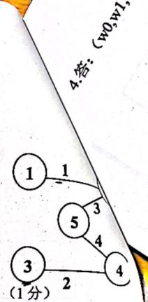

2) Prim 算法:

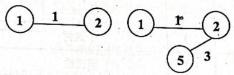


(1分)
(1分)
(1分)
(1分)

知识点：[最小代价生成树的Kruskal算法（边集扩展与并查集）](../../../topics/算法分析/Kruskal算法.md)、[最小代价生成树的Prim算法（点集扩展）](../../../topics/算法分析/Prim算法.md)

### 计算 3

答： $S^0 = \{(0,0),(10,2)\}$

$$
S _ {1} ^ {1} = \{(1 5, 5), (2 5, 7) \},
$$

$$
S ^ {1} = \{(0, 0), (1 0, 2), (1 5, 5), (2 5, 7) \}
$$

$$
S _ {1} ^ {2} = \{(6, 8), (1 6, 1 0), (2 1, 1 3), (3 1, 1 5) \},
$$

$$
S ^ {2} = \{(0, 0), (6, 8), (1 6, 1 0), (2 1, 1 3), (3 1, 1 5) \}
$$

$$
S _ {1} ^ {3} = \{(9, 1), (1 5, 9), (2 5, 1 1), (3 0, 1 4), (4 0, 1 6) \},
$$

$$
S ^ {3} = \{(0, 0), (6, 8), (1 5, 9), (1 6, 1 0), (2 1, 1 3), (3 0, 1 4), (3 1, 1 5) \}
$$

----8分， $S^{0}\sim S^{3}$ 每个集合2分。

(2) 最优解值为 15

(3) 最优解为 $(1,1,1,0)$


(每个结点1分，共10分)

知识点：[最小代价生成树的Prim算法（点集扩展）](../../../topics/算法分析/Prim算法.md)、[最小代价生成树的Kruskal算法（边集扩展与并查集）](../../../topics/算法分析/Kruskal算法.md)、[算法的概念与基本特性（确定性、有限性等）](../../../topics/算法分析/算法概念与特性.md)

### 计算 4

(2)----4分

| 初始状态 | 5 | 8 | 4 | 6 | 3 | 7 | 1 | ∞ |
| :--- | :--- | :--- | :--- | :--- | :--- | :--- | :--- | :--- |
| 第一趟 | [3] | 1 | [4] | 5 | [6] | 7 | [8] | ∞ |
| 第二趟 | [1] | 3 | [4] | 5 | [6] | 7 | [8] | ∞ |
| 第三趟 | 1 | 3 | 4 | 5 | 6 | [7] | [8] | ∞ |
| 第四趟 | 1 | 3 | 4 | 5 | 6 | 7 | [8] | ∞ |
| 排序结果 | 2 | 3 | 4 | | 5 | | 8 | ∞ |

#### (4)----2分

每次分划操作后，若左、右两个子序列的长度基本相等，则快速排序效率最高，为最好情况，时间复杂度为 $O(n\log n)$。

原始序列正向有序或反向有序时，每次分划操作所产生的两个子序列，其中之一为空序列，则快速排序效率最低，为最坏情况，时间复杂度是 $O(n^{2})$ 。

## 五、程序设计题（共10分）

(1) $\underline{c[1][j]=c[0][j-1]+1}$

(2) c[1][j]=c[0][j]

(3) c[1][j]=c[1][j-1]

(4) c[0][j]=c[1][j]

(5) return c[1][n] //或 return c[0][n]也行

知识点：[0/1背包问题实数重量的阶跃点集合求解（非启发式与启发式方法）](../../../topics/算法分析/01背包阶跃点集合.md)、[贪心法的一般算法框架（按量度标准排序后逐步决策）](../../../topics/算法分析/贪心法一般框架.md)、[近似算法概念（寻找近似解而非最优解）](../../../topics/算法分析/近似算法概念.md)

### 简答 1

设 $\mathbf{W} = \{2,3,8,10,12,15\}$，请按照贪心准则，构造一棵最优 3 路合并树。

知识点：[分治法的一般思想与算法框架（分解、解决、合并）](../../../topics/算法分析/分治法一般框架.md)、[两路合并排序算法及其时间与空间复杂度分析](../../../topics/算法分析/合并排序.md)、[快速排序算法（Partition分划函数与QuickSort）及性能改善方法](../../../topics/算法分析/快速排序.md)

### 简答 2

设有一般背包问题实例 $n=6$，$M=11$，$(w_{0},w_{1},\cdots,w_{5})=(3,5,3,4,1,6)$，物品装入背包的收益为 $(p_{0},p_{1},\cdots,p_{5})=(15,4,9,10,6,6)$，给出求解这一实例的最优解和最大收益。（请给出求解过程）

知识点：[多段图问题的向前/向后递推动态规划算法](../../../topics/算法分析/多段图问题.md)、[动态规划法与分治法、贪心法的异同比较](../../../topics/算法分析/动态规划与分治贪心对比.md)

### 简答 3

8 皇后问题运用蒙特卡罗方法估计状态空间树上实际生成的结点数，如果随机选取的路径为 $(2,5,3,0,4)$，求实际生成的结点数估计值。

知识点：[一般背包问题的贪心法求解及最优度量标准证明](../../../topics/算法分析/背包问题贪心求解.md)、[0/1背包问题的动态规划法求解（自底向上、反证法证明最优子结构）](../../../topics/算法分析/01背包动态规划.md)、[贪心法的基本要素（贪心选择性质/最优量度标准、最优子结构性质）](../../../topics/算法分析/贪心法基本要素.md)

### 简答 4

地图着色问题中的地图可以转化为对应的平面图表示。请给出下面地图对应的平面图。

| 2 | | 3 |
| --- | --- | --- |
| 0 | 1 | |

知识点：[多段图问题的向前/向后递推动态规划算法](../../../topics/算法分析/多段图问题.md)

### 简答 5

请简述回溯法和分枝限界法的相同点和不同点。

## 四、问答题（每题 10 分，共 20 分）

知识点：[剪枝函数设计与回溯法效率分析（蒙特卡罗估计算法）](../../../topics/算法分析/剪枝函数与效率分析.md)、[n-皇后问题的回溯法求解及状态空间树分析](../../../topics/算法分析/N皇后问题.md)、[回溯法的基本概念（解空间、状态空间树、显式约束与隐式约束）](../../../topics/算法分析/回溯法基本概念.md)

### 问答 1

斯特拉森矩阵乘法的处理方法是：将待乘的两个 $n \times n$ 的矩阵 A 和 B，分别分解成 4 个 $(n/2) \times (n/2)$ 的矩阵相乘。

$$
\left[ \begin{array}{ll} \mathrm{A}_{11} & \mathrm{A}_{12} \\ \mathrm{A}_{21} & \mathrm{A}_{22} \end{array} \right] \times \left[ \begin{array}{ll} \mathrm{B}_{11} & \mathrm{B}_{12} \\ \mathrm{B}_{21} & \mathrm{B}_{22} \end{array} \right] = \left[ \begin{array}{ll} \mathrm{C}_{11} & \mathrm{C}_{12} \\ \mathrm{C}_{21} & \mathrm{C}_{22} \end{array} \right]
$$

先执行 7 次子矩阵乘法和 10 次加（减）法得到 7 个中间子矩阵：

$$
\begin{array}{l} \mathrm{P} = (\mathrm{A}_{11} + \mathrm{A}_{22})(\mathrm{B}_{11} + \mathrm{B}_{22}) \\ \mathrm{R} = \mathrm{A}_{11}(\mathrm{B}_{12} - \mathrm{B}_{22}) \\ \mathrm{T} = (\mathrm{A}_{11} + \mathrm{A}_{12})\mathrm{B}_{22} \\ \mathrm{V} = (\mathrm{A}_{12} - \mathrm{A}_{22})(\mathrm{B}_{21} + \mathrm{B}_{22}) \end{array}
$$

然后再使用 8 次子矩阵加（减）法得到：$C_{11}=P+S-T+V$，$C_{12}=R+T$，$C_{21}=Q+S$，$C_{22}=P+R-Q+U$。

（1）请写出斯特拉森矩阵分治求解的时间递推关系式，并给出求得的时间复杂度。

（2）通过手算证明子矩阵 $C_{12} = R + T$ 的正确性（不能省略中间步骤）。

知识点：[Strassen矩阵乘法分治策略及时间复杂度改进](../../../topics/算法分析/Strassen矩阵乘法.md)、[分治法的复杂性分析与Master定理应用](../../../topics/算法分析/分治法复杂度分析.md)、[递推方程的求解方法（替换法、迭代法、递归树、主方法）](../../../topics/算法分析/递推方程求解.md)

### 问答 2

（1）请写出运用 Floyd 算法求任意点对间的最短路径长度 $d[i][j]$ 的递推式，以及当 $d[i][j]$ 发生更新时最短路径上 $j$ 的前一个顶点信息 $path[i][j]$ 更新的递推式。

（2）若在一个有 4 个结点的带权有向图中求解完毕得到的 $d_{n-1}$ 和 $path_{n-1}$ 数组如下图所示，请给出从结点 2 到结点 3 的最短路径长度和最短路径。

$d_3$ 数组：

| 0 | 1 | 2 | 3 |
| --- | --- | --- | --- |
| 0 | 1 | 9 | 3 |
| 11 | 0 | 8 | 2 |
| 3 | 4 | 0 | 6 |
| 9 | 10 | 6 | 0 |

$path_3$ 数组：

| 0 | 1 | 2 | 3 |
| --- | --- | --- | --- |
| -1 | 0 | 3 | 1 |
| 2 | -1 | 3 | 1 |
| 2 | 0 | -1 | 1 |
| 2 | 0 | 3 | -1 |

## 五、算法题（10 分）

带时限的作业排序问题实例：$n=4$，$(t_{0},d_{0},p_{0})=(1,1,3)$，$(t_{1},d_{1},p_{1})=(1,2,2)$，$(t_{2},d_{2},p_{2})=(2,3,6)$，$(t_{3},d_{3},p_{3})=(3,5,5)$，解向量形式为可变长度元组解（$x_i$ 为入选作业的下标），选取目标函数为未入选的作业造成的损失。

（1）当采用 LC 分支限界法时，若从活结点表（优先权队列）中取出的新的扩展结点因限界函数 $\hat{c} \geq U$ 被剪枝，则剩余活结点表中的结点均会被丢弃。请据此设计：活结点表中满足什么条件的结点能优先成为新的扩展结点？

（2）请画出该实例用 LC 分枝限界法求解生成的状态空间树，标出树中每个结点的目标函数损失下界 $\hat{c}$、损失上界 $u$，以及损失上界阈值 $U$ 的每次更新值（$U$ 值请加方框）。——注意：状态空间树中的结点编号请按生成顺序编号。

（3）请给出求得的最大作业收益和对应的作业子集解元组。

## 《算法分析与设计》

知识点：[每对结点间最短路径的Floyd（弗洛伊德）算法及正确性证明](../../../topics/算法分析/Floyd算法.md)、[LC（优先队列式）分枝限界法与代价估计函数](../../../topics/算法分析/LC分枝限界法.md)、[带时限作业排序的分枝限界法求解（可变大小元组状态空间树）](../../../topics/算法分析/带时限作业排序分枝限界.md)

### 一、选择题（每空 2 分，共 20 分）

| 1 | 2 | 3 | 4 | 5 | 6 | 7 | 8 | 9 | 10 |
| --- | --- | --- | --- | --- | --- | --- | --- | --- | --- |
| A | C | A | A | C | B | B | D | C | D |

知识点：[算法的概念与基本特性（确定性、有限性等）](../../../topics/算法分析/算法概念与特性.md)、[算法的时间复杂度定义（最好、最坏、平均情况）](../../../topics/算法分析/时间复杂度定义.md)、[渐近表示法：大O记号（紧上界）](../../../topics/算法分析/大O记号.md)

### 二、填空题（每空 2 分，共 20 分）

（1）规模较小

（2）相互独立

（3）类型相同

（4）动态规划

（5）$f(j-1,X)$

（6）$f(j-1,X-w_{j})+p_{j}$

（7）完整性

（8）抗否认性

（9）不确定

（10）NP 难度（NP hard）

注：（1）、（2）、（3）可以互换，（5）、（6）可以互换，（7）、（8）可以互换。

知识点：[0/1背包问题的动态规划法求解（自底向上、反证法证明最优子结构）](../../../topics/算法分析/01背包动态规划.md)、[信息安全目标与密码体制（对称密码体制与非对称密码体制）](../../../topics/算法分析/信息安全与密码体制.md)、[不确定算法、不确定机（Choice/Success/Failure）与P类、NP类问题定义](../../../topics/算法分析/不确定机与P类NP类.md)

### 三、简答题（每题 6 分，共 30 分）

#### 简答 1

答：$n=6$，$k=3$，$(n-1)\% (k-1)=1$。所以需补 1 个虚节点。

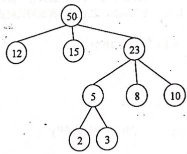

每层 2 分。

#### 简答 2

答：$P/\omega=(5,0.8,3,2.5,6,1)$，解为 $(1,0,1,1,1,0)$，最大收益值为 40。

或：按 $\frac{p}{w}$ 从大到小排列为 $(6,5,3,2.5,1,0.8)$，解为 $(1,1,1,1,0,0)$，最大收益 40。

#### 简答 3

答：

| $m_0$ | $m_1$ | $m_2$ | $m_3$ | $m_4$ |
| --- | --- | --- | --- | --- |
| 8 | 5 | 3 | 3 | 2 |

结点数估计值 $= 1 + 8 + 8\times5 + 8\times5\times3 + 8\times5\times3\times3 + 8\times5\times3\times3\times2 = 1249$。

#### 简答 4

答：对应的平面图为

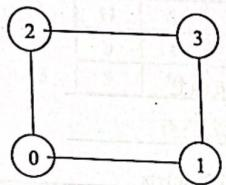

#### 简答 5

答：（答对 5 点即给分，每少 1 点扣 1 分。另外有表述错误再扣 1 分。）

相同点：（1）都通过搜索问题的状态空间树求解。（2）都通过剪枝函数进行剪枝。

不同点：（1）回溯法采用深度优先遍历，分枝限界法采用广度优先遍历。（2）回溯法求解所有可行解，分枝限界法求解最优解。（3）回溯法主要采用约束函数，剪去不含可行解的分支。分枝限界法主要采用限界函数，剪去不含最优解的分支。（也可以答：对当前扩展结点的扩展方式不同。回溯法中的每个活结点可能多次成为当前扩展结点，纵深方向扩展其一个儿子，然后再回溯后扩展其他儿子；而分枝限界法中每一个活结点只有一次机会成为扩展结点，一次产生所有孩子结点，自身成为死结点，之后无需再返回该结点处。）

知识点：[最优归并模式（扩充二叉树、Huffman编码与带权外路径长度）](../../../topics/算法分析/最佳合并模式.md)、[一般背包问题的贪心法求解及最优度量标准证明](../../../topics/算法分析/背包问题贪心求解.md)、[剪枝函数设计与回溯法效率分析（蒙特卡罗估计算法）](../../../topics/算法分析/剪枝函数与效率分析.md)、[分枝限界法与回溯法的异同及基本生成方法](../../../topics/算法分析/分枝限界法概述.md)

### 四、问答题（每题 10 分，共 20 分）

#### 问答 1

答：（1）（4 分）

$$
\mathrm{T}(n) = \left\{ \begin{array}{ll} \mathrm{b} & n\leq 2 \\ 7T(n/2) + \mathrm{O}(n^2) & n > 2 \end{array} \right.
$$

求得时间复杂度为：$\mathrm{O}(n^{\log_2 7})$ 或 $\mathrm{O}(n^{2.81})$。

（2）证明：（6 分）

$$
\begin{array}{rl} C_{12} & = R + T = A_{11}(B_{12} - B_{22}) + (A_{11} + A_{12})B_{22} = A_{11}B_{12} - A_{11}B_{22} + A_{11}B_{22} + A_{12}B_{22} \\ & = A_{11}B_{12} + A_{12}B_{22} = C_{12} \end{array}
$$

#### 问答 2

答：（1）（6 分）

$d_k[i][j]=\min\{d_{k-1}[i][j],d_{k-1}[i][k]+d_{k-1}[k][j]\}$，$path_k[i][j]=path_{k-1}[k][j]$。

（2）（4 分）

从结点 2 到结点 3 的最短路径长度为 6，最短路径为（2,0,1,3）。

知识点：[Strassen矩阵乘法分治策略及时间复杂度改进](../../../topics/算法分析/Strassen矩阵乘法.md)、[每对结点间最短路径的Floyd（弗洛伊德）算法及正确性证明](../../../topics/算法分析/Floyd算法.md)

### 五、算法题（10 分）

答：（1）$\hat{c}$ 值最小的活结点。（1 分）

（2）（7 分）

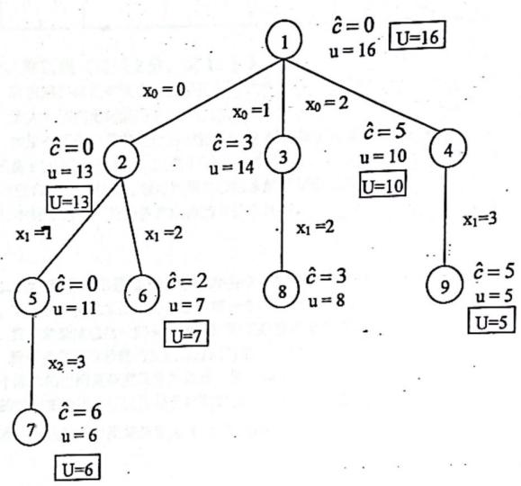

（3）（2 分）

最大作业收益为：$16-5=11$。

最优解元组为（2，3）。

## 《算法分析与设计》

知识点：[分枝限界法与回溯法的异同及基本生成方法](../../../topics/算法分析/分枝限界法概述.md)、[求最优解的上下界函数设计与剪枝方法](../../../topics/算法分析/上下界函数.md)

### 一、判断题（每题 2 分，共 10 分）

1、若求解的问题有较多重叠子问题，适合用分治法求解。（）

2、最大集团判定问题是 NP 完全的。

3、如果有两个定义在正数集上的正函数 $f(n)$ 和 $g(n)$ 满足 $f(n) = \Theta(g(n))$，则表示 $g(n)$ 既是 $f(n)$ 的一个上界，又是 $f(n)$ 的一个下界。（T）

4、一般背包问题和 0-1 背包问题都可以用贪心法求解得到最优解。（F）

5、分枝限界法中每个活结点可能多次成为当前扩展结点。（F）

知识点：[动态规划法的基本要素（最优子结构、重叠子问题）与设计步骤](../../../topics/算法分析/动态规划基本要素.md)、[NP难度（NP-hard）与NP完全（NPC）问题的定义及证明策略](../../../topics/算法分析/NP难度与NP完全.md)、[渐近表示法：Θ记号（紧渐近界）](../../../topics/算法分析/Theta记号.md)、[一般背包问题的贪心法求解及最优度量标准证明](../../../topics/算法分析/背包问题贪心求解.md)、[分枝限界法与回溯法的异同及基本生成方法](../../../topics/算法分析/分枝限界法概述.md)

### 二、选择题（每题 2 分，共 20 分）

#### 选择 1

下列关于算法复杂度的说法，哪一个不正确（B）

- A. 算法复杂度包括时间复杂度和空间复杂度两个方面。
- B. 程序步数可以精确的反映程序运行的实际时间。
- C. 同一个算法的时间复杂度又分为最好、最坏和平均情况三种。
- D. 算法的时间复杂度不仅仅依赖于问题的规模，还与输入实例的初始状态有关。

#### 选择 2

下面划线程序步执行的时间复杂度为（A）。（$n>1$）

```
x=n;
y=0;
while (y<x) { y++; x--; }
```

- A. $O(n)$
- B. $O(\sqrt{n})$
- C. $O(\log n)$
- D. $O(n^2)$

#### 选择 3

关于两路合并排序和快速排序算法，以下（）说法是错误的。

- A. 若分解得到的子序列为空或只有一个元素时，认为其自然有序无需排序。
- B. 两路合并排序的分解过程非常简单，每次只需将待排序的序列一分为二即可。
- C. 快速排序中，一旦左、右两个子序列均已分别排序，则无需再进行额外处理，整个序列便自然成为了有序序列。
- D. 两路合并排序的平均时间复杂度为 $O(n^2)$。

知识点：[算法的时间复杂度定义（最好、最坏、平均情况）](../../../topics/算法分析/时间复杂度定义.md)、[使用程序步分析算法的时间复杂度](../../../topics/算法分析/程序步分析法.md)、[两路合并排序算法及其时间与空间复杂度分析](../../../topics/算法分析/合并排序.md)

### 选择 4

由若干权值分别为（1，3，3，4，7）的结点，按照贪心准则构造的两路最佳合并树的带权外路径长度为（A）。

- A. 40
- B. 43
- C. 45
- D. 48

答案：A。

知识点：[回溯法的基本概念（解空间、状态空间树、显式约束与隐式约束）](../../../topics/算法分析/回溯法基本概念.md)、[回溯法的递归回溯与迭代回溯算法框架](../../../topics/算法分析/回溯法框架.md)、[n-皇后问题的回溯法求解及状态空间树分析](../../../topics/算法分析/N皇后问题.md)

### 选择 5

斯特拉森矩阵乘法所需时间的递推式为 $T(n)=7T(n/2)+dn^{2}$，则该矩阵乘法的渐近时间复杂度为（ ）。

- A. $\Theta(n^{2})$
- B. $\Theta(n^{\log 7})$
- C. $\Theta(n^{2})$
- D. $\Theta(\log n)$

知识点：[算法的概念与基本特性（确定性、有限性等）](../../../topics/算法分析/算法概念与特性.md)、[递推方程的求解方法（替换法、迭代法、递归树、主方法）](../../../topics/算法分析/递推方程求解.md)

### 选择 6

n 个顶点的连通图至少有（A）条边。

- A. n-1
- B. n
- C. n+1
- D. 0

答案：A。

知识点：[问题和问题求解方法与系统生命周期](../../../topics/算法分析/问题求解过程.md)、[算法的概念与基本特性（确定性、有限性等）](../../../topics/算法分析/算法概念与特性.md)

### 选择 7

备忘录方法是（ ）的一个变种，以自顶向下直接递归的方式计算最优解，同时避免了相同子问题的重复求解。

- A. 分治法
- B. 贪心法
- C. 动态规划法
- D. 回溯法

知识点：[算法的概念与基本特性（确定性、有限性等）](../../../topics/算法分析/算法概念与特性.md)、[问题和问题求解方法与系统生命周期](../../../topics/算法分析/问题求解过程.md)

### 选择 8

下列（D）是指数时间算法的渐近时间复杂度。

- A. O(1)
- B. O(n)
- C. O(n$^{3}$)
- D. O(n!)

答案：D。

知识点：[最长公共子序列（LCS）的最优子结构证明、递推公式与构造最优解](../../../topics/算法分析/最长公共子序列.md)、[动态规划法的基本要素（最优子结构、重叠子问题）与设计步骤](../../../topics/算法分析/动态规划基本要素.md)

### 选择 9

（A）问题是所有可在多项式时间内用确定算法求解的判定问题的集合。

- A. P 类
- B. NP 类
- C. NP 难度
- D. NP 完全

答案：A。

知识点：[LC（优先队列式）分枝限界法与代价估计函数](../../../topics/算法分析/LC分枝限界法.md)

### 选择 10

第一个被证明是 NP 完全问题的是（ ）。

- A. CNF 可满足性问题
- B. 最大集团问题
- C. 顶点覆盖问题
- D. 图着色数判定问题

## 三、填空题（每空 2 分，共 20 分）

知识点：[二分搜索（对半搜索）的递归与迭代实现](../../../topics/算法分析/二分搜索.md)、[对半搜索的二叉判定树性质及基于关键字比较的搜索算法时间下界](../../../topics/算法分析/二叉判定树.md)

### 填空 1

估算回溯法处理一个实例时，实际生成的结点数的方法叫蒙特卡罗方法。

知识点：[算法的时间复杂度定义（最好、最坏、平均情况）](../../../topics/算法分析/时间复杂度定义.md)、[算法的空间复杂度定义](../../../topics/算法分析/空间复杂度定义.md)

### 填空 2

贪心法是一种求解最优化问题的算法设计方法。

贪心法是一种求解 __最优化__ 问题的算法设计策略，每一步上用作决策依据的选择准则被称为 __最优量度标准__。

知识点：[算法的概念与基本特性（确定性、有限性等）](../../../topics/算法分析/算法概念与特性.md)、[递归概念与归纳证明（斐波那契数列、Hanoi塔问题）](../../../topics/算法分析/递归与归纳证明.md)

### 填空 3

分治法求解很自然导致一个递归算法。

知识点：[贪心法的基本要素（贪心选择性质/最优量度标准、最优子结构性质）](../../../topics/算法分析/贪心法基本要素.md)

### 填空 4

若 $d_{k}[i][j]$ 表示从结点 i 到结点 j 的路径上，只允许包含结点编号不大于 k 的结点时，所有可能路径中的最短路径长度。则弗洛伊德算法中，求解带权有向图中任意一对结点间距离的递推式为 $d_{k}[i][j]=\min\left\{\begin{array}{lll}(3)& & (4)\end{array}\right\}$。

知识点：[欧几里德算法（递归与迭代实现求最大公约数）](../../../topics/算法分析/欧几里德算法.md)、[数论初步（同余定义、按模计算原理、欧拉函数）](../../../topics/算法分析/数论初步.md)

### 填空 5

约束函数和限界函数统称为 剪枝函数。

知识点：[动态规划法的基本要素（最优子结构、重叠子问题）与设计步骤](../../../topics/算法分析/动态规划基本要素.md)

### 填空 6

密码系统的安全性是基于（6）的，因此算法往往可以作为标准公布。密码体制可以从原理上分为（7）体制和（8）体制两类。

## 四、简答题（每题 8 分，共 40 分）

知识点：[回溯法的基本概念（解空间、状态空间树、显式约束与隐式约束）](../../../topics/算法分析/回溯法基本概念.md)

### 简答 1

对初始数据（3，6，1，2，8，8）执行快速排序。每次都选择左边第一个元素作为主元，请给出每一趟分划操作的结果，并用 [] 标识分划所得子序列的左、右边界。

知识点：[分治法的一般思想与算法框架（分解、解决、合并）](../../../topics/算法分析/分治法一般框架.md)、[两路合并排序算法及其时间与空间复杂度分析](../../../topics/算法分析/合并排序.md)、[快速排序算法（Partition分划函数与QuickSort）及性能改善方法](../../../topics/算法分析/快速排序.md)

### 简答 2

带权的无向连通图 G 如下图所示：

《算法分析与设计》

第 2 页 共 4 页

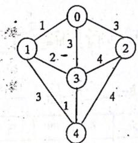

(1) 请画出从源点 0 开始，对图 G 执行 Prim 算法，得到最小代价生成树的步骤。

(2) 请画出对图 G 执行 Kruskal 算法，得到最小代价生成树的步骤。

知识点：[多段图问题的向前/向后递推动态规划算法](../../../topics/算法分析/多段图问题.md)、[动态规划法与分治法、贪心法的异同比较](../../../topics/算法分析/动态规划与分治贪心对比.md)

### 简答 3

背包载重为 8，有 3 件物品的重量为 $(\mathrm{w}_0,\mathrm{w}_1,\mathrm{w}_2) = (3,2,5)$，放入背包的收益分别为 $(p_0,p_1,p_2) = (6,6,5)$。（注：最优解中的解分量 $\mathbf{x}_{i}$ 表示物品 i 放入背包的比例。）

(1) 若物品可以分割，则最大收益是多少？最优解是什么？

(2) 若物品不可以分割，则最大收益是多少？最优解是什么？

知识点：[一般背包问题的贪心法求解及最优度量标准证明](../../../topics/算法分析/背包问题贪心求解.md)、[0/1背包问题的动态规划法求解（自底向上、反证法证明最优子结构）](../../../topics/算法分析/01背包动态规划.md)、[贪心法的基本要素（贪心选择性质/最优量度标准、最优子结构性质）](../../../topics/算法分析/贪心法基本要素.md)

### 简答 4

使用从前向后递推方法，求如图所示的多段图从源点 0 到汇点 6 的最短路径及路径长度。（请写出求解时的计算过程。）


知识点：[多段图问题的向前/向后递推动态规划算法](../../../topics/算法分析/多段图问题.md)

### 简答 5

NQueens 函数用回溯法求解 4-皇后问题的所有可行解，若随机选择的路径为 (0,3,1) 和 (1,3,0,2)，请用蒙特卡罗方法估计实际生成的状态空间树结点数。

## 五、算法程序题（每空 2 分，共 10 分）

请补充完整下面程序，完成折半插入排序。每次插入对象 V[i] 时，利用对半搜索在已排序好的对象序列中寻找 V[i] 的插入位置。

```c
typedef int T;

if (temp < V[mid]) Right = ____(2);
else Left = ____(3);

for (int k = i-1; k >= Left; k--) ____ (4) ____;
(5) = temp;
```

《算法分析与设计》

第 4 页 共 4 页

## 《算法分析与设计》

院(系) ____ 班级 ____ 学号 ____ 姓名 ____

| 题号 | 一 | 二 | 三 | 四 | 五 | 六 | 七 | 八 | 九 | 十 | 总分 |
|---|---|---|---|---|---|---|---|---|---|---|---|
| 得分 | | | | | | | | | | | |

## 一、选择题（每题 2 分，共 20 分）

知识点：[剪枝函数设计与回溯法效率分析（蒙特卡罗估计算法）](../../../topics/算法分析/剪枝函数与效率分析.md)、[n-皇后问题的回溯法求解及状态空间树分析](../../../topics/算法分析/N皇后问题.md)、[回溯法的基本概念（解空间、状态空间树、显式约束与隐式约束）](../../../topics/算法分析/回溯法基本概念.md)

### 选择 1

算法可以有（D）个输出。

- A. 0 个
- B. 0 个或 1 个
- C. 0 个或多个
- D. 1 个或多个

答案：D。

知识点：[算法的概念与基本特性（确定性、有限性等）](../../../topics/算法分析/算法概念与特性.md)

### 选择 2

以下关于算法和程序的描述中（C）是错误的。

- A. 算法必须可终止，程序却没有这一限制。
- B. 描述一个算法可以用自然语言、流程图、伪代码和程序设计语言。
- C. 操作系统程序是使用计算机语言描述的一个算法。
- D. 算法+数据结构=程序。

答案：C。

知识点：[欧几里德算法（递归与迭代实现求最大公约数）](../../../topics/算法分析/欧几里德算法.md)、[连续整数检测算法求最大公约数](../../../topics/算法分析/连续整数检测算法.md)

### 选择 3

已知某算法所需时间的递推式为：$T(n)=2T(n/2)+n^{2}$，$T(1)=2$，则该算法的渐近时间复杂度为（B）。

- A. $\Theta(n)$
- B. $\Theta(n^{2})$
- C. $\Theta(\log n)$
- D. $\Theta(n^{2}\log n)$

答案：B。

知识点：[算法按时间复杂度分类（多项式时间算法与指数时间算法）](../../../topics/算法分析/算法按时间复杂度分类.md)

### 选择 4

十字路口信号灯系统是一个程序，却不是算法，是因为算法必须具有（B）。

- A. 确定性
- B. 有穷性
- C. 可行性
- D. 输入

答案：B。

知识点：[回溯法的基本概念（解空间、状态空间树、显式约束与隐式约束）](../../../topics/算法分析/回溯法基本概念.md)、[回溯法的递归回溯与迭代回溯算法框架](../../../topics/算法分析/回溯法框架.md)、[n-皇后问题的回溯法求解及状态空间树分析](../../../topics/算法分析/N皇后问题.md)

### 选择 5

以下关于动态规划法的描述哪项是正确的（C）。

- A. 动态规划法一般采用自顶向下方式进行计算，并且保存已求解子问题的最优解值。
- B. 动态规划法一定具有多项式时间的渐近时间复杂度。
- C. 动态规划法通常采用数学归纳法进行正确性证明。
- D. 动态规划法比备忘录方法具有更好的时间界。

答案：C。

知识点：[算法的概念与基本特性（确定性、有限性等）](../../../topics/算法分析/算法概念与特性.md)、[递推方程的求解方法（替换法、迭代法、递归树、主方法）](../../../topics/算法分析/递推方程求解.md)

### 选择 6

下面（B）问题不能使用贪心算法来解决。

- A. 单源最短路径问题
- B. N-皇后问题
- C. 最小代价生成树问题
- D. 一般背包问题

答案：B。

知识点：[问题和问题求解方法与系统生命周期](../../../topics/算法分析/问题求解过程.md)、[算法的概念与基本特性（确定性、有限性等）](../../../topics/算法分析/算法概念与特性.md)

### 选择 7

根据（B）可将分枝限界法分为 FIFO、LIFO、LC 分枝限界法三类。

- A. 状态空间树中解空间的大小不同
- B. 从活结点表中选择下一个扩展结点的次序不同
- C. 求解可行解或最优解的目标不同
- D. 构造的剪枝函数不同

答案：B。

知识点：[算法的概念与基本特性（确定性、有限性等）](../../../topics/算法分析/算法概念与特性.md)、[问题和问题求解方法与系统生命周期](../../../topics/算法分析/问题求解过程.md)

### 选择 8

设 $X = (x_{1}, x_{2}, \ldots, x_{m})$ 和 $Y = (y_{1}, y_{2}, \ldots, y_{n})$ 为两个序列，$Z = (z_{1}, z_{2}, \ldots, z_{k})$ 是它们的最长公共子序列，则以下说法错误的是（A）。

- A. 若 $x_{m} \neq y_{n}$ 且 $z_{k} \neq y_{n}$，则 $Z$ 是 $X_{m-1}$ 和 $Y$ 的最长公共子序列；
- B. 最长公共子序列具有最优子结构特性，且 $Z$ 的取值不唯一。
- C. 若 $x_{m} = y_{n}$，则 $z_{k} = x_{m} = y_{n}$，且 $Z_{k-1}$ 是 $X_{m-1}$ 和 $Y_{n-1}$ 的最长公共子序列。
- D. 求解 $Z$ 可在多项式时间内完成计算，时间复杂度为 $O(m^{*}n)$。

答案：A。

知识点：[最长公共子序列（LCS）的最优子结构证明、递推公式与构造最优解](../../../topics/算法分析/最长公共子序列.md)、[动态规划法的基本要素（最优子结构、重叠子问题）与设计步骤](../../../topics/算法分析/动态规划基本要素.md)

### 选择 9

以代价估计函数 $\hat{c}()$ 作为选择下一个扩展结点的评价函数，即总是选取 $\hat{c}()$ 值小的活结点作为下一个扩展结点，采用这种检索方法的分枝限界法属于（C）。

- A. FIFO 分枝限界法
- B. LIFO 分枝限界法
- C. LC 分枝限界法
- D. Heap 分枝限界法

答案：C。

知识点：[LC（优先队列式）分枝限界法与代价估计函数](../../../topics/算法分析/LC分枝限界法.md)

### 选择 10

下列关于对半搜索二叉判定树的说法中（D）是错误的。

- A. 对半搜索所需的关键字值间的比较次数不会超过对半搜索二叉判定树的高度（不计失败结点）。
- B. 对半搜索二叉判定树中，从根结点到每个内结点的一条路径代表成功搜索的一条比较路径。
- C. 对半搜索二叉判定树中若搜索失败，则算法在外结点处终止。
- D. 对半搜索二叉判定树一定是满二叉树。

答案：D。

## 二、填空题（每空 2 分，共 20 分）

知识点：[二分搜索（对半搜索）的递归与迭代实现](../../../topics/算法分析/二分搜索.md)、[对半搜索的二叉判定树性质及基于关键字比较的搜索算法时间下界](../../../topics/算法分析/二叉判定树.md)

### 填空 1

使用剪枝函数的深度优先生成状态空间树中结点的求解方法称为回溯法，而分枝限界法则是利用 __广度__ 优先生成结点。

知识点：[算法的时间复杂度定义（最好、最坏、平均情况）](../../../topics/算法分析/时间复杂度定义.md)、[算法的空间复杂度定义](../../../topics/算法分析/空间复杂度定义.md)

### 填空 2

不同的活结点表生成不同的分枝限界法，FIFO 分枝限界法的活结点表是先进先出队列，LIFO 分枝限界法的活结点表是堆栈，LC 分枝限界表的活结点表是优先权队列。

知识点：[算法的概念与基本特性（确定性、有限性等）](../../../topics/算法分析/算法概念与特性.md)、[递归概念与归纳证明（斐波那契数列、Hanoi塔问题）](../../../topics/算法分析/递归与归纳证明.md)

### 填空 3

回溯法中一般用 __蒙特卡罗__ 方法估计处理问题时状态空间树上实际生成的结点数。若随机选择一条路径 $(x_0, x_1, x_2)$，这条路径上不受限制的 $x_0$ 取值有 5 个；不受限制的 $x_1$ 取值有 4 个，不受限制的 $x_2$ 取值有 2 个。则整个状态空间树上将实际生成的结点数估计为 $m = 66$。

知识点：[贪心法的基本要素（贪心选择性质/最优量度标准、最优子结构性质）](../../../topics/算法分析/贪心法基本要素.md)

### 填空 4

一个问题的最优解包含其子问题的最优解，则称此问题具有最优子结构性质，是该问题可以用动态规划算法或贪心算法求解的关键特征。

知识点：[欧几里德算法（递归与迭代实现求最大公约数）](../../../topics/算法分析/欧几里德算法.md)、[数论初步（同余定义、按模计算原理、欧拉函数）](../../../topics/算法分析/数论初步.md)

### 填空 5

基于比较关键字值的两路合并排序最坏情况时间复杂度是 O(n log n)。

知识点：[动态规划法的基本要素（最优子结构、重叠子问题）与设计步骤](../../../topics/算法分析/动态规划基本要素.md)

### 填空 6

图 $G=(V, E)$ 是一个无向带权连通图，若其边数相对较少，则能较高效率得到最小代价生成树的是 克鲁斯卡尔 算法。

知识点：[回溯法的基本概念（解空间、状态空间树、显式约束与隐式约束）](../../../topics/算法分析/回溯法基本概念.md)

### 填空 7

分枝限界法生成状态空间树中的结点时，一旦一个活结点成为 __扩展结点（E-结点）__ 后，算法将依次生成它的孩子结点并加入到活结点表中。

知识点：[剪枝函数设计与回溯法效率分析（蒙特卡罗估计算法）](../../../topics/算法分析/剪枝函数与效率分析.md)

### 填空 8

对半搜索的过程中形成一棵二叉判定树，则具有 $n(n>0)$ 个内结点的二叉判定树的高度（不计外结点）为 $\left\lfloor\log n\right\rfloor+1$。

## 三、简答题（每题 10 分，共 30 分）

知识点：[对半搜索的二叉判定树性质及基于关键字比较的搜索算法时间下界](../../../topics/算法分析/二叉判定树.md)、[二分搜索（对半搜索）的递归与迭代实现](../../../topics/算法分析/二分搜索.md)

### 简答 1

(10 分) 确定下面画线语句的执行次数，并计算出其的渐近时间复杂度。

```c
for (int i = 1; i <= n; i++)
    for (int j = 1; j <= i; j++)
        i = 1; x = 0
        for (int k = 1; k <= j; k++)
            x++; i = 2 * i;
```

答案：

(1) 执行次数为 $n(n+1)(n+2)/6$（3 分）

时间复杂度为 $O(n^{3})$（2 分）

(2) 执行次数为 $\log n$（3 分）

时间复杂度为 $O(\log n)$（2 分）

知识点：[分治法的一般思想与算法框架（分解、解决、合并）](../../../topics/算法分析/分治法一般框架.md)、[两路合并排序算法及其时间与空间复杂度分析](../../../topics/算法分析/合并排序.md)、[快速排序算法（Partition分划函数与QuickSort）及性能改善方法](../../../topics/算法分析/快速排序.md)

### 简答 2

(10 分) 请简要回答动态规划法与贪心法的异同点有哪些？

答案：

(1) 共同点：

都是求解最优化问题；（2 分）

都要求问题具有最优子结构性质。（2 分）

(2) 不同点：

1) 求解方式不同：（3 分）

动态规划法：自底向上；

贪心法：自顶向下。以迭代的方式作出相继的贪心选择，每作一次贪心选择就将所求问题简化为一个规模更小的子问题。

2) 对子问题的依赖不同：（3 分）

动态规划法：依赖于各子问题的解，所以只有在解出相关子问题后，才能作出选择；应使各子问题最优，才能保证整体最优；

贪心法：不依赖于子问题的解。仅在当前状态下作出最好选择，即局部最优选择，然后再去解作出这个选择后产生的相应的子问题。

三、计算题（10分）

知识点：[多段图问题的向前/向后递推动态规划算法](../../../topics/算法分析/多段图问题.md)、[动态规划法与分治法、贪心法的异同比较](../../../topics/算法分析/动态规划与分治贪心对比.md)

### 计算 3

给定如下图所示的带权无向连通图，请分别使用普里姆算法和克鲁斯卡尔算法画出最小代价生成树的构造过程。(要求普里姆算法以顶点1为起始点进行构造)

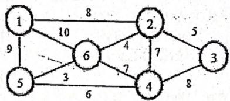

答案：
(1) 普里姆方法:
结点并入顺序：1,2,6,5,3,4（图略） (5分)

(2) 克鲁斯卡尔方法:
边的并入顺序：(5,6)，(2,6)，(2,3)，(4,5)，(1,2)（图略） (5分)

四、证明题（10分）

知识点：[最小代价生成树的Prim算法（点集扩展）](../../../topics/算法分析/Prim算法.md)、[最小代价生成树的Kruskal算法（边集扩展与并查集）](../../../topics/算法分析/Kruskal算法.md)、[算法的概念与基本特性（确定性、有限性等）](../../../topics/算法分析/算法概念与特性.md)

### 证明 1

假定 n 是 2 的幂，设 T(n) 由如下递推式定义，请利用迭代法扩展递推式以证明 T(n) = O(nlog²n)。

$$
T (n) = \left\{ \begin{array}{l l} 1 & n = 1 \\ 2 T (n / 2) + n \log n & n > 1 \end{array} \right.
$$

答案：
设 $\mathbf{n} = 2^{\mathbf{k}}$ ，则

$$
\begin{array}{r l} \mathrm{T(n)} & = 2 \mathrm{T(n/2)} + \mathrm{n} \log \mathrm{n} \\ & = 2 (2 \mathrm{T(n/2} ^ {2}) + (\mathrm{n/2}) ^ {*} \log (\mathrm{n/2})) + \mathrm{n} \log \mathrm{n} \\ & = 2 (2 (2 \mathrm{T(n/2} ^ {3}) + (\mathrm{n/2} ^ {2}) ^ {*} \log (\mathrm{n/2} ^ {2})) + (\mathrm{n/2}) ^ {*} \log (\mathrm{n/2})) + \mathrm{n} \log \mathrm{n} \\ & \dots \dots \\ & = 2 ^ {\mathrm{k}} \mathrm{T(n/2} ^ {\mathrm{k}}) + \mathrm{n} \log (\mathrm{n/2} ^ {\mathrm{k-1}}) + \mathrm{n} \log (\mathrm{n/2} ^ {\mathrm{k-2}}) + \dots + \mathrm{n} \log (\mathrm{n/2} ^ {0}) \\ & = \mathrm{n} + \mathrm{n} \log 2 + \mathrm{n} \log 2 ^ {2} + \dots + \mathrm{n} \log 2 ^ {\mathrm{k}} \end{array}
$$

$$
\begin{array}{r l} & = n + n ^ {*} (1 + 2 + \dots + k) \\ & = (n \log^ {2} n) / 2 + (n \log n) / 2 + n \\ & = O (n \log^ {2} n) \end{array}
$$

五、综合应用题（5分+7分+8分，共20分）

知识点：[渐近表示法：大O记号（紧上界）](../../../topics/算法分析/大O记号.md)

### 综合 1

设有背包问题实例 n=4，M=32，物品重量 $(w_{0}, w_{1}, w_{2}, w_{3})=(6, 9, 10, 15)$ ，物品装入背包的收益为： $(p_{0}, p_{1}, p_{2}, p_{3})=(8, 1, 2, 5)$

(1) 假设每件物品可以分割，请给出利用贪心法求解这一实例的最优解，以及此时的最大收益。(请给出求解过程)

(2) 假设每件物品不可以分割，请给出利用动态规划法求解这一实例的最优解，以及此时的最大收益。(请给出求解过程)

(3) 假设给定编号分别为 a、b、c 的 3 个背包，现要求将上述 4 件物品装入这 3 个背包中，下图显示了 4 件物品的装包冲突图 G=(V, E)，在图 G 中任意一个结点 $\mathbf{v}_{\mathbf{k}} \in V$ 表示重量为 $\mathbf{w}_{\mathbf{k}}$ 的物品 ( $k \in \{0, 1, 2, 3\}$ ), 任意一条边 ( $\mathbf{v}_{\mathbf{i}}, \mathbf{v}_{\mathbf{j}}) \in E$ 表示重量为 $w_{i}$ 和 $w_{j}$ 的两个物品不能放入同一个背包中，请利用回溯法求解在满足图 G 所示的约束条件下将上述 4 件物品装入这 3 个背包的所有可行的装包方案，给出问题的显示约束和隐式约束划分，并且画出对这一实例采用回溯法时实际生成的状态空间树。（提示：该问题的解可采用 4-元组 $X = (x_{0}, x_{1}, x_{2}, x_{3})$ 表示，其中 $x_{i}$ 表示重量为 $w_{i}$ 的物品所装入背包的编号）


答案：
(1) $\mathrm{p_i / w_i = (4 / 3, 1 / 9, 1 / 5, 1 / 3),}$ (2分)
最优解：(1,1/9,1,1) (2分)
最大收益： $\mathrm{P}_{\mathrm{max}} = 8 + 1^{*}1 / 9 + 2 + 5 = 136 / 9$ (1分)

(2) $S^{-1} = \{(0,0)\},\quad S_{1}^{0} = \{(6,8)\},$ $S^0 = \{(0,0),(6,8)\} ,\quad S_{1}^{1} = \{(9,1),(15,9)\} ,$ $S^1 = \{(0,0),(6,8),(15,9)\} ,\quad S_1^2 = \{(10,2),(16,10),(25,11)\} ,$ $S^2 = \{(0;0),(6,8),(15,9),(16,10),(25,11)\} ,$ $S_{1}^{3} = \{(15,5),(21,13),(30,14),(31,15),(40,16)\} ,$
$S^3 = \{(0,0),(6,8),(15,9),(16,10),(21,13),(30,14),(31,15)\}$ (4分)
因为 $(31, 15) \in \mathrm{S}_{\mathrm{I}}^{3}$ , 所以 $x = 1$ 。计算 $(X - w, P - p) = (16, 10)$ , 继续回溯, 因为 $(16, 10) \in \mathrm{S}_{\mathrm{I}}^{2}$ ,
所以 $x = 1$ 。计算 $(X - w, P - p) = (6, 8)$ ，继续回溯，因为 $(6, 8) \in S^0$ ，所以 $x = 0$ 。再回溯，
因为 $(6,8)\in S_{1}^{0}$ ，所以 $x = 1$ 。因此，问题最优解为 $(x,x,x,x) = (1,0,1,1)$ （2分）
最大收益为 $8+2+5=15$ 。 (1分)

(3) 显示约束: $x \in \{a, b, c\}$ , $0 \leq i < 4$ (1 分)
隐式约束：如果边 $(\mathbf{v_i},\mathbf{v_j})\in E$ ，则 $\mathbf{x}\neq \mathbf{x}$ (1分）

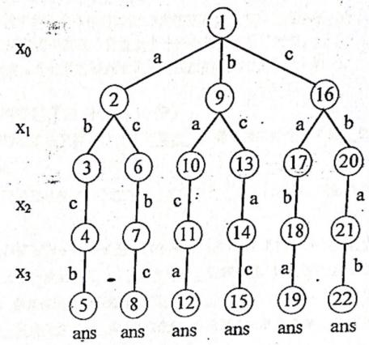

因此，所有可行解为：
$X = (a, b, c, b) = (a, c, b, c) = (b, a, c, a) = (b, c, a, c) = (c, a, b, a) = (c, b, a, b)$ (6分)

## 《算法设计与分析》

知识点：[快速排序算法（Partition分划函数与QuickSort）及性能改善方法](../../../topics/算法分析/快速排序.md)、[分治法的一般思想与算法框架（分解、解决、合并）](../../../topics/算法分析/分治法一般框架.md)、[算法的时间复杂度定义（最好、最坏、平均情况）](../../../topics/算法分析/时间复杂度定义.md)

### 一、判断题（10分，共5题）

1、近似算法解最优化问题时需保证得到的结果在一定误差之内。（√）

2、剪枝函数就是约束函数。 (×)

3、蒙特卡罗方法可以精确得到状态空间树上实际生成的结点数。（×）

4、渐近时间复杂度使得可以在数量级上估计一个算法的执行时间。（√）

5、一般称用于确定 n 个元素的排列满足某些性质的状态空间树为排列树。（√）

知识点：[近似算法的性能指标（绝对性能保证、相对性能保证、近似方案）](../../../topics/算法分析/近似算法性能保证.md)、[剪枝函数设计与回溯法效率分析（蒙特卡罗估计算法）](../../../topics/算法分析/剪枝函数与效率分析.md)、[子集树与排列树的搜索结构](../../../topics/算法分析/子集树与排列树.md)

### 二、填空题（20分，共10空）

1、辗转相除法又称\_欧几里德算法，是一种求两个整数的最大公约数的算法。

2、很多情况下，可以通过考察一个程序中关键操作的执行次数，来估算算法的渐近时间复杂度。

3、如果 $f(n)=a^{n}n^{n}+a^{-1}n^{-1}+\cdots+a^{1}n+a^{0}$ 是 m 次多项式，且 $a^{n}>0$ ，则 $f(n)=0(\underline{n}^{n})$ 。

4、贪心法在算法的每一步上根据最优量度标准选择分量，只需保证形成的部分解不违反约束条件，最终得到的n-元组必定是最优解。

5、Cook 定理表明·可满足性问题是 NP 完全的。若问题 Q∈NP 且 Q 是 MP 难度的，则称 Q 是 NP 完全的。

6、信息安全的目标是保护信息的机密性、完整性，并具有抗否认性和可用性。

知识点：[欧几里德算法（递归与迭代实现求最大公约数）](../../../topics/算法分析/欧几里德算法.md)、[渐近表示法：大O记号（紧上界）](../../../topics/算法分析/大O记号.md)、[贪心法的基本要素（贪心选择性质/最优量度标准、最优子结构性质）](../../../topics/算法分析/贪心法基本要素.md)、[Cook定理及其证明思路](../../../topics/算法分析/Cook定理.md)、[信息安全目标与密码体制（对称密码体制与非对称密码体制）](../../../topics/算法分析/信息安全与密码体制.md)、[典型NP完全问题证明（如CNF可满足性规约至最大集团判定问题）](../../../topics/算法分析/典型NP完全问题.md)

### 三、选择题（10分，共5题）

1、二分搜索算法的执行过程可以用一个（B）来描述。
A. 哈夫曼树 B. 二叉判定树 C. 堆栈 D. 队列

2、实时系统最关心系统（C）情况下的时间复杂度。
A. 最好 B. 平均 C. 最坏 D. 所有

3、下面关于备忘录方法的说法中（A）是错误的。
A. 备忘录方法自底向上求解。
B. 备忘录方法为每个已解过的子问题建立备忘录进行保存。
C. 备忘录方法是动态规划法的变形。
D. 当只有部分子问题需要求解时，选用备忘录方法较好。

4、若已知 RSA 算法中的公开密钥为 $\{e,n\}$ ，私人密钥为 $\{d,n\}$ ，M 为明文分组，C 是 M 对应的密文。则加密公式为（A）
A. $C=M^{e}\mod n$ B. $C=M^{d}\mod n$ C. $M=C^{e}\mod n$ D. $M=C^{d}\mod n$

5、下面（D）不是针对 RSA 算法的攻击方式。
A. 大整数分解 B. 时间攻击 C. 中间人攻击 D. 数字认证

知识点：[二分搜索（对半搜索）的递归与迭代实现](../../../topics/算法分析/二分搜索.md)、[对半搜索的二叉判定树性质及基于关键字比较的搜索算法时间下界](../../../topics/算法分析/二叉判定树.md)、[算法的时间复杂度定义（最好、最坏、平均情况）](../../../topics/算法分析/时间复杂度定义.md)、[矩阵连乘问题的动态规划求解（完全加括号、递推关系、备忘录方法）](../../../topics/算法分析/矩阵连乘.md)、[RSA机制的密钥产生、加解密过程与扩展Euclid算法](../../../topics/算法分析/RSA算法.md)、[RSA的安全性分析及可能存在的攻击方式](../../../topics/算法分析/RSA安全性分析.md)

### 四、问答题（50分，共5题）

1、(1) 请写出分治法的算法思想。
(2) 分治法求解的问题通常得到一个递归算法, 若算法的执行时间可以表示为 $T(n)=aT(u/b)+cn^{k}$ , $T(1)=c$ , 请给出该算法渐近时间复杂度的解。

答：（1）分治法的算法思想是 1）将一个难以直接求解的复杂问题分解成若干个规模较小、相互独立，但类型相同的子问题。2）如果子问题还比较复杂而不能直接求解，还可以继续细分，直到子问题足够小，能够直接求解为止。3）最后，再通过组合子问题的解，来得到原始问题的完整解。
(2) $T(n) = \begin{cases} \Theta (n^{\log_b a}) & \text{若} a > b^t \\ \Theta (n^k \log n) & \text{若} a = b^k \\ \Theta (n^k) & \text{若} a < b^k \end{cases}$

2、请画出 W={1, 3, 5, 7, 8, 10}的三路最佳合并树。

答：因为 $n = 6$ ， $\mathrm{k} = 3$ ， $(\mathrm{n - 1})\% (\mathrm{k - 1}) = 1$ ，需补齐一个虚结点。


3、下图所示的AOE网中
（1）求每个事件（结点）i 可能的最早发生时间 earliest(i)和允许的最迟发生时间 latest(i)。
(2) 求从源点 0 到汇点 5 的关键路径长度。
(3) 找出图中所有的关键活动。
(4) 写出图中所有的关键路径。

解：(1)

| | 0 | 1 | 2 | 3 | 4 | 5 |
|---|---|---|---|---|---|---|
| earliest(i) | 0 | 2 | 3 | 6 | 7 | 9 |
| latest(i) | 0 | 2 | 6 | 6 | 7 | 9 |

(2) 关键路径长度：9

(3) 关键活动：$<0,1>, <1,3>, <1,4>, <3,5>, <4,5>$

(4) 关键路径：$(0,1,3,5)$ 和 $(0,1,4,5)$

知识点：[分治法的复杂性分析与Master定理应用](../../../topics/算法分析/分治法复杂度分析.md)、[最优归并模式（扩充二叉树、Huffman编码与带权外路径长度）](../../../topics/算法分析/最佳合并模式.md)、[多段图的应用：资源分配问题与关键路径算法（earliest递推）](../../../topics/算法分析/资源分配与关键路径.md)

### 计算 4

请用启发式方法计算 0/1 背包问题。背包载重为 $M=6$，有 4 件物品的重量为 $(w_0, w_1, w_2, w_3)=(3.3, 2, 1.2, 5)$，放入背包的收益分别为 $(p_0, p_1, p_2, p_3)=(4, 5, 6, 1)$。背包最大收益是多少？最优解是什么？

（注：最优解中的解分量 $x_i$ 表示物品 $i$ 放入背包的比例。）

解：ProfLeft(0)=16, ProfLeft(1)=12, ProfLeft(2)=7, ProfLeft(3)=1, ProfLeft(4)=0。

$$5.5 < M = 6,$$

$S^0=\{(0,0), (3.3,4)\}$，$x_0=0$

$S^1=\{(2,5), (5.3,9)\}$，$x_1=1$

$S^2=\{(3.2,11)\}$，$x_2=1$

$S^3=\{(3.2,11)\}$，$x_2=0$

所以最大收益是 11，最优解是 $(0,1,1,0)$。

知识点：[0/1背包问题实数重量的阶跃点集合求解（非启发式与启发式方法）](../../../topics/算法分析/01背包阶跃点集合.md)、[贪心法的一般算法框架（按量度标准排序后逐步决策）](../../../topics/算法分析/贪心法一般框架.md)、[近似算法概念（寻找近似解而非最优解）](../../../topics/算法分析/近似算法概念.md)

### 计算 5

设有 $n=4$ 个正数的集合 $W=\{w_0, w_1, w_2, w_3\}=(3, 5, 8, 10)$ 和整数 $M=13$，求 $W$ 中元素之和等于 $M$ 的所有子集。画出对于这一实例由 SumOfSub 算法实际生成的那部分状态空间树，并给出所有可行解。

解：（1）实际生成的状态空间树：


(2) 可行解有：(1, 0, 0, 1) 和 (0, 1, 1, 0)

## 五、算法设计题（10分）

知识点：[回溯法的基本概念（解空间、状态空间树、显式约束与隐式约束）](../../../topics/算法分析/回溯法基本概念.md)、[子集树与排列树的搜索结构](../../../topics/算法分析/子集树与排列树.md)、[子集和数问题的回溯法求解（固定长度元组解）](../../../topics/算法分析/子集和数问题.md)

### 算法设计 1

请利用快速排序算法的思想，用分治法设计一个算法选出 $n$ 个元素中第 $k$ 小的元素。请尽可能地说清楚你的算法，不用给出具体程序。

答：每一步根据一个随机选取的元素对输入数组进行划分，然后只对包含第 $k$ 小元素的那部分子数组进行递归操作——即寻找 $x[k]$ 位置的所有者。

参考程序：

```cpp
template <class Type>
Type RandomizedSelect(Type a[], int p, int r, int k)
    // 在数组 a 中下标从 p 到 r 的范围内查找第 k 小的元素
{
    if (p == r) return a[p];    // a[p] 即是第 k 小的元素
    int i = RandomizedPartition(a, p, r);    // 快速排序的一趟分划操作
    j = i - p + 1;    // 前面子数组中（包括位置 i 处）元素总数
    if (k <= j)
    return RandomizedSelect(a, p, i, k);
    else
    return RandomizedSelect(a, i + 1, r, k - j);
}
```

复杂度比较：

$$\ln(1) < O(\log n) < O(n) < O(n\log n) < O(n^{2}) \leq O(n^{3}),$$

| 算法 | 最好 | 最坏 | 平均 |
|---|---|---|---|
| 快速排序 | $O(n\log n)$ | $O(n^{2})$ | $O(n\log n)$ |
| 合并排序 | $O(n\log n)$ | $O(n\log n)$ | $O(n\log n)$ |

两路合并：$O(n\log n)$

对半搜索：
忘记：

直接定义：

# 《算法分析与设计》

院(系)______ 班级 ______ 学号 ______ 姓名

| 题号 | 一 | 二 | 三 | 四 | 五 | 六 | 七 | 八 | 九 | 十 | 总分 |
|---|---|---|---|---|---|---|---|---|---|---|---|
| 得分 | | | | | | | | | | | |

得分 一、选择题（每空 1 分，共 10 分）

知识点：[分治法的一般思想与算法框架（分解、解决、合并）](../../../topics/算法分析/分治法一般框架.md)、[快速排序算法（Partition分划函数与QuickSort）及性能改善方法](../../../topics/算法分析/快速排序.md)、[选择问题与线性时间选择算法（五元中值组取中值分割法）](../../../topics/算法分析/线性时间选择.md)

### 选择 1

下列关于算法的说法不正确的是（A）

- A. 简单的算法一定是高效的。
- B. 算法总能在执行有限步后终止。
- C. 算法至少产生一个输出量。
- D. 算法具有确定性。

答案：A。

知识点：[算法的概念与基本特性（确定性、有限性等）](../../../topics/算法分析/算法概念与特性.md)

### 选择 2

两路合并排序算法最好、最坏、平均情况下的时间复杂度均为（）

- A. O(logn)
- B. O(n)
- C. O(nlogn)
- D. O(n²)

知识点：[欧几里德算法（递归与迭代实现求最大公约数）](../../../topics/算法分析/欧几里德算法.md)、[连续整数检测算法求最大公约数](../../../topics/算法分析/连续整数检测算法.md)

### 选择 3

对半搜索算法的成功搜索和失败搜索的时间复杂度分别为（A）

- A. O(logn) Θ(logn)
- B. O(logn) O(logn)
- C. Θ(logn) O(logn)
- D. Θ(logn) Θ(logn)

答案：A。

知识点：[算法按时间复杂度分类（多项式时间算法与指数时间算法）](../../../topics/算法分析/算法按时间复杂度分类.md)

### 选择 4

有一般背包问题实例 $n=6, M=12, (w_0, w_1, \ldots, w_3)=(2, 5, 7, 4, 1, 3)$，物品装入背包的收益为 $(p_0, p_1, \ldots, p_3)=(8, 12, 7, 6, 3, 6)$，则这一实例的最大收益为（B）

- A. 42
- B. 30.5
- C. 27.8
- D. 25

答案：B。

$$4, \frac{12}{5}, 1, \frac{3}{2}, 3, 2.$$

知识点：[回溯法的基本概念（解空间、状态空间树、显式约束与隐式约束）](../../../topics/算法分析/回溯法基本概念.md)、[回溯法的递归回溯与迭代回溯算法框架](../../../topics/算法分析/回溯法框架.md)、[n-皇后问题的回溯法求解及状态空间树分析](../../../topics/算法分析/N皇后问题.md)

### 选择 5

以下对分枝限界法中活结点的叙述不正确的是（）

- A. 分枝限界法中的每个活结点只有一次机会成为扩展结点。
- B. 活结点一旦成为扩展结点，依次生成孩子结点后，自身就成为死结点。
- C. 一个扩展结点生成的所有孩子结点，全部被加入活结点表中。
- D. 从活结点表中选择下一个扩展结点时可依据的有 FIFO、LIFO 或 LC 原则。

知识点：[算法的概念与基本特性（确定性、有限性等）](../../../topics/算法分析/算法概念与特性.md)、[递推方程的求解方法（替换法、迭代法、递归树、主方法）](../../../topics/算法分析/递推方程求解.md)

### 选择 6

十五谜问题适合于用（）实现

- A. 回溯法
- B. FIFO 分枝限界法
- C. LIFO 分枝限界法
- D. LC 分枝限界法

知识点：[问题和问题求解方法与系统生命周期](../../../topics/算法分析/问题求解过程.md)、[算法的概念与基本特性（确定性、有限性等）](../../../topics/算法分析/算法概念与特性.md)

### 选择 7

请将以下 A-D 选项填入程序中合适的位置，使得程序能够用回溯法求解 n-皇后问题的全部可行解：

- A. x[k]=i
- B. NQueens(0,n,x)
- C. Place(k,i,x)
- D. NQueens(k+1,n,x)

(1)______ (2)______ (3)______ (4)______

```cpp
if ((x[j]=i)||(abs(x[j]-i)=abs(j-k)))
return false;

return true;

void NQueens(int k, int n, int *x)
{    for (int i = 0; i < n; i++)

else ______(3) A D

void NQueens(int n,int *x)
{ (4) }
```

得分 二、填空题（每空 1 分，共 10 分）

知识点：[算法的概念与基本特性（确定性、有限性等）](../../../topics/算法分析/算法概念与特性.md)、[问题和问题求解方法与系统生命周期](../../../topics/算法分析/问题求解过程.md)

### 填空 1

算法的复杂度是指运行一个算法所需的时间和空间资源的量。

知识点：[算法的时间复杂度定义（最好、最坏、平均情况）](../../../topics/算法分析/时间复杂度定义.md)、[算法的空间复杂度定义](../../../topics/算法分析/空间复杂度定义.md)

### 填空 2

分治法求解很自然导致一个递归算法。

知识点：[算法的概念与基本特性（确定性、有限性等）](../../../topics/算法分析/算法概念与特性.md)、[递归概念与归纳证明（斐波那契数列、Hanoi塔问题）](../../../topics/算法分析/递归与归纳证明.md)

### 填空 3

用贪心算法求解的问题一般都具有最优子结构性质和贪心选择性质。

知识点：[贪心法的基本要素（贪心选择性质/最优量度标准、最优子结构性质）](../../../topics/算法分析/贪心法基本要素.md)

### 填空 4

设有 5 个有序文件分别包含（30,10,20,15,20）条记录，现通过两两合并将其合并成一个有序文件。（若每一次合并需读写两个文件的全部记录一次）则整个合并过程中至少需要读写总共______条记录。

知识点：[欧几里德算法（递归与迭代实现求最大公约数）](../../../topics/算法分析/欧几里德算法.md)、[数论初步（同余定义、按模计算原理、欧拉函数）](../../../topics/算法分析/数论初步.md)

### 填空 5

最优子结构性质和重叠子问题性质是动态规划法求解的基本要素。

知识点：[动态规划法的基本要素（最优子结构、重叠子问题）与设计步骤](../../../topics/算法分析/动态规划基本要素.md)

### 填空 6

状态空间是描述问题解空间的树形结构。

知识点：[回溯法的基本概念（解空间、状态空间树、显式约束与隐式约束）](../../../topics/算法分析/回溯法基本概念.md)

### 填空 7

约束函数和限界函数统称为剪枝函数。

# 《算法分析与设计》

得分 三、判断题（每题 1 分，共 10 分）

知识点：[剪枝函数设计与回溯法效率分析（蒙特卡罗估计算法）](../../../topics/算法分析/剪枝函数与效率分析.md)

### 判断 1

操作系统既是一个程序，也是一个算法。

知识点：[算法的概念与基本特性（确定性、有限性等）](../../../topics/算法分析/算法概念与特性.md)、[渐近表示法：大O记号（紧上界）](../../../topics/算法分析/大O记号.md)、[算法的时间复杂度定义（最好、最坏、平均情况）](../../../topics/算法分析/时间复杂度定义.md)

### 判断 2

算法不能用自然语言来描述；而只能用程序设计语言来描述。

知识点：[算法的概念与基本特性（确定性、有限性等）](../../../topics/算法分析/算法概念与特性.md)

### 判断 3

算法的时间复杂度不仅仅依赖于问题的规模，还与输入实例的初始状态有关。

知识点：[算法的时间复杂度定义（最好、最坏、平均情况）](../../../topics/算法分析/时间复杂度定义.md)、[使用程序步分析算法的时间复杂度](../../../topics/算法分析/程序步分析法.md)、[渐近表示法：大O记号（紧上界）](../../../topics/算法分析/大O记号.md)

### 判断 4

程序步数可以确切的反映程序运行的实际时间。

知识点：[使用程序步分析算法的时间复杂度](../../../topics/算法分析/程序步分析法.md)、[算法的时间复杂度定义（最好、最坏、平均情况）](../../../topics/算法分析/时间复杂度定义.md)

### 判断 5

如果有两个定义在正数集上的正函数 $f(n)$ 和 $g(n)$ 满足 $f(n)=\Theta(g(n))$，则表示 $g(n)$ 既是 $f(n)$ 的一个上界，又是 $f(n)$ 的一个下界。

知识点：[渐近表示法：Θ记号（紧渐近界）](../../../topics/算法分析/Theta记号.md)

### 判断 6

一般背包问题和 0-1 背包问题都可以用贪心法求解得到最优解。

知识点：[贪心法的基本要素（贪心选择性质/最优量度标准、最优子结构性质）](../../../topics/算法分析/贪心法基本要素.md)、[一般背包问题的贪心法求解及最优度量标准证明](../../../topics/算法分析/背包问题贪心求解.md)、[动态规划法与分治法、贪心法的异同比较](../../../topics/算法分析/动态规划与分治贪心对比.md)

### 判断 7

动态规划法自底向上逐步构造整体最优解的过程，不依赖于子问题的最优解。（X）

知识点：[动态规划法的基本要素（最优子结构、重叠子问题）与设计步骤](../../../topics/算法分析/动态规划基本要素.md)

### 判断 8

回溯法运行的时间通常取决于状态空间树上实际生成的那部分问题状态的数目。

知识点：[剪枝函数设计与回溯法效率分析（蒙特卡罗估计算法）](../../../topics/算法分析/剪枝函数与效率分析.md)、[回溯法的基本概念（解空间、状态空间树、显式约束与隐式约束）](../../../topics/算法分析/回溯法基本概念.md)

### 判断 9

分枝限界法中每个活结点可能多次成为当前扩展结点。

知识点：[分枝限界法与回溯法的异同及基本生成方法](../../../topics/算法分析/分枝限界法概述.md)

### 判断 10

如下图（a）所示，在 $4 \times 4$ 方形棋盘上给定了 15 个号牌和一个空格的初始排列。由该初始状态经过一系列合法的号牌移动，可以到达目标状态（b）。

| 1 | | 3 | 4 |
|---|---|---|---|
| 5 | 2 | 7 | 8 |
| 9 | 6 | 10 | 12 |
| 13 | 14 | 11 | 15 |

| 1 | 2 | 3 | 4 |
|---|---|---|---|
| 5 | 6 | 7 | 8 |
| 9 | 10 | 11 | 12 |
| 13 | 14 | 15 | |

# 《算法分析与设计》

得分 四、证明题（10 分）

知识点：[15谜问题的可解性判定（定理9-1）与状态空间树搜索](../../../topics/算法分析/十五谜问题.md)

### 证明 1

证明：$n^{2}$ 是 $3\log n+2*n+n^{2}$ 的上界。

## 五、简答题（每题 10 分，共 20 分）

知识点：[渐近表示法：大O记号（紧上界）](../../../topics/算法分析/大O记号.md)

### 简答 1

请比较分治策略中的合并排序和快速排序算法的不同。

知识点：[分治法的一般思想与算法框架（分解、解决、合并）](../../../topics/算法分析/分治法一般框架.md)、[两路合并排序算法及其时间与空间复杂度分析](../../../topics/算法分析/合并排序.md)、[快速排序算法（Partition分划函数与QuickSort）及性能改善方法](../../../topics/算法分析/快速排序.md)

### 简答 2

比较动态规划法和分治法的异同

# 《算法分析与设计》

知识点：[多段图问题的向前/向后递推动态规划算法](../../../topics/算法分析/多段图问题.md)、[动态规划法与分治法、贪心法的异同比较](../../../topics/算法分析/动态规划与分治贪心对比.md)

### 综合 1

请写出对数据 $(6,5,4,3,2,1)$ 进行快速排序的执行过程（结果从小到大排列）。

$$
\begin{array}{l}
6\ 5\ 4\ 3\ 2\ 1\ \infty \\
1\ [5\ 4\ 3\ 2]\ 6\ \infty \\
1\ [5\ 4\ 3\ 2]\ 6\ \infty \\
1\ [2\ 4\ 3]\ 5\ 6\ \infty \\
1\ 2\ [4\ 3]\ 5\ 6\ \infty \\
1\ 2\ 3\ 4\ 5\ 6\ \infty \\
1\ 2\ 3\ 4\ 5\ 6
\end{array}
$$

答案：求解形式正确占 1 分，哨兵 $\infty$ 占 1 分，最后排序结果正确占 1 分；排序过程占 7 分，错一步扣 1 分。

知识点：[快速排序算法（Partition分划函数与QuickSort）及性能改善方法](../../../topics/算法分析/快速排序.md)、[分治法的一般思想与算法框架（分解、解决、合并）](../../../topics/算法分析/分治法一般框架.md)、[算法的时间复杂度定义（最好、最坏、平均情况）](../../../topics/算法分析/时间复杂度定义.md)

### 综合 2

对右图所示的一个无向连通带权图：

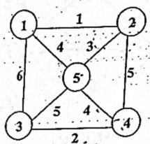

(1) 请在下面图中分别画出用 Kruskal 算法和 Prim 算法构造它的一棵最小代价生成树的过程（从结点 1 出发）。

1) Kruskal 算法生成过程：


(2)


(3)

(4)

2) Prim 算法生成过程：

(1)

(2)

(3)

(4)

答案：(1) 1) Kruskal 算法（各步 1 分）；2) Prim 算法（各步 1 分）。(2) 边数多的适用 Prim 算法，边数少的适用 Kruskal 算法。

知识点：[最小代价生成树的Kruskal算法（边集扩展与并查集）](../../../topics/算法分析/Kruskal算法.md)、[最小代价生成树的Prim算法（点集扩展）](../../../topics/算法分析/Prim算法.md)

### 综合 3

对如图所示的多段图，采用向后递推和向前递推两种动态规划算法，求多段图中从源点 $s$ 到汇点 $t$ 的最短路径及路径长度。


向前：

$$
\begin{array}{r l}
{\cos t (5, 8)} & {= 0} \\
{\cos t (4, 6)} & {= 3}
\end{array}
$$

$$
\begin{array}{l}
{\cos t (3, y) = 6 + 3.4 + 4 = 8 \dots \cos} \\
{\cos t (2, y) = 1}
\end{array}
$$

$$
\cos t (2, 1) = 2 + 8 - 10
$$

$$
\cos t (1, 0) = \min \{2 + 10, \dots\}
$$

$$
\cos t (2, 8) \div 6
$$

$$
: 6)\ (3, 3) = 8
$$

答案：从后向前递推：

$$
\cos t(8)=0;\ \cos t(7)=4;\ \cos t(6)=3;\ d(7)=d(6)=8;
$$

$$
\cos t(5) = \min \{2 + \cos t(6), 3 + \cos t(7)\} = 5;\quad d(5) = 6;
$$

$$
\cos t(4) = \min \{6 + \cos t(6), 4 + \cos t(7)\} = 8;\quad d(4) = 7;
$$

$$
\cos t(2) = 1 + \cos t(5) = 6;
$$

$$
\cos t(1) = 2 + \cos t(4) = 10;\quad d(1) = 4;
$$

$$
\cos t(0) = \min \{2 + \cos t(1), 5 + \cos t(2), 4 + \cos t(3)\} = 11;\quad d(0) = 2;
$$

知识点：[多段图问题的向前/向后递推动态规划算法](../../../topics/算法分析/多段图问题.md)、[动态规划法的基本要素（最优子结构、重叠子问题）与设计步骤](../../../topics/算法分析/动态规划基本要素.md)

### 综合 4

设有 $n = 4$ 个正数的集合 $W = \{w_0, w_1, w_2, w_3\} = \{7, 11, 13, 24\}$ 和整数 $M = 31$，求 $W$ 的所有满足条件的子集，使子集中的正数之和等于 $M$。请画出用回溯法求解的状态空间树（采用固定长度 4-元组表示解）。

$x[0]=0$

知识点：[分枝限界法与回溯法的异同及基本生成方法](../../../topics/算法分析/分枝限界法概述.md)、[旅行商问题的分枝限界法求解（代价矩阵归约与下界函数）](../../../topics/算法分析/旅行商问题分枝限界.md)、[LC（优先队列式）分枝限界法与代价估计函数](../../../topics/算法分析/LC分枝限界法.md)

### 选择 1

1、A

知识点：[算法的概念与基本特性（确定性、有限性等）](../../../topics/算法分析/算法概念与特性.md)

### 选择 2

2、C

知识点：[欧几里德算法（递归与迭代实现求最大公约数）](../../../topics/算法分析/欧几里德算法.md)、[连续整数检测算法求最大公约数](../../../topics/算法分析/连续整数检测算法.md)

### 选择 3

3、A

知识点：[算法按时间复杂度分类（多项式时间算法与指数时间算法）](../../../topics/算法分析/算法按时间复杂度分类.md)

### 选择 4

4、B

知识点：[回溯法的基本概念（解空间、状态空间树、显式约束与隐式约束）](../../../topics/算法分析/回溯法基本概念.md)、[回溯法的递归回溯与迭代回溯算法框架](../../../topics/算法分析/回溯法框架.md)、[n-皇后问题的回溯法求解及状态空间树分析](../../../topics/算法分析/N皇后问题.md)

### 选择 5

5、C

知识点：[算法的概念与基本特性（确定性、有限性等）](../../../topics/算法分析/算法概念与特性.md)、[递推方程的求解方法（替换法、迭代法、递归树、主方法）](../../../topics/算法分析/递推方程求解.md)

### 选择 6

6、D

知识点：[问题和问题求解方法与系统生命周期](../../../topics/算法分析/问题求解过程.md)、[算法的概念与基本特性（确定性、有限性等）](../../../topics/算法分析/算法概念与特性.md)

### 选择 7

7、(1) C

(2) A

(3) D

(4) B

知识点：[算法的概念与基本特性（确定性、有限性等）](../../../topics/算法分析/算法概念与特性.md)、[问题和问题求解方法与系统生命周期](../../../topics/算法分析/问题求解过程.md)

### 填空 1

1、时间 空间（顺序可颠倒）

知识点：[算法的时间复杂度定义（最好、最坏、平均情况）](../../../topics/算法分析/时间复杂度定义.md)、[算法的空间复杂度定义](../../../topics/算法分析/空间复杂度定义.md)

### 填空 2

2、递归

知识点：[算法的概念与基本特性（确定性、有限性等）](../../../topics/算法分析/算法概念与特性.md)、[递归概念与归纳证明（斐波那契数列、Hanoi塔问题）](../../../topics/算法分析/递归与归纳证明.md)

### 填空 3

3、贪心选择 最优子结构（顺序可颠倒）

知识点：[贪心法的基本要素（贪心选择性质/最优量度标准、最优子结构性质）](../../../topics/算法分析/贪心法基本要素.md)

### 填空 4

4、215

知识点：[欧几里德算法（递归与迭代实现求最大公约数）](../../../topics/算法分析/欧几里德算法.md)、[数论初步（同余定义、按模计算原理、欧拉函数）](../../../topics/算法分析/数论初步.md)

### 填空 5

5、最优子结构 子问题重叠（顺序可颠倒）

知识点：[动态规划法的基本要素（最优子结构、重叠子问题）与设计步骤](../../../topics/算法分析/动态规划基本要素.md)

### 填空 6

6、状态空间树

知识点：[回溯法的基本概念（解空间、状态空间树、显式约束与隐式约束）](../../../topics/算法分析/回溯法基本概念.md)

### 填空 7

7、剪枝函数

知识点：[剪枝函数设计与回溯法效率分析（蒙特卡罗估计算法）](../../../topics/算法分析/剪枝函数与效率分析.md)

### 判断 1

××√×√××√×√

知识点：[算法的概念与基本特性（确定性、有限性等）](../../../topics/算法分析/算法概念与特性.md)、[渐近表示法：大O记号（紧上界）](../../../topics/算法分析/大O记号.md)、[算法的时间复杂度定义（最好、最坏、平均情况）](../../../topics/算法分析/时间复杂度定义.md)

### 证明 1

证明：即要证明 $3\log n+2n+n^{2}=O(n^{2})$。

取 $c=3$，$n_{0}=2$。

当 $n \geqslant 2$ 的时候有 $3\log n + 2n + n^2 \leqslant 3n^2$（$c$ 和 $n_0$ 的取值可行各占 3 分，共 6 分），则 $n^2$ 是 $3\log n + 2n + n^2$ 的上界。即：$3\log n + 2n + n^2 = O(n^2)$。（写出其中任一句，即得 2 分）

知识点：[渐近表示法：大O记号（紧上界）](../../../topics/算法分析/大O记号.md)

### 简答 1

答：

问题分解过程：

- 合并排序——将序列一分为二即可。（十分简单）
- 快速排序——需调用 Partition 函数将一个序列划分为子序列。（分解方法相对较困难）

子问题解合并得到原问题解的过程：

- 快速排序——一旦左、右两个子序列都已分别排序，整个序列便自然成为有序序列。（异常简单，几乎无须额外的工作，省去了从子问题解合并得到原问题解的过程）

知识点：[分治法的一般思想与算法框架（分解、解决、合并）](../../../topics/算法分析/分治法一般框架.md)、[两路合并排序算法及其时间与空间复杂度分析](../../../topics/算法分析/合并排序.md)、[快速排序算法（Partition分划函数与QuickSort）及性能改善方法](../../../topics/算法分析/快速排序.md)

### 简答 2

答：

共同点（2 分）：将待求解的问题分解成若干子问题，先求解子问题，然后再从这些子问题的解得到原问题的解。

不同点（4 分）：

1、适合于用动态规划法求解的问题，分解得到的各子问题往往不是相互独立的；而分治法中子问题相互独立。

2、动态规划法用表保存已求解过的子问题的解，再次碰到同样的子问题时不必重新求解，而只需查询答案，故可获得多项式级时间复杂度，效率较高；而分治法中对于每次出现的子问题均求解，导致同样的子问题被反复求解，故产生指数增长的时间复杂度，效率较低。

因此最短路径长度为 11；最短路径为 $(0, d(0) = 2, d(2) = 5, d(5) = 6, d(6) = 8)$。从前向后递推：

| | |
|---|---|
| Bcost(0)=0; Bcost(1)=2; Bcost(2)=5; Bcost(3)=4; d(1)=d(2)=d(3)=0; | |
| Bcost(4)=min{2+Bcost(1),1+Bcost(3)}=4; | d(4)=1; |
| Bcost(5)=min{1+Bcost(2),3+Bcost(3)}=6; | d(5)=2; |
| Bcost(6)=min{6+Bcost(4),2+Bcost(5)}=8; | d(6)=5; |
| Bcost(7)=min{4+Bcost(4),3+Bcost(5)}=8; | d(7)=4; |
| Bcost(8)=min{3+Bcost(6),4+Bcost(7)}=11; | d(8)=6; |

因此最短路径长度为 11；最短路径为 $(d(2) = 0, d(5) = 2, d(6) = 5, d(8) = 6, 8)$。

（向前、向后递推过程各占 3 分，共 6 分。其中向前、向后递推形式正确占 1 分，求值正确占 1 分，求值时递推表达式正确占 1 分）
（最短路径长度值占 2 分；向前、向后求得最短路径各占 1 分，共 2 分）

知识点：[多段图问题的向前/向后递推动态规划算法](../../../topics/算法分析/多段图问题.md)、[动态规划法与分治法、贪心法的异同比较](../../../topics/算法分析/动态规划与分治贪心对比.md)

### 综合 4

答：$(\mathrm{w0,w1,w2,w3}) = (7,11,13,24), M = 31$

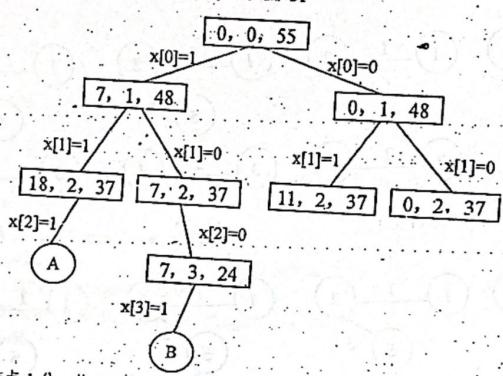

（每个结点 1 分，共 10 分）

知识点：[分枝限界法与回溯法的异同及基本生成方法](../../../topics/算法分析/分枝限界法概述.md)、[旅行商问题的分枝限界法求解（代价矩阵归约与下界函数）](../../../topics/算法分析/旅行商问题分枝限界.md)、[LC（优先队列式）分枝限界法与代价估计函数](../../../topics/算法分析/LC分枝限界法.md)
