# 《算法分析与设计》第10章 NP完全问题（课件）

原件的每一页，下面附识别出的文字。

### 算法设计与分析

原文：

Nanjing University of Posts & Telecommunications

算法设计与分析

### 第10章 NP完全问题

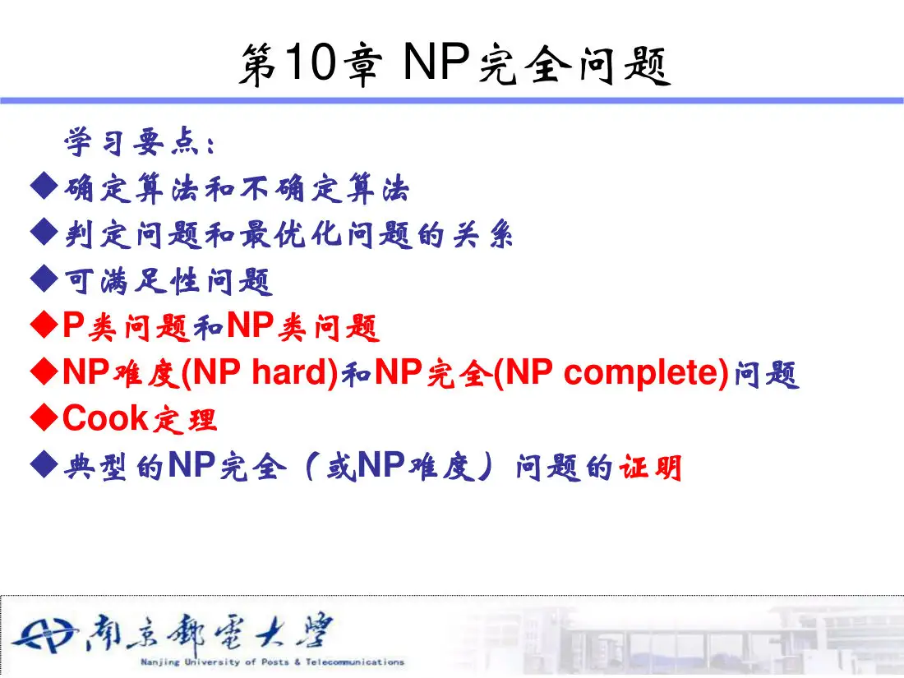

原文：

第10章 NP完全问题

学习要点：

◆确定算法和不确定算法

◆判定问题和最优化问题的关系

◆可满足性问题

◆P类问题和NP类问题

◆NP难度(NP hard)和NP完全(NP complete)问题

◆Cook定理

◆典型的NP完全（或NP难度）问题的证明

安南京郵電大学 Nanjing University of Posts & Telecommunications

### \- 章节内容:

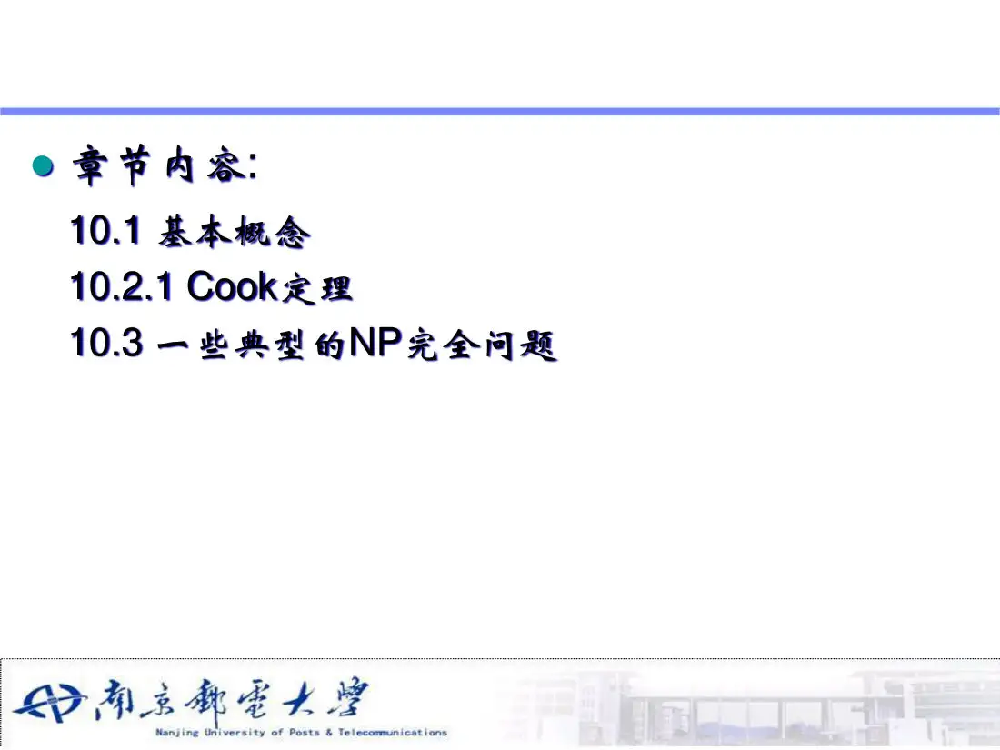

原文：

\- 章节内容:
10.1 基本概念
10.2.1 Cook定理
10.3 一些典型的NP完全问题

安南京郵電大学 Nanjing University of Posts & Telecommunications

### 10.1 基本概念

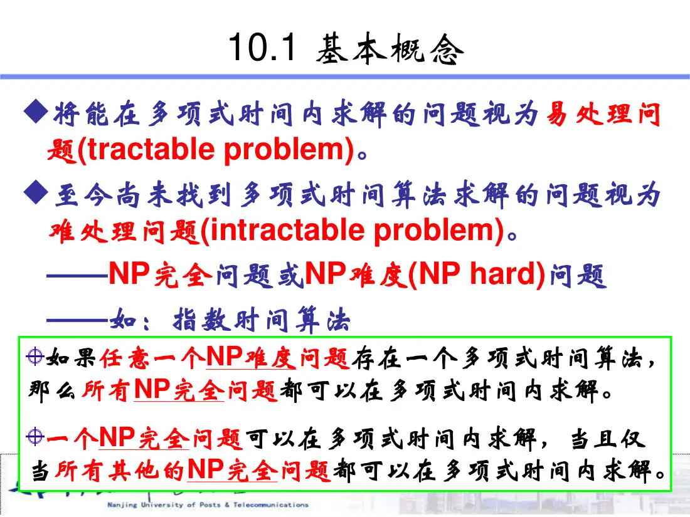

原文：

10.1 基本概念

◆将能在多项式时间内求解的问题视为易处理问题(tractable problem)。

◆至今尚未找到多项式时间算法求解的问题视为难处理问题(intractable problem)。

NP完全问题或NP难度(NP hard)问题

——如：指数时间算法

◆无论消耗多少计算机时间和空间也不能求解的如果任意一个NP难度问题存在一个多项式时间算法，那么所有NP完全问题都可以在多项式时间内求解。

——不存在任何算法求解一个NP完全问题可以在多项式时间内求解，当且仅当所有其他的NP完全问题都可以在多项式时间内求解。

Nanjing University of Posts & Telecommunications

### 10.1.1 不确定算法和不确定机

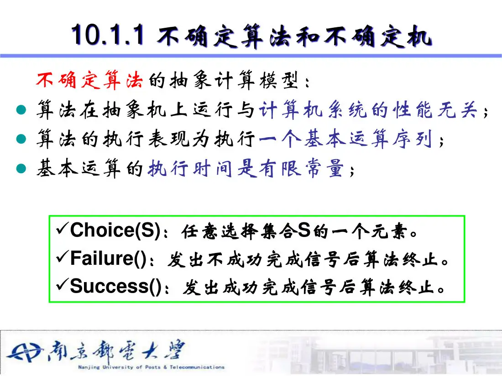

原文：

10.1.1 不确定算法和不确定机

不确定算法的抽象计算模型：

⚫ 算法在抽象机上运行与计算机系统的性能无关；

⚫ 算法的执行表现为执行一个基本运算序列；

⚫ 基本运算的执行时间是有限常量；

✓Choice(S)：任意选择集合S的一个元素。

✓Failure()：发出不成功完成信号后算法终止。

✓Success()：发出成功完成信号后算法终止。

安南京郵電大学 Nanjing University of Posts & Telecommunications

### Success();

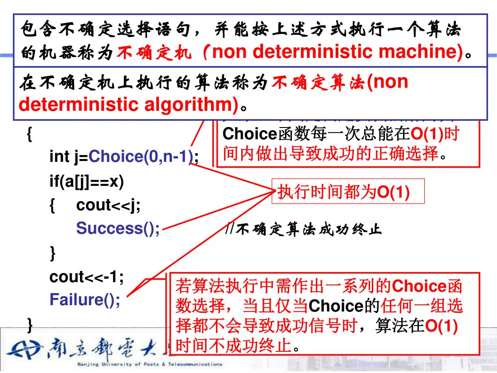

原文：

例10-1 在n个元素的数组a中查找给定元素x，如果包含不确定选择语句，并能按上述方式执行一个算法x在其中，则确定使a[j]==x的下标j，否则输出-1。的机器称为不确定机（non deterministic machine)。

不确定搜索算法：在不确定机上执行的算法称为不确定算法(nonvoid Search(int a[],T x)deterministic algorithm)。

Success();

cout<<-1; Failure();

Choice函数每一次总能在O(1)时//从{0,1,...,n-1}中任意选取一个间内做出导致成功的正确选择。

执行时间都为O(1)

//不确定算法成功终止

若算法执行中需作出一系列的Choice函//不确定算法失败终止数选择，当且仅当Choice的任何一组选择都不会导致成功信号时，算法在O(1)时间不成功终止。

Nanjing University of Posts & Telecommunications

### 不确定机的执行方式，可理解为不受限制的并行计算：

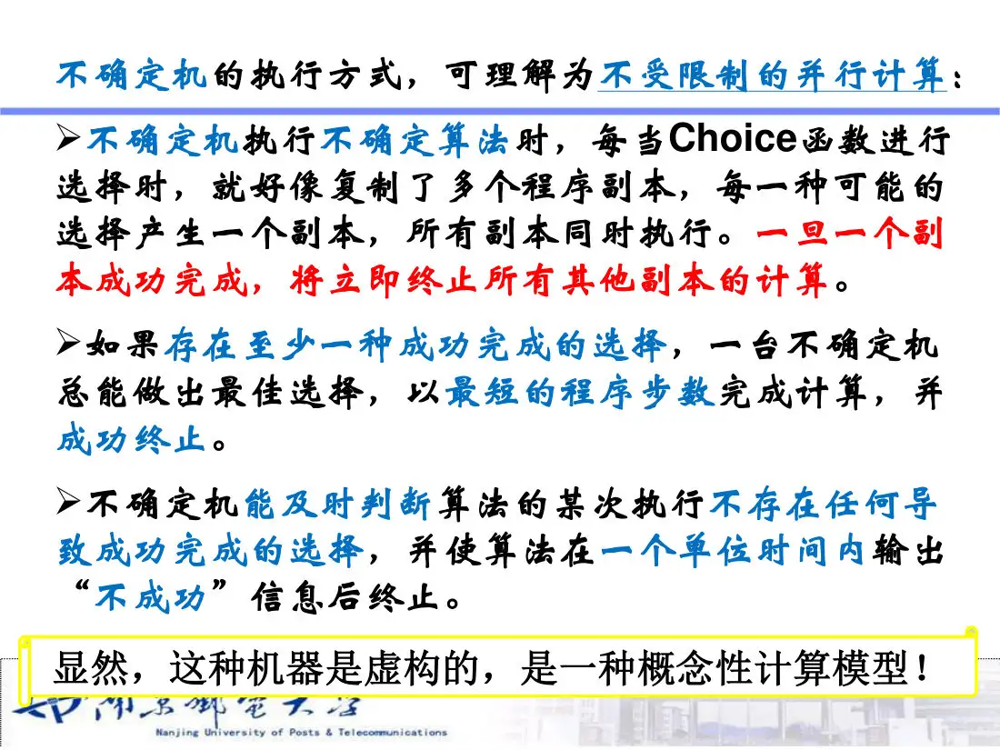

原文：

不确定机的执行方式，可理解为不受限制的并行计算：

➢不确定机执行不确定算法时，每当Choice函数进行选择时，就好像复制了多个程序副本，每一种可能的选择产生一个副本，所有副本同时执行。一旦一个副本成功完成，将立即终止所有其他副本的计算。

➢如果存在至少一种成功完成的选择，一台不确定机总能做出最佳选择，以最短的程序步数完成计算，并成功终止。

➢不确定机能及时判断算法的某次执行不存在任何导致成功完成的选择，并使算法在一个单位时间内输出“不成功”信息后终止。

显然，这种机器是虚构的，是一种概念性计算模型！

Nanjing University of Posts & Telecommunications

### 第 8 页

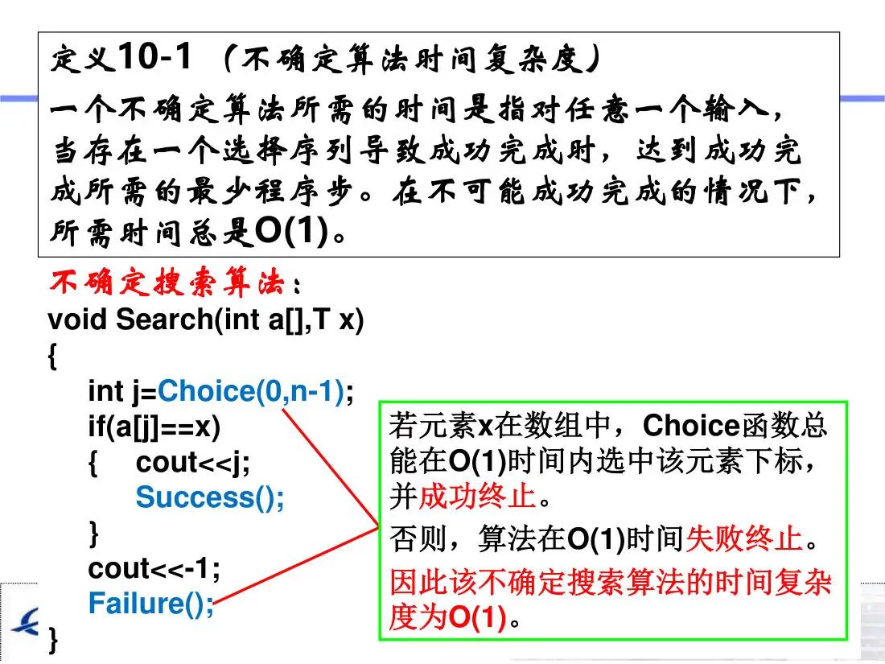

### 例10-2 将n个元素的序列排成有序序列。

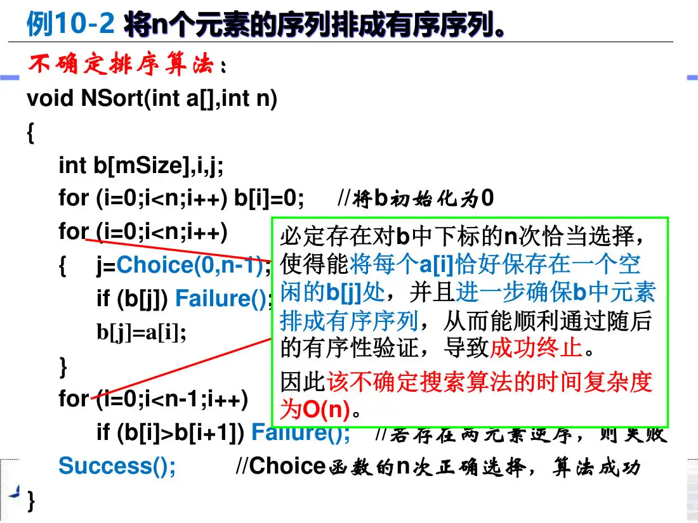

原文：

例10-2 将n个元素的序列排成有序序列。

### 判定问题和最优化问题

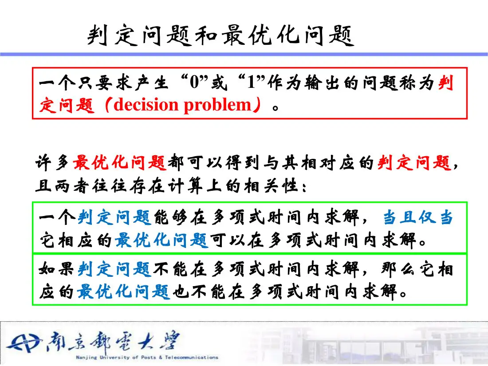

原文：

判定问题和最优化问题

一个只要求产生“0”或“1”作为输出的问题称为判定问题（decision problem）。

许多最优化问题都可以得到与其相对应的判定问题，且两者往往存在计算上的相关性：

一个判定问题能够在多项式时间内求解，当且仅当它相应的最优化问题可以在多项式时间内求解。

如果判定问题不能在多项式时间内求解，那么它相应的最优化问题也不能在多项式时间内求解。

安南京郵電大学 Nanjing University of Posts & Telecommunications

### 例10-3 最大集团及其判定问题

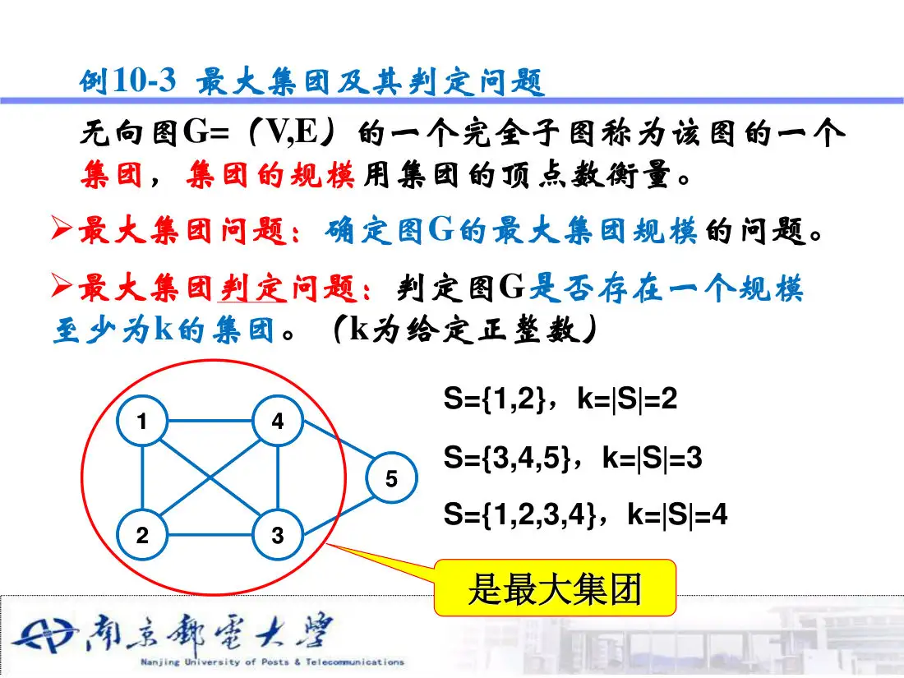

原文：

例10-3 最大集团及其判定问题

无向图 $\mathbf { G } \mathbf { = \nabla } \left( \mathbf { V } , \mathbf { E } \right)$ 的一个完全子图称为该图的一个集团，集团的规模用集团的顶点数衡量。

➢最大集团问题：确定图G的最大集团规模的问题。

➢最大集团判定问题：判定图G是否存在一个规模至少为k的集团。（k为给定正整数）

南京郵電大学

$$
\mathsf {S} = \{1, 2 \}, \quad \mathsf {k} = | \mathsf {S} | = 2
$$

$$
\mathsf {S} = \{3, 4, 5 \}, \quad \mathrm{k} = | \mathsf {S} | = 3
$$

$$
\mathsf {S} = \{1, 2, 3, 4 \}, \quad \mathsf {k} = | \mathsf {S} | = 4
$$

是最大集团

Nanjing University of Posts & Telecommunications

### 第 12 页

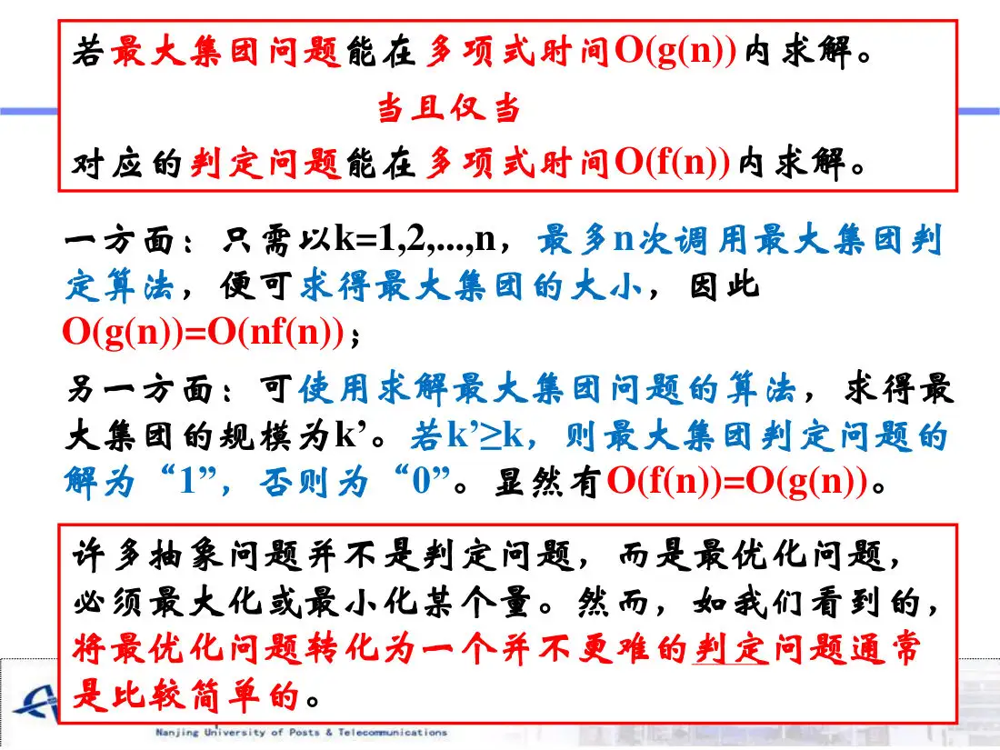

原文：

若最大集团问题能在多项式时间O(g(n))内求解。当且仅当对应的判定问题能在多项式时间O(f(n))内求解。

一方面：只需 $\scriptstyle { \pmb { \nu } } = 1 , 2 , \ldots , \mathbf { n }$ ，最多n次调用最大集团判定算法，便可求得最大集团的大小，因此$\scriptstyle \mathbf { O } ( \mathbf { g ( n ) } ) = \mathbf { O } ( \mathbf { n f ( n ) } ) ;$

另一方面：可使用求解最大集团问题的算法，求得最大集团的规模为k’。若k’≥k，则最大集团判定问题的解为“1”，否则为“0”。显然有 ${ \bf O } ( { \bf f } ( { \bf n } ) ) { \bf { = } } { \bf O } ( { \bf g } ( { \bf n } ) )$ 。

许多抽象问题并不是判定问题，而是最优化问题，必须最大化或最小化某个量。然而，如我们看到的，将最优化问题转化为一个并不更难的判定问题通常是比较简单的。

Nanjing University of Posts & Telecommunications

### 10.1.2 可满足性问题

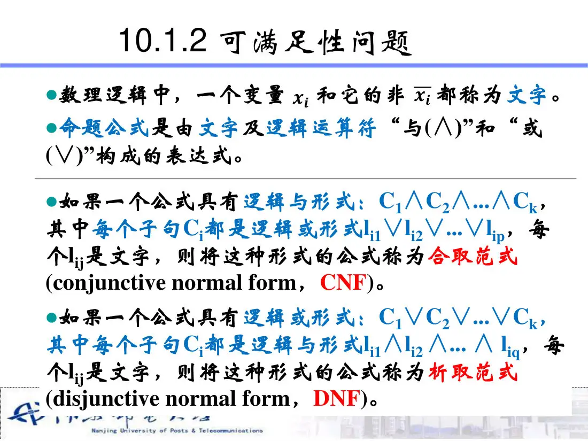

原文：

10.1.2 可满足性问题

⚫数理逻辑中，一个变量 $x _ { i }$ 和它的非 $\overline { { x _ { i } } }$ 都称为文字。

⚫命题公式是由文字及逻辑运算符“与(∧)”和“或(∨)”构成的表达式。

⚫如果一个公式具有逻辑与形式： $\mathbf { C } _ { 1 } \wedge \mathbf { C } _ { 2 } \wedge \ldots \wedge \mathbf { C } _ { \mathrm { k } } .$ 其中每个子句 $\mathbf { C _ { i } }$ 都是逻辑或形式 $\mathrm { { l } _ { i 1 } \mathrm { { V l } _ { i 2 } \mathrm { { V . . . } \mathrm { { V l } _ { i p } } } } }$ ，每个 $\mathbf { \cdot l _ { i j } }$ 是文字，则将这种形式的公式称为合取范式(conjunctive normal form，CNF)。

⚫如果一个公式具有逻辑或形式： $\mathbf { C } _ { 1 } \bigvee \mathbf { C } _ { 2 } \bigvee . . . \bigvee \mathbf { C } _ { \mathrm { k } } .$ 其中每个子句 $\mathbf { C _ { i } }$ 都是逻辑与形式 $\mathrm { l _ { i 1 } } \Lambda _ { \mathrm { i 2 } } \wedge \ldots \wedge \mathrm { l _ { i q } } ,$ 每个 ${ \bf { \cdot } } { \bf { l _ { i j } } }$ 是文字，则将这种形式的公式称为析取范式(disjunctive normal form，DNF)。

Nanjing University of Posts & Telecommunications

### 例如：

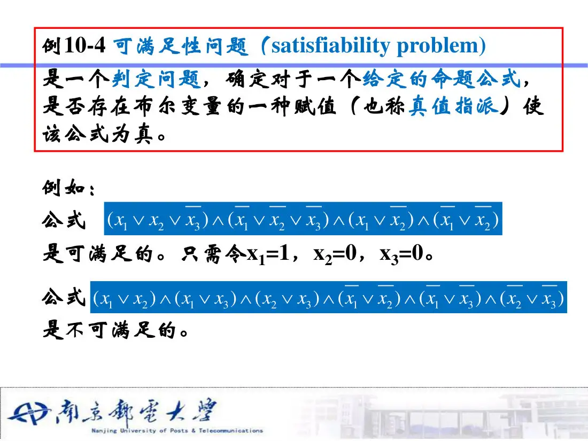

原文：

<table><tr><td>例10-4 可满足性问题 (satisfiability problem)</td></tr><tr><td>是一个判定问题,确定对于一个给定的命题公式,是否存在布尔变量的一种赋值(也称真值指派)使该公式为真。</td></tr></table>

例如：

公式 $3 0 0 \div 2 = 1 0 0 ( c m )$ 是可满足的。只需令 $\mathbf { \nabla } \cdot \mathbf { x _ { 1 } } { = } 1$ $\mathbf { x } _ { 2 } { = } \mathbf { 0 }$ $\bf { X } _ { 3 } \mathrm { = } \bf { 0 }$ 。

公式 $( 2 ) ( 1 0 0 0 0 0 0 0 0 0 0 0 0 0 0 0 0 0 0 0 0 0 0 0 0 0 0 0 0 0 0 0 0 0 0 0 0 0 0 0 0 0 0 0 0 0 0 0 0 0 0 0 0 0 0 0 0 0 0 0 0 0 0 0 0 0 0 0 0 0 0 0 0 0 0 0 0 0 0 0 0 0 0 0 0 0 0 0 0 0 0 0 0 0 0 0 0 0 0 0 0 0 0 0 0 0 0 0 0 0 0 0 0 0 0 0 0 0 0 0 0 0 0 0 0 0 0 0 0 0 0 0 0 0 0 0 0 0 0 0 0 0 0 0 0 0 0 0 0 0 0 0 0 0 0 0 0 0 0 0 0 0 0 0 0 0 0 0 0 0 0 0 0 0 0 0 0 0 0 0 0 0 0 0 0 0 0 0 0 0 0 0 0 0 0 0 0 0 0 0 0 0 0 0 0 0 0 0 0 0 0 0 0 0 0 0 0 0 0 0 0 0 0 0 0 0 0 0 0 0 0 0 0 0 0 0 0 0 0 0 0 0 0 0 0 0 0 0 0 0 0 0 0 0 0 0 0 0 0 0 0 0 0 0 0 0 0 0 0 0 0 0 0 0 0 0 0 0 0 0 0 0 0 0 0 0 0 0 0 0 0 0 0 0 0 0 0 0 0 0 0 0 0 0 0 0 0 0 0 0 0 0 0 0 0 0 0 0 0 0 0 0 0 0 0 0 0 0 0 0 0 0 0 0 0 0 0 0 0 0 0 0 0 0 0 0 0 0 0 0 0 0 0 0 0 0 0 0 0 0 0 0 0 0 0 0 0 0 0 0 0 0 0 0 0 0 0 0 0 0 0 0 0 0 0 0 0 0 0 0 0 0 0 0 0 0 0 0 0 0 0 0 0 0 0 0 0 0 0 0 0 0 0 0 0 0 0 0 0 0 0 0 0 0 0 0 0 0 0 0 0 0 0 0 0 0 0 0 0 0 0 0 0 0 0 0 0 0 0 0 0 0 0 0 0 0 0 0 0 0 0 0 0 0 0 0 0 0 0 0 0 0 0 0 0 0 0 0 0 0 0 0 0 0 0 0 0 0 0 0 0 0 0 0 0 0 0 0 0 0 0 0 0 0 0 0 0 0 0 0 0 0 0 0 0 0 0 0 0 0 0 0 0 0 0 0 0 0 0 0 0 0 0 0 0 0 0 0 0 0 0 0 0 0 0 0 0 0 0 0 0 0 0 0 0 0 0 0 0 0 0 0 0 0 0 0 0 0 0 0 0 0$ 是不可满足的。

安南京郵電大学 Nanjing University of Posts & Telecommunications

### 程序10-4 可满足性问题的不确定算法

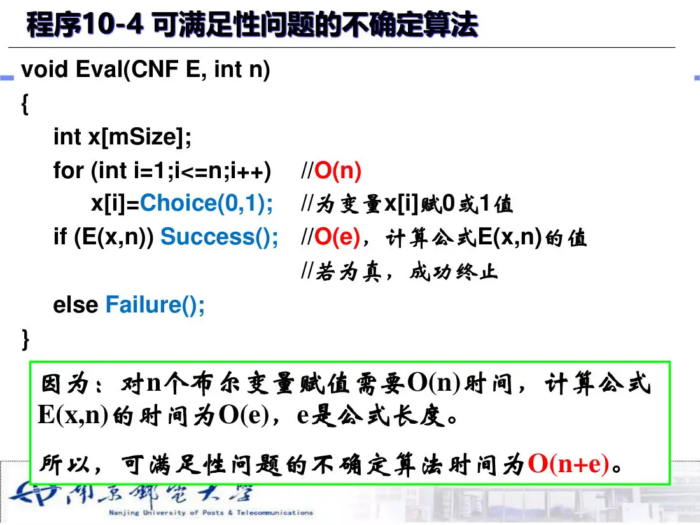

原文：

程序10-4 可满足性问题的不确定算法

### 10.1.3 P类和NP类问题

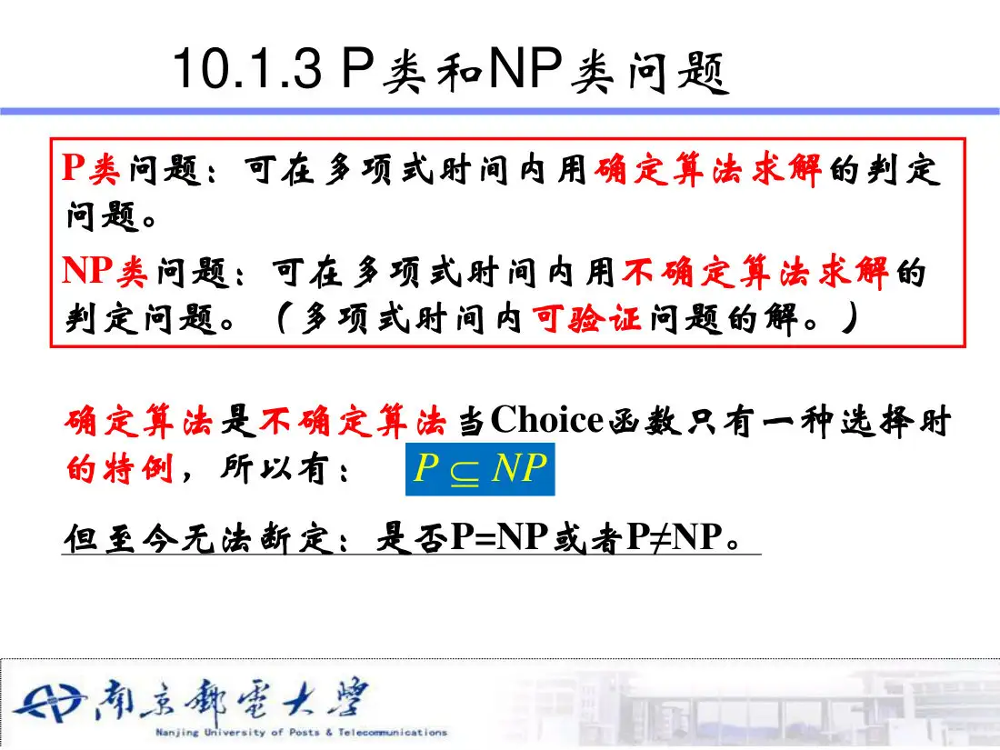

原文：

10.1.3 P类和NP类问题

P类问题：可在多项式时间内用确定算法求解的判定问题。

NP类问题：可在多项式时间内用不确定算法求解的判定问题。（多项式时间内可验证问题的解。）

确定算法是不确定算法当Choice函数只有一种选择时的特例，所以有： $| | \mathbf { \vec { \mathbf { \tau } } } | | \mathbf { \vec { \mathbf { \tau } } } | | \mathbf { \vec { \mathbf { \tau } } } = | | \mathbf { \vec { \mathbf { \tau } } } | | \mathbf { \vec { \mathbf { \tau } } } | | \mathbf { \vec { \mathbf { \tau } } } | | ^ { p } \mathbf { \vec { \mathbf { \tau } } }$

但至今无法断定：是否P=NP或者 $\mathbf { P \neq N P }$ 。

安南京郵電大学 Nanjing University of Posts & Telecommunications

### 即：

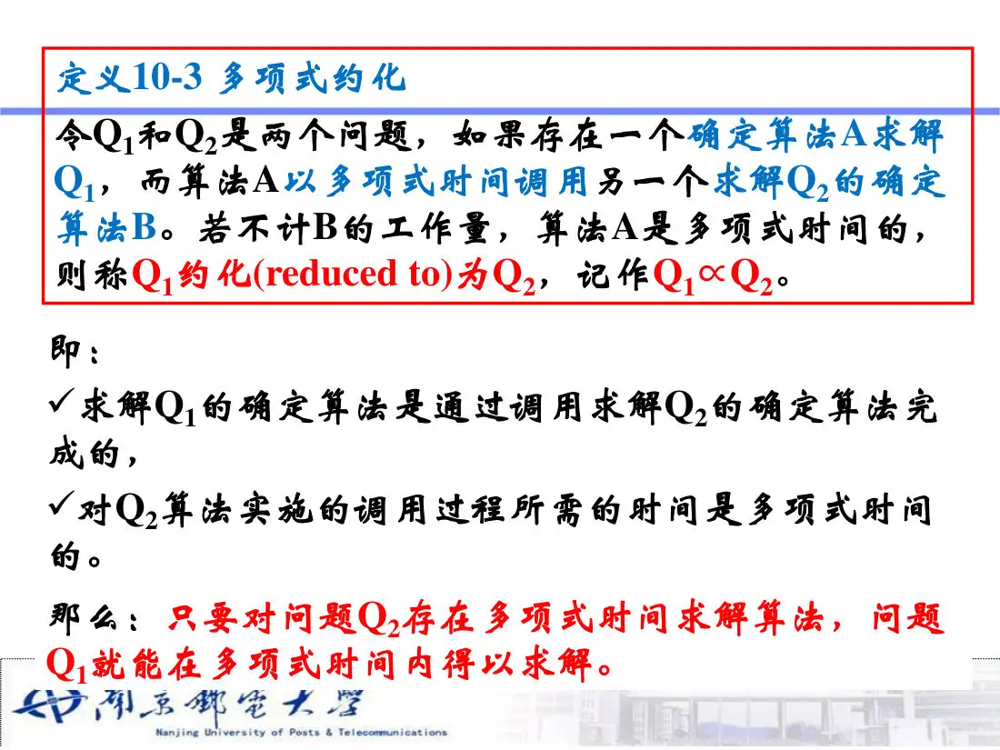

原文：

<table><tr><td>定义10-3 多项式约化</td></tr><tr><td>令 $Q_1$ 和 $Q_2$ 是两个问题,如果存在一个确定算法A求解 $Q_1$ ,而算法A以多项式时间调用另一个求解 $Q_2$ 的确定算法B。若不计B的工作量,算法A是多项式时间的,则称 $Q_1$ 约化(reduced to)为 $Q_2$ ,记作 $Q_1 \propto Q_2$ 。</td></tr></table>

即：

✓求解 $\mathbf { Q _ { 1 } }$ 的确定算法是通过调用求解 $\mathbf { Q } _ { 2 }$ 的确定算法完成的，

$\checkmark$ 对 $\mathbf { Q } _ { 2 }$ 算法实施的调用过程所需的时间是多项式时间的。

那么：只要对问题 $\mathbf { Q } _ { 2 }$ 存在多项式时间求解算法，问题$\mathbf { Q } _ { 1 }$ 就能在多项式时间内得以求解。

步方聞原鄧電大學

Nanjing University of Posts & Telecommunications

### 性质10-1

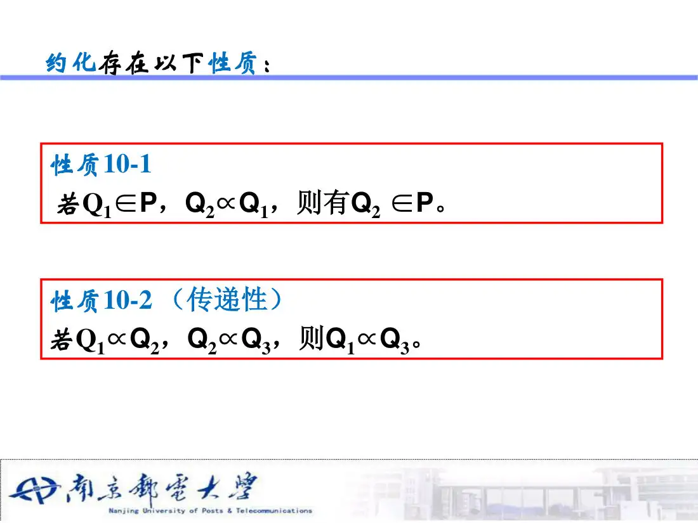

原文：

性质10-1

若 $\mathbf { Q } _ { 1 } { \in } { \mathsf { P } } , \ \mathbf { Q } _ { 2 } { \propto } \mathbf { Q } _ { 1 } ,$ ，则有 $\mathbf { Q } _ { 2 } \in \mathbf { P }$

$$
\mathbf {Q} _ {1} \propto \mathbf {Q} _ {2}, \quad \mathbf {Q} _ {2} \propto \mathbf {Q} _ {3},
$$

$$
\mathbf {Q} _ {1} \propto \mathbf {Q} _ {3} 。
$$

约化存在以下性质：

安南京郵電大学 Nanjing University of Posts & Telecommunications

### 10.1.4 NP难度和NP完全问题

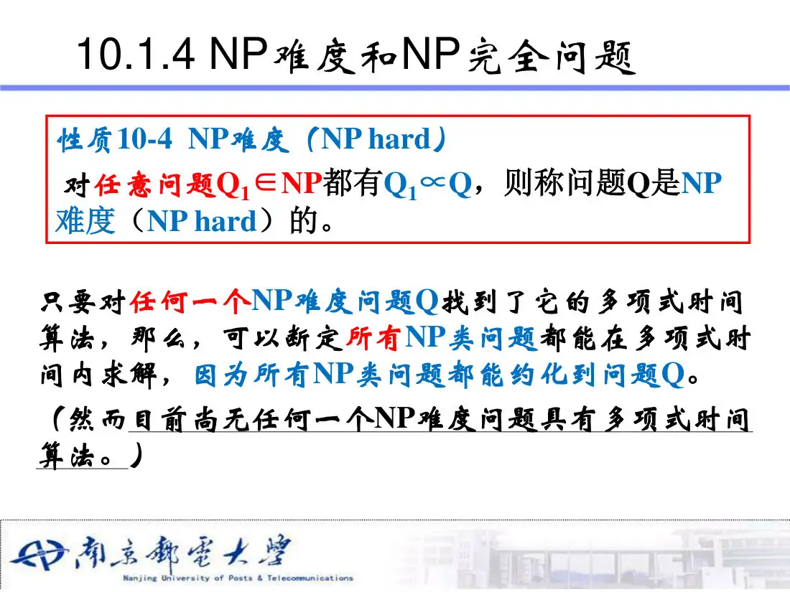

原文：

10.1.4 NP难度和NP完全问题

只要对任何一个NP难度问题Q找到了它的多项式时间算法，那么，可以断定所有NP类问题都能在多项式时间内求解，因为所有NP类问题都能约化到问题Q。

（然而目前尚无任何一个NP难度问题具有多项式时间算法。）

安南京郵電大学 Nanjing University of Posts & Telecommunications

### 第 20 页

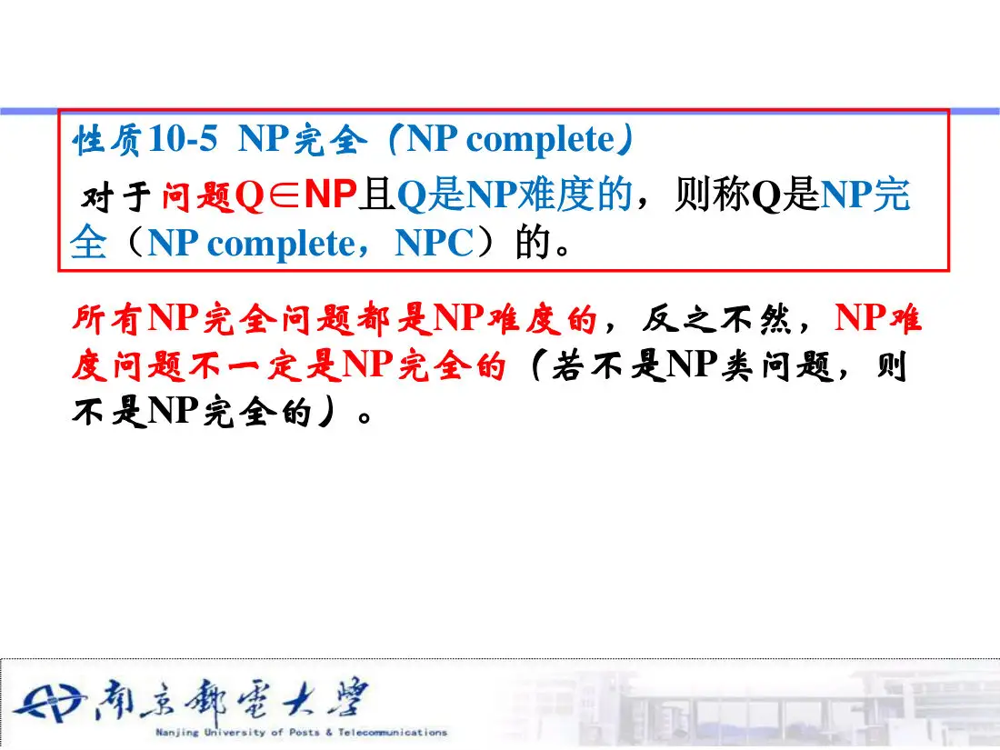

原文：

对于问题Q∈NP且Q是NP难度的，则称Q是NP完全（NP complete，NPC）的。

所有NP完全问题都是NP难度的，反之不然，NP难度问题不一定是NP完全的（若不是NP类问题，则不是NP完全的）。

分南京郵電大学Nanjing University of Posts & Telecommunications

### 现实意义：

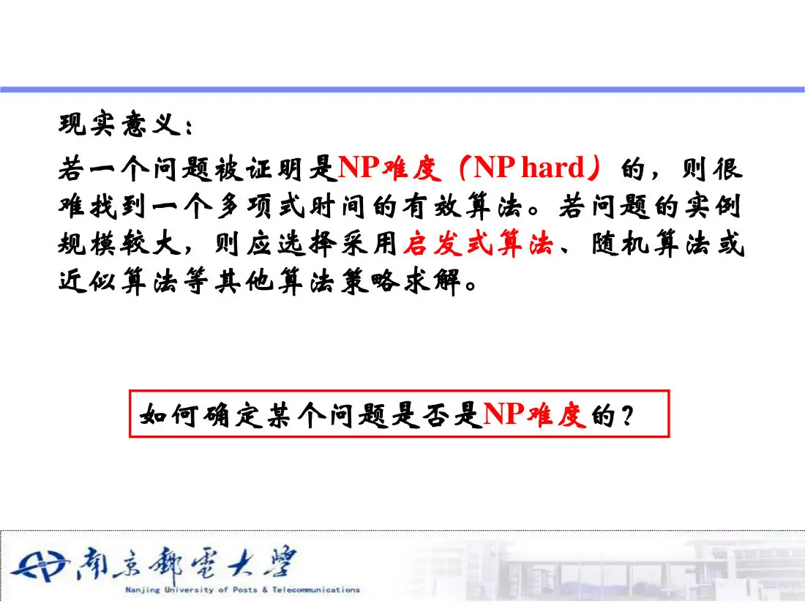

原文：

现实意义：

若一个问题被证明是NP难度（NP hard）的，则很难找到一个多项式时间的有效算法。若问题的实例规模较大，则应选择采用启发式算法、随机算法或近似算法等其他算法策略求解。

如何确定某个问题是否是NP难度的？

S南京郵電大学 Nanjing University of Posts & Telecommunications

### 证明某个问题Q是NP难度（NP hard）的证明策略：

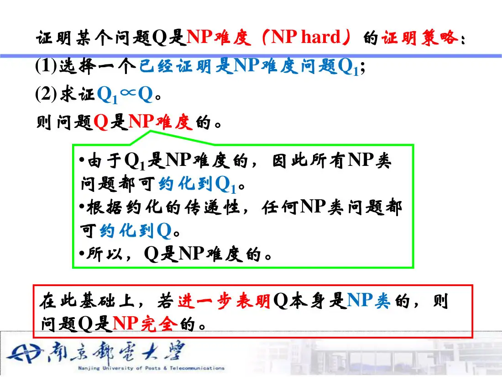

原文：

证明某个问题Q是NP难度（NP hard）的证明策略：

(1)选择一个已经证明是NP难度问题 $\mathbf { \overline { { Q _ { 1 } } } }$ ;

(2)求证 $\mathbf { Q } _ { 1 } \mathbf { \infty } \mathbf { Q }$ o

则问题Q是NP难度的。

•由于 $\mathbf { Q _ { 1 } }$ 是NP难度的，因此所有NP类问题都可约化到 $\mathbf { Q } _ { 1 }$ 。

•根据约化的传递性，任何NP类问题都可约化到 $\mathbf { Q }$ 。

•所以，Q是NP难度的。

在此基础上，若进一步表明Q本身是NP类的，则问题Q是NP完全的。

今南京郵電大学

Nanjing University of Posts & Telecommunications

### 10.2 Cook定理和证明

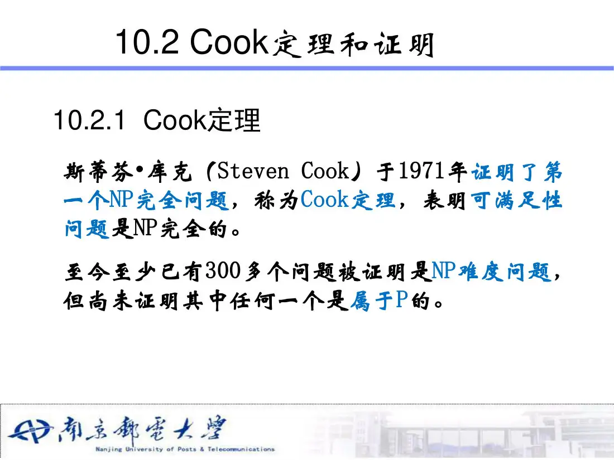

原文：

10.2 Cook定理和证明

10.2.1 Cook定理

斯蒂芬•库克（Steven Cook）于1971年证明了第一个NP完全问题，称为Cook定理，表明可满足性问题是NP完全的。

至今至少已有300多个问题被证明是NP难度问题，但尚未证明其中任何一个是属于P的。

分南京郵電大学Nanjing University of Posts & Telecommunications

### 10.3 一些典型的NP完全问题

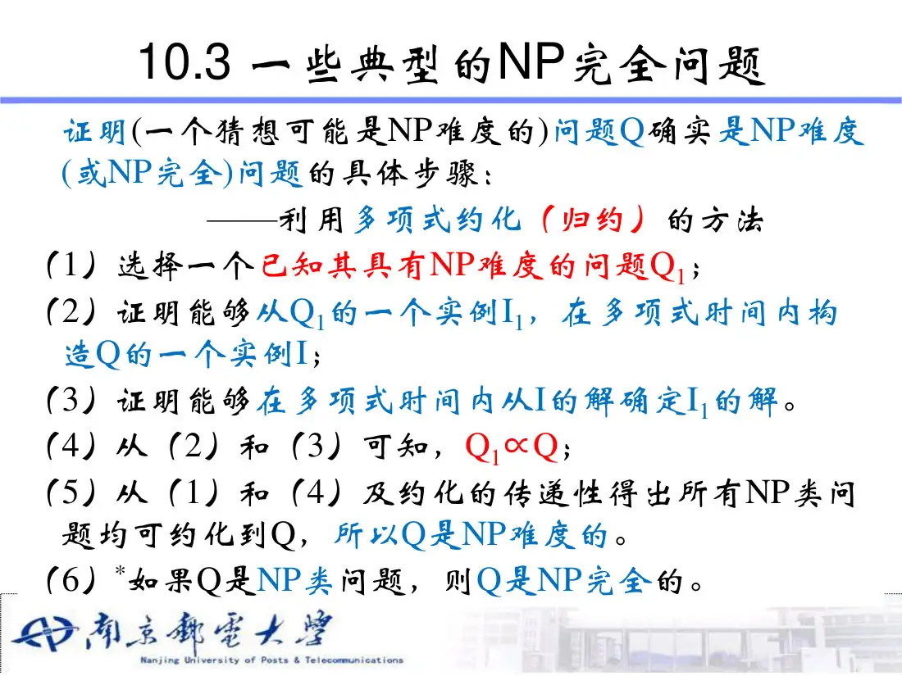

原文：

10.3 一些典型的NP完全问题

证明(一个猜想可能是NP难度的)问题Q确实是NP难度(或NP完全)问题的具体步骤：

——利用多项式约化（归约）的方法

（1）选择一个已知其具有NP难度的问题 $\mathrm { Q } _ { 1 }$ ；

（2）证明能够从 $\mathrm { . Q _ { 1 } }$ 的一个实例 $\mathrm { I } _ { 1 }$ ，在多项式时间内构造Q的一个实例I；

（3）证明能够在多项式时间内从I的解确定 $\mathrm { . }$ 的解。

（4）从（2）和（3）可知， $\mathrm { Q } _ { 1 } \propto \mathrm { Q }$

（5）从（1）和（4）及约化的传递性得出所有NP类问题均可约化到Q，所以Q是NP难度的。

（6）\*如果Q是NP类问题，则Q是NP完全的。

A南京郵電大学

Nanjing University of Posts & Telecommunications

### 最大集团判定问题是NP类问题。

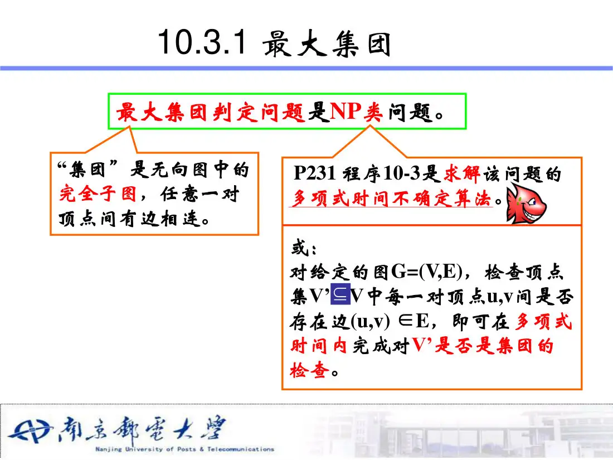

原文：

最大集团判定问题是NP类问题。

“集团”是无向图中的完全子图，任意一对顶点间有边相连。

P231 程序10-3是求解该问题的多项式时间不确定算法。

或：

对给定的图G=(V,E)，检查顶点集V’ V中每一对顶点u,v间是否存在边(u,v) ∈E，即可在多项式时间内完成对V’是否是集团的检查。

10.3.1 最大集团

安南京郵電大学 Nanjing University of Posts & Telecommunications

### 下面证明： 最大集团判定问题是NP完全的。

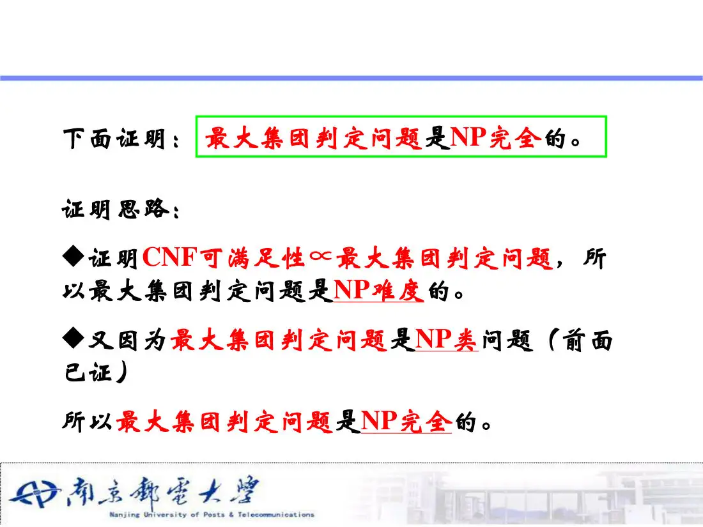

原文：

下面证明： 最大集团判定问题是NP完全的。

证明思路：

◆证明CNF可满足性∝最大集团判定问题，所以最大集团判定问题是NP难度的。

◆又因为最大集团判定问题是NP类问题（前面已证）

所以最大集团判定问题是NP完全的。

安南京郵電大学 Nanjing University of Posts & Telecommunications

### 定理10-3 CNF可满足性∝最大集团判定问题

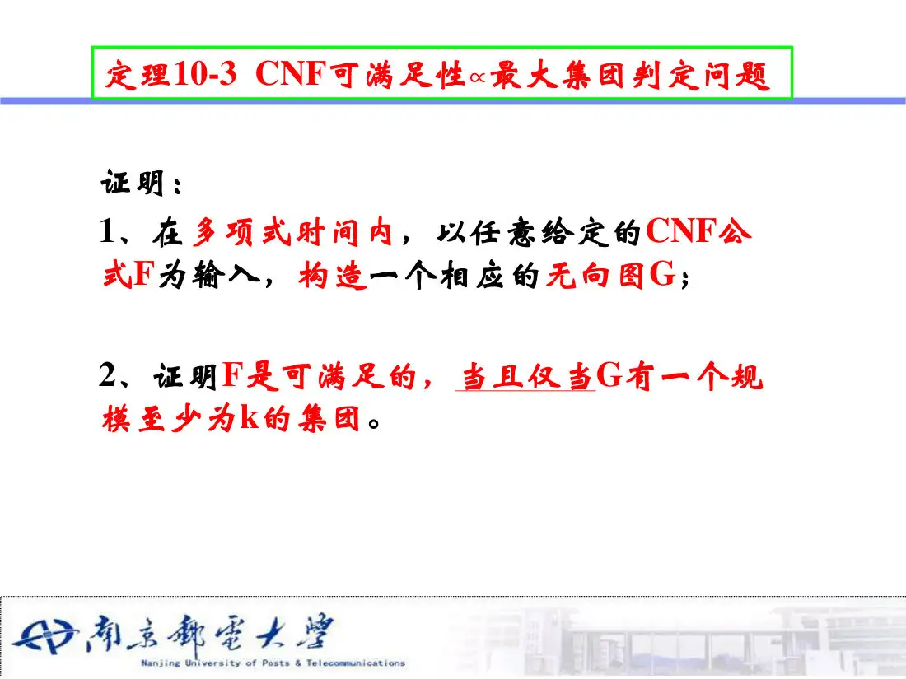

原文：

定理10-3 CNF可满足性∝最大集团判定问题

证明：

1、在多项式时间内，以任意给定的CNF公式F为输入，构造一个相应的无向图G；

2、证明F是可满足的，当且仅当G有一个规模至少为k的集团。

分南京郵電大学Nanjing University of Posts & Telecommunications

### 定理10-3 CNF可满足性∝最大集团判定问题

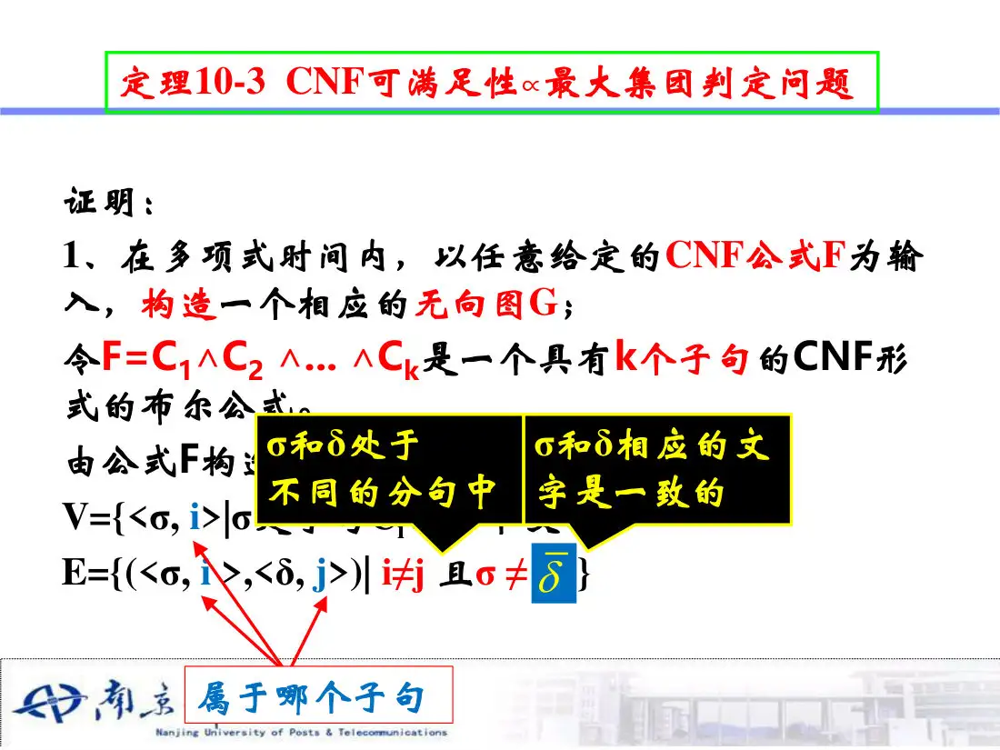

原文：

定理10-3 CNF可满足性∝最大集团判定问题

证明：

1、在多项式时间内，以任意给定的CNF公式F为输入，构造一个相应的无向图G；

令 $F { = } C _ { 1 } \wedge C _ { 2 } \wedge \ldots \wedge C _ { k }$ 是一个具有k个子句的CNF形式的布尔公式。

由公式F构造

σ和δ处于 σ和δ相应的文不同的分句中 字是一致的

$$
\mathbf {V} = \{\langle \sigma , i \rangle | \sigma
$$

$\scriptstyle \mathbf { E } = \{ ( < \sigma , \mathbf { \vec { l } } > , < \delta , \mathbf { \vec { j } } > )$ i≠j 且σ ≠ }

属于哪个子句

Nanjing University of Posts & Telecommunications

### 由F生成一个无向边集中为何没有边

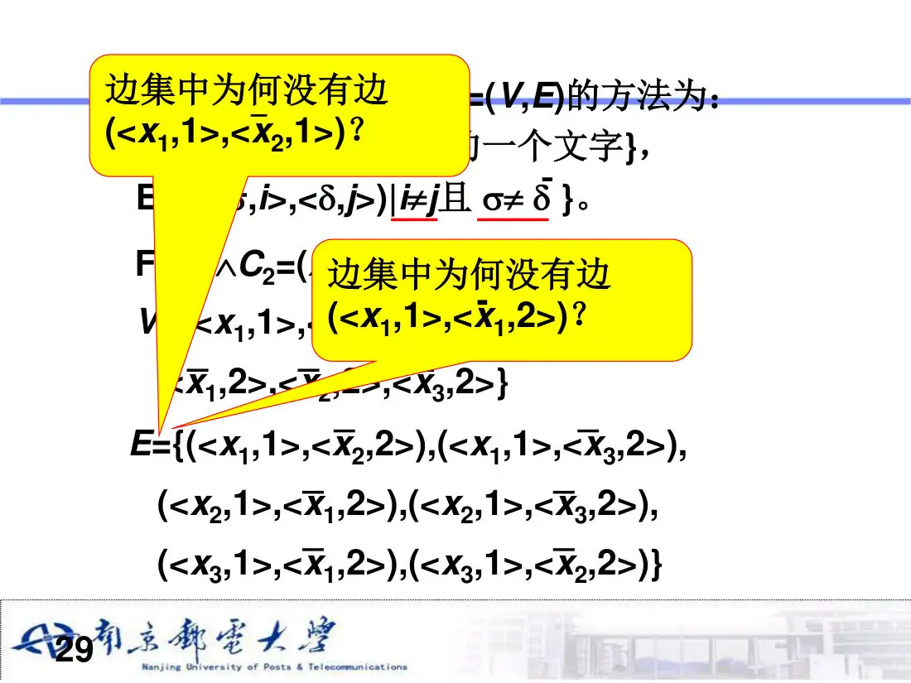

原文：

由F生成一个无向边集中为何没有边

= $\Rightarrow$ 的方法为：

$$
(<   x _ {1}, 1 >, <   \bar {x} _ {2}, 1 >)?
$$

的一个文字}，

$$
\left. \delta , i >, <   \delta , j >\right) | i \neq j \text {且} \sigma \neq \bar {\delta} \rbrace 。
$$

$\therefore C _ { 2 } = 1 1$ 边集中为何没有边

$$
<   x _ {1}, 1 >, (<   x _ {1}, 1 >, <   \bar {x} _ {1}, 2 >)?
$$

$$
\langle \overline {{x}} _ {1}, 2 \rangle , \langle \overline {{y}} _ {2}, 2 \rangle , \langle \overline {{x}} _ {3}, 2 \rangle \}
$$

$$
E = \{(<   x _ {1}, 1 >, <   \overline {{x}} _ {2}, 2 >), (<   x _ {1}, 1 >, <   \overline {{x}} _ {3}, 2 >),
$$

$$
(<   x _ {2}, 1 >, <   \overline {{x}} _ {1}, 2 >), (<   x _ {2}, 1 >, <   \overline {{x}} _ {3}, 2 >),
$$

$$
(<   x _ {3}, 1 >, <   \overline {{x}} _ {1}, 2 >), (<   x _ {3}, 1 >, <   \overline {{x}} _ {2}, 2 >) \}
$$

A主9南京郵电大学 Nanjing University of Posts & Telecommunications

### $$

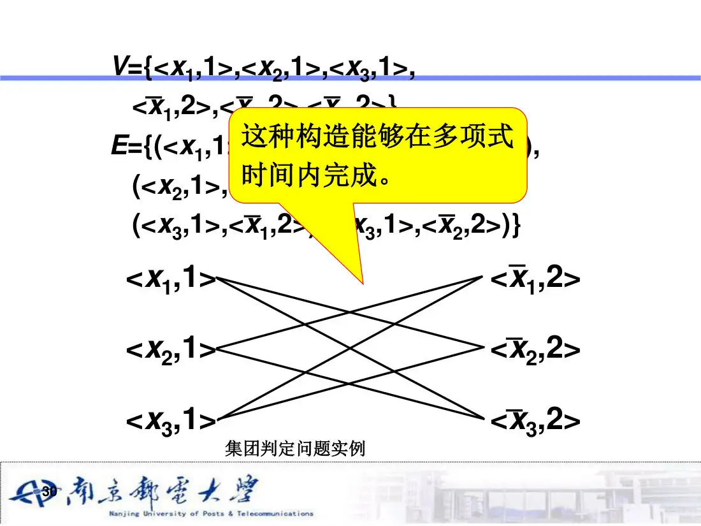

原文：

$$
V = \{<   x _ {1}, 1 >, <   x _ {2}, 1 >, <   x _ {3}, 1 >,
$$

$$
<   \overline {{x}} _ {1}, 2 >, <   \overline {{y}} _ {1} > - \overline {{y}} _ {2} > 1
$$

$E = \{ ( < x _ { 1 } , 1$ 这种构造能够在多项式$( < x _ { 2 } , 1 > ,$ 时间内完成。

A3南京郵電大學 Nanjing University of Posts & Telecommunications

### 定理10-3 CNF可满足性∝最大集团判定问题

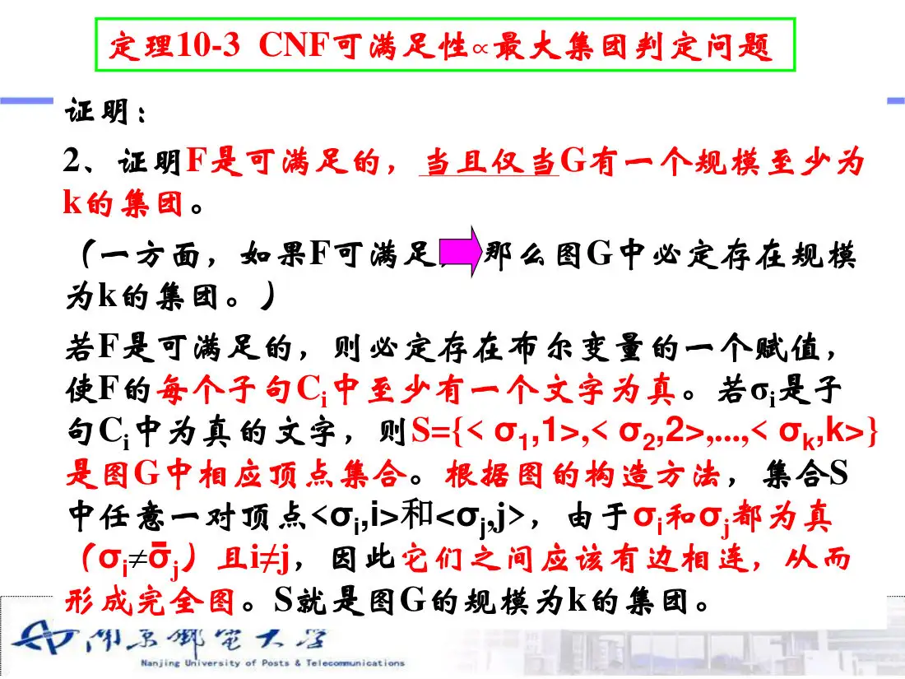

原文：

定理10-3 CNF可满足性∝最大集团判定问题

证明：

2、证明F是可满足的，当且仅当G有一个规模至少为k的集团。

（一方面，如果F可满足， 那么图G中必定存在规模为k的集团。）

若F是可满足的，则必定存在布尔变量的一个赋值，使F的每个子句 $\mathbf { C _ { i } }$ 中至少有一个文字为真。若 ${ \pmb { \sigma _ { \mathrm { i } } } }$ 是子句 $\mathbf { C _ { i } }$ 中为真的文字，则 $\mathrm { S } { = } \{ < \sigma _ { 1 } , 1 > , < \sigma _ { 2 } , 2 > , { \ldots } , < \sigma _ { \mathrm { k } } , \mathrm { k } { > } \}$ 是图G中相应顶点集合。根据图的构造方法，集合S中任意一对顶点 $< \sigma _ { \mathrm { i } } \mathrm { , i } >$ 和 ${ \bf \epsilon } { \bf < } { \bf \sigma } _ { \mathrm { { j } } } { \bf { j } } >$ ，由于 $\sigma _ { \mathrm { i } }$ 和 $\sigma _ { \mathrm { j } }$ 都为真$( \sigma _ { \mathrm { i } } { \neq } \sigma _ { \mathrm { j } } )$ 且i≠j，因此它们之间应该有边相连，从而形成完全图。S就是图G的规模为k的集团。

Nanjing University of Posts & Telecommunications

### 定理10-3 CNF可满足性∝最大集团判定问题

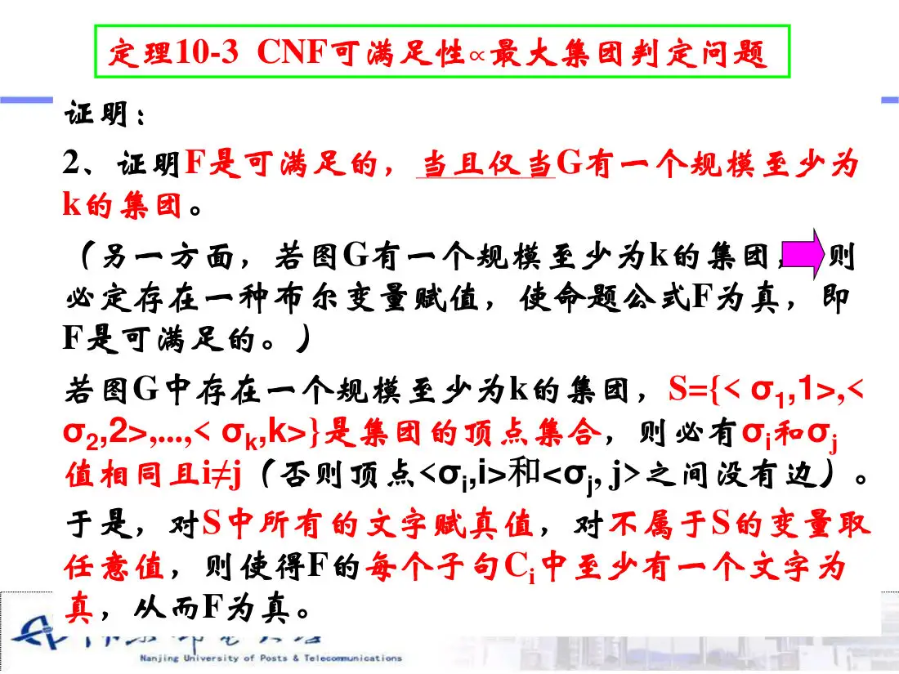

原文：

定理10-3 CNF可满足性∝最大集团判定问题

证明：

2、证明F是可满足的，当且仅当G有一个规模至少为k的集团。

（另一方面，若图G有一个规模至少为k的集团， 则必定存在一种布尔变量赋值，使命题公式F为真，即F是可满足的。）

若图G中存在一个规模至少为k的集团， $\mathrm { S } { = } \{ { < \sigma _ { 1 } , 1 > , < }$ $\sigma _ { 2 } , 2 { > } , \ldots , < \sigma _ { \mathrm { k } } , \mathrm { k } { > } \}$ 是集团的顶点集合，则必有 $\sigma _ { \mathrm { i } }$ 和 $\sigma _ { \mathrm { j } }$ 值相同且i≠j（否则顶点 $\mathrm { \bf { \langle { \bf { \mathcal { \Lambda } } } \otimes _ { i } , \bar { \bf { \Lambda } } \mathrm { \bf { \bar { \Lambda } } } \mathrm { \bf { \Sigma } } } } < { \bf { \sigma } } _ { \bf { \Phi } } \mathrm  \bf { \langle { \bf { \mathcal { \Lambda } } } \otimes _ { i } , \bar { \bf { \Lambda } } \mathrm { \bf { \bar { \Lambda } } } \mathrm { \bf { \Sigma } } \mathrm { \bf { \Sigma } } \mathrm { \bf { \Sigma } } }$ 和 $< 0 _ { j } , j > 3$ 间没有边）。于是，对S中所有的文字赋真值，对不属于S的变量取任意值，则使得F的每个子句 $\mathbf { C _ { i } }$ 中至少有一个文字为真，从而F为真。

Nanjing University of Posts & Telecommunications

### 第 33 页

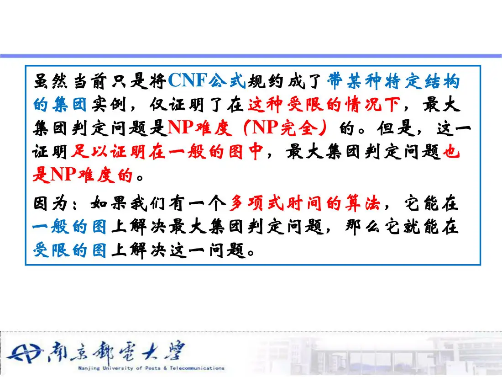

原文：

虽然当前只是将CNF公式规约成了带某种特定结构的集团实例，仅证明了在这种受限的情况下，最大集团判定问题是NP难度（NP完全）的。但是，这一证明足以证明在一般的图中，最大集团判定问题也是NP难度的。

因为：如果我们有一个多项式时间的算法，它能在一般的图上解决最大集团判定问题，那么它就能在受限的图上解决这一问题。

安南京郵電大学 Nanjing University of Posts & Telecommunications

### P226 10-6 10-7

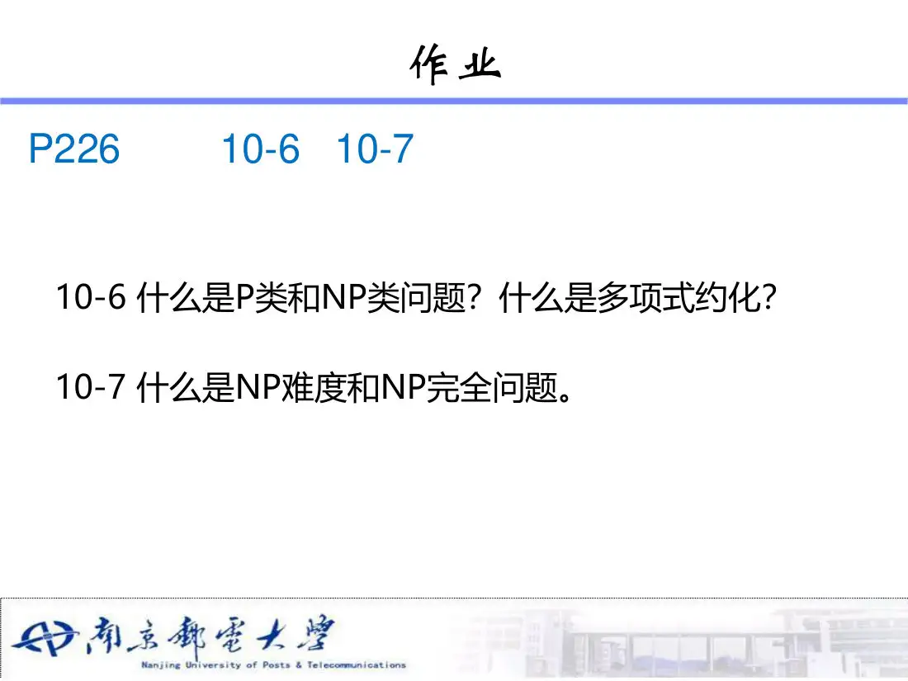

原文：

P226 10-6 10-7

10-6 什么是P类和NP类问题？什么是多项式约化？

10-7 什么是NP难度和NP完全问题。

作业

安南京郵電大学 Nanjing University of Posts & Telecommunications

### 附：程序10-3 最大集团判定问题的不确定算法

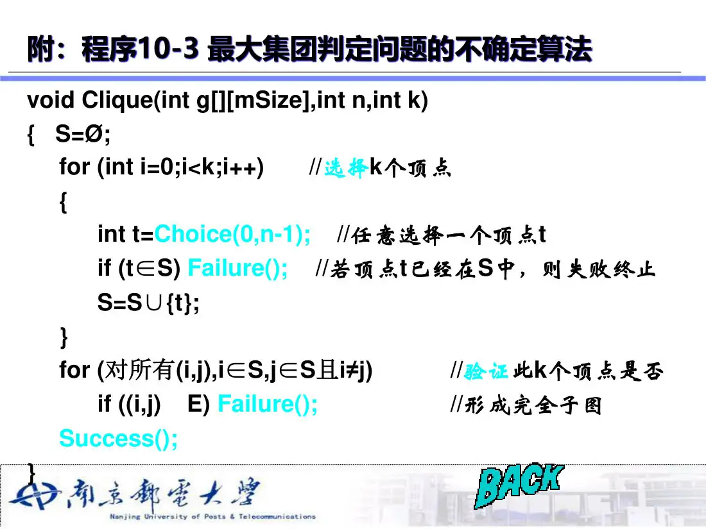

原文：

附：程序10-3 最大集团判定问题的不确定算法
