# 《算法分析与设计》第13章 密码算法（课件）

原件的每一页，下面附识别出的文字。

### 算法设计与分析

原文：

Nanjing University of Posts & Telecommunications

算法设计与分析

### 第13章 密码算法

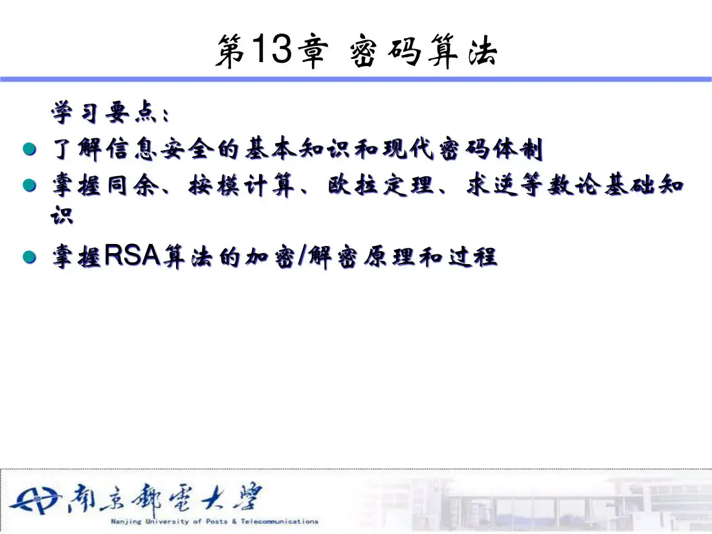

原文：

第13章 密码算法

学习要点：

⚫ 了解信息安全的基本知识和现代密码体制

⚫ 掌握同余、按模计算、欧拉定理、求逆等数论基础知 识

⚫ 掌握RSA算法的加密/解密原理和过程

安南京郵電大学 Nanjing University of Posts & Telecommunications

### 第13章 密码算法

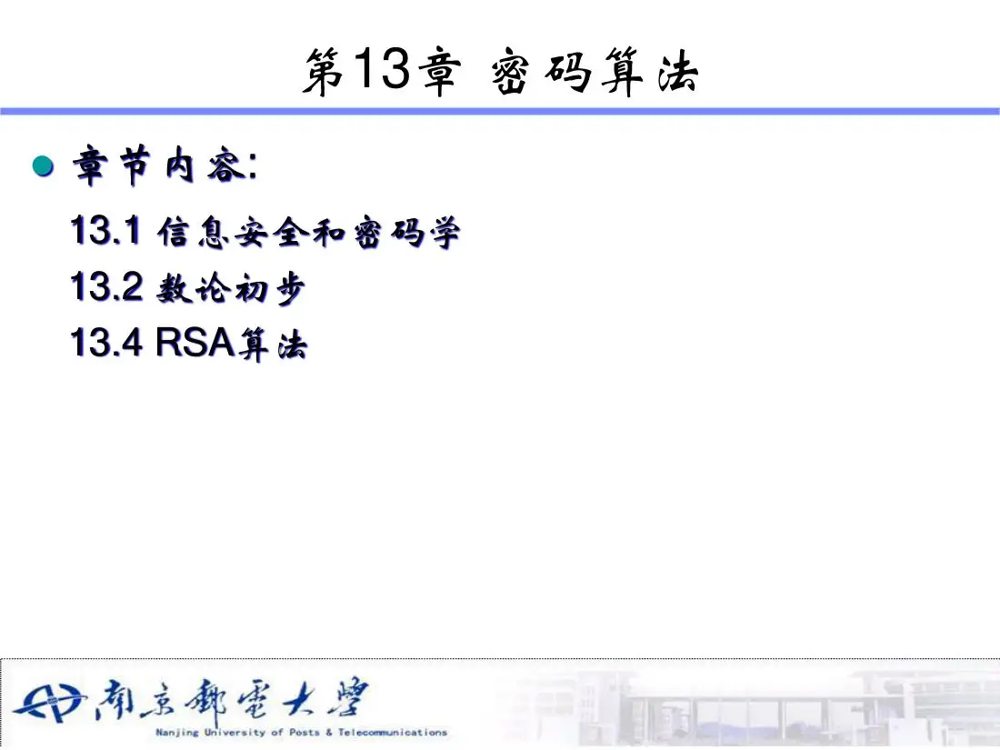

原文：

第13章 密码算法

⚫ 章节内容:

13.1 信息安全和密码学

13.2 数论初步

13.4 RSA算法

安南京郵電大学 Nanjing University of Posts & Telecommunications

### 13.1 信息安全和密码学

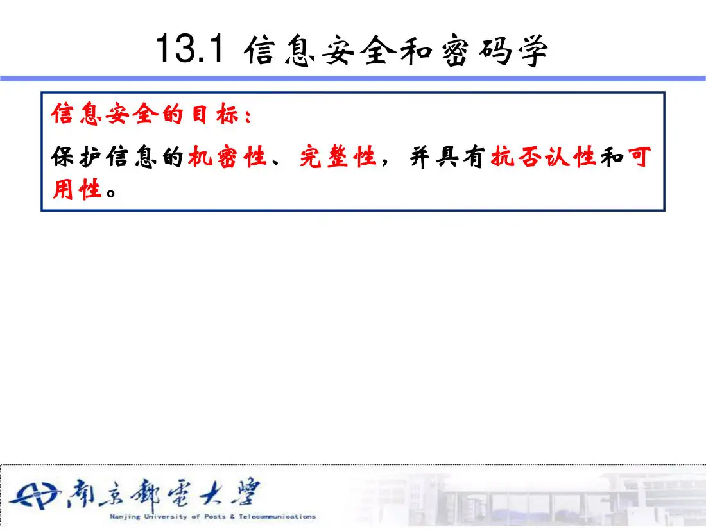

原文：

13.1 信息安全和密码学

信息安全的目标：

保护信息的机密性、完整性，并具有抗否认性和可用性。

安南京郵電大学 Nanjing University of Posts & Telecommunications

### 信息安全的目标：

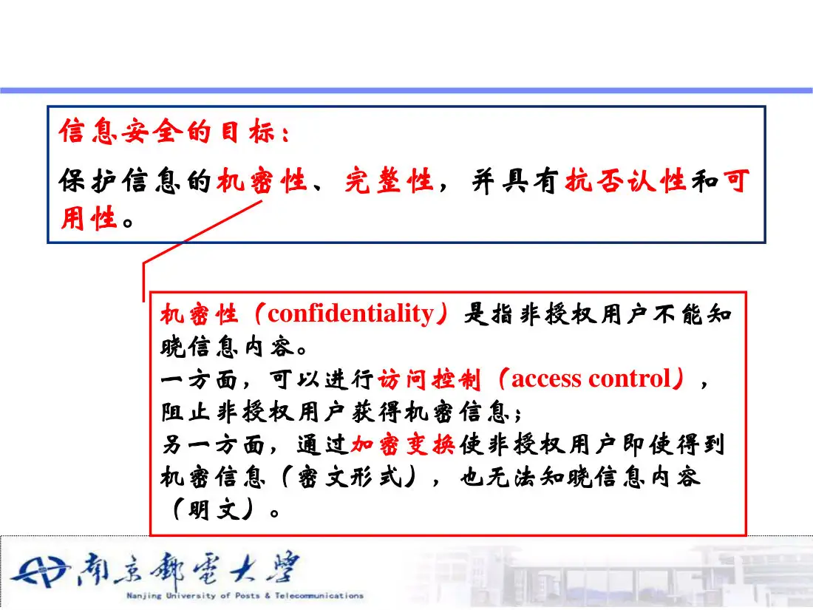

原文：

信息安全的目标：

保护信息的机密性、完整性，并具有抗否认性和可用性。

机密性（confidentiality）是指非授权用户不能知晓信息内容。

一方面，可以进行访问控制（access control），阻止非授权用户获得机密信息；

另一方面，通过加密变换使非授权用户即使得到机密信息（密文形式），也无法知晓信息内容（明文）。

安南京郵電大学

Nanjing University of Posts & Telecommunications

### 信息安全的目标：

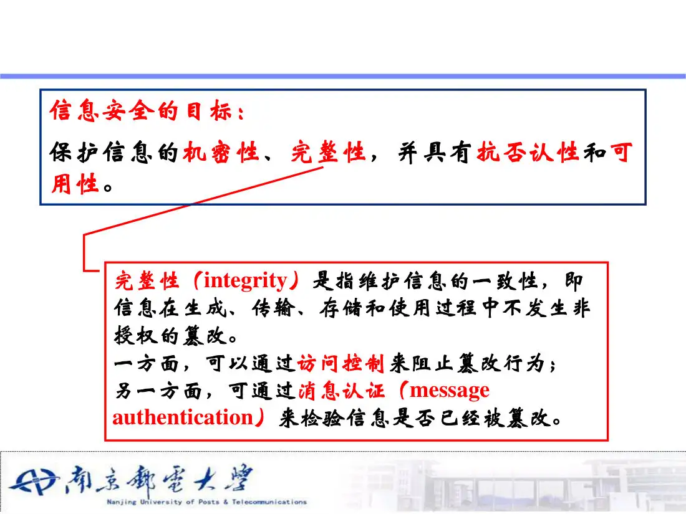

原文：

信息安全的目标：

保护信息的机密性、完整性，并具有抗否认性和可用性。

完整性（integrity）是指维护信息的一致性，即信息在生成、传输、存储和使用过程中不发生非授权的篡改。

一方面，可以通过访问控制来阻止篡改行为；另一方面，可通过消息认证（messageauthentication）来检验信息是否已经被篡改。

安南京郵電大学 Nanjing University of Posts & Telecommunications

### 信息安全的目标：

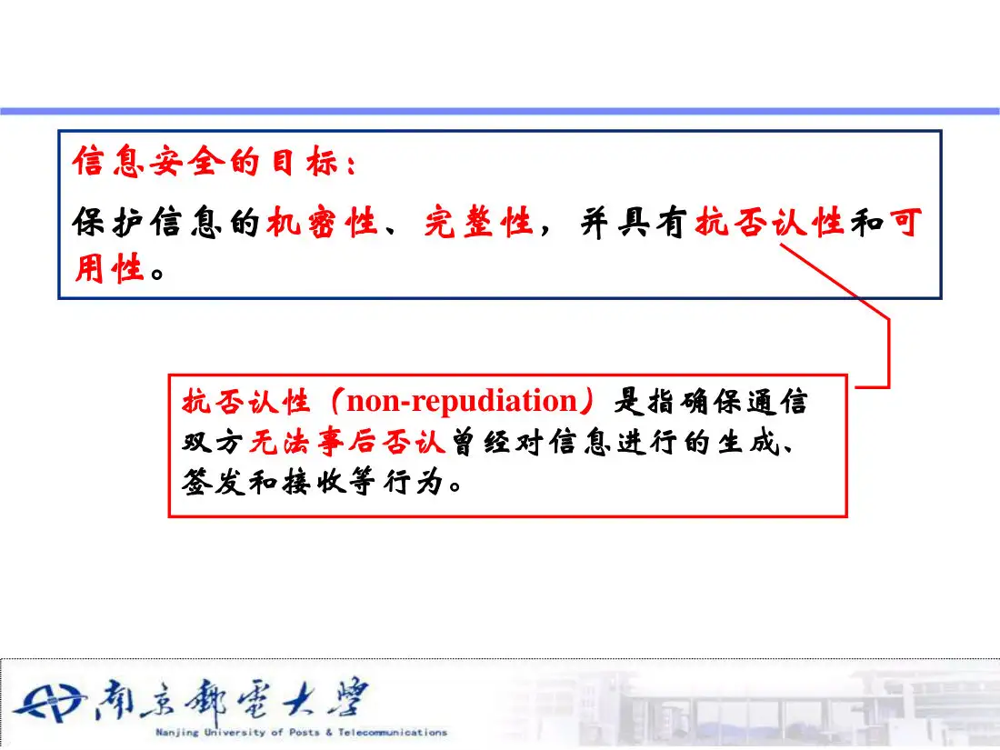

原文：

信息安全的目标：

保护信息的机密性、完整性，并具有抗否认性和可用性。

抗否认性（non-repudiation）是指确保通信双方无法事后否认曾经对信息进行的生成、签发和接收等行为。

安南京郵電大学 Nanjing University of Posts & Telecommunications

### 信息安全的目标：

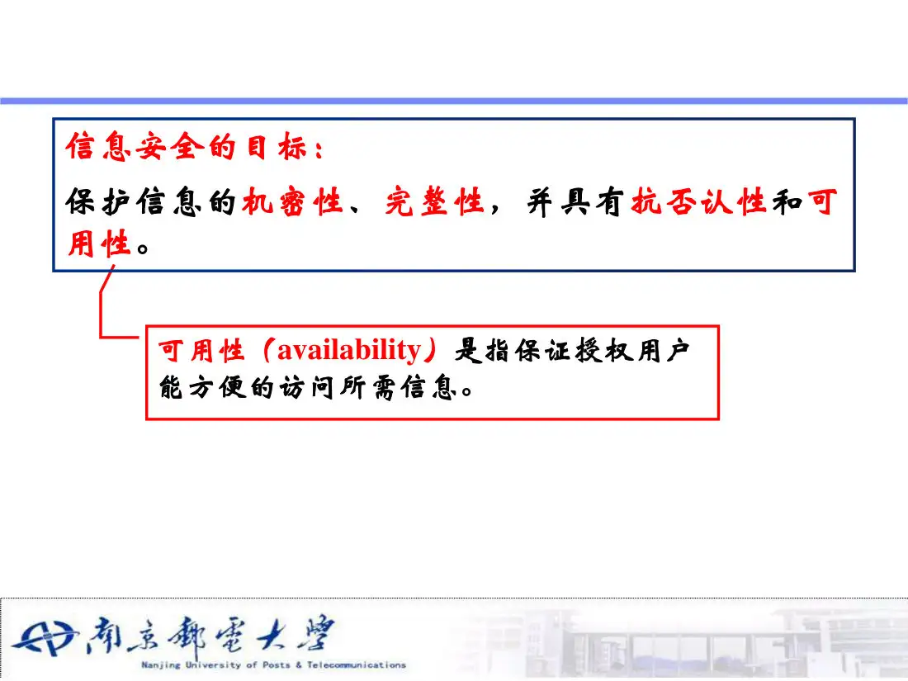

原文：

信息安全的目标：

保护信息的机密性、完整性，并具有抗否认性和可用性。

可用性（availability）是指保证授权用户能方便的访问所需信息。

S南京郵電大学 Nanjing University of Posts & Telecommunications

### 信息安全的目标：

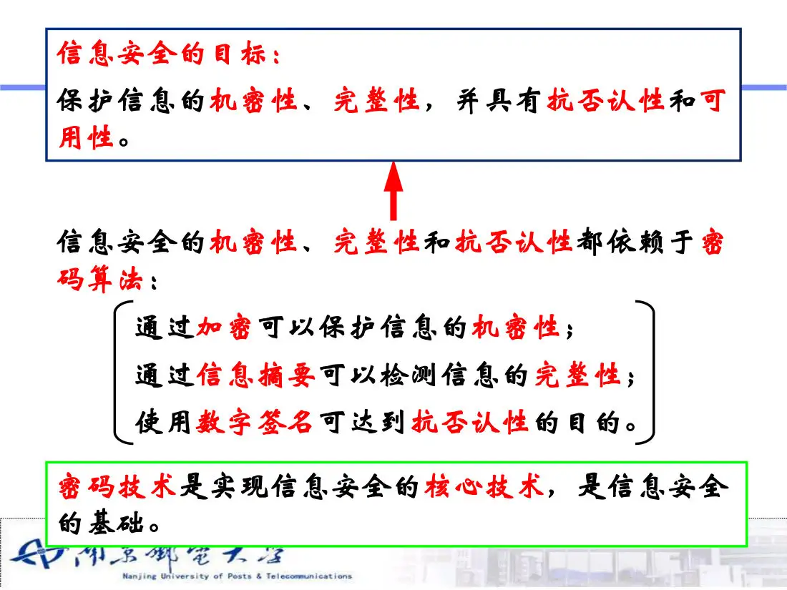

原文：

信息安全的目标：

保护信息的机密性、完整性，并具有抗否认性和可用性。

信息安全的机密性、完整性和抗否认性都依赖于密码算法：

通过加密可以保护信息的机密性；

通过信息摘要可以检测信息的完整性；

使用数字签名可达到抗否认性的目的。

密码技术是实现信息安全的核心技术，是信息安全的基础。

Nanjing University of Posts & Telecommunications

### 拆字法(青鹅除，立第四

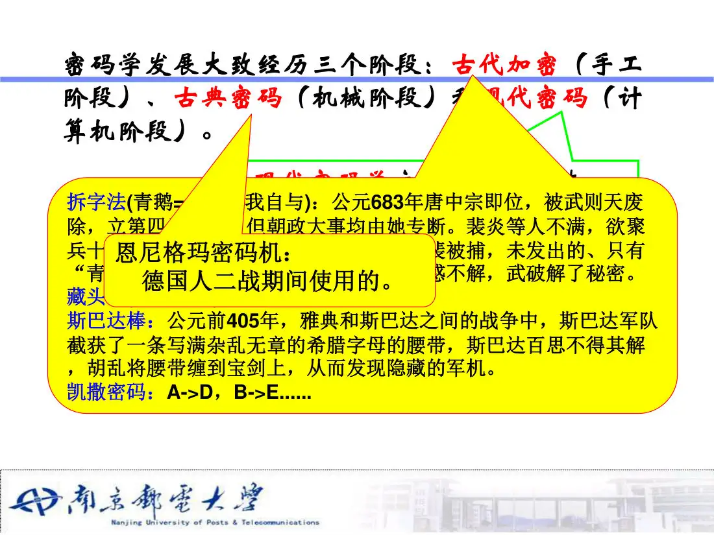

原文：

密码学发展大致经历三个阶段：古代加密（手工阶段）、古典密码（机械阶段） 现代密码（计算机阶段）。

拆字法(青鹅除，立第四

我自与)：公元683年唐中宗即位，被武则天废但朝政大事均由她专断。裴炎等人不满，欲聚

密万造反，裴做内应。恩尼格玛密码机：二字的文件落入武之手，群德国人二战期间使用的。

ryptanalysis)。裴被捕，未发出的、只有惑不解，武破解了秘密。

前者致力于建立难以攻破的安斯巴达棒：公元前405年，雅典和斯巴达之间的战争中，斯巴达军队全密码体制；截获了一条写满杂乱无章的希腊字母的腰带，斯巴达百思不得其解，胡乱将腰带缠到宝剑上，从而发现隐藏的军机。凯撒密码：A->D，B->E......

安南京郵電大学 Nanjing University of Posts & Telecommunications

### m: 明文(plaintext)

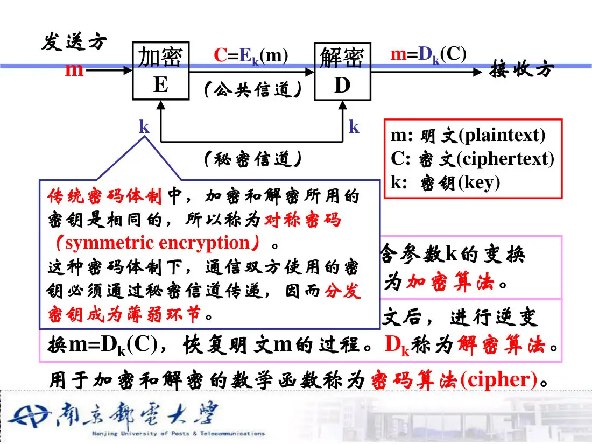

原文：

图13-1 传统保密通信机制传统密码体制中，加密和解密所用的密钥是相同的，所以称为对称密码（symmetric encryption）。

这种密码体制下，通信双方使用的密k k钥必须通过秘密信道传递，因而分发解密(Decryption)密钥成为薄弱环节。

m: 明文(plaintext)

C: 密文(ciphertext)

k: 密钥(key)

含参数k的变换为加密算法。

文后，进行逆变

换m=Dk(C)，恢复明文m的过程。Dk称为解密算法。

用于加密和解密的数学函数称为密码算法(cipher)。

安南京郵電大学

Nanjing University of Posts & Telecommunications

### 13.1.3 密码体制

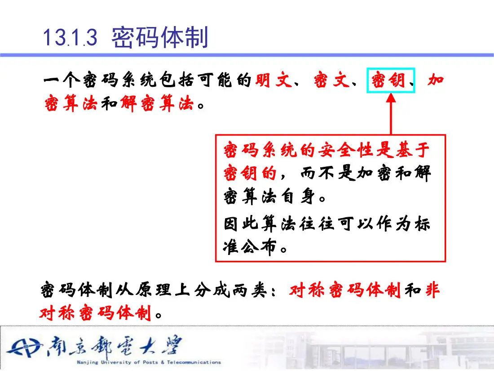

原文：

13.1.3 密码体制

一个密码系统包括可能的明文、密文、密钥、加密算法和解密算法。 1

密码系统的安全性是基于密钥的，而不是加密和解密算法自身。

因此算法往往可以作为标准公布。

密码体制从原理上分成两类：对称密码体制和非对称密码体制。

安南京郵電大学 Nanjing University of Posts & Telecommunications

### 对称密码体制（symmetric encryption）

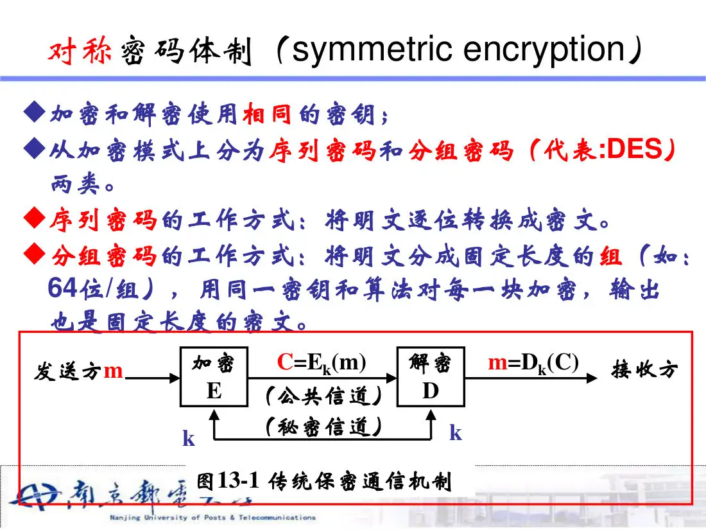

原文：

对称密码体制（symmetric encryption）

◆加密和解密使用相同的密钥；

◆从加密模式上分为序列密码和分组密码（代表:DES）两类。

◆序列密码的工作方式：将明文逐位转换成密文。

分组密码的工作方式：将明文分成固定长度的组（如：64位/组），用同一密钥和算法对每一块加密，输出也是固定长度的密文。

Nanjing University of Posts & Telecommunications

### 对称密码体制（symmetric encryption）

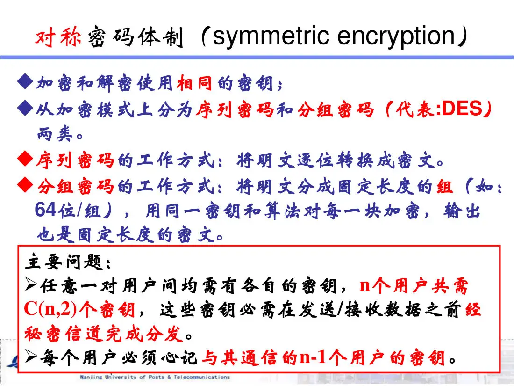

原文：

对称密码体制（symmetric encryption）

◆加密和解密使用相同的密钥；

◆从加密模式上分为序列密码和分组密码（代表:DES）两类。

◆序列密码的工作方式：将明文逐位转换成密文。

◆分组密码的工作方式：将明文分成固定长度的组（如：64位/组），用同一密钥和算法对每一块加密，输出也是固定长度的密文。

主要问题：

➢任意一对用户间均需有各自的密钥，n个用户共需C(n,2)个密钥，这些密钥必需在发送/接收数据之前经秘密信道完成分发。

➢每个用户必须心记与其通信的n-1个用户的密钥。

Nanjing University of Posts & Telecommunications

### 对称密码体制（symmetric encryption）

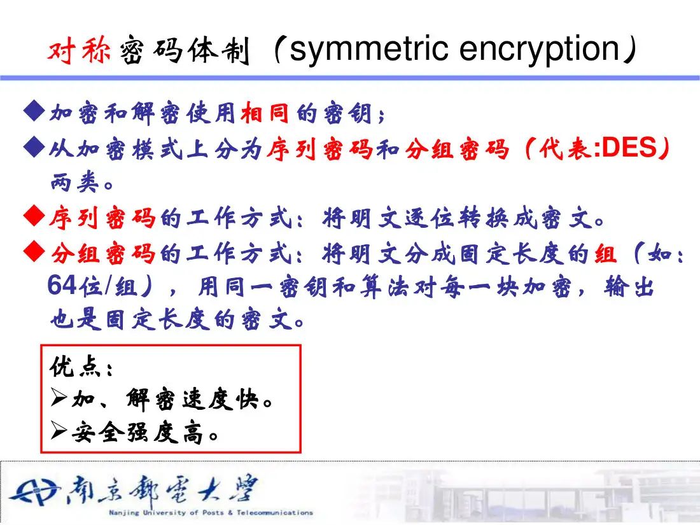

原文：

对称密码体制（symmetric encryption）

◆加密和解密使用相同的密钥；

◆从加密模式上分为序列密码和分组密码（代表:DES）两类。

◆序列密码的工作方式：将明文逐位转换成密文。

◆分组密码的工作方式：将明文分成固定长度的组（如：64位/组），用同一密钥和算法对每一块加密，输出也是固定长度的密文。

优点：

➢加、解密速度快。

➢安全强度高。

安南京郵電大学 Nanjing University of Posts & Telecommunications

### Diffie–Hellman密钥交换协议

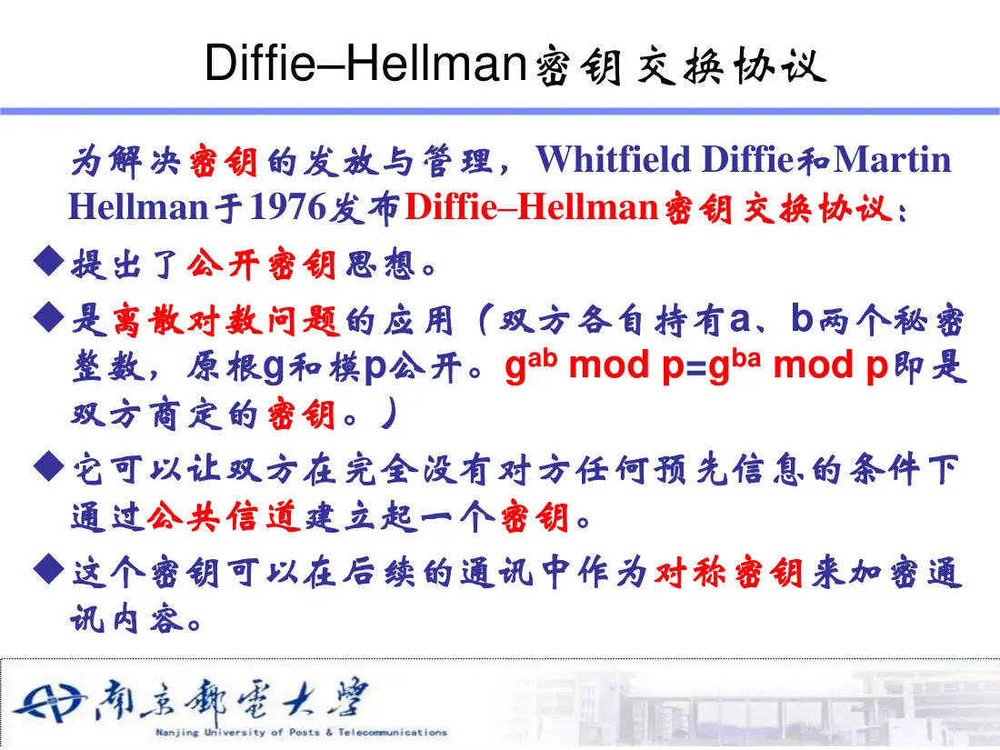

原文：

Diffie–Hellman密钥交换协议

为解决密钥的发放与管理，Whitfield Diffie和MartinHellman于1976发布Diffie–Hellman密钥交换协议：

◆提出了公开密钥思想。

◆是离散对数问题的应用（双方各自持有a、b两个秘密整数，原根g和模p公开。 ${ \mathfrak { g } } ^ { \mathrm { a b } } { \mathrm { ~ m o d ~ } } { \mathrm { p = g } } ^ { \mathrm { b a } } { \mathrm { ~ m o d ~ } } { \mathrm { p } }$ 即是双方商定的密钥。）

◆它可以让双方在完全没有对方任何预先信息的条件下通过公共信道建立起一个密钥。

◆这个密钥可以在后续的通讯中作为对称密钥来加密通讯内容。

安南京郵電大学 Nanjing University of Posts & Telecommunications

### 第 17 页

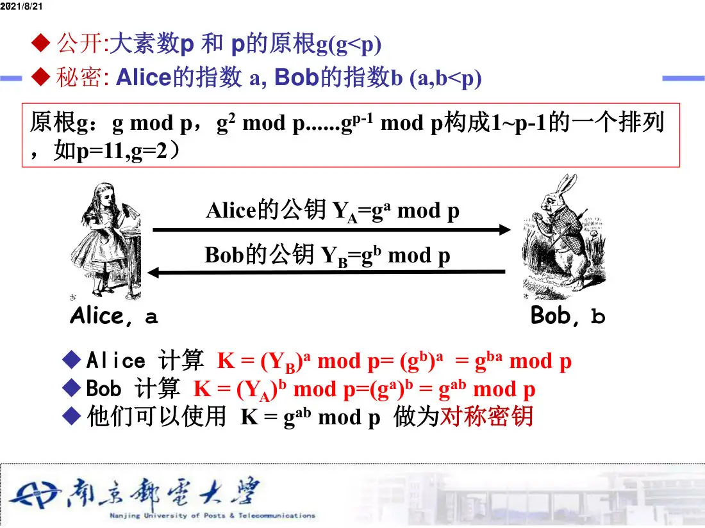

原文：

◆公开:大素数p 和 p的原根 $\bf \underline { { g } } ( \bf { g } { < } \bf { p } )$

◆秘密: Alice的指数 a, Bob的指数b $\mathbf { \left( a , b { < } p \right) }$

原根g：g mod p， $\mathbf { g } ^ { 2 } \mathbf { \ m o d \ p { \ldots } } \mathbf { g } ^ { \mathbf { p } - 1 } \mathbf { \ m o d \ p }$ 构成1\~p-1的一个排列，如 $\scriptstyle \mathbf { p } = \mathbf { 1 1 } , \mathbf { g } = 2 )$

Alice的公钥 $\mathbf { Y _ { A } = g ^ { a } }$ mod p

Bob的公钥 $\bf Y _ { B } { = } \bf g ^ { b }$ mod p

◆ Alice 计算 $\mathbf { K } = ( \mathbf { Y _ { B } } ) ^ { \mathbf { a } }$ mod $\mathbf { p } \mathbf { = } ( \mathbf { g } ^ { \mathbf { b } } ) ^ { \mathbf { a } } \mathbf { \Sigma } = \mathbf { g } ^ { \mathbf { b a } }$ mod p

◆ Bob 计算 $\mathbf { K } = ( \mathbf { Y _ { A } } ) ^ { \mathbf { b } }$ mod $\mathbf { p } { = } ( \mathbf { g } ^ { \mathbf { a } } ) ^ { \mathbf { b } } = \mathbf { g } ^ { \mathbf { a b } }$ mod p

◆他们可以使用 $\mathbf { K } = \mathbf { g ^ { a b } ~ m o d ~ p }$ 做为对称密钥

安南京郵電大学 Nanjing University of Posts & Telecommunications

### Diffie–Hellman举例

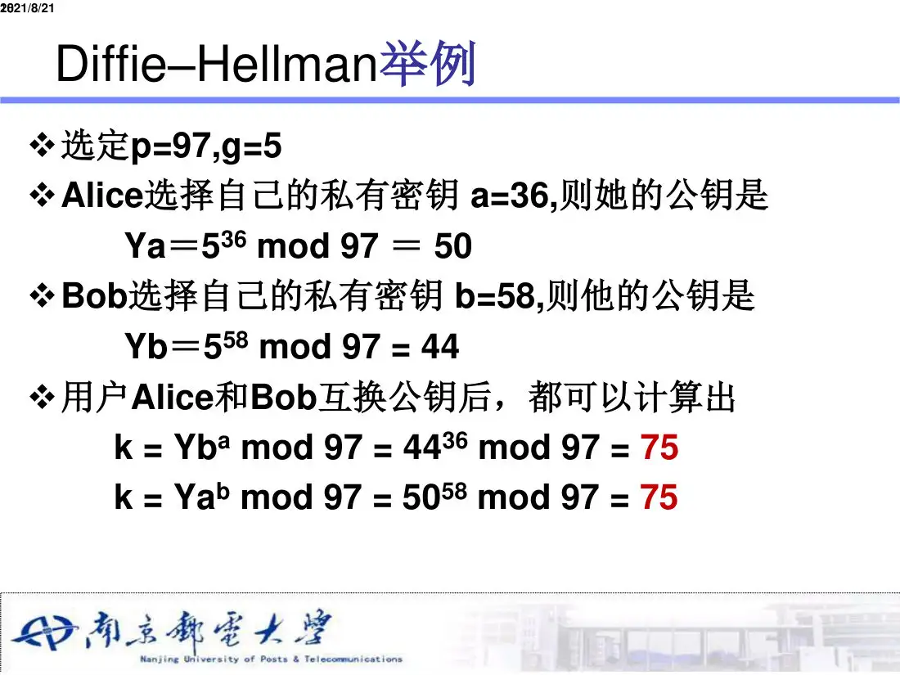

原文：

Diffie–Hellman举例

❖选定 $\scriptstyle 0 = 9 7 , 9 = 5$

❖Alice选择自己的私有密钥 $\mathtt { a } \mathtt { = } 3 6$ ,则她的公钥是Ya＝536 mod 97 ＝ 50

❖Bob选择自己的私有密钥 b=58,则他的公钥是

$$
\mathrm{Yb} = 5 ^ {5 8} \bmod 9 7 = 4 4
$$

❖用户Alice和Bob互换公钥后，都可以计算出

$$
\mathbf {k} = \mathrm{Yb} ^ {\mathrm{a}} \bmod 9 7 = 4 4 ^ {3 6} \bmod 9 7 = 7 5
$$

$$
\mathbf {k} = \mathrm{Ya} ^ {\mathrm{b}} \bmod 9 7 = 5 0 ^ {5 8} \bmod 9 7 = 7 5
$$

2021/8/2118

安南京郵電大学 Nanjing University of Posts & Telecommunications

### 非对称密码体制（asymmetric encryption）

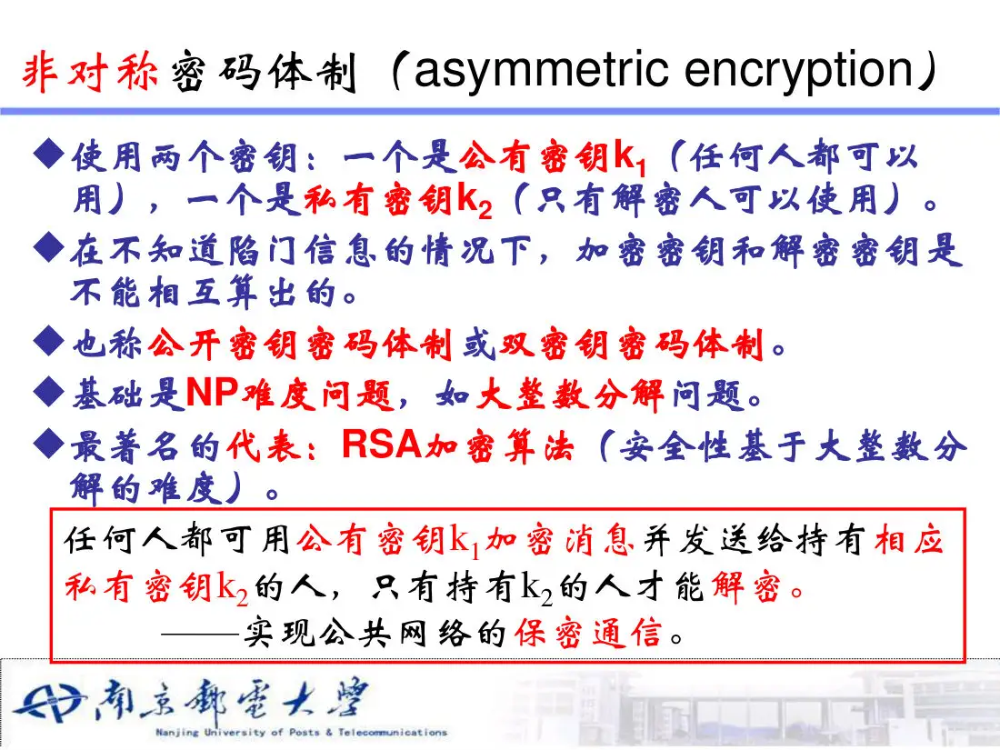

原文：

非对称密码体制（asymmetric encryption）

◆使用两个密钥：一个是公有密钥k （任何人都可以用），一个是私有密钥 $\mathbf { k } _ { 2 }$ （只有解密人可以使用）。

◆在不知道陷门信息的情况下，加密密钥和解密密钥是不能相互算出的。

◆也称公开密钥密码体制或双密钥密码体制。

◆基础是NP难度问题，如大整数分解问题。

◆最著名的代表：RSA加密算法（安全性基于大整数分解的难度）。

任何人都可用公有密钥k 加密消息并发送给持有相应私有密钥k 的人，只有持有 $\mathrm { k } _ { 2 }$ 的人才能解密。

实现公共网络的保密通信。

安南京郵電大学 Nanjing University of Posts & Telecommunications

### 非对称密码体制（asymmetric encryption）

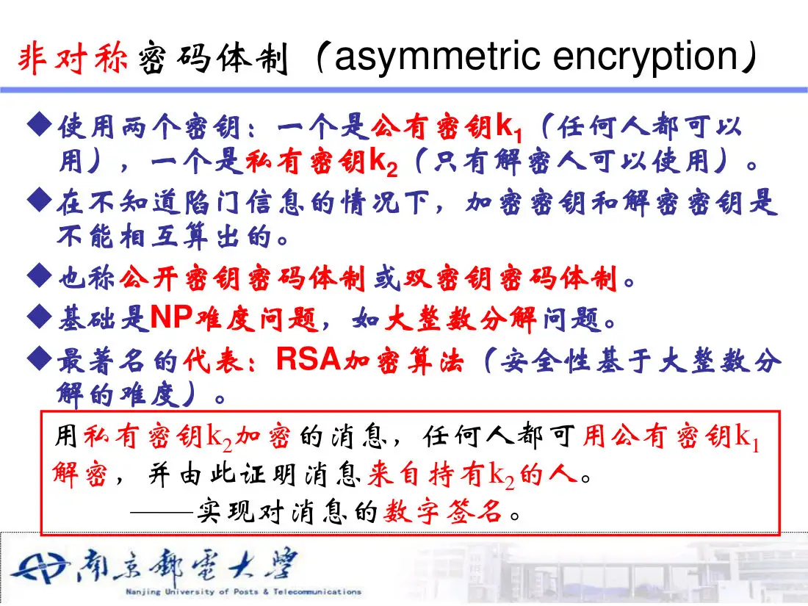

原文：

非对称密码体制（asymmetric encryption）

◆使用两个密钥：一个是公有密钥k （任何人都可以用），一个是私有密钥 $\mathbf { k } _ { 2 }$ （只有解密人可以使用）。

◆在不知道陷门信息的情况下，加密密钥和解密密钥是不能相互算出的。

◆也称公开密钥密码体制或双密钥密码体制。

◆基础是NP难度问题，如大整数分解问题。

◆最著名的代表：RSA加密算法（安全性基于大整数分解的难度）。

用私有密钥k 加密的消息，任何人都可用公有密钥k解密，并由此证明消息来自持有 $\mathrm { k } _ { 2 }$ 的人。

实现对消息的数字签名。

安南京郵電大学 Nanjing University of Posts & Telecommunications

### 13.2 数论初步

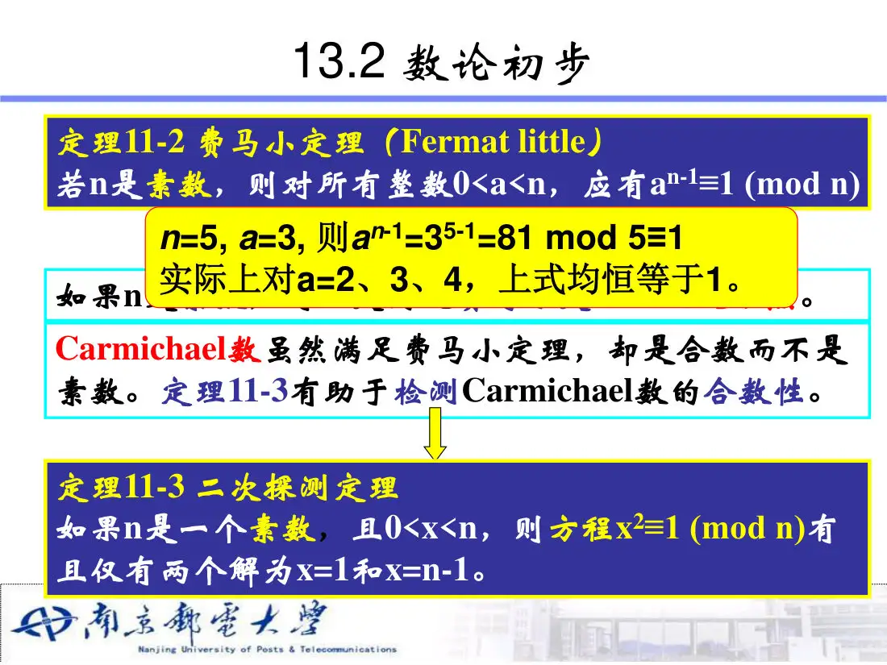

原文：

13.2 数论初步

定理11-2 费马小定理（Fermat little）若n是素数，则对所有整数 $0 . 0 9 2 \dot { 0 }$ ，应有 $9 0 - 2 = 1 1$ (mod n)$n = 5 , a = 3$ , 则 $a ^ { n - 1 } = 3 ^ { 5 - 1 } = 8 1 { \mathrm { ~ m o d ~ } } 5 \equiv 1$ 实际上对a=2、3、4，上式均恒等于1。如果n

Carmichael数虽然满足费马小定理，却是合数而不是 素数。定理11-3有助于检测Carmichael数的合数性。

定理11-3 二次探测定理如果n是一个素数， $\square 2 7 9 \div 5 \cdots 1 1$ 则方程x2≡1 (mod n)有且仅有两个解为x=1和x=n-1。

今南京郵電大学

Nanjing University of Posts & Telecommunications

### 定义13-1 同余

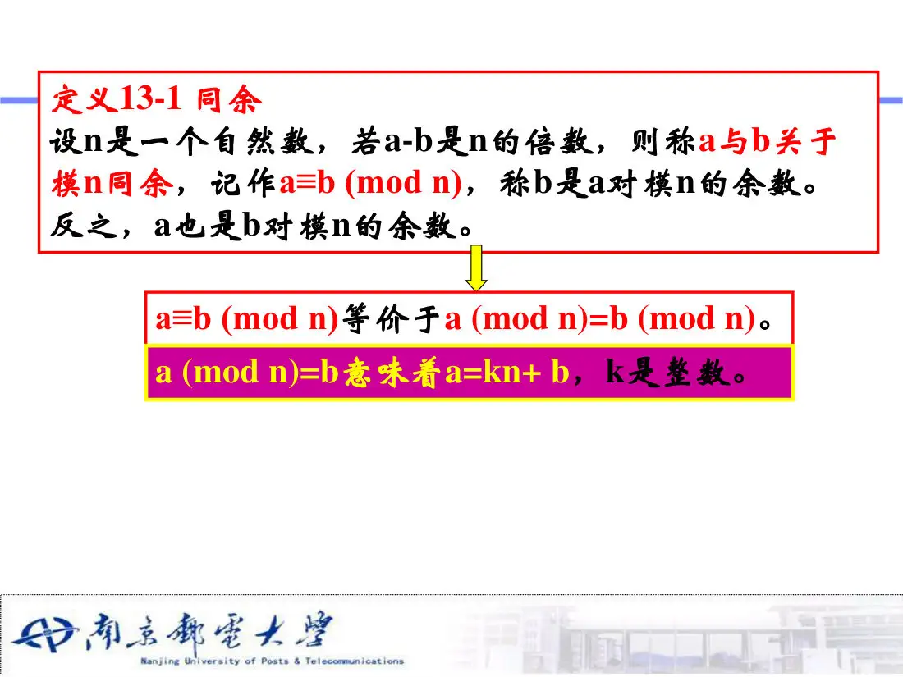

原文：

定义13-1 同余

设n是一个自然数，若a-b是n的倍数，则称a与b关于模n同余，记作a≡b (mod n)，称b是a对模n的余数。反之，a也是b对模n的余数。

a≡b (mod n)等价于a (mod n)=b (mod n)。

a (mod n)=b  意味着a=kn+ b ，k是整数。

安南京郵電大学 Nanjing University of Posts & Telecommunications

### 定理13-1 按模计算原理

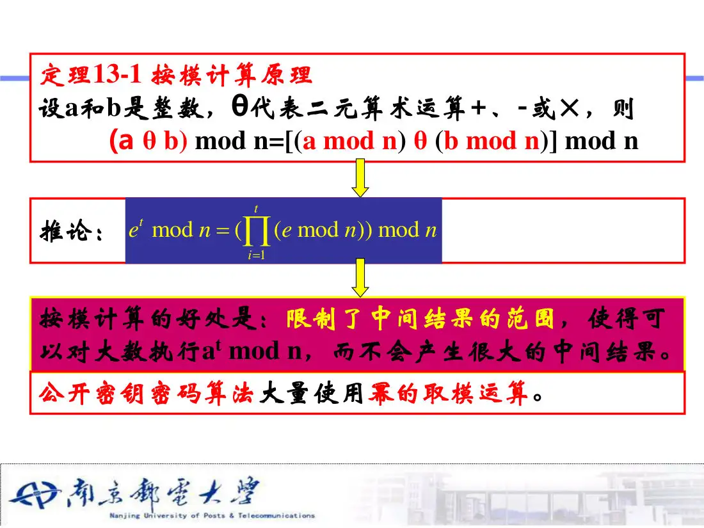

原文：

定理13-1 按模计算原理

设a和b是整数，θ代表二元算术运算+、-或×，则

推论：

$$
e ^ {t} \bmod n = (\prod_ {i = 1} ^ {t} (e \bmod n)) \bmod n
$$

按模计算的好处是：限制了中间结果的范围，使得可以对大数执行 $\mathbf { a } ^ { \mathbf { t } } \mathbf { m } \mathbf { o } \mathbf { d } \mathbf { n }$ ，而不会产生很大的中间结果。

公开密钥密码算法大量使用幂的取模运算。

安南京郵電大学 Nanjing University of Posts & Telecommunications

### 定义13-2 欧拉(Euler)函数

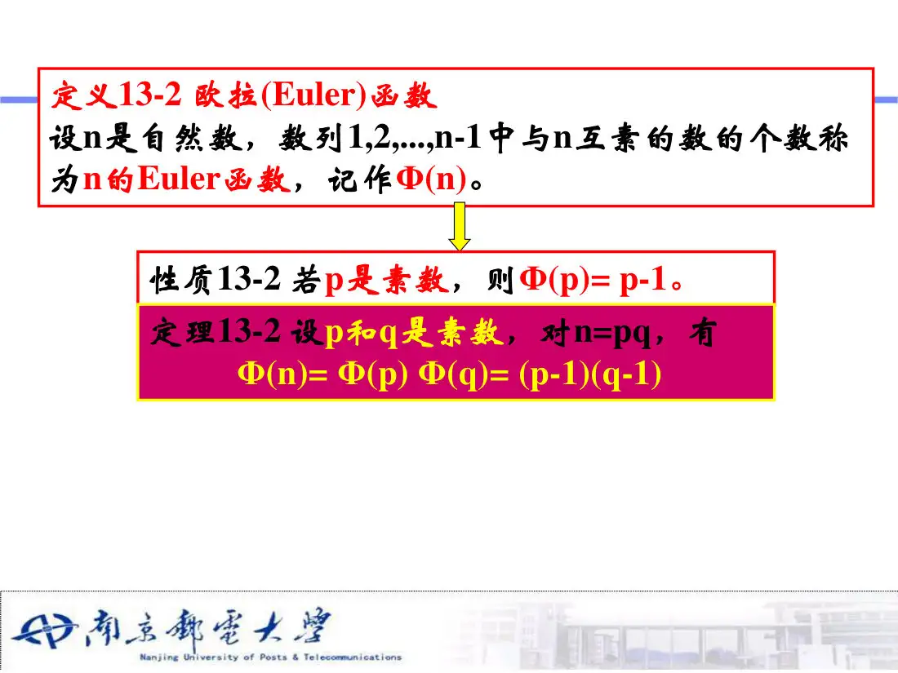

原文：

定义13-2 欧拉(Euler)函数

设n是自然数，数列 ${ \bf 1 , 2 , . . . , n . 1 }$ 中与n互素的数的个数称为n的Euler函数，记作Φ(n)。

性质13-2 若p是素数，则 $\Phi ( \mathbf { p } ) { = } \mathbf { p } { = } 1$

定理13-2 设p和q是素数，对 $\mathbf { n } { = } \mathbf { p } \mathbf { q }$ 有$( 0 ) [ 0 0 ] = ( 1 1 0 ) \times ( 1 1 0 ) = ( 1 0 0 ) [ 0 0 ]$

安南京郵電大学 Nanjing University of Posts & Telecommunications

### 第 25 页

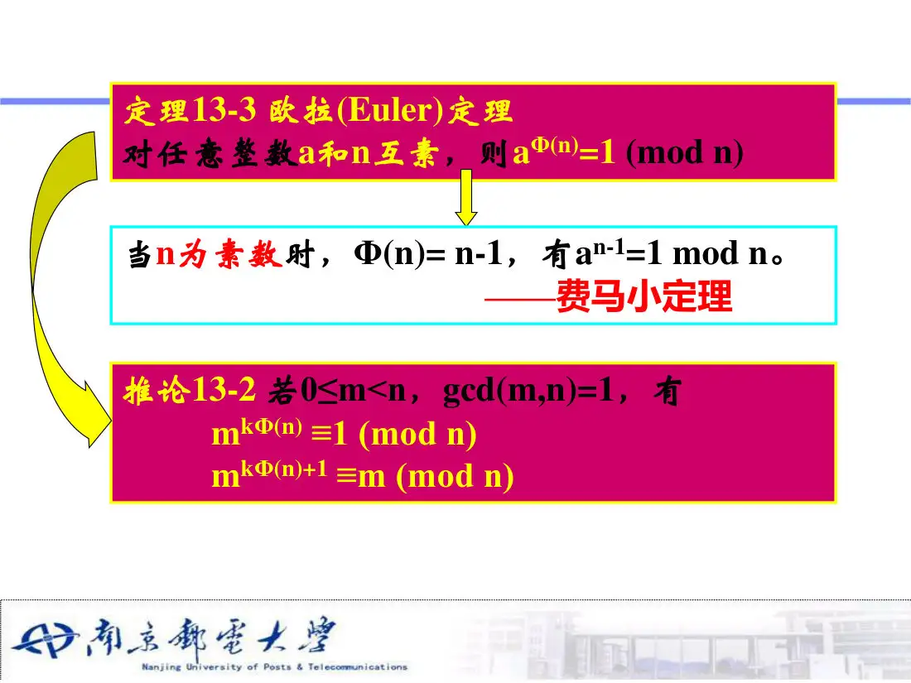

原文：

定理13-3 欧拉(Euler)定理对任意整数a和n互素，则 $\mathbf { 0 . 0 0 d n } ) \mathbf { - 1 } \left( \mathbf { m o d n } \right)$

当n为素数时， ${ \bf { \Phi } } ( { \bf { n } } ) { = } { \bf { n } } { = } 1$ ，有 $\mathbf { a ^ { n - 1 } } \mathbf { = } \mathbf { 1 } \mathbf { \bmod { n } } \mathbf { \Lambda } _ { }$ 费马小定理

推论13-2 若 $\mathbf { 0 } { \leq } \mathbf { m } { < } \mathbf { n }$ $\mathbf { g c d } ( \mathbf { m } , \mathbf { n } ) { = } 1$ 有$) 1 0 0 \times ( 1 0 0 0 0 0 0 0 0 0 0 0 0 0 0 0 0 0 0 0 0 0 0 0 0 0 0 0 0 0 0 0 0 0 0 0 0 0 0 0 0 0 0 0 0 0 0 0 0 0 0 0 0 0 0 0 0 0 0 0 0 0 0 0 0 0 0 0 0 0 0 0 0 0 0 0 0 0 0 0 0 0 0 0 0 0 0 0 0 0 0 0 0$ $1 0 0 \times 2 0 0 0 0 = 1 0 0 0 ( m o d n )$

安南京郵電大学 Nanjing University of Posts & Telecommunications

### 定义13-3

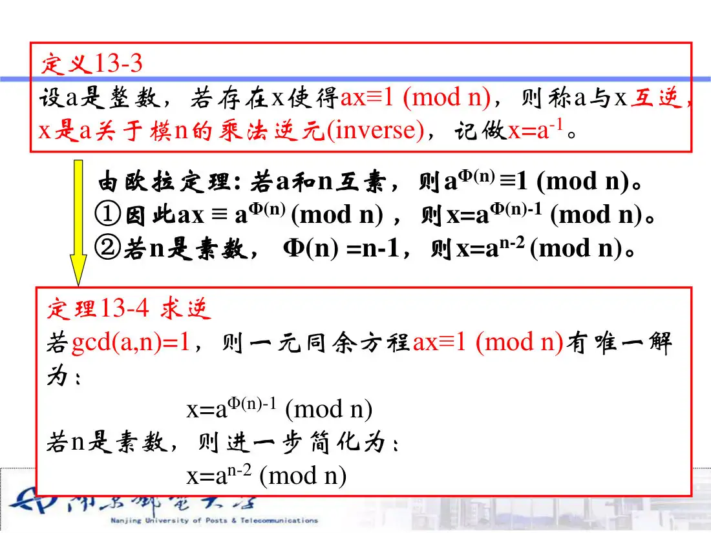

原文：

定义13-3

设a是整数，若存在x使得ax≡1 (mod n)，则称a与x互逆x是a关于模n的乘法逆元(inverse)，记做 $\mathbf { X } { = } \mathbf { a } ^ { - 1 }$ 。

由欧拉定理: 若a和n互素，则 $\mathbf { a } ^ { \Phi ( \mathbf { n } ) } \equiv \mathbf { 1 } { \mathrm { ~ ( m o d ~ } } \mathbf { n } )$ 0

①因此 $\mathbf { a x } \equiv \mathbf { a } ^ { \Phi }$ (n) (mod n) ，则 $\mathbf { X } { = } \mathbf { a } ^ { \Phi ( \mathbf { n } ) - 1 }$ (mod n)。

②若n是素数， $\Phi ( { \bf n } ) = { \bf n } - 1$ ，则 $\mathbf { X } { = } \mathbf { a } ^ { \mathbf { n } - 2 }$ (mod n)。

### Shamir

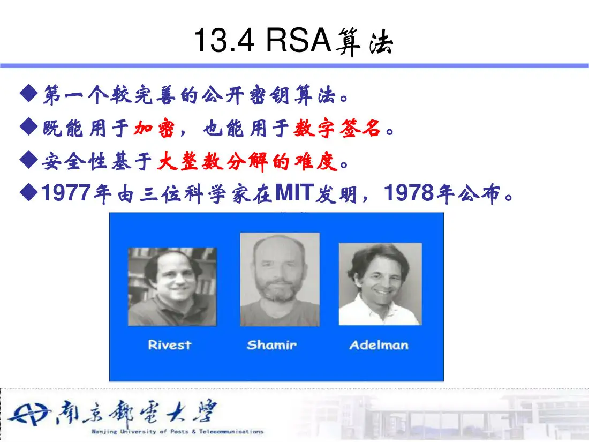

原文：

Shamir

13.4 RSA算法

◆第一个较完善的公开密钥算法。

◆既能用于加密，也能用于数字签名。

◆安全性基于大整数分解的难度。

◆1977年由三位科学家在MIT发明，1978年公布。

Nanjing University of Posts & Telecommunications

分南京郵電大学

### 产生一对密钥的过程

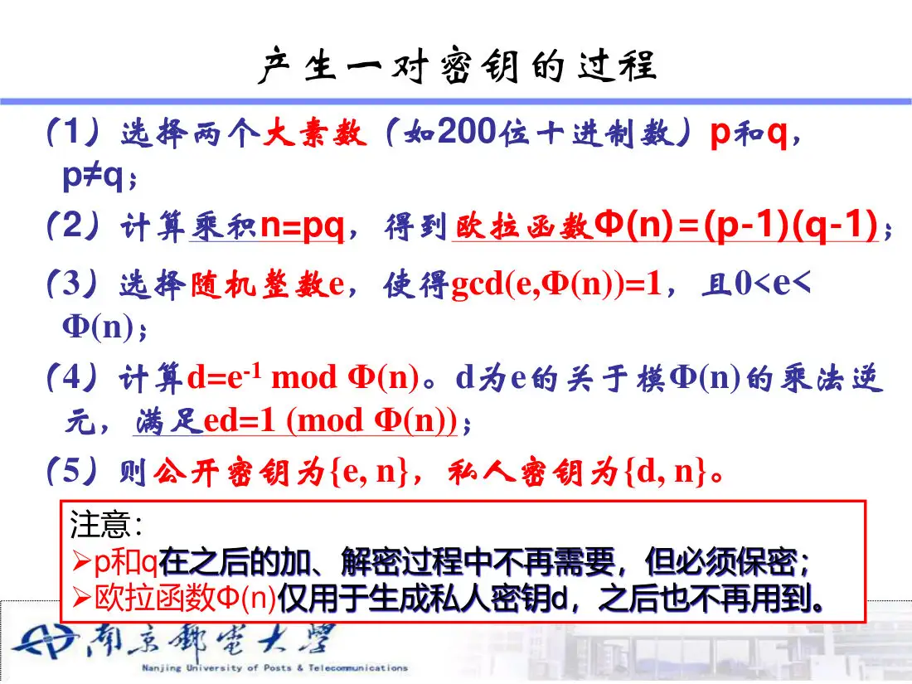

原文：

产生一对密钥的过程

（1）选择两个大素数（如200位十进制数）p和q，$\mathsf { p } \neq \mathsf { q }$ ；

（2）计算乘积 $\mathbf { n } { = } \mathbf { p } \mathbf { q }$ ，得到欧拉函数 $\Phi ( { \bf n } ) = ( { \bf p } - 1 ) ( { \bf q } - 1 )$

（3）选择随机整数e，使得 $\mathbf { g c d } ( \mathbf { e } , \Phi ( \mathbf { n } ) ) { = } 1$ ，且 $\mathbf { \boldsymbol { 0 } } < \mathbf { \boldsymbol { e } } <$ $\Phi ( \mathbf { n } )$ ；

（4）计算 $\mathbf { d } { = } \mathbf { e } ^ { - 1 } \mathbf { m o d } \ \Phi ( \mathbf { n } )$ 。d为e的关于模Φ(n)的乘法逆元，满足 $\scriptstyle \mathbf { \mathbf { e d } } = 1 ( \mathbf { m o d } \Phi ( \mathbf { n } ) )$ ；

（5）则公开密钥为 $\{ \mathbf { e } , \mathbf { n } \}$ ，私人密钥为 $\{  { \mathbf { d } } ,  { \mathbf { n } } \}$

注意：

➢p和q在之后的加、解密过程中不再需要，但必须保密；➢欧拉函数Φ(n)仅用于生成私人密钥d，之后也不再用到。

今南京郵電大學

Nanjing University of Posts & Telecommunications

### 加/解密过程

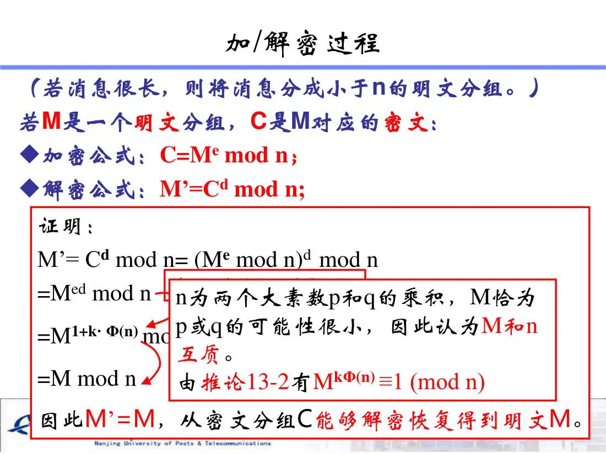

原文：

加/解密过程

（若消息很长，则将消息分成小于n的明文分组。）

若M是一个明文分组，C是M对应的密文：

◆加密公式： $\mathbf { C = M ^ { e } m o d } \mathbf { n }$

◆解密公式： $\mathbf { M ^ { \circ } { = } C ^ { d } m o d n ; }$

证明：

$\mathbf { M } ^ { \prime } { = } \mathbf { C ^ { d } }$ mod n= (Me mod $\underline { { \mathbf { n } ) } } ^ { \mathrm { d } }$ mod n

$\mathbf { \tau } = \mathbf { M } ^ { \mathrm { e d } }$ mod n

n为两个大素数p和q的乘积，M恰为p或q的可能性很小，因此认为M和n互质。

=M mod n

由推论13-2有 $\mathrm { M } ^ { \mathrm { k } \Phi ( \mathrm { n } ) } { \equiv } 1 { \mathrm { ( m o d n ) } }$

因此 $\mathsf { M } ^ { \boldsymbol { \mathsf { \prime } } } = \mathsf { M }$ ，从密文分组C能够解密恢复得到明文M。

Nanjing University of Posts & Telecommunications

### 问题：

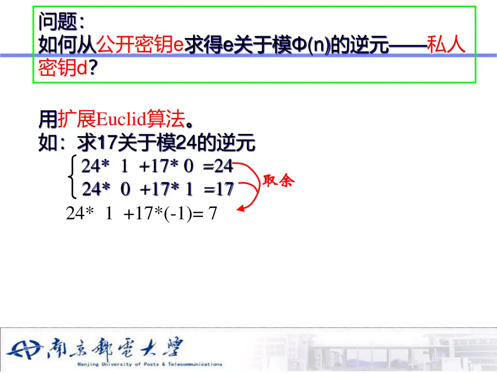

原文：

问题：

用扩展Euclid算法。

如：求17关于模24的逆元

$$
\left\{ \begin{array}{l} 2 4 ^ {*} 1 + 1 7 ^ {*} 0 = 2 4 \\ 2 4 ^ {*} 0 + 1 7 ^ {*} 1 = 1 7 \\ 2 4 ^ {*} 1 + 1 7 ^ {*} (- 1) = 7 \end{array} \right.
$$

取余

安南京郵電大学 Nanjing University of Posts & Telecommunications

### 问题：

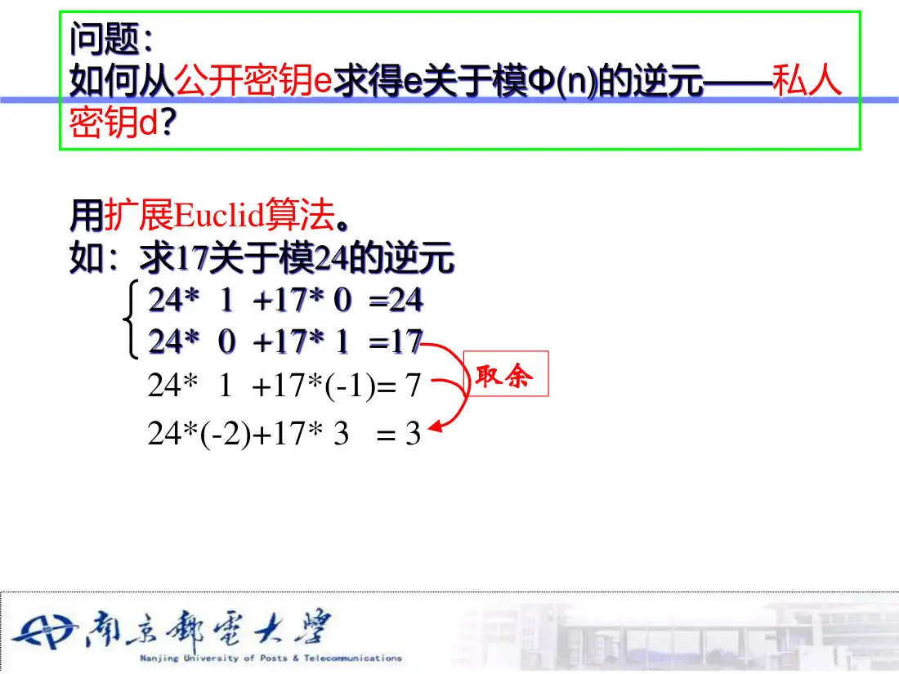

原文：

问题：

用扩展Euclid算法。

如：求17关于模24的逆元

$$
\left\{ \begin{array}{l} 2 4 ^ {*} 1 + 1 7 ^ {*} 0 = 2 4 \\ 2 4 ^ {*} 0 + 1 7 ^ {*} 1 = 1 7 - \\ 2 4 ^ {*} 1 + 1 7 ^ {*} (- 1) = 7 - \\ 2 4 ^ {*} (- 2) + 1 7 ^ {*} 3 = 3 \end{array} \right.
$$

取余

安南京郵電大学 Nanjing University of Posts & Telecommunications

### 用扩展Euclid算法。

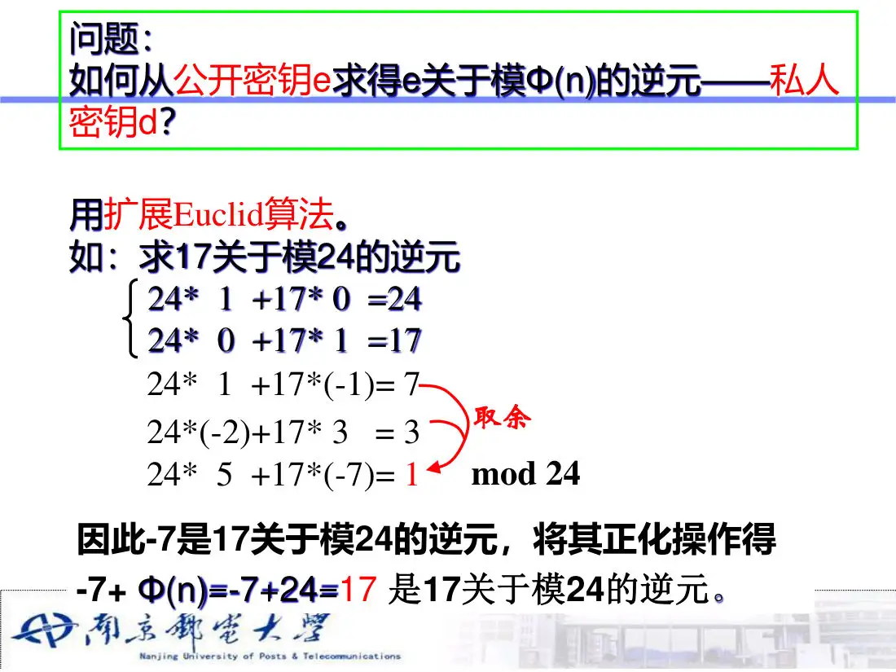

原文：

用扩展Euclid算法。

如：求17关于模24的逆元

$$
\left\{ \begin{array}{l} 2 4 ^ {*} 1 + 1 7 ^ {*} 0 = 2 4 \\ 2 4 ^ {*} 0 + 1 7 ^ {*} 1 = 1 7 \\ 2 4 ^ {*} 1 + 1 7 ^ {*} (- 1) = 7 \\ 2 4 ^ {*} (- 2) + 1 7 ^ {*} 3 = 3 \\ 2 4 ^ {*} 5 + 1 7 ^ {*} (- 7) = 1 \end{array} \right.
$$

取余

mod 24

因此-7是17关于模24的逆元，将其正化操作得$- 7 + \Phi ( n ) = - 7 + 2 4 = 1 7$ 是17关于模24的逆元。

今南京郵電大學

Nanjing University of Posts & Telecommunications

### 例13-6 用RSA机制进行保密通信

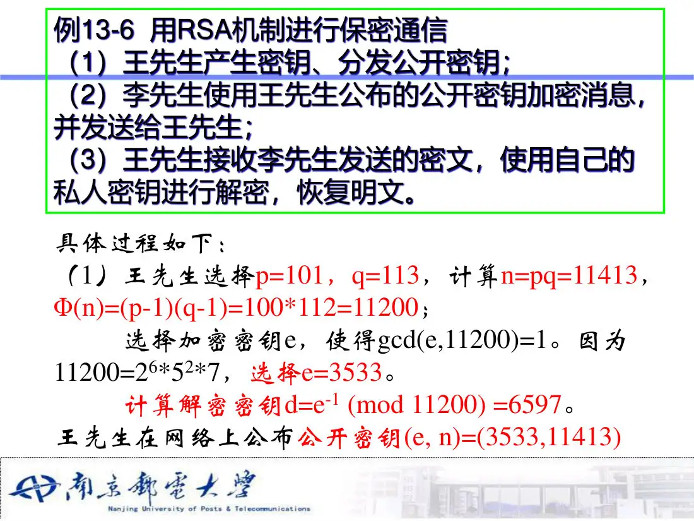

原文：

例13-6 用RSA机制进行保密通信

（1）王先生产生密钥、分发公开密钥；

（2）李先生使用王先生公布的公开密钥加密消息，并发送给王先生；

（3）王先生接收李先生发送的密文，使用自己的私人密钥进行解密，恢复明文。

具体过程如下：

（1）王先生选择p=101，q=113，计算n=pq=11413，Φ(n)=(p-1)(q-1)=100\*112=11200；

选择加密密钥e，使得gcd(e,11200)=1。因为11200=26\*52\*7，选择e=3533。

计算解密密钥d=e-1 (mod 11200) =6597。 王先生在网络上公布公开密钥(e, n)=(3533,11413)

安南京郵電大学 Nanjing University of Posts & Telecommunications

### 具体过程如下：

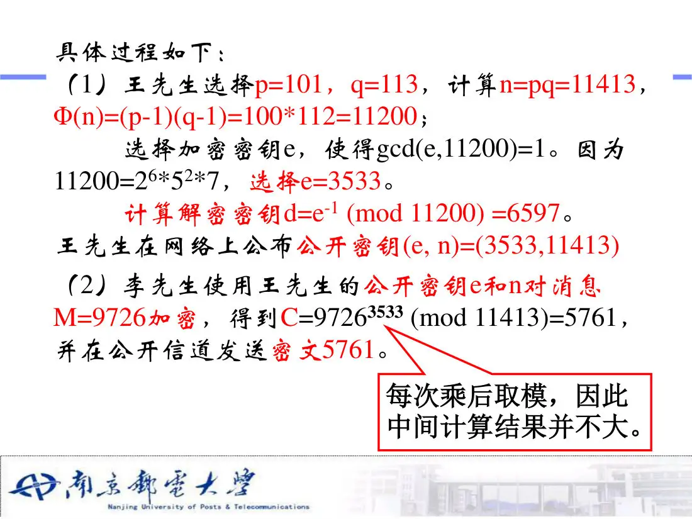

原文：

具体过程如下：

（1）王先生选择p=101，q=113，计算n=pq=11413，Φ(n)=(p-1)(q-1)=100\*112=11200；

选择加密密钥e，使得gcd(e,11200)=1。因为11200=26\*52\*7，选择e=3533。

计算解密密钥d=e-1 (mod 11200) =6597。 王先生在网络上公布公开密钥(e, n)=(3533,11413)

（2）李先生使用王先生的公开密钥e和n对消息M=9726加密，得到C=97263533 (mod 11413)=5761，并在公开信道发送密文5761。

每次乘后取模，因此中间计算结果并不大。

A南京郵電大学 Nanjing University of Posts & Telecommunications

### 具体过程如下：

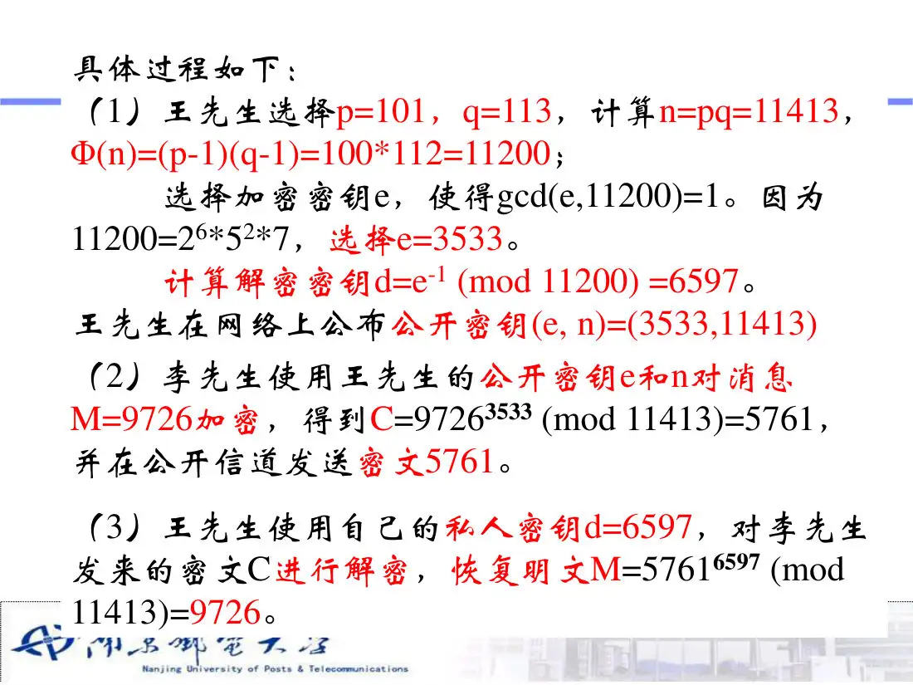

原文：

具体过程如下：

（1）王先生选择p=101，q=113，计算n=pq=11413，Φ(n)=(p-1)(q-1)=100\*112=11200；

选择加密密钥e，使得gcd(e,11200)=1。因为11200=26\*52\*7，选择e=3533。

计算解密密钥d=e-1 (mod 11200) =6597。 王先生在网络上公布公开密钥(e, n)=(3533,11413)

（2）李先生使用王先生的公开密钥e和n对消息M=9726加密，得到C=97263533 (mod 11413)=5761，并在公开信道发送密文5761。

（3）王先生使用自己的私人密钥d=6597，对李先生发来的密文C进行解密，恢复明文M=57616597 (mod11413)=9726。

Nanjing University of Posts & Telecommunications

### 文本加密

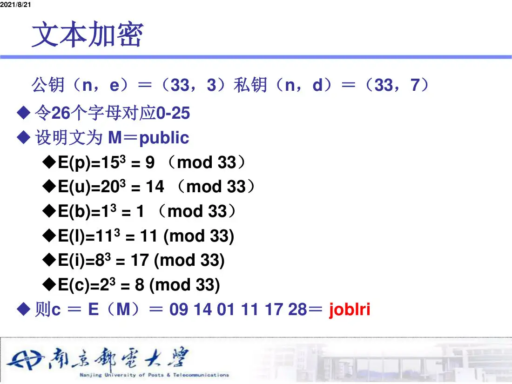

原文：

文本加密

公钥 $( \mathsf { n } , \mathsf { e } ) = ( 3 3 , \mathsf { 3 } )$ 私钥 $( \mathsf { n } , \mathsf { d } ) \ : = \ : ( \mathsf { 3 3 } , \mathsf { 7 } )$

◆令26个字母对应0-25

◆设明文为 $\scriptstyle \mathbf { M } = \mathbf { p u b } \scriptscriptstyle \mathrm { I i c }$

◆E(p)=153 = 9 （mod 33）

$$
\blacklozenge E (u) = 2 0 ^ {3} = 1 4 \pmod {3 3}
$$

◆E(b)=13 = 1 （mod 33）

◆E(l)=113 = 11 (mod 33)

◆E(i)=83 = 17 (mod 33)

$$
\blacklozenge E (c) = 2 ^ {3} = 8 \pmod {3 3}
$$

◆则c ＝ E（M）＝ 09 14 01 11 17 28＝ joblri

2021/8/21

安南京郵電大学 Nanjing University of Posts & Telecommunications

### 文本解密

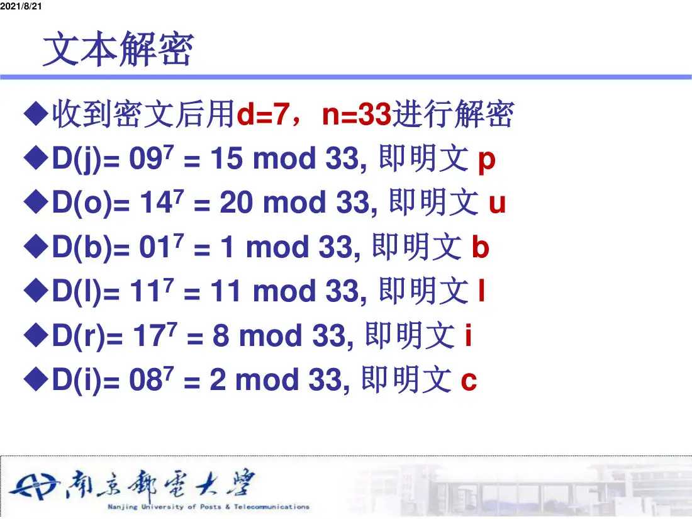

原文：

文本解密

◆收到密文后用d=7，n=33进行解密

◆D(j)= 097 = 15 mod 33, 即明文 p

◆D(o)= 147 = 20 mod 33, 即明文 u

◆D(b)= 017 = 1 mod 33, 即明文 b

◆D(l)= 117 = 11 mod 33, 即明文 l

◆D(r)= 177 = 8 mod 33, 即明文 i

◆D(i)= 087 = 2 mod 33, 即明文 c

2021/8/21

安南京郵電大学 Nanjing University of Posts & Telecommunications

### RSA的安全性

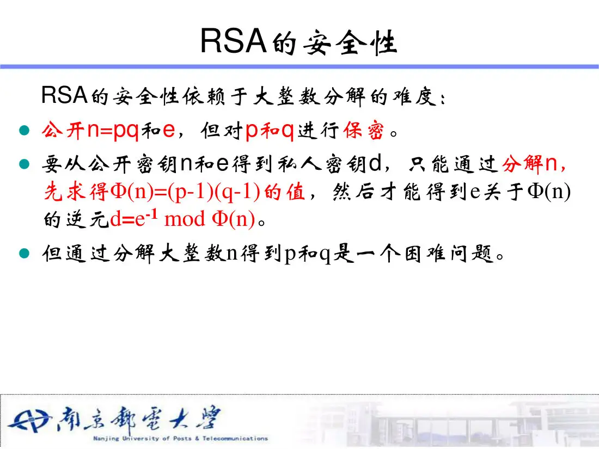

原文：

RSA的安全性

RSA的安全性依赖于大整数分解的难度：

⚫ 公开n=pq和e，但对p和q进行保密。

⚫ 要从公开密钥n和e得到私人密钥d，只能通过分解n，先求得Φ(n)=(p-1)(q-1)的值，然后才能得到e关于Φ(n)的逆元 $\mathrm { d } { = } \mathrm { e } ^ { - 1 } \mathrm { m o d } \ \Phi ( \mathrm { n } )$ 。

⚫ 但通过分解大整数n得到p和q是一个困难问题。

安南京郵電大学 Nanjing University of Posts & Telecommunications

### 针对RSA可能存在的攻击方式

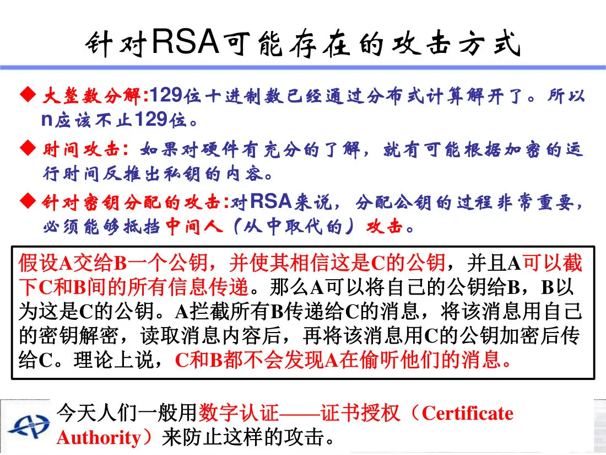

原文：

针对RSA可能存在的攻击方式

◆大整数分解:129位十进制数已经通过分布式计算解开了。所以n应该不止129位。

◆时间攻击: 如果对硬件有充分的了解，就有可能根据加密的运行时间反推出私钥的内容。

◆针对密钥分配的攻击:对RSA来说，分配公钥的过程非常重要，必须能够抵挡中间人（从中取代的）攻击。

假设A交给B一个公钥，并使其相信这是C的公钥，并且A可以截下C和B间的所有信息传递。那么A可以将自己的公钥给B，B以为这是C的公钥。A拦截所有B传递给C的消息，将该消息用自己的密钥解密，读取消息内容后，再将该消息用C的公钥加密后传给C。理论上说，C和B都不会发现A在偷听他们的消息。

今天人们一般用数字认证——证书授权（CertificateAuthority）来防止这样的攻击。

### PGP

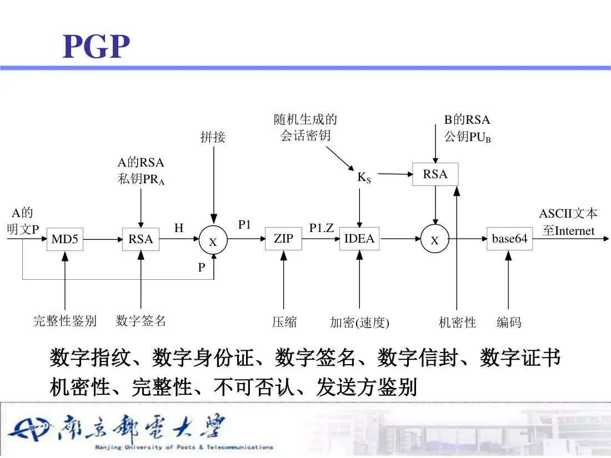

原文：

数字指纹、数字身份证、数字签名、数字信封、数字证书机密性、完整性、不可否认、发送方鉴别

PGP

2021/8/21 40 Nanjing University of Posts & Telecommunications
