# 《算法分析与设计》第1章 算法求解基础（课件）

原件的每一页，下面附识别出的文字。

### 算法设计与分析

原文：

算法设计与分析

南京郵電大學 municitions

### 课前简介

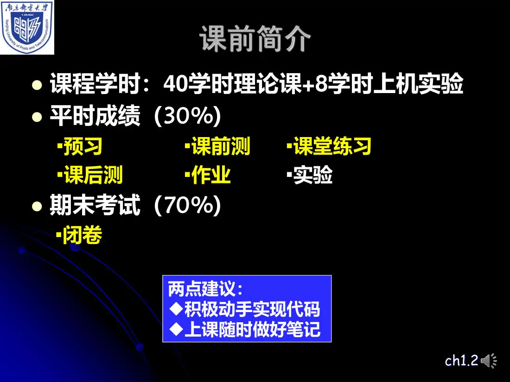

原文：

课前简介

⚫ 课程学时：40学时理论课+8学时上机实验

⚫ 平时成绩（30%）

▪预习

▪课前测

▪课堂练习

▪课后测

▪作业

▪实验

⚫ 期末考试（70%）

▪闭卷

两点建议：

积极动手实现代码

上课随时做好笔记

ch1.2

南京郵電大學 municitions

### 上机实验安排

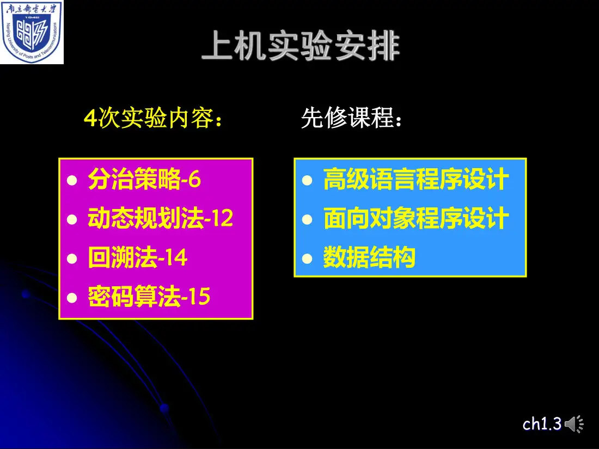

原文：

上机实验安排

4次实验内容：

分治策略-6

动态规划法-12

⚫ 回溯法-14

密码算法-15

先修课程：

高级语言程序设计

面向对象程序设计

数据结构

南京郵電大學nmuncstions

ch1.3

### “算法”与“数据结构”的关系：

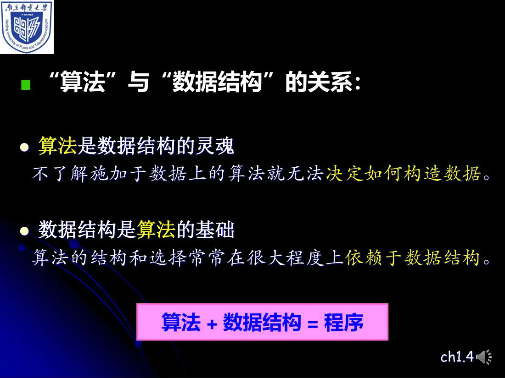

原文：

“算法”与“数据结构”的关系：

算法是数据结构的灵魂不了解施加于数据上的算法就无法决定如何构造数据。

数据结构是算法的基础算法的结构和选择常常在很大程度上依赖于数据结构。

算法 + 数据结构 = 程序

南京郵電大學 municitions

### 课程推荐参考书

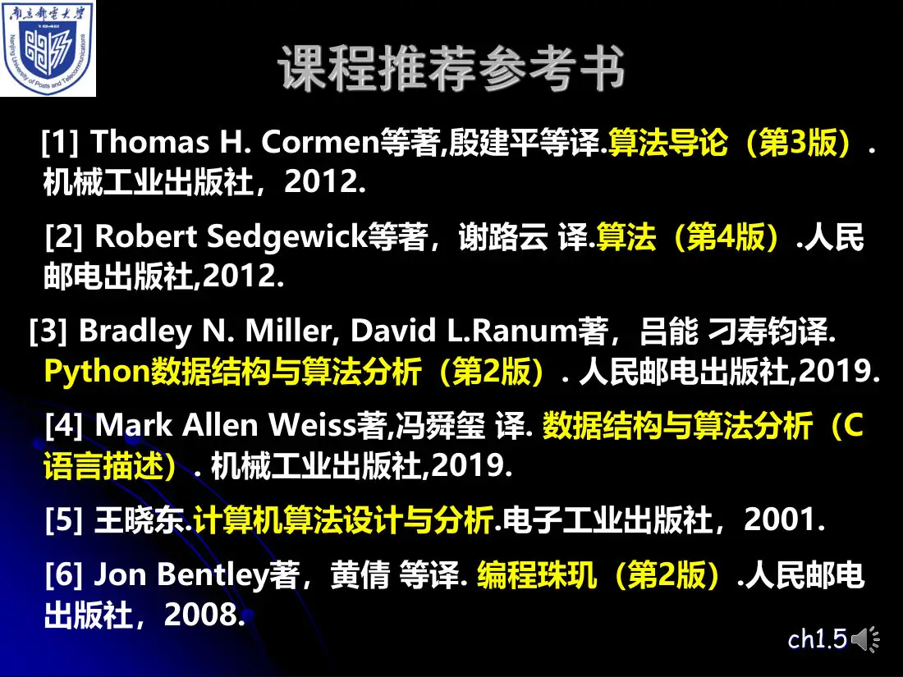

原文：

课程推荐参考书

[1] Thomas H. Cormen等著,殷建平等译.算法导论（第3版）机械工业出版社，2012.

[2] Robert Sedgewick等著，谢路云 译.算法（第4版）.人民邮电出版社,2012.

[3] Bradley N. Miller, David L.Ranum著，吕能 刁寿钧译.Python数据结构与算法分析（第2版）. 人民邮电出版社,2019.

[4] Mark Allen Weiss著,冯舜玺 译. 数据结构与算法分析（C语言描述）. 机械工业出版社,2019.

[5] 王晓东.计算机算法设计与分析.电子工业出版社，2001.

[6] Jon Bentley著，黄倩 等译. 编程珠玑（第2版）.人民邮电出版社，2008.

ch1.5

南京郵電大學948

### 其他参考书和学习资料

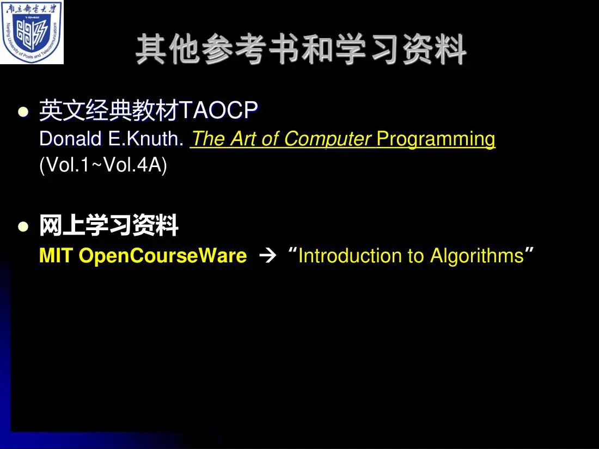

原文：

其他参考书和学习资料

英文经典教材TAOCPDonald E.Knuth. The Art of Computer Programming(Vol.1\~Vol.4A)

⚫ 网上学习资料MIT OpenCourseWare →“Introduction to Algorithms”

南京郵電大學848municitons

### ⚫ Ch1 算法问题求⚫ 1.1 算法概述⚫ 1.3 算法设计与分

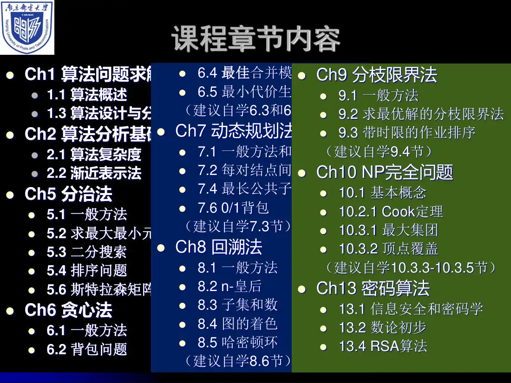

原文：

⚫ Ch1 算法问题求⚫ 1.1 算法概述⚫ 1.3 算法设计与分

⚫ Ch2 算法分析基⚫ 2.1 算法复杂度⚫ 2.2 渐近表示法

Ch5 分治法5.1 一般方法5.2 求最大最小元5.3 二分搜索5.4 排序问题5.6 斯特拉森矩阵

⚫ Ch6 贪心法⚫ 6.1 一般方法⚫ 6.2 背包问题

课程章节内容

础⚫ 6.4 最佳合并模

6.5 最小代价生（建议自学6.3和6.

Ch7 动态规划法

⚫ 7.1 一般方法和

⚫ 7.2 每对结点间

⚫ 7.4 最长公共子

⚫ 7.6 0/1背包（建议自学7.3节）

⚫ Ch8 回溯法

⚫ 8.1 一般方法

法⚫ 8.2 n-皇后

⚫ 8.3 子集和数

⚫ 8.4 图的着色

⚫ 8.5 哈密顿环

（建议自学8.6节）

式⚫ Ch9 分枝限界法

⚫ 9.1 一般方法

）⚫ 9.2 求最优解的分枝限界法

9.3 带时限的作业排序要素（建议自学9.4节）

的最短路径⚫ Ch10 NP完全问题

⚫ 10.1 基本概念

⚫ 10.2.1 Cook定理

⚫ 10.3.1 最大集团

10.3.2 顶点覆盖（建议自学10.3.3-10.3.5节）

⚫ Ch13 密码算法

⚫ 13.1 信息安全和密码学

⚫ 13.2 数论初步

⚫ 13.4 RSA算法

南京郵電大學948

### 算法课程学习目标

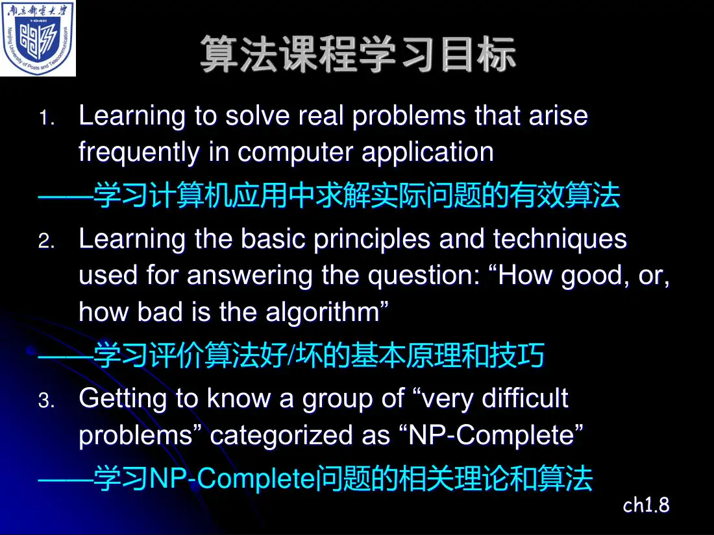

原文：

算法课程学习目标

1. Learning to solve real problems that arise frequently in computer application 学习计算机应用中求解实际问题的有效算法

2. Learning the basic principles and techniques used for answering the question: “How good, or, how bad is the algorithm” 学习评价算法好/坏的基本原理和技巧

3. Getting to know a group of “very difficult problems” categorized as “NP-Complete” 学习NP-Complete问题的相关理论和算法

南京郵電大學948municitons

ch1.8

### 第1章 算法问题求解基础

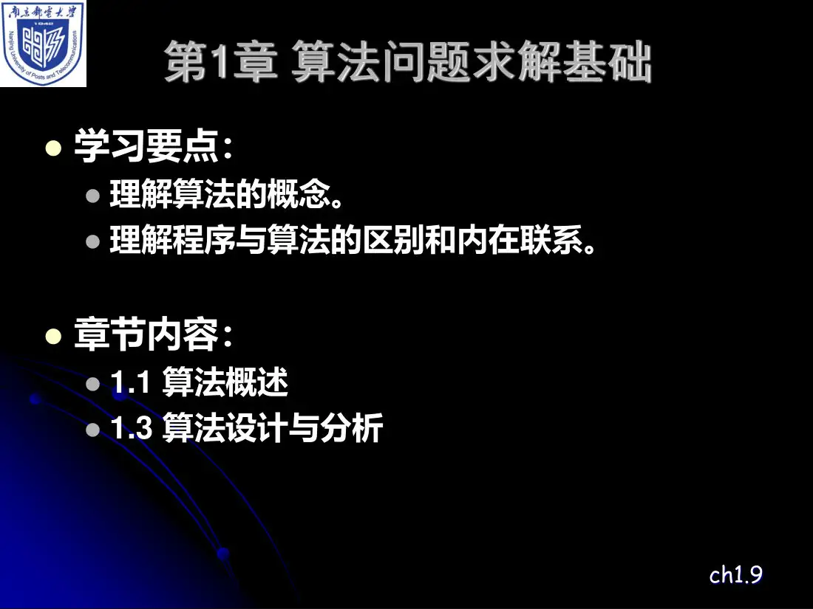

原文：

第1章 算法问题求解基础

⚫ 学习要点：

理解算法的概念。

⚫ 理解程序与算法的区别和内在联系。

⚫ 章节内容：

⚫ 1.1 算法概述

⚫ 1.3 算法设计与分析

南京郵電大學 municitions

ch1.9

### 1.1 算法概述

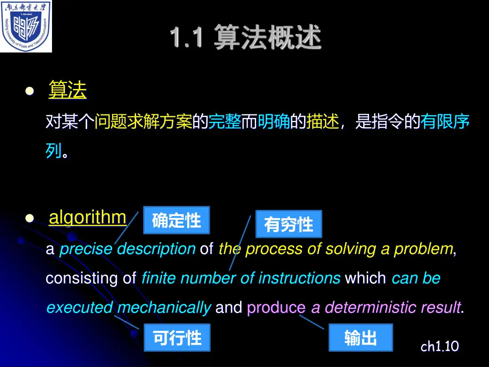

原文：

1.1 算法概述

⚫ 算法

对某个问题求解方案的完整而明确的描述，是指令的有限序列。

algorithm

确定性

有穷性

a precise description of the process of solving a problem, consisting of finite number of instructions which can be executed mechanically and produce a deterministic result.

可行性

输出

ch1.10

南京郵電大學nmuncstions

### 确定性 (Definiteness)

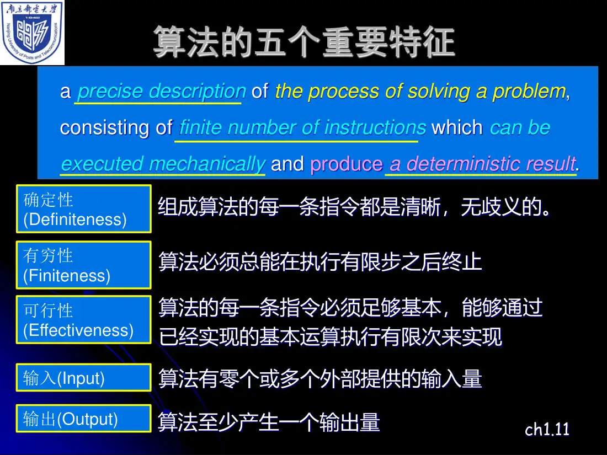

原文：

a precise description of the process of solving a problem,

consisting of finite number of instructions which can be

executed mechanically and produce a deterministic result.

确定性 (Definiteness)

有穷性(Finiteness)

可行性(Effectiveness)

输入(Input)

输出(Output)

组成算法的每一条指令都是清晰，无歧义的。

算法必须总能在执行有限步之后终止

算法的每一条指令必须足够基本，能够通过

已经实现的基本运算执行有限次来实现

算法有零个或多个外部提供的输入量

算法至少产生一个输出量

南京郵電大學848municitons

算法的五个重要特征

ch1.11

### 算法、计算过程与程序

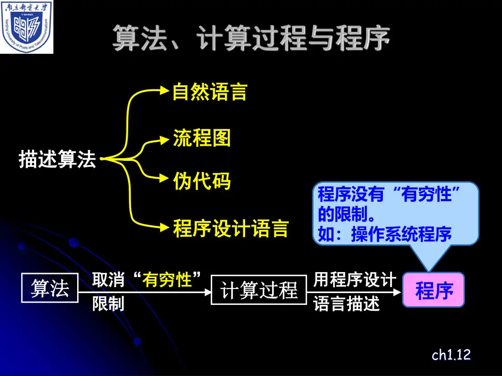

原文：

算法、计算过程与程序

描述算法

自然语言

流程图

伪代码

程序设计语言程序没有“有穷性”的限制。

如：操作系统程序

算法

取消“有穷性”

限制

计算过程用程序设计语言描述程序

南京郵電大學nmuncstions

ch1.12

### 经典算法举例

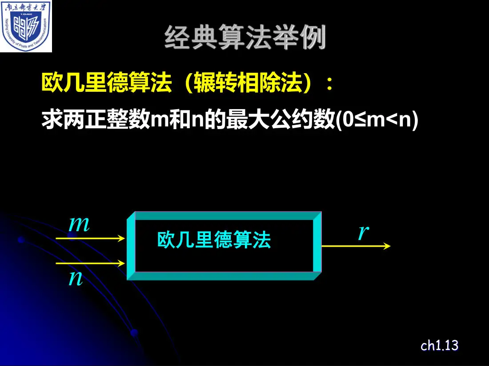

原文：

经典算法举例

欧几里德算法（辗转相除法）：求两正整数m和n的最大公约数(0≤m<n)

欧几里德算法

南京郵電大學848municitons

ch1.13

### ① 输入m 和n；

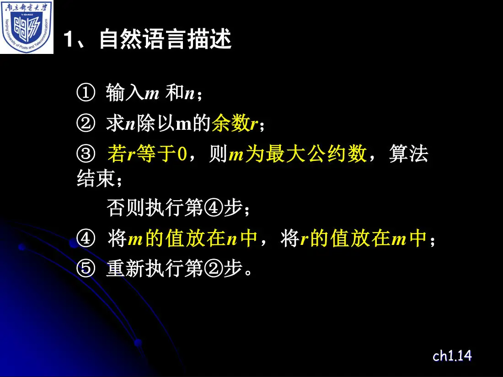

原文：

① 输入m 和n；

② 求n除以m的余数r；

③ 若r等于0，则m为最大公约数，算法结束；

否则执行第④步；

④ 将m的值放在n中，将r的值放在m中；

⑤ 重新执行第②步。

南京郵電大學图 948

1、自然语言描述

ch1.14

### 南京郵電大學图 948

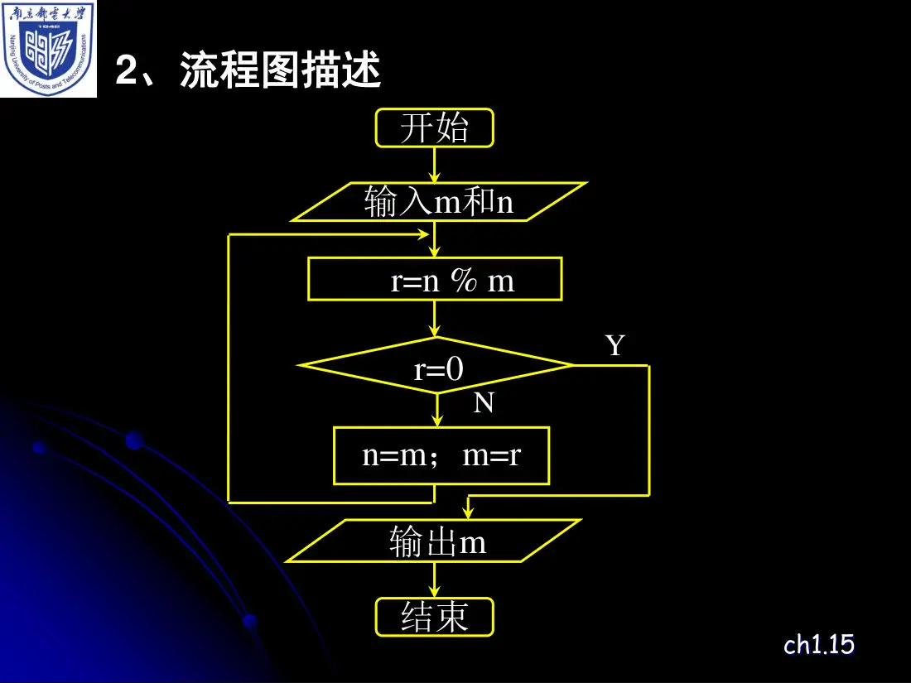

原文：

南京郵電大學图 948

2、流程图描述

ch1.15

### 3、伪代码描述

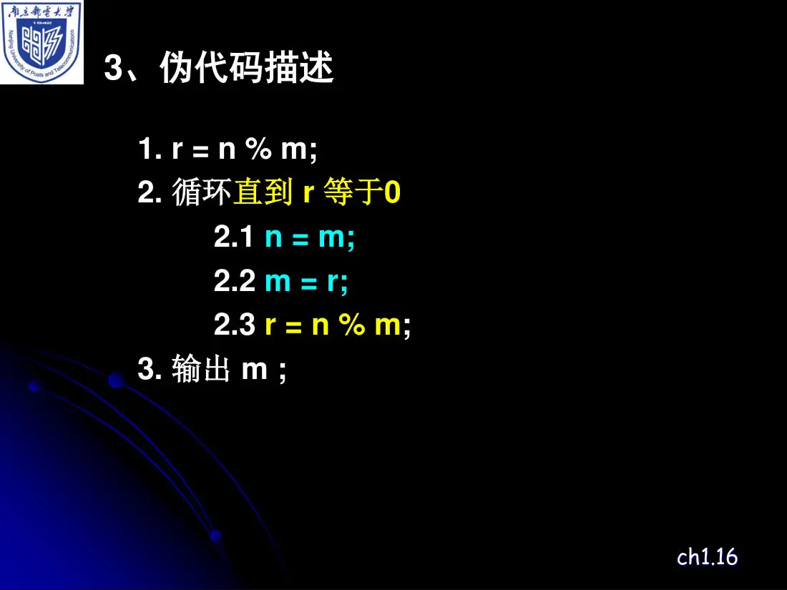

原文：

3、伪代码描述

$\bf \delta m = m \cdot v \cdot v \cdot m ^ { \prime }$ 2. 循环直到 r 等于0$p z | | \mathbf { \bar { \rho } } | | \mathbf { \bar { \rho } } | | \mathbf { \bar { \rho } }$ $p 2 + 2 m = 1 0$ $\angle A C E = \angle A C = 9 0 ^ { \circ }$

3. 输出 m ;

南京郵電大學 municitions

ch1.16

### 程序1-1 欧几里德算法（递归）

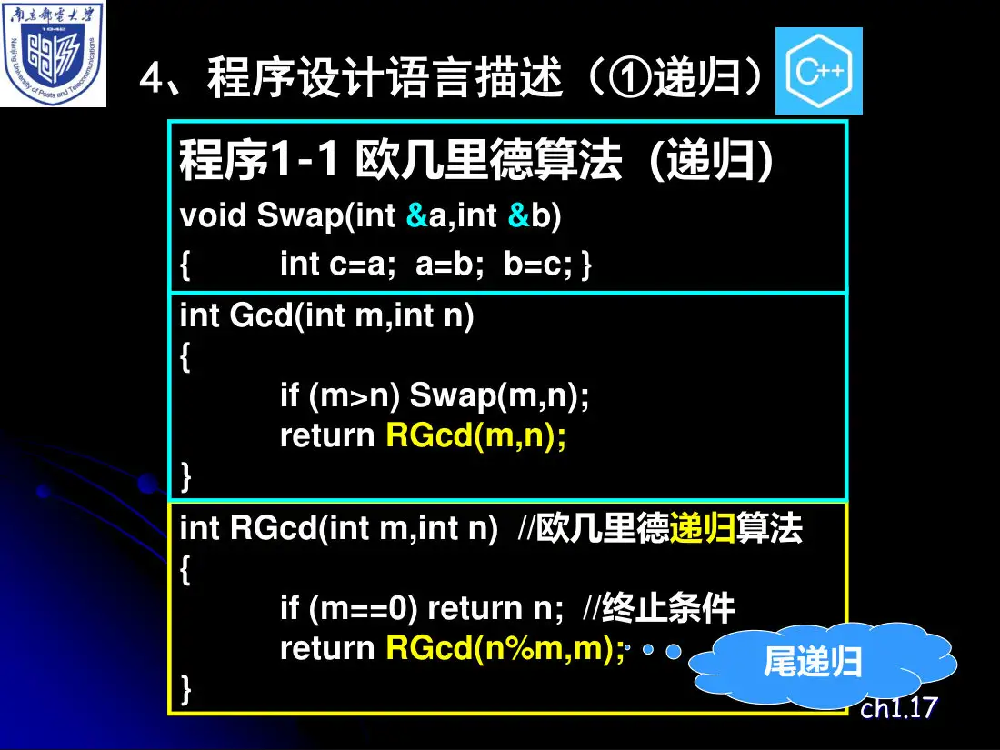

原文：

程序1-1 欧几里德算法（递归）

void Swap(int &a,int &b) { int c=a; a=b; b=c; }

int Gcd(int m,int n)

if (m>n) Swap(m,n); return RGcd(m,n);

int RGcd(int m,int n) //欧几里德递归算法

if (m==0) return n; //终止条件 return RGcd(n%m,m);

尾递归

南京郵電大學nmuncstions

4、程序设计语言描述（①递归）

C++

ch1.17

### 可见：同一个算法可采用不同的形式来表示。

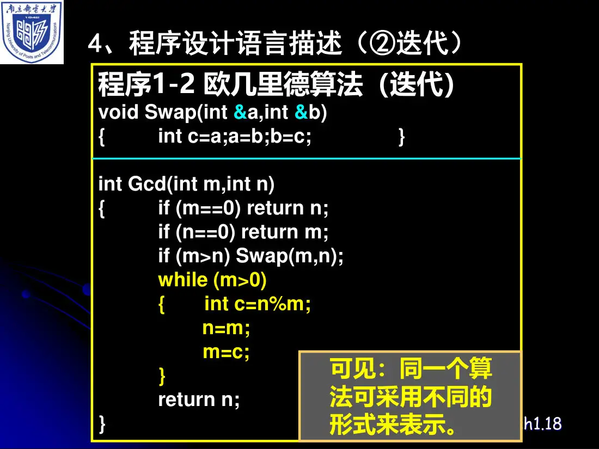

原文：

程序1-2 欧几里德算法（迭代）void Swap(int &a,int &b)int c=a;a=b;b=c; }

int Gcd(int m,int n) { if (m==0) return n; if (n==0) return m; if (m>n) Swap(m,n); while (m>0) int c=n%m; n=m; m=c; } return n;

可见：同一个算法可采用不同的形式来表示。

南京郵電大學 municitions

4、程序设计语言描述（②迭代）

h1.18

### 1、若不事先比较m和n的大小，如何实现？

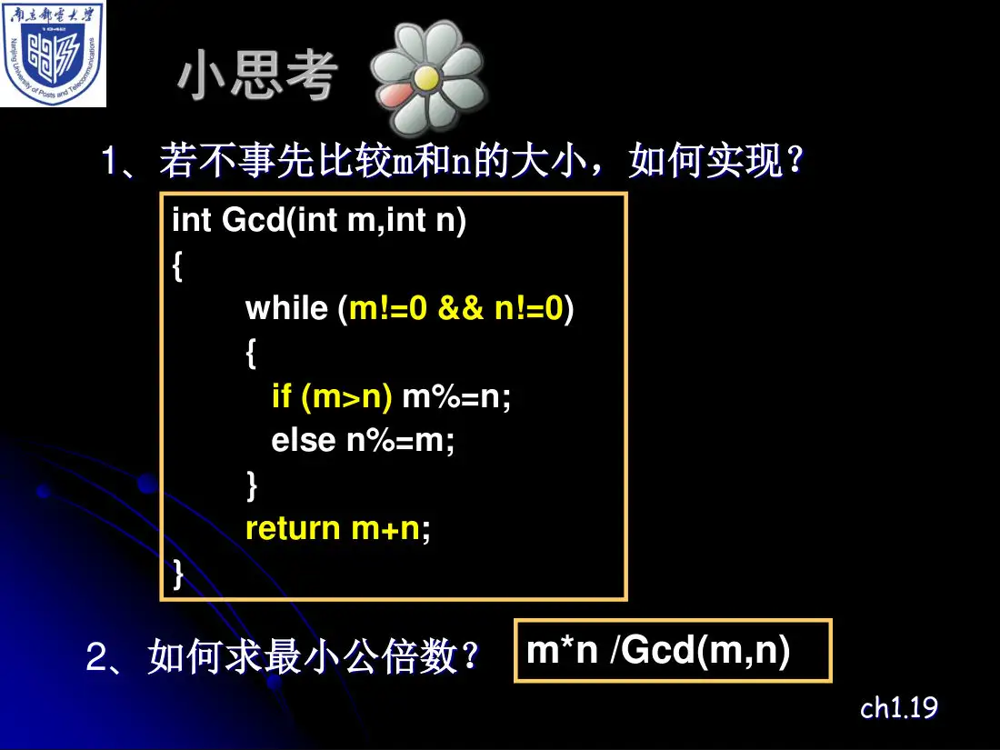

原文：

1、若不事先比较m和n的大小，如何实现？

int Gcd(int m,int n)

return m+n;

2、如何求最小公倍数？ m\*n /Gcd(m,n)

南京郵電大學nmuncstions

小思考

ch1.19

### 程序1-3 连续整数检测int Gcd(int m,int n)

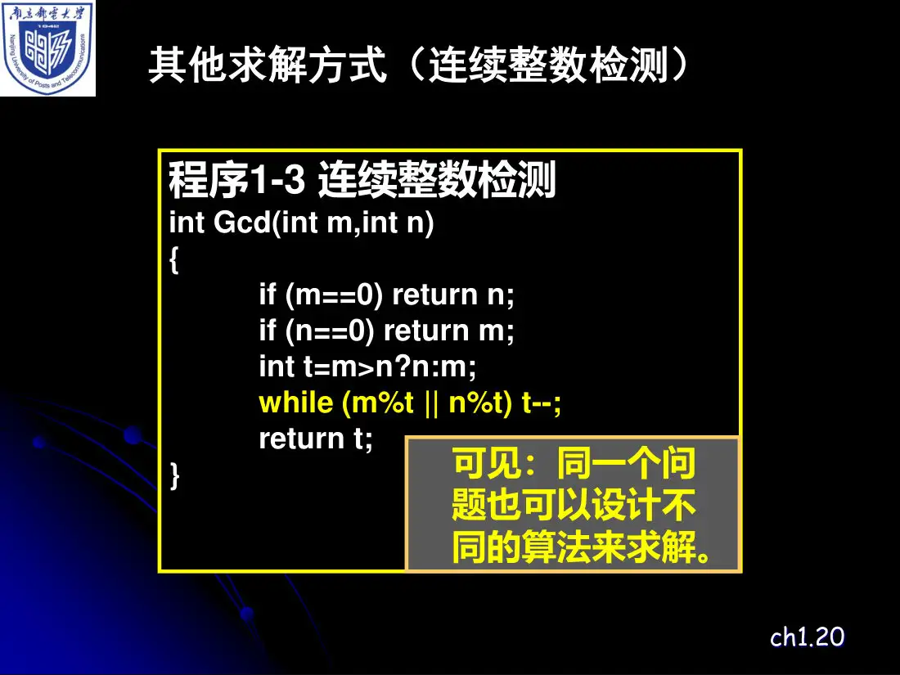

原文：

程序1-3 连续整数检测int Gcd(int m,int n)

if (m==0) return n; if (n==0) return m; int t=m>n?n:m; while (m%t || n%t) t--; return t;

可见：同一个问题也可以设计不同的算法来求解。

南京郵電大學 municitions

其他求解方式（连续整数检测）

ch1.20

### 南京郵電大學948

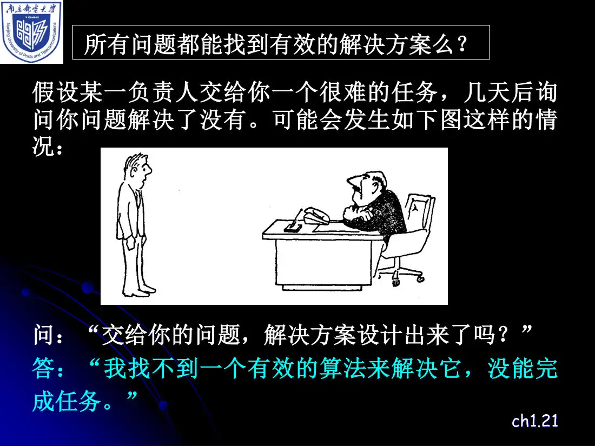

原文：

假设某一负责人交给你一个很难的任务，几天后询问你问题解决了没有。可能会发生如下图这样的情况：

问：“交给你的问题，解决方案设计出来了吗？”答：“我找不到一个有效的算法来解决它，没能完成任务。”

南京郵電大學948

所有问题都能找到有效的解决方案么？

ch1.21

### 要证明一个问题不存在有效算法，往往跟寻找有效算法一样难。

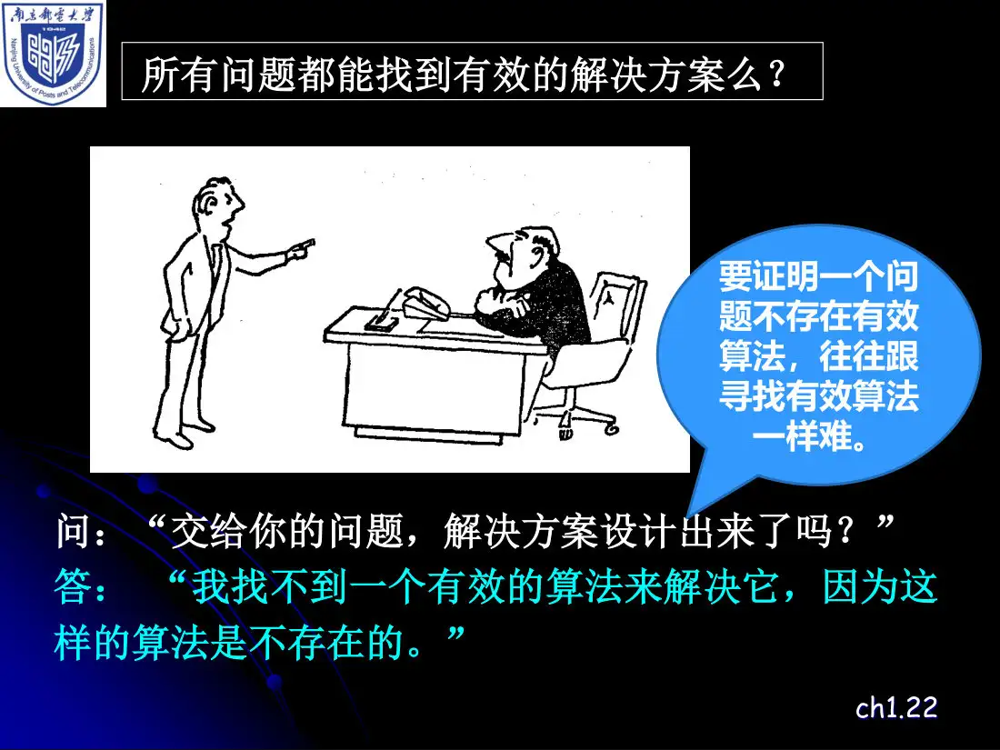

原文：

要证明一个问题不存在有效算法，往往跟寻找有效算法一样难。

问：“交给你的问题，解决方案设计出来了吗？”答： “我找不到一个有效的算法来解决它，因为这样的算法是不存在的。

南京郵電大學nmuncstions

所有问题都能找到有效的解决方案么？

ch1.22

### mnALLLLL..

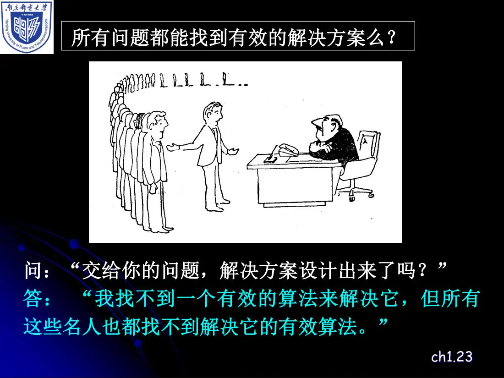

原文：

mnALLLLL..

问：“交给你的问题，解决方案设计出来了吗？”答： “我找不到一个有效的算法来解决它，但所有这些名人也都找不到解决它的有效算法。

南京郵電大學nmuncstions

所有问题都能找到有效的解决方案么？

ch1.23

### 南京郵電大學nmuncstions

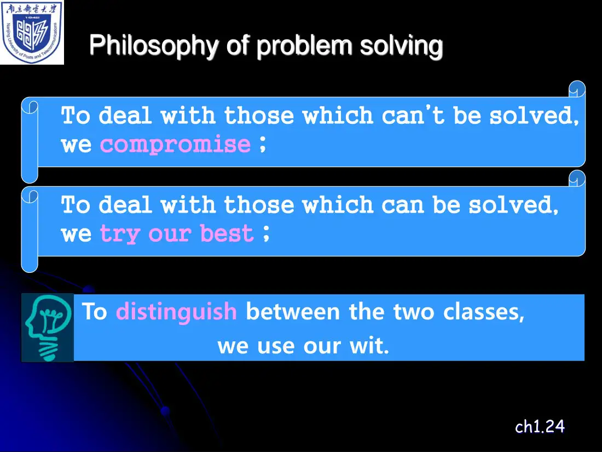

原文：

To deal with those which can’t be solved, we compromise；

To deal with those which can be solved, we try our best；

To distinguish between the two classes, we use our wit.

南京郵電大學nmuncstions

Philosophy of problem solving

ch1.24

### 有趣的算法问题

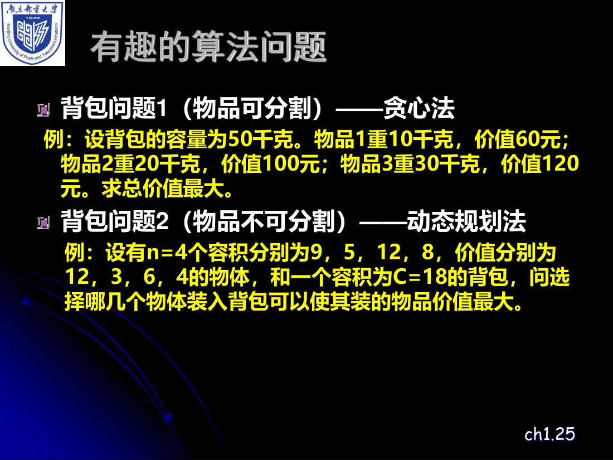

原文：

有趣的算法问题

背包问题1（物品可分割）——贪心法例：设背包的容量为50千克。物品1重10千克，价值60元；物品2重20千克，价值100元；物品3重30千克，价值120元。求总价值最大。

背包问题2（物品不可分割）——动态规划法例：设有n=4个容积分别为9，5，12，8，价值分别为12，3，6，4的物体，和一个容积为C=18的背包，问选择哪几个物体装入背包可以使其装的物品价值最大。

南京郵電大學nmuncstions

ch1.25

### 有趣的算法问题

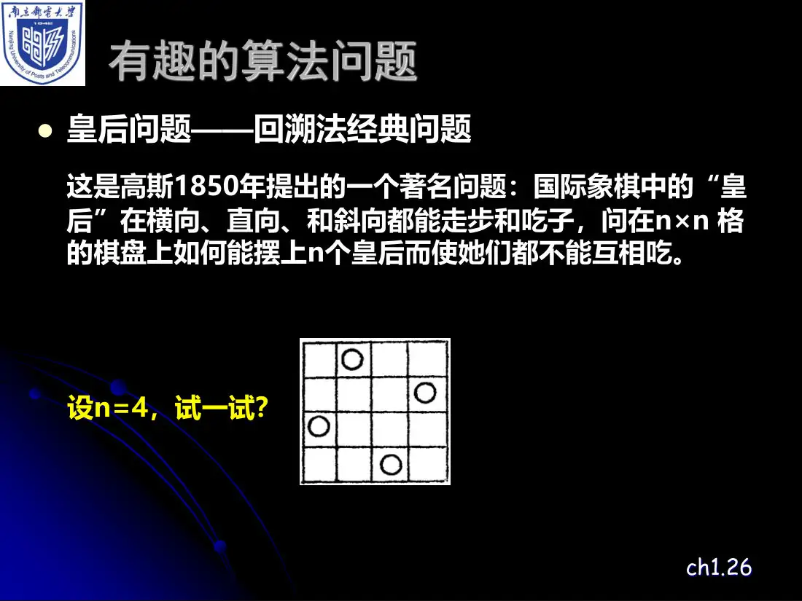

原文：

有趣的算法问题

⚫ 皇后问题— 回溯法经典问题

这是高斯1850年提出的一个著名问题：国际象棋中的“皇后”在横向、直向、和斜向都能走步和吃子，问在n×n 格的棋盘上如何能摆上n个皇后而使她们都不能互相吃。

设n=4，试一试？

南京郵電大學 municitions

ch1.26

### 有趣的算法问题

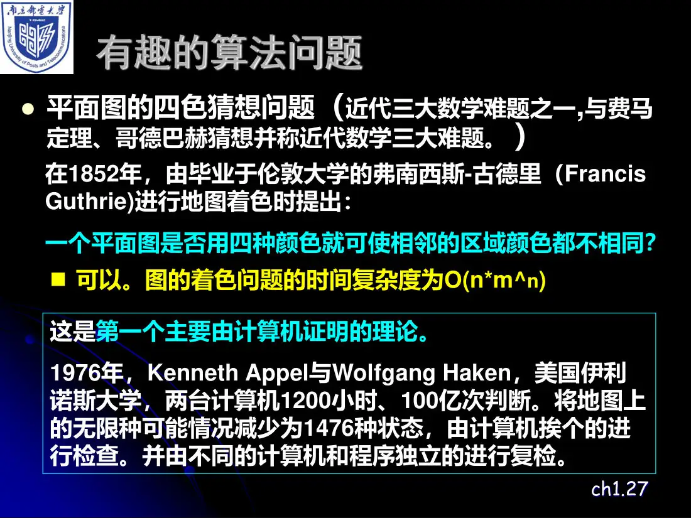

原文：

有趣的算法问题

平面图的四色猜想问题（近代三大数学难题之一,与费马定理、哥德巴赫猜想并称近代数学三大难题。在1852年，由毕业于伦敦大学的弗南西斯-古德里（FrancisGuthrie)进行地图着色时提出：一个平面图是否用四种颜色就可使相邻的区域颜色都不相同？可以。图的着色问题的时间复杂度为O(n\*m^n)

这是第一个主要由计算机证明的理论。

1976年，Kenneth Appel与Wolfgang Haken，美国伊利诺斯大学，两台计算机1200小时、100亿次判断。将地图上的无限种可能情况减少为1476种状态，由计算机挨个的进行检查。并由不同的计算机和程序独立的进行复检。

南京郵電大學 municitions

ch1.27

### 有趣的算法问题

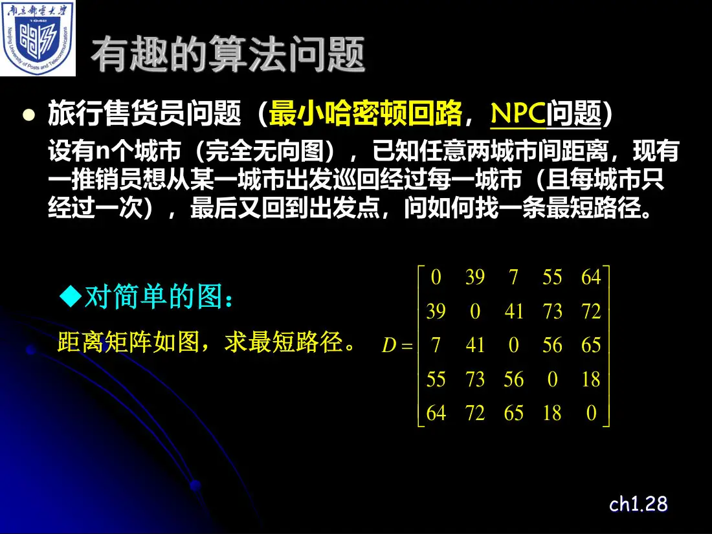

原文：

有趣的算法问题

旅行售货员问题（最小哈密顿回路，NPC问题）设有n个城市（完全无向图），已知任意两城市间距离，现有一推销员想从某一城市出发巡回经过每一城市（且每城市只经过一次），最后又回到出发点，问如何找一条最短路径。

对简单的图：

距离矩阵如图，求最短路径。

$$
D = \left[ \begin{array}{l l l l l} 0 & 3 9 & 7 & 5 5 & 6 4 \\ 3 9 & 0 & 4 1 & 7 3 & 7 2 \\ 7 & 4 1 & 0 & 5 6 & 6 5 \\ 5 5 & 7 3 & 5 6 & 0 & 1 8 \\ 6 4 & 7 2 & 6 5 & 1 8 & 0 \end{array} \right]
$$

南京郵電大學 municitions

ch1.28

### 有趣的算法问题

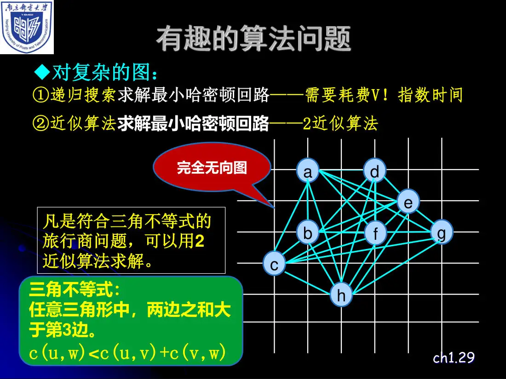

原文：

有趣的算法问题

对复杂的图：

①递归搜索求解最小哈密顿回路— 需要耗费V！指数时间

②近似算法求解最小哈密顿回路 2近似算法

完全无向图

凡是符合三角不等式的旅行商问题，可以用2近似算法求解。

三角不等式：任意三角形中，两边之和大于第3边。

c(u,w)<c(u,v)+c(v,w)

南京郵電大學 municitions

ch1.29

### 1）用Prim算法生成最小代价生成树

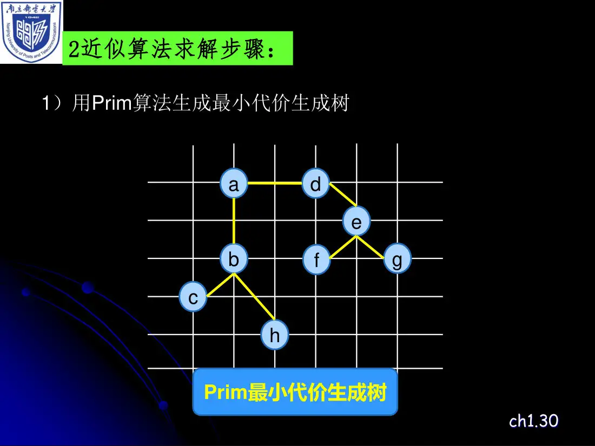

原文：

1）用Prim算法生成最小代价生成树

Prim最小代价生成树

南京郵電大學图 948

2近似算法求解步骤：

ch1.30

### 最优哈密顿回路

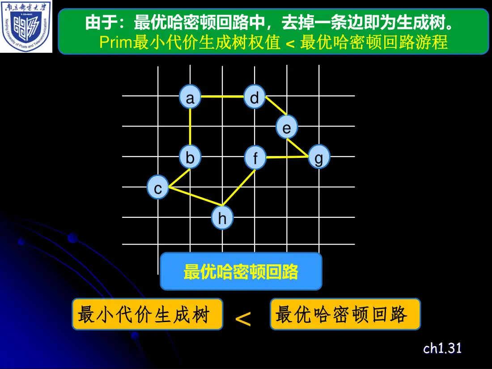

原文：

由于：最优哈密顿回路中，去掉一条边即为生成树。Prim最小代价生成树权值 < 最优哈密顿回路游程

最优哈密顿回路

最小代价生成树

最优哈密顿回路

南京郵電大學848municitons

ch1.31

### 2）先序遍历该最小代价生成树，得到一条遍历路线。

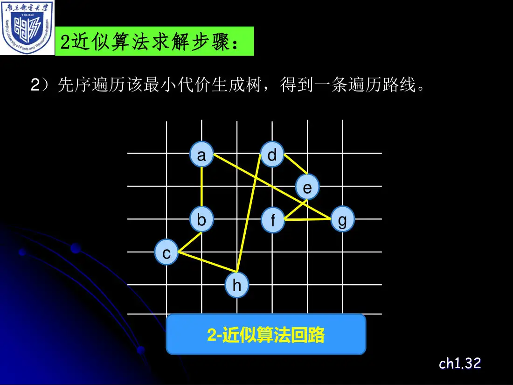

原文：

2）先序遍历该最小代价生成树，得到一条遍历路线。

2-近似算法回路

南京郵電大學 municitions

2近似算法求解步骤：

ch1.32

### 2-近似算法回路

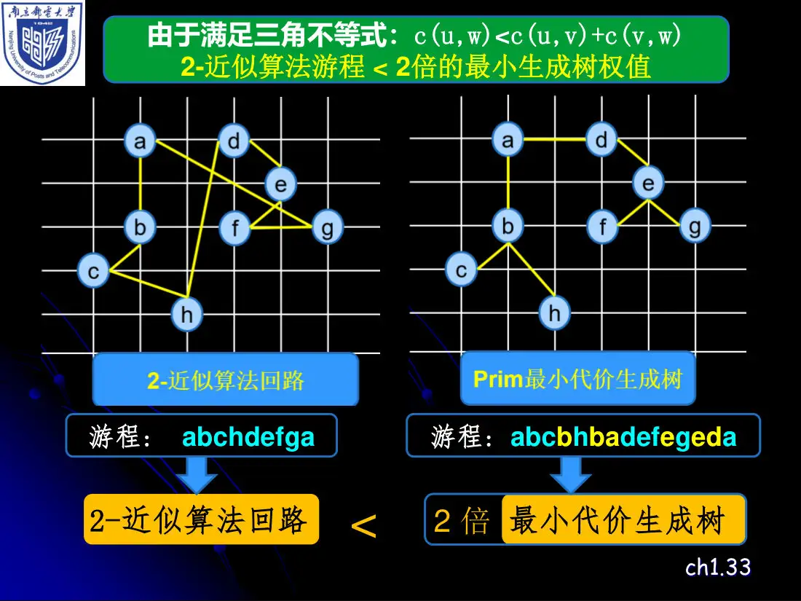

原文：

2-近似算法回路

游程: abchdefga

2-近似算法回路

Prim最小代价生成树

游程: abcbhbadefegeda

2 倍 最小代价生成树

南京郵電大學nmuncstions

由于满足三角不等式：c(u,w)<c(u,v)+c(v,w)2-近似算法游程 < 2倍的最小生成树权值

ch1.33

### 2-近似算法回路 <2 倍 最小代价生成树

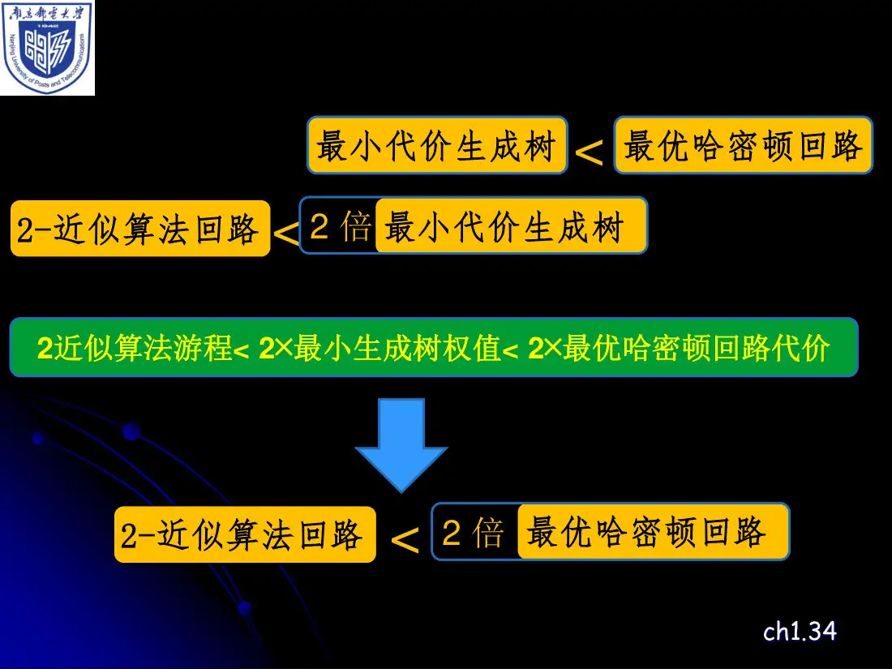

原文：

2-近似算法回路 <2 倍 最小代价生成树

2近似算法游程< 2╳最小生成树权值< 2╳最优哈密顿回路代价

2-近似算法回路 < 2 倍 最优哈密顿回路

南京郵電大學 municitions

最小代价生成树 < 最优哈密顿回路

ch1.34

### 1.3 算法设计与分析

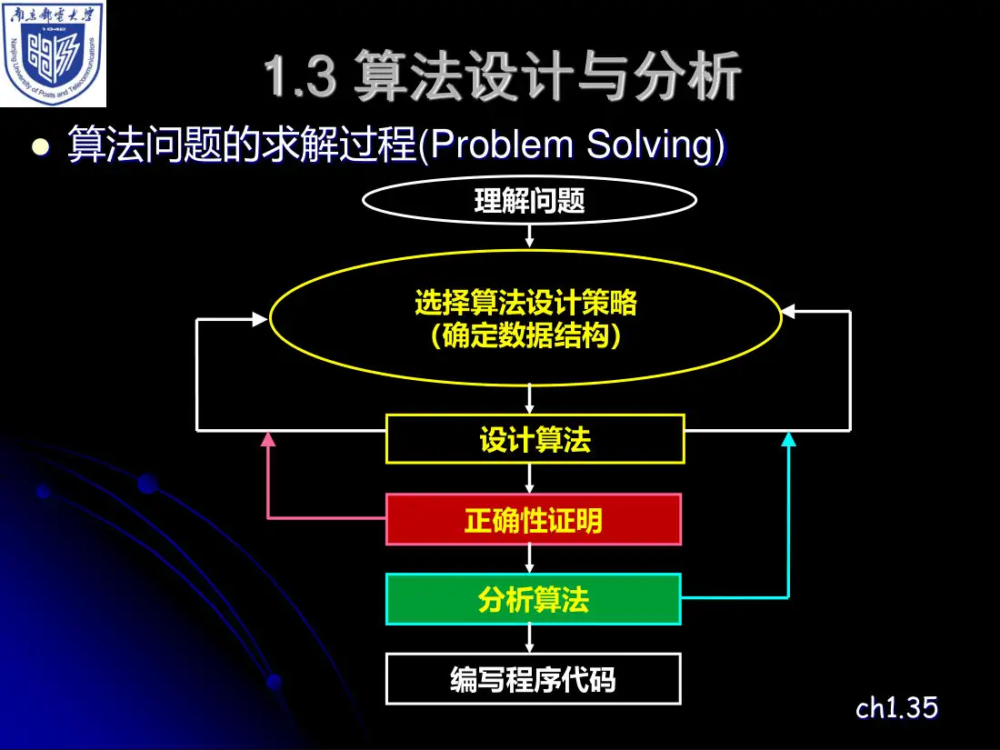

原文：

1.3 算法设计与分析

算法问题的求解过程(Problem Solving)

理解问题

选择算法设计策略（确定数据结构）

设计算法

正确性证明

分析算法

编写程序代码

南京郵電大學陶 848municitnons

ch1.35

### 1.3 算法设计与分析

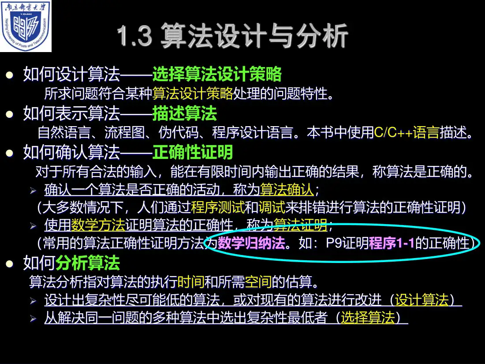

原文：

1.3 算法设计与分析

如何设计算法——选择算法设计策略所求问题符合某种算法设计策略处理的问题特性。

如何表示算法——描述算法自然语言、流程图、伪代码、程序设计语言。本书中使用C/C++语言描述。

如何确认算法——正确性证明对于所有合法的输入，能在有限时间内输出正确的结果，称算法是正确的。确认一个算法是否正确的活动，称为算法确认；（大多数情况下，人们通过程序测试和调试来排错进行算法的正确性证明）使用数学方法证明算法的正确性，称为算（常用的算法正确性证明方法为数学归纳法。如：P9证明程序1-1的正确性）

如何分析算法算法分析指对算法的执行时间和所需空间的估算。

设计出复杂性尽可能低的算法，或对现有的算法进行改进（设计算法）

从解决同一问题的多种算法中选出复杂性最低者（选择算法）

南京郵電大學948

### 南京郵電大學 municitions

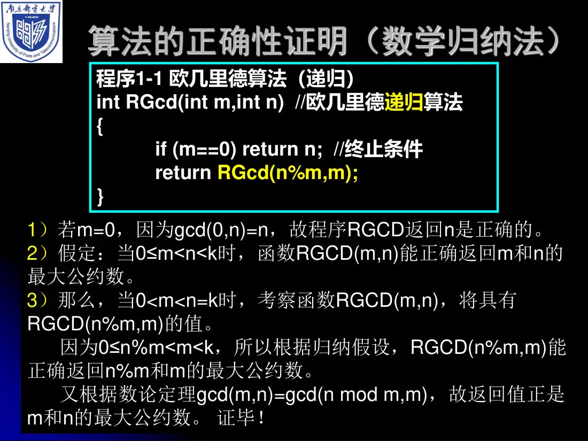

原文：

程序1-1 欧几里德算法（递归）int RGcd(int m,int n) //欧几里德递归算法

if (m==0) return n; //终止条件 return RGcd(n%m,m);

1）若m=0，因为 $\pmb { \Theta } [ \pmb { \Theta } ( \mathbf { 0 } ) ] ( \pmb { 0 } ) [ \pmb { 0 } ] = \tilde { 0 }$ ，故程序RGCD返回n是正确的。

2）假定：当 $\textcircled { 1 } E \textcircled { 1 1 } \times \textcircled { 1 } \times \textcircled { 2 }$ 时，函数RGCD(m,n)能正确返回m和n的最大公约数。

3）那么，当 $\bf { ( 0 ) } \lambda \mathrm { = } \lambda \mathrm { | 0 | \bf { < } \lambda \mathrm { | 0 | \bf { = } \lambda \mathrm { | 0 | \bf { = } \lambda \mathrm { ~ } } } }$ 时，考察函数RGCD(m,n)，将具有RGCD(n%m,m)的值。

因为 $\mathrm { ( 0 ) - ( 1 0 ) ( 0 ) ( 0 ) ( 1 1 ) - ( 1 1 ) ( - 0 ) ( 0 ) ( - 0 ) ( - 0 ) ( - 0 ) ( 0 ) ( - 0 ) ( - 0 ) ( - 0 ) ( - 0 ) }$ 所以根据归纳假设，RGCD(n%m,m)能正确返回n%m和m的最大公约数。

又根据数论定理gcd(m,n)=gcd(n mod m,m)，故返回值正是m和n的最大公约数。 证毕！

南京郵電大學 municitions

算法的正确性证明（数学归纳法）

### 1.3 算法设计与分析

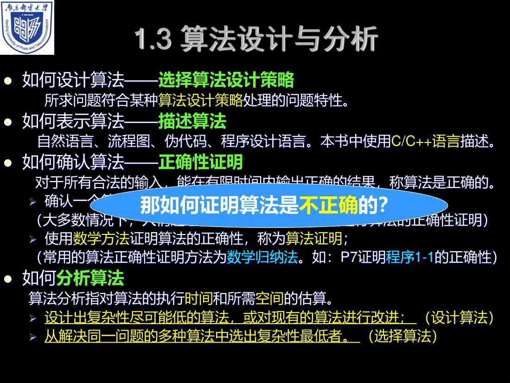

原文：

1.3 算法设计与分析

如何设计算法— 选择算法设计策略所求问题符合某种算法设计策略处理的问题特性。

如何表示算法——描述算法自然语言、流程图、伪代码、程序设计语言。本书中使用C/C++语言描述。

如何确认算法——正确性证明对于所有合法的输入，能在有限时间内输出正确的结果，称算法是正确的。

确认一个（大多数情况下

否正确的活动，称为算法确认；那如何证明算法是不正确的？

TAHY 证明）

使用数学方法证明算法的正确性，称为算法证明；（常用的算法正确性证明方法为数学归纳法。如：P7证明程序1-1的正确性）

如何分析算法算法分析指对算法的执行时间和所需空间的估算。

设计出复杂性尽可能低的算法，或对现有的算法进行改进； （设计算法）

从解决同一问题的多种算法中选出复杂性最低者。 （选择算法）

南京郵電大學948

### 常见算法种类

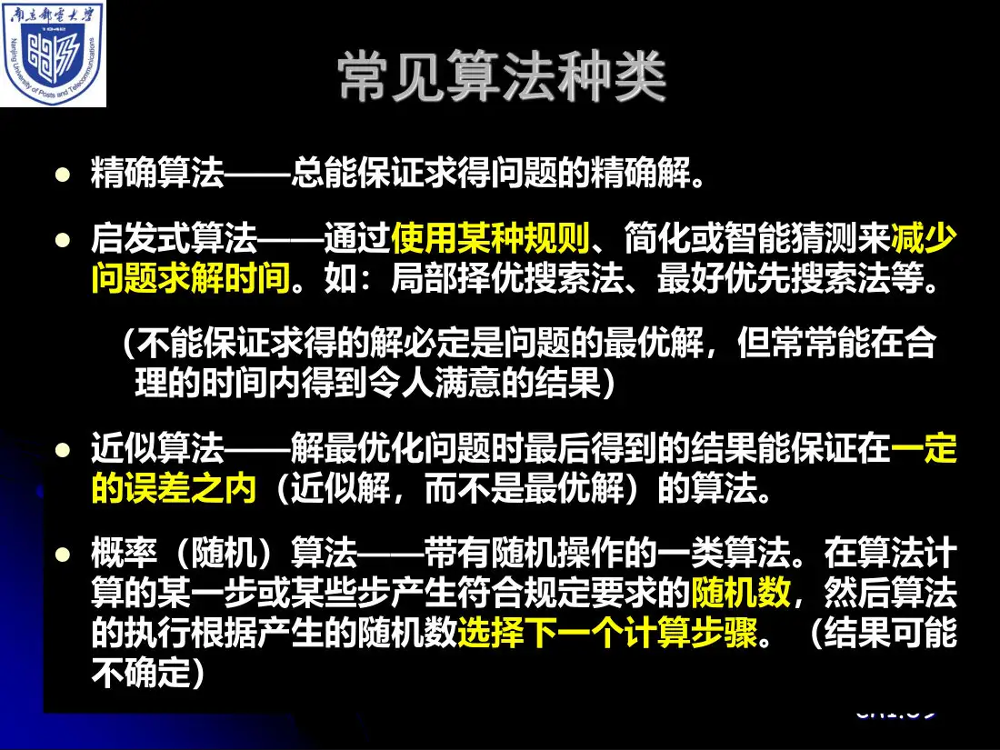

原文：

常见算法种类

⚫ 精确算法— 总能保证求得问题的精确解。

启发式算法— 通过使用某种规则、简化或智能猜测来减少问题求解时间。如：局部择优搜索法、最好优先搜索法等。

（不能保证求得的解必定是问题的最优解，但常常能在合理的时间内得到令人满意的结果）

近似算法— 解最优化问题时最后得到的结果能保证在一定的误差之内（近似解，而不是最优解）的算法。

概率（随机）算法——带有随机操作的一类算法。在算法计算的某一步或某些步产生符合规定要求的随机数，然后算法的执行根据产生的随机数选择下一个计算步骤。 （结果可能不确定）

南京郵電大學nmuncstions

### 本章作业

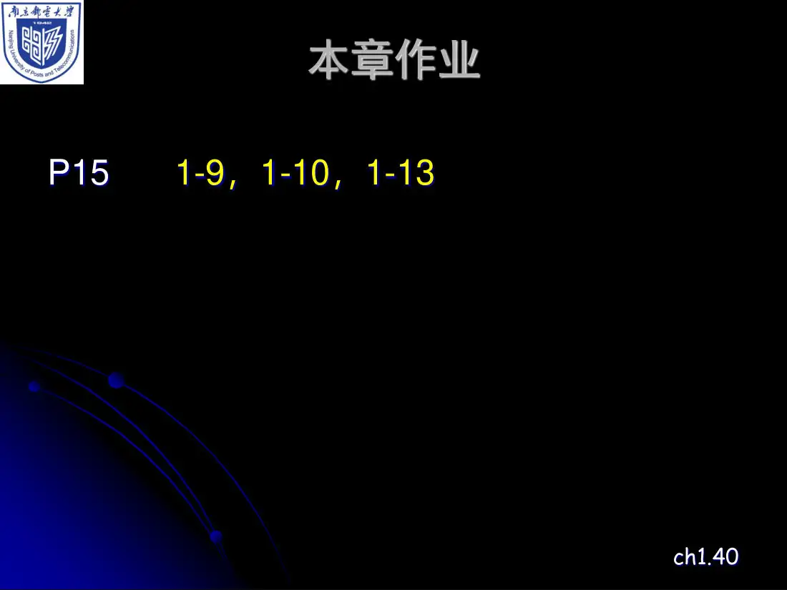

原文：

本章作业

P15 1-9，1-10，1-13

ch1.40

南京郵電大學948

### 1-9 试给出n!的递归定义式，并设计一个递归函数计算n!。

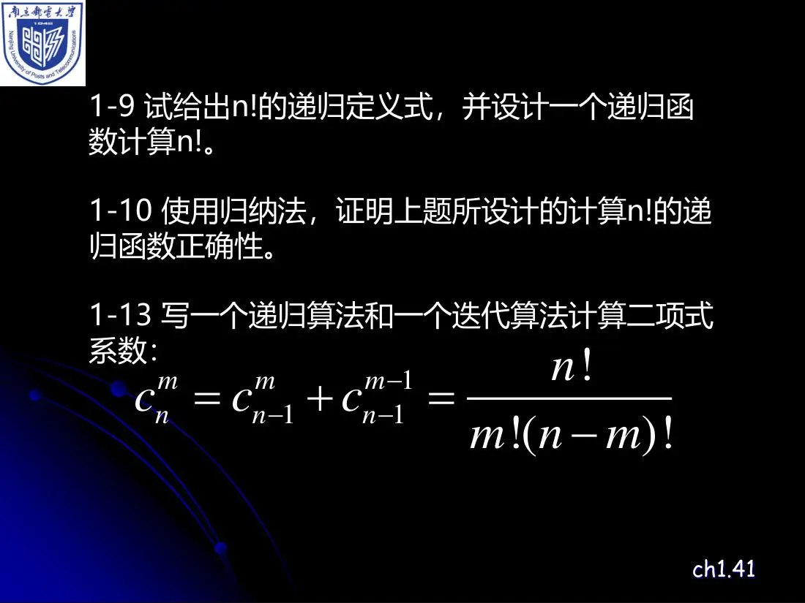

原文：

1-9 试给出n!的递归定义式，并设计一个递归函数计算n!。

1-10 使用归纳法，证明上题所设计的计算n!的递归函数正确性。

1-13 写一个递归算法和一个迭代算法计算二项式系数： n1

$$
c _ {n} ^ {m} = c _ {n - 1} ^ {m} + c _ {n - 1} ^ {m - 1} = \frac {n !}{m ! (n - m) !}
$$

南京郵電大學 municitions

ch1.41
