# 《算法分析与设计》第2章 算法分析基础（课件）

原件的每一页，下面附识别出的文字。

### 第2章 算法分析基础

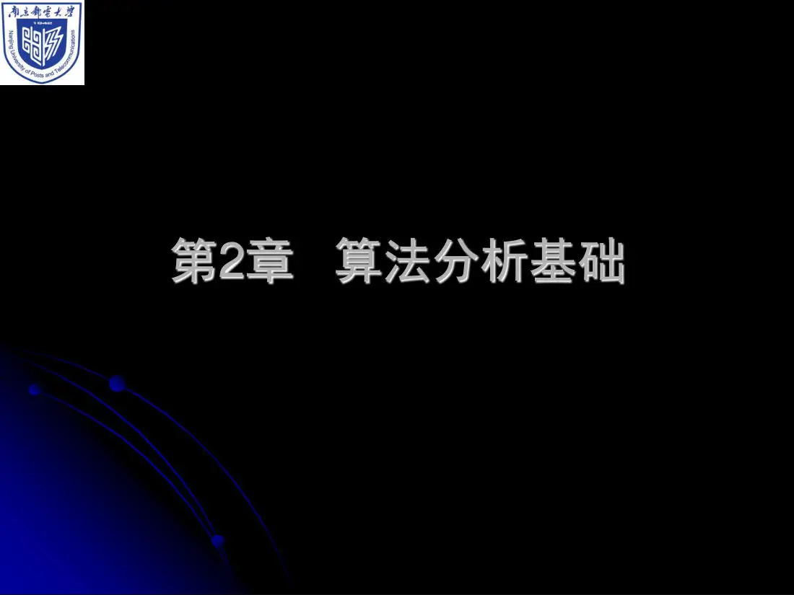

原文：

第2章 算法分析基础

南京郵電大學 municitions

### ⚫ 学习要点：

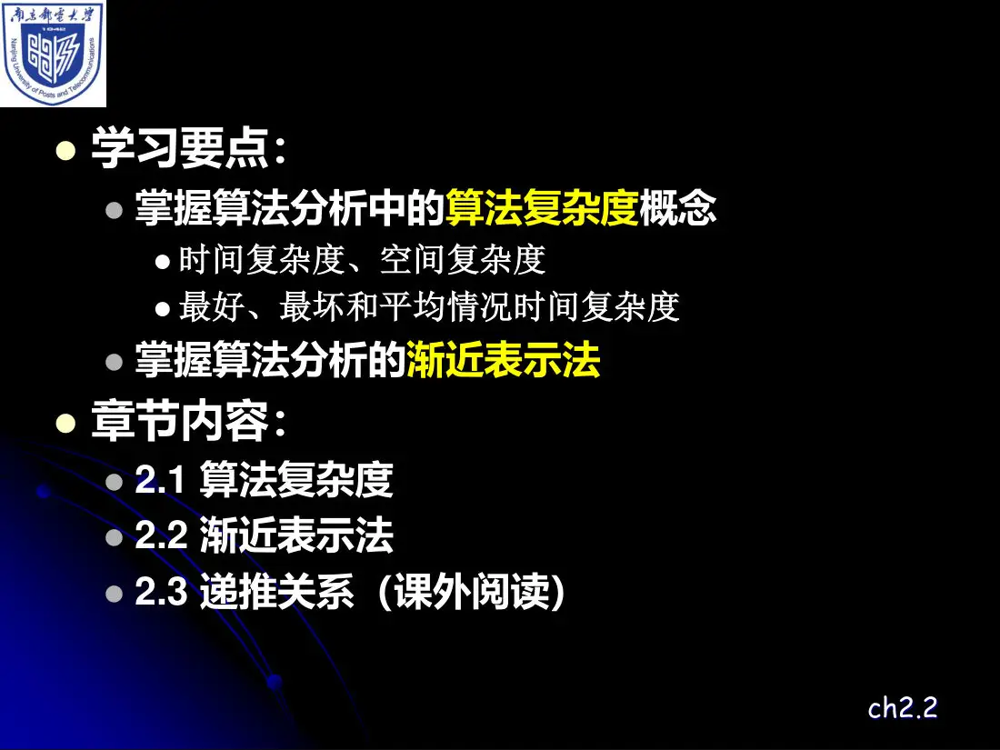

原文：

⚫ 学习要点：

掌握算法分析中的算法复杂度概念

⚫时间复杂度、空间复杂度

⚫最好、最坏和平均情况时间复杂度

掌握算法分析的渐近表示法

⚫ 章节内容：

⚫ 2.1 算法复杂度

⚫ 2.2 渐近表示法

⚫ 2.3 递推关系（课外阅读）

南京郵電大學nmuncstions

ch2.2

### 2.1 算法复杂度

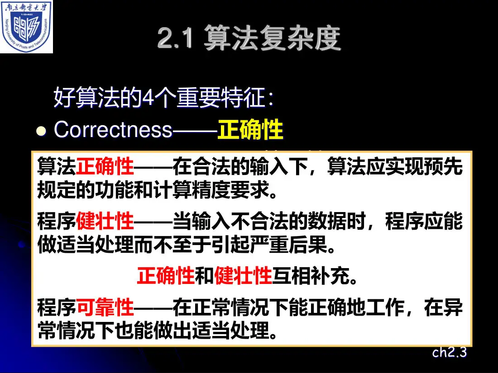

原文：

2.1 算法复杂度

好算法的4个重要特征：⚫ Correctness— 正确性

⚫ Simplicity, clarity——简明性算法正确性——在合法的输入下，算法应实现预先⚫ Amount of time/space 规定的功能和计算精度要求。

⚫ Optimality——最优性程序健壮性——当输入不合法的数据时，程序应能做适当处理而不至于引起严重后果。

正确性和健壮性互相补充。

程序可靠性——在正常情况下能正确地工作，在异常情况下也能做出适当处理。

南京郵電大學 municitions

ch2.3

### 2.1 算法复杂度

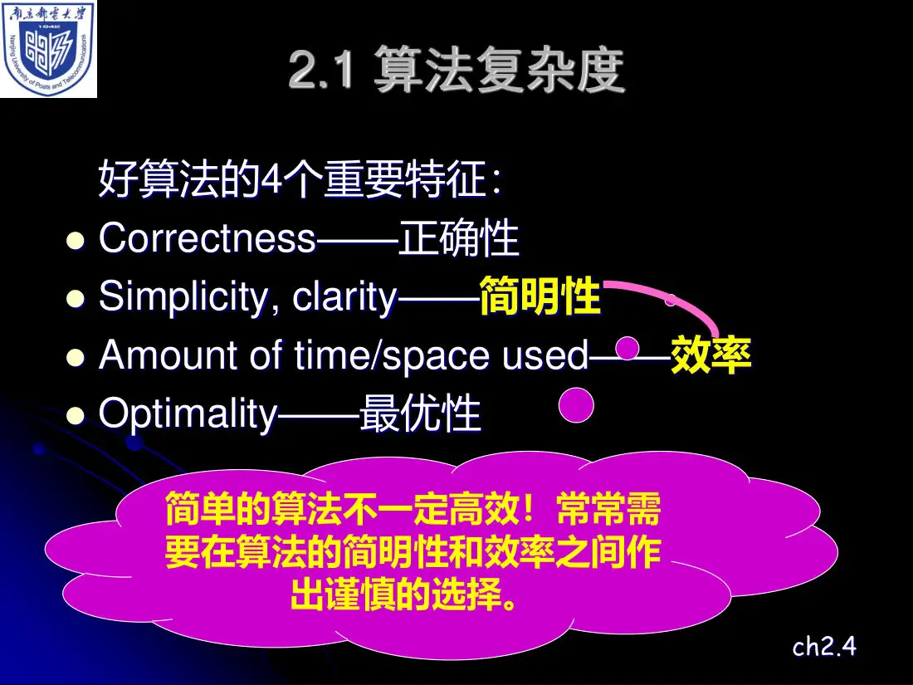

原文：

2.1 算法复杂度

好算法的4个重要特征：

⚫ Correctness— 正确性

⚫ Simplicity, clarity— 简明性

⚫ Amount of time/space used——效率

⚫ Optimality— 最优性

简单的算法不一定高效！常常需要在算法的简明性和效率之间作出谨慎的选择。

南京郵電大學948

ch2.4

### 2.1 算法复杂度

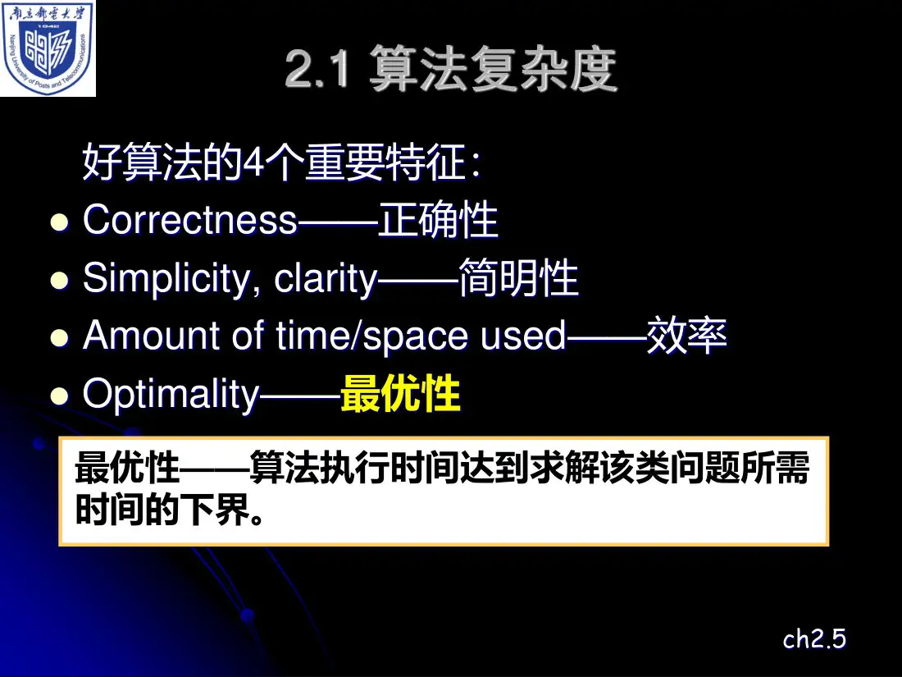

原文：

2.1 算法复杂度

好算法的4个重要特征：

⚫ Correctness— 正确性

⚫ Simplicity, clarity— —简明性

⚫ Amount of time/space used— 效率

⚫ Optimality— 最优性

最优性——算法执行时间达到求解该类问题所需时间的下界。

南京郵電大學948

ch2.5

### Optimal algorithm（最优算法）

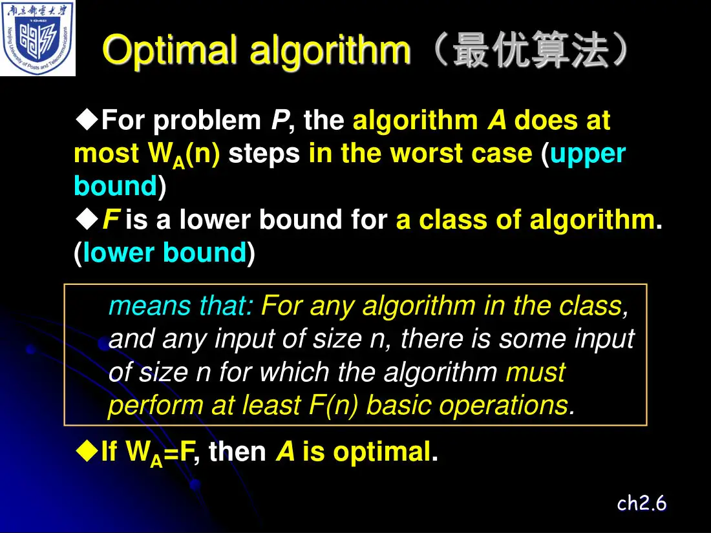

原文：

Optimal algorithm（最优算法）

◆For problem P, the algorithm A does at most W (n) steps in the worst case (upper bound)

◆F is a lower bound for a class of algorithm. (lower bound)

means that: For any algorithm in the class, and any input of size n, there is some input of size n for which the algorithm must perform at least F(n) basic operations.

If W =F, then A is optimal.

南京郵電大學 municitions

ch2.6

### 最优算法

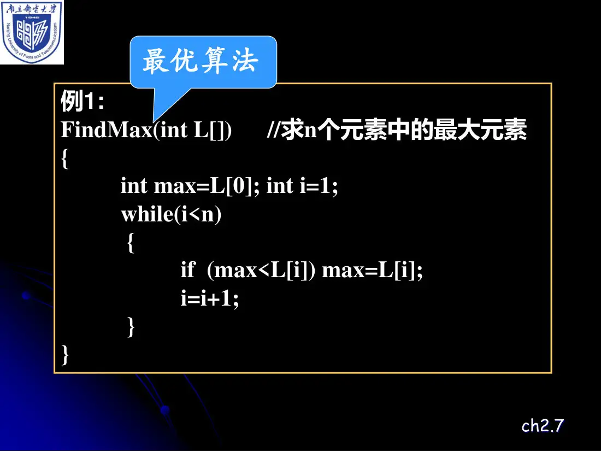

原文：

最优算法

例1:FindMax(int L[]) //求n个元素中的最大元素

int max=L[0]; int i=1;while(i<n)

if (max<L[i]) max=L[i];i=i+1;

南京郵電大學nmuncstions

ch2.7

### 排序问题的时间复杂度下界可证为(nlogn)。

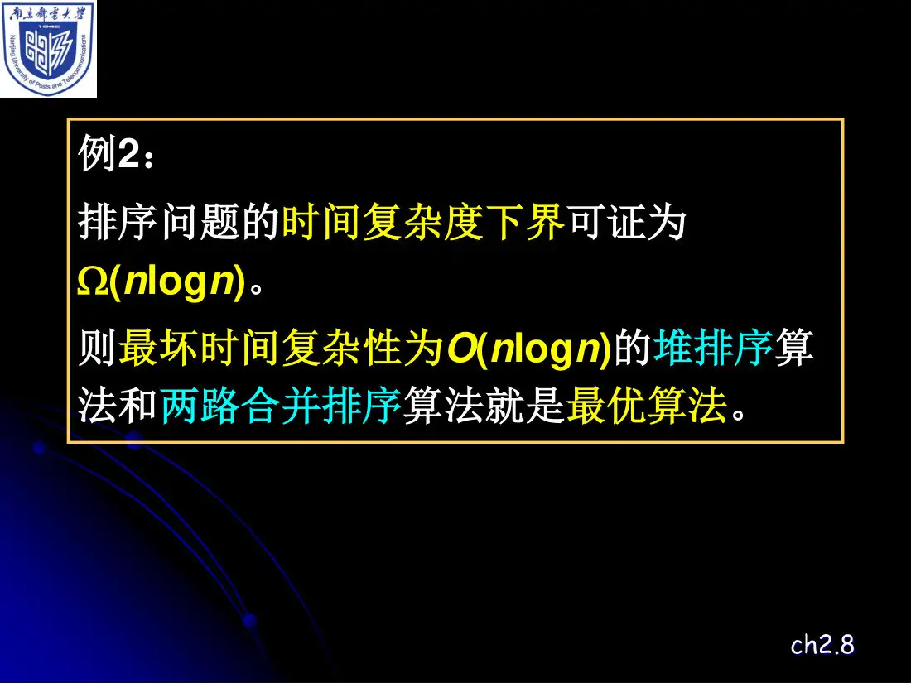

原文：

排序问题的时间复杂度下界可证为(nlogn)。

则最坏时间复杂性为O(nlogn)的堆排序算法和两路合并排序算法就是最优算法。

南京郵電大學nmuncstions

ch2.8

### 影响程序运行时间的因素

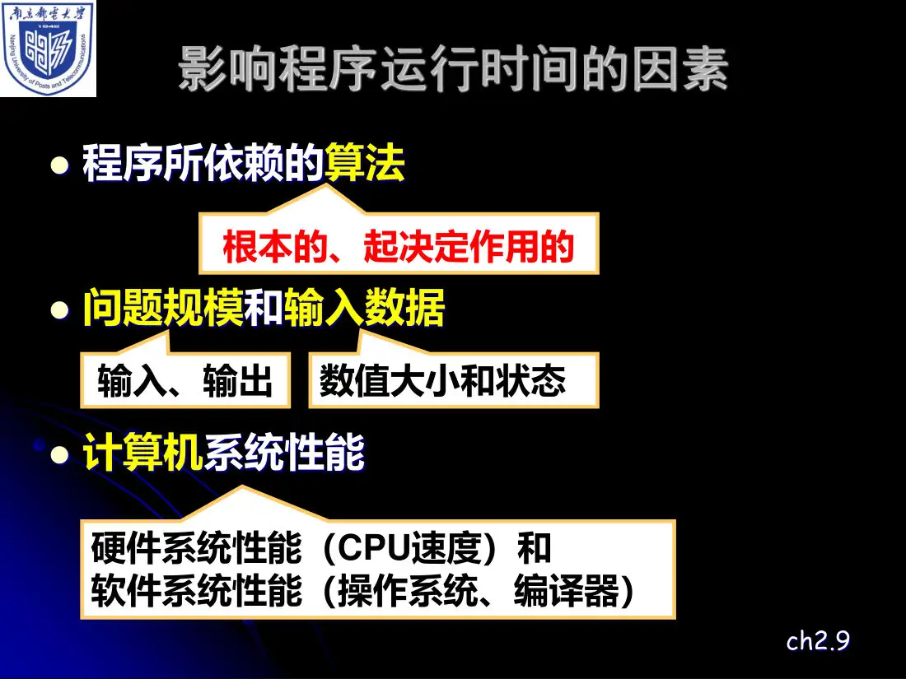

原文：

影响程序运行时间的因素

⚫ 程序所依赖的算法

根本的、起决定作用的

⚫ 问题规模和输入数据

数值大小和状态输入、输出

⚫ 计算机系统性能

硬件系统性能（CPU速度）和

软件系统性能（操作系统、编译器）

南京郵電大學nmuncstions

ch2.9

### 南京郵電大學nmuncstions

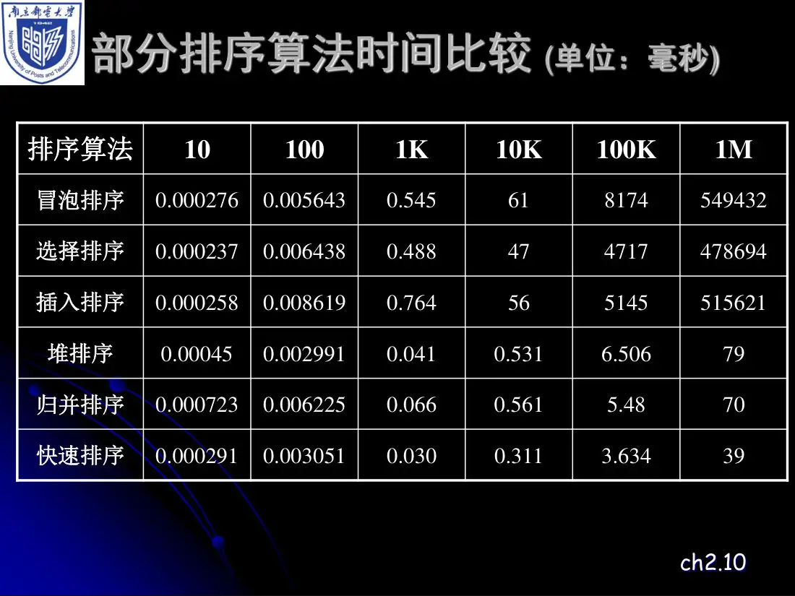

原文：

<table><tr><td>排序算法</td><td>10</td><td>100</td><td>1K</td><td>10K</td><td>100K</td><td>1M</td></tr><tr><td>冒泡排序</td><td>0.000276</td><td>0.005643</td><td>0.545</td><td>61</td><td>8174</td><td>549432</td></tr><tr><td>选择排序</td><td>0.000237</td><td>0.006438</td><td>0.488</td><td>47</td><td>4717</td><td>478694</td></tr><tr><td>插入排序</td><td>0.000258</td><td>0.008619</td><td>0.764</td><td>56</td><td>5145</td><td>515621</td></tr><tr><td>堆排序</td><td>0.00045</td><td>0.002991</td><td>0.041</td><td>0.531</td><td>6.506</td><td>79</td></tr><tr><td>归并排序</td><td>0.000723</td><td>0.006225</td><td>0.066</td><td>0.561</td><td>5.48</td><td>70</td></tr><tr><td>快速排序</td><td>0.000291</td><td>0.003051</td><td>0.030</td><td>0.311</td><td>3.634</td><td>39</td></tr></table>

南京郵電大學nmuncstions

部分排序算法时间比较 (单位：毫秒)

ch2.10

### 算法复杂度

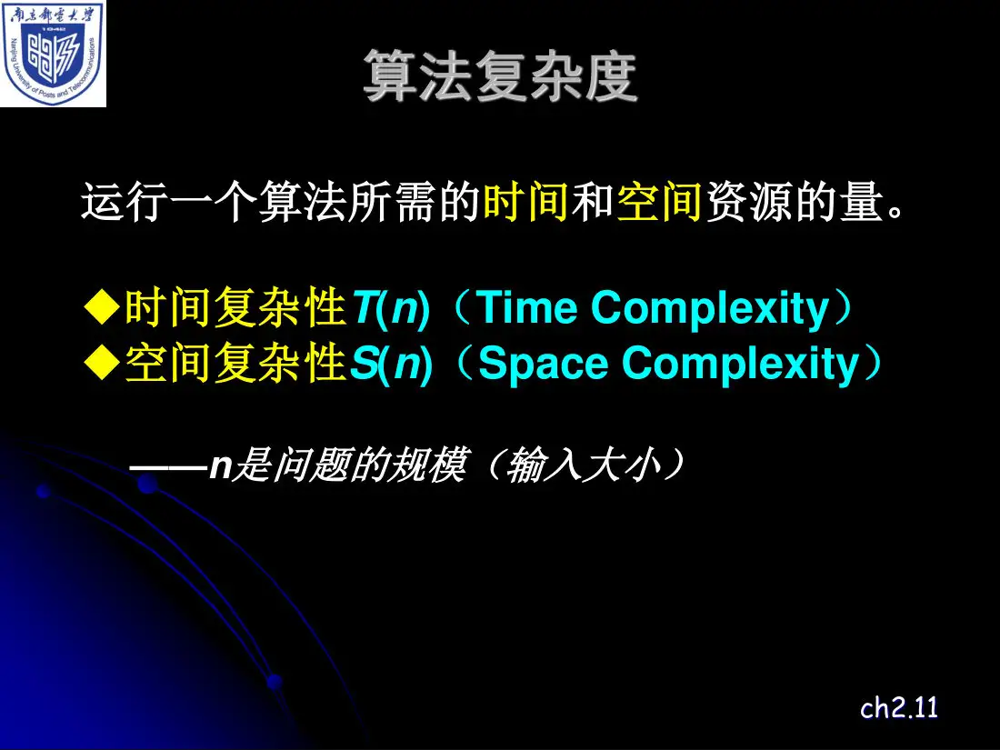

原文：

算法复杂度

运行一个算法所需的时间和空间资源的量。

时间复杂性T(n)（Time Complexity）

空间复杂性S(n)（Space Complexity）

n是问题的规模 （输入大小）

南京郵電大學948municitons

ch2.11

### ⚫ 时间复杂度— 算法运行所需的时间

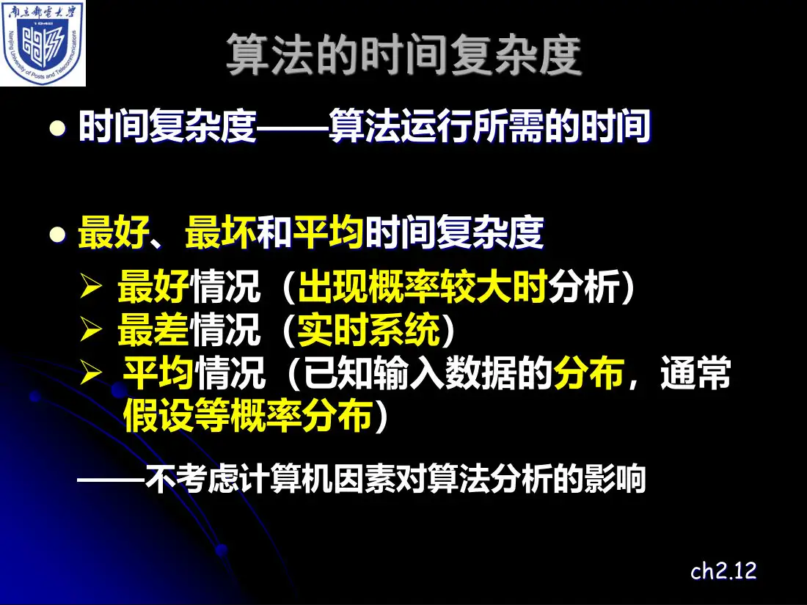

原文：

⚫ 时间复杂度— 算法运行所需的时间

⚫ 最好、最坏和平均时间复杂度

最好情况（出现概率较大时分析）

最差情况（实时系统）

平均情况（已知输入数据的分布，通常假设等概率分布）

不考虑计算机因素对算法分析的影响（1）最好情况下的时间复杂性：$: [ 0 ] \because [ \sin ( 0 ) ] = \sin ( 0 ) = \sin ( 0 ) = \sin ( 0 )$ （2）最坏情况下的时间复杂性：$\mathrm { W G } ( 0 ) = \mathrm { W G } ( 0 ) = \mathrm { W G } ( 0 ) \mathrm { S } ( 0 ) / \mathrm { W G } ( 0 ) / \mathrm { W G } ( 0 )$ （3）平均情况下的时间复杂性：A(n) = Tavg(n) = p(I)T(n,I)nI D

南京郵電大學848municitons

算法的时间复杂度

ch2.12

### 南京郵電大學948

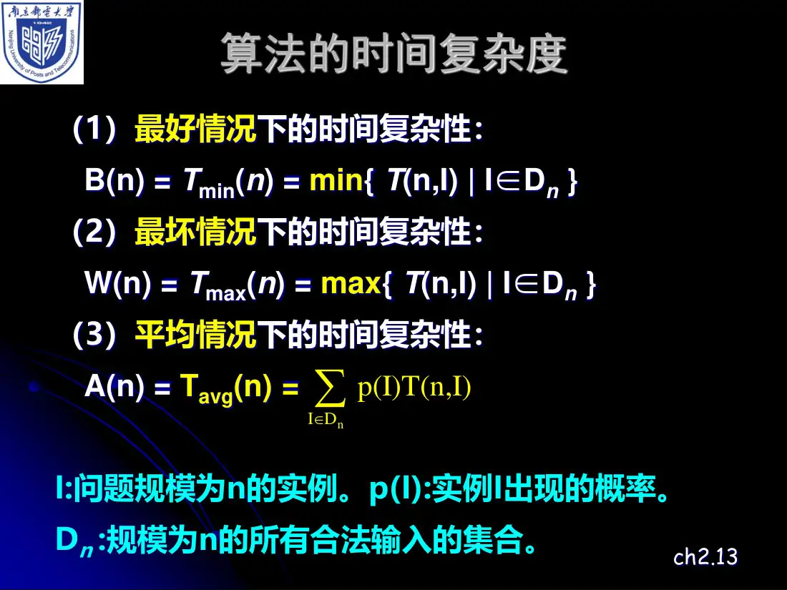

原文：

I:问题规模为n的实例。p(I):实例I出现的概率。$\boxed { \mathbf { b } }$ :规模为n的所有合法输入的集合。

南京郵電大學948

算法的时间复杂度

ch2.13

### 输入规模为100万个数据元素时的最好、最坏及平均情况下的排序时间 （单位：毫秒

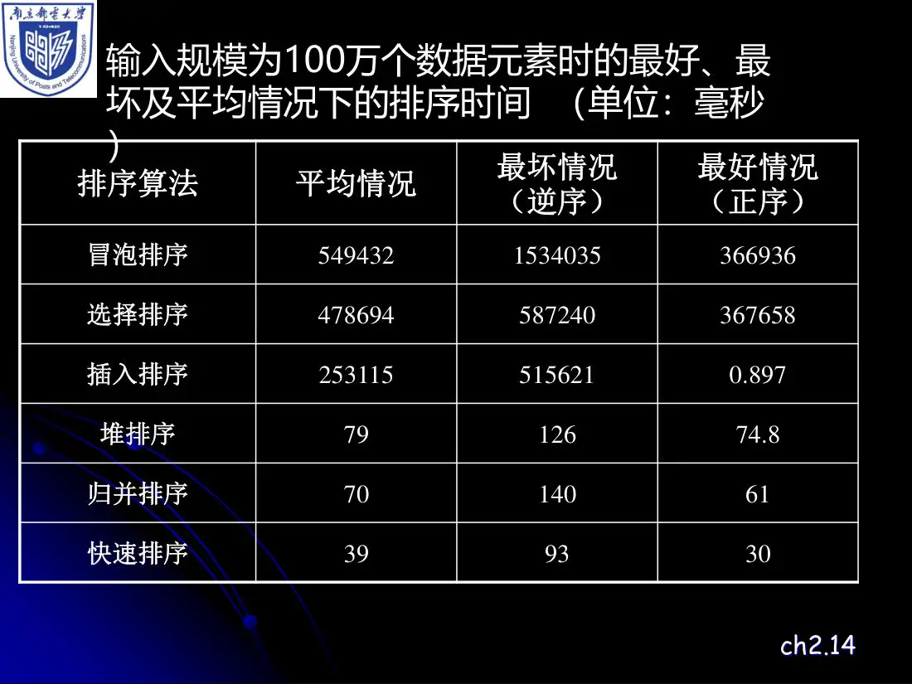

原文：

输入规模为100万个数据元素时的最好、最坏及平均情况下的排序时间 （单位：毫秒

<table><tr><td>排序算法</td><td>平均情况</td><td>最坏情况(逆序)</td><td>最好情况(正序)</td></tr><tr><td>冒泡排序</td><td>549432</td><td>1534035</td><td>366936</td></tr><tr><td>选择排序</td><td>478694</td><td>587240</td><td>367658</td></tr><tr><td>插入排序</td><td>253115</td><td>515621</td><td>0.897</td></tr><tr><td>堆排序</td><td>79</td><td>126</td><td>74.8</td></tr><tr><td>归并排序</td><td>70</td><td>140</td><td>61</td></tr><tr><td>快速排序</td><td>39</td><td>93</td><td>30</td></tr></table>

南京郵電大學nmuncstions

ch2.14

### 算法的空间复杂度

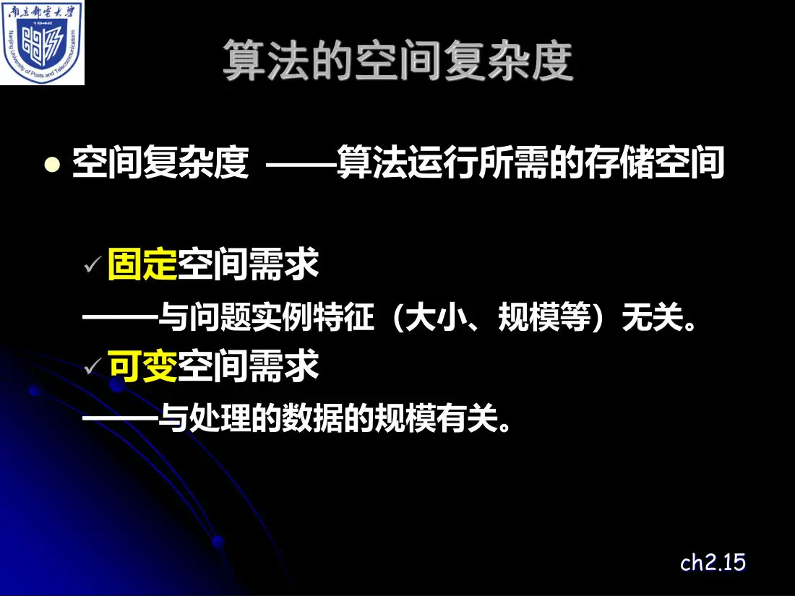

原文：

算法的空间复杂度

⚫ 空间复杂度 算法运行所需的存储空间

固定空间需求与问题实例特征（大小、规模等）无关。可变空间需求与处理的数据的规模有关。

南京郵電大學 municitions

ch2.15

### 用程序步分析算法的时间复杂度

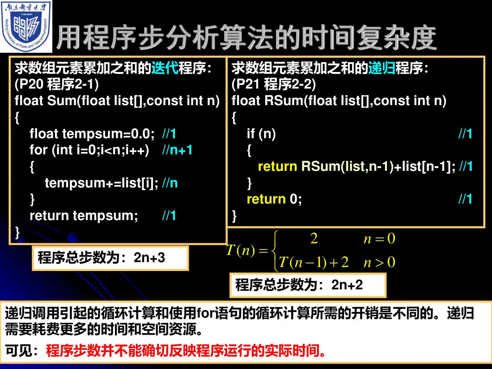

原文：

用程序步分析算法的时间复杂度

求数组元素累加之和的迭代程序：(P20 程序2-1)float Sum(float list[],const int n)

float tempsum=0.0; //1 for (int i=0;i<n;i++) //n+1 { tempsum+=list[i]; //n } return tempsum; //1

程序总步数为：2n+3求数组元素累加之和的递归程序：(P21 程序2-2)float RSum(float list[],const int n)

$$
T (n) = \left\{ \begin{array}{c c} 2 & n = 0 \\ T (n - 1) + 2 & n > 0 \end{array} \right.
$$

程序总步数为：2n+2

递归调用引起的循环计算和使用for语句的循环计算所需的开销是不同的。递归需要耗费更多的时间和空间资源。

可见：程序步数并不能确切反映程序运行的实际时间。

南京郵電大學Nanjing Un

### 2.2 渐近表示法

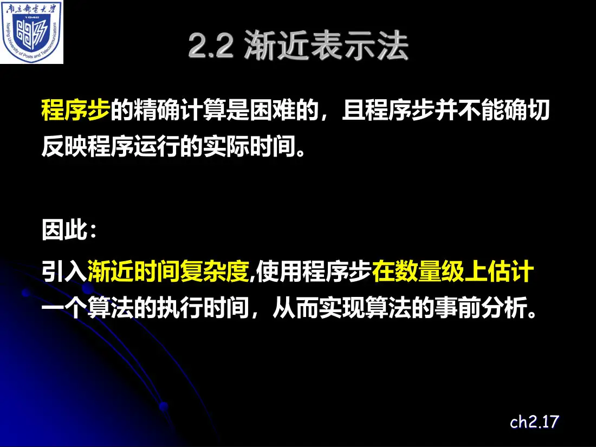

原文：

2.2 渐近表示法

程序步的精确计算是困难的，且程序步并不能确切反映程序运行的实际时间。

因此：

引入渐近时间复杂度,使用程序步在数量级上估计个算法的执行时间，从而实现算法的事前分析。

南京郵電大學 municitions

ch2.17

### 南京郵電大學nmuncstions

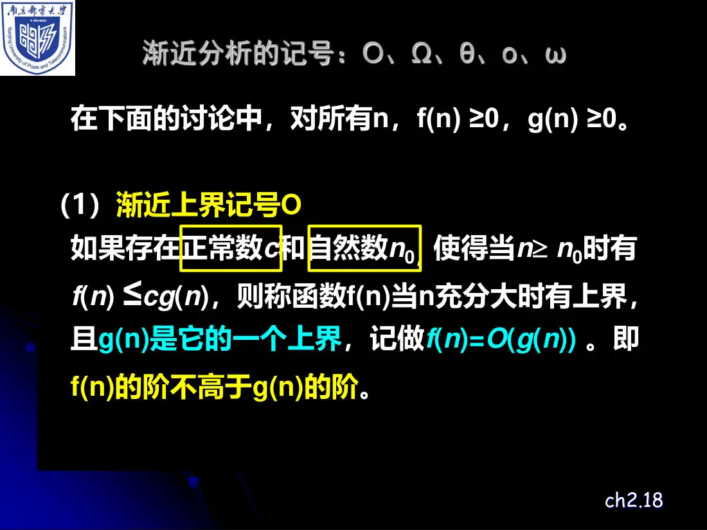

原文：

渐近分析的记号：O、Ω、θ、o、ω在下面的讨论中，对所有n，f(n) ≥0，g(n) ≥0。

（1）渐近上界记号O如果存在正常数c和自然数 $\mathbf { \delta } [ \mathbf { \delta } \mathbf { \eta } ]$ 使得当 $\textcircled { 1 } 2 \textcircled { 1 } 2$ 时有f(n) ≤cg(n)，则称函数f(n)当n充分大时有上界，且g(n)是它的一个上界，记做f(n)=O(g(n)) 。即f(n)的阶不高于g(n)的阶。

南京郵電大學nmuncstions

ch2.18

### 算法的渐近复杂度：保留高阶项，去掉常系数！

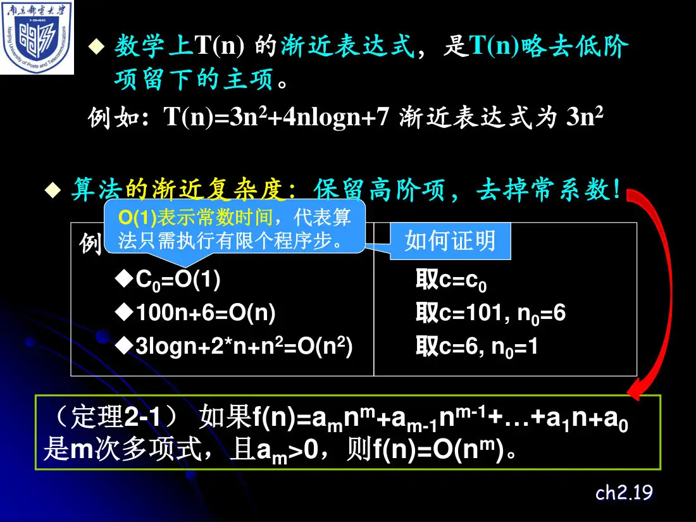

原文：

数学上T(n) 的渐近表达式，是T(n)略去低阶项留下的主项。例如: $0 . 1 1 ( 1 1 ) = 0 . 1 1 ( 2 0 ) = 1 . 1 1 ( 1 1 ) = 1 . 1 5 ( 2 0 )$ 渐近表达式为 $\textcircled { 8 } \textcircled { 1 }$

算法的渐近复杂度：保留高阶项，去掉常系数！

O(1)表示常数时间，代表算例 如：法只需执行有限个程序步。

$\therefore \angle B = \angle C ( 0 , 1 )$ $\mathrm { \Delta } \mathrm { \Sigma } \mathrm { \Sigma } \mathrm { \Sigma } \mathrm { \Sigma } \mathrm { \Sigma } \mathrm { \Sigma } \mathrm { \Sigma } \mathrm { \Sigma } \mathrm { \Sigma } \mathrm { \Sigma } \mathrm { \Sigma } \mathrm { \Sigma } \mathrm { \Sigma } \mathrm { \Sigma } \mathrm { \Sigma } \mathrm { \Sigma } \mathrm { \Sigma }$ $\Sigma _ { 1 } ( \circ _ { 1 } , \circ _ { 2 } , \circ _ { 3 } , \circ _ { 4 } , \circ _ { 5 } , \circ _ { 6 } , \circ _ { 6 } )$

如何证明

取 $\circledast = \circledast$

取c=101, n0=6

取c=6, n0=1

（定理2-1） 如果f $\textcircled { 1 } = \frac { 1 } { 1 1 } \times 1 1 \times 1 1 \times 1 1 \times 1 0 \times 1 0 \times 1 0 \times 1 0 \times 1 0 \times 1 0 \times 1 0$ 是m次多项式，且 $\mathcal { E } _ { \mathrm { ~ m ~ } } ^ { \mathrm { ~ ~ } }$ ，则 $l ( 0 ) { \equiv } ( 0 / ( 0 0 ) )$ 。

南京郵電大學nmuncstions

ch2.19

### return tempsum; //1

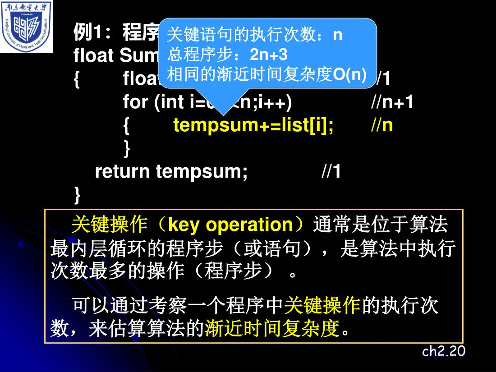

原文：

例1：程序 2-1关键语句的执行次数：nfloat Sum (float list[],con总程序步：2n+3{ floa tempsum=0.0;相同的渐近时间复杂度O(n)

for (int i=0;i<n;i++) //n+1 { tempsum+=list[i]; //n

return tempsum; //1

关键操作（key operation）通常是位于算法最内层循环的程序步（或语句），是算法中执行次数最多的操作（程序步） 。

可以通过考察一个程序中关键操作的执行次数，来估算算法的渐近时间复杂度。

南京郵電大學 municitions

ch2.20

### 例2：程序2-3 矩阵乘法for (i=0;i<n;i++)

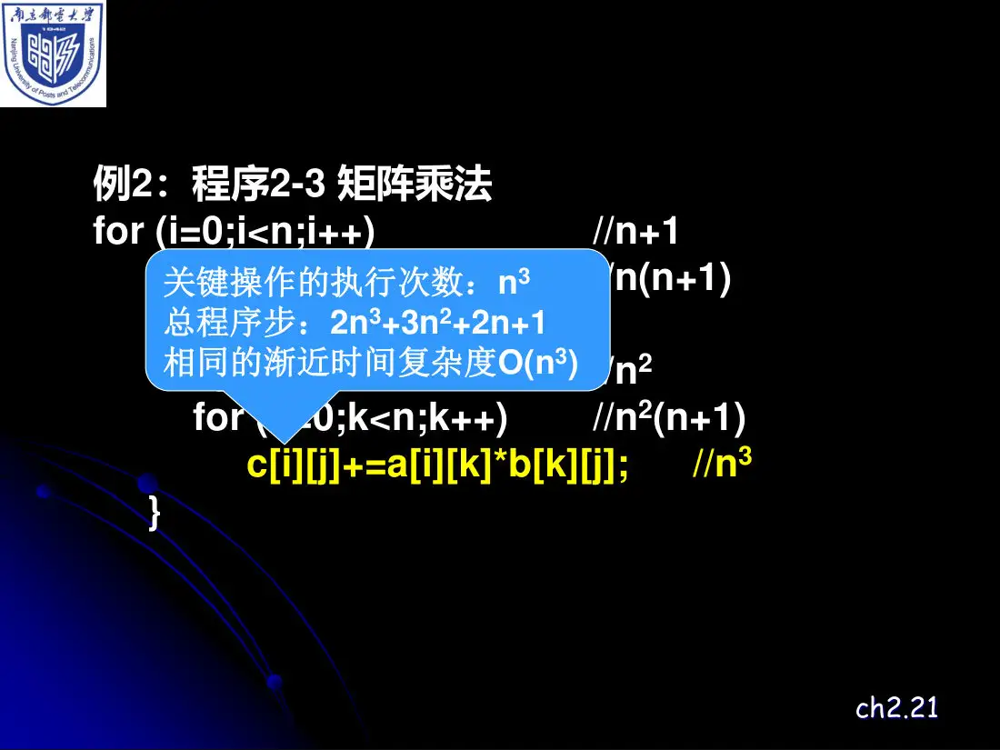

原文：

例2：程序2-3 矩阵乘法for (i=0;i<n;i++)

//n+1

or (j=0;j<n;j++) 关键操作的执行次数： $\bigstar ^ { 6 }$ 总程序步： $\angle B = \angle B = \angle B = \angle C = \angle C = \angle C$ c[i][j]=0;相同的渐近时间复杂度O(n3)

/n(n+1)

$$
/ n ^ {2}
$$

for 0;k<n;k++) //n2(n+1) c[i][j]+=a[i][k]\*b[k][j]; $U _ { \mathbf { I } } ( \mathbf { I } )$

南京郵電大學nmuncstions

ch2.21

### $$

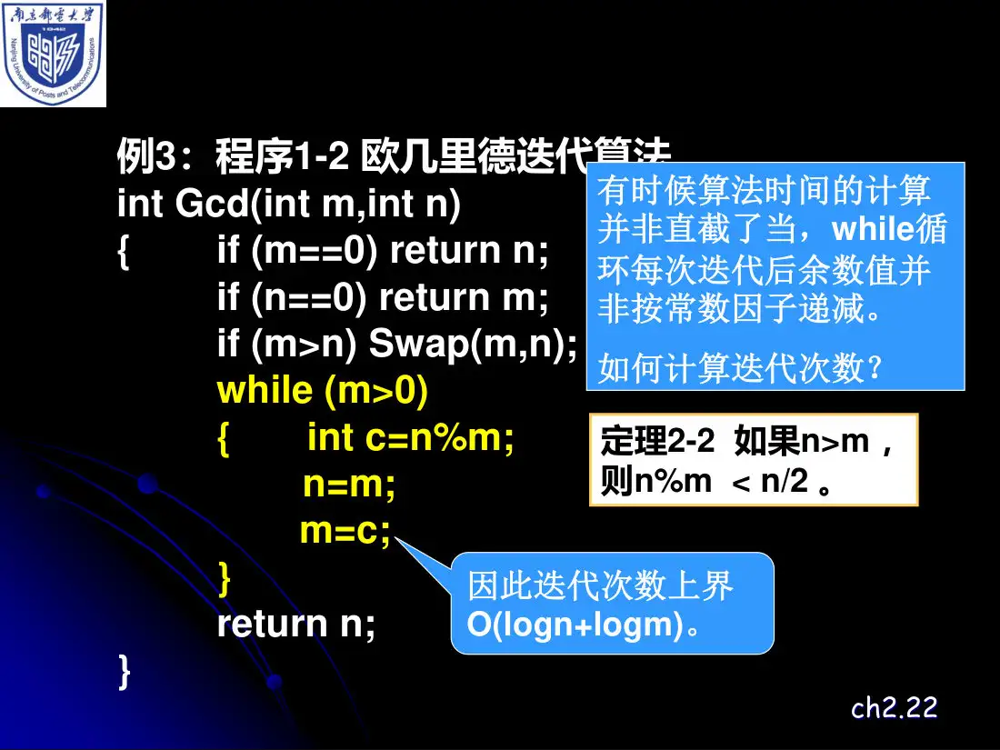

原文：

例3：程序1-2 欧几里德迭代int Gcd(int m,int n){ if (m==0) return n;if (n==0) return m;if (m>n) Swap(m,n);while (m>0)int c=n%m;n=m;

$$
m = c;
$$

return n;

有时候算法时间的计算并非直截了当，while循环每次迭代后余数值并非按常数因子递减。

如何计算迭代次数？

定理2-2 如果n>m ，则n%m < n/2 。

因此迭代次数上界O(logn+logm)。

南京郵電大學 municitions

ch2.22

### i=1; ① while (i<=n) i=i\*2; ②

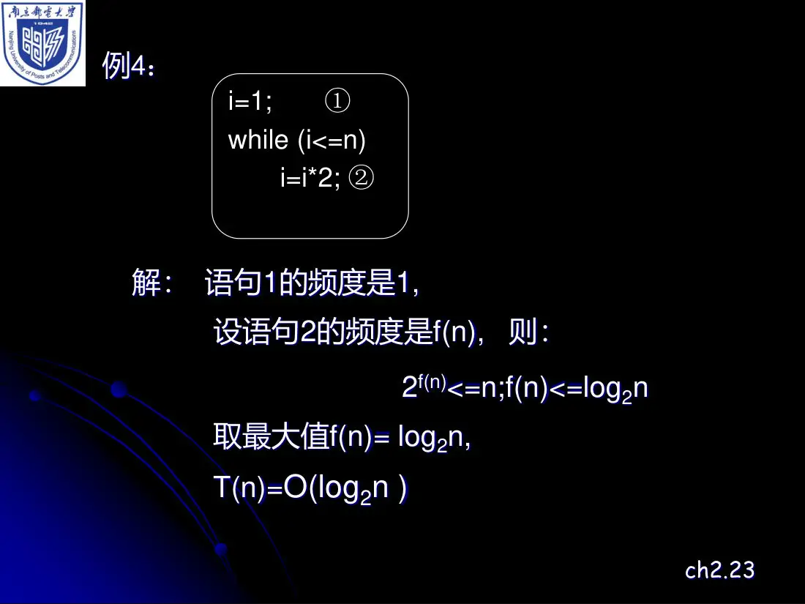

原文：

i=1; ① while (i<=n) i=i\*2; ②

解： 语句1的频度是1,设语句2的频度是f(n), 则：$\mathbf { \partial } \psi _ { 4 } ( 0 ) = | \mathbf { m } | ( 0 ) = | \mathbf { 0 } | \mathbf { e } \mathbf { = } |$ 取最大值f $( 0 ) = ( 0 , 0 )$ 7T(n)=O(log2n )

南京郵電大學 municitions

例4：

ch2.23

### 例5：

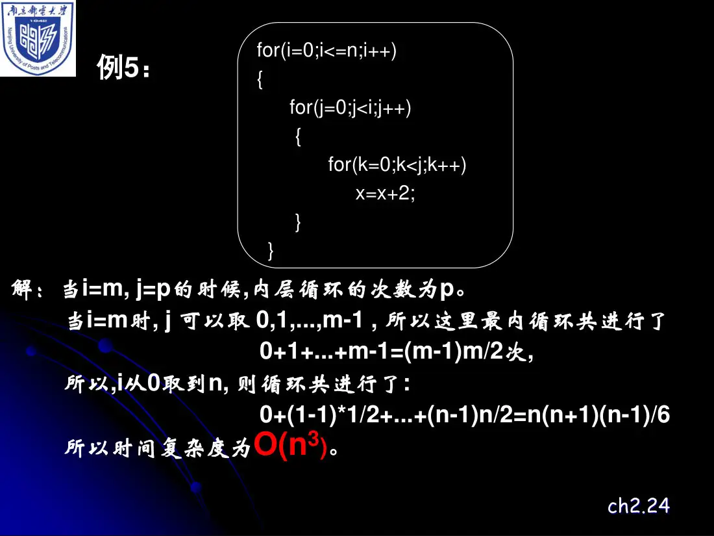

原文：

例5：

$$
\text { for } (j = 0; j <   i; j + +)
$$

$$
\begin{array}{c} \text {for(k = 0;k <   j;k + + )} \\ x = x + 2; \end{array}
$$

解：当i=m, j=p的时候,内层循环的次数为p。当 $\mathbf { \widehat { \mathbb { E } } } \mathbf { \widehat { \mathbb { m } } }$ 时, j 可以取 $\bf { 0 . 5 4 }$ , 所以这里最内循环共进行了$( ) \because ( - \infty , - \infty , 0 ) \in [ 0 , 1 ] \times [ - \infty , 0 ]$ 所以,i从0取到n, 则循环共进行了:$( 1 ) ( 1 5 0 - 1 ) \times ( 1 0 - 1 ) ( 1 5 0 - 1 ) = 1 0 ( 1 5 0 - 1 ) ( 1 5 0 - 1 ) ( 1 5 0 - 1 ) = 1 0$ 所以时间复杂度为 $\textcircled { \bullet } \textcircled { = } \textcircled { = } \textcircled { = }$ o

南京郵電大學 municitions

for(i=0;i<=n;i++)

ch2.24

### $$

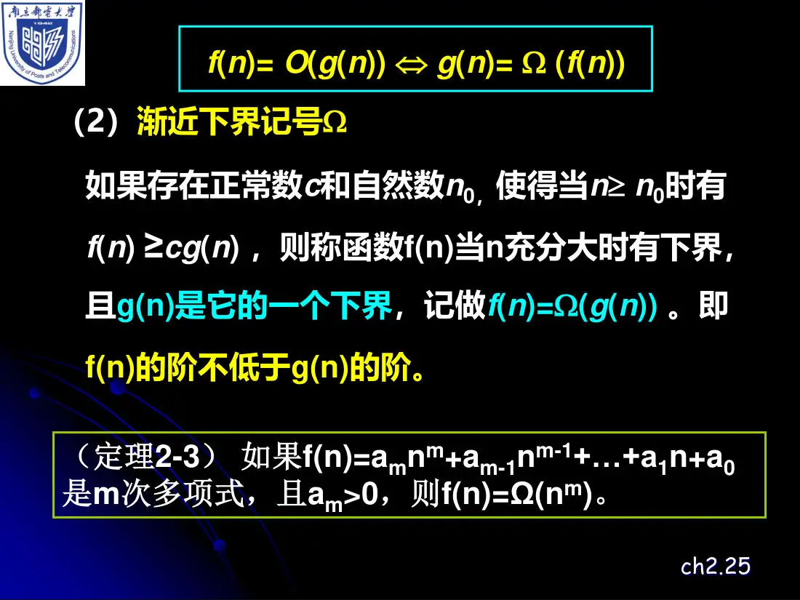

原文：

$$
f (n) = O (g (n)) \Leftrightarrow g (n) = \Omega (f (n))
$$

（2）渐近下界记号

如果存在正常数c和自然数 $\pmb { \mathbb { \left[ 0 \right] } }$ 使得当 $\boxed { 1 } \boxed { 2 } \boxed { 1 } \boxed { 1 }$ 时有$i i ( 0 ) = ( e ( 0 )$ ，则称函数f(n)当n充分大时有下界，且 $\mathbb { E } ( 0 )$ 是它的一个下界，记做f $\textcircled { 4 } = \textcircled { 9 } \textcircled { 9 } \textcircled { 1 0 } )$ 。即$\Im \mathrm { ( 0 ) }$ 的阶不低于g(n)的阶。

（定理2-3） 如果 $\mathrm { ( \textcircled { 1 } ) } = \mathrm { ( 1 ) } \mathrm { ( 1 ) } \mathrm { ( 2 ) } = \mathrm { ( 1 ) } \mathrm { ( 1 ) } \mathrm { ( 1 ) } \mathrm { ( 1 ) } \mathrm { ( 1 ) } \mathrm { ( 1 ) } \mathrm { ( 2 ) } = \mathrm { ( 1 ) } \mathrm { ( 1 ) } \mathrm { ( 2 ) } \mathrm { ( 1 ) } \mathrm { ( 2 ) }$ 是m次多项式，且 $\Xi \sharp \sharp$ ，则 $1 0 ) = 0 / ( 0 0 )$ 0

南京郵電大學 municitions

ch2.25

### （3）紧渐近界记号

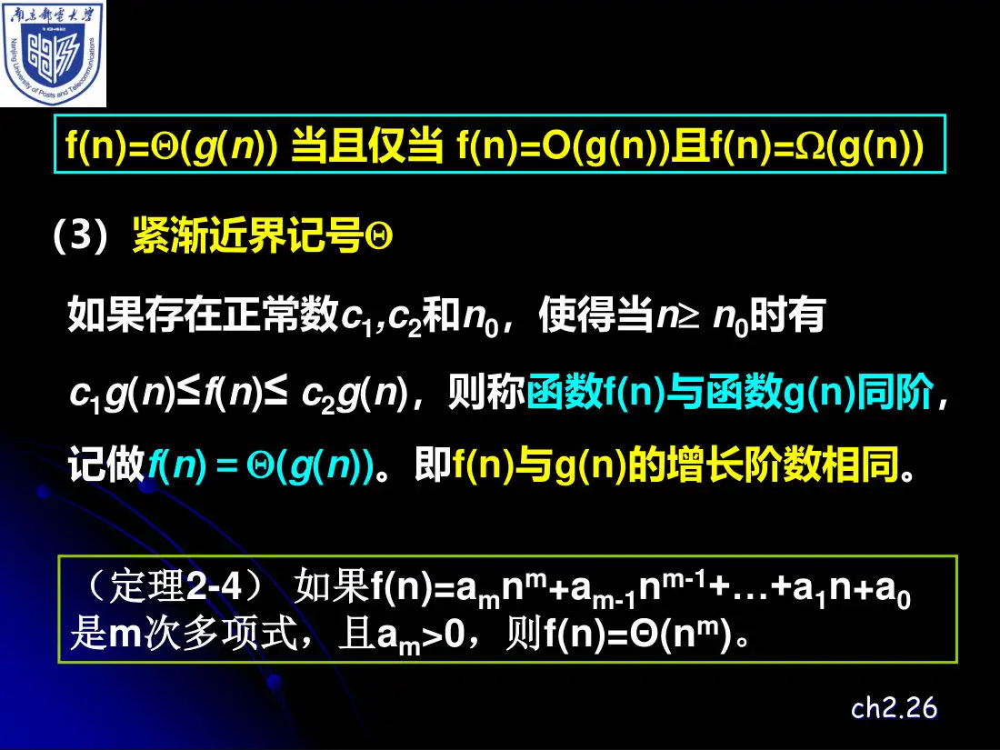

原文：

$f ( 0 ) { } = \odot ( \odot ( 0 ) )$ 当且仅当 f(n)=O(g(n))且f(n)=(g(n))

（3）紧渐近界记号

如果存在正常数 $\textcircled { 9 } \textcircled { 9 }$ 和 $\pmb { \mathbb { L } } ( \pmb { \mathbb { \eta } } )$ ，使得当 $\pmb { \bigtriangledown } \pmb { \bigtriangledown } = \pmb { \bigtriangledown } ( \pmb { \bigtriangledown } )$ 时有$\cos ( \varphi ) = \sin ( \varphi ) = \cos ( \varphi )$ 则称函数f(n)与函数g(n)同阶，记做 $i ( \pmb { \omega } ) = \pmb { \bigcirc } ( \pmb { \mathscr { C } } ( \pmb { \mathscr { D } } ) )$ 即f(n)与g(n)的增长阶数相同。

（定理2-4） 如果f $\mathrm { ( 0 ) } = \frac { 1 } { 1 1 } \times \frac { 1 } { 2 } \times \frac { 1 } { 1 1 } \times \frac { 1 } { 2 } \times \frac { 1 } { 2 } \times \frac { 1 } { 2 } \times \frac { 1 } { 2 } \times \frac { 1 } { 2 } \times \frac { 1 } { 2 } \times \frac { 1 } { 2 }$ 是m次多项式，且 $\Theta$ ，则f $( 0 ) \equiv ( \odot / ( " ) )$ 。

南京郵電大學nmuncstions

ch2.26

### （4）非紧上界记号o

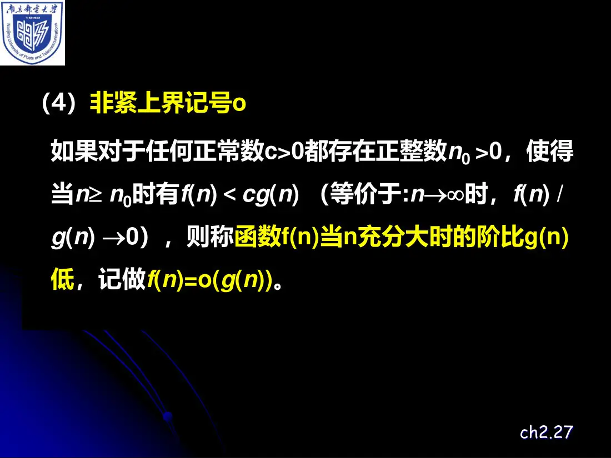

原文：

（4）非紧上界记号o

如果对于任何正常数c>0都存在正整数 $\pmb { \mathscr { n } } ( \pmb { \mathscr { n } } )$ ，使得当 $\pmb { \bigtriangledown } \pmb { \bigtriangledown } = \pmb { \bigtriangledown } ( \pmb { \bigtriangledown } )$ 时有 $i i ( 0 ) \times \pmb { \mathcal { O } } ( \pmb { \mathcal { O } } ( \pmb { \mathcal { O } } ) )$ （等价于:n→时，f(n) /$\textcircled { 9 } \textcircled { 4 } \textcircled { 7 }$ ，则称函数f(n)当n充分大时的阶比g(n)低，记做 $i ( 0 ) { \equiv } \mathbb { Q } ( \pmb { \mathscr { Q } } ( 0 ) )$

南京郵電大學 municitions

ch2.27

### f(n)= o(g(n)) ⇔ g(n)= ω (f(n))

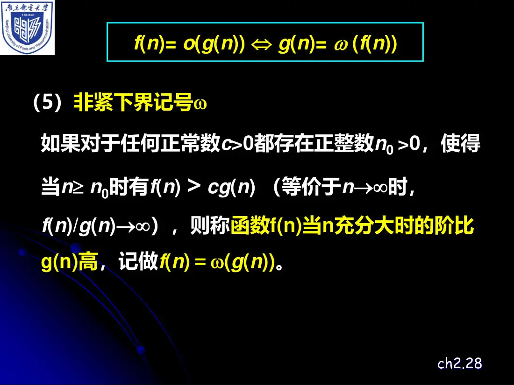

原文：

f(n)= o(g(n)) ⇔ g(n)= ω (f(n))

如果对于任何正常数 $\mathbf { \odot 9 }$ 都存在正整数 $\pmb { \mathbb { \ m } } ( \pmb { \mathbb { \ m } } )$ ，使得当 $\pmb { \bigtriangledown } \pmb { \bigtriangledown } = \pmb { \bigtriangledown } ( \pmb { \bigtriangledown } )$ 时有f(n) $\Sigma ^ { ( 9 ) }$ （等价于 $\bf \Pi _ { \pmb { | } } \bf = \pmb { | \alpha _ { | } \pmb { | \alpha _ { | } \pmb { | } } }$ 时，$i ( \varpi ) [ e ( \varpi ) = \infty ]$ ，则称函数f(n)当n充分大时的阶比$\mathbf { G } ( \mathbf { 0 } )$ 高，记做 $i ( 0 ) { = } i 0 ( \mathcal { O } ( \bar { \omega } ) )$ o

南京郵電大學 municitions

ch2.28

### 渐近分析中函数比较

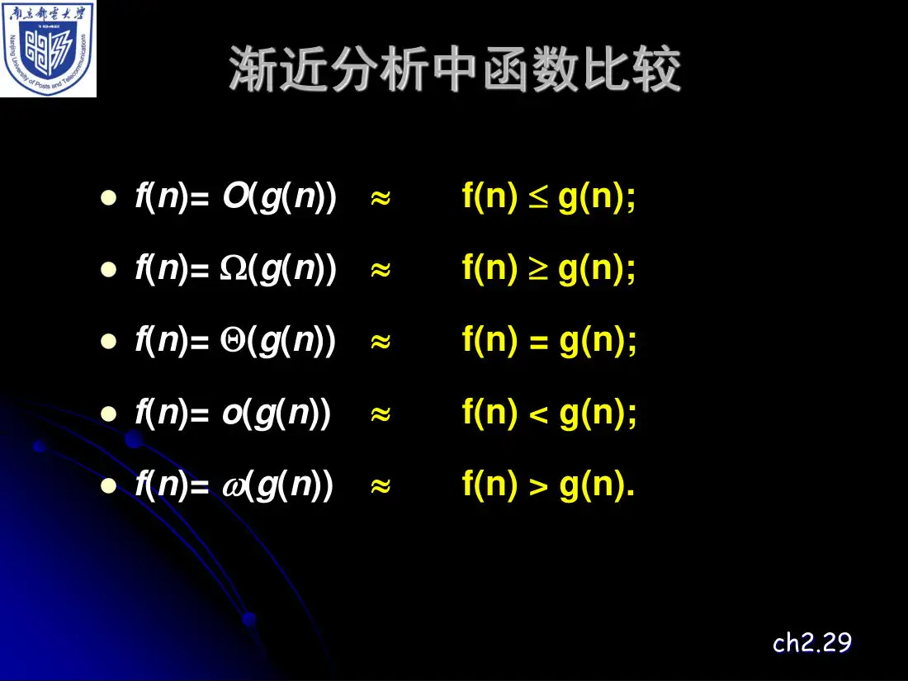

原文：

渐近分析中函数比较

$$
f (n) = O (g (n)) \approx
$$

$$
f (n) \leq g (n);
$$

$$
f (n) = \Omega (g (n)) \approx
$$

$$
f (n) \geq g (n);
$$

$$
f (n) = \Theta (g (n)) \approx
$$

$$
f (n) = g (n);
$$

$$
f (n) = o (g (n))
$$

$$
f (n) = \omega (g (n)) \approx
$$

$$
f (n) <   g (n);
$$

$$
f (n) > g (n).
$$

南京郵電大學948

ch2.29

### 时间复杂度综合分析（例1）

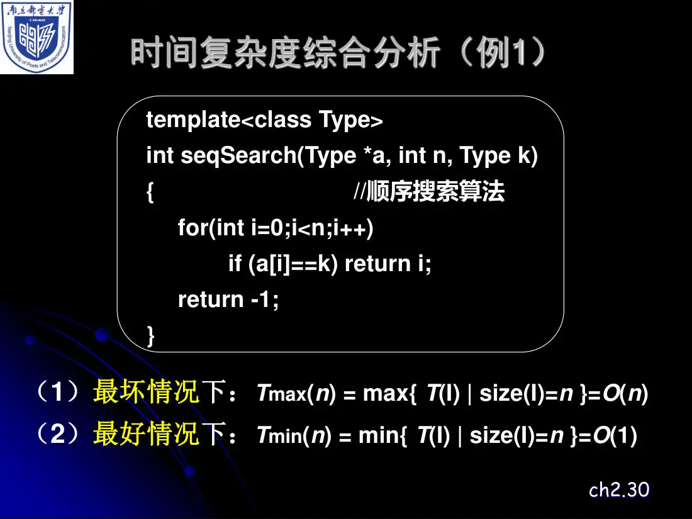

原文：

时间复杂度综合分析（例1）

template<class Type> int seqSearch(Type \*a, int n, Type k) { //顺序搜索算法 for(int i=0;i<n;i++) if (a[i]==k) return i; return -1;

（1）最坏情况下：Tmax(n) = max{ T(I) | size(I)=n }=O(n)

（2）最好情况下：Tmin(n) = min{ T(I) | size(I)=n }=O(1)

ch2.30

南京郵電大學948

### 时间复杂度综合分析（例1）

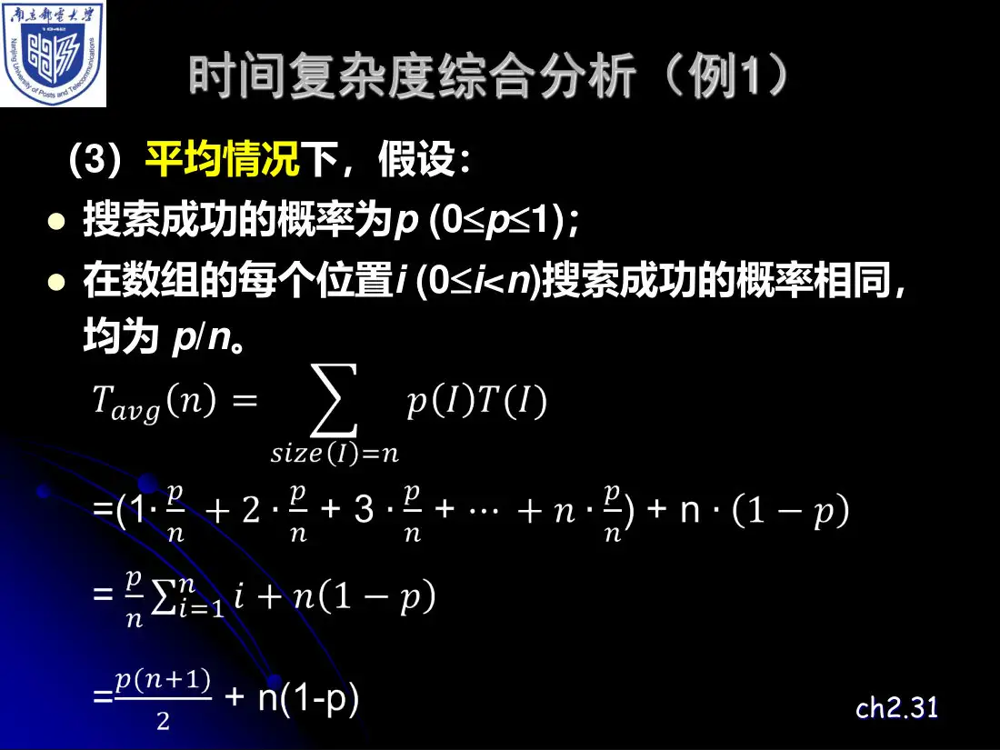

原文：

时间复杂度综合分析（例1）

（3）平均情况下，假设：

⚫ 搜索成功的概率为p $\mathtt { f o s f o s s u }$

⚫ 在数组的每个位置i $( 0 \times 1 2 0 )$ 搜索成功的概率相同，均为 $\pmb { \bigtriangledown } \pmb { \bigtriangledown } \pmb { \bigtriangledown }$

$$
\begin{array}{r l} & T _ {a v g} (n) = \sum_ {s i z e (I) = n} p (I) T (I) \\ & = (1 \cdot \frac {p}{n} + 2 \cdot \frac {p}{n} + 3 \cdot \frac {p}{n} + \dots + n \cdot \frac {p}{n}) + n \cdot (1 - p) \\ & = \frac {p}{n} \sum_ {i = 1} ^ {n} i + n (1 - p) \\ & = \frac {p (n + 1)}{2} + n (1 - p) \end{array}
$$

南京郵電大學 municitions

ch2.31

### 时间复杂度综合分析（例2）

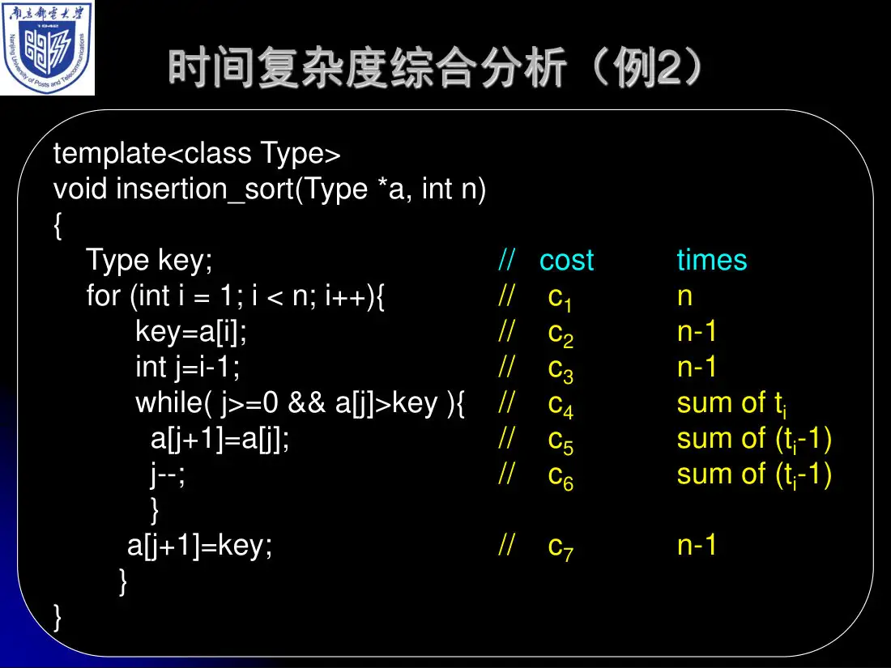

原文：

时间复杂度综合分析（例2）

template<class Type> void insertion\_sort(Type \*a, int n)

Type key;

while( j>=0 && a[j]>key ){ a[j+1]=a[j];

// cost

times

$$
\begin{array}{l} n \\ n - 1 \\ n - 1 \end{array}
$$

sum of t sum of (t -1) sum of (ti-1)

$$
a [ j + 1 ] = k e y;
$$

// c7

n-1

南京郵電大學948municitons

### $$

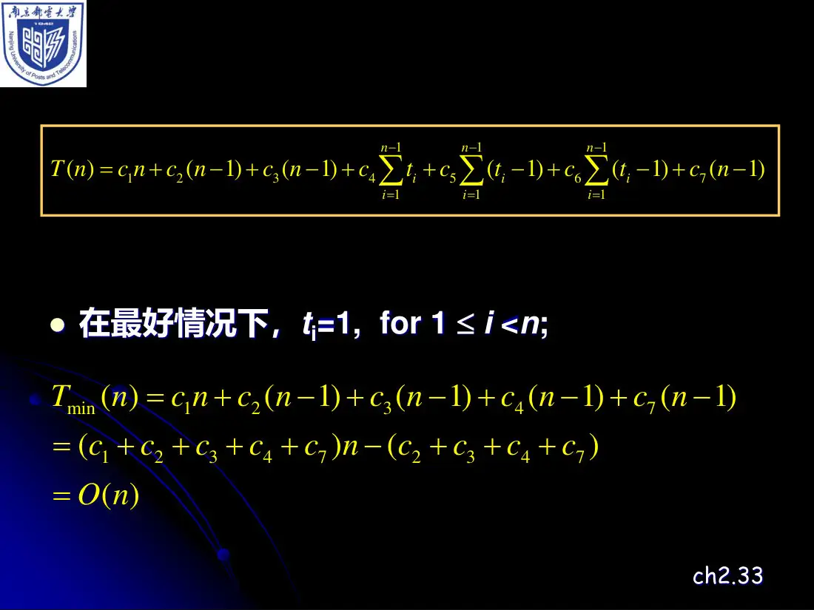

原文：

$$
T (n) = c _ {1} n + c _ {2} (n - 1) + c _ {3} (n - 1) + c _ {4} \sum_ {i = 1} ^ {n - 1} t _ {i} + c _ {5} \sum_ {i = 1} ^ {n - 1} (t _ {i} - 1) + c _ {6} \sum_ {i = 1} ^ {n - 1} (t _ {i} - 1) + c _ {7} (n - 1)
$$

⚫ 在最好情况下，ti=1, for 1  i <n;

$$
\begin{array}{r l} & T _ {\min} (n) = c _ {1} n + c _ {2} (n - 1) + c _ {3} (n - 1) + c _ {4} (n - 1) + c _ {7} (n - 1) \\ & = (c _ {1} + c _ {2} + c _ {3} + c _ {4} + c _ {7}) n - (c _ {2} + c _ {3} + c _ {4} + c _ {7}) \\ & = O (n) \end{array}
$$

南京郵電大學 municitions

ch2.33

### $$

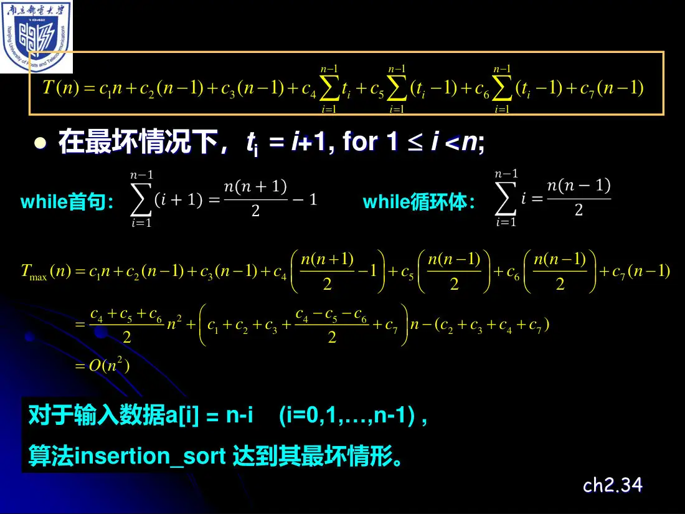

原文：

$$
T (n) = c _ {1} n + c _ {2} (n - 1) + c _ {3} (n - 1) + c _ {4} \sum_ {i = 1} ^ {n - 1} t _ {i} + c _ {5} \sum_ {i = 1} ^ {n - 1} \left(t _ {i} - 1\right) + c _ {6} \sum_ {i = 1} ^ {n - 1} \left(t _ {i} - 1\right) + c _ {7} (n - 1)
$$

⚫ 在最坏情况下， $( 2 + 1 5 + 1 5 + 2 ) \times 2 = 1 5 ( m ^ { 2 } )$

while首句： $\frac { 1 } { 2 } ( 1 - 2 0 ) = \frac { 1 1 } { 2 } ( 1 - 2 0 ) = \frac { 1 1 } { 2 } ( 1 - 2 0 )$

while循环体：

$$
\sum_ {i = 1} ^ {n - 1} i = \frac {n (n - 1)}{2}
$$

$$
\begin{array}{l} T _ {\max} (n) = c _ {1} n + c _ {2} (n - 1) + c _ {3} (n - 1) + c _ {4} \left(\frac {n (n + 1)}{2} - 1\right) + c _ {5} \left(\frac {n (n - 1)}{2}\right) + c _ {6} \left(\frac {n (n - 1)}{2}\right) + c _ {7} (n - 1) \\ = \frac {c _ {4} + c _ {5} + c _ {6}}{2} n ^ {2} + \left(c _ {1} + c _ {2} + c _ {3} + \frac {c _ {4} - c _ {5} - c _ {6}}{2} + c _ {7}\right) n - \left(c _ {2} + c _ {3} + c _ {4} + c _ {7}\right) \\ = O \left(n ^ {2}\right) \end{array}
$$

对于输入数据a[i] = n-i (i=0,1,…,n-1) ,算法insertion\_sort 达到其最坏情形。

南京郵電大學 municsnons Fpst ad Telecou

ch2.34

### 算法按时间复杂度分类

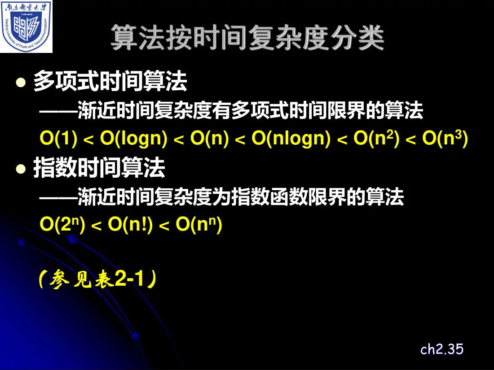

原文：

算法按时间复杂度分类

⚫ 多项式时间算法渐近时间复杂度有多项式时间限界的算法$\mathrm { \Lambda ^ { ( q ) } ( 0 ) } \subset \mathrm { \Lambda ^ { ( q ) } ( [ e r g ] ) } \subset \mathrm { \Lambda ^ { ( q ) } ( 0 ) } \subset \mathrm { \Lambda ^ { ( q ) } ( [ q ] [ e r g ] ) } \subset \mathrm { \Lambda ^ { ( q ) } ( 0 ) } \subset \mathrm { \Lambda ^ { ( q ) } ( 0 ) } \subset \mathrm { \Lambda ^ { ( q ) } ( 0 ) }$

⚫ 指数时间算法渐近时间复杂度为指数函数限界的算法$\mathrm  \langle \bullet ( \mathcal { H } 4 ) \mathcal { L } 3 \mathcal { L } 4 0 ( \bullet ) \mathcal { L } 4 0 ( \bullet ) \mathcal { L } 4 0 ( \bullet ) \mathcal { L } 0 0 ( \bullet ) \mathcal { L } 4 0 ( \bullet ) \mathcal { L } 0 0 ( \bullet ) \mathcal { L } 0 0 ( \bullet ) \mathcal { L } 0 0 ( \bullet ) \mathcal { L } 0 0 ( \bullet ) \mathcal { L }$

（参见表2-1）

南京郵電大學948

ch2.35

### 算法分析中常见的时间复杂度函数

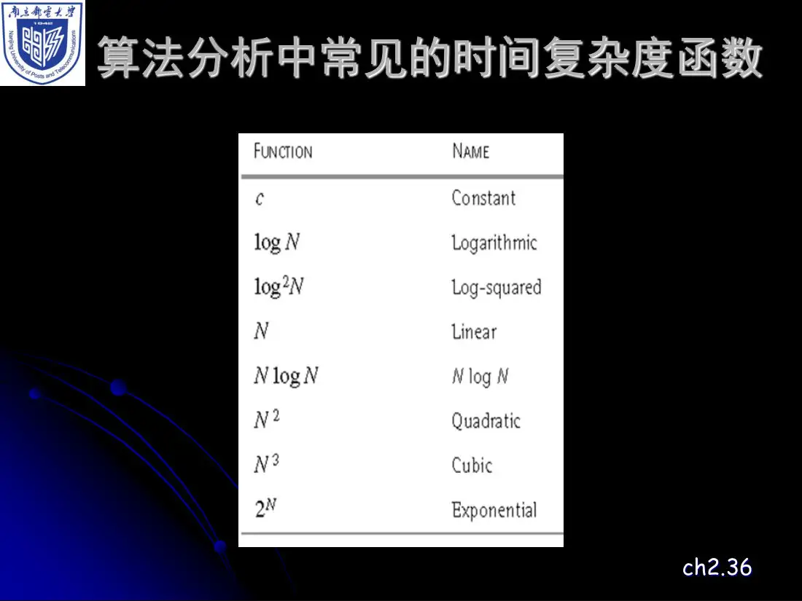

原文：

算法分析中常见的时间复杂度函数

<table><tr><td>FUNCTION</td><td>NAME</td></tr><tr><td>c</td><td>Constant</td></tr><tr><td> $\log N$ </td><td>Logarithmic</td></tr><tr><td> $\log^{2}N$ </td><td>Log-squared</td></tr><tr><td>N</td><td>Linear</td></tr><tr><td> $N\log N$ </td><td> $N\log N$ </td></tr><tr><td> $N^{2}$ </td><td>Quadratic</td></tr><tr><td> $N^{3}$ </td><td>Cubic</td></tr><tr><td> $2^{N}$ </td><td>Exponential</td></tr></table>

南京郵電大學 municitions

ch2.36

### 中等规模数据

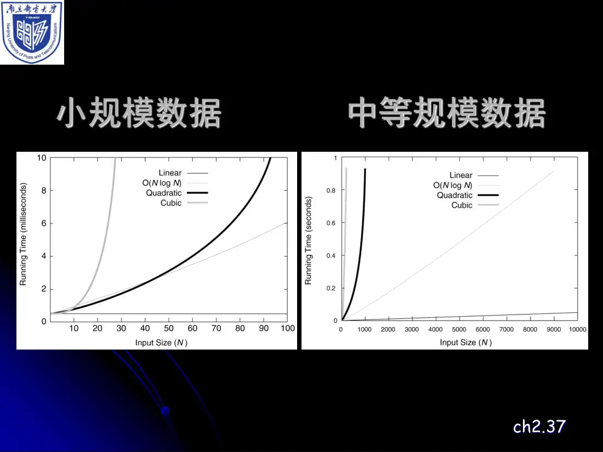

原文：

中等规模数据

南京郵電大學 municitions

ch2.37

### 写出下列复杂性函数的偏序关系(按渐近阶从低到高排序）

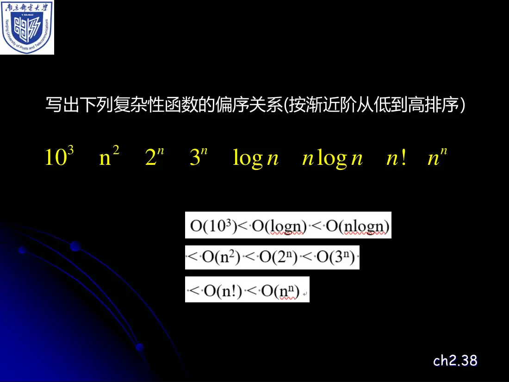

原文：

写出下列复杂性函数的偏序关系(按渐近阶从低到高排序）

$$
1 0 ^ {3}
$$

$$
\mathbf {n} ^ {2}
$$

$$
2 ^ {n}
$$

$$
3 ^ {n}
$$

$$
\log n
$$

$$
n \log n
$$

$$
n!
$$

$$
n ^ {n}
$$

$$
\mathrm{O} \left(1 0 ^ {3}\right) <   \cdot \mathrm{O} (\text { logn }) <   \cdot \mathrm{O} (\text { nlogn })
$$

$$
<   \cdot \mathrm{O} \left(\mathrm{n} ^ {2}\right) <   \cdot \mathrm{O} \left(2 ^ {\mathrm{n}}\right) <   \cdot \mathrm{O} \left(3 ^ {\mathrm{n}}\right) \cdot
$$

$$
<   \cdot \mathrm{O} (\mathrm{n}!) <   \cdot \mathrm{O} (\mathrm{n} ^ {\mathrm{n}})
$$

南京郵電大學 municitions

ch2.38

### 要更快的计算机还是要更快的算法？

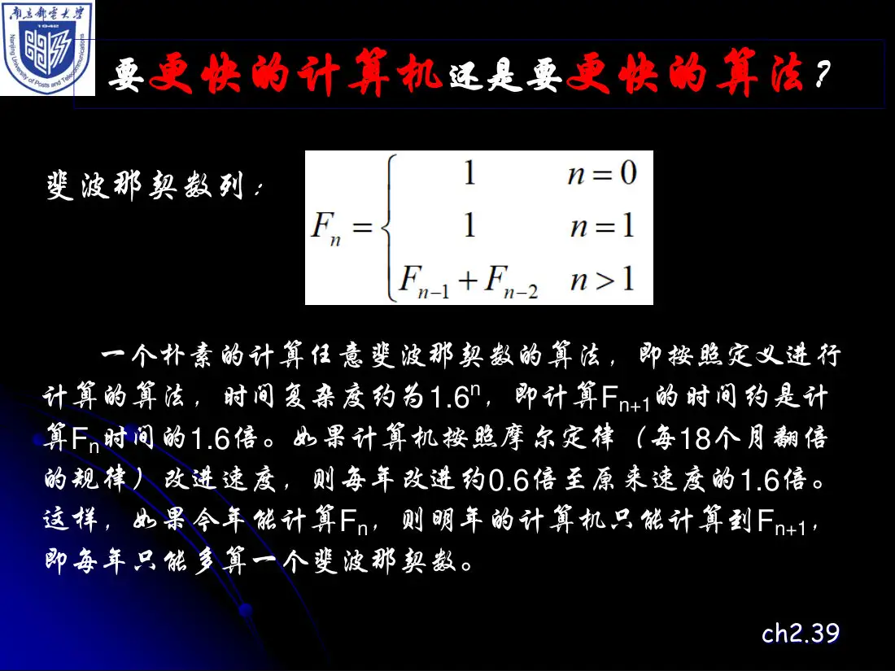

原文：

要更快的计算机还是要更快的算法？

斐波那契数列：

$$
F _ {n} = \left\{ \begin{array}{c c} 1 & n = 0 \\ 1 & n = 1 \\ F _ {n - 1} + F _ {n - 2} & n > 1 \end{array} \right.
$$

一个朴素的计算任意斐波那契数的算法，即按照定义进行计算的算法，时间复杂度约为 $\pmb { \mathrm { H } } \mathbf { \left( \pmb { \hat { \bullet } } \right) }$ ，即计算 $[ \frac { 1 } { 1 5 } , \frac { 1 } { 1 5 } ]$ 的时间约是计算 $\sqrt { \frac { 5 } { 1 0 } }$ 时间的1.6倍。如果计算机按照摩尔定律（每18个月翻倍的规律）改进速度，则每年改进约0.6倍至原来速度的1.6倍。这样，如果今年能计算 $\boxed { \pm }$ ，则明年的计算机只能计算到 $\boxed { \pm }$ 即每年只能多算一个斐波那契数。

南京郵電大學周 942sumnicctos

ch2.39

### 南京郵電大學

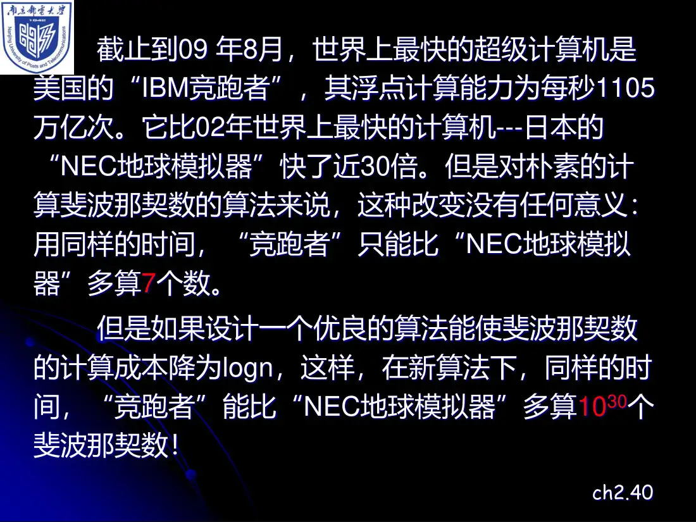

原文：

截止到09 年8月，世界上最快的超级计算机是美国的“IBM竞跑者”，其浮点计算能力为每秒1105万亿次。它比02年世界上最快的计算机---日本的“NEC地球模拟器”快了近30倍。但是对朴素的计算斐波那契数的算法来说，这种改变没有任何意义：用同样的时间， “竞跑者”只能比“NEC地球模拟器”多算7个数。

但是如果设计一个优良的算法能使斐波那契数的计算成本降为logn，这样，在新算法下，同样的时间，“竞跑者”能比“NEC地球模拟器”多算1030个斐波那契数！

南京郵電大學

ch2.40

### 补充：C/C++知识点复习

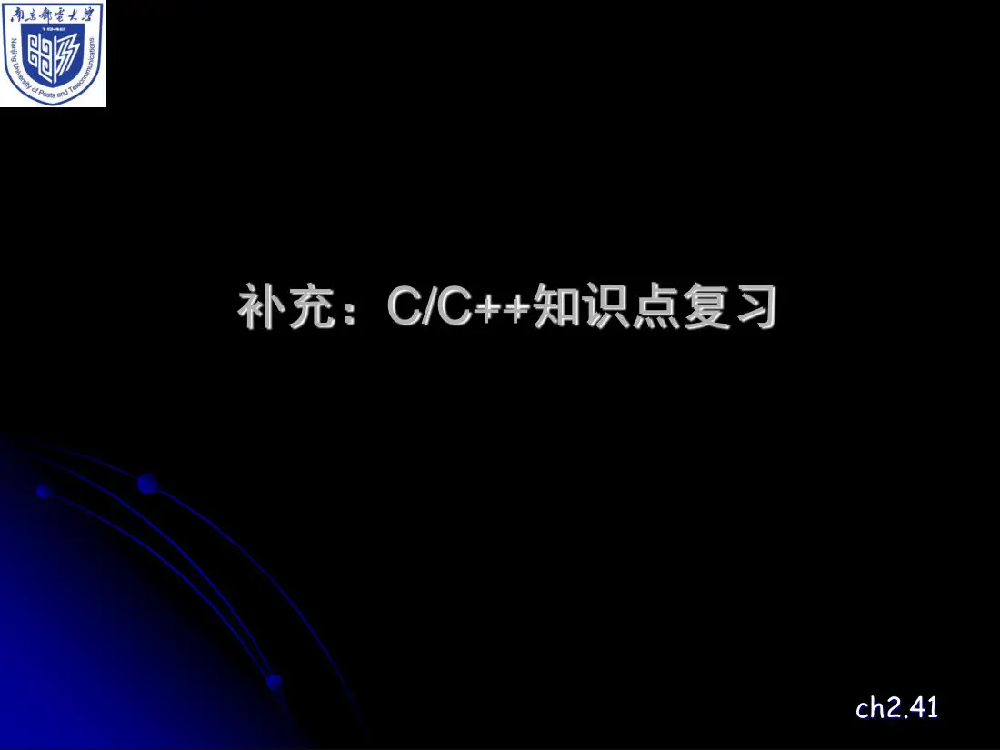

原文：

补充：C/C++知识点复习

南京郵電大學 municitions

ch2.41

### 用c++描述算法

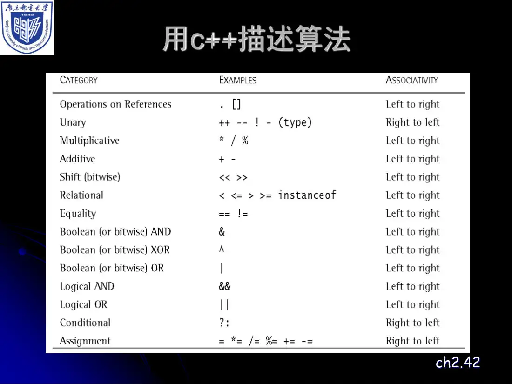

原文：

用c++描述算法
<table><tr><td>CATEGORY</td><td>EXAMPLES</td><td>ASSOCIATIVITY</td></tr><tr><td>Operations on References</td><td>. []</td><td>Left to right</td></tr><tr><td>Unary</td><td>++ -- ! - (type)</td><td>Right to left</td></tr><tr><td>Multiplicative</td><td>* / %</td><td>Left to right</td></tr><tr><td>Additive</td><td>+ -</td><td>Left to right</td></tr><tr><td>Shift (bitwise)</td><td>&lt;&lt; &gt;&gt;</td><td>Left to right</td></tr><tr><td>Relational</td><td>&lt; &lt;= &gt; &gt;= instanceof</td><td>Left to right</td></tr><tr><td>Equality</td><td>== !=</td><td>Left to right</td></tr><tr><td>Boolean (or bitwise) AND</td><td>&amp;</td><td>Left to right</td></tr><tr><td>Boolean (or bitwise) XOR</td><td>^</td><td>Left to right</td></tr><tr><td>Boolean (or bitwise) OR</td><td>|</td><td>Left to right</td></tr><tr><td>Logical AND</td><td>&amp;&amp;</td><td>Left to right</td></tr><tr><td>Logical OR</td><td>||</td><td>Left to right</td></tr><tr><td>Conditional</td><td>?:</td><td>Right to left</td></tr><tr><td>Assignment</td><td>= *= /= %= += -=</td><td>Right to left</td></tr></table>

南京郵電大學nmuncstions

ch2.42

### （1）选择语句：

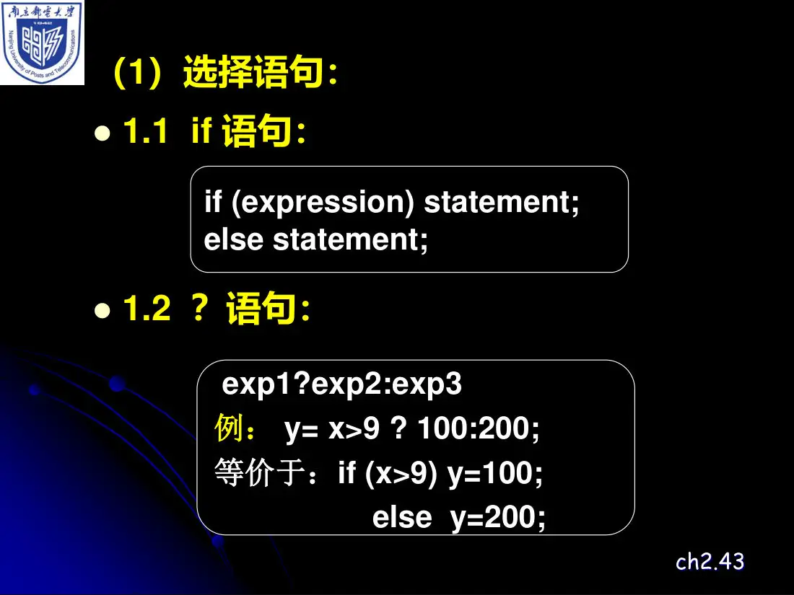

原文：

（1）选择语句：

⚫ 1.1 if 语句：

if (expression) statement; else statement;

⚫ 1.2 ？语句：

exp1?exp2:exp3例： y= x>9 ? 100:200;等价于：if (x>9) y=100;else y=200;

南京郵電大學942nmncsntons

ch2.43

### （1）选择语句：1.3 switch语句

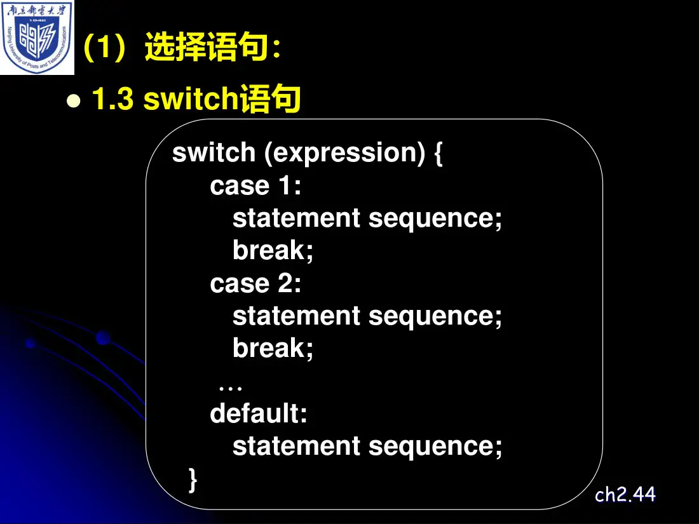

原文：

（1）选择语句：1.3 switch语句

switch (expression) { case 1: statement sequence; break; case 2: statement sequence; break;

default: statement sequence;

南京郵電大學948ications

ch2.44

### 南京郵電大學942nmncsntons

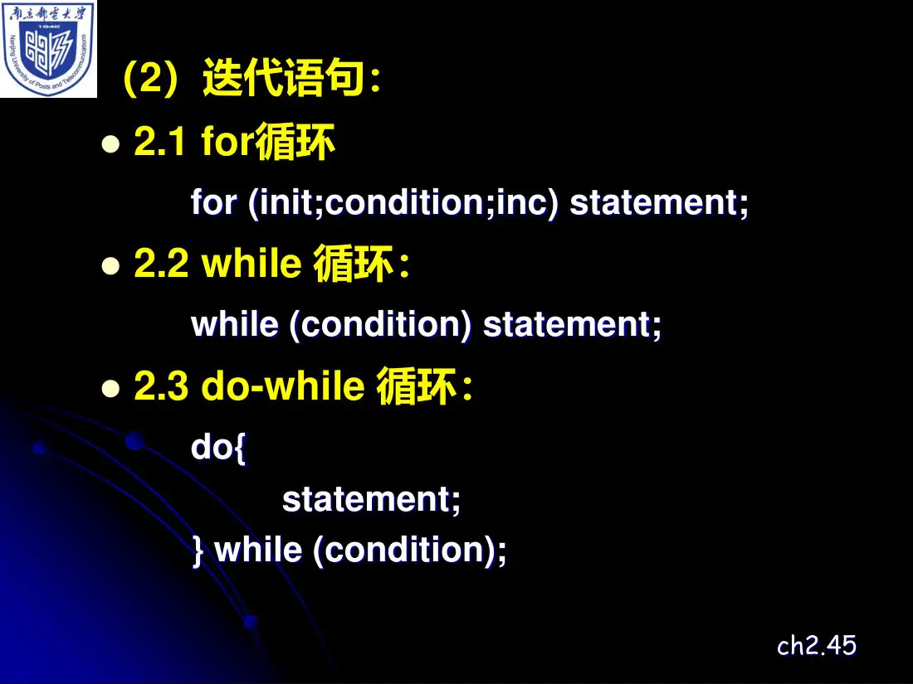

原文：

（2）迭代语句： ⚫ 2.1 for循环 for (init;condition;inc) statement; ⚫ 2.2 while 循环： while (condition) statement; ⚫ 2.3 do-while 循环： do{ statement; } while (condition);

南京郵電大學942nmncsntons

ch2.45

### （3）跳转语句：

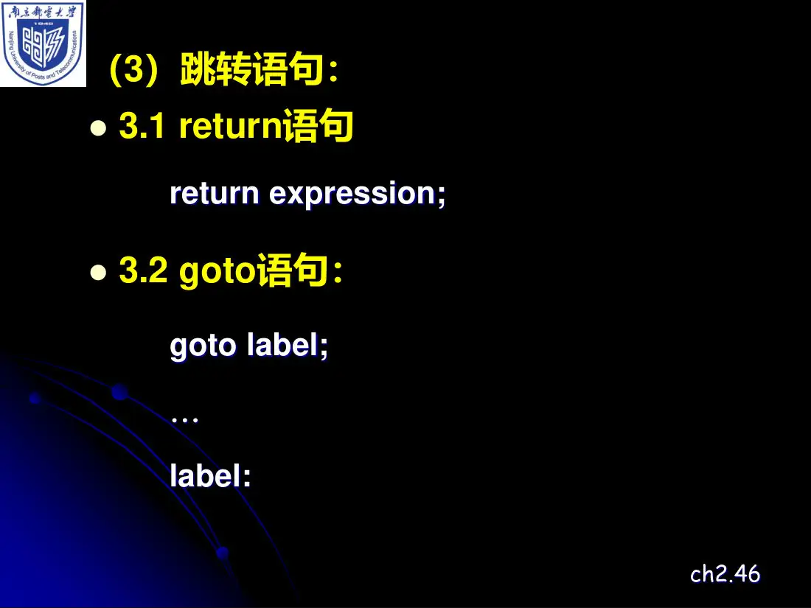

原文：

（3）跳转语句：

⚫ 3.1 return语句

return expression;

⚫ 3.2 goto语句：

goto label;

label:

南京郵電大學942nmncsntons

ch2.46

### （4） 函数：

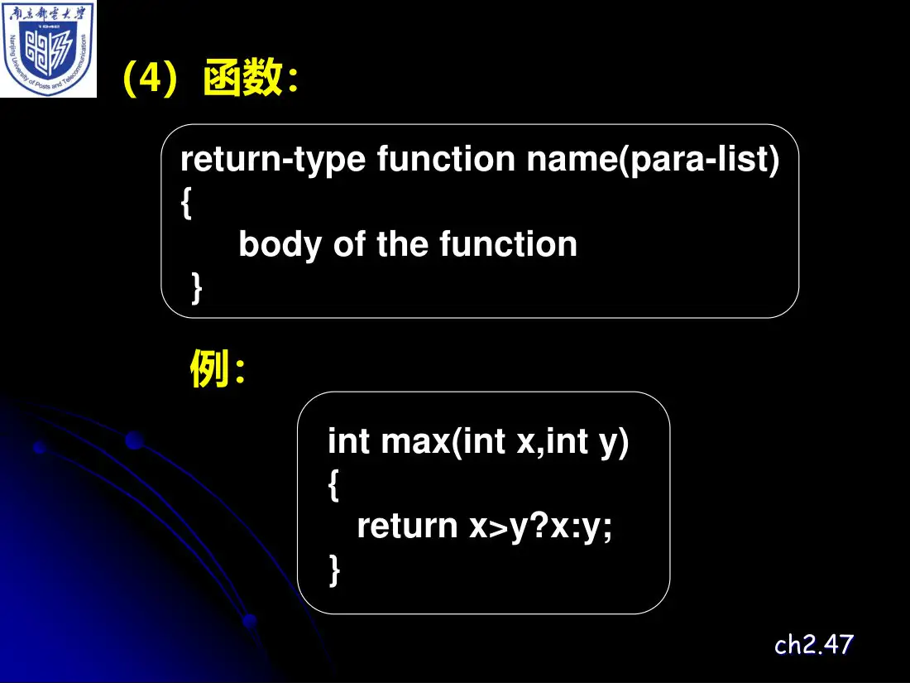

原文：

（4） 函数：

例：

int max(int x,int y) { return x>y?x:y;

南京郵電大學nmuncstions

ch2.47

### （5）模板template：

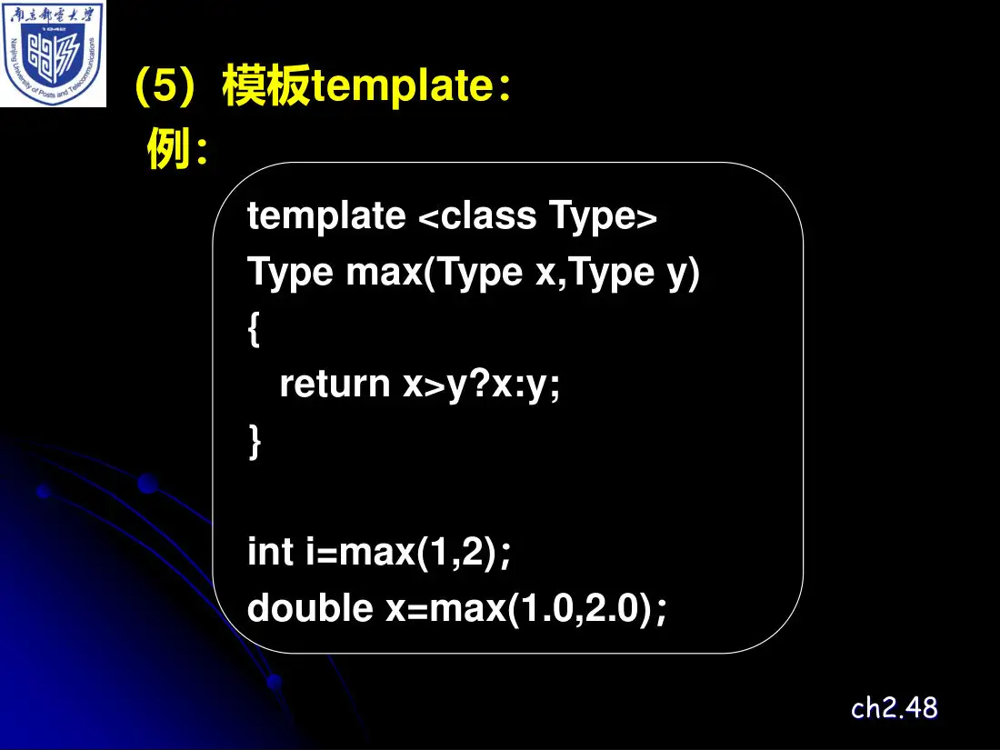

原文：

（5）模板template：

例：

template <class Type> Type max(Type x,Type y) return x>y?x:y; }

int i=max(1,2)；double x=max(1.0,2.0)；

南京郵電大學942nmncsntons

ch2.48

### （6）动态存储分配：

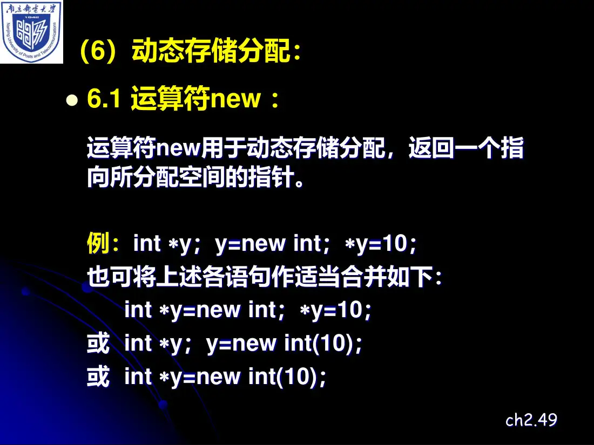

原文：

（6）动态存储分配：

⚫ 6.1 运算符new ：

运算符new用于动态存储分配，返回一个指向所分配空间的指针。

例： int \*y; y=new int; \*y=10;也可将上述各语句作适当合并如下：int \*y=new int; \*y=10;或 int y；y=new int(10)；或 int y=new int(10)；

南京郵電大學 municitions

ch2.49

### ⚫ 6.2 一维数组：

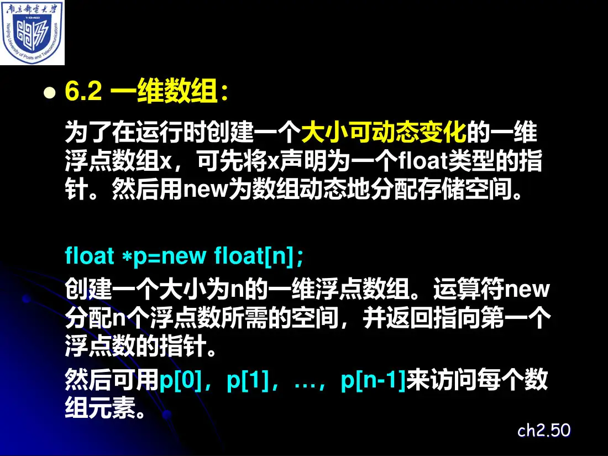

原文：

⚫ 6.2 一维数组：

为了在运行时创建一个大小可动态变化的一维浮点数组x，可先将x声明为一个float类型的指针。然后用new为数组动态地分配存储空间。

float p=new float[n]；

创建一个大小为n的一维浮点数组。运算符new分配n个浮点数所需的空间，并返回指向第一个浮点数的指针。

然后可用p[0]，p[1]，…，p[n-1]来访问每个数组元素。

南京郵電大學nmuncstions

ch2.50

### 例：

原文：

例：

int n=5; int \*p=new int[n]; for (int i=0;i<n;i++)

p[i]=i; cout<<p[i];

南京郵電大學 municitions

ch2.51

### 南京郵電大學nmuncstions

原文：

⚫ 6.3 运算符delete:当动态分配的存储空间已不再需要时，应用运算符delete来及时释放由new所分配的空间。

例： delete y；delete [ ]x；分别释放分配给y的空间和分配给一维数组x的空间。

南京郵電大學nmuncstions

ch2.52

### 南京郵電大學 municitions

原文：

⚫ 6.4 动态二维数组：创建类型为Type的动态工作数组，这个数组有rows行和cols列。

template <class Type> void Make2DArray(Type\*\* &x,int rows, int cols) {

x=new Type\* [rows]; for (int i=0;i<rows;i++) x[i]=new Type[cols];

南京郵電大學 municitions

### $$

原文：

当不再需要一个动态分配的二维数组时，可按以下步骤释放它所占用的空间：首先释放在for循环中为每一行所分配的空间，然后释放为行指针分配的空间。

template <class Type> void Delete2DArray(Type\*\* &x,int rows) for (int i=0;i<rows;i++) delete []x[i]; delete []x;

$$
x = 0;
$$

释放空间后应将x置为0，以防继续访问已被释放的空间。

南京郵電大學nmuncstions

.54

### （1）传递性：

原文：

（1）传递性：

⚫ $i i ( 0 ) { \bf - } \odot ( \odot ( 0 ) )$ ，g(n)= (h(n)) ⇒ f(n)= Θ(h(n));

⚫ $i ( 0 ) { = } \mathbb { C } ( \mathscr { O } ( 0 ) )$ g(n)= O(h(n))

$$
\Rightarrow f (n) = O (h (n));
$$

⚫ $i ( \pmb { \omega } ) \equiv \circledcirc ( \pmb { \mathscr { e } } ( \pmb { \omega } ) )$ g(n)= (h(n))

$$
\Rightarrow f (n) = \Omega (h (n));
$$

⚫ $i i ( 0 ) { \operatorname { - } } i e ( 0 ( i ) )$ g(n)= o(h(n))

$$
\Rightarrow f (n) = o (h (n));
$$

⚫ $i ( 0 ) = o ( e ( 0 ) ) , o ( 0 ) = o ( i ( 0 ) )$

$$
\Rightarrow f (n) = \omega (h (n));
$$

南京郵電大學imunicitnons

附录：渐近分析记号的若干性质

ch2.55

### （2）反身性：

原文：

（2）反身性：

⚫ $l ( 0 ) = \odot ( l ( 0 ) )$

⚫ $f ( \widehat { \pmb { \omega } } ) = \widetilde { \pmb { \varrho } } ( \widehat { \pmb { u } } ( \widehat { \pmb { \omega } } ) ) \widetilde { \pmb { \omega } }$

⚫ $i ( \pmb { \omega } ) { - } \odot ( { \pmb { \omega } } ( \pmb { \omega } ) )$

南京郵電大學 municitions

ch2.56

### （3）对称性：

原文：

（3）对称性：

⚫ $\langle \langle \langle \mathcal { D } \rangle \rangle \langle \mathcal { O } ( \mathcal { O } ( \mathcal { O } ) ) \rangle = \langle \mathcal { O } ( \mathcal { O } ) \rangle \langle \mathcal { O } ( \mathcal { O } ) \rangle$

（4）互对称性：

⚫ $\langle \langle \langle \mathcal { D } \rangle \rangle = \langle \langle \mathcal { O } ( \mathcal { O } ) \rangle = \langle \mathcal { O } ( \mathcal { O } ) \rangle = \langle \mathcal { O } ( \mathcal { O } ) \rangle$ ；

⚫ $\langle \langle \langle \mathcal { D } \rangle \mathcal { = } \langle \mathcal { O } \rangle \mathcal { O } \rangle = \mathcal { X } \langle \mathcal { O } \rangle = \mathcal { O } ( \mathcal { O } )$ ；

南京郵電大學 municitions

ch2.57

### （5）算术运算：

原文：

（5）算术运算：

⚫ O(f(n))+O(g(n)) = O(max{f(n),g(n)}) ；

⚫ O(f(n))+O(g(n)) = O(f(n)+g(n)) ；

⚫ $( \circ _ { 4 } ( \omega ) ) \circ ( \circ ( \omega ) ) = ( \circ _ { 4 } ( \omega ) \circ ( \omega ) )$ ；

$\cos ( \varphi _ { i } ( \varphi _ { i } ( 0 ) ) ) = \cos ( \varphi _ { i } ( 0 ) )$ ；其中c是一个正的常数；

⚫ 如果 $\left( \mathcal { O } \right) \Sigma ^ { \prime } ( \mathcal { O } ( \mathcal { O } ) ) \Sigma = 2 \iiint \left( \sigma ( \mathcal { O } ) \right) \Sigma ^ { \prime } ( \mathcal { O } ( \mathcal { O } ) ) \Sigma ^ { \prime } ( \mathcal { O } ( \mathcal { O } ) )$ 0

⚫ $\pmb { [ | \pmb { \big | } \pmb { \big | } } \pmb { \big | | } \pmb { \big | | } \pmb { \big | | } \pmb { \big | | }$ 0

南京郵電大學948

ch2.58

### 取整函数

原文：

取整函数

x」：不大于x的最大整数；

●「x：不小于x的最小整数。

⚫ $\angle A = 1 8 0 ^ { \circ } - \angle A = 1 8 0 ^ { \circ } - \angle B = 1 8 0 ^ { \circ }$

• L n/2」+ 「 n/2 = n;

南京郵電大學 municitions

附录：算法渐近复杂性分析中常用函数

ch2.59

### 南京郵電大學imunicitnons

原文：

指数函数（ 对于正整数m,n和实数a>0）$( \epsilon ( n ) ) / \epsilon = \epsilon ( n - 1 )$ $( \epsilon / \eta ) / \epsilon ( \theta / \eta )$ $\angle 1 1 = \angle 1 = \angle 2 \angle 1$ $E F = \frac { 1 } { 2 }$ 为单调递增函数;$\frac { 1 } { 2 } = \frac { 1 } { 2 } \times \frac { 1 } { 2 } \times \frac { 1 } { 2 } \times \frac { 1 } { 2 } \times \frac { 1 } { 2 } \times \frac { 1 } { 2 } \times \frac { 1 } { 2 } \times \frac { 1 } { 2 }$ $\angle B = \angle A = \angle B = \angle C = \angle 1 = \angle B = \angle C = \angle C$

南京郵電大學imunicitnons

ch2.60

### 对数函数

原文：

对数函数

⚫ log $\langle u | \mathbf { - } | \mathbf { | \langle o | \langle | \cdot | } | u | \rangle$

⚫ l g $\pmb  [ i \pmb  [ 0 \pmb { [ 0 \pmb { [ 0 ] } } \pmb { [ 0 \pmb { [ 0 ] } } \pmb { [ 0 \pmb { [ 0 ] } } \pmb { [ 0 \pmb { [ 0 ] } } \pmb { [ 0 \pmb { [ 0 ] } } \pmb { [ 0 \pmb { [ 0 ] } } \pmb { [ 0 \pmb { [ 0 ] } } \pmb { [ 0 \pmb { [ 0 ] } } \pmb { [ 0 \pmb { [ 0 ] } } \pmb { [ 0 \pmb { [ 0 ] } } \pmb { [ 0 \pmb { [ 0 ] } } \pmb { [ 0 \pmb { [ 0 ] } } \pmb { [ 0 \pmb { [ 0 ] } } \pmb { [ 0 \pmb { [ 0 ] } } \pmb { [ 0 \pmb { [ 0 ] } } \pmb { [ 0 \pmb { [ 0 ] } } \pmb { [ 0 \pmb { [ 0 ] } } \pmb { [ 0 \pmb { [ 0 ] } } \pmb { [ 0 \pmb { [ 0 ] } } \pmb { [ 0 \pmb { [ 0 ] } } \pmb  0 \pmb { [ 0 \pmb { [ 0 ] } } \pmb { [ 0 \pmb { [ 0 ] } } \pmb { [ 0 \pmb { [ 0 \pmb ] } } \pmb  \pmb { [ 0 \pmb { [ 0 ] } } \pmb { [ 0 \pmb { [ 0 \pmb ] } } \pmb  \pmb { [ 0 \pmb { [ 0 ] } } \pmb { \pmb { [ 0 \pmb ] } } \pmb { \pmb { [ 0 \pmb ] } } \pmb { \pmb { [ 0 \pmb ] } } \pmb  \pmb { [ 0 \pmb \pmb { [ 0 \pmb ] } } \pmb { \pmb \pmb { [ 0 \pmb ] } } \pmb \pmb { \pmb { [ 0 \pmb \pmb { [ 0 ] } \pmb \pmb { \pmb \pmb ] } } \pmb } \pmb \pmb  \pmb  [ 0 \pmb \pmb \pmb  [ 0 \pmb $

⚫ l n $\angle n = \angle C = \angle C$

$1 0 0 0 m - 1 0 0 0 m - 1 0 0 0 m$

⚫ log log n = log(log n);

⚫ $0 . 5 \times 1 0 ^ { 1 0 } k m ^ { 3 }$

⚫ $1 0 x \cdot \frac { 1 } { 2 } \times 1 0 0 = 1 0 0 0 0 ( c m )$

南京郵電大學 municitions

ch2.61

### $$

原文：

$1 0 \times 1 0 ^ { 3 } k ^ { \prime } - 1 1 0 \times 1 0 \times 1 0 ^ { 3 } k ^ { \prime }$ $[ \langle { \boldsymbol { \eta } } ( { \boldsymbol { \chi } } ) | \langle { \bf { \delta } } ( { \bf { \delta } } | { \bf { \delta } } ( { \bf { \delta } } ) | - = | { \bf { \delta } } ( { \bf { \delta } } ) | \langle { \bf { \delta } } | { \bf { \delta } } ( { \bf { \delta } } ) | \rangle ] ] = - [ \langle { \bf { \delta } } ( { \bf { \delta } } ) | \langle { \bf { \delta } } | { \bf { \delta } } ( { \bf { \delta } } ) | ] ^ { 2 }$ ⚫ $1 0 ) \div ( a ) = 1 0 : ( c m ) = 1 0 : ( c m ) = 1 0 : ( c m ) = 1 0 : ( c m )$

$$
\log_ {b} a = \frac {\log_ {c} a}{\log_ {c} b}
$$

$$
a ^ {\log_ {b} c} = c ^ {\log_ {b} a}
$$

南京郵電大學 municitions

ch2.62

### $$

原文：

$$
\cdot | x | \leq 1 \Rightarrow \ln (1 + x) = x - \frac {x ^ {2}}{2} + \frac {x ^ {3}}{3} - \frac {x ^ {4}}{4} + \frac {x ^ {5}}{5} - \dots
$$

⚫ for x > -1, $\angle B A C = \angle A B C = \angle C D E = \angle C$

$$
\begin{array}{l} \bullet \text {for any a > 0 ,} \quad \lim _ {n \to \infty} \frac {\log n}{(2 ^ {a}) ^ {\log n}} = \lim _ {n \to \infty} \frac {\log n}{n ^ {a}} = 0 \\ \Rightarrow \log n = o (n ^ {a}) \end{array}
$$

南京郵電大學 municitions

ch2.63

### 阶乘函数

原文：

阶乘函数

$$
n! = 1 \cdot 2 \cdot 3 \dots n = \left\{ \begin{array}{c c} 1 & n = 0 \\ n (n - 1)! & n > 0 \end{array} \right.
$$

⚫ $1 0 0 = 0 0 0 0 0 0$

⚫ $[ m ] = m ( \pmb { \theta } / \pmb { \theta } )$

⚫ $( 0 ) \div ( 0 . 0 1 ) = ( 0 . 0 1 0 ) ( 0 . 0 1 )$

南京郵電大學 municitions

ch2.64

### 2-8（1）\~（4） 确定划线语句执行次数、计算渐近时间复杂度。

原文：

2-8（1）\~（4） 确定划线语句执行次数、计算渐近时间复杂度。

2-10（2）

2-13（1）\~（2）

南京郵電大學 municitions

作业 P28

ch2.65

### 2-8 确定划线语句执行次数、计算渐近时间复杂度。

原文：

2-8 确定划线语句执行次数、计算渐近时间复杂度。

$$
\underline {{x + + ; i = 2 ^ {*} i}};
$$

} while i<n;

for (int i=1;i<=n;i++) for(int j=1,j<=I;j++) for(int k=1;k<=j;k++) x++;

南京郵電大學948municitons

作业 P28

ch2.66

### 南京郵電大學 municitions

原文：

2-8 确定划线语句执行次数、计算渐近时间复杂度。（3）x=n; y=0;while $\scriptstyle ( 1 , + 2 , + ( 1 , 2 , + 1 ) , ( 1 , 1 , 1 ) )$ y++;

（4）m=0;for (int i=0;i<n;i++)for (int j=2\*I;j<=n;j++)m++;

南京郵電大學 municitions

作业 P28

ch2.67

### 南京郵電大學948

原文：

2-10 (2)试用定义证明等式5 $\frac { 1 } { 2 } \times \frac { 1 } { 3 } \times \frac { 1 } { 2 } \times \frac { 1 } { 3 } = \frac { 1 } { 2 } ( m ^ { 2 } )$ 的正确性。

设 $[ \langle \boldsymbol { \theta } \rangle ] = ( \mathcal { I } ( \mathcal { C } _ { i } ( \omega ) ) \mathcal { R } \mathcal { R } ) = \langle \boldsymbol { \mathcal { I } } ( \mathcal { C } _ { i } ( \omega ) ) \rangle$ ,证明下列结论成立：$\langle \beta ( \omega ) \cdot ( \beta ( \omega ) ) = \langle \alpha ( \mathrm { m e } ) \cdot ( \beta ( \omega ) ) \cdot ( \beta ( \omega ) ) \cdot ( \omega )$

设 $[ A ( \omega ) = ( \mathrm { { } } q ( \mathcal { G } ( \omega ) ) , \mathrm { { } } m ( \omega ) = \mathrm { { } } q ( \mathcal { G } ( \omega ) ) ]$ ,证明下列结论成立：$) \beta ( \omega ) = \beta ( \omega ) = \gamma ( \beta ( \omega ) , \beta ( \omega ) )$

南京郵電大學948

作业 P28

ch2.68
