# 《算法分析与设计》第5章 分治法（课件）

原件的每一页，下面附识别出的文字。

### 第5章 分治法

原文：

第5章 分治法

### 学习要点：

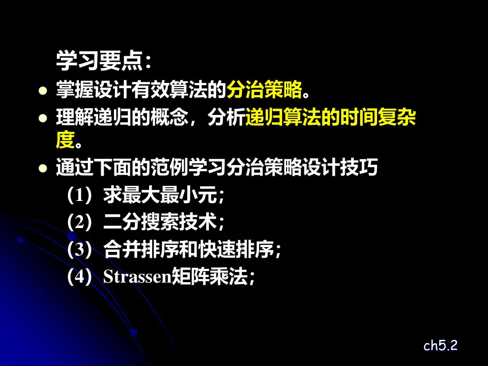

原文：

学习要点：

掌握设计有效算法的分治策略。

⚫ 理解递归的概念，分析递归算法的时间复杂度。

通过下面的范例学习分治策略设计技巧

（1）求最大最小元；

（2）二分搜索技术；

（3）合并排序和快速排序；

（4）Strassen矩阵乘法；

ch5.2

### ch5.3

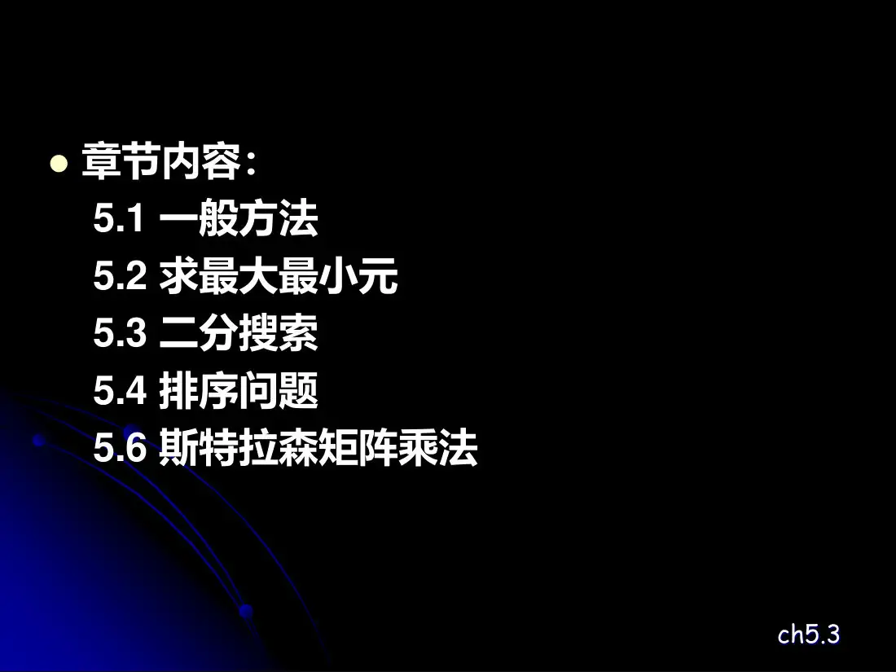

原文：

章节内容：5.1 一般方法5.2 求最大最小元5.3 二分搜索5.4 排序问题5.6 斯特拉森矩阵乘法

ch5.3

### 5.1 分治法的一般方法

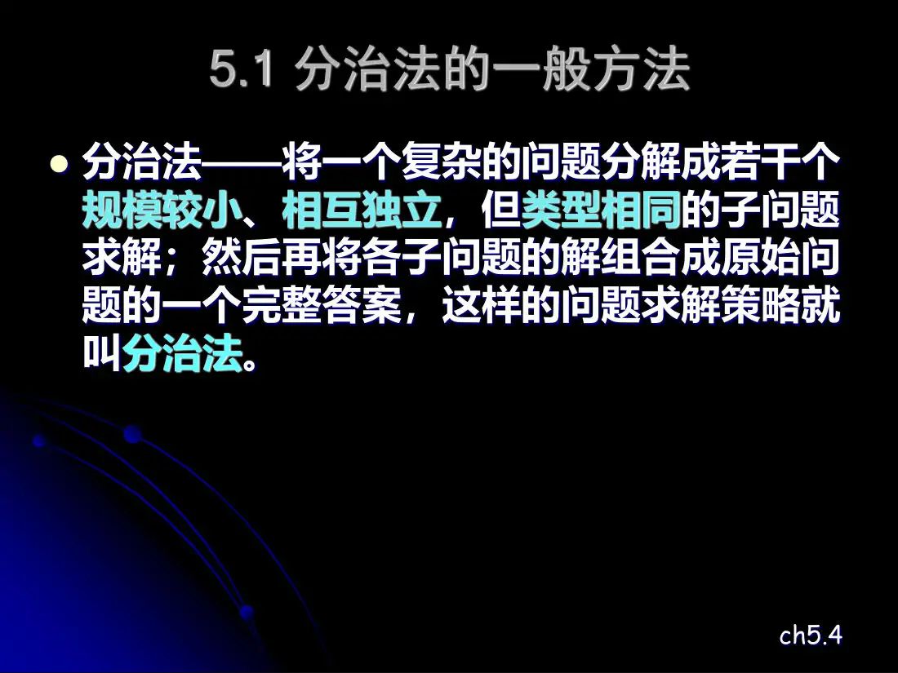

原文：

5.1 分治法的一般方法

分治法——将一个复杂的问题分解成若干个规模较小、相互独立，但类型相同的子问题求解；然后再将各子问题的解组合成原始问题的一个完整答案，这样的问题求解策略就叫分治法。

ch5.4

### 分治算法总体思想

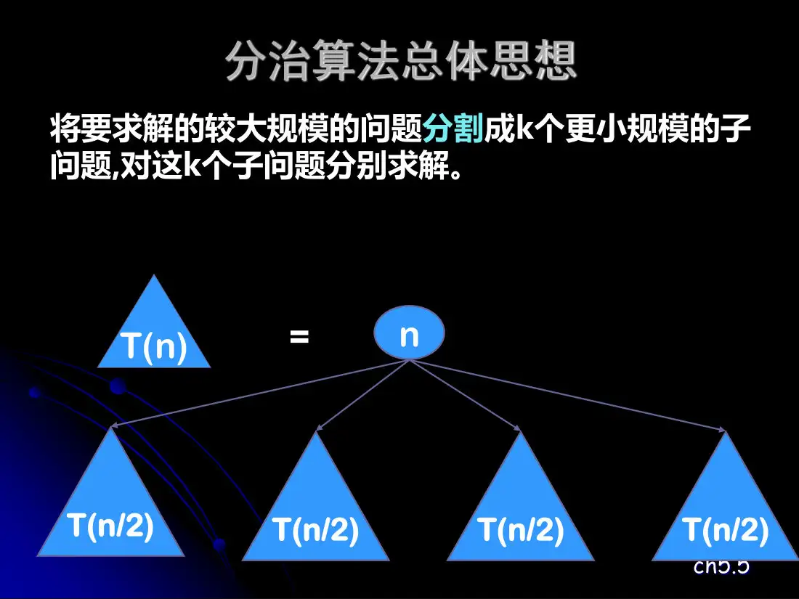

原文：

分治算法总体思想

将要求解的较大规模的问题分割成k个更小规模的子问题,对这k个子问题分别求解。

T(n)

T(n/2)

T(n/2)

T(n/2)

T(n/2)

### 如果子问题的规模仍然不够小，则再划分为k个子问题。

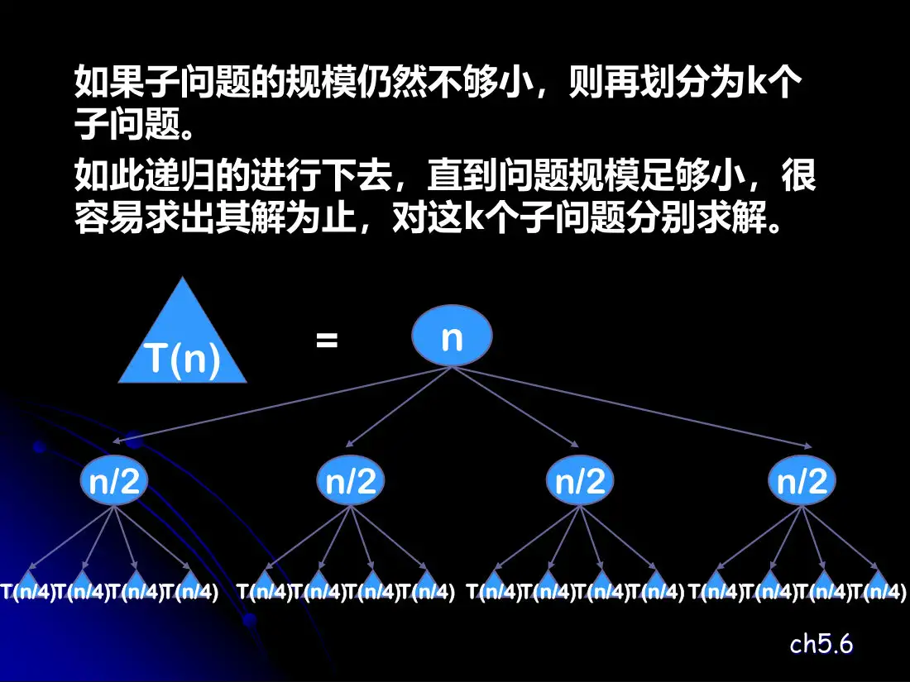

原文：

如果子问题的规模仍然不够小，则再划分为k个子问题。

如此递归的进行下去，直到问题规模足够小，很容易求出其解为止，对这k个子问题分别求解。

T(n)

n/2

n/2

n/2

n/2

T(n/4)T(n/4)T(n/4)T(n/4) T(n/4)T(n/4)T(n/4)T(n/4) T(n/4)T(n/4)T(n/4)T(n/4) T(n/4)T(n/4)T(n/4)T(n/4)

ch5.6

### T(n)

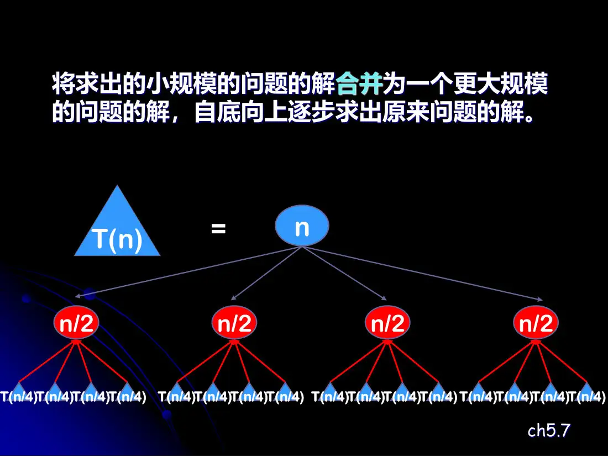

原文：

将求出的小规模的问题的解合并为一个更大规模的问题的解，自底向上逐步求出原来问题的解。

T(n)

n/2

n/2

n/2

n/2

T(n/4)T(n/4)T(n/4)T(n/4) T(n/4)T(n/4)T(n/4)T(n/4) T(n/4)T(n/4)T(n/4)T(n/4) T(n/4)T(n/4)T(n/4)T(n/4)

ch5.7

### T(n)

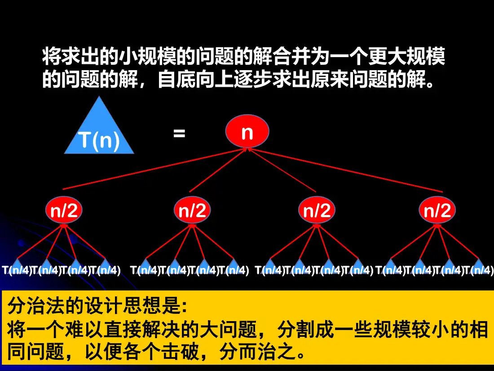

原文：

将求出的小规模的问题的解合并为一个更大规模的问题的解，自底向上逐步求出原来问题的解。

T(n)

n

n/2

n/2

n/2

n/2

T(n/4)T(n/4)T(n/4)T(n/4) T(n/4)T(n/4)T(n/4)T(n/4) T(n/4)T(n/4)T(n/4)T(n/4) T(n/4)T(n/4)T(n/4)T(n/4)

分治法的设计思想是:

将一个难以直接解决的大问题，分割成一些规模较小的相同问题，以便各个击破，分而治之。

### 分治法的适用条件

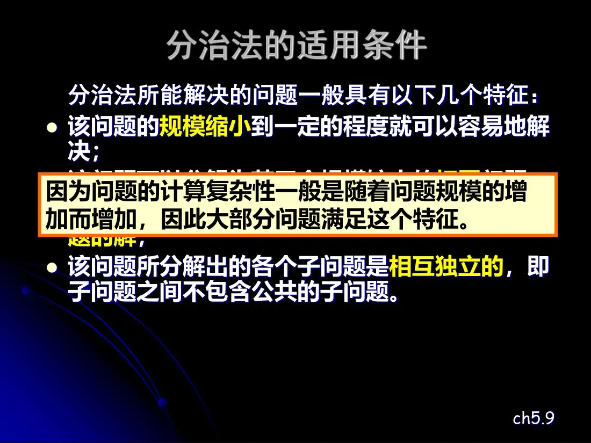

原文：

分治法的适用条件

分治法所能解决的问题一般具有以下几个特征：

⚫ 该问题的规模缩小到一定的程度就可以容易地解决；

题可以分 若干个规模 小的相同 题；因为问题的计算复杂性一般是随着问题规模的增⚫ 利用该问题分解出的子问题的解可以合加而增加，因此大部分问题满足这个特征。

题的解；

该问题所分解出的各个子问题是相互独立的，即子问题之间不包含公共的子问题。

ch5.9

### 分治法的适用条件

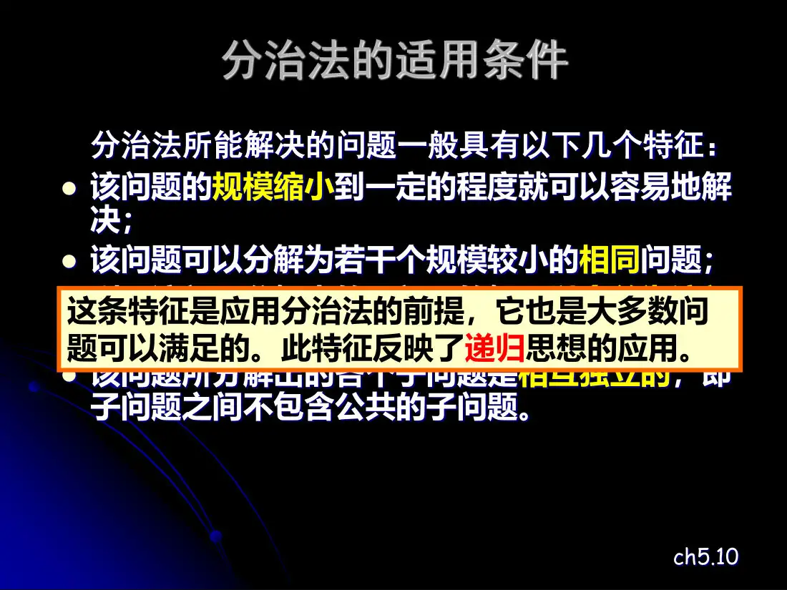

原文：

分治法的适用条件

分治法所能解决的问题一般具有以下几个特征：

⚫ 该问题的规模缩小到一定的程度就可以容易地解决；

该问题可以分解为若干个规模较小的相同问题；

⚫ 利用该问题分解出的子问题的解可以合并为该这条特征是应用分治法的前提，它也是大多数问题可以满足的。此特征反映了递归思想的应用。

⚫ 该问题所分解出的各个子问题是相互独立的，即子问题之间不包含公共的子问题。

ch5.10

### 分治法的适用条件

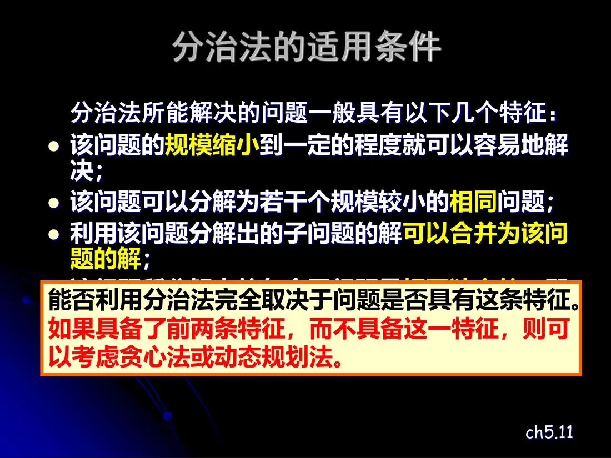

原文：

分治法的适用条件

分治法所能解决的问题一般具有以下几个特征：

⚫ 该问题的规模缩小到一定的程度就可以容易地解决；

该问题可以分解为若干个规模较小的相同问题；

利用该问题分解出的子问题的解可以合并为该问题的解；

⚫ 该问题所分解出的各个子问题是相互独立的，即能否利用分治法完全取决于问题是否具有这条特征。如果具备了前两条特征，而不具备这一特征，则可以考虑贪心法或动态规划法。

ch5.11

### 分治法的适用条件

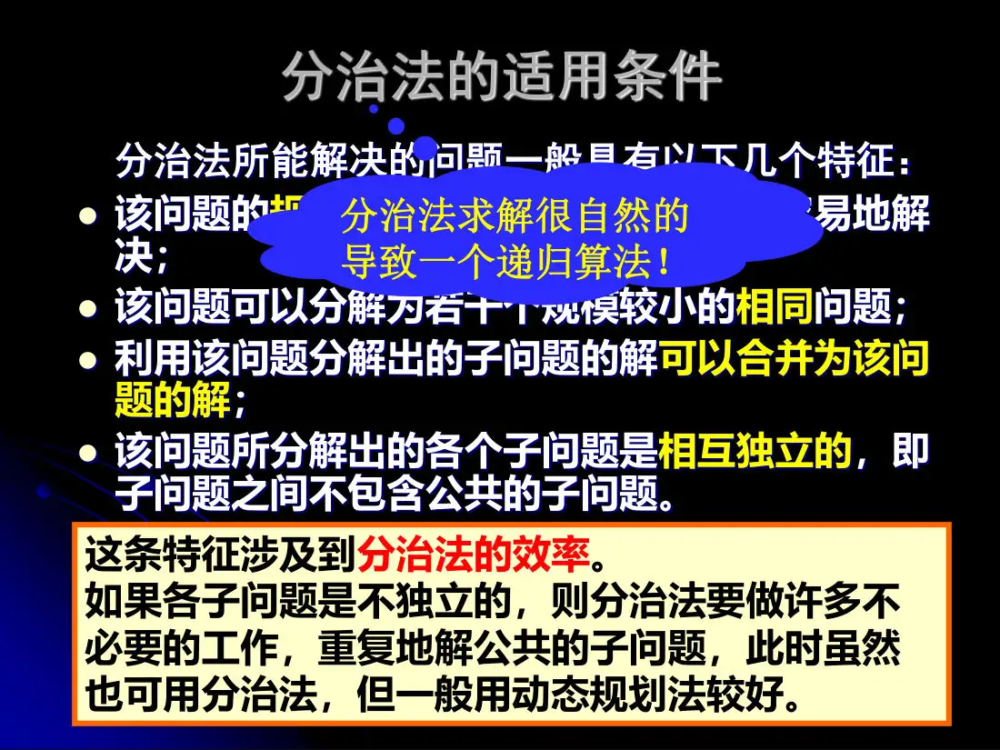

原文：

分治法的适用条件

分治法所能解决的问题一般具有以下几个特征：

该问题的规决；

缩小到一定的程度就分治法求解很自然的

导致一个递归算法！

易地解

该问题可以分解为若干个规模较小的相同问题；

利用该问题分解出的子问题的解可以合并为该问题的解；

该问题所分解出的各个子问题是相互独立的，即子问题之间不包含公共的子问题。

这条特征涉及到分治法的效率。

如果各子问题是不独立的，则分治法要做许多不必要的工作，重复地解公共的子问题，此时虽然也可用分治法，但一般用动态规划法较好。

### 递归的概念

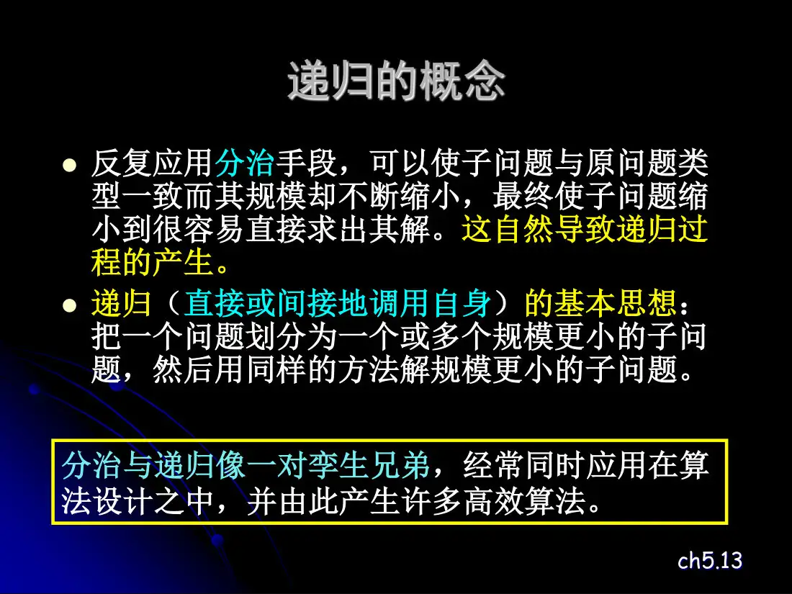

原文：

递归的概念

反复应用分治手段，可以使子问题与原问题类型一致而其规模却不断缩小，最终使子问题缩小到很容易直接求出其解。这自然导致递归过程的产生。

递归（直接或间接地调用自身）的基本思想：把一个问题划分为一个或多个规模更小的子问题，然后用同样的方法解规模更小的子问题。

分治与递归像一对孪生兄弟，经常同时应用在算法设计之中，并由此产生许多高效算法。

ch5.13

### 例1 阶乘函数

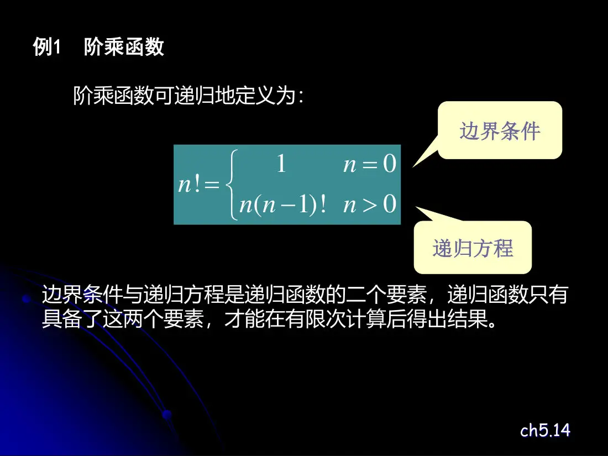

原文：

例1 阶乘函数

阶乘函数可递归地定义为：

边界条件

$$
n! = \left\{ \begin{array}{c c} 1 & n = 0 \\ n (n - 1)! & n > 0 \end{array} \right.
$$

递归方程

边界条件与递归方程是递归函数的二个要素，递归函数只有具备了这两个要素，才能在有限次计算后得出结果。

ch5.14

### 例2 Fibonacci数列

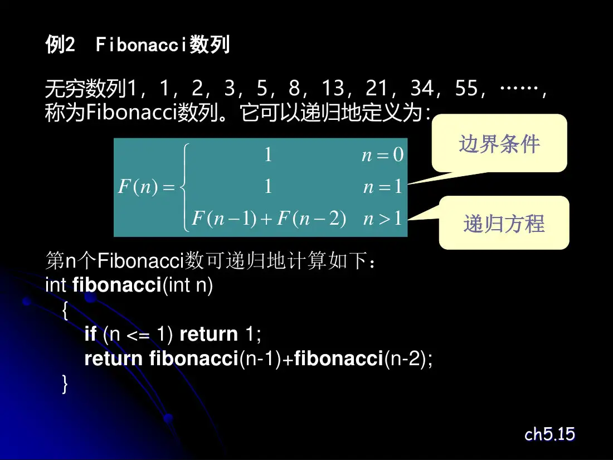

原文：

例2 Fibonacci数列

无穷数列1，1，2，3，5，8，13，21，34，55，……，称为Fibonacci数列。它可以递归地定义为：

边界条件

$$
F (n) = \left\{ \begin{array}{c c} 1 & n = 0 \\ 1 & n = 1 \\ F (n - 1) + F (n - 2) & n > 1 \end{array} \right.
$$

递归方程

第n个Fibonacci数可递归地计算如下：int fibonacci(int n)

$\mathrm { H } \langle \langle 0 | 0 | \leq 0 | 0 \rangle$ return 1; return fibonacci(n-1)+fibonacci(n-2);

ch5.15

### 例3 Hanoi塔问题

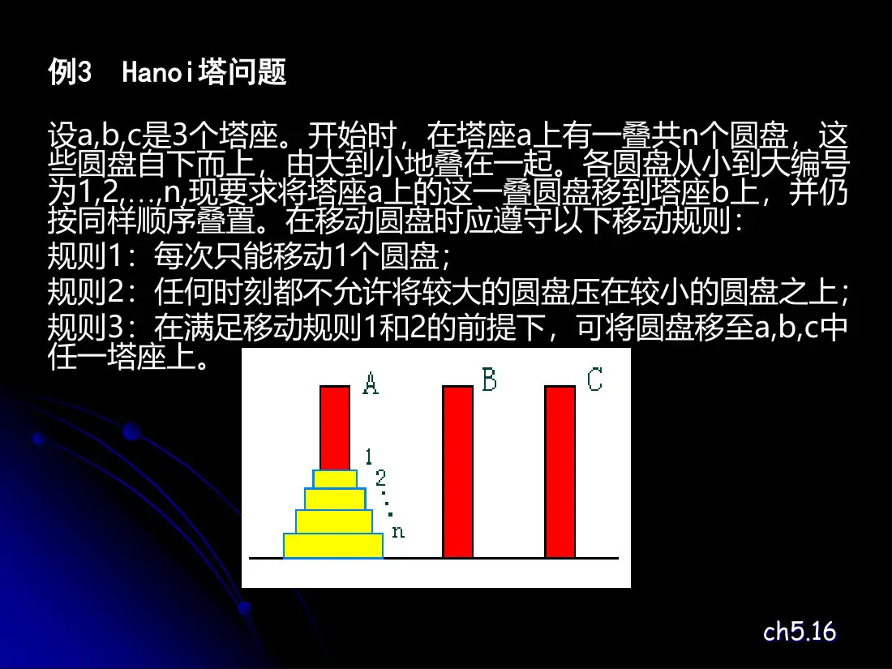

原文：

例3 Hanoi塔问题

设a,b,c是3个塔座。开始时，在塔座a上有一叠共n个圆盘，这些圆盘自下而上，由大到小地叠在一起。各圆盘从小到大编号为1,2,…,n,现要求将塔座a上的这一叠圆盘移到塔座b上，并仍按同样顺序叠置。在移动圆盘时应遵守以下移动规则：规则1：每次只能移动1个圆盘；规则2：任何时刻都不允许将较大的圆盘压在较小的圆盘之上；规则3：在满足移动规则1和2的前提下，可将圆盘移至a,b,c中任一塔座上。

ch5.16

### ch5.17

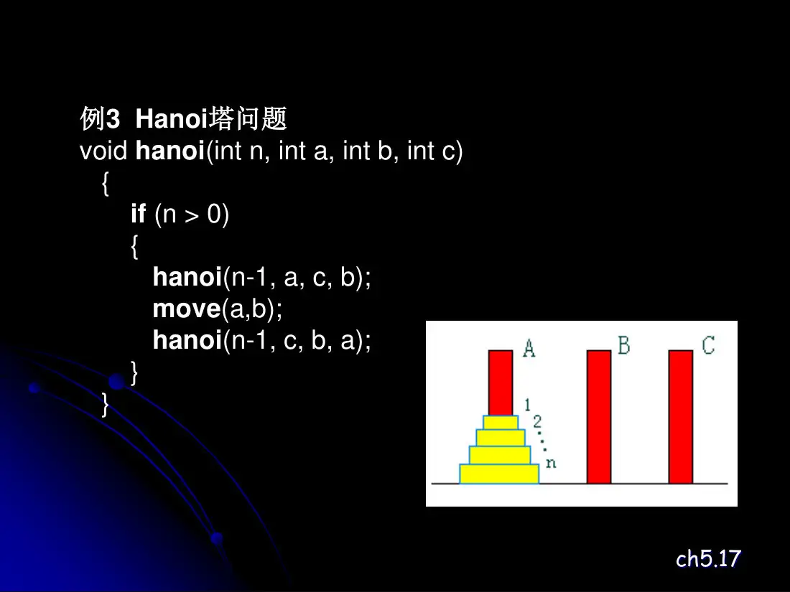

原文：

例3 Hanoi塔问题 void hanoi(int n, int a, int b, int c) if (n > 0) hanoi(n-1, a, c, b); move(a,b); hanoi(n-1, c, b, a);

ch5.17

### 递归小结

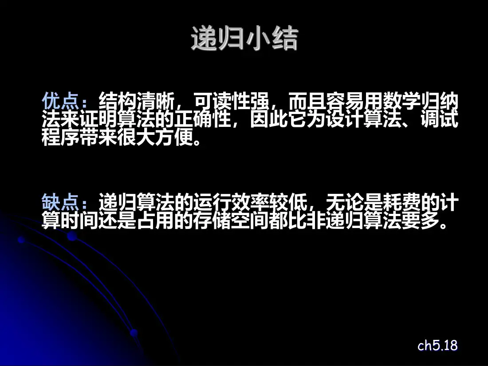

原文：

递归小结

优点：结构清晰，可读性强，而且容易用数学归纳法来证明算法的正确性，因此它为设计算法、调试程序带来很大方便。

缺点：递归算法的运行效率较低，无论是耗费的计算时间还是占用的存储空间都比非递归算法要多。

ch5.18

### 分治法的算法框架

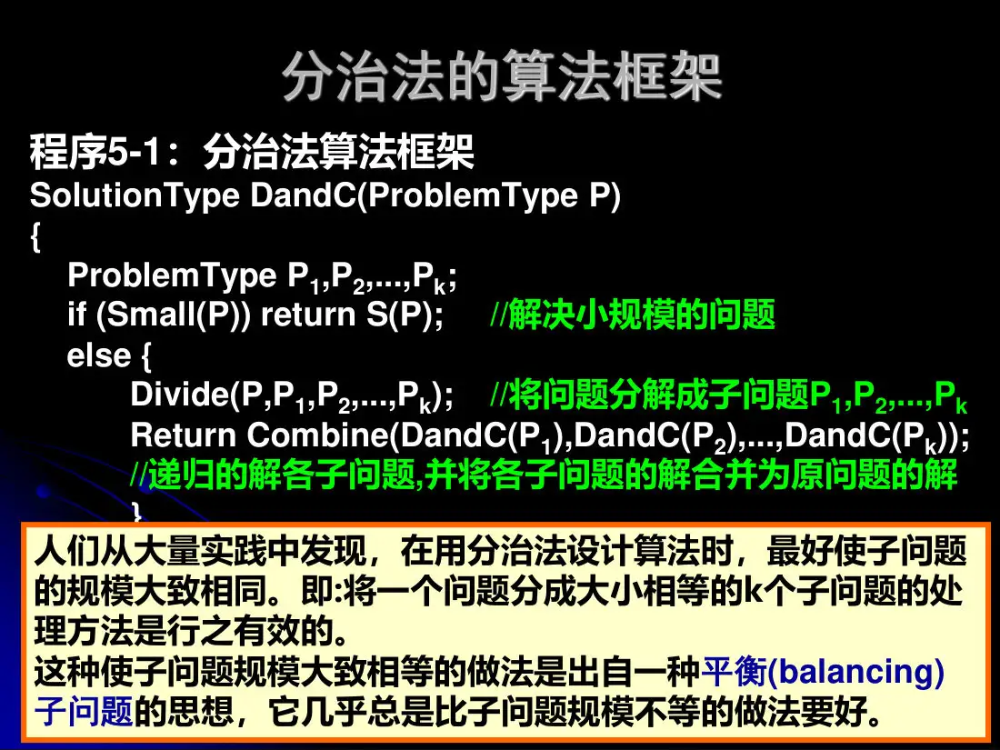

原文：

分治法的算法框架

程序5-1：分治法算法框架SolutionType DandC(ProblemType P)

ProblemType $\boxed { 2 } \boxed { 2 } \boxed { 2 } \boxed { 2 } \boxed { 1 } \boxed { 2 }$ if (Small(P)) return S(P); //解决小规模的问题 else {

Divide(P, $\bf \Pi \boxed { 5 } \times \boxed { 5 } \times \boxed { 5 } \times \boxed { 5 } \times \boxed { 5 }$ //将问题分解成子问题P $\boxed { \bullet }$ Return Combine(DandC(P ),DandC(P ),...,DandC(P ));//递归的解各子问题,并将各子问题的解合并为原问题的解

}人们从大量实践中发现，在用分治法设计算法时，最好使子问题的规模大致相同。即:将一个问题分成大小相等的k个子问题的处理方法是行之有效的。

这种使子问题规模大致相等的做法是出自一种平衡(balancing)ch子问题的思想，它几乎总是比子问题规模不等的做法要好。

### 一分为二的分治法算法框架

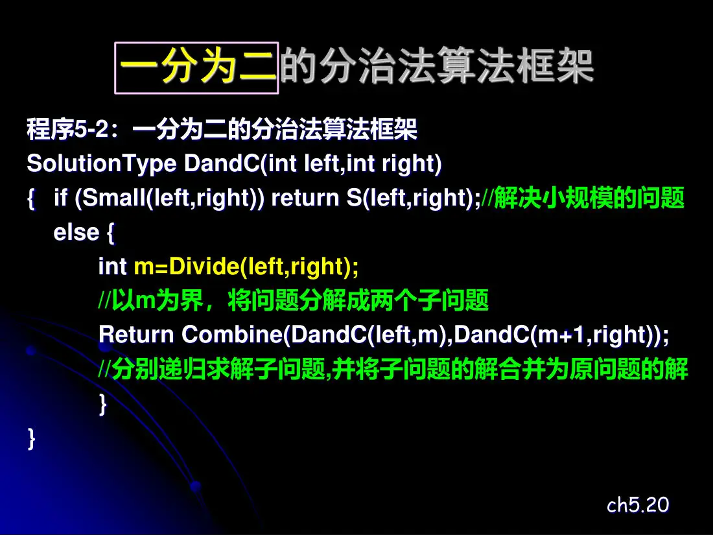

原文：

一分为二的分治法算法框架

程序5-2：一分为二的分治法算法框架

SolutionType DandC(int left,int right)

{ if (Small(left,right)) return S(left,right);//解决小规模的问题 else {

int m=Divide(left,right);//以m为界，将问题分解成两个子问题

Return Combine(DandC(left,m),DandC(m+1,right));

//分别递归求解子问题,并将子问题的解合并为原问题的解

ch5.20

### 分治法的复杂性分析

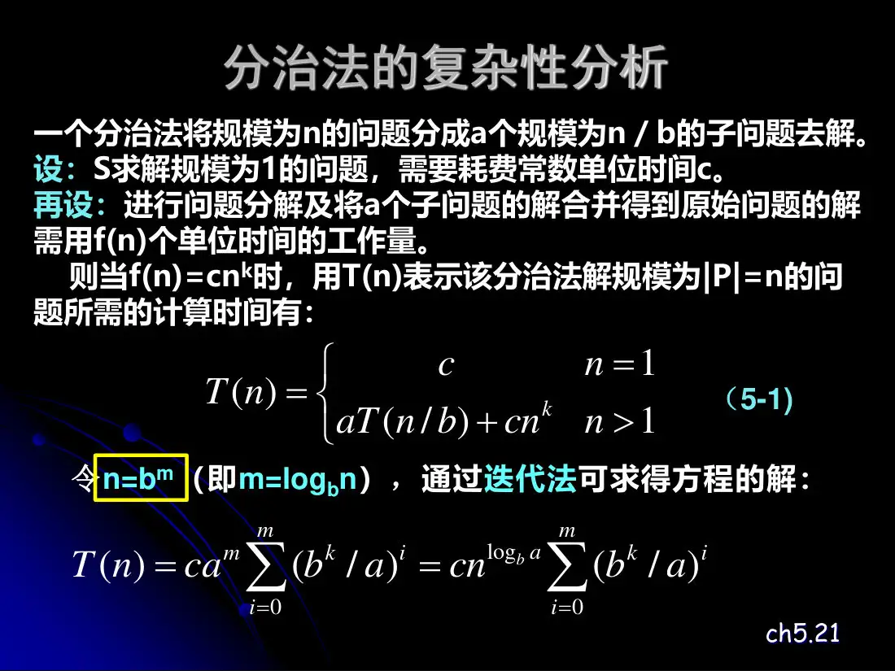

原文：

分治法的复杂性分析

个分治法将规模为n的问题分成a个规模为n／b的子问题去解。设：S求解规模为1的问题，需要耗费常数单位时间c。

再设：进行问题分解及将a个子问题的解合并得到原始问题的解需用f(n)个单位时间的工作量。

则当f(n)=cnk时，用T(n)表示该分治法解规模为|P|=n的问题所需的计算时间有：

$$
T (n) = \left\{ \begin{array}{c c} c & n = 1 \\ a T (n / b) + c n ^ {k} & n > 1 \end{array} \right.\tag{5-1}
$$

令 $\bf \Pi ^ { \mathrm { } }$ （即 $[ \pm \pmb { \mathrm { i } } \pm ] [ \pmb { \mathrm { o } } ] \pmb { \mathrm { o } } ]$ 通过迭代法可求得方程的解：

$$
T (n) = c a ^ {m} \sum_ {i = 0} ^ {m} (b ^ {k} / a) ^ {i} = c n ^ {\log_ {b} a} \sum_ {i = 0} ^ {m} (b ^ {k} / a) ^ {i}
$$

ch5.21

### 得到（定理5-1）：

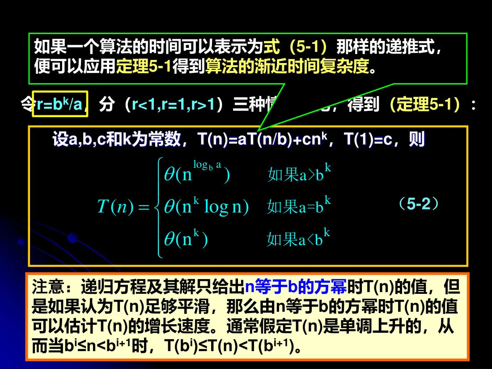

原文：

logbm k i k i a如果一个算法的时间可以表示为式（5-1）那样的递推式，便可以应用定理5-1得到算法的渐近时间复杂度。

$\circledast 1 = \circledast 1 \circledast$ 分 $( ( c + 1 ) = ( 1 1 + 1 )$ 三种情

得到（定理5-1）：

设a,b,c和k为常数， $1 1 \textcircled { \div } 2 : 1 1 \textcircled { \div } 2 : 1 = 2 : 1 1$ $\Pi ( [ 0 ] ) = 0$ ，则

$$
\theta (\mathrm{n} ^ {\log_ {\mathrm{b}} \mathrm{a}})
$$

如果 $0 . 1 \dot { 0 } \dot { 2 } \dot { 0 } \dot { 1 } \dot { 0 } \dot { 1 } \dot { 1 } 0 0 \dot { 1 } \dot { 1 } 0 0 0 \dot { 1 } \dot { 1 } 0 0 0 \dot { 1 } \dot { 1 } 0 0 0 \dot { 1 } 0 0 0 \dot { 1 } 0 0 0 0 \dot { 1 } 0 0 0 0 0 \dot { 1 } 0 0 0 0 0 0 0 0 0 0 0$

$$
\theta (\mathrm{n} ^ {\mathrm{k}})
$$

如果 $( 0 . 7 5 - 1 . 5 ) \div ( 0 . 7 5 - 1 . 5 )$

（5-2）

如果 $6 0 \times 1 0 = 1 0$

注意：递归方程及其解只给出n等于b的方幂时T(n)的值，但是如果认为T(n)足够平滑，那么由n等于b的方幂时T(n)的值可以估计T(n)的增长速度。通常假定T(n)是单调上升的，从而当 $b ^ { i } \leq n < b ^ { i + 1 }$ 时， $\mathsf { T } ( \mathsf { b } ^ { \mathsf { i } } ) { \leq } \mathsf { T } ( \mathsf { n } ) { \leq } \mathsf { T } ( \mathsf { b } ^ { \mathsf { i } + 1 } )$

### 本章算法的数据结构

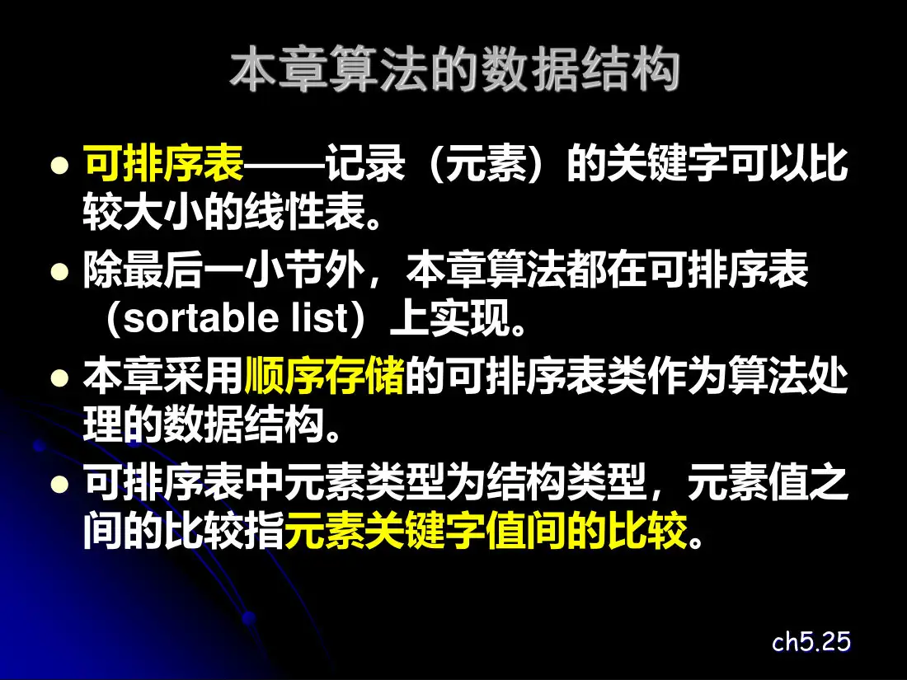

原文：

本章算法的数据结构

⚫ 可排序表— 记录（元素）的关键字可以比较大小的线性表。

⚫ 除最后一小节外，本章算法都在可排序表（sortable list）上实现。

本章采用顺序存储的可排序表类作为算法处理的数据结构。

⚫ 可排序表中元素类型为结构类型，元素值之间的比较指元素关键字值间的比较。

ch5.25

### 5.2 求最大最小元

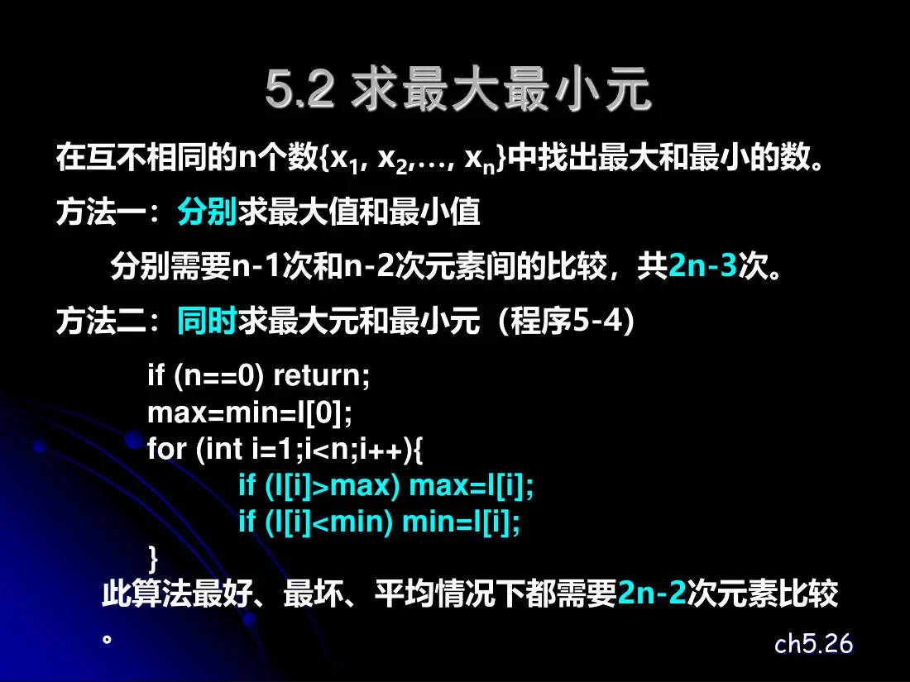

原文：

5.2 求最大最小元

在互不相同的n个数 $\pm \pm \sqrt { 1 0 } \pm \sqrt { 1 0 } \pm \sqrt { 1 0 }$ 中找出最大和最小的数。方法一：分别求最大值和最小值分别需要n-1次和n-2次元素间的比较，共2n-3次。方法二：同时求最大元和最小元（程序5-4）

if (n==0) return;max=min=l[0];for (int i=1;i<n;i++){if (l[i]>max) max=l[i];if (l[i]<min) min=l[i];

此算法最好、最坏、平均情况下都需要2n-2次元素比较方法二（改进）：只有当l[i]>max为假时才比较l[i]<minif (n==0) return;max=min=l[0];for (int i=1;i<n;i++){if (l[i]>max) max=l[i];else if (l[i]<min) min=l[i];}

ch5.26

### ch5.27

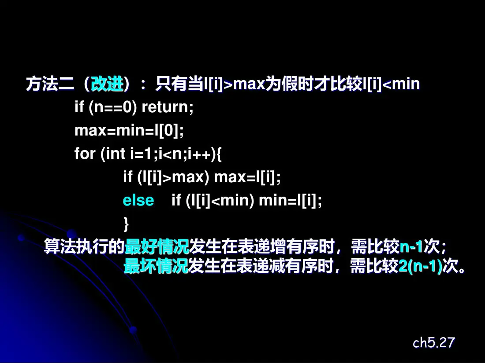

原文：

算法执行的最好情况发生在表递增有序时， 需比较n-1次；最坏情况发生在表递减有序时，需比较2(n-1)次。

ch5.27

### if (i==j) max=min=l[i]; else if (i==j-1)

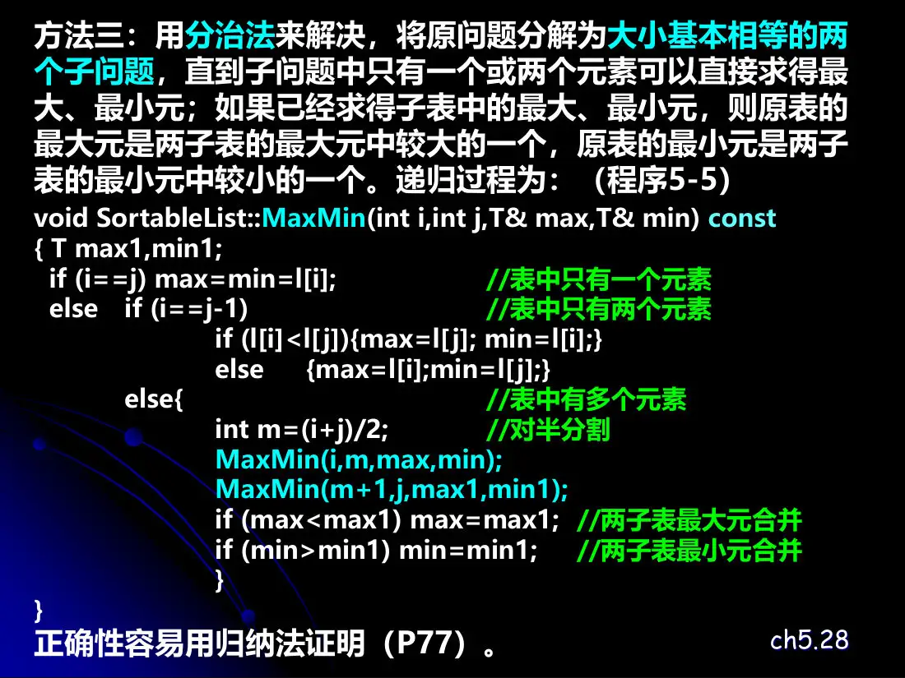

原文：

方法三：用分治法来解决，将原问题分解为大小基本相等的两个子问题，直到子问题中只有一个或两个元素可以直接求得最大、最小元；如果已经求得子表中的最大、最小元，则原表的最大元是两子表的最大元中较大的一个，原表的最小元是两子表的最小元中较小的一个。递归过程为：（程序5-5）

void SortableList::MaxMin(int i,int j,T& max,T& min) const { T max1,min1; { T max1,min1;

if (i==j) max=min=l[i]; else if (i==j-1)

else{

//表中只有一个元素//表中只有两个元素

if (l[i]<l[j]){max=l[j]; min=l[i];}else $[ [ \mathrm { i n k } ] , [ \mathrm { i n k } ] ] = [ [ \mathrm { i n k } ] , [ \mathrm { i n k } ] ] = [ [ \mathrm { i n } ] , [ \mathrm { i n } ]$ //表中有多个元素int m=(i+j)/2; //对半分割MaxMin(i,m,max,min);MaxMin(m+1,j,max1,min1);if (max<max1) max=max1; //两子表最大元合并if (min>min1) min=min1; //两子表最小元合并算法两次递归调用自身，所需时间分别为T(n/2|)和T(n/2 )，另外合并时还需要进行2次额外比较。

正确性容易用归纳法证明（P77）。

ch5.28

### 当n=2k时，由迭代计算得到：T(n)=3n/2-2

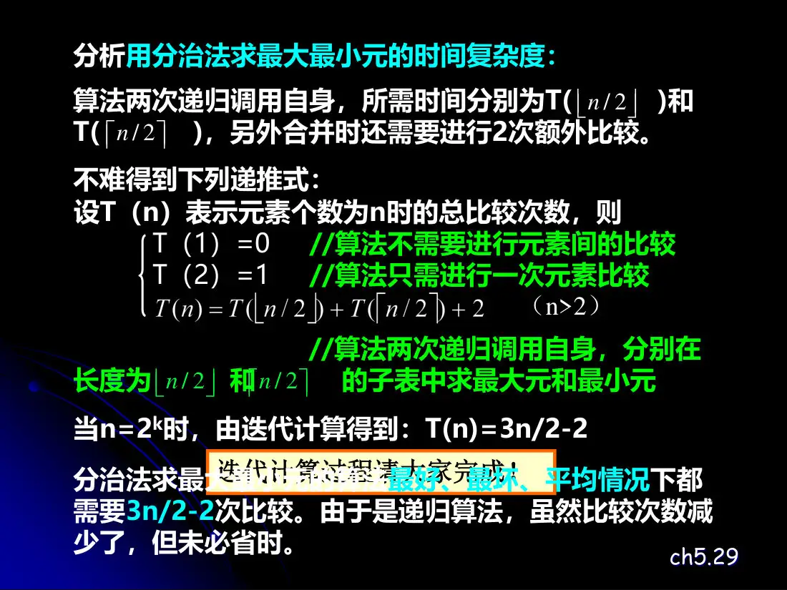

原文：

设T（n）表示元素个数为n时的总比较次数，则T（1）=0 //算法不需要进行元素间的比较T（2）=1 //算法只需进行一次元素比较$1 \times ( \square ) = \square ( \square ) = \square ( \square ) = \square ( \square ) = \square ( \square ) = \square ( \square )$ （n>2）

//算法两次递归调用自身，分别在长度为|n/2|和n/2 的子表中求最大元和最小元

当n=2k时，由迭代计算得到：T(n)=3n/2-2

分治法求最大最小元的算法迭代计算过程请大家完成！ 最好、最坏、平均情况下都需要3n/2-2次比较。由于是递归算法，虽然比较次数减少了，但未必省时。 ch5.2方法四：其实，此问题也不一定要用递归算法来解决:可将数据分成两个一组的n/2组，第一组比较一次，令大的为 $\pmb { \mathrm { L } } \pmb { \mathrm { ( n e ) } }$ 小的为 $\pmb { \mathrm { L } } \pmb { \mathrm { \Omega } } \pmb { \mathrm { M } } \pmb { \mathrm { \Omega } }$ 以后各组比较三次，先两个数据比较，其中大者再与 $\mathbb { S } \mathbb { S } \mathbb { I } \mathbb { I } \mathbb { I } \mathbb { I } \mathbb { I } \mathbb { I } \mathbb { I } \mathbb { I }$ 小者再与 $\pmb { \Sigma } \pmb { \left| 1 1 \pmb { \left| 1 \right| } \right|} $ 比;总比较次数也恰为 $( \frac { x } { 2 } , 0 ) = ( \frac { x } { 2 } , 0 )$ o

ch5.29

### ch5.30

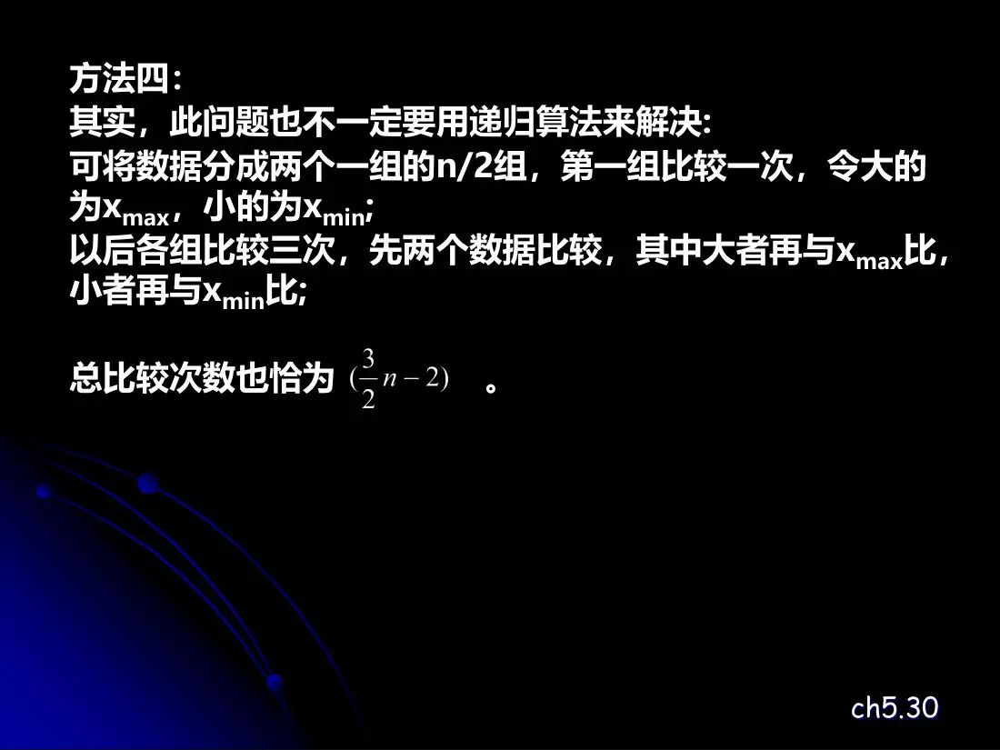

原文：

ch5.30

### 5.3 二分搜索

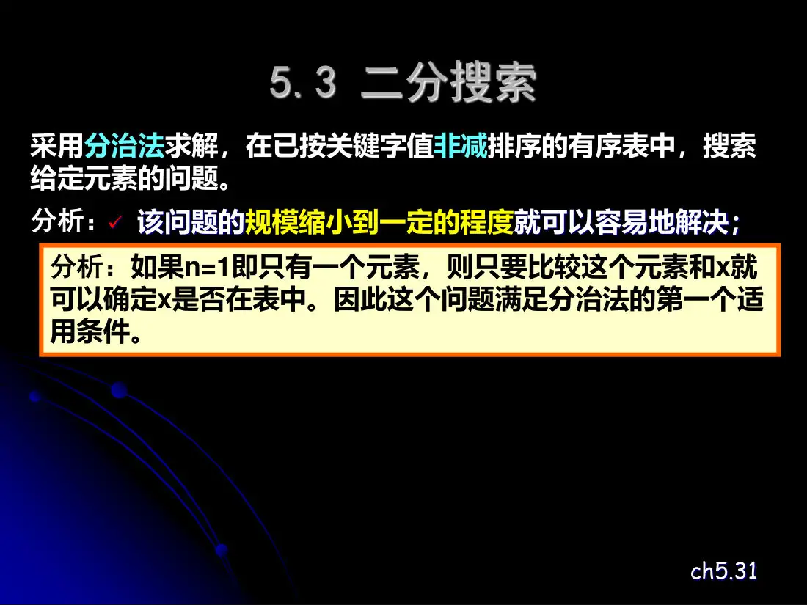

原文：

5.3 二分搜索

采用分治法求解，在已按关键字值非减排序的有序表中，搜索给定元素的问题。

分析：✓ 该问题的规模缩小到一定的程度就可以容易地解决；

✓ 该问题可以分解为若干个规模较小的相同问题;分析：如果n=1即只有一个元素，则只要比较这个元素和x就✓ 分解出的子问题的解可以合并为原问题的解；可以确定x是否在表中。因此这个问题满足分治法的第一个适✓用条件。

ch5.31

### 5.3 二分搜索

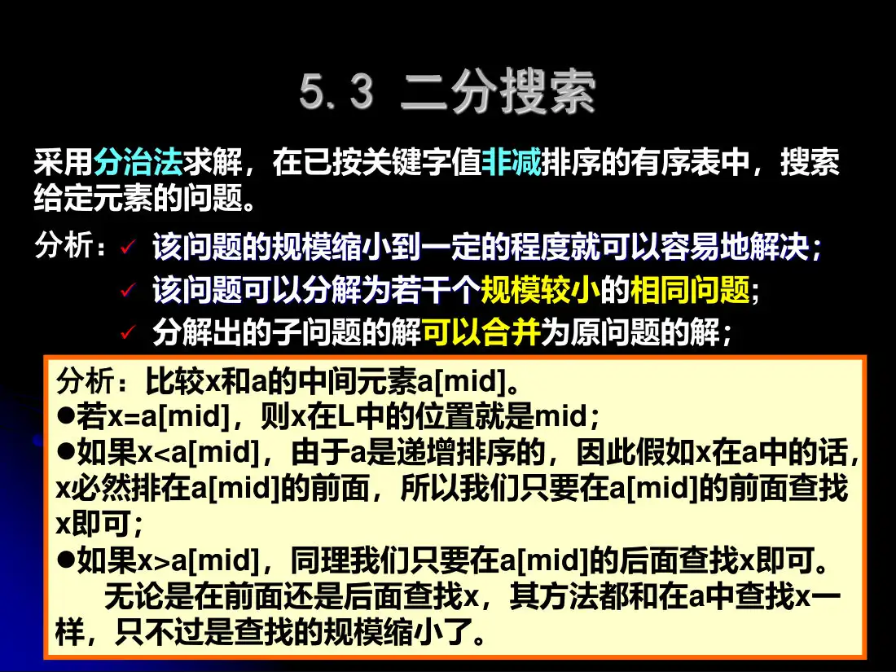

原文：

5.3 二分搜索

采用分治法求解，在已按关键字值非减排序的有序表中，搜索给定元素的问题。

✓ 该问题的规模缩小到一定的程度就可以容易地解决；分析：

✓ 该问题可以分解为若干个规模较小的相同问题;

✓ 分解出的子问题的解可以合并为原问题的解；

分析：✓ 比较分解出的各个子问题是相互x和a的中间元素a[mid]。

⚫若x=a[mid]，则x在L中的位置就是mid；

⚫如果x<a[mid]，由于a是递增排序的，因此假如x在a中的话，x必然排在a[mid]的前面，所以我们只要在a[mid]的前面查找x即可；

⚫如果x>a[mid]，同理我们只要在a[mid]的后面查找x即可。无论是在前面还是后面查找x，其方法都和在a中查找x样，只不过是查找的规模缩小了。

### 5.3 二分搜索

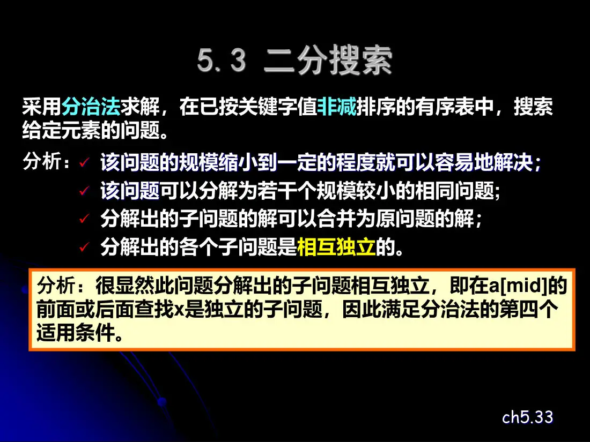

原文：

5.3 二分搜索

采用分治法求解，在已按关键字值非减排序的有序表中，搜索给定元素的问题。

✓ 该问题的规模缩小到一定的程度就可以容易地解决；分析：

✓ 该问题可以分解为若干个规模较小的相同问题;

✓ 分解出的子问题的解可以合并为原问题的解；

✓ 分解出的各个子问题是相互独立的。

分析：很显然此问题分解出的子问题相互独立，即在a[mid]的前面或后面查找x是独立的子问题，因此满足分治法的第四个适用条件。

ch5.33

### $\Xi _ { \parallel }$ 与x比较的结果有三种可能：

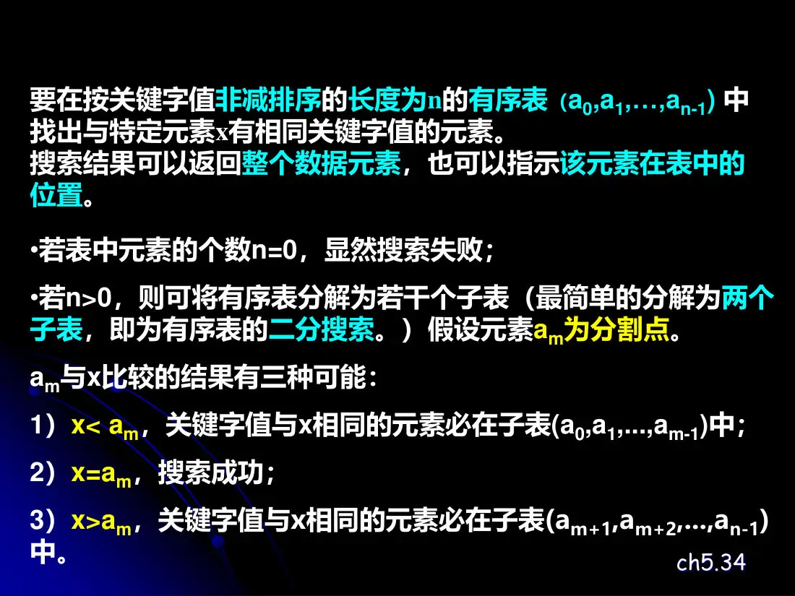

原文：

要在按关键字值非减排序的长度为n的有序表 $( \epsilon / 0 ) \epsilon / \left( \epsilon / \eta ^ { 2 } + \epsilon / \eta ^ { 2 } \right)$ 中找出与特定元素x有相同关键字值的元素。搜索结果可以返回整个数据元素，也可以指示该元素在表中的位置。

•若表中元素的个数 $\bf \Pi ^ { \prime \prime } \equiv \bf \Pi ^ { \prime \prime }$ 显然搜索失败；

•若 $\boxed { 1 } \boxed { 2 } \boxed { 1 }$ ，则可将有序表分解为若干个子表（最简单的分解为两个子表，即为有序表的二分搜索。）假设元素 $\mathsf { E }$ 为分割点。

$\Xi _ { \parallel }$ 与x比较的结果有三种可能：

1） $\therefore c - 2 a c - 1 = 0$ ，关键字值与x相同的元素必在子表 $\epsilon ( 0 ) = \epsilon ( 0 , 0 ) = \eta ( 0 ) ( 0 )$ 中；

2） $\therefore c = - \sqrt { 1 1 }$ 搜索成功；

3） $\therefore c = 0$ 关键字值与x相同的元素必在子表 $\textcircled { 6 } \frac { 1 } { 1 1 5 } \times \frac { 1 } { 1 5 } = \frac { 1 } { 1 1 5 } \times \frac { 1 } { 1 5 } = \frac { 1 } { 1 5 } \times \frac { 1 } { 1 5 } = \frac { 1 } { 1 5 }$ 中。 ch5.34 int SortableList<T>:BSearch(const T& x, int left, int right)const

### return -1;

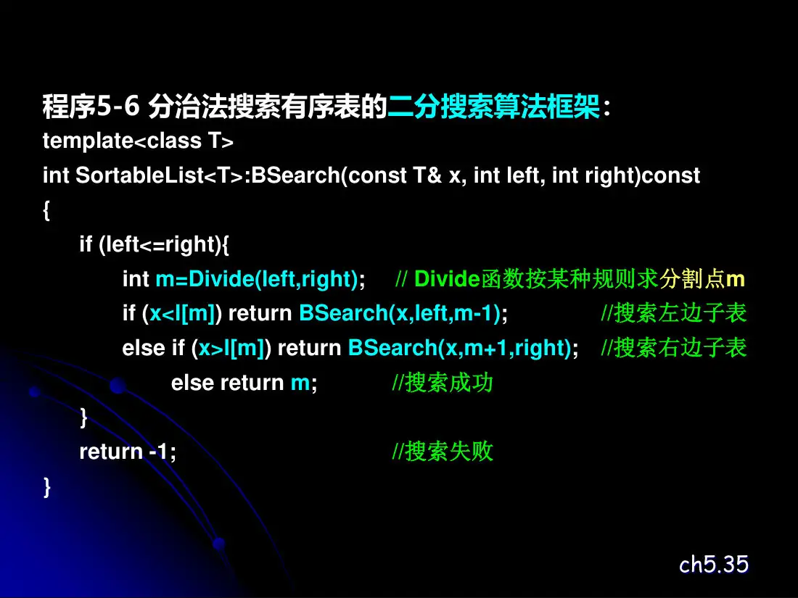

原文：

if (left<=right){ int m=Divide(left,right); // Divide函数按某种规则求分割点m if (x<l[m]) return BSearch(x,left,m-1); //搜索左边子表 else if (x>l[m]) return BSearch(x,m+1,right); //搜索右边子表 else return m; //搜索成功

return -1;

//搜索失败

ch5.35

### return -1;

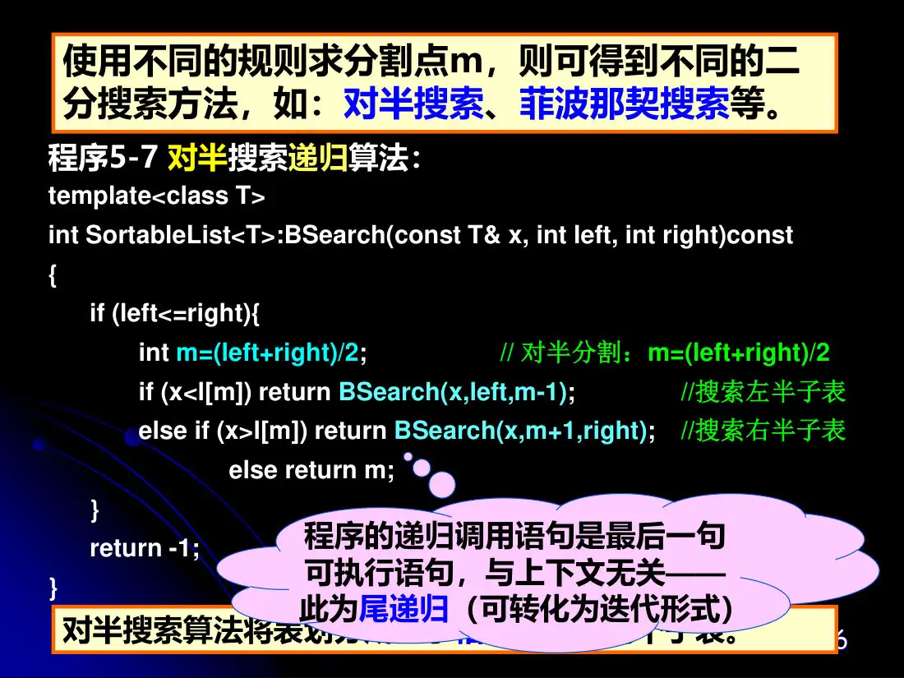

原文：

使用不同的规则求分割点m，则可得到不同的二分搜索方法，如：对半搜索、菲波那契搜索等。

程序5-7 对半搜索递归算法： template<class T> int SortableList<T>:BSearch(const T& x, int left, int right)const {

if (left<=right){ int m=(left+right)/2; // 对半分割：m=(left+right)/2 if (x<l[m]) return BSearch(x,left,m-1); //搜索左半子表 else if (x>l[m]) return BSearch(x,m+1,right); //搜索右半子表 else return m;

return -1;

对半搜索算法将表划分程序的递归调用语句是最后一句可执行语句，与上下文无关—此为尾递归（可转化为迭代形式）

### 递归函数往往效率较低，因此将程序5-7转换为迭代算法实现。

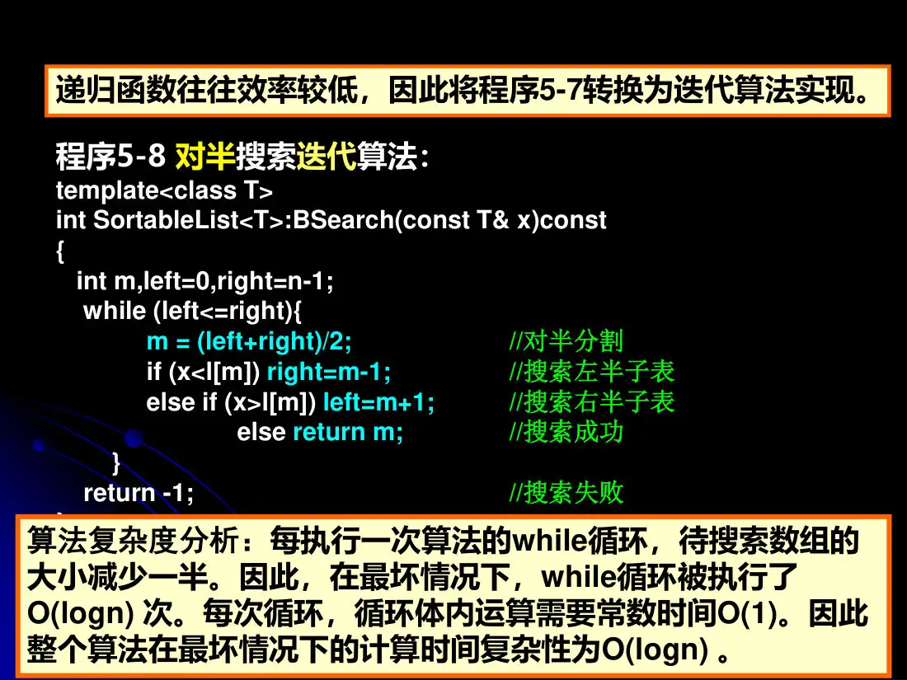

原文：

递归函数往往效率较低，因此将程序5-7转换为迭代算法实现。

程序5-8 对半搜索迭代算法： template<class T> int SortableList<T>:BSearch(const T& x)const

int m,left=0,right=n-1; while (left<=right){ m = (left+right)/2; if (x<l[m]) right=m-1; else if (x>l[m]) left=m+1; else return m;

//对半分割 //搜索左半子表 //搜索右半子表 //搜索成功

//搜索失败

算法复杂度分析：每执行一次算法的while循环，待搜索数组的大小减少一半。因此，在最坏情况下，while循环被执行了O(logn) 次。每次循环，循环体内运算需要常数时间O(1)。因此整个算法在最坏情况下的计算时间复杂性为O(logn) 。

### 二叉判定树

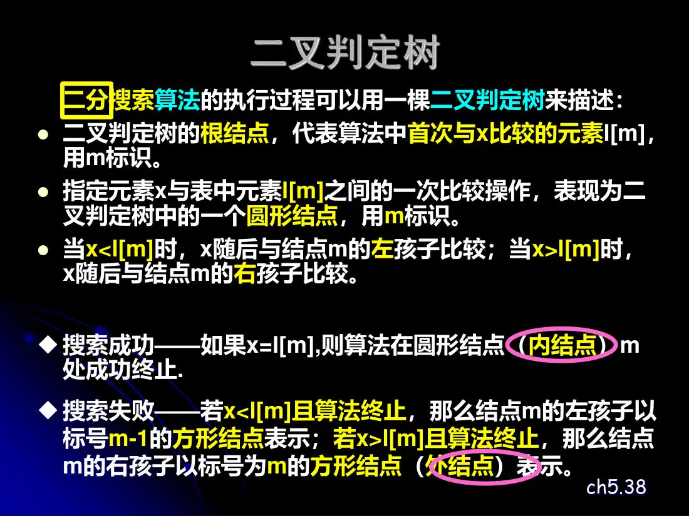

原文：

二叉判定树

二分搜索算法的执行过程可以用一棵二叉判定树来描述：

⚫ 二叉判定树的根结点，代表算法中首次与x比较的元素l[m]，用m标识。

指定元素x与表中元素l[m]之间的一次比较操作，表现为二叉判定树中的一个圆形结点，用m标识。

当x<l[m]时，x随后与结点m的左孩子比较；当x>l[m]时，x随后与结点m的右孩子比较。

搜索成功— 如果x=l[m],则算法在圆形结点（内结点）m处成功终止.

搜索失败——若x<l[m]且算法终止，那么结点m的左孩子以标号m-1的方形结点表示；若x>l[m]且算法终止，那么结点m的右孩子以标号为m的方形结点（外结点）表示。

ch5.38

### 对半搜索二叉判定树（举例）

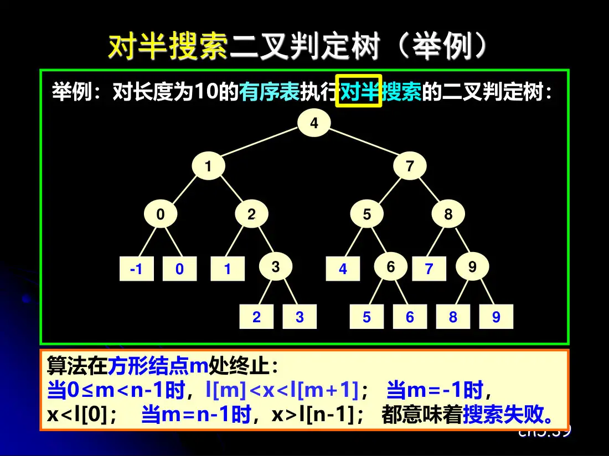

原文：

对半搜索二叉判定树（举例）

举例：对长度为10的有序表执行对半搜索的二叉判定树：

算法在方形结点m处终止：当0≤m<n-1时，l[m]<x<l[m+1]； 当m=-1时，x<l[0]； 当m=n-1时，x>l[n-1]； 都意味着搜索失败。

ch5.39

### 对半搜索二叉判定树的性质在有序表上进行对半搜索的二叉判定树有以下性质：

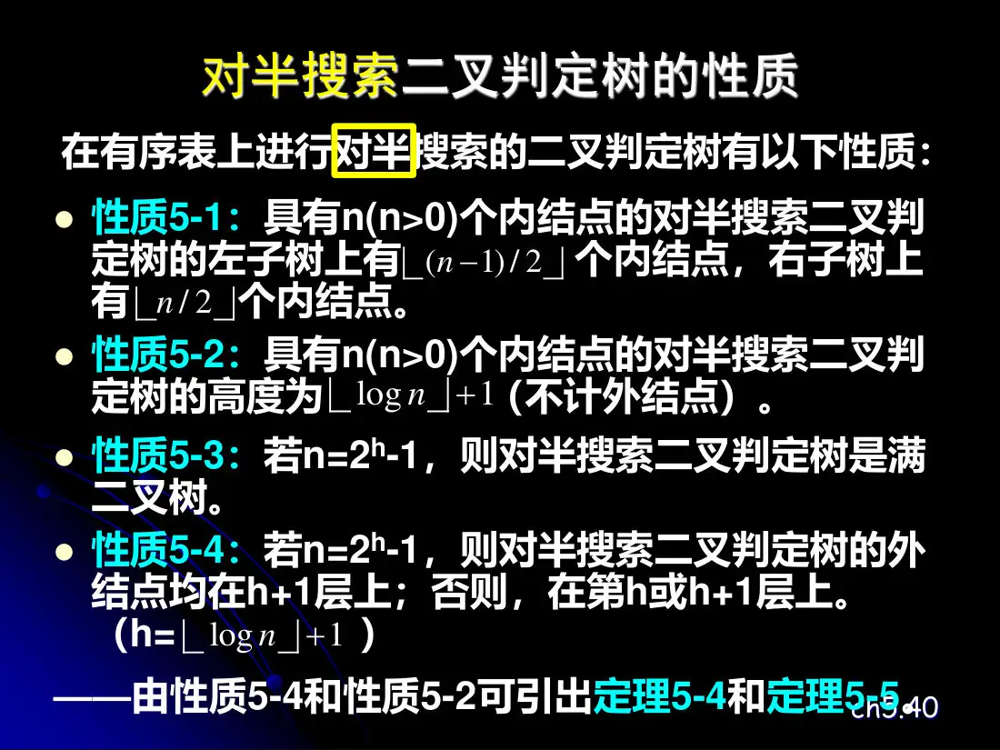

原文：

对半搜索二叉判定树的性质在有序表上进行对半搜索的二叉判定树有以下性质：

性质5-1：具有n(n>0)个内结点的对半搜索二叉判( 1) / 2 n −定树的左子树上有 个内结点，右子树上n /2有 个内结点。

性质5-2：具有n(n>0)个内结点的对半搜索二叉判定树的高度为 log 1 n + （不计外结点）。

性质5-3：若n=2h-1，则对半搜索二叉判定树是满二叉树。

性质5-4：若n=2h-1，则对半搜索二叉判定树的外结点均在h+1层上；否则，在第h或h+1层上。（h= log 1 n + ）

ch5.40由性质5-4和性质5-2可引出定理5-4和定理5-5。

### 对半搜索二叉判定树的性质

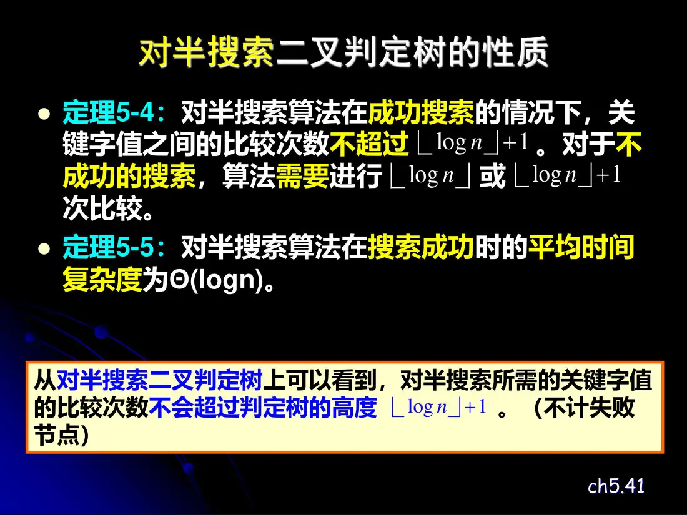

原文：

对半搜索二叉判定树的性质

定理5-4：对半搜索算法在成功搜索的情况下，关键字值之间的比较次数不超过 。对于不log 1 n +成功的搜索，算法需要进行 或log n log 1 n +次比较。

定理5-5：对半搜索算法在搜索成功时的平均时间复杂度为Θ(logn)。

从对半搜索二叉判定树上可以看到，对半搜索所需的关键字值的比较次数不会超过判定树的高度 。（不计失败log 1 n +节点）

ch5.41

### 基于关键字比较的搜索算法时间下界

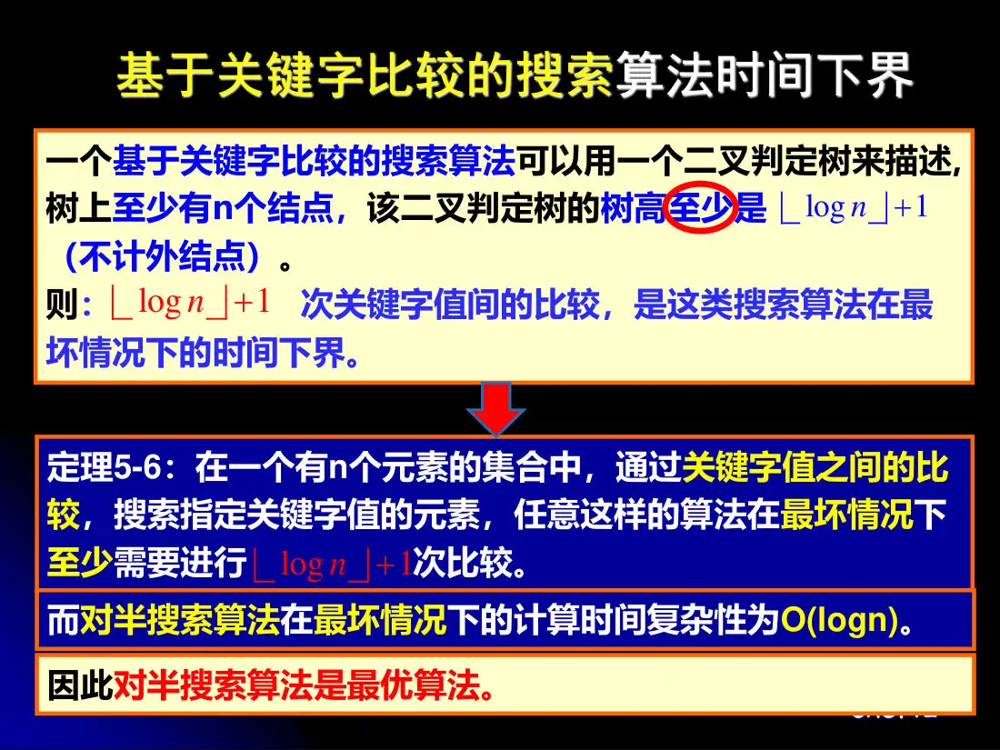

原文：

基于关键字比较的搜索算法时间下界

一个基于关键字比较的搜索算法可以用一个二叉判定树来描述,树上至少有n个结点，该二叉判定树的树高至少是 $\log n \_ { \mathrm { ~ \scriptsize ~ l ~ o ~ g ~ } }$ （不计外结点）。

则： $\lfloor \log n \rfloor + 1$ 次关键字值间的比较，是这类搜索算法在最坏情况下的时间下界。

定理5-6：在一个有n个元素的集合中，通过关键字值之间的比较，搜索指定关键字值的元素，任意这样的算法在最坏情况下至少需要进行 $1 0 \div 4 = 1 0$ 次比较。

而对半搜索算法在最坏情况下的计算时间复杂性为O(logn)。

因此对半搜索算法是最优算法。

### 基本思想：

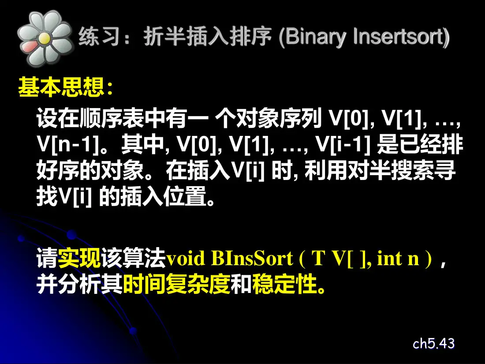

原文：

基本思想：

设在顺序表中有一 个对象序列 V[0], V[1], …,V[n-1]。其中, V[0], V[1], …, V[i-1] 是已经排好序的对象。在插入V[i] 时, 利用对半搜索寻找V[i] 的插入位置。

请实现该算法void BInsSort ( T V[ ], int n并分析其时间复杂度和稳定性。

练习：折半插入排序 (Binary Insertsort)

ch5.43

### typedef int T;

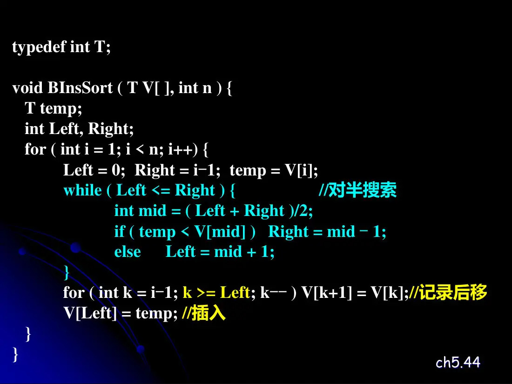

原文：

typedef int T;

void BInsSort ( T V[ ], int n ) { T temp; int Left, Right; for ( int i = 1; i < n; i++) { Left = 0; Right = i-1; temp = V[i]; while ( Left <= Right ) { //对半搜索 int mid = ( Left + Right )/2; if ( temp < V[mid] ) Right = mid - 1; else Left = mid + 1;

for ( int k = i-1; k >= Left; k-- ) V[k+1] = V[k];//记录后移 V[Left] = temp; //插入

ch5.44

### 1n− ∑(L1og₂ i|+1) ≈ n·log2 n 1i=

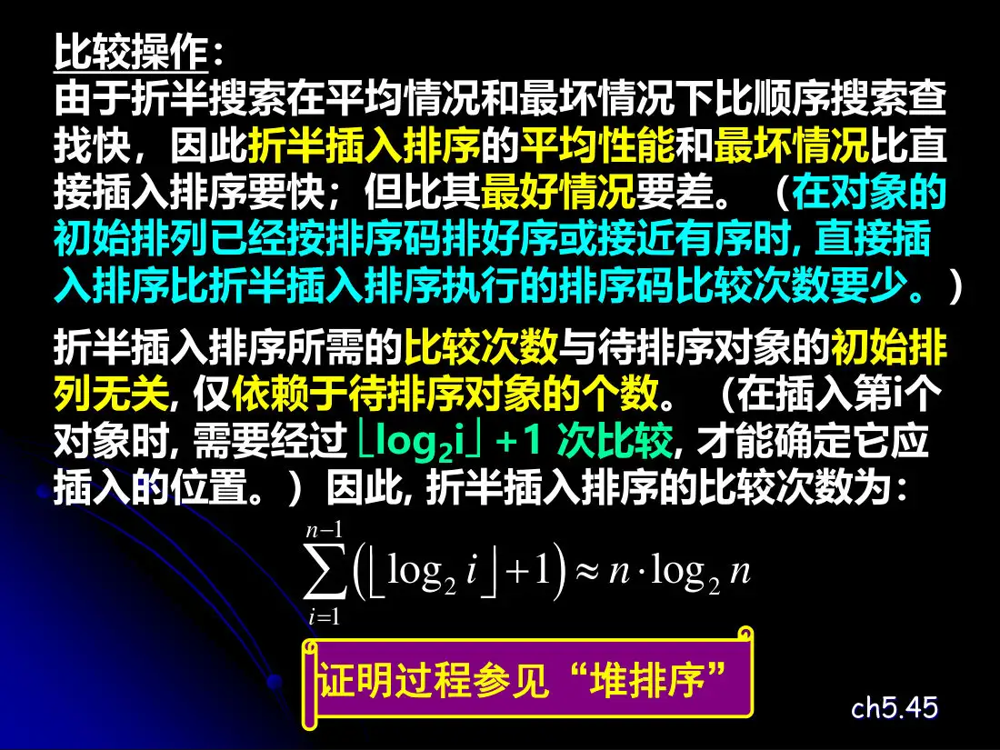

原文：

由于折半搜索在平均情况和最坏情况下比顺序搜索查找快，因此折半插入排序的平均性能和最坏情况比直接插入排序要快；但比其最好情况要差。（在对象的初始排列已经按排序码排好序或接近有序时, 直接插入排序比折半插入排序执行的排序码比较次数要少。

折半插入排序所需的比较次数与待排序对象的初始排列无关, 仅依赖于待排序对象的个数。（在插入第i个对象时，需要经过log₂i」+1 次比较，才能确定它应插入的位置。）因此, 折半插入排序的比较次数为：

1n− ∑(L1og₂ i|+1) ≈ n·log2 n 1i=

证明过程参见 “堆排序”

ch5.45

### 移动操作：

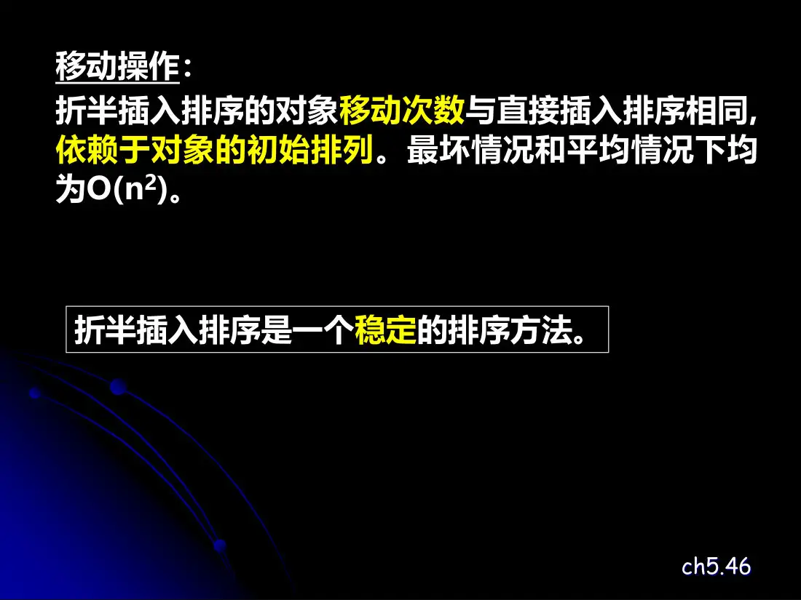

原文：

移动操作：

折半插入排序的对象移动次数与直接插入排序相同,依赖于对象的初始排列。最坏情况和平均情况下均为O(n2)。

折半插入排序是一个稳定的排序方法。

ch5.46

### 5.4 排序问题

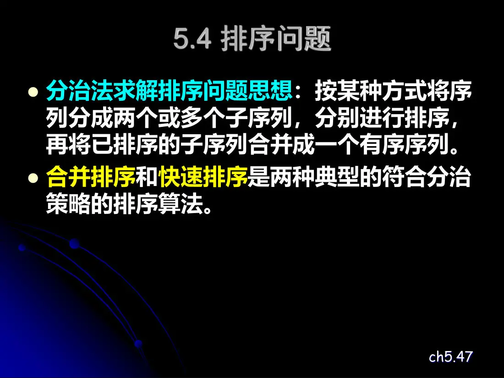

原文：

5.4 排序问题

分治法求解排序问题思想：按某种方式将序列分成两个或多个子序列，分别进行排序，再将已排序的子序列合并成一个有序序列。

合并排序和快速排序是两种典型的符合分治策略的排序算法。

ch5.47

### 合并排序

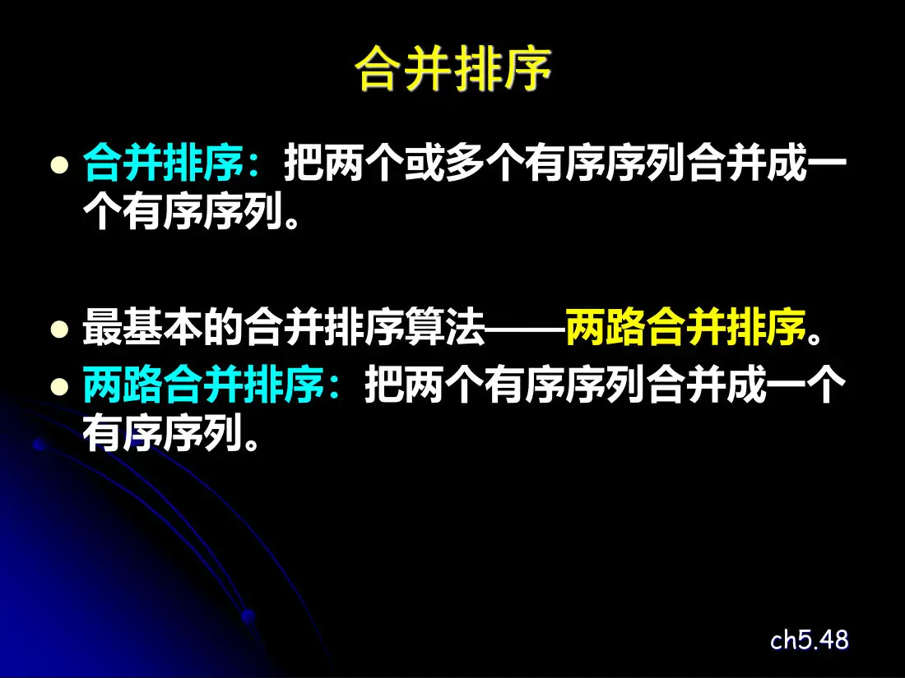

原文：

合并排序

⚫ 合并排序：把两个或多个有序序列合并成个有序序列。

最基本的合并排序算法— 两路合并排序。

两路合并排序：把两个有序序列合并成一个有序序列。

ch5.48

### 两路合并排序

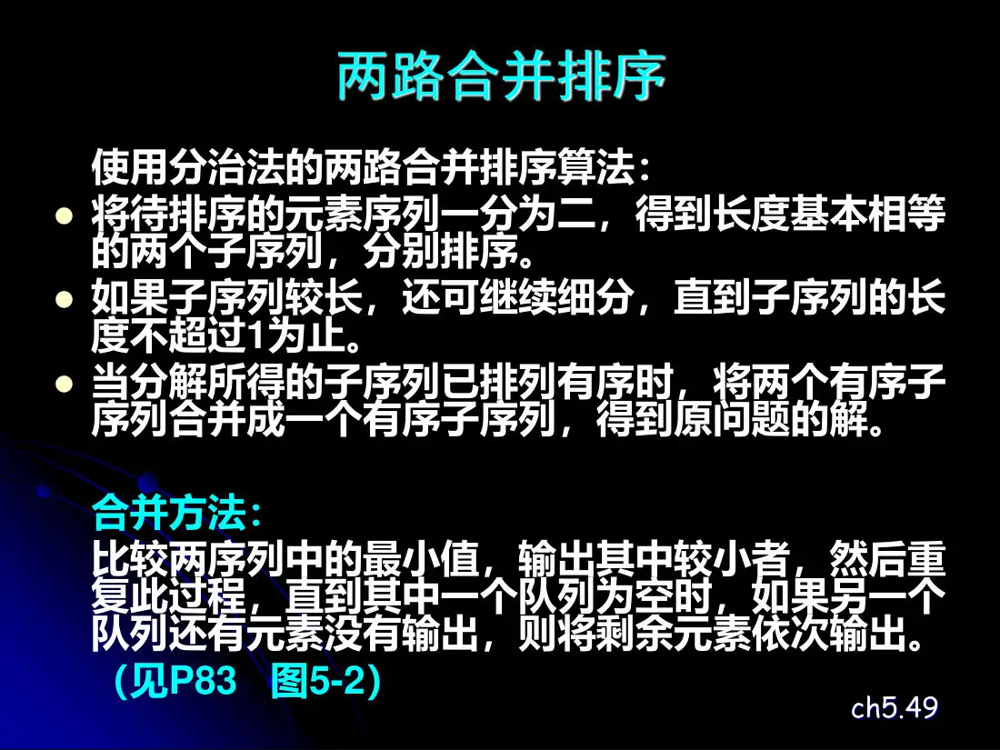

原文：

两路合并排序

使用分治法的两路合并排序算法：

将待排序的元素序列一分为二，得到长度基本相等的两个子序列，分别排序。

如果子序列较长，还可继续细分，直到子序列的长度不超过1为止。

当分解所得的子序列已排列有序时，将两个有序子序列合并成一个有序子序列，得到原问题的解。

合并方法：

比较两序列中的最小值，输出其中较小者，然后重复此过程，直到其中一个队列为空时，如果另一队列还有元素没有输出，则将剩余元素依次输出。

（见P83 图5-2）

ch5.49

### MergeSort(0,n-1);

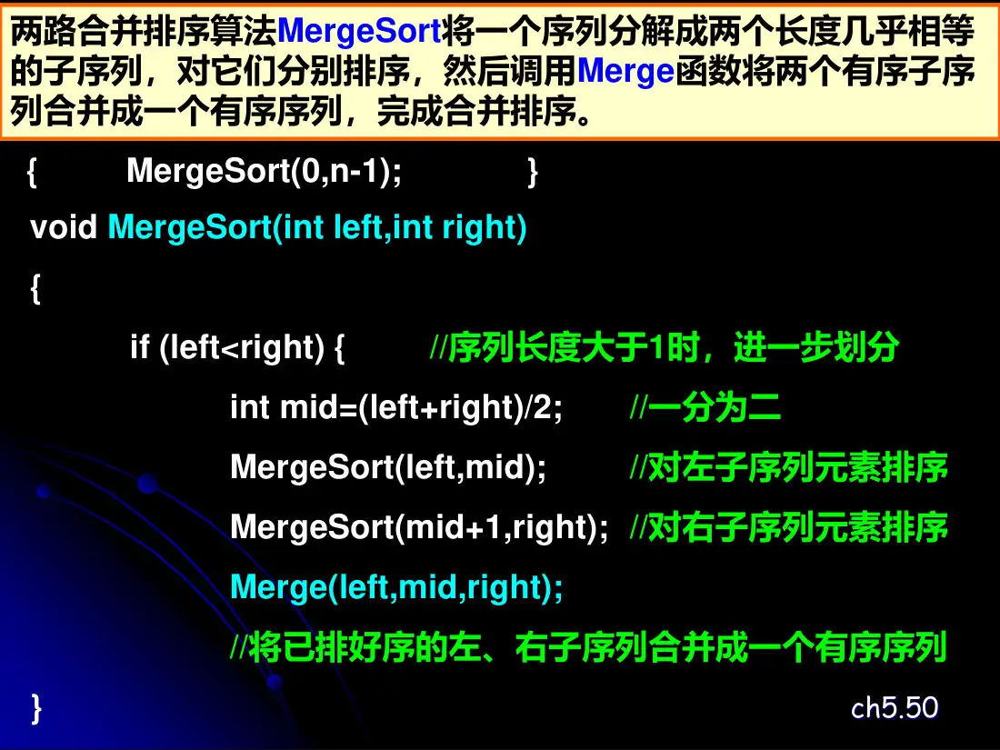

原文：

两路合并排序算法MergeSort将一个序列分解成两个长度几乎相等的子序列，对它们分别排序，然后调用Merge函数将两个有序子序void MergeSort()列合并成一个有序序列，完成合并排序。

MergeSort(0,n-1);

void MergeSort(int left,int right)

if (left<right) {

//序列长度大于1时，进一步划分

int mid=(left+right)/2;

//一分为二

MergeSort(left,mid);

//对左子序列元素排序

MergeSort(mid+1,right); //对右子序列元素排序

Merge(left,mid,right);

//将已排好序的左、右子序列合并成一个有序序列

ch5.50

}

### 第 49 页

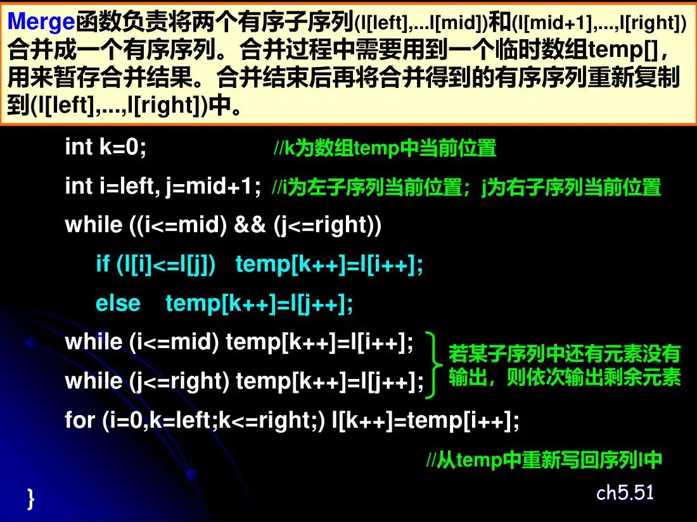

原文：

Merge函数负责将两个有序子序列(l[left],...l[mid])和(l[mid+1],...,l[right])合并成一个有序序列。合并过程中需要用到一个临时数组temp[]，void Merge (int left,int mid,int right)用来暂存合并结果。合并结束后再将合并得到的有序序列重新复制{ T\* temp=new T[r到(l[left],...,l[right])中。

int k=0; //k为数组temp中当前位置 int i=left, j=mid+1; //i为左子序列当前位置；j为右子序列当前位置 while ((i<=mid) && (j<=right)) if (l[i]<=l[j]) temp[k++]=l[i++]; else temp[k++]=l[j++]; while (i<=mid) temp[k++]=l[i++]; 若某子序列中还有元素没有 while (j<=right) temp[k++]=l[j++]; 输出，则依次输出剩余元素 for (i=0,k=left;k<=right;) l[k++]=temp[i++]; //从temp中重新写回序列l中 ch5.51

### 两路合并排序递归算法（例）

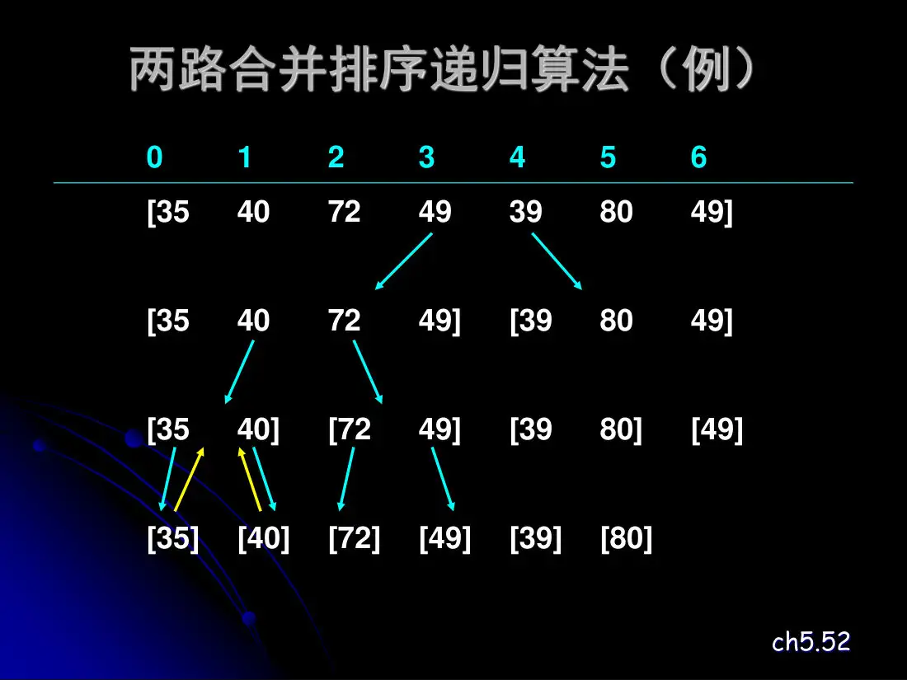

原文：

两路合并排序递归算法（例）

ch5.52

### 两路合并排序递归算法（例）

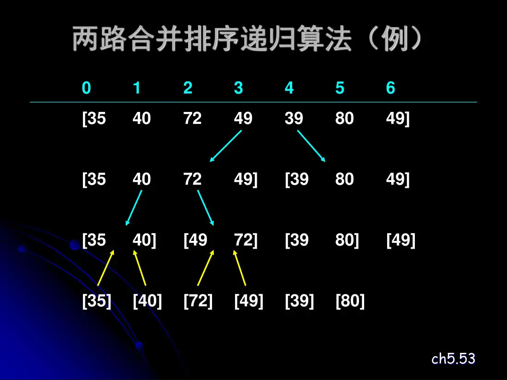

原文：

两路合并排序递归算法（例）

[35] [40] [72] [49] [39] [80]

ch5.53

### 两路合并排序递归算法（例）

原文：

两路合并排序递归算法（例）

ch5.54

### 两路合并排序递归算法（例）

原文：

两路合并排序递归算法（例）

ch5.55

### 两路合并排序递归算法（例）

原文：

两路合并排序递归算法（例）

ch5.56

### 两路合并算法时间复杂度分析

原文：

两路合并算法时间复杂度分析

⚫ Merge函数将长度之和为n的两个有序子序列合并成一个有序序列，执行过程中最多需进行n-1次关键字值间的比较，其时间复杂度为O(n)。

请写出合并排序递归算法MergeSort的时间复杂度递归函数？

ch5.57

### 两路合并算法时间复杂度分析

原文：

两路合并算法时间复杂度分析

Merge函数将长度之和为n的两个有序子序列合并成一个有序序列，执行过程中最多需进行n-1次关键字值间的比较，其时间复杂度为O(n)。

由此可得到合并排序递归算法MergeSort的时间复杂度递归函数：

$$
T (n) = \left\{ \begin{array}{c c} d & n \leq 1 \\ 2 T (n / 2) + c n & n > 1 \end{array} \right.
$$

由定理5-1，或通过迭代计算，均可得到两路合并排序的时间复杂度为T(n)=O(nlogn) 。

ch5.58

### 两路合并算法空间复杂度分析

原文：

两路合并算法空间复杂度分析

两路合并排序一般需要一个与原序列相同长度的辅助数组temp，因此它所需的额外空间为O(n)。

ch5.59

### 两路合并排序

原文：

两路合并排序

最好时间复杂度：O(nlogn) 最坏时间复杂度：O(nlogn) 平均时间复杂度：O(nlogn) 辅助空间：O(n)

ch5.60

### 快速排序

原文：

快速排序

快速排序（又称分划交换排序）：在待排序的序列$( ( 5 0 ) \leq ( 1 0 - 1 ) \leq ( 1 0 - 1 )$ 中选择一个元素作为分划元素，也称为主元。以主元为轴心，对原序列重新排列，分成左右两个子序列，使主元左侧子序列中所有元素都不大于主元，主元右侧子序列中所有元素都不小于主元，这样的分解过程称为一趟分划。

原序列被分成三部分：主元和左、右两个子序列$( \frac { 1 } { 2 } , \frac { 1 } { 2 } , \frac { 1 } { 3 } , \frac { 1 } { 2 } , \frac { 1 } { 3 } , \frac { 1 } { 2 } , \frac { 1 } { 3 } , \frac { 1 } { 2 } , \frac { 1 } { 3 } , \frac { 1 } { 2 } , \frac { 1 } { 3 } , \frac { 1 } { 3 } , \frac { 1 } { 2 } , \frac { 1 } { 3 } , \frac { 1 } { 3 } , \frac { 1 } { 3 } , \frac { 1 } { 3 } , \frac { 1 } { 3 } , \frac { 1 } { 3 } , \frac { 1 } { 3 } , \frac { 1 } { 3 } , \frac { 1 } { 3 } , \frac { 1 } { 3 } , \frac { 1 } { 3 } , \frac { 1 } { 3 } , \frac { 1 } { 3 } , \frac { 1 } { 3 } , \frac { 1 } { 3 } , \frac { 1 } { 3 } , \frac { 1 } { 3 } , \frac { 1 } { 3 } , \frac { 1 } { 3 } , \frac { 1 } { 3 } , \frac { 1 } { 3 } , \frac { 1 } { 3 } , \frac { 1 } { 3 } , \frac { 1 } { 3 } , \frac { 1 } { 3 } , \frac { 1 } { 3 } , \frac { 1 } { 3 } , \frac { 1 } { 3 } , \frac { 1 } { 3 } , \frac { 1 } { 3 } , \frac { 1 } { 3 } , \frac { 1 } { 3 } , \frac { 1 } { 3 } , \frac { 1 } { 3 } , \frac { 1 } { 3 } , \frac { 1 } { 3 } , \frac { 1 } { 3 } , \frac { 1 } { 3 } , \frac { 1 } { 3 } , \frac { 1 } { 3 } , \frac { 1 } { 3 } , \frac { 1 } { 3 } , \frac { 1 } { 3 } , \frac { 1 } { 3 } , \frac { 1 } { 3 } , \frac { 1 } { 3 } , \frac { 1 } { 3 } , \frac { 1 } { 3 } , \frac { 1 } { 3 } , \frac { 1 } { 3 } , \frac { 1 } { 3 } , \frac { 1 } { 3 } , \frac { 1 } { 3 } , \frac { 1 } { 3 } , \frac { 1 } $

通过分划操作，原序列的排序问题被分解成了两个性质相同、相互独立的子问题，分别对两个子序列当子序列为空序列或只有一个元素的序列时，无须进行任进行排序。何处理，它们自然是有序的。

### 程序5-12 快速排序算法（排序函数—QuickSort ）

原文：

程序5-12 快速排序算法（排序函数—QuickSort ）

void QuickSort(int left,int right)

{ if (left<right){

//当序列长度>1时，用Partition函数分割

int j=Partition(left,right); //对序列进行分划操作

QuickSort(left,j-1);

QuickSort(j+1,right);

//对左子序列进行快速排序

//对右子序列进行快速排序

分划操作Partition是快速排序的核心。

分划操作中最简单的选择主元的方法：选择序列的第一个元素。

ch5.62

### 程序5-11 快速排序算法（分划函数—Partition）

原文：

程序5-11 快速排序算法（分划函数—Partition）

int Partition(int left,int right)

//调用本函数的前置条件：left<right；主元为第一个元素l[left] 。

int i=left,j=right+1;

do{ do i++; while (l[i]<l[left]);

// 从l[left+1]开始比较

// i右移，直到遇到一个不小于主元的元素停止

do j--; while (l[j]>l[left]);

// 从l[right]开始比较

// j左移，直到遇到一个不大于主元的元素停止

if (i<j) Swap(i,j);

//交换l[i]和l[j]两个元素

}while (i<j);

//只要i仍小于j

Swap(left,j);

//最后将主元l[left]与l[j] 交换，结束一趟分划操作

return j;

//返回当前主元的位置

}

ch5.63

### 例：一趟分划过程

原文：

例：一趟分划过程

{72, 26, 57, 88, 42, 80, 72, 48, 60, ∞} 初始序列 {72, 26, 57, 88, 42, 80, 72, 48, 60, ∞} i++; j--; i j {72, 26, 57, 88, 42, 80, 72, 48, 60, ∞} Swap(i,j) i j {72, 26, 57, 60, 42, 80, 72, 48, 88, ∞} i++; j--; i j {72, 26, 57, 60, 42, 80, 72, 48, 88, ∞} Swap(i,j) i {72, 26, 57, 60, 42, 48, 72, 80, 88, ∞} i++; j--; i j {72, 26, 57, 60, 42, 48, 72, 80, 88, ∞} 不满足i<j时

i j算法在待排序序列的尾部设置一个大值∞作为哨兵，若当前进行分划操作的初始序列中元素个数为n，则：

ch5.64每趟分划操作中，主元和表中元素的比较不超过n+1次。

### 例：完整的快速排序过程

原文：

例：完整的快速排序过程

{72, 26, 57, 88, 42, 80, 72, 48, 60, ∞} 初始序列

{72, 26, 57, 60, 42, 48}72 {80, 88} ∞ 第一趟

$$
\{4 8, 2 6, 5 7, 6 0, 4 2 \} 7 2 \quad 7 2 \{8 0, 8 8 \} \infty \quad \text {第二趟}
$$

{42, 26}48 {60, 57}72 72 {80, 88} ∞ 第三趟

{26} 42 48 {60, 57}72 72 {80, 88} ∞ 第四趟

26 42 48 {57} 60 72 72 {80, 88} ∞ 第五趟

26 42 48 57 60 72 72 80 {88} ∞ 第六趟

26 42 48 57 60 72 72 80 88 ∞ 排序结果

### ch5.66

原文：

快速排序算法时间复杂度分析显然，当序列中没有元素或只有1个元素的时候，所需的排序时间为常数Θ(1)。每次分划操作中，主元和表中关键字值的比较不超过n+1次。

最好情况下：如果每次分划中，主元都恰好是序列（子序列）的中值，分划得到左右两个几乎相等的子序列，则快速排序的效率最高。递推公式为：

B(n)=2B(n/2)+ Θ(n) 由定理5-1可得递推式的解为： B(n)=Θ(n logn)

ch5.66

### 快速排序算法时间复杂度分析

原文：

快速排序算法时间复杂度分析

显然，当序列中没有元素或只有1个元素的时候，所需的排序时间为常数Θ(1)。

⚫ 每次分划操作中，主元和表中关键字值的比较不超过n+1次。

最坏情况下：如果每次划分操作产生的两个子序列，其中之一为空序列，则快速排序效率最低。（若总是选择左边第一个元素为主元，则快速排序的最坏情况发生在原始序列正向有序或反向有序时）递推公式为：

w(n) ≤w(n-1)+n+1 ≤W(1)+(n+1)+...+3递推式的解为：

W(n)=O(n2)

### 快速排序算法时间复杂度分析

原文：

快速排序算法时间复杂度分析

平均情况下：假定序列中n个元素的各种可能排列是等概率的，则主元在序列中的大小次序是随机的。因此在（当前）一趟分划操作后，它位于下标[0,n-1]的任何位置的可能性是相等的。这意味着序列中任何一个元素为主元的概率是1/n。

次分划操作中，主元分划操作将序列分成三部分，设左、右两个子和表中关键字值的比较序列分别包括k个和n-k-1个元素，则对这两个子序列不超过n+1次。分别执行快速排序所需的平均时间分别为A(k)和A(n-k-1)。

得递推公式： 1 1n−A(n)= 1 ( ( ) ( 1))n A k A n k+ + + − − 递推式的解为： 0kn =A(n)<2(n+1)ln(n+1)=O(n logn)

### 快速排序算法空间复杂度分析

原文：

快速排序算法空间复杂度分析

最坏情况下，程序所需的系统栈调用深度，最大为O(n)。

⚫ 如果希望减少使用的栈空间，可以每次分划后在栈中保存较大子序列的上、下界，而对较小的子序列先进行排序。这样可使所需的栈空间大小降为O(logn)。

ch5.69

### 快速排序

原文：

快速排序

最好时间复杂度：O(nlogn) 平均时间复杂度：O(nlogn) 最坏时间复杂度：O(n2) 辅助空间：O(n)或O(logn)

ch5.70

### 改善快速排序算法性能的方法

原文：

改善快速排序算法性能的方法

1、改进主元的选择方法快速排序算法的性能取决于划分的对称性。通过修改算法Partition，可以设计出采用随机选择策略的快速排序算法RandomizedPartition 。

在快速排序算法的每一步中，当数组还没有被划分时，可以在(l[left],...,l[right])中随机选出一个元素作为划分基准，这样可以使划分基准的选择是随机的，从而可以期望划分是较对称的。

int RandomizedPartition (int left, int right) int i = Random(left,right); Swap(i, left); return Partition (left, right); //再调

用Partition函数

### 改善快速排序算法性能的方法

原文：

改善快速排序算法性能的方法

2、当待排序的子序列长度小于一定值时，快速排序的速度反而不如一些简单的排序算法（如：直接插入法）。 因此对长度很小的子序列，可以不再继续分划，而使用直接插入法进行排序。

3、递归算法的效率常常不如相应的非递归算法。为提高速度，可使用非递归的快速排序（如使用堆栈代替系统栈）来取代原来的递归算法。

ch5.72

### 合并排序VS快速排序

原文：

合并排序VS快速排序

问题分解过程：

⚫ 合并排序— 将序列一分为二即可。 （十分简单）

快速排序— \_ 需调用Partition函数将一个序列划分为子序列。 （分解方法相对较困难）子问题解合并得到原问题解的过程：

合并排序— 需要调用Merge函数来实现。（Merge函数时间复杂度为O(n)）

快速排序— 旦左、右两个子序列都已分别排序，整个序列便自然成为有序序列。（异常简单，几乎无须额外的工作，省去了从子问题解合并得到原问题解的过程）

ch5.73

### 排序算法的时间下界

原文：

排序算法的时间下界

定理5-7：任何一个通过关键字值比较对n个元素进行排序的算法，最坏情况下，至少要做(n/4)logn次比较。

构造排序问题二叉判定树：(由搜索算法二叉判定树稍作修改)

⚫ 两个元素间的一次比较用一个内结点表示，并用进行比较的两元素下标“i：j”标识；

算法在外结点终止。从根到每个外结点的一条路径代表一种可能的输入序列的排序结果，因此该二叉判定树上至少有n!个外结点。（参见图 $( 1 ) \because \vert a \vert = \vert a \vert = \vert b \vert = \vert b \vert = \vert b \vert = \vert b \vert$

证明：对n个元素排序最坏情况下所需比较次数取决于二叉树高度。

1）二叉树性质：任意一棵二叉树上 叶结点的个数比度为2的结 点个数多一个。因此该二叉判定树 $m > \pm \vert \pm \vert \pmb { \vert \vert }$ $m / 2 = \sqrt { \frac { 1 } { m ^ { 2 } } }$

3）二叉树性质：包含N个元素的二叉树高度至少为 log( 1) N +因此不计外结点，二叉树高度至少为 lo $\angle B A C = \angle A B C = \angle C O B = 9 0 ^ { \circ }$ n≥4时， $( 1 0 0 0 0 0 - 1 0 0 0 0 0 0 0 0 0 0 0 0 0 0 0 0 0 0 0 0 0 0 0 0 0 0 0 0 0 0 0 0 0 0 0 0 0 0 0 0 0 0 0 0 0 0 0 0 0 0 0 0 0 0 0 0 0 0 0 0 0 0 0 0 0 0 0 0 0 0 0 0 0 0 0 0 0 0 0 0 0 0 0 0 0 0 0 0 0 0 0 0 0 0 0 0 0 0 0 0 0 0 0 0 0 0 0 0 0 0 0 0 0 0 0 0 0 0 0 0 0 0 0 0 0 0 0 0 0 0 0 0 0 0 0 0 0 0 0 0 0 0 0 0 0 0 0 0 0 0 0 0 0 0 0 0 0 0 0 0 0 0 0 0 0 0 0 0 0 0 0 0 0 0 0 0 0 0 0 0 0 0 0 0 0 0 0 0 0 0 0 0 0 0 0 0 0 0 0 0 0 0 0 0 0 0 0 0 0 0 0 0 0 0 0 0 0 0 0 0 0 0 0 0 0 0 0 0 0 0 0 0 0 0 0 0 0 0 0 0 0 0 0 0 0 0 0 0 0 0 0 0 0 0 0 0 0 0 0 0 0 0 0 0 0 0 0 0 0 0 0 0 0 0 0 0 0 0 0 0 0 0 0 0 0 0 0 0 0 0 0 0 0 0 0 0 0 0 0 0 0 0 0 0 0 0 0 0 0 0 0 0 0 0 0 0 0 0 0 0 0 0 0 0 0 0 0 0 0 0 0 0 0 0 0 0 0 0 0 0 0 0 0 0 0 0 0 0 0 0 0 0 0 0 0 0 0 0 0 0 0 0 0 0 0 0 0 0 0 0 0 0 0 0 0 0 0 0 0 0 0 0 0 0 0 0 0 0 0 0 0 0 0 0 0 0 0 0 0 0 0 0 0 0 0 0 0 0 0 0 0 0 0 0 0 0 0 0 0 0 0 0 0 0 0 0 0 0 0 0 0 0 0 0 0 0 0 0 0 0 0 0 0 0 0 0 0 0 0 0 0 0 0 0 0 0 0 0 0 0 0 0 0 0 0 0 0 0 0 0 0 0 0 0 0 0 0 0 0 0 0 0 0 0 0 0 0 0 0 0 0 0 0 0 0 0 0 0 0 0 0 0 0 0 0 0 0 0 0 0 0 0 0 0 0 0 0 0 0 0 0 0 0 0 0 0 0 0 0 0 0 0 0 0 0 0 0 0 0 0 0 0 0 0 0 0 0 0 0 0 0 0 0 0 0 0 0 0 0 0 0 0 0 0 0 0 0$

### 排序算法的时间下界

原文：

排序算法的时间下界

<table><tr><td>排序算法</td><td>最好情况</td><td>平均情况</td><td>最坏情况</td></tr><tr><td>直接插入排序</td><td>O(n)</td><td>O(n2)</td><td>O(n2)</td></tr><tr><td>简单选择排序</td><td>O(n2)</td><td>O(n2)</td><td>O(n2)</td></tr><tr><td>冒泡排序</td><td>O(n)</td><td>O(n2)</td><td>O(n2)</td></tr><tr><td>快速排序</td><td>O(nlogn)</td><td>O(nlogn)</td><td>O(n2)</td></tr><tr><td>两路合并排序</td><td>O(nlogn)</td><td>O(nlogn)</td><td>O(nlogn)</td></tr><tr><td>堆排序</td><td>O(nlogn)</td><td>O(nlogn)</td><td>O(nlogn)</td></tr></table>

ch5.75

### 如何选出n个元素中第k小的元素？（模拟快速排序算法设计）

原文：

如何选出n个元素中第k小的元素？（模拟快速排序算法设计）

每一步根据一个随机选取的元素对输入数组进行递归划分，只对含有第k小元素的那部分子数组进行递归操作寻找x[k]位置的所有者。

思考题

ch5.76

### return Randomiz能否达到线性时间复杂度？

原文：

j=i-p 分划枢纽元的选取方法， 决定了 i处）元素总数if (k 该算法的最坏时间复杂度。

return Randomiz能否达到线性时间复杂度？

else

return RandomizedSelect(a,i+1,r,k-j);

ch5.77最坏情况下算法RandomizedSelect( )需要Ω(n2) 时间。

### （详见5.5.3“线性时间选择算法”

原文：

（详见5.5.3“线性时间选择算法”

若采用“五元中值组取中值分割法”，在线性时间内找到一个划分枢纽元，使得按这个枢纽元所划分出的两个子数组的长度都至少为原数组长度的ε倍（0<ε<1是某个正常数），那么在最坏情况下用O(n)线性时间就可以完成选择任务。

时间分析：①在长度为n的数组中，寻找各分组5个元素中值，时间为O(n)；②递归调用自身寻找各组中值的二次中间值，时间为T(n/5)；③根据返回的二次中间值，对n个元素进行分划操作，时间为O(n)。④划分得到的两个子数组长度，均不会超过原数组长度的3/4，因此对子数组继续递归调用算法所需的计算时间 ≤T(3n/4)。则最坏情况下的总时间为:ch5.78T(n)<T(n/5)+T(3n/4)+O(n)=O(n)为线性时间。

### 补充：堆排序

原文：

补充：堆排序

堆排序（Heap sort, 1964年Robert W. Floyd 和J.Williams共同设计，1978年Robert W. Floyd获图灵奖）是利用二叉树的一种排序方法。

同的全二叉起连续的一个结点数

由此可见，堆是完全二叉树，且规定了父结点和子结点数据之间必须满足的条件。

ch5.79

### ch5.80

原文：

由于堆阵是完全二叉树，采用将结点顺序编号存于一维数组中的表示法较链接表示法节省存储也便于运算。设某堆的结点数共有n个，顺序将它们存入一维数组K中，下标从1到n。根据顺序表示二叉树的特点，除下标为1的结点是整个树的根结点而没有父结点以外，其余下标为j的结点（2≤j≤n）都有父结点，父结点的下标为i= 。故堆阵的条件可以表示成:K[i]≥K[j] 当2≤j≤n 和i= j / 2由堆的定义可知，其根结点（即在数组中下标为1的结点）具有最大的数值，堆阵排序就是利用这一特点进行的。堆阵排序过程分为构成堆和利用它来排序两个阶段，下面分别进行介绍。

ch5.80

### 构成堆阵的过程

原文：

构成堆阵的过程

可以结使

ch5.81

### ch5.82

原文：

“筛”运算从最末尾结点（下标为n）的父结点（下标为 ）开始，向前逐结点进行，直至筛完根结点即形成此堆阵。筛每个结点时，将其数值与其两个子结点中数值较大者进行比较，如小于该子结点数值，则与之进行互换，互换后又将它看成父结点，再与下一层的子结点进行比较，如此做下去，直至不小于其子结点的数值或已筛到端结点而不再有子结点了，此数据的“筛”运算即完成。

ch5.82

### 利用堆阵排序

原文：

利用堆阵排序

由于在一个堆中根结点数据总是所有数据中之最大者，利用堆阵排序的方法是从根结点逐个取出数据，每次将新的元素再提到根结点，如此反复进行。

为了节约存储，要求排序得到的有序数据序列仍存放于原数组中，故将从根结点取出的数据由数组的末端起逐单元存放。每存放一个数据，同时将原在该单元的数据换到根结点，但这样互换后一般会破坏堆的条件，为此，需对根结点再做一次筛运算，就又可形成新的满足条件的堆。

随着数组末端存放的由堆中取出的数据越来越多，堆的结点数逐渐减少，当到取出了(n-1)个数据，堆阵只剩下一个根结点，此最后一个数据一定是全部数据中的最小者，堆阵排序过程即全部结束。 ch5.83

### 时间复杂性分析

原文：

时间复杂性分析

堆阵排序分为建立堆阵和利用堆阵排序两大步骤设堆阵有r个满层，元素个数n=2r-1。

最坏的情况假设每个元素都需要从原来位置“筛到堆阵的最底层，仅原来在最底层的不必筛，这样一来最上层的一个元素要下降r-1层；第二层的两个元素要下降r-2层；……；中间第i层2(i-1)个元素要下降r-i层；……；下面倒数第二层，也即第r-1层的2(r-2)个元素下降一层。

每筛下一层要进行两次比较（先左右两子节点相比，然后此元素与其中较大者比）。因此在最坏的情况下，为了建立堆阵所需要的比较次数为：

2(i−1)(r−i)=2((r−1)•1+(r−2)•2+(r−3)•2 +..+1.2(r−2)) i=1 ch5.84 上式中共有(r-1)项，第一项包括(r-1)个1，第二项包 括(r-2)个2，第三项包括(r-3)个22，......，最后一项 是1个2r-2。将它们重新组合后可得下式： 2 ( 2)2(( 1) 1 ( 2) 2 ( 3) 2 1 2 )rr r r −− + − + − + + 2 2 ( 2)2((1) (1 2) (1 2 2 ) (1 2 2 2 ))r−= + + + + + + + + + + 2r− 12 (2 1)k+= − 0k= 2 12 (2 2 2 ) 2( 1)r r−= + + + − − 2(2 2) 2( 1)r r= − − − 2( 1) 2(log( 1) 1)n n= − − + − 2 1rn = −（因 ） 2 2 g( ) lo 1 2n n n = − +  n（当 较大时）

### ch5.85

原文：

ch5.85

### 1n− 2∑Llogi 1i=

原文：

排序时由后向前顺次将元素与根结点对换，并将换到根结点的元素筛到合适的位置处。如果逐个进行，堆阵越来越小，直至排序完毕。设在某一步堆阵有i个元素，其深度为 ，最坏情况将根元素筛到堆阵最下层需要比较次为 2| log i故最坏情况排序过程的总比较次数为：

1n− 2∑Llogi 1i=

ch5.86

### 第 85 页

原文：

$\vert \vert \overrightarrow { a } \vert = \vert \vert \overrightarrow { b } \vert = \vert \vert \overrightarrow { b } \vert = \vert \vert \overrightarrow { a } \vert = \vert \vert \overrightarrow { b } \vert$ 1( 2 1共 个 ）因： $1 0 0 0 0 0 0 0 0 0 0 0 0 0 0 0 0 0 0 0 0 0 0 0 0 0 0 0 0 0 0 0 0 0 0 0 0 0 0 0 0 0 0 0 0 0 0 0 0 0 0 0 0 0 0 0 0 0 0 0 0 0 0 0 0 0 0 0 0 0 0 0 0 0 0 0 0 0 0 0 0 0 0 0 0 0 0 0 0 0 0 0 0 0 0 0 0 0 0 0 0 0 0 0 0 0 0 0 0 0 0 0 0 0 0 0 0 0 0 0 0 0 0 0 0 0 0 0 0 0 0 0 0 0 0 0 0 0 0 0 0 0 0 0 0 0 0 0 0 0 0 0 0 0 0 0 0 0 0 0 0 0 0 0 0 0 0 0 0 0 0 0 0 0 0 0 0 0 0 0 0 0 0 0 0 0 0 0 0 0 0 0 0 0 0 0 0 0 0 0 0 0 0 0 0 0 0 0 0 0 0 0 0 0 0 0 0 0 0 0 0 0 0 0 0 0 0 0 0 0 0 0 0 0 0 0 0 0 0 0 0 0 0 0 0 0 0 0 0 0 0 0 0 0 0 0 0 0 0 0 0 0 0 0 0 0 0 0 0 0 0 0 0 0 0 0 0 0 0 0 0 0 0 0 0 0 0 0 0 0 0 0 0 0 0 0 0 0 0 0 0 0 0 0 0 0 0 0 0 0 0 0 0 0 0 0 0 0 0 0 0 0 0 0 0 0 0 0 0 0 0 0 0 0 0 0 0 0 0 0 0 0 0 0 0 0 0 0 0 0 0 0 0 0 0 0 0 0 0 0 0 0 0 0 0 0 0 0 0 0 0 0 0 0 0 0 0 0 0 0 0 0 0 0 0 0 0 0 0 0 0 0 0 0 0 0 0 0 0 0 0 0 0 0 0 0 0 0 0 0 0 0 0 0 0 0 0 0 0 0 0 0 0 0 0 0 0 0 0 0 0 0 0 0 0 0 0 0 0 0 0 0 0 0 0 0 0 0 0 0 0 0 0 0 0 0 0 0 0 0 0 0 0 0 0 0 0 0 0 0 0 0 0 0 0 0 0 0 0 0 0 0 0 0 0 0 0 0 0 0 0 0 0 0 0 0 0 0 0 0 0 0 0 0 0 0 0 0 0 0 0 0 0 0 0 0 0 0 0 0 0 0 0 0 0 0 0 0 0 0 0 0 0 0 0 0 0 0 0 0 0 0 0 0 0 0 0 0 0 0 0 0 0 0 0 0 0 0 0 0 0 0 0 0 0 0 0 0 0 0 0 0 0 0 0 0$ 22 2（共 个 ）$\frac { 1 0 0 0 0 } { 1 0 0 0 } = \frac { 1 1 0 0 0 0 } { 1 0 0 0 0 } = \frac { 1 1 0 0 0 0 0 } { 1 0 0 0 0 } = \frac { 1 } { 2 }$ 32 3（共 个 ）当n恰为2的整数次方时：$2 \times 2 = 2 \times 2 = 2 \times 2$ 例如：n=16时，上式为 $( 4 + 2 5 + 2 4 + 5 + 2 ) = 2 7 2$ 当n不恰为2的整数次方时，则后面几项是：$1 0 0 0 0 0 0 0 0 0 0 0 0 0 0 0 0 0 0 0 0 0 0 0 0 0 0 0 0 0 0 0 0 0 0 0 0 0 0 0 0 0 0 0 0 0 0 0 0 0 0 0 0 0 0 0 0 0 0 0 0 0 0 0 0 0 0 0 0 0 0 0 0 0 0 0 0 0 0 0 0 0 0 0 0 0 0 0 0 0 0 0 0 0 0 0 0 0 0 0 0 0 0 0 0 0 0 0 0 0 0 0 0 0 0 0 0 0 0 0 0 0 0 0 0 0 0 0 0 0 0 0 0 0 0 0 0 0 0 0 0 0 0 0 0 0 0 0 0 0 0 0 0 0 0 0 0 0 0 0 0 0 0 0 0 0 0 0 0 0 0 0 0 0 0 0 0 0 0 0 0 0 0 0 0 0 0 0 0 0 0 0 0 0 0 0 0 0 0 0 0 0 0 0 0 0 0 0 0 0 0 0 0 0 0 0 0 0 0 0 0 0 0 0 0 0 0 0 0 0 0 0 0 0 0 0 0 0 0 0 0 0 0 0 0 0 0 0 0 0 0 0 0 0 0 0 0 0 0 0 0 0 0 0 0 0 0 0 0 0 0 0 0 0 0 0 0 0 0 0 0 0 0 0 0 0 0 0 0 0 0 0 0 0 0 0 0 0 0 0 0 0 0 0 0 0 0 0 0 0 0 0 0 0 0 0 0 0 0 0 0 0 0 0 0 0 0 0 0 0 0 0 0 0 0 0 0 0 0 0 0 0 0 0 0 0 0 0 0 0 0 0 0 0 0 0 0 0 0 0 0 0 0 0 0 0 0 0 0 0 0 0 0 0 0 0 0 0 0 0 0 0 0 0 0 0 0 0 0 0 0 0 0 0 0 0 0 0 0 0 0 0 0 0 0 0 0 0 0 0 0 0 0 0 0 0 0 0 0 0 0 0 0 0 0 0 0 0 0 0 0 0 0 0 0 0 0 0 0 0 0 0 0 0 0 0 0 0 0 0 0 0 0 0 0 0 0 0 0 0 0 0 0 0 0 0 0 0 0 0 0 0 0 0 0 0 0 0 0 0 0 0 0 0 0 0 0 0 0 0 0 0 0 0 0 0 0 0 0 0 0 0 0 0 0 0 0 0 0 0 0 0 0 0 0 0 0 0 0 0 0 0 0 0 0 0 0 0 0 0 0 0 0 0 0 0 0 0 0 0 0 0 0 0 0 0 0 0 0 0 0 0 0 0 0 0 0 0 0 0 0 0 0 0 0 0 0 0 0 0 0 0 0 0 0 0$ 例如：n=19时，比n=16多出3项，每项值为 $\left| \mathbf { I } ( \mathbf { 0 } ) \mathbf { \dot { = } } \mathbf { 0 } \right| \mathbf { 0 } = \mathbf { 0 }$ 因此几项的总值 $( 0 ) : ( 1 0 - 1 ) : ( 0 . 5 ) : ( 0 . 5 ) : ( 1 0 - 1 ) : ( 1 0 - 1 ) : ( 1 0 - 1 ) : ( 1 0 - 1 ) : ( 1 0 - 1 ) : ( 1 0 - 1 ) : ( 1 0 - 1 ) : ( 1 0 - 1 ) : ( 1 0 - 1 ) : ( 1 0 - 1 ) : ( 1 0 - 1 ) : ( 1 0 - 1 ) : ( 1 0 - 1 ) : ( 1 0 - 1 ) : ( 1 0 - 1 ) : ( 1 0 - 1 ) : ( 1 0 - 1 ) : ( 1 0 - 1 ) : ( 1 0 - 1 ) : ( 1 0 - 1 ) : ( 1 0 - 1 ) : ( 1 0 - 1 ) : ( 1 0 - 1 ) : ( 1 0 - 1 ) : ( 1 0 - 1 ) : ( 0 . 5 )$ ➢得排序总的比较次数为：2( $2 2 . 1 2 . 1 0 2 . 1 . 0 2 . 1 . 0 2 . 1 . 0 2 . 1 . 0 2 . 1 . 0 2 . 1 . 0 2 . 1 . 0 2 . 1 . 0 2 . 1 . 0 2 . 1 . 0 2 . 1 . 0 2 . 1 . 0 2 . 1 . 0 2 . 1 . 0 2 . 1 . 0 2 . 1 . 0 2 . 1 . 0 2 . 1 . 0 2 . 1 . 0 2 . 1 . 0 2 . 1 . 0 2 . 1 . 0 2 . 1 . 0 2 . 1 . 0 2 . 1 . 0 2 . 1 . 0 2 . 1 . 0 . 1 . 0 . 1 . 0 . 1 . 0 . 1 . 0 . 1 . 0 . 1 . 0 . 1 . 0 . 1 . 0 . 1 . 0 . 1 . 0 . 1 . 0 . 1 . 0 . 0 . 1 . 0 . 1 . 0 . 0 . 1 . 0 . 0 . . 1 . 0 . 0 . 1 . 0 . 0 . . 1 . 0 . 0 . . 0 . 1 . 0 . 0 . . 0 . 1 . 0 . 0 .$

### 又因其中：

原文：

又因其中：

$$
\begin{array}{l} \sum_ {j = 1} ^ {k - 1} j 2 ^ {j} = \sum_ {j = 1} ^ {k - 1} j (2 ^ {j + 1} - 2 ^ {j}) = \sum_ {j = 1} ^ {k - 1} j 2 ^ {j + 1} - \sum_ {j = 0} ^ {k - 2} (j + 1) 2 ^ {j + 1} \\ = \sum_ {j = 1} ^ {k - 1} j 2 ^ {j + 1} - \sum_ {j = 0} ^ {k - 2} j 2 ^ {j + 1} - \sum_ {j = 0} ^ {k - 2} 2 ^ {j + 1} \\ = (k - 1) 2 ^ {k} - 2 (2 ^ {k - 1} - 1) = (k - 1) 2 ^ {k} - 2 ^ {k} + 2 \\ = k 2 ^ {k} - 2 ^ {k + 1} + 2 \end{array}
$$

故排序总的比较次数为：

$$
\begin{array}{l} 2 \left(\sum_ {j = 1} ^ {\lfloor \log n \rfloor - 1} j 2 ^ {j} + \lfloor \log n \rfloor (n - 2 ^ {\lfloor \log n \rfloor})\right) \\ = 2 \left(\left(\lfloor \log n \rfloor \times 2 ^ {\lfloor \log n \rfloor} - 2 ^ {\lfloor \log n \rfloor + 1} + 2\right) + \lfloor \log n \rfloor \times (n - 2 ^ {\lfloor \log n \rfloor})\right) \\ = 2 (n \lfloor \log n \rfloor - 2 ^ {\lfloor \log n \rfloor + 1} + 2) \\ \approx 2 n \log n \quad (\text {当} n \text {较大时}) \end{array}
$$

### 此排序算法是“就地”进行运算，所占空间比较节省。

原文：

建立堆阵所需的比较次数：2n利用堆阵排序所需的比较次数：2nlogn因此堆阵排序最坏情况时间复杂度为O(nlogn)。

此排序算法是“就地”进行运算，所占空间比较节省。

ch5.89

### ch5.90

原文：

补充：希尔排序 (Shell Sort)希尔排序方法又称为缩小增量排序。基本思想：

设待排序对象序列有 n 个对象, 首先取一个整数gap < n 作为间隔, 将全部对象分为 gap 个子序列,所有距离为 gap 的对象放在同一个子序列中, 在每一个子序列中分别施行直接插入排序。

然后缩小间隔 gap， 例如取 gap =「gap/2]，重复上述的子序列划分和排序工作。直到最后取 gap== 1, 将所有对象放在同一个序列中排序为止。

ch5.90

### 希尔排序过程：

原文：

希尔排序过程：

$$
\mathrm{Gap} = 3
$$

Gap = 2

21 16 08 25\* 25 49

08 16 21 25\* 25 49

08 16 21 25\* 25 49

Gap = 1

08 16 21 25\* 25 49

ch5.91

### 希尔排序的算法：

原文：

希尔排序的算法：

typedef int SortData; void ShellSort ( SortData V[], int n ) { SortData temp; int gap = n / 2; //gap是间隔 while ( gap != 0 ) //循环,直到gap为零

for ( int i = gap; i < n; i+=gap) { temp = V[i]; //直接插入排序 for ( int j = i; j >= gap; j = j-gap ) if ( temp < V[j-gap] ) V[j] = V[j-gap]; else break; V[j] = temp;

gap = ( int ) ( gap / 2 );

ch5.92

### 对特定的待排序对象序列，可以准确地估算排序码的 比较次数和对象移动次数。

原文：

开始时 gap 的值较大, 子序列中的对象较少, 排序速度较快; 随着排序进展, gap 值逐渐变小, 子序列中对象个数逐渐变多, 由于前面大多数对象已基本有序,所以排序速度仍然很快。

Gap的取法有多种。shell 提出取 gap = Ln/2」，gap =Lgap/2]，直到 $\mathbf { \dot { \varrho } }$ o

对特定的待排序对象序列，可以准确地估算排序码的 比较次数和对象移动次数。

希尔排序所需的比较次数和移动次数约为n 1.3， 当n趋于无穷时可减少到 $\mathbb { M } ( \mathbb { o } ; \mathbb { m } ) ^ { \sharp }$ o

ch5.93

### 补充：计数排序

原文：

补充：计数排序

计数排序假设n个输入元素中的每一个都是介于0到k之间的整数。

此处k为某个整数，当k=O(n)时，计数排序的运行时间为Θ(n)。

基本思想：

对每一个输入元素x，确定出小于x的元素个数，从而可以把x直接放到它在最终输出数组中的位置上。例如：若有17个元素小于x，则x将位于第18个输出位置上。

（但是当有几个元素相同时，方案要略作修改，相同元素不能放在同一个输出位置上）ch5.94 ch5.9

### length[A]=n

原文：

输入：数组A[1...n] le存放排序结果：数组B[1...n]提供临时存储区：数组C[0...k]

length[A]=n

B[ C[ A[j] ] ] ←A[j] //排好序的输出数组B

C[ A[j] ] ←C[ A[j] ] -1

//更新数组C中的值

ch5.95

### ch5.96

原文：

Counting-Sort(A,B,k) for i←0 to k do C[i]←0 for j←1 to length[A] do C[ A[j] ] ←C[ A[j] ]+1 for i←1 to k do C[i]←c[i]+c[i-1] for j←length[A] downto 1 do B[ C[ A[j] ] ] ←A[j] C[ A[j] ] ←C[ A[j] ] -1

ch5.96

### ch5.97

原文：

Counting-Sort(A,B,k) for i←0 to k do C[i]←0 for j←1 to length[A] do C[ A[j] ] ←C[ A[j] ]+1 for i←1 to k do C[i]←c[i]+c[i-1] for j←length[A] downto 1 do B[ C[ A[j] ] ] ←A[j] C[ A[j] ] ←C[ A[j] ] -1

ch5.97

### 计数排序是 稳定的！

原文：

Counting-Sort(A,B,k) for i←0 to k do C[i]←0 for j←1 to length[A] do C[ A[j] ] ←C[ A[j] ]+1 for i←1 to k do C[i]←c[i]+c[i-1] for j←length[A] downto 1 do B[ C[ A[j] ] ] ←A[j] C[ A[j] ] ←C[ A[j] ] -1

计数排序是 稳定的！

ch5.98

### Θ(k)

原文：

Counting-Sort(A,B,k) for i←0 to k do C[i]←0

Θ(k)

for j←1 to length[A] do C[ A[j] ] ←C[ A[j] ]+1

for i←1 to k do C[i]←c[i]+c[i-1]

Θ(k)

for j←length[A] downto 1 do B[ C[ A[j] ] ] ←A[j] C[ A[j] ] ←C[ A[j] ] -1 总时间：Θ(n+k)

Θ(n)

因此实践中，当k=O(n)时，我们常常采用计数排序，其运行时间为Θ(n)。

Θ(n)

ch5.99

### 因为计数排序不是一个比较排序算法！

原文：

计数排序的时间下界优于（定理5-7中证明的，如表5-2）基于比较关键字值的排序算法时间下界Θ(nlogn)，为什么？

因为计数排序不是一个比较排序算法！

事实上，其代码中根本就不出现输入元素之间的比较。相反，计数排序是用了输入元素的实际值来确定它们在数组中的位置。

当我们采用的不是比较排序模型时，排序算法的下界Θ(nlogn)就不适用了。

ch5.100

### 补充：基数排序

原文：

补充：基数排序

基数排序（radix sort）是一种用在老式穿卡机上的算法。

一张卡片有80列，每一列可以在12个位置中的任一处穿孔。对于十进制数字来说，每列中只能用到10个位置。（另两个位置用于编码非数值字符）一个d位数占用d个列。

因为卡片排序器一次只能查看一个列，因此，要对n张卡片上的d位数进行排序，就需要用到排序算法。基数排序还可用来对有多个关键字域的记录排序。

与人们的直觉相反，基数排序是首先按最低有 效位数字进行排序。

### $$

原文：

$$
\begin{array}{c c c} 3 & 2 & 9 \\ \hline 4 & 5 & 7 \\ \hline 6 & 5 & 7 \\ \hline 8 & 3 & 9 \\ \hline 4 & 3 & 6 \\ \hline 7 & 2 & 0 \\ \hline 3 & 5 & 5 \\ \hline \end{array}
$$

$$
\begin{array}{c c c} \hline 7 & 2 & 0 \\ \hline 3 & 5 & 5 \\ \hline 4 & 3 & 6 \\ \hline 4 & 5 & 7 \\ \hline 6 & 5 & 7 \\ \hline 3 & 2 & 9 \\ \hline 8 & 3 & 9 \\ \hline \end{array}
$$

$$
\begin{array}{c c c} \hline 7 & 2 & 0 \\ \hline 3 & 2 & 9 \\ \hline 4 & 3 & 6 \\ \hline 8 & 3 & 9 \\ \hline 3 & 5 & 5 \\ \hline 4 & 5 & 7 \\ \hline 6 & 5 & 7 \\ \hline \end{array}
$$

$$
\begin{array}{c c c} \hline 3 & 2 & 9 \\ \hline 3 & 5 & 5 \\ \hline 4 & 3 & 6 \\ \hline 4 & 5 & 7 \\ \hline 6 & 5 & 7 \\ \hline 7 & 2 & 0 \\ \hline 8 & 3 & 9 \\ \hline \end{array}
$$

基数排序算法很重要的一点就是：按位排序要稳定！常采用计数排序算法作为子过程。但计数排序不是原地排序，消耗内存比较多。

ch5.102

### Radix-Sort(A,d)

原文：

给定n个d位数，每一个数位可以取k种可能的值。如果所用的稳定按位排序算法需要Θ(n+k)的时间，则基数排序算法能以Θ(d(n+k))的时间正确的对这些数进行排序。

Radix-Sort(A,d)

for i←1 to d

do use a stable sort to sort array A on digit i

ch5.103

### 补充：桶排序

原文：

补充：桶排序

与计数排序类似（计数排序假设输入是由一个小范围内的整数构成），桶排序也对输入做了某种假设。桶排序假设输入由一个随机过程产生，该过程将元素均匀而独立的分布在区间[0,1)上。

算法思想：

把区间[0,1)划分成n个相同大小的子区间（或称桶）。然后将n个输入数分布到各个桶中去。因为输入数均匀且独立的分布在[0,1)上，因此一般不会有很多数落在一个桶中的情况。为得到结果，先对各个桶中的数进行排序，然后按次序把各桶中的元素列出来即可。

ch5.104

### ch5.105

原文：

输入：含n个元素的数组A，且元素满足0≤A[i]<1。存放链表（桶）：辅助数组B[0...n-1] 。

ch5.105

### ch5.106

原文：

for i←1 to n //将元素分布到n个桶中去 do insert A[i] into list B[ | nA[i] |] for i←0 to n-1 do sort list B[i] with insertion sort concatenate the lists B[0],B[1],...,B[n-1] together in order

桶排序不是一个比较排序算法，期望运行时间为线性时间Θ(n)，但最坏情况下仍有可能是O(n2)。

ch5.106

### 5.6 Strassen矩阵乘法

原文：

5.6 Strassen矩阵乘法

⚫ 传统方法： $\odot ( 0 ^ { \circ } )$

A和B的乘积矩阵C中的元素C[i,j]定义为:

$$
C [ i ] [ j ] = \sum_ {k = 1} ^ {n} A [ i ] [ k ] \cdot B [ k ] [ j ]
$$

若依此定义来计算A和B的乘积矩阵C，则每计算C的一个元素C[i][j]，需要做n次乘法和n-1次加法。因此，普通矩阵相乘算法的时间复杂度为 ${ \mathsf { O } } ( { \mathsf { n } } ^ { 3 } )$

ch5.107

### Strassen矩阵乘法

原文：

Strassen矩阵乘法

复杂度分析

$$
\begin{array}{l} T (n) = \left\{ \begin{array}{c c} O (1) & n = 2 \\ 8 T (n / 2) + O (n ^ {2}) & n > 2 \end{array} \right. \\ T (n) = O (n ^ {3}) \end{array}
$$

$$
\begin{array}{l} C _ {1 1} = A _ {1 1} B _ {1 1} + A _ {1 2} B _ {2 1} \\ C _ {1 2} = A _ {1 1} B _ {1 2} + A _ {1 2} B _ {2 2} \\ C _ {2 1} = A _ {2 1} B _ {1 1} + A _ {2 2} B _ {2 1} \\ C _ {2 2} = A _ {2 1} B _ {1 2} + A _ {2 2} B _ {2 2} \end{array}
$$

ch5.108

### Strassen矩阵乘法

原文：

Strassen矩阵乘法

斯特拉森分治法：

复杂度分析

$$
T (n) = \left\{ \begin{array}{c c} O (1) & n = 2 \\ 7 T (n / 2) + O (n ^ {2}) & n > 2 \end{array} \right.
$$

21 22 11 A B + ) C M M = + T(n)=O(nlog7) =O(n2.81) ✓较大的改进

$$
M _ {4} = A _ {2 2} (B _ {2 1} - B _ {1 1})
$$

$$
C _ {2 2} = M _ {5} + M _ {1} - M _ {3} + M _ {7}
$$

$$
M _ {5} = (A _ {1 1} + A _ {2 2}) (B _ {1 1} + B _ {2 2})
$$

$$
M _ {6} = (A _ {1 2} - A _ {2 2}) (B _ {2 1} + B _ {2 2})
$$

$$
M _ {7} = (A _ {2 1} - A _ {1 1}) (B _ {1 1} + B _ {1 2})
$$

ch5.109

### Strassen矩阵乘法

原文：

Strassen矩阵乘法

⚫ 更快的方法？

➢Hopcroft和Kerr已经证明(1971)，计算2×2矩阵的乘积，7次乘法是必要的。因此，要想进一步改进矩阵乘法的时间复杂性，就不能再基于计算2×2矩阵的7次乘法这样的方法了。或许应当研究3×3或5×5矩阵的更好算法，即减小子问题的规模。

➢在Strassen之后又有许多算法改进了矩阵乘法的计算时间复杂性。目前最好的计算时间上界是O(n2.376)

ch5.110

### 思考题（棋盘覆盖）

原文：

思考题（棋盘覆盖）

在一个2k×2k个方格组成的棋盘中，若恰有一个方格与其他方格不同，则称该方格为一特殊方格，且称该棋盘为一特殊棋盘。

用下的特 2个

请用分治策略设计出解棋盘覆盖问题的一个简洁的算法！

牌不得重叠覆盖。并求算法的时间复杂度。

ch5.111

### 提示：

原文：

提示：

当k>0时，我们将2k×2k的棋盘分割为4个2k-1×2k-1的子棋盘，如图所示：

$$
2 ^ {k - 1} \times 2 ^ {k - 1}
$$

$$
2 ^ {k - 1} \times 2 ^ {k - 1}
$$

$$
2 ^ {k - 1} \times 2 ^ {k - 1}
$$

$$
2 ^ {k - 1} \times 2 ^ {k - 1}
$$

ch5.112

### 进 步提示：

原文：

进 步提示：

特殊方格必位于4个较小子棋盘之一中，其余3个子棋盘中无特殊方格。为了将这3个无特殊方格的子棋盘转化为特殊棋盘，我们可以用一个L型骨牌覆盖这3个较小棋盘的会合处，如图所示：

$$
2 ^ {k - 1} \times 2 ^ {k - 1}
$$

$$
2 ^ {k - 1} \times 2 ^ {k - 1}
$$

$$
2 ^ {k - 1} \times 2 ^ {k - 1}
$$

$$
2 ^ {k - 1} \times 2 ^ {k - 1}
$$

ch5.113

### 效果：

原文：

效果：

这3个子棋盘上被L型骨牌覆盖的方格就成为该棋盘上的特殊方格，从而将原问题转化为4个较小规模的棋盘覆盖问题。

递归的使用这种分割，直至棋盘简化为1×1棋盘。

ch5.114

### 时间复杂度

原文：

时间复杂度

设T(k)是算法覆盖一个2k×2k棋盘所需的时间，则从算法的分治策略可知，T(k)满足如下递归方程：

$$
T (k) = \left\{ \begin{array}{l l} O (1) & k = 0 \\ 4 T (k - 1) + O (1) \end{array} \right.
$$

$$
k > 0
$$

求解可得： $\mathrm { I n } ( 3 ) = \textcircled { \bullet } ( c - 3 )$

由于任何一个 $2 5 3 \div 2$ 的棋盘覆盖，恰好用到L型骨牌的个数为（4k-1)/3，因此该算法是一个在渐近意义下最优的算法。

ch5.115

### 补充：大整数相乘

原文：

补充：大整数相乘

### 大整数相乘问题

原文：

大整数相乘问题

给定两个n位长二进制数x和y，求这两个数的乘积。

⚫采用逐位相乘的方法：

y的每一位与x的每一位逐位相乘，总共需要Θ(n2)次位运算。

ch5.117

### 给定两个n位长二进制数x和y，求这两个数的乘积。

原文：

给定两个n位长二进制数x和y，求这两个数的乘积。

⚫分治法：

设 $\mathbb { E } 2 5$ （若n≠2k ，可以在数的最前面加0，补足位数为2的整数次幂）。则x可以表示为 $\mathsf { E P \mathsf { 4 0 } } \mathsf { E B }$ ，y可以表示为 $\yen 4$ ，其中 $\boxed { 6 } \boxed { 9 } \boxed { 9 } \boxed { 9 }$ 均为n/2位二进制数。于是 $3 . 7 \equiv ( \mathrm { e } ^ { - 2 \mathrm { i } ( 1 / \mathrm { e } ^ { - 2 \mathrm { i } ( \cdot ) } ) } ) ( \mathrm { e } ^ { - 2 \mathrm { i } ( 1 / \mathrm { e } ^ { - 2 \mathrm { i } ( \cdot ) } ) } ) = ( \mathrm { e } ^ { - 2 \mathrm { i } ( 1 / \mathrm { e } ^ { - 2 \mathrm { i } ( \cdot ) } ) } ( \mathrm { e } ^ { - 2 \mathrm { i } ( \cdot ) } ) \mathrm { e } ^ { 2 \mathrm { i } ( 1 / \mathrm { e } ^ { - 2 \mathrm { i } ( \cdot ) } ) } ) ( \mathrm { e } ^ { - 2 \mathrm { i } ( 1 / \mathrm { e } ^ { - 2 \mathrm { i } ( \cdot ) } ) } ) = 0 . 1 \equiv ( \mathrm { e } ^ { - 2 \mathrm { i } ( \cdot ) } ) ( \mathrm { e } ^ { - 2 \mathrm { i } ( \cdot ) } ) ( \mathrm { e } ^ { - 2 \mathrm { i } ( \cdot ) } )$ 即：x\*y可分解为4对n/2位二进制数的乘法（即ac,ad, bc, bd）以及ac的n次移位（以获得 $\in ( \# 2 0 )$ 求(ad+bc)所做的n位加法和(ad+bc)的n/2次移位、和两个2n位加法（以获得 $E = ( 0 + 2 0 0 0 0 0 0 0 0 0 0 0 0 0 0 0 0 0 0 0 0 0 0 0 0 0 0 0 0 0 0 0 0 0 0 0 0 0 0 0 0 0 0 0 0 0 0 0 0 0 0 0 0 0 0 0 0 0 0 0 0 0 0 0 0 0 0 0 0 0 0 0 0 0 0 0 0 0 0 0 0 0 0 0 0 0 0 0 0 0 0 0 0 0 0 0 0 0 0 0 0 0 0 0 0 0 0 0 0 0 0 0 0 0 0 0 0 0 0 0 0 0 0 0 0 0 0 0 0 0 0 0 0 0 0 0 0 0 0 0 0 0 0 0 0 0 0 0 0 0 0 0 0 0 0 0 0 0 0 0 0 0 0 0 0 0 0 0 0 0 0 0 0 0 0 0 0 0 0 0 0 0 0 0 0 0 0 0 0 0 0 0 0 0 0 0 0 0 0 0 0 0 0 0 0 0 0 0 0 0 0 0 0 0 0 0 0 0 0 0 0 0$ o

因此： $1 1 0 \div 1 1 ( 1 7 2 ) = 1 0 ( 0 ) = 1 0 ( 1 7 )$

ch5.118

### 给定两个n位长二进制数x和y，求这两个数的乘积。

原文：

给定两个n位长二进制数x和y，求这两个数的乘积。

$) : ( - \infty , - 1 ) \cup ( - \infty , 0 ) : ( - \infty , 0 ) : ( - \infty , 0 ) : ( - \infty , 0 ) : ( - \infty , 0 ) : ( - \infty , 0 ) : ( - \infty , 0 ) : ( - \infty , 0 ) : ( - \infty , 0 ) : ( - \infty , 0 ) : ( - \infty , 0 ) : ( - \infty , 0 ) : ( - \infty , 0 ) : ( - \infty , 0 ) : ( - \infty , 0 ) : ( - \infty , 0 ) : ( - \infty , 0 ) : ( - \infty , 0 ) : ( - \infty , 0 ) : ( - \infty , 0 ) : ( - \infty , 0 ) : ( - \infty , 0 ) : ( - \infty , 0 ) : ( - \infty , 0 ) : ( - \infty , 0 ) : ( - \infty , 0 ) : ( - \infty , 0 ) : ( - \infty , 0 ) : ( - \infty , 0 ) : ( - \infty , 0 ) : ( - \infty , 0 ) : ( - \infty , 0 ) : ( - \infty , 0 ) : ( - \infty , 0 ) : ( - \infty , 0 ) : ( - \infty , 0 ) : ( - \infty , 0 ) : ( - \infty , 0 ) : ( - \infty , 0 ) :$ 中的$\mathbf { \varepsilon } _ { \mathbf { \varepsilon } } ( \mathbf { \varepsilon } _ { 0 } \mathbf { \varepsilon } _ { \mathrm { { L } } } = \mathbf { \varepsilon } _ { 0 } \mathbf { \varepsilon } _ { 0 }$ 可写为 $( - \infty , 0 , 0 ) = ( - \infty , 0 ) ( 0 , 0 ) = 0 . 0 0$ 因此在ac和bd计算出之后，只要再做4次加减法，1次（n/2位数的）乘法，就可以计算出 $\operatorname { E } [ 0 ] \operatorname { E } [ 0 ] ( 9 )$ 而原先计算 $( \mathbf { E } ( \mathbf { \vec { \circ } } , \mathbf { \vec { \circ } } ) , \mathbf { \vec { \circ } } )$ 需要做2次乘法，1次加法。新的计算公式比原方法少做了一次乘法。虽然新公式比原来多了3次加减法，但仍有 $i ( 0 ) { \ j } = 0 ( 0 )$

因此： $1 0 \equiv 9 1 ( 0 / \ell ) \ 0 ( 0 ) = 0 ( 0 / \ell ) \ 0 ( 0 / \ell )$

ch5.119

### 补充：寻找最近点对

原文：

补充：寻找最近点对

### 寻找最近点对

原文：

寻找最近点对

给定平面上的n个点，要找出距离最近的两个点。

⚫Brute-force法

把C 2个点对的距离逐一计算一遍，时间复杂度为Θ(n2) 。

ch5.121

### 寻找最近点对

原文：

寻找最近点对

给定平面上的n个点，要找出距离最近的两个点。

⚫分治法

事先用Θ(nlogn)时间对x坐标进行排序，使得所有点按x坐标从小到大排好序（x坐标相同时，y坐标小的排前面）。那么取下标小的「n/2]个点属于左但显然：我们不能对u∈P，而v∈P的所有点对(u,v)进行逐一的检查，否则仅此一项检查将花费Θ(n2)时间。（因为此时的P 和P 中各有约n/2的别求出 和 中的最近点对。）点，满足上述条件的点对共有n2/4个。）

但需要注意的是：整个点集的最近点对可能是这样的点对：一个点在P 中而另一个在P 中。

### 因此只需要考虑落入到以分割线为中心，宽度为2δ的垂直带状区域内的点。

原文：

记 $\pmb { \triangleright }$ 是左边点集 $\boxed { \frac { \bullet } { \vert \mathbf { \sigma } \vert } }$ 中的最近点对距离， $\odot$ 是右边点集 $\boxed { \frac { \mathbf { \cdot } } { \mathbf { \cdot } } }$ 中的最近点对距离，则整个点集合中的最近点对距离不会大于δ=min{δ ， $\odot$ 。

因此只需要考虑落入到以分割线为中心，宽度为2δ的垂直带状区域内的点。

分割线

但是，全部n个点都落到带状区域内的可能性也存在。因此，对带状区域内的点的检查次数还要压缩！

ch5.123

### 分析如下：

原文：

分析如下：

若最近点对的两点分属于P 和P ，则两点间的y坐标值之差必定小于δ。（根据直角三角形的任一直角边必定小于斜边。）

因此，若p是最近点对中y坐标值较小的一个点，则另一个点q必然落在如图所示的δ×2δ矩形之中。δ×2δ矩形之外的任何点不可能与p点一起构成最近点对。 分割线

ch5.124

### 可以证明：

原文：

可以证明：

当 $\mathrm { \dot { c } = m i n i t i o n t o n } \mathrm { \dot { c } = \dot { c } _ { i i } }$ 时，在δ×2δ矩形之内，最多有4个点属于PL；同理，也最多有4个点属于PR。

因此，如果落入带状区域内的所有点均已按y坐标从小到大的次序排好，那么，对其中任何一个点p，我们最多只要依次检查排在p后面的7个点。

### （因为该点及该点之后的点，已无可能与p点一起构成最近点对。）

原文：

根据『计算机研究与发展』1998年第10期957-960页《求平面点集最近点对的一个改进算法》，最多只要依次检查排在p后面的4个点。

实际执行时，检查次数还可能更少些：只要当前被检查的点的y坐标值与p点的y坐标值之差大于等于δ，我们就可以立即停止对p点的检查。

（因为该点及该点之后的点，已无可能与p点一起构成最近点对。）

分割线

ch5.126

### 也就是说：

原文：

也就是说：

如果落入带状区域内的所有点均已按y坐标从小到大的次序排好，那么就能够在常数时间里完成任何一个点p的检查。

因此：

若当前的处理对象有m个点，即使在最坏情况下（亦即全部m个点均落入带状区域内时），对这m个点的检查也只需要Θ(m)时间。

因此时间复杂度T(n)=2T(n/2)+O(n)=O(nlogn)

ch5.127

### 前提①对所有点按x坐标排序

原文：

前提①对所有点按x坐标排序

由于分治是按x坐标进行的，为了便于分治，初始时我们对x坐标要进行预处理——用Θ(nlogn)时间对其进行排序。所有点的坐标一旦排好后就不允许再改变其相互位置（即X数组是固定不变的）。

这样在分治时，只需根据存放x坐标的X数组的下标就可以用O(1)时间把m个点的集合分为两个各有约m/2个点的子集合。

例如：如要对x坐标在X[j]到X[k]这一段中的m个点（j<k, m=k-j+1）进行分治，只要将这m个点分为x坐标在X[j]到X[ j+m/2]-1]中的点（共有m/2个点）和x坐标在X[j+「m/2]]到X[k]中的点（共有m/2个点）即可。 ch5.128前提②对落入带状区域的点按y坐标排序对落入带状区域内的点的检查不超过O(m)时间需要一个前提，那就是落入带状区域内的点要已经按照y坐标从小到大的次序排好。因此，初始时需要进行次预处理——用Θ(nlogn)时间对y坐标进行排序。

### 如果m个点的y坐标是已经排好序的，那么我们就可以利用数据之间的关系：

原文：

如果m个点的y坐标是已经排好序的，那么我们就可以利用数据之间的关系：

（1）在不超过O(m)的时间里，把m个y坐标分拆为左、右两部分提供给分治处理，且 排好序。 如何实现？

（2）在不超过O(m)的时间里，（若分割线的x坐标值x 和半幅带宽δ已知）使得落入带状区域内的点按y坐标已排好序。 ch5.129（1）把m个y坐标分拆为左右两部分提供给分治处理，且这两部分的y坐标也是已经排好序的。

### 可以从小到大依次扫描m个点的y坐标：

原文：

设本次处理的是从X[j]到X[k]这一段中的m个点，则按当前处理的y坐标所对应的x坐标在X数组中的下标可分为：a)下标在j到 j+「m/2]-1之间；b)下标在j+「m/2]到k之间。于是，x坐标在X[j]到X[ j+[m/2]-1]一段中的即属于左边的点集，而x坐标在X[j+[m/2]]到X[k]一段中的即属于右边的点集。

可以从小到大依次扫描m个点的y坐标：

如果当前的y坐标所对应的x坐标在X数组中的下标（可在O(1)时间里找到）小于等于j+「m/2]-1，则该y坐标应放入左边点集的 $\mathbb { n }$ 数组，否则就放入右边点集的 $\mathbb { Y }$ 数组。

ch5.13这样就可以在O(m)时间里得到两个排好序的Y数组。

### ch5.131

原文：

（2）如果分割线的x坐标值 $\pmb { \mathrm { W } }$ 和半幅带宽 δ已知，使得落入带状区域内的点是按y坐标排好序的。

如果当前的y坐标所对应的x坐标（可在O(1)时间里找到）落在区间 $\pmb { \mathrm { G } } \pmb { \mathrm { m } } = \pmb { \mathrm { 0 } } \pmb { \mathrm { m } } \pmb { \mathrm { 0 } }$ δ)之内，则该y坐标应放入带状区域内的Y 数组，否则就不放入。

左边点集的x坐标最大值为X[j+[m/2]-1]，而右边点集的x坐标最小值为X[ j+[m/2]]。因此只要用算式xdiv=(X[j+[m/2]-1]+X[j+[m/2]])/2在O(1)时间内即可求得。

$\mathrm { c o - m a n ( o r e ) - n ( o r e ) }$ 分治完毕返回时即可求得。

ch5.131

### 关键实现细节

原文：

关键实现细节

由于存放x坐标的X数组排好序后是固定不变的（以便分治），但存放y坐标的Y数组随着分治（以及点是否落入带状区域内）要不断发生变化。而：

⚫计算点对距离时，同时需要x坐标和y坐标；

⚫分治时将一个Y数组拆分为Y 和Y 左右两个数组，需要知道每个y坐标所对应的x坐标。

因此，我们需要一个机制来保持x坐标和y坐标的对应关系！

以便保证在O(1)时间里能够找

的x坐标，从而在不超过O(

拆分以及O(m)个点相关的点

)的时间里完

ch5.132

### 算法的主程序(1)

原文：

算法的主程序(1)

1.读入n个点的坐标，这n个点的x坐标和y坐标分别放在X，Y两个数组中，然后进行下述预处理。

2.对X数组中的n个x坐标值按从小到大的次序进行排序，排序过程中保持x坐标和y坐标的对应关系：若X[i]与X[j]对换位置，则Y[i]与Y[j]也做相同的对换。另外，若两个点的x坐标相同，则y坐标值小的排前。X数组排好之后就固定了，以后不再改变，以便在O(1)时间对其实现分拆。

3.将数组IND初始化为：IND[i]=i $\bf ( 4 ) = 0 . 7 4 > 0 . 0 0 0 > 0 . 0 0 0 > 0 . 0 0 0 > 0 . 0 0 0 > 0 . 0 0 0 > 0 . 0 0 0 > 0 . 0 0 0 > 0 . 0 0 0 > 0 . 0 0 0 > 0 . 0 0 0 > 0 . 0 0 0 > 0 . 0 0 0 > 0 . 0 0 0 > 0 . 0 0 0 > 0 . 0 0 0 > 0 . 0 0 0 > 0 . 0 0 0 > 0 . 0 0 0 > 0 . 0 0 0 > 0 . 0 0 0 > 0 . 0 0 0 > 0 .$ 。数组IND即是用来保持x坐标和y坐标的对应关系的机制，IND[i]记录的是其y坐标值为Y[i]的点所对应的x坐标在X数组中的下标。ch5.133

### 算法的主程序(2)

原文：

算法的主程序(2)

4.Y数组中的n个y坐标值按从小到大的次序进行排序，排序过程中保持y坐标和x坐标的对应关系：若Y[i]与Y[j]对换位置，则IND[i]与IND[j]也做相同的对换。

这样，当给了一个点的y坐标Y[i]之后，就可以在O(1)时间里找到其对应的x坐标：Y[i]与X[ IND[i]]就是该点的y坐标和x坐标。

5.调用下面子程序FCPP(1,n,X,Y,IND,δ,p,q)就可求得n个点中的最近点对(p,q)和最小距离δ。

ch5.134

### 子程序FCPP

原文：

子程序FCPP

1.首先看当前处理的点数。若不超过3个点，就直接进行相互比较。若超过3个点，就把点的y坐标分为两部分：左边和右边。然后进行分治，求得两边的δ 和 $i d \mathbf { \delta }$ 从而求得δ。

2.求出分割线，扫描当前的所有点，把落到2δ带状区域内的点找出来，并使这些点的y坐标仍然保持从小到大的次序。

3.对落到2δ带状区域内的每一个点检查其后面的4个点，若有距离更近的点对，则把最小距离δ及最近点对(p,q)更新。执行完毕时，最小距离δ及最近点对(p,q)就得到了。

ch5.135

### 本章知识点

原文：

本章知识点

⚫ 分治法的基本思想与适用条件。

⚫ 分治与递归的关系。

⚫ 分治法的复杂性分析（定理5-1）。

⚫ 求最大、最小元。

⚫ 二分搜索算法（对半搜索、斐波那契搜索）及二叉判定树的性质。

排序算法（两路合并排序、快速排序 、折半插入排序、堆排序）及时间复杂度分析。

ch5.136

### 本章知识点（续）

原文：

本章知识点（续）

补充排序算法：希尔排序、计数排序、基数排序、桶排序。

⚫ 补充思考题：O(n)平均时间内选第k小元素。

⚫ Strassen矩阵乘法。

⚫ 补充思考题：棋盘覆盖。

补充：大整数相乘。

⚫ 补充：寻找最近点对。

ch5.137

### 作 业

原文：

作 业

P89 5-8（递推式和最坏时间复杂度）

课外题： P90 5-21(最近点对问题) 5-22(大整数相乘)

ch5.138

### 5-8

原文：

5-8

三分搜索算法的做法是：它先将待查元素x与n/3处的元素比较，然后将x与2n/3处的元素进行比较。比较的结果或者找到x,或者将搜索范围缩小为原来的n/3。

（1）编写c++程序实现算法；

（2）分析算法的时间复杂度。

5-11

对数据（5，5，8，3，4，3，2）执行快速排序算法，请列表表示执行过程。

ch5.139
