# 《算法分析与设计》第6章 贪心法（课件）

原件的每一页，下面附识别出的文字。

### 算法设计与分析

原文：

Nanjing University of Posts & Telecommunications

算法设计与分析

1

### 第6章 贪心法

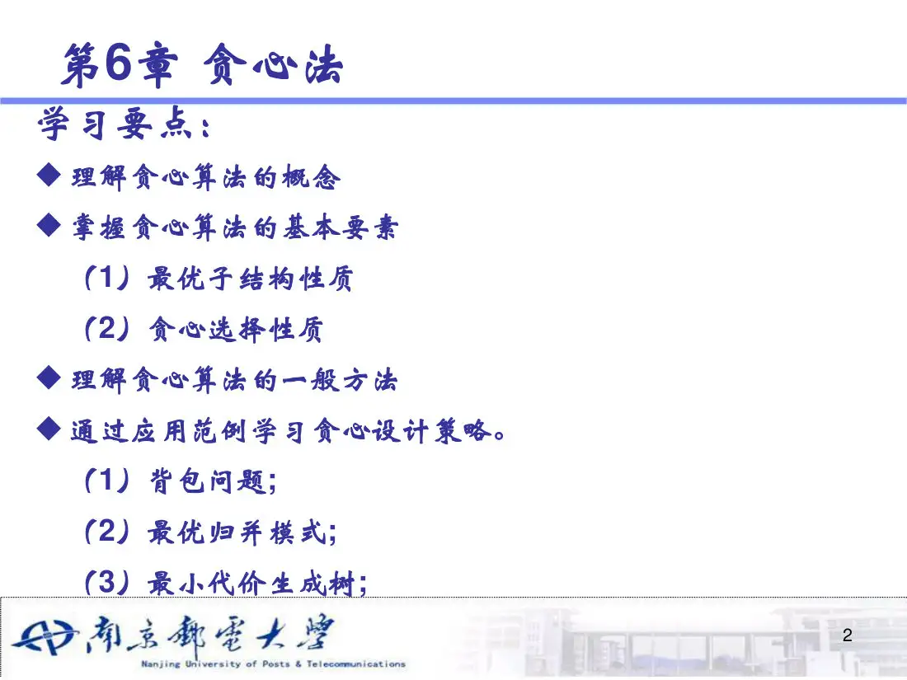

原文：

第6章 贪心法

学习要点：

◆理解贪心算法的概念

◆掌握贪心算法的基本要素

（1）最优子结构性质

（2）贪心选择性质

◆理解贪心算法的一般方法

◆通过应用范例学习贪心设计策略。

（1）背包问题;

（2）最优归并模式;

（3）最小代价生成树;

安南京郵電大学

2

### ◆章节内容

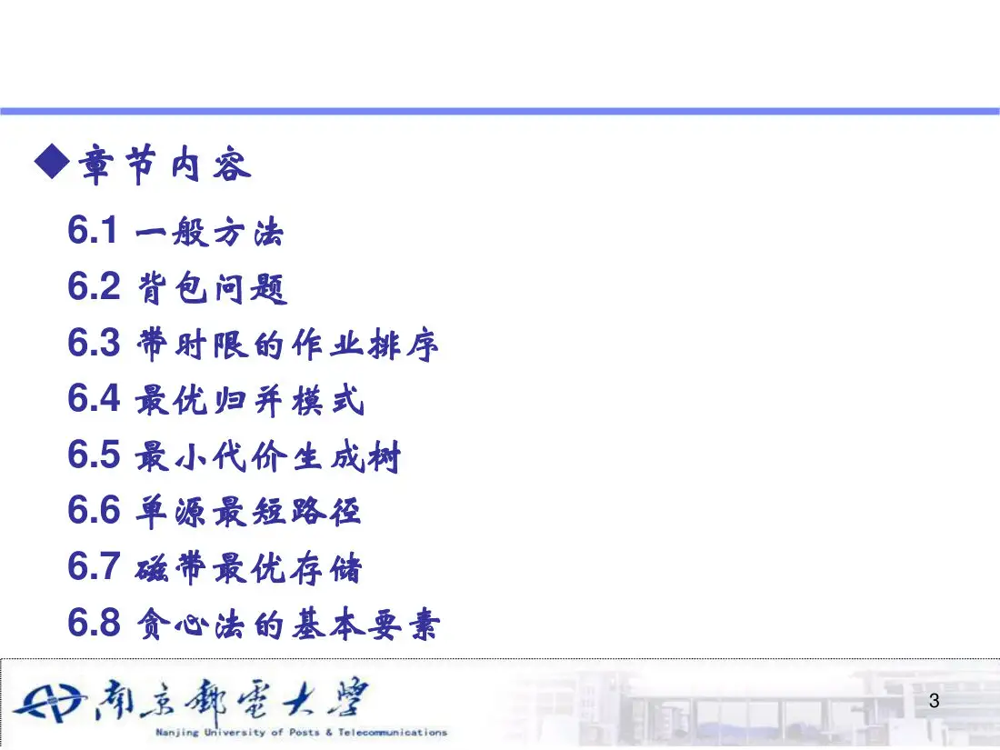

原文：

◆章节内容
6.1 一般方法
6.2 背包问题
6.3 带时限的作业排序
6.4 最优归并模式
6.5 最小代价生成树
6.6 单源最短路径
6.7 磁带最优存储
6.8 贪心法的基本要素

### 6.1 贪心法的一般方法

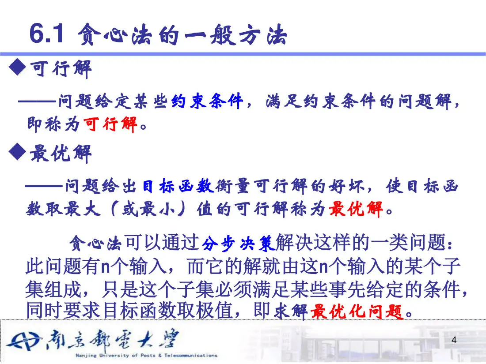

原文：

6.1 贪心法的一般方法

可行解

——问题给定某些约束条件，满足约束条件的问题解，即称为可行解。

◆最优解

—问题给出目标函数衡量可行解的好坏，使目标函数取最大（或最小）值的可行解称为最优解。

贪心法可以通过分步决策解决这样的一类问题：此问题有n个输入，而它的解就由这n个输入的某个子集组成，只是这个子集必须满足某些事先给定的条件，同时要求目标函数取极值，即求解最优化问题。

安南京郵電大学

4

Nanjing University of Posts & Telecommunications

### 引例—找零钱

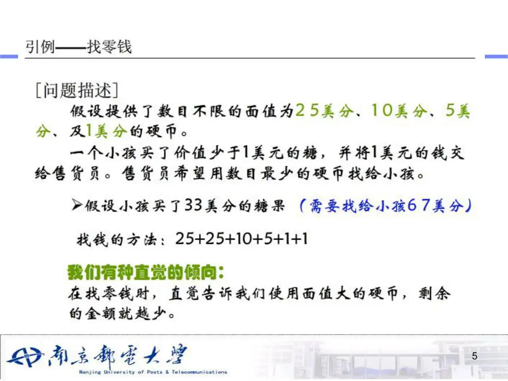

原文：

引例—找零钱

[问题描述]

假设提供了数目不限的面值为25美分、10美分、5美分、及1美分的硬币。

一个小孩买了价值少于1美元的糖，并将1美元的钱交给售货员。售货员希望用数目最少的硬币找给小孩。

假设小孩买了33美分的糖果（需要找给小孩67美分）

找钱的方法：25+25+10+5+1+1

我们有种直觉的倾向：

在找零钱时，直觉告诉我们使用面值大的硬币，剩余的金额就越少。

分南京郵電大学

5

Nanjing University of Posts & Telecommunications

### 贪心算法思想

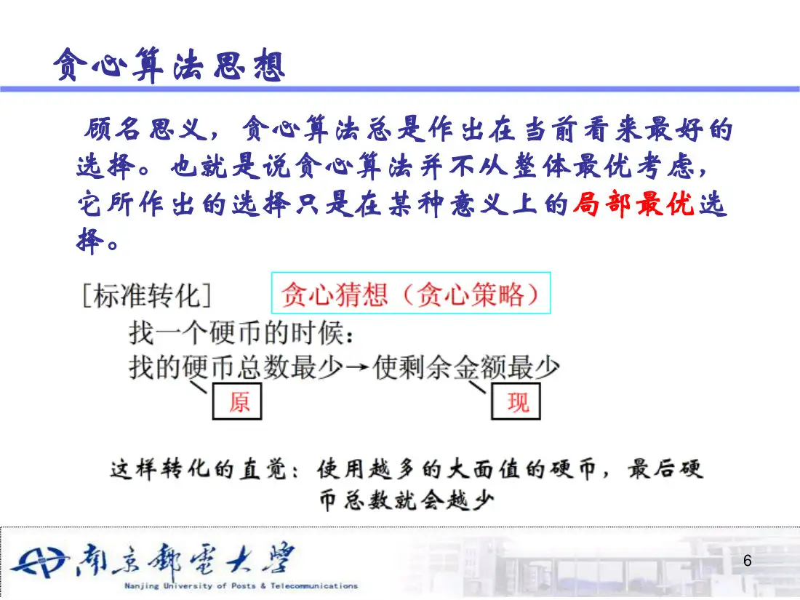

原文：

贪心算法思想

顾名思义，贪心算法总是作出在当前看来最好的选择。也就是说贪心算法并不从整体最优考虑，它所作出的选择只是在某种意义上的局部最优选择。

[标准转化]

贪心猜想（贪心策略）

找一个硬币的时候：

找的硬币总数最少→使剩余金额最少

原

现

这样转化的直觉：使用越多的大面值的硬币，最后硬币总数就会越少

安南京郵電大学 Nanjing University of Posts & Telecommunications

6

### 本节着重讨论可以用贪心法求解的问题的一般特征。

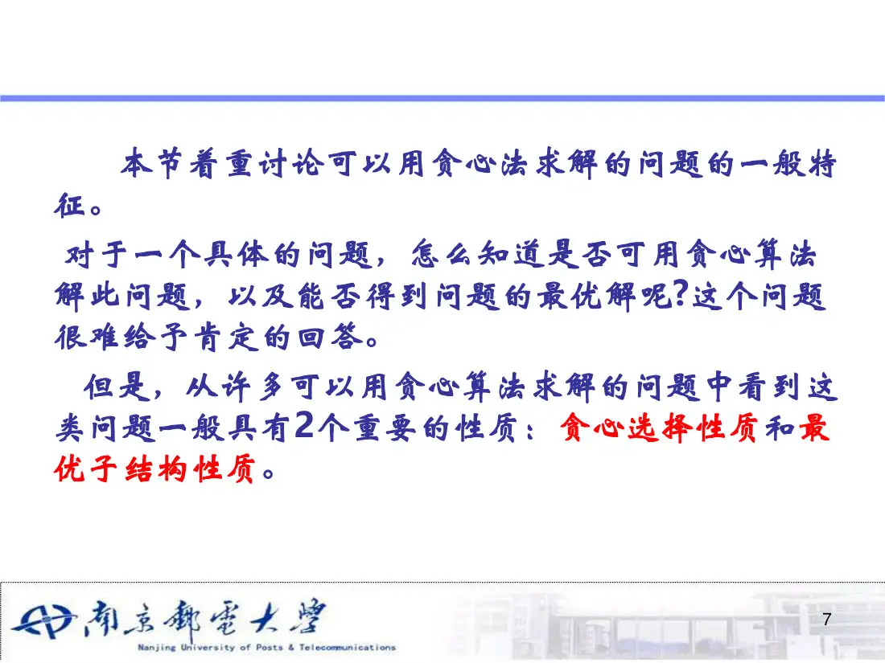

原文：

本节着重讨论可以用贪心法求解的问题的一般特征。

对于一个具体的问题，怎么知道是否可用贪心算法解此问题，以及能否得到问题的最优解呢?这个问题很难给予肯定的回答。

但是，从许多可以用贪心算法求解的问题中看到这类问题一般具有2个重要的性质：贪心选择性质和最优子结构性质。

安南京郵電大学 Nanjing University of Posts & Telecommunications

7

### 1、贪心选择性质（最优量度标准）

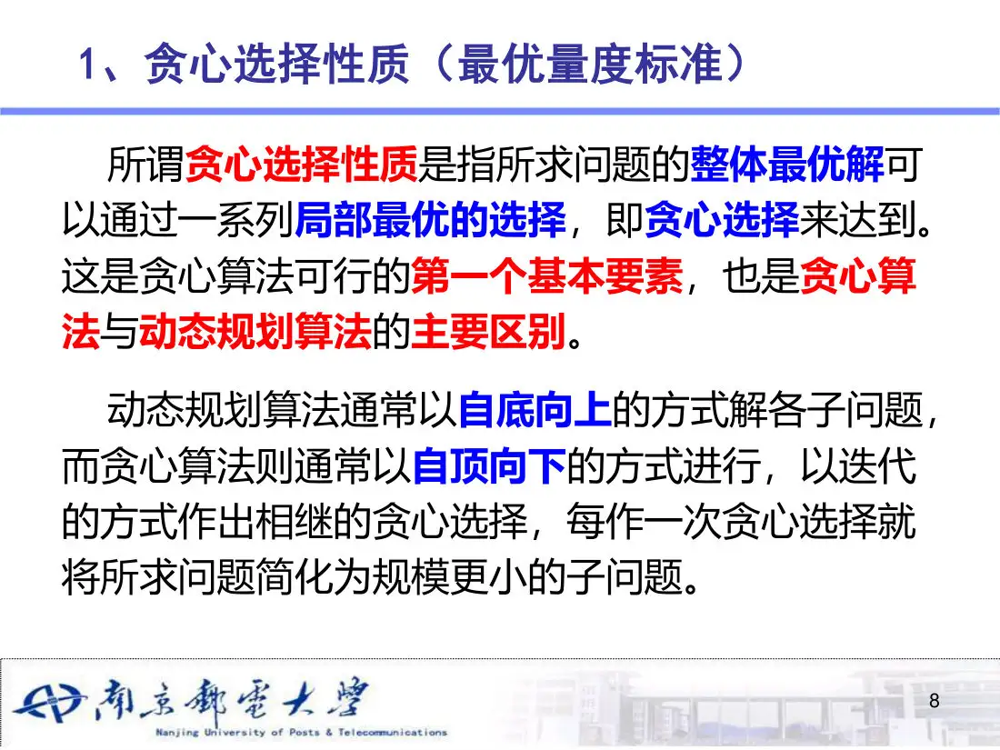

原文：

1、贪心选择性质（最优量度标准）

所谓贪心选择性质是指所求问题的整体最优解可以通过一系列局部最优的选择，即贪心选择来达到。这是贪心算法可行的第一个基本要素，也是贪心算法与动态规划算法的主要区别。

动态规划算法通常以自底向上的方式解各子问题，而贪心算法则通常以自顶向下的方式进行，以迭代的方式作出相继的贪心选择，每作一次贪心选择就将所求问题简化为规模更小的子问题。

安南京郵電大学 Nanjing University of Posts & Telecommunications

8

### 在一些情况下，即使贪心算法不能得到整体最优解，其最终结果却是最优解的很好近似。

原文：

对于一个具体问题，要确定它是否具有贪心选择性质，必须证明每一步所作的贪心选择最终导致问题的整体最优解。

虽然贪心算法不能对所有问题都得到整体最优解，但对一些问题它确实能产生整体最优解：如单源最短路径问题，最小生成树问题等。

在一些情况下，即使贪心算法不能得到整体最优解，其最终结果却是最优解的很好近似。

安南京郵電大学 Nanjing University of Posts & Telecommunications

9

### 2、最优子结构性质

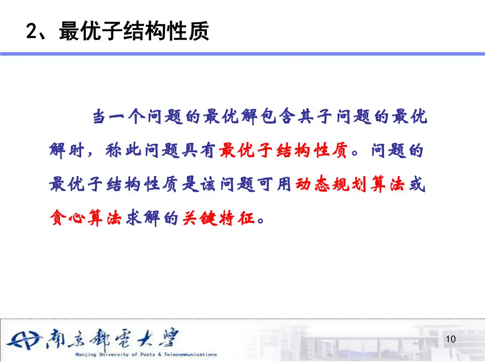

原文：

2、最优子结构性质

当一个问题的最优解包含其子问题的最优解时，称此问题具有最优子结构性质。问题的最优子结构性质是该问题可用动态规划算法或贪心算法求解的关键特征。

安南京郵電大学 Nanjing University of Posts & Telecommunications

10

### 程序6-1 贪心法算法框架

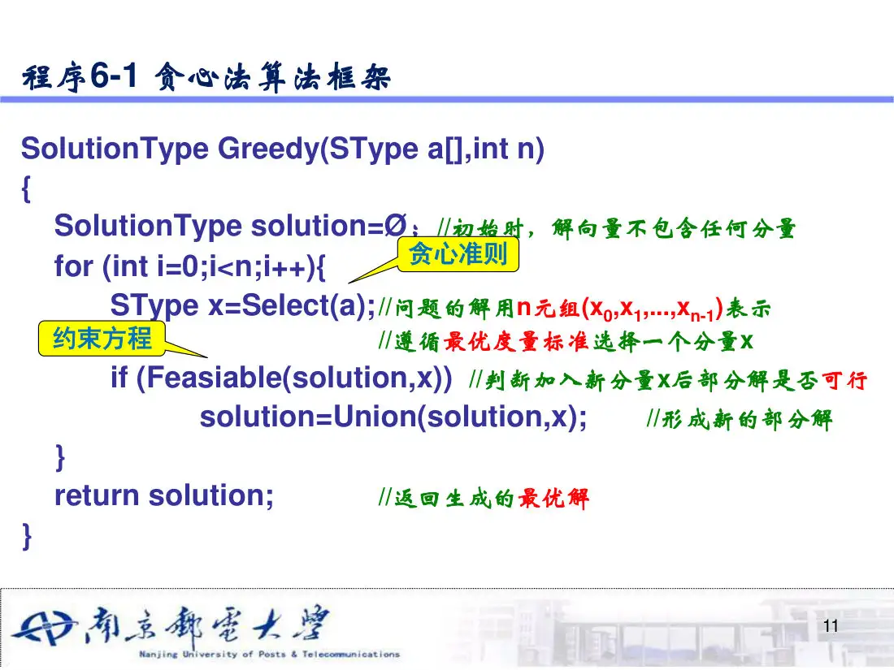

原文：

程序6-1 贪心法算法框架

安南京郵電大学 Nanjing University of Posts & Telecommunications

11

### n个输入按某种量度标准排序

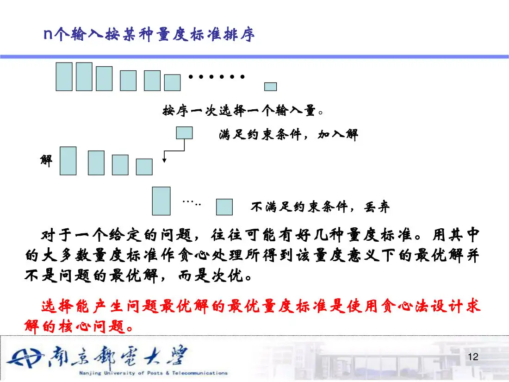

原文：

n个输入按某种量度标准排序

按序一次选择一个输入量。

解

满足约束条件，加入解

不满足约束条件，丢弃

对于一个给定的问题，往往可能有好几种量度标准。用其中的大多数量度标准作贪心处理所得到该量度意义下的最优解并不是问题的最优解，而是次优。

选择能产生问题最优解的最优量度标准是使用贪心法设计求解的核心问题。

安南京郵電大学 Nanjing University of Posts & Telecommunications

12

### 6.2 背包问题

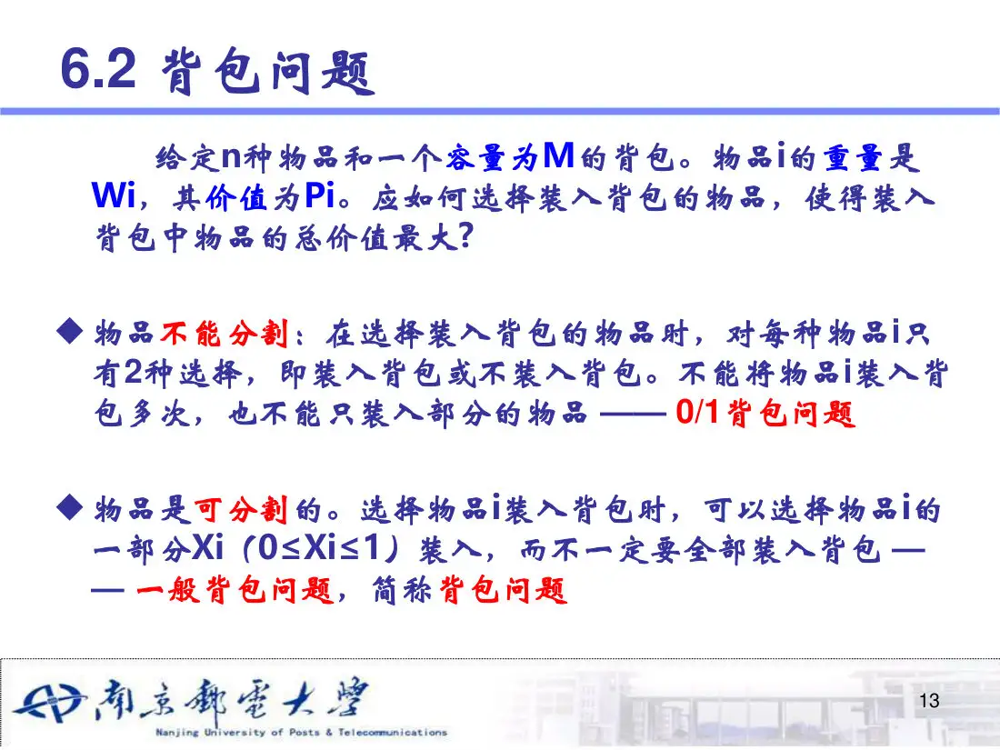

原文：

6.2 背包问题

给定n种物品和一个容量为M的背包。物品i的重量是Wi，其价值为Pi。应如何选择装入背包的物品，使得装入背包中物品的总价值最大?

◆ 物品不能分割：在选择装入背包的物品时，对每种物品i只有2种选择，即装入背包或不装入背包。不能将物品i装入背包多次，也不能只装入部分的物品 —— 0/1背包问题

◆物品是可分割的。选择物品i装入背包时，可以选择物品i的一部分Xi（0≤Xi≤1）装入，而不一定要全部装入背包 —— 一般背包问题，简称背包问题

安南京郵電大学 Nanjing University of Posts & Telecommunications

13

### 这2类问题都具有最优子结构性质，极为相似。

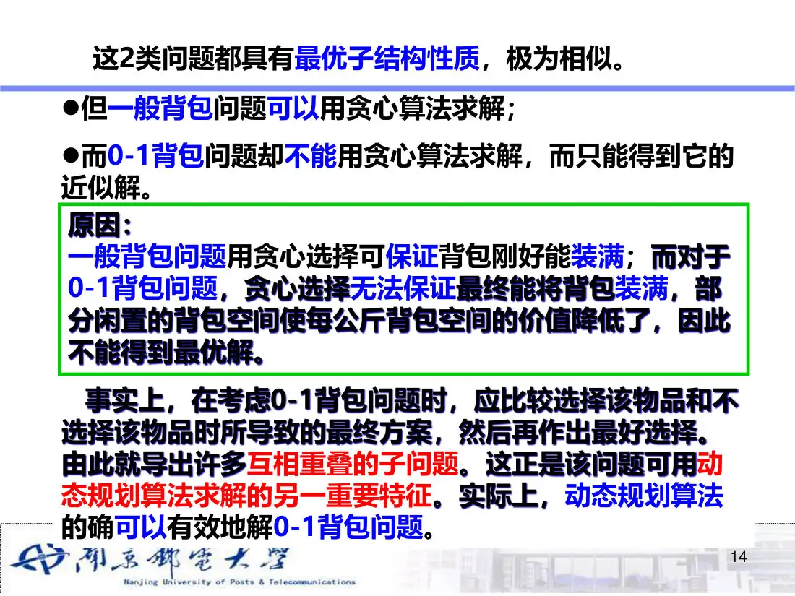

原文：

这2类问题都具有最优子结构性质，极为相似。

⚫但一般背包问题可以用贪心算法求解；

⚫而0-1背包问题却不能用贪心算法求解，而只能得到它的近似解。

原因：

一般背包问题用贪心选择可保证背包刚好能装满；而对于0-1背包问题，贪心选择无法保证最终能将背包装满，部分闲置的背包空间使每公斤背包空间的价值降低了，因此不能得到最优解。

事实上，在考虑0-1背包问题时，应比较选择该物品和不选择该物品时所导致的最终方案，然后再作出最好选择。由此就导出许多互相重叠的子问题。这正是该问题可用动态规划算法求解的另一重要特征。实际上，动态规划算法的确可以有效地解0-1背包问题。

分聞京郵電大學

14

Nanjing University of Posts & Telecommunications

### 贪心法求解背包问题

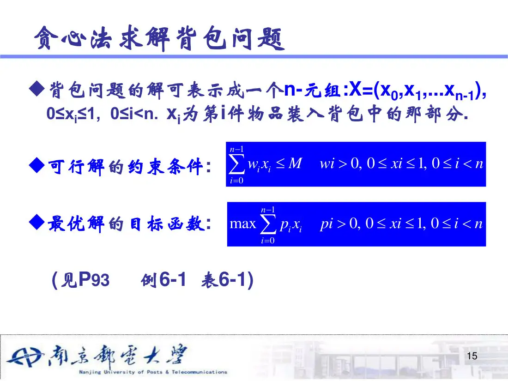

原文：

贪心法求解背包问题

◆背包问题的解可表示成一个n-元组: $X = ( X _ { 0 } , X _ { 1 } , \ldots X _ { n - 1 } )$ $0 \leq x _ { i } \leq 1 , 0 \leq 1 < n , x _ { i }$ 为第i件物品装入背包中的那部分.

◆可行解的约束条件: $2 0 0 0 0 0 0 0 0 0 0 0 0 0 0 0 0 0 0 0 0 0 0 0 0 0 0 0 0 0 0 0 0 0 0 0 0 0 0 0 0 0 0 0 0 0 0 0 0 0 0 0 0 0 0 0 0 0 0 0 0 0 0 0 0 0 0 0 0 0 0 0 0 0 0 0 0 0 0 0 0 0 0 0 0 0 0 0 0 0 0 0 0 0 0 0 0 0 0 0 0 0 0 0 0 0 0 0 0 0 0 0 0 0 0 0 0 0 0 0 0 0 0 0 0 0 0 0 0 0 0 0 0 0 0 0 0 0 0 0 0 0 0 0 0 0 0 0 0 0 0 0 0 0 0 0 0 0 0 0 0 0 0 0 0 0 0 0 0 0 0 0 0 0 0 0 0 0 0 0 0 0 0 0 0 0 0 0 0 0 0 0 0 0 0 0 0 0 0 0 0 0 0 0 0 0 0 0 0 0 0 0 0 0 0 0 0 0 0 0 0 0 0 0 0 0 0 0 0 0 0 0 0 0 0 0 0 0 0 0 0 0 0 0 0 0 0 0 0 0 0 0 0 0 0 0 0 0 0 0 0 0 0 0 0 0 0 0 0 0 0 0 0 0 0 0 0 0 0 0 0 0 0 0 0 0 0 0 0 0 0 0 0 0 0 0 0 0 0 0 0 0 0 0 0 0 0 0 0 0 0 0 0 0 0 0 0 0 0 0 0 0 0 0 0 0 0 0 0 0 0 0 0 0 0 0 0 0 0 0 0 0 0 0 0 0 0 0 0 0 0 0 0 0 0 0 0 0 0 0 0 0 0 0 0 0 0 0 0 0 0 0 0 0 0 0 0 0 0 0 0 0 0 0 0 0 0 0 0 0 0 0 0 0 0 0 0 0 0 0 0 0 0 0 0 0 0 0 0 0 0 0 0 0 0 0 0 0 0 0 0 0 0 0 0 0 0 0 0 0 0 0 0 0 0 0 0 0 0 0 0 0 0 0 0 0 0 0 0 0 0 0 0 0 0 0 0 0 0 0 0 0 0 0 0 0 0 0 0 0 0 0 0 0 0 0 0 0 0 0 0 0 0 0 0 0 0 0 0 0 0 0 0 0 0 0 0 0 0 0 0 0 0 0 0 0 0 0 0 0 0 0 0 0 0 0 0 0 0 0 0 0 0 0 0 0 0 0 0 0 0 0 0 0 0 0 0 0 0 0 0 0 0 0 0 0 0 0 0 0 0 0 0 0 0 0 0 0 0 0 0 0 0 0 0 0 0 0 0 0 0 0 0 0 0 0$

最优解的目标函数: $\vert 1 1 1 0 \vert < 3 2 0 \vert < 3 2 0 \vert < 3 2 0 \vert < 3 2 0 \vert < 3 2 0 \vert < 1 1 1 < 3 2 0 \vert$

(见P93 例6-1 表6-1)

安南京郵電大学 Nanjing University of Posts & Telecommunications

15

### 用贪心法求解,找出最优量度标准是至关重要的.

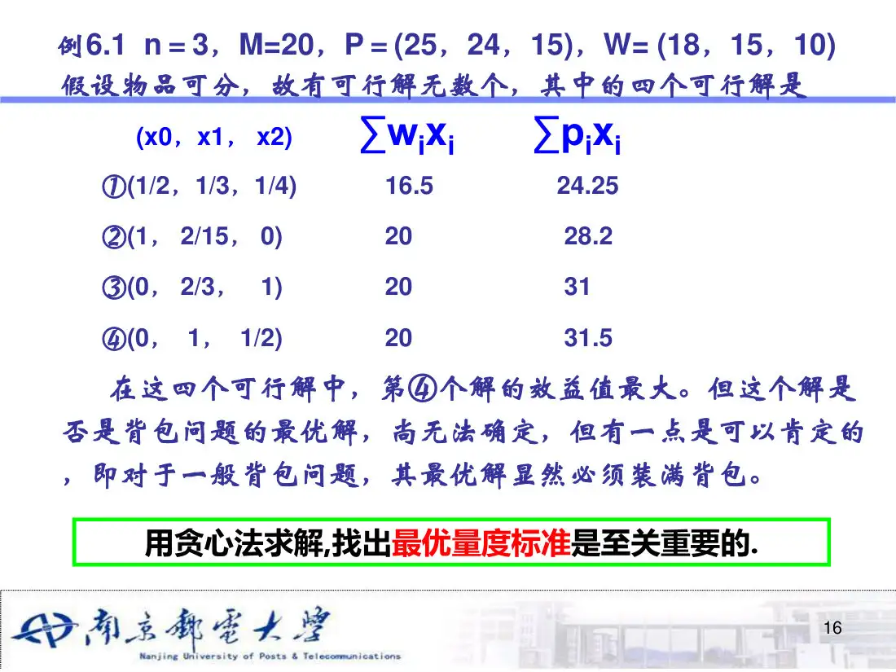

原文：

例6.1 n＝3，M=20，P＝(25，24，15)，W= (18，15，10)假设物品可分，故有可行解无数个，其中的四个可行解是

<table><tr><td>(x0, x1, x2)</td><td> $\sum w_i x_i$ </td><td> $\sum p_i x_i$ </td></tr><tr><td>1(1/2, 1/3, 1/4)</td><td>16.5</td><td>24.25</td></tr><tr><td>2(1, 2/15, 0)</td><td>20</td><td>28.2</td></tr><tr><td>3(0, 2/3, 1)</td><td>20</td><td>31</td></tr><tr><td>4(0, 1, 1/2)</td><td>20</td><td>31.5</td></tr></table>

在这四个可行解中，第④个解的效益值最大。但这个解是否是背包问题的最优解，尚无法确定，但有一点是可以肯定的，即对于一般背包问题，其最优解显然必须装满背包。

用贪心法求解,找出最优量度标准是至关重要的.

安南京郵電大学 Nanjing University of Posts & Telecommunications

16

### 贪心法求解背包问题

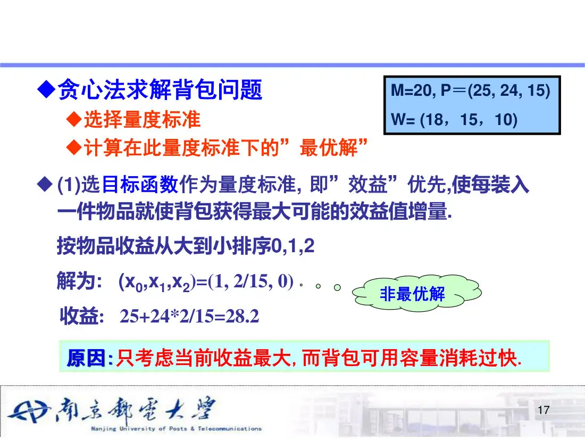

原文：

贪心法求解背包问题

◆选择量度标准

$$
\begin{array}{l} \mathrm{M=20,P=(25,24,15)} \\ \mathrm {W = (18, 15, 10)} \end{array}
$$

◆计算在此量度标准下的”最优解”

◆(1)选目标函数作为量度标准, 即”效益”优先,使每装入一件物品就使背包获得最大可能的效益值增量.

按物品收益从大到小排序0,1,2

解为: $( \mathsf { x } _ { 0 } , \mathsf { x } _ { 1 } , \mathsf { x } _ { 2 } ) { = } ( \mathsf { 1 } , 2 / 1 5 , \mathsf { 0 } )$

非最优解

收益: $2 5 + 2 4 \div 2 / 1 5 = 2 8 . 2$

原因:只考虑当前收益最大,而背包可用容量消耗过快.

安南京郵電大学 Nanjing University of Posts & Telecommunications

17

### ⚫ 贪心法求解背包问题

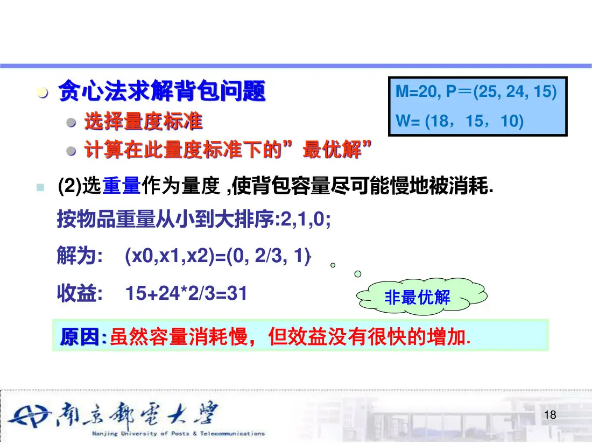

原文：

⚫ 贪心法求解背包问题

⚫ 选择量度标准

$$
\begin{array}{l} \mathrm{M=20,P=(25,24,15)} \\ \mathrm {W = (18, 15, 10)} \end{array}
$$

⚫ 计算在此量度标准下的”最优解”

(2)选重量作为量度 ,使背包容量尽可能慢地被消耗.

按物品重量从小到大排序:2,1,0;

解为: $( \mathbf { x } 0 , \mathbf { x } 1 , \mathbf { x } 2 ) { = } ( 0 , 2 / 3 , 1 )$

收益: $1 5 + 2 4 \div 2 / 3 = 3 1$

非最优解

原因:虽然容量消耗慢，但效益没有很快的增加.

安南京郵電大学 Nanjing University of Posts & Telecommunications

18

### ⚫ 贪心法求解背包问题

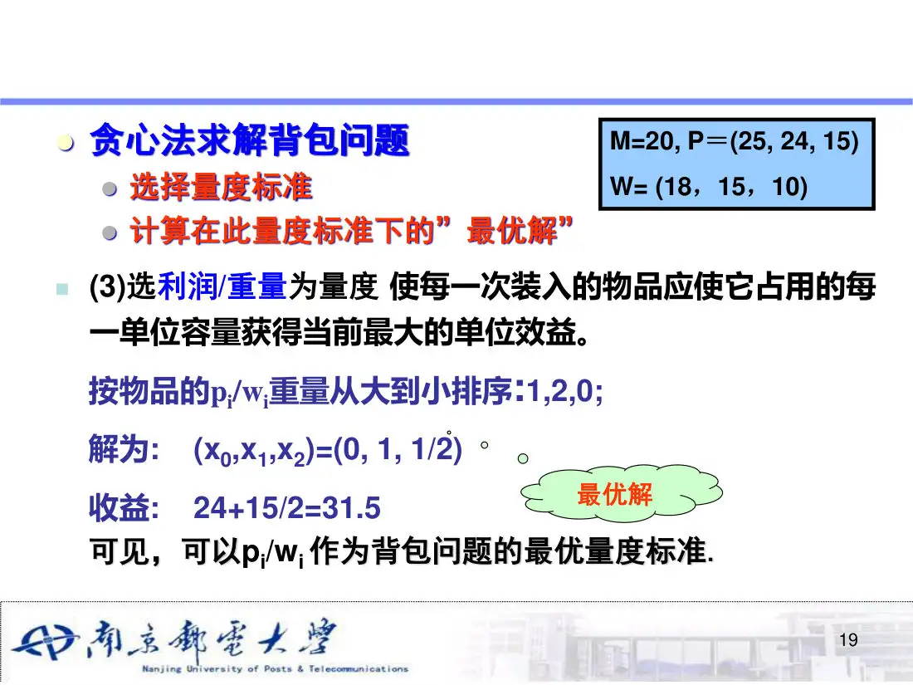

原文：

⚫ 贪心法求解背包问题

⚫ 选择量度标准

$$
\begin{array}{l} \mathrm{M=20,P=(25,24,15)} \\ \mathrm{W=(18,15,10)} \end{array}
$$

⚫ 计算在此量度标准下的”最优解”

(3)选利润/重量为量度 使每一次装入的物品应使它占用的每一单位容量获得当前最大的单位效益。

按物品的 $\mathbf { p _ { i } } / \mathbf { w _ { i } }$ 重量从大到小排序:1,2,0;

解为: $( \mathbf { x } _ { 0 } , \mathbf { x } _ { 1 } , \mathbf { x } _ { 2 } ) { = } ( 0 , 1 , 1 / 2 )$ O

收益: $2 4 + 1 5 / 2 = 3 1 . 5$

最优解

可见，可以 $\mathbf { \nabla } _ { \mathbf { p _ { i } } } / \mathbf { w _ { i } }$ 作为背包问题的最优量度标准.

安南京郵電大学 Nanjing University of Posts & Telecommunications

19

### 背包问题的贪心算法

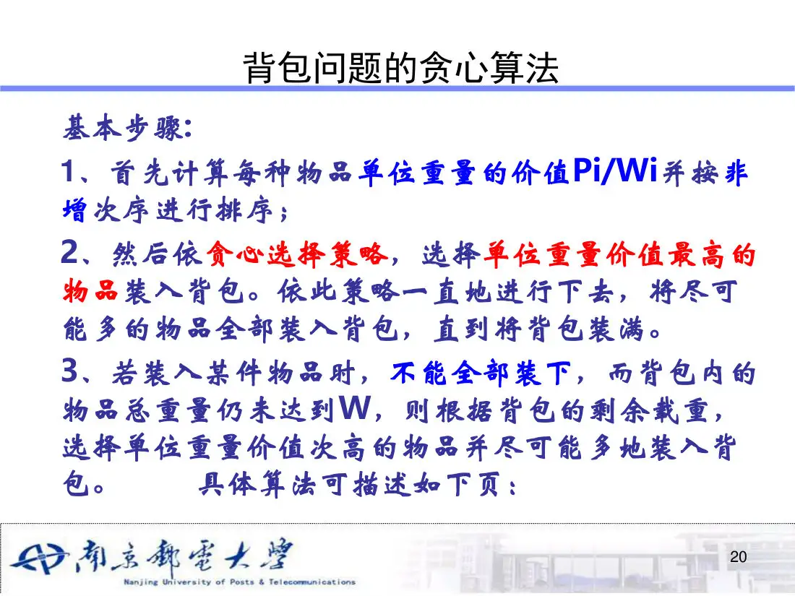

原文：

背包问题的贪心算法

基本步骤:

1、首先计算每种物品单位重量的价值Pi/Wi并按非增次序进行排序；

2、然后依贪心选择策略，选择单位重量价值最高的物品装入背包。依此策略一直地进行下去，将尽可能多的物品全部装入背包，直到将背包装满。

3、若装入某件物品时，不能全部装下，而背包内的物品总重量仍未达到W，则根据背包的剩余载重，选择单位重量价值次高的物品并尽可能多地装入背包。 具体算法可描述如下页：

安南京郵電大学 Nanjing University of Posts & Telecommunications

20

### 第 21 页

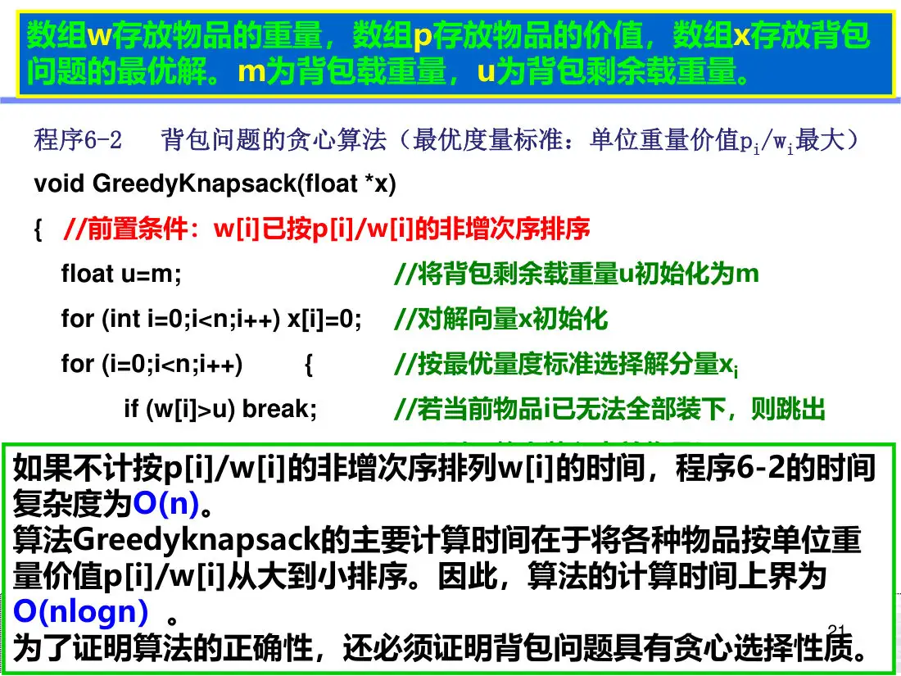

原文：

数组w存放物品的重量，数组p存放物品的价值，数组x存放背包问题的最优解。m为背包载重量，u为背包剩余载重量。

### 证明：程序6-2选取的最优度量标准可以得到最优解。

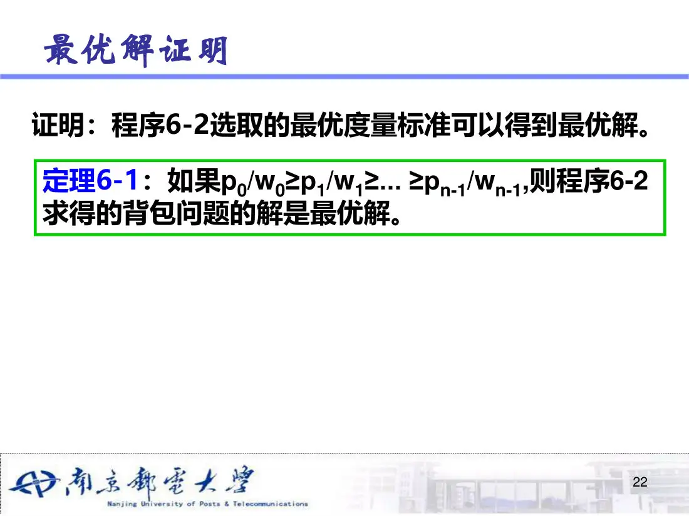

原文：

证明：程序6-2选取的最优度量标准可以得到最优解。

定理6-1：如果 $p _ { 0 } / \mathsf { w } _ { 0 } \mathsf { z p } _ { 1 } / \mathsf { w } _ { 1 } \mathsf { z } \quad \mathsf { z p } _ { \mathsf { n } - 1 } / \mathsf { w } _ { \mathsf { n } - 1 }$ ,则程序6-2求得的背包问题的解是最优解。

最优解证明

安南京郵電大学 Nanjing University of Posts & Telecommunications

22

### 为保证Z是可行解，应有：

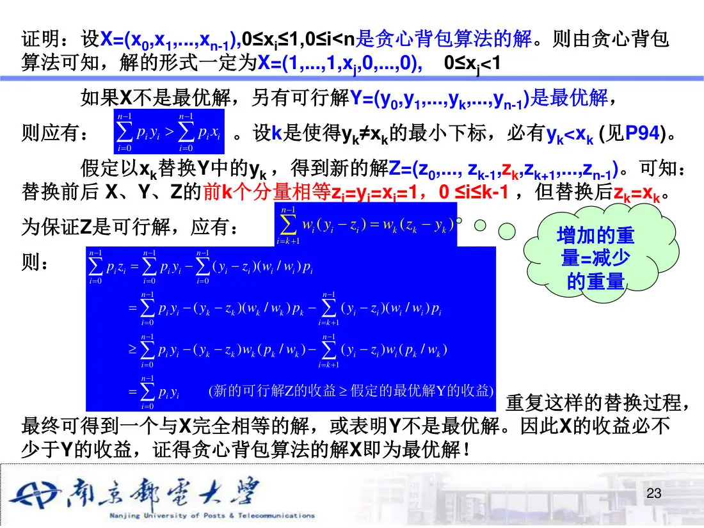

原文：

证明：设 $X = ( X _ { 0 } , X _ { 1 } , \ldots , X _ { n - 1 } ) , 0 \leq X _ { 1 } \leq 1 , 0 \leq i < n$ 是贪心背包算法的解。则由贪心背包算法可知，解的形式一定为 $\mathsf X { = } ( 1 , \ldots , 1 , \mathsf X _ { \mathrm { i } } , 0 , \ldots , 0 )$ $0 \leq x _ { j } < 1$

如果X不是最优解，另有可行解 $\forall \equiv ( \mathsf { y } _ { 0 } , \mathsf { y } _ { 1 } , \ldots , \mathsf { y } _ { | _ { k } , \ldots , \mathsf { y } _ { n - 1 } ) }$ 是最优解，则应有： $\frac { 1 } { 1 2 } ( 2 \pi ) = \frac { 1 } { 1 2 } ( 2 \pi )$ 。设k是使得 $y _ { k } \neq x _ { k }$ 的最小下标，必有 $y _ { k } < x _ { k }$ (见P94)。

假定以 ${ \bf { X } } _ { \bf { k } }$ 替换Y中的 $y _ { k }$ ，得到新的解 $Z = ( z _ { 0 } , \ldots , z _ { k - 1 } , z _ { k } , z _ { k + 1 } , \ldots , z _ { n - 1 } )$ 。可知：替换前后 X、Y、Z的前k个分量相等 $z _ { i } = y _ { i } = x _ { i } = 1 , 0 \leq 1 \leq k - 1$ ，但替换后 $z _ { k } { = } \mathbf { \boldsymbol { X } } _ { \mathbf { k } ^ { \circ } }$

为保证Z是可行解，应有：

$$
\sum_ {i = k + 1} ^ {n - 1} w _ {i} (y _ {i} - z _ {i}) = w _ {k} (z _ {k} - y _ {k}) \circ
$$

则：

增加的重量=减少的重量

$$
\begin{array}{r l} \sum_ {i = 0} ^ {n - 1} p _ {i} z _ {i} & = \sum_ {i = 0} ^ {n - 1} p _ {i} y _ {i} - \sum_ {i = 0} ^ {n - 1} (y _ {i} - z _ {i}) (w _ {i} / w _ {i}) p _ {i} \\ & = \sum_ {i = 0} ^ {n - 1} p _ {i} y _ {i} - (y _ {k} - z _ {k}) (w _ {k} / w _ {k}) p _ {k} - \sum_ {i = k + 1} ^ {n - 1} (y _ {i} - z _ {i}) (w _ {i} / w _ {i}) p _ {i} \\ & \geq \sum_ {i = 0} ^ {n - 1} p _ {i} y _ {i} - (y _ {k} - z _ {k}) w _ {k} (p _ {k} / w _ {k}) - \sum_ {i = k + 1} ^ {n - 1} (y _ {i} - z _ {i}) w _ {i} (p _ {k} / w _ {k}) \\ & = \sum_ {i = 0} ^ {n - 1} p _ {i} y _ {i} \quad (\text {新的可行解Z的收益} \geq \text {假定的最优解Y的收益}) \end{array}
$$

重复这样的替换过程，

最终可得到一个与X完全相等的解，或表明Y不是最优解。因此X的收益必不少于Y的收益，证得贪心背包算法的解X即为最优解！

安南京郵電大学

23

Nanjing University of Posts & Telecommunications

### 24

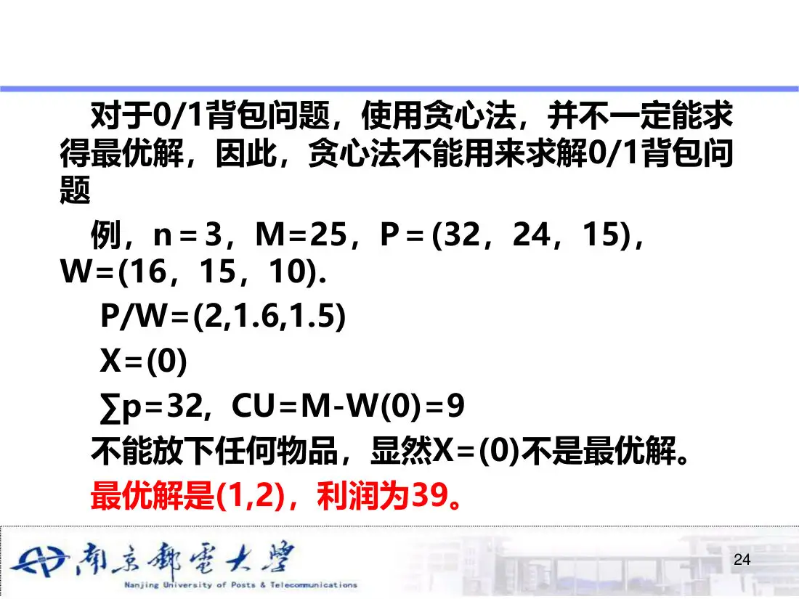

原文：

对于0/1背包问题，使用贪心法，并不一定能求得最优解，因此，贪心法不能用来求解0/1背包问题

安南京郵電大学 Nanjing University of Posts & Telecommunications

24

### 6.3 带时限的作业排序

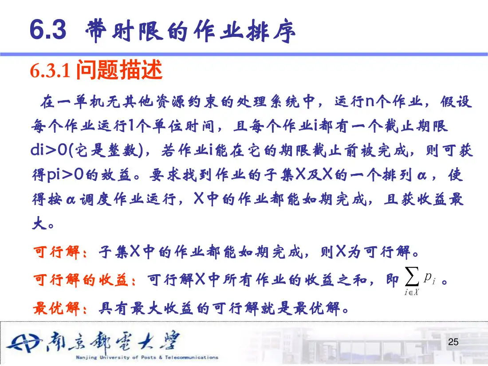

原文：

6.3 带时限的作业排序

6.3.1 问题描述

在一单机无其他资源约束的处理系统中，运行n个作业，假设每个作业运行1个单位时间，且每个作业i都有一个截止期限di>0(它是整数)，若作业i能在它的期限截止前被完成，则可获得pi>0的效益。要求找到作业的子集X及X的一个排列α，使得按α调度作业运行，X中的作业都能如期完成，且获收益最大。

可行解：子集X中的作业都能如期完成，则X为可行解。

可行解的收益：可行解X中所有作业的收益之和，即 $\sum _ { i \in { \cal { X } } } p _ { i }$

最优解：具有最大收益的可行解就是最优解。

安南京郵電大学 Nanjing University of Posts & Telecommunications

25

### $$

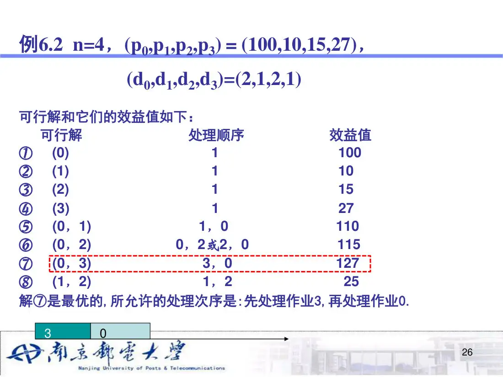

原文：

例6.2 n=4， $( \mathbf { p _ { 0 } } , \mathbf { p _ { 1 } } , \mathbf { p _ { 2 } } , \mathbf { p _ { 3 } } ) = ( 1 0 0 , 1 0 , 1 5 , 2 7 )$

$$
(\mathbf {d} _ {0}, \mathbf {d} _ {1}, \mathbf {d} _ {2}, \mathbf {d} _ {3}) = (2, 1, 2, 1)
$$

可行解和它们的效益值如下：

<table><tr><td colspan="2">可行解</td><td>处理顺序</td><td>效益值</td></tr><tr><td>1</td><td>(0)</td><td>1</td><td>100</td></tr><tr><td>2</td><td>(1)</td><td>1</td><td>10</td></tr><tr><td>3</td><td>(2)</td><td>1</td><td>15</td></tr><tr><td>4</td><td>(3)</td><td>1</td><td>27</td></tr><tr><td>5</td><td>(0, 1)</td><td>1, 0</td><td>110</td></tr><tr><td>6</td><td>(0, 2)</td><td>0, 2或2, 0</td><td>115</td></tr><tr><td>7</td><td>(0, 3)</td><td>3, 0</td><td>127</td></tr><tr><td>8</td><td>(1, 2)</td><td>1, 2</td><td>25</td></tr></table>
解⑦是最优的,所允许的处理次序是:先处理作业3,再处理作业0.

安南京郵電大学

26

Nanjing University of Posts & Telecommunications

### 贪心法求解

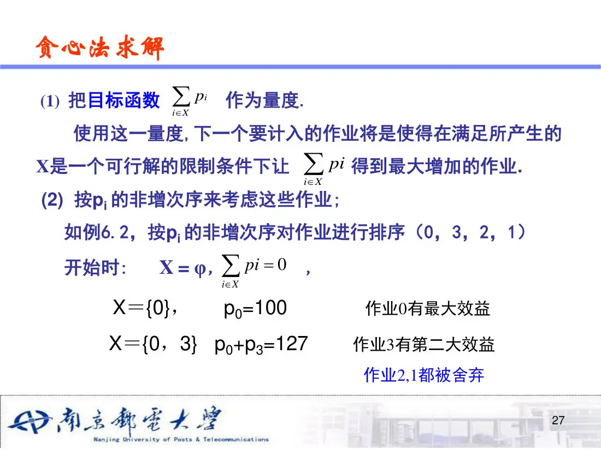

原文：

贪心法求解

(1) 把目标函数 $\sum _ { i \in X } p { i }$ 作为量度.

使用这一量度,下一个要计入的作业将是使得在满足所产生的X是一个可行解的限制条件下让 $\sum _ { i \in X } p i$ 得到最大增加的作业.

(2) 按 $\mathsf { p } _ { \mathsf { i } }$ 的非增次序来考虑这些作业;

如例6.2，按 $p _ { \mathrm { i } }$ 的非增次序对作业进行排序（0，3，2，1）

开始时: $\mathbf { X } = \boldsymbol { \Phi } , \sum _ { i \in X } p i = 0$

$$
X = \{0 \},
$$

$$
p _ {0} = 1 0 0
$$

$$
X = \{0, 3 \} p _ {0} + p _ {3} = 1 2 7
$$

作业0有最大效益

作业3有第二大效益

作业2,1都被舍弃

安南京郵電大学 Nanjing University of Posts & Telecommunications

27

### 【程序6-4】带时限作业排序算法

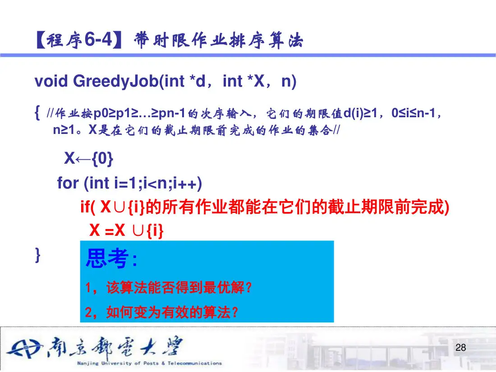

原文：

【程序6-4】带时限作业排序算法

28

### 【程序6-4】 带时限的作业排序程序

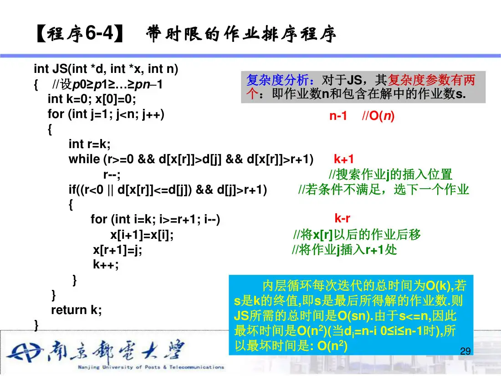

原文：

【程序6-4】 带时限的作业排序程序

### 改进方法：

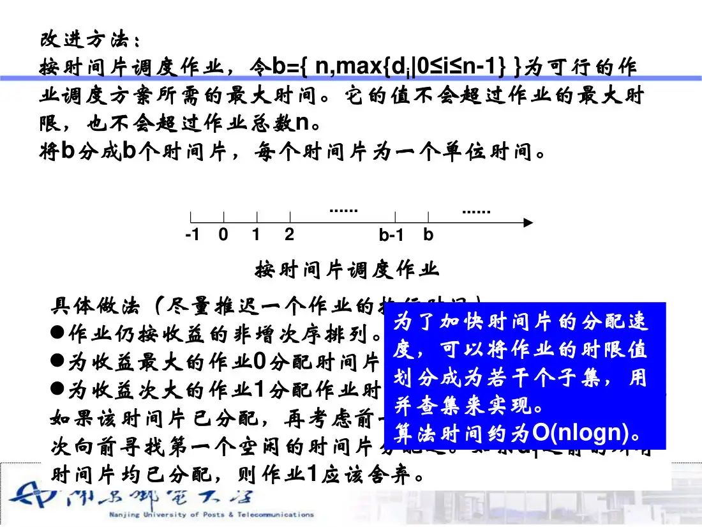

原文：

改进方法：

按时间片调度作业，令 $\mathbf { \cdot b } { = } \{ \mathsf { n } , \mathsf { m a x } \{ \mathsf { d } _ { \mathrm { i } } | 0 { \leq } | { \leq } \mathsf { n } { - } 1 \}$ }为可行的作业调度方案所需的最大时间。它的值不会超过作业的最大时限，也不会超过作业总数n。

将b分成b个时间片，每个时间片为一个单位时间。

具体做法（尽量推迟一个作业的

⚫作业仍按收益的非增次序排列。

⚫为收益最大的作业0分配时间片

⚫为收益次大的作业1分配作业时如果该时间片已分配，再考虑前次向前寻找第一个空闲的时间片

时间片均已分配，则作业1应该舍弃。

为了加快时间片的分配速度，可以将作业的时限值0 0划分成为若干个子集，用并查集来实现。1 1算法时间约为O(nlogn)。

Nanjing University of Posts & Telecommunications

### 6.4 最优归并模式

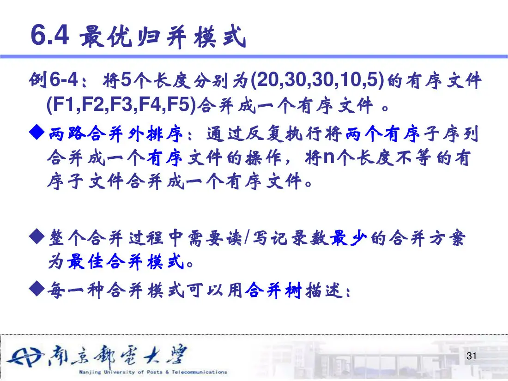

原文：

6.4 最优归并模式

例6-4：将5个长度分别为(20,30,30,10,5)的有序文件(F1,F2,F3,F4,F5)合并成一个有序文件 。

◆两路合并外排序：通过反复执行将两个有序子序列合并成一个有序文件的操作，将n个长度不等的有序子文件合并成一个有序文件。

◆整个合并过程中需要读/写记录数最少的合并方案为最佳合并模式。

◆每一种合并模式可以用合并树描述：

安南京郵電大学 Nanjing University of Posts & Telecommunications

31

### 扩充二叉树：除叶子结点外，其余结点都必须有2个孩子。

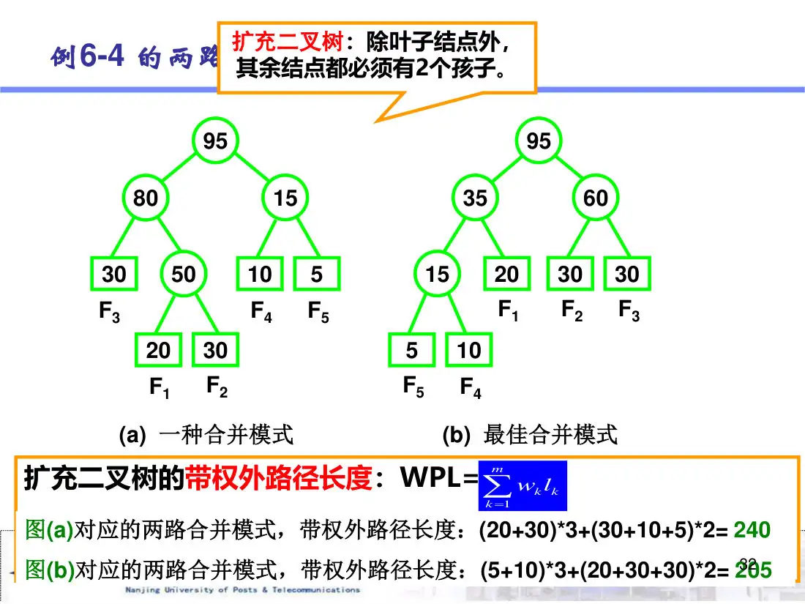

原文：

扩充二叉树：除叶子结点外，其余结点都必须有2个孩子。

(b) 最佳合并模式

扩充二叉树的带权外路径长度： $W P L = \sum \limits _ { i = 1 } ^ { 4 } L _ { i } ^ { \prime }$

其中：m是叶子结点的个数，wk是第图(a)对应的两路合并模式，带权外路径长度： $( 2 0 + 3 0 ) ^ { \ast } 3 + ( 3 0 + 1 0 + 5 ) ^ { \ast } 2 = 2 4 0$

图(b)对应的两路合并模式，带权外路径长度： $( 5 + 1 0 ) ^ { \ast } 3 + ( 2 0 + 3 0 + 3 0 ) ^ { \ast } 2 = 2 6 5$

例6-4 的两路

Nanjing University of Posts & Telecommunications

### 两路合并最佳模式问题的贪心算法：（最优度量标准— 带权外路径长度最小）

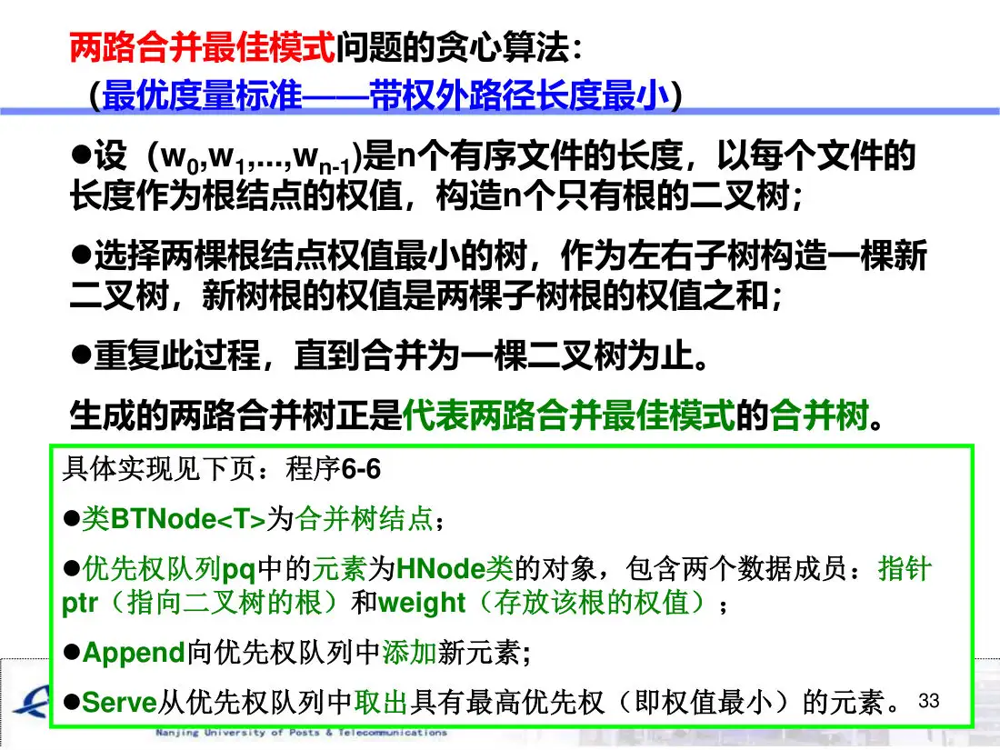

原文：

两路合并最佳模式问题的贪心算法：（最优度量标准— 带权外路径长度最小）

⚫设 $( w _ { 0 } , w _ { 1 } , \ldots , w _ { n - 1 } )$ 是n个有序文件的长度，以每个文件的长度作为根结点的权值，构造n个只有根的二叉树；

⚫选择两棵根结点权值最小的树，作为左右子树构造一棵新二叉树，新树根的权值是两棵子树根的权值之和；

⚫重复此过程，直到合并为一棵二叉树为止。

生成的两路合并树正是代表两路合并最佳模式的合并树。

Nanjing University of Posts & Telecommunications

### 程序6-6 两路合并最佳模式的贪心算法

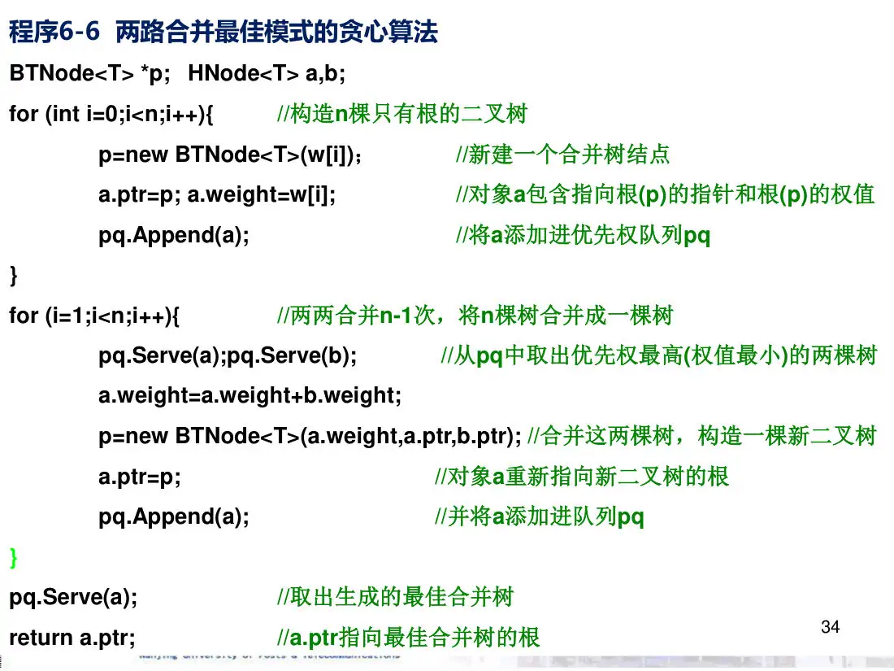

原文：

程序6-6 两路合并最佳模式的贪心算法

### Huffman编码：

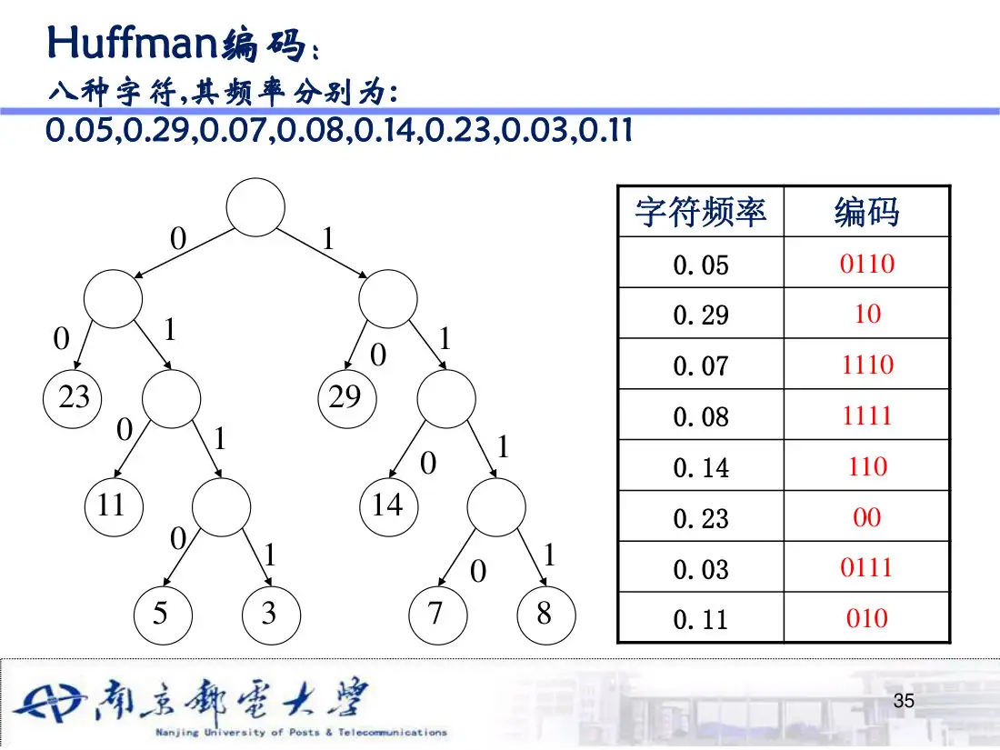

原文：

Huffman编码：

八种字符,其频率分别为:

0.05,0.29,0.07,0.08,0.14,0.23,0.03,0.11

<table><tr><td>字符频率</td><td>编码</td></tr><tr><td>0.05</td><td>0110</td></tr><tr><td>0.29</td><td>10</td></tr><tr><td>0.07</td><td>1110</td></tr><tr><td>0.08</td><td>1111</td></tr><tr><td>0.14</td><td>110</td></tr><tr><td>0.23</td><td>00</td></tr><tr><td>0.03</td><td>0111</td></tr><tr><td>0.11</td><td>010</td></tr></table>

分南京郵電大学

Nanjing University of Posts & Telecommunications

35

### 算法正确性证明

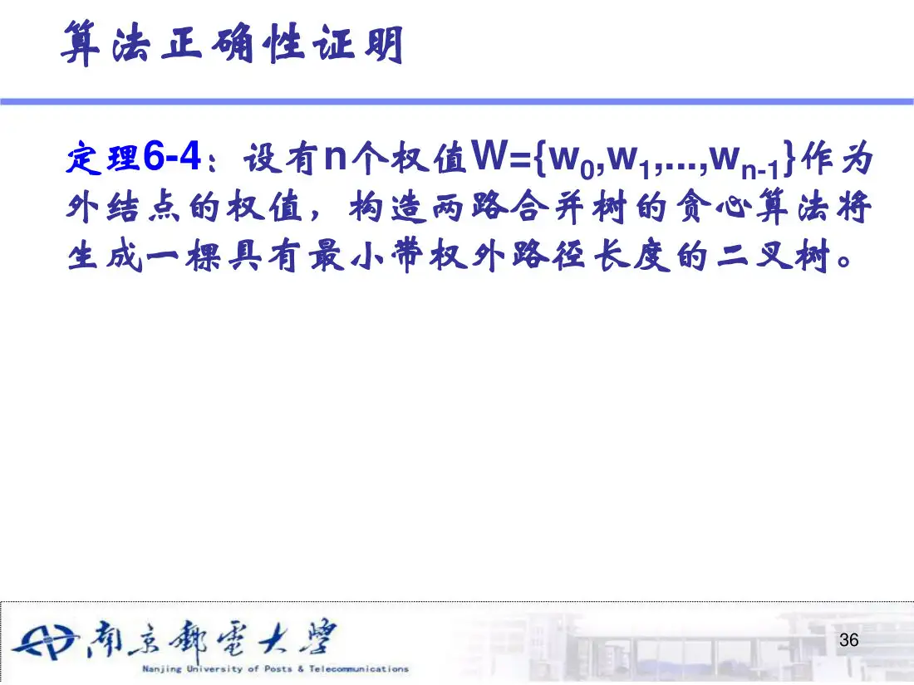

原文：

算法正确性证明

定理6-4：设有n个权值 $W { = } \{ \mathsf { w } _ { 0 } , \mathsf { w } _ { 1 } , \ldots , \mathsf { w } _ { { \mathsf { n } } { = } 1 } \}$ 作为外结点的权值，构造两路合并树的贪心算法将生成一棵具有最小带权外路径长度的二叉树。

安南京郵電大学 Nanjing University of Posts & Telecommunications

36

### 第 37 页

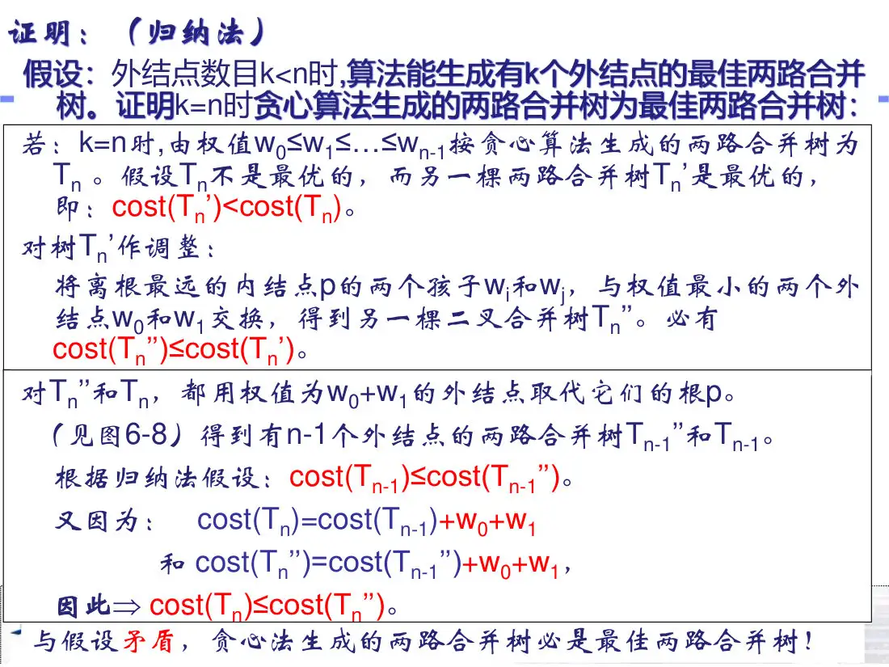

### 6.5 最小代价生成树

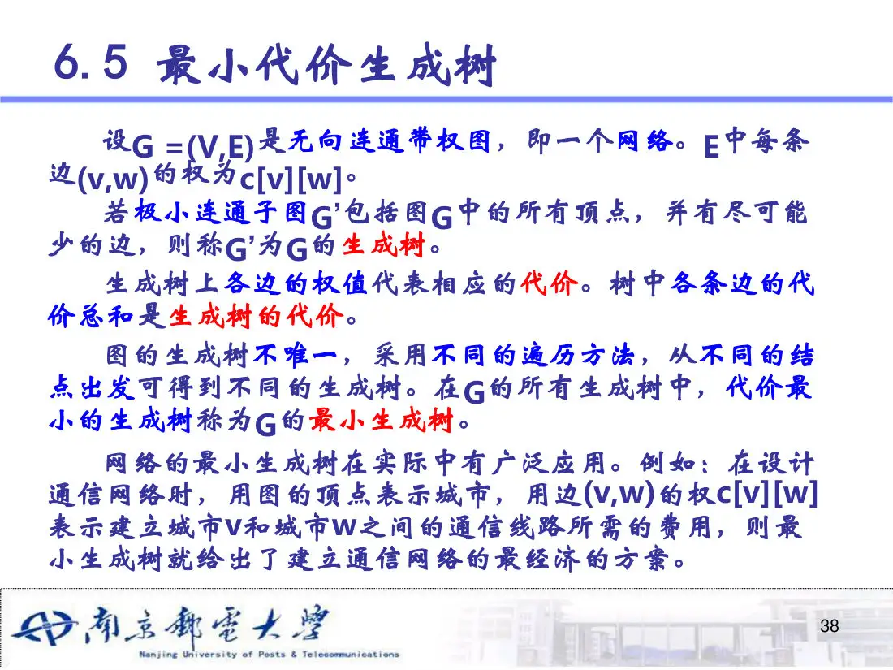

原文：

6.5 最小代价生成树

设 $\mathbf { G } = ( \mathsf { V } , \mathsf { E } )$ 是无向连通带权图，即一个网络。E中每条 边(v,w)的权为c[v][w]。

若极小连通子图G’包括图G中的所有顶点，并有尽可能少的边，则称G’为G的生成树。

生成树上各边的权值代表相应的代价。树中各条边的代价总和是生成树的代价。

图的生成树不唯一，采用不同的遍历方法，从不同的结点出发可得到不同的生成树。在G的所有生成树中，代价最小的生成树称为G的最小生成树。

网络的最小生成树在实际中有广泛应用。例如：在设计通信网络时，用图的顶点表示城市，用边(v,w)的权c[v][w]表示建立城市v和城市w之间的通信线路所需的费用，则最小生成树就给出了建立通信网络的最经济的方案。

分南京郵電大学

38

Nanjing University of Posts & Telecommunications

### 39

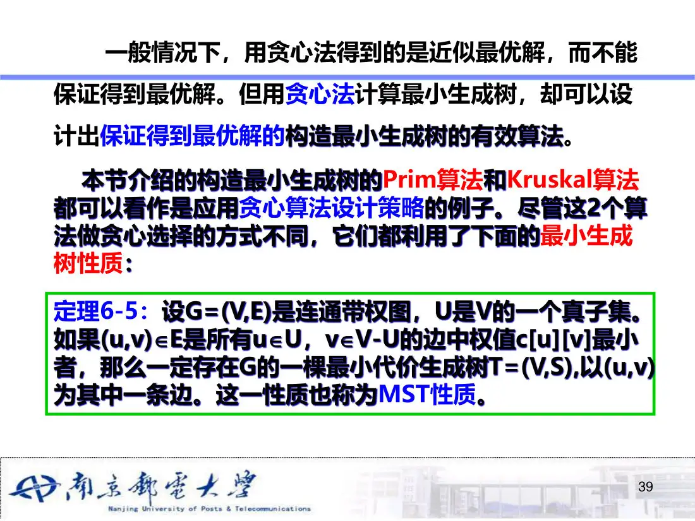

原文：

一般情况下，用贪心法得到的是近似最优解，而不能保证得到最优解。但用贪心法计算最小生成树，却可以设计出保证得到最优解的构造最小生成树的有效算法。

本节介绍的构造最小生成树的Prim算法和Kruskal算法都可以看作是应用贪心算法设计策略的例子。尽管这2个算法做贪心选择的方式不同，它们都利用了下面的最小生成树性质：

定理6-5：设G=(V,E)是连通带权图，U是V的一个真子集。如果(u,v)∈E是所有u∈U，v∈V-U的边中权值c[u][v]最小者，那么一定存在G的一棵最小代价生成树T=(V,S),以(u,v)为其中一条边。这一性质也称为MST性质。

安南京郵電大学 Nanjing University of Posts & Telecommunications

39

### 第 40 页

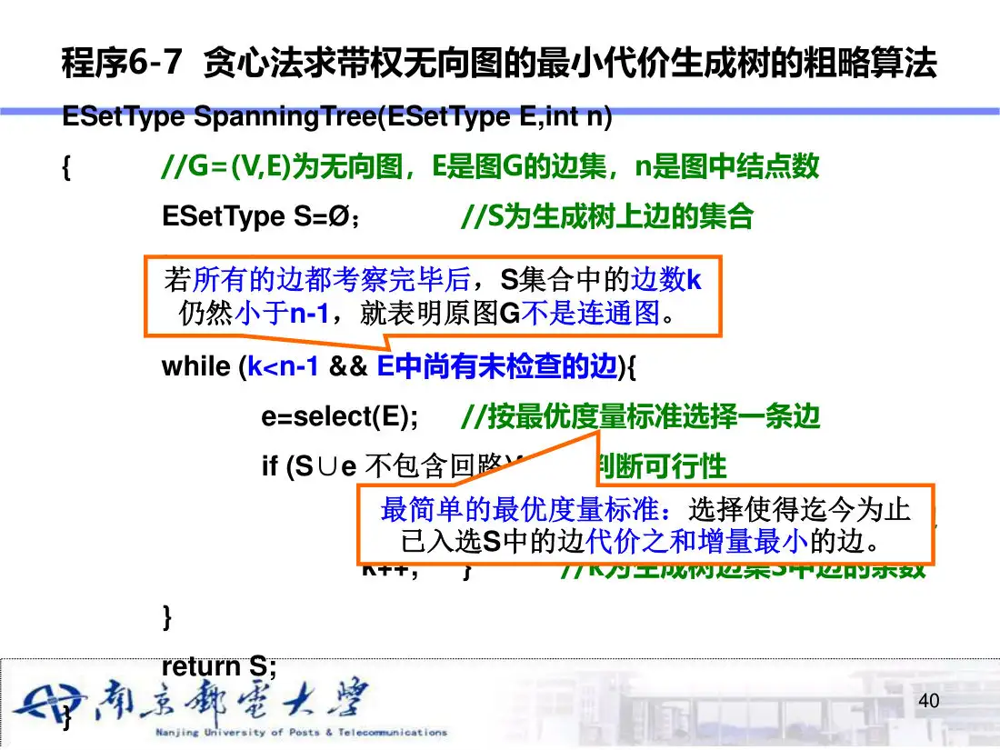

### Kruskal算法

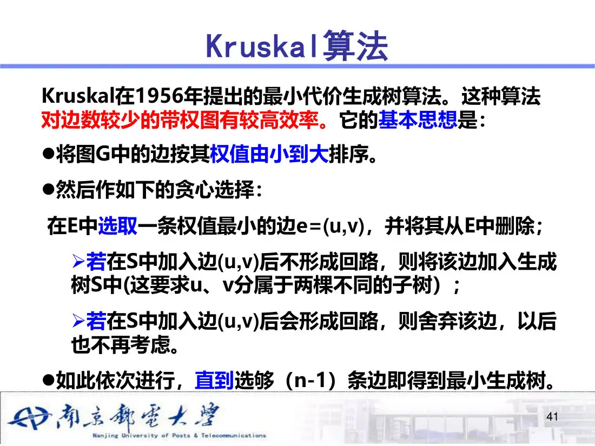

原文：

Kruskal算法

Kruskal在1956年提出的最小代价生成树算法。这种算法对边数较少的带权图有较高效率。它的基本思想是：

⚫将图G中的边按其权值由小到大排序。

⚫然后作如下的贪心选择：

在E中选取一条权值最小的边 $\ e { \in } ( \mathbf { u } , \mathbf { v } )$ ，并将其从E中删除；

➢若在S中加入边(u,v)后不形成回路，则将该边加入生成树S中(这要求u、v分属于两棵不同的子树）；

➢若在S中加入边(u,v)后会形成回路，则舍弃该边，以后也不再考虑。

⚫如此依次进行，直到选够（n-1）条边即得到最小生成树。

安南京郵電大学

41

Nanjing University of Posts & Telecommunications

### (S为正在构造的生成树边集)

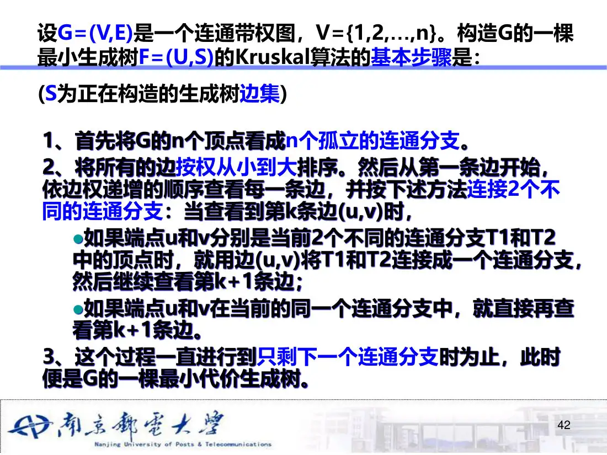

原文：

设G=(V,E)是一个连通带权图， $\lor = \{ 1 , 2 , \dots , \nmid$ 构造G的一棵最小生成树F=(U,S)的Kruskal算法的基本步骤是：

(S为正在构造的生成树边集)

1、首先将G的n个顶点看成n个孤立的连通分支。

2、将所有的边按权从小到大排序。然后从第一条边开始，依边权递增的顺序查看每一条边，并按下述方法连接2个不同的连通分支：当查看到第k条边(u,v)时，

⚫如果端点u和v分别是当前2个不同的连通分支T1和T2中的顶点时，就用边(u,v)将T1和T2连接成一个连通分支，然后继续查看第k+1条边；

⚫如果端点u和v在当前的同一个连通分支中，就直接再查看第k+1条边。

3、这个过程一直进行到只剩下一个连通分支时为止，此时便是G的一棵最小代价生成树。

安南京郵電大学

42

Nanjing University of Posts & Telecommunications

### 例如：对于下图中的连通带权图

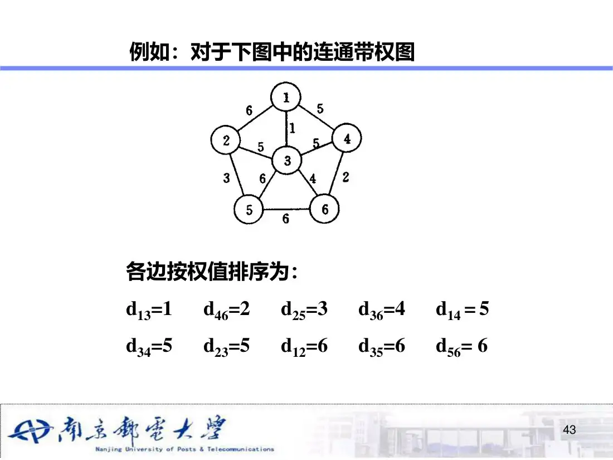

原文：

例如：对于下图中的连通带权图

各边按权值排序为：

$$
\mathbf {d} _ {1 3} = \mathbf {1}
$$

$$
\mathbf {d} _ {4 6} = 2
$$

$$
\mathbf {d} _ {2 5} = 3
$$

$$
\mathbf {d} _ {3 6} = 4
$$

$$
\mathbf {d} _ {1 4} = 5
$$

$$
\mathbf {d} _ {3 4} = 5
$$

$$
\mathbf {d} _ {2 3} = 5
$$

$$
\mathbf {d} _ {1 2} = 6
$$

$$
\mathbf {d} _ {3 5} = 6
$$

$$
\mathbf {d} _ {5 6} = 6
$$

安南京郵電大学 Nanjing University of Posts & Telecommunications

43

### 按Kruskal算法选边的过程如下图所示：

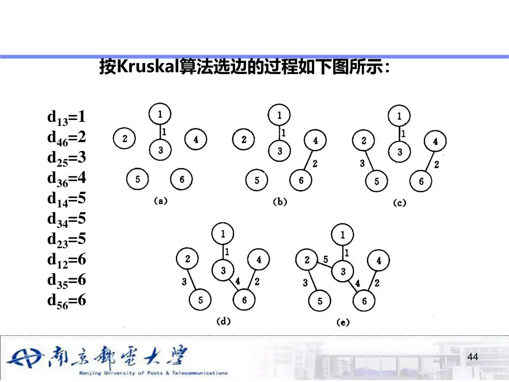

原文：

按Kruskal算法选边的过程如下图所示：

$$
\mathbf {d _ {1 3}} = \mathbf {1}
$$

$$
\mathbf {d} _ {4 6} = 2
$$

$$
\mathbf {d} _ {2 5} = 3
$$

$$
\mathbf {d} _ {3 6} = 4
$$

$$
\mathbf {d} _ {1 4} = 5
$$

(b)

$$
\mathbf {d} _ {3 4} = 5
$$

$$
\mathbf {d} _ {2 3} = 5
$$

$$
\mathbf {d} _ {1 2} = \mathbf {6}
$$

$$
\mathbf {d} _ {3 5} = 6
$$

$$
\mathbf {d} _ {5 6} = \mathbf {6}
$$

44

Nanjing University of Posts & Telecommunications

### 关于集合的一些基本运算可用于实现Kruskal算法：

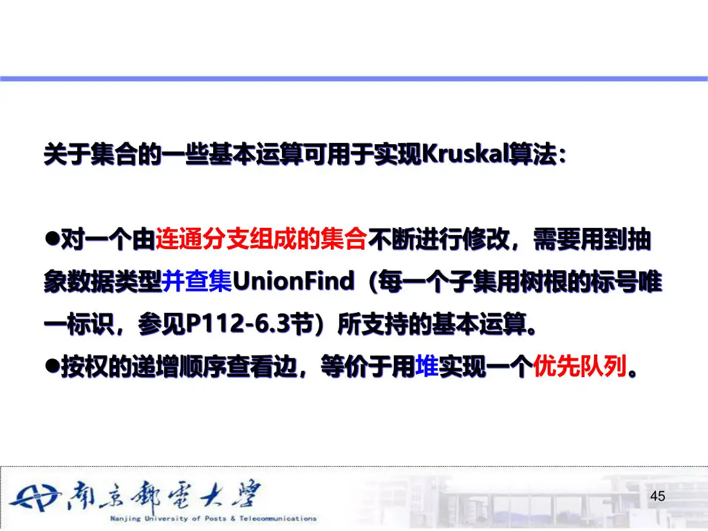

原文：

关于集合的一些基本运算可用于实现Kruskal算法：

⚫对一个由连通分支组成的集合不断进行修改，需要用到抽象数据类型并查集UnionFind（每一个子集用树根的标号唯一标识，参见P112-6.3节）所支持的基本运算。

⚫按权的递增顺序查看边，等价于用堆实现一个优先队列。

安南京郵電大学 Nanjing University of Posts & Telecommunications

45

### 程序6-9 Kruskal算法

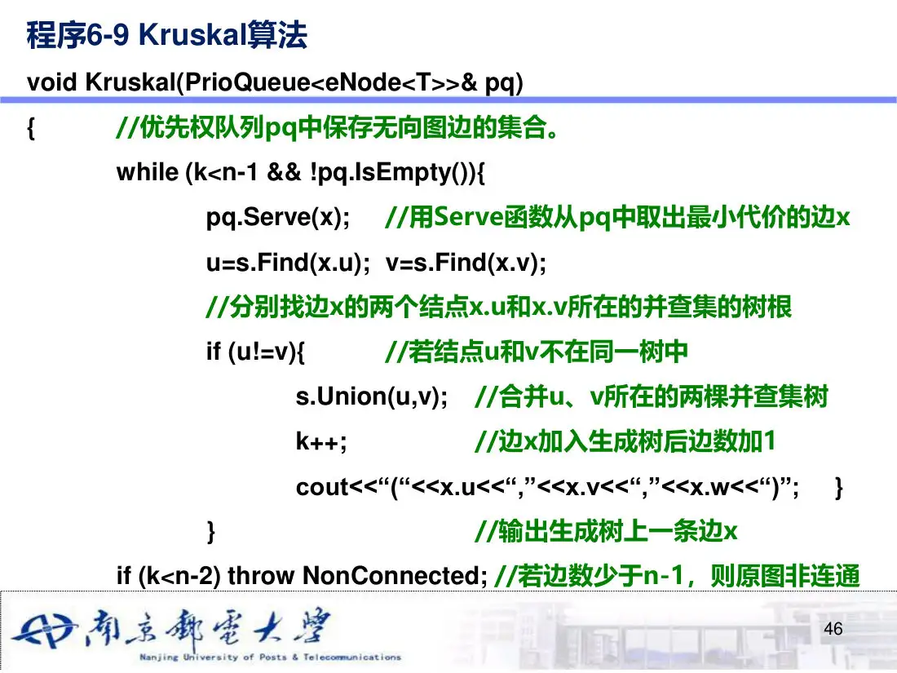

原文：

程序6-9 Kruskal算法

void Kruskal(PrioQueue<eNode<T>>& pq)

### $$

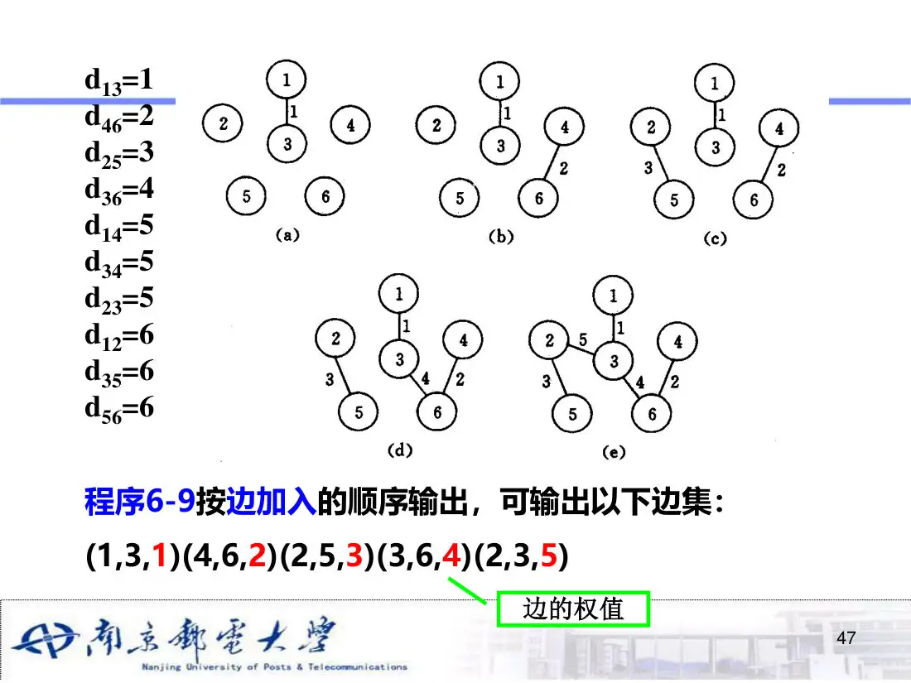

原文：

$$
\mathbf {d} _ {1 3} = \mathbf {1}
$$

$$
\mathbf {d} _ {4 6} = 2
$$

$$
\mathbf {d} _ {2 5} = 3
$$

$$
\mathbf {d} _ {3 6} = 4
$$

$$
\mathbf {d} _ {1 4} = 5
$$

(b)

$$
\mathbf {d} _ {3 4} = 5
$$

$$
\mathbf {d} _ {2 3} = 5
$$

$$
\mathbf {d} _ {1 2} = \mathbf {6}
$$

$$
\mathbf {d} _ {3 5} = 6
$$

$$
\mathbf {d} _ {5 6} = \mathbf {6}
$$

程序6-9按边加入的顺序输出，可输出以下边集：

(1,3,1)(4,6,2)(2,5,3)(3,6,4)(2,3,5)

边的权值

分南京郵電大学

47

Nanjing University of Posts & Telecommunications

### Kruskal算法时间复杂度分析

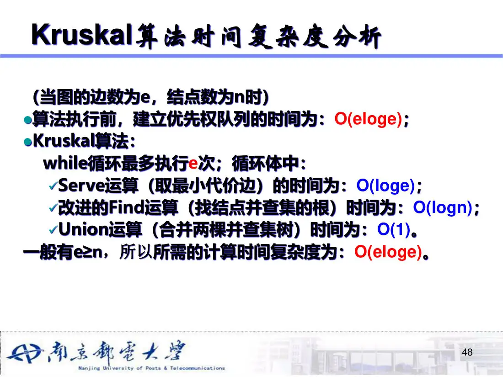

原文：

Kruskal算法时间复杂度分析

（当图的边数为e，结点数为n时）

⚫算法执行前，建立优先权队列的时间为：O(eloge)；

⚫Kruskal算法：

while循环最多执行e次；循环体中：

✓Serve运算（取最小代价边）的时间为：O(loge)；

✓改进的Find运算（找结点并查集的根）时间为：O(logn)；

✓Union运算（合并两棵并查集树）时间为：O(1)。

一般有e≥n，所以所需的计算时间复杂度为：O(eloge)。

安南京郵電大学 Nanjing University of Posts & Telecommunications

48

### Prim算法

原文：

Prim算法

Prim在1957年提出的最小代价生成树算法，这种算法特别适用于边数相对较多，即比较接近于完全图的图。

此算法是按逐个将顶点连通的步骤进行的，它只需采用一个顶点集合。这个集合开始时是空集，以后将已连通的顶点陆续加入到集合中去，到全部顶点都加入到集合中了，就得到所需的生成树。

安南京郵電大学 Nanjing University of Posts & Telecommunications

49

### (U为正在构造的生成树点集)

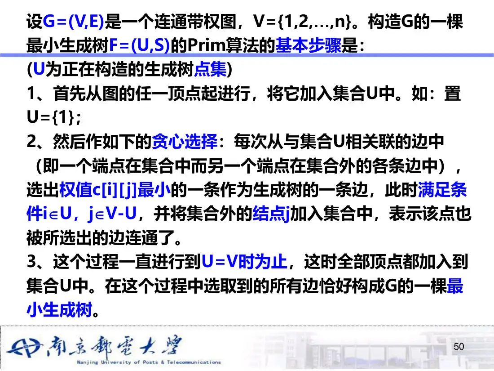

原文：

设G=(V,E)是一个连通带权图， $\lor = \{ 1 , 2 , \dots , \nmid$ 。构造G的一棵最小生成树F=(U,S)的Prim算法的基本步骤是：

(U为正在构造的生成树点集)

1、首先从图的任一顶点起进行，将它加入集合U中。如：置$u = \{ 1 \}$

2、然后作如下的贪心选择：每次从与集合U相关联的边中（即一个端点在集合中而另一个端点在集合外的各条边中），选出权值c[i][j]最小的一条作为生成树的一条边，此时满足条件i∈U，j∈V-U，并将集合外的结点j加入集合中，表示该点也被所选出的边连通了。

3、这个过程一直进行到U=V时为止，这时全部顶点都加入到集合U中。在这个过程中选取到的所有边恰好构成G的一棵最小生成树。

安南京郵電大学 Nanjing University of Posts & Telecommunications

50

### 例如，对于下图(a)中的带权图，按Prim算法选边的过程如下图(b)所示。

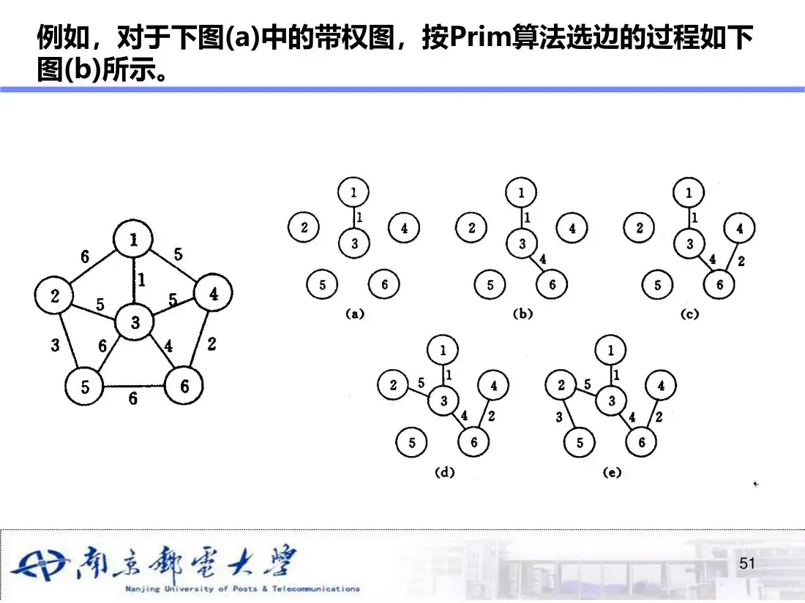

原文：

例如，对于下图(a)中的带权图，按Prim算法选边的过程如下图(b)所示。

南京郵電大学

51

Nanjing University of Posts & Telecommunications

### 在Prim算法的执行过程中:

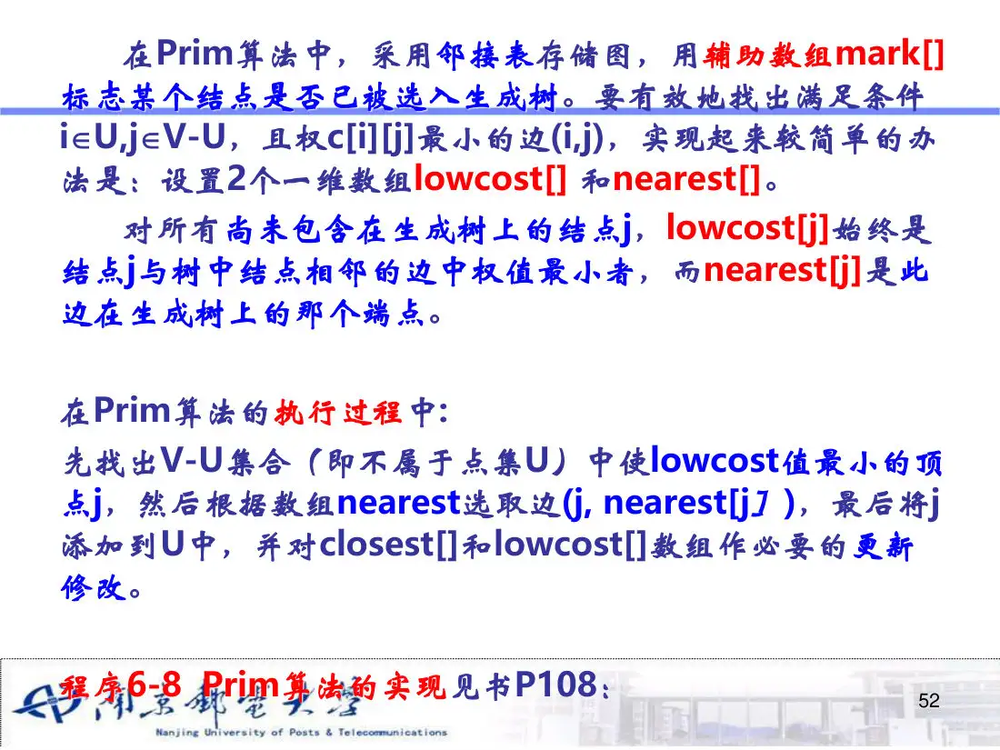

原文：

在Prim算法中，采用邻接表存储图，用辅助数组mark[]标志某个结点是否已被选入生成树。要有效地找出满足条件i∈U,j∈V-U，且权c[i][j]最小的边(i,j)，实现起来较简单的办法是：设置2个一维数组lowcost[] 和nearest[]。

对所有尚未包含在生成树上的结点j，lowcost[j]始终是结点j与树中结点相邻的边中权值最小者，而nearest[j]是此边在生成树上的那个端点。

在Prim算法的执行过程中:

先找出V-U集合（即不属于点集U）中使lowcost值最小的顶点j，然后根据数组nearest选取边(j, nearest[j］)，最后将j添加到U中，并对closest[]和lowcost[]数组作必要的更新修改。

程序6-8 Prim算法的实现见书P108：南京郵電型學

52

Nanjing University of Posts & Telecommunications

### 第 53 页

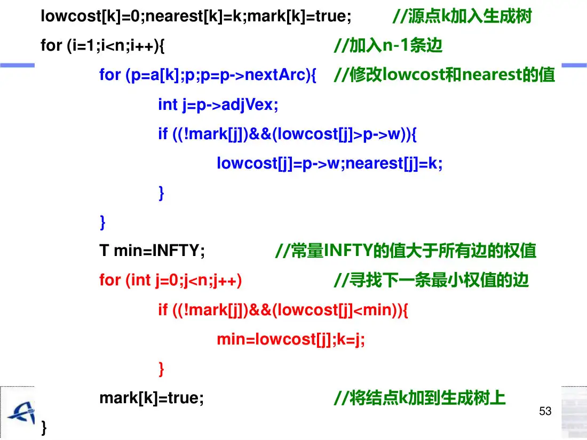

### nearest[j]: 结点j接入到生成树中的另一端接入结点

原文：

程序6-8按（邻接表和mark[]、lowcost[]、nearest[]数组中）结点的编号顺序输出，可输出以下边集：lowcost[j]: 边的权值

（1,1,0)(3,2,5)(1,3,1)(6,4,2)(2,5,3)(3,6,4)

nearest[j]: 结点j接入到生成树中的另一端接入结点

结点编号j

54

Nanjing University of Posts & Telecommunications

### Prim算法时间复杂度分析

原文：

Prim算法时间复杂度分析

◆很明显，程序6-8实现的Prim算法所需的时间复杂度为${ \mathsf { O } } ( { \mathsf { n } } ^ { 2 } )$ 。

安南京郵電大学 Nanjing University of Posts & Telecommunications

55

### 比较Prim算法和Kruskal算法

原文：

比较Prim算法和Kruskal算法

◆Prim算法的贪心准则：保证S所代表的子图是一棵树的前提下，选择一条最小代价的边 $\scriptstyle \mathbf { e } = ( \mathbf { u } , \mathbf { v } )$ ;

◆Kruskal算法的贪心准则：按边代价的非减次序考察E中的边，从中选择一条代价最小的边 $\scriptstyle \mathbf { e } = ( \mathbf { u } , \mathbf { v } )$

Prim算法：由于Prim算法中每次选取的边两端总是一个已连通顶点和一个未连通顶点，故这个边选取后一定能将该未连通点连通而又保证不会形成回路。因此每选择一条边后，无须再判断边集S ∪e是否包含回路。

◆Kruskal算法：为了确保最终得到生成树，每选择一条边时，都需要判定边集S∪e是否包含回路。

安南京郵電大学 Nanjing University of Posts & Telecommunications

56

### 算法正确性证明

原文：

算法正确性证明

定理6-5：设G=(V,E)是连通带权图，U是V的一个真子集。如果(u,v)∈E是所有u∈U，v∈V-U的边中权值c[u][v]最小者，那么一定存在G的一棵最小代价生成树T=(V,S),以(u,v)为其中一条边。这一性质也称为MST性质。

定理6-5是Prim算法和Kruskal算法的理论基础，可由反证法得证（见P111 图6-12）！

无论Prim算法还是Kruskal算法，每一步选择的边均符合定理6-5，因此必定存在一棵最小代价生成树包含每一步上已经形成的生成树和新添加的边，因此定理6-6成立。

定理6-6：Prim算法和Kruskal算法都将产生一个带权无向连通图的最小代价生成树。

安南京郵電大学 Nanjing University of Posts & Telecommunications

57

### 6.6 单源最短路径

原文：

6.6 单源最短路径

对右图中的有向带权图，计算从源顶点0到其他顶点间最短路径。

迪杰斯特拉算法按从源点到其他各顶点的最短路径长度的从小到大的次序逐一产生最短路径。

<table><tr><td>源点</td><td>终点</td><td>最短路径</td><td>路径长度</td></tr><tr><td>0</td><td>1</td><td>(0,2,3,1)</td><td>45</td></tr><tr><td></td><td>2</td><td>(0,2)</td><td>10</td></tr><tr><td></td><td>3</td><td>(0,2,3)</td><td>25</td></tr><tr><td></td><td>4</td><td>(0,2,3,1,4)</td><td>55</td></tr><tr><td></td><td>5</td><td>-</td><td>∞</td></tr></table>

分南京郵電大学

58

Nanjing University of Posts & Telecommunications

### ⚫ 迪杰斯特拉（Dijkstra）算法思想：

原文：

⚫ 迪杰斯特拉（Dijkstra）算法思想：

把V分成两组：

（1）S：存放已求得最短路径的顶点的集合

（2）T=V-S：尚未确定最短路径的顶点集合将T中顶点按最短路径非递减的次序加入到S中。

这个过程中，总保持：

⚫ 从源点 $\mathbf { V _ { 0 } }$ 到S中各顶点的最短路径长度都不大于从$\bf V _ { 0 }$ 到T中任何顶点的最短路径长度。

⚫ 而且每个顶点对应一个距离值：

S中顶点对应的距离值，是从 $\bf { V _ { 0 } }$ 到此顶点的最短路径长度；

T中顶点对应的距离值，是从 $\mathbf { { V _ { 0 } } }$ 到此顶点的只包括S中顶点作中间顶点的当前最短路径长度。

### 选择数据结构

原文：

选择数据结构

一维数组d

d[i]中存放从源点 $\mathbf { v _ { 0 } }$ 到 $\mathbf { v _ { i } }$ 的当前最短路径长度，该路径上除顶点vi自身外，其余顶点都属于S，并且是所有这些路径中的最短者。

一维整型数组path

path[i]给出从 $\mathbf { v _ { 0 } }$ 到顶点 $\mathbf { v _ { i } }$ 的最短路径上，位于顶点 $\mathbf { v _ { i } }$ 前面的那个顶点。

例如：从v0到v1的最短路径为 $( \mathbf { v _ { 0 } } , \mathbf { v _ { 2 } } , \mathbf { v _ { 3 } } , \mathbf { v _ { 1 } } )$

则有path[1]=3，path[3]=2， $\mathbf { p a t h } [ 2 ] { = } \mathbf { 0 }$

一维布尔数组s

若s[i]为true，表示顶点 $\mathbf { v _ { i } }$ 在S中；否则表示 $\mathbf { v _ { i } }$ 在V-S中。

安南京郵電大学 Nanjing University of Posts & Telecommunications

### 初始状态

原文：

初始状态

S={v }，T={其余顶点}。源点 $\mathbf { v _ { 0 } }$ 到自身的路径长度为0，路径上0前面的顶点不存在因此为-1。

<table><tr><td>S</td><td>d[0]path[0]</td><td>d[1]path[1]</td><td>d[2]path[2]</td><td>d[3]path[3]</td><td>d[4]path[4]</td><td>d[5]path[5]</td></tr><tr><td>{0}</td><td>0, -1</td><td>50, 0</td><td>10, 0</td><td>∞, -1</td><td>70, 0</td><td>∞, -1</td></tr></table>

初始状态下T中顶点 $\mathbf { v _ { i } }$ 对应的当前最短路径长度d[i]和该路径上i前面的结点path[i]值为：若存在 $< \mathbf { v _ { 0 } } , \mathbf { v _ { i } } >$ ，则d[i]为 $< \mathbf { v _ { 0 } } , \mathbf { v _ { i } } >$ 弧上的权值 $\bf { w } ( v _ { 0 } , v _ { i } )$ 且 $\mathbf { p a t h } [ \mathbf { i } ] { = } \mathbf { 0 }$ 若不存在 $< \mathbf { v _ { 0 } } , \mathbf { v _ { i } } >$ ，则d[i]为∞，且 $\mathbf { p a t h } [ \mathbf { i } ] { = } { \cdot } 1$

### 求第一条最短路径

原文：

求第一条最短路径

第一条最短路径是 $T \equiv V - \{ V _ { 0 } \}$ 集合中所有顶点的当前最短路径中最短者：

d[i]=min{d[i],d[k]+w(k,i)}

选择顶点 $\mathbf { v } _ { 2 }$ 加入集合S，则d[2]为源点 $\mathbf { v _ { 0 } }$ 到顶点 $\mathbf { v } _ { 2 }$ 2的最短路径，path[2]为该最短路径上顶点$\mathbf { v } _ { 2 }$ 前面的那个顶点 $\mathbf { v _ { 0 } }$

<table><tr><td>S</td><td>d[0]path[0]</td><td>d[1]path[1]</td><td>d[2]path[2]</td><td>d[3]path[3]</td><td>d[4]path[4]</td><td>d[5]path[5]</td></tr><tr><td>{0}</td><td>0, -1</td><td>50, 0</td><td>10, 0</td><td>∞, -1</td><td>70, 0</td><td>∞, -1</td></tr></table>

### 更新d[]和path[]

原文：

更新d[]和path[]

顶点 $\mathbf { v _ { k } ^ { - } }$ 加入S后，对所有T=V-S集合中的剩余顶点 $\mathbf { v _ { i } }$ ，按公式修正从源点 $\mathbf { v _ { 0 } }$ 到该顶点的当前最短路径长度： $c ( 1 0 ) = \operatorname* { m i n } ( c ( 1 0 ) ) = \operatorname* { m i n } ( c ( 1 0 ) )$

<table><tr><td>S</td><td>d[0]path[0]</td><td>d[1]path[1]</td><td>d[2]</td><td colspan="4">若d[i]值被更新,则path[i]值也随之更新为k。</td></tr><tr><td>{0}</td><td>0, -1</td><td>50, 0</td><td>10, 0</td><td>∞,</td><td>70, 0</td><td colspan="2">∞, -1</td></tr><tr><td>{0,2}[S]</td><td>0, -1d[0] path[0]</td><td>50, 0d[1] path[1]</td><td>10, 0d[2] path[2]</td><td>25, 2d[3] path[3]</td><td>70, 0d[4] path[4]</td><td colspan="2">∞, -1d[5] path[5]</td></tr><tr><td>{0}</td><td>0, -1</td><td>50, 0</td><td>10, 0</td><td>∞, -1</td><td>70, 0</td><td colspan="2">∞, -1</td></tr><tr><td>{0,2}</td><td>0, -1</td><td>50, 0</td><td>10, 0</td><td>25, 2</td><td>70, 0</td><td colspan="2">∞, -1</td></tr></table>

### 第 64 页

### 第 65 页

原文：

Nanjing University of Posts & Telecommunications将顶点 $v _ { 1 }$ 3加入S。则d[1]为源点 $\mathbf { \Delta } \mathbf { v _ { 0 } }$ 到顶点 $v _ { 1 }$ 15的最短路径，path[1]为最短路径上顶点$v _ { 1 }$ 前面的那个顶点。

<table><tr><td>S</td><td>d[0] path[0]</td><td>d[1] path[1]</td><td>d[2] path[2]</td><td>d[3] path[3]</td><td>d[4] path[4]</td><td>d[5] path[5]</td></tr><tr><td>{0}</td><td>0, -1</td><td>50, 0</td><td>10, 0</td><td>∞, -1</td><td>70, 0</td><td>∞, -1</td></tr><tr><td>{0,2}</td><td>0, -1</td><td>50, 0</td><td>10, 0</td><td>25, 2</td><td>70, 0</td><td>∞, -1</td></tr><tr><td>{0,2,3}</td><td>0, -1</td><td>45, 3</td><td>10, 0</td><td>25, 2</td><td>60, 3</td><td>∞, -1</td></tr></table>

### 第 66 页

原文：

<table><tr><td>S</td><td>d[0] path[0]</td><td>d[1] path[1]</td><td>d[2] path[2]</td><td>d[3] path[3]</td><td>d[4] path[4]</td><td>d[5] path[5]</td></tr><tr><td>{0}</td><td>0, -1</td><td>50, 0</td><td>10, 0</td><td>∞, -1</td><td>70, 0</td><td>∞, -1</td></tr><tr><td>{0,2}</td><td>0, -1</td><td>50, 0</td><td>10, 0</td><td>25, 2</td><td>70, 0</td><td>∞, -1</td></tr><tr><td>{0,2,3}</td><td>0, -1</td><td>45, 3</td><td>10, 0</td><td>25, 2</td><td>60, 3</td><td>∞, -1</td></tr></table>

Nanjing University of Posts & Telecommunications

### 第 67 页

原文：

<table><tr><td>S</td><td>d[0] path[0]</td><td>d[1] path[1]</td><td>d[2] path[2]</td><td>d[3] path[3]</td><td>d[4] path[4]</td><td>d[5] path[5]</td></tr><tr><td>{0}</td><td>0, -1</td><td>50, 0</td><td>10, 0</td><td>∞, -1</td><td>70, 0</td><td>∞, -1</td></tr><tr><td>{0,2}</td><td>0, -1</td><td>50, 0</td><td>10, 0</td><td>25, 2</td><td>70, 0</td><td>∞, -1</td></tr><tr><td>{0,2,3}</td><td>0, -1</td><td>45, 3</td><td>10, 0</td><td>25, 2</td><td>60, 3</td><td>∞, -1</td></tr><tr><td>{0,2,3,1}</td><td>0, -1</td><td>45, 3</td><td>10, 0</td><td>25, 2</td><td>55, 1</td><td>∞, -1</td></tr></table>

### 第 68 页

原文：

<table><tr><td>S</td><td>d[0] path[0]</td><td>d[1] path[1]</td><td>d</td></tr><tr><td>{0}</td><td>0, -1</td><td>50, 0</td><td>1</td></tr><tr><td>{0,2}</td><td>0, -1</td><td>50, 0</td><td>1</td></tr><tr><td>{0,2,3}</td><td>0, -1</td><td>45, 3</td><td>1</td></tr><tr><td>{0,2,3,1}</td><td>0, -1</td><td>45, 3</td><td>1</td></tr></table>

选择顶点 ${ \bf v } _ { 4 }$ 加入S。则d[4]为源点 $\mathbf { v _ { 0 } }$ 到顶点 $\mathbf { v _ { 4 } }$ 的最短路径， path[4]为最短路径上顶点 ${ \bf v _ { 4 } }$ 前面的那个顶点。

Nanjing University of Posts & Telecommunications

### 安南京郵電大學

原文：

<table><tr><td>S</td><td>d[0] path[0]</td><td>d[1] path[1]</td><td>d[2] path[2]</td><td>d[3] path[3]</td><td>d[4] path[4]</td><td>d[5] path[5]</td></tr><tr><td>{0}</td><td>0, -1</td><td>50, 0</td><td>10, 0</td><td>∞, -1</td><td>70, 0</td><td>∞, -1</td></tr><tr><td>{0,2}</td><td>0, -1</td><td>50, 0</td><td>10, 0</td><td>25, 2</td><td>70, 0</td><td>∞, -1</td></tr><tr><td>{0,2,3}</td><td>0, -1</td><td>45, 3</td><td>10, 0</td><td>25, 2</td><td>60, 3</td><td>∞, -1</td></tr><tr><td>{0,2,3,1}</td><td>0, -1</td><td>45, 3</td><td>10, 0</td><td>25, 2</td><td>55, 1</td><td>∞, -1</td></tr><tr><td>{0,2,3,1,4}</td><td>0, -1</td><td>45, 3</td><td>10, 0</td><td>25, 2</td><td>55, 1</td><td>∞, -1</td></tr></table>
安南京郵電大學

Nanjing University of Posts & Telecommunications

### 第 70 页

原文：

安南京郵電大学 Nanjing University of Posts & Telecommunications
