# 《算法分析与设计》第7章 动态规划法（课件）

原件的每一页，下面附识别出的文字。

### 算法设计与分析

原文：

Nanjing University of Posts & Telecommunications

算法设计与分析

1

### 第7章 动态规划法

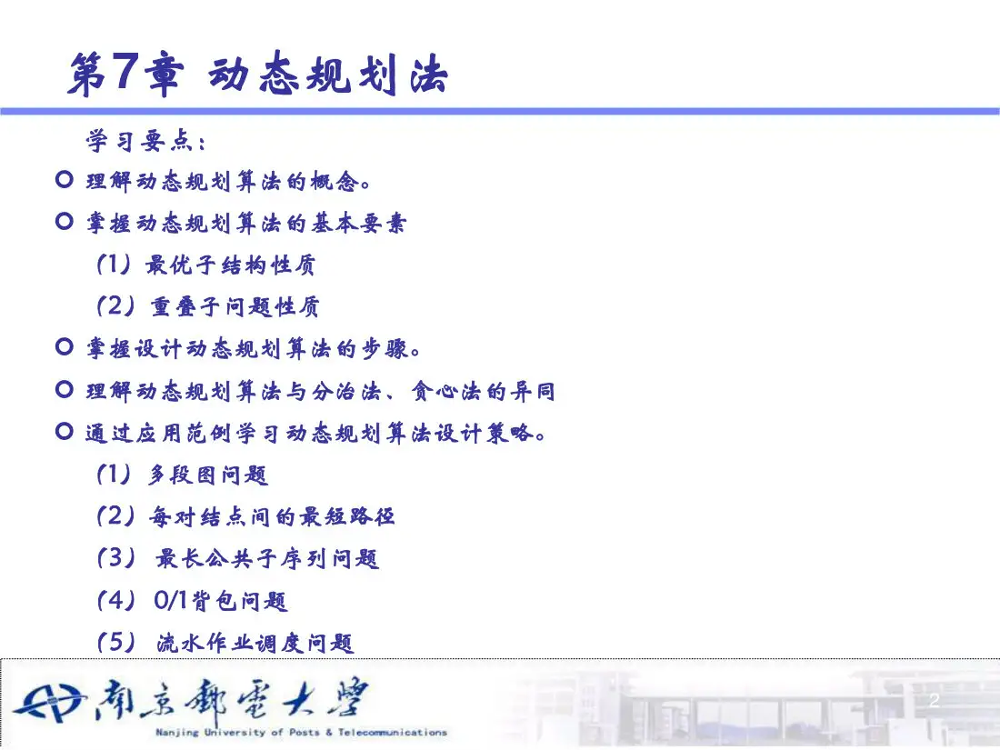

原文：

第7章 动态规划法

学习要点：

 理解动态规划算法的概念。

 掌握动态规划算法的基本要素

（1）最优子结构性质

（2）重叠子问题性质

 掌握设计动态规划算法的步骤。

 理解动态规划算法与分治法、贪心法的异同

 通过应用范例学习动态规划算法设计策略。

（1）多段图问题

（2）每对结点间的最短路径

（3） 最长公共子序列问题

（4） 0/1背包问题

（5） 流水作业调度问题

安南京郵電大学

### 章节内容

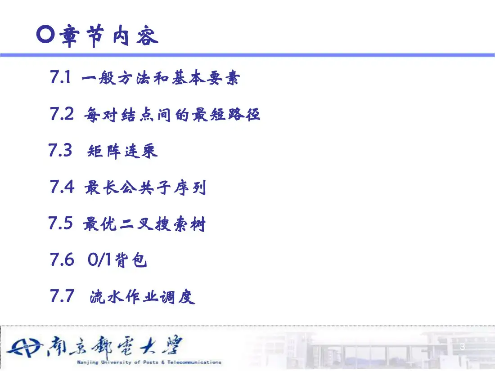

原文：

章节内容
7.1 一般方法和基本要素
7.2 每对结点间的最短路径
7.3 矩阵连乘
7.4 最长公共子序列
7.5 最优二叉搜索树
7.6 0/1背包
7.7 流水作业调度
南京邮电大学
Nanjing University of Posts & Telecommunications

### 7.1 一般方法和基本要素

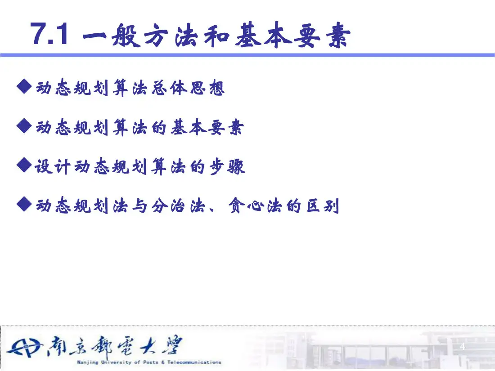

原文：

7.1 一般方法和基本要素
◆ 动态规划算法总体思想
◆ 动态规划算法的基本要素
◆ 设计动态规划算法的步骤
◆ 动态规划法与分治法、贪心法的区别动态规划方法是处理分段过程最优化问题的一类及其有效的方法。在实际生活中，有一类问题的活动过程可以分成若干个阶段，每个阶段可包含一个或多个状态。每个阶段的决策可以构成一个决策序列。使目标函数取极值的即为最优决策序列，也称为最优策略。

安南京郵電大学 Nanjing University of Posts & Telecommunications

### 分南京郵電大学

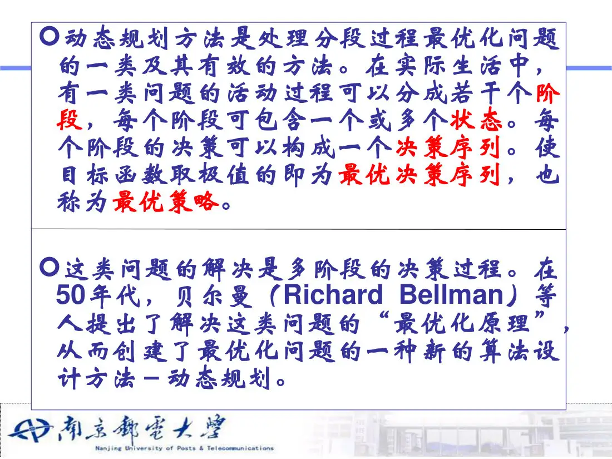

原文：

这类问题的解决是多阶段的决策过程。在50年代，贝尔曼（Richard Bellman）等人提出了解决这类问题的“最优化原理”从而创建了最优化问题的一种新的算法设计方法－动态规划。

分南京郵電大学

Nanjing University of Posts & Telecommunications

### 动态规划算法总体思想

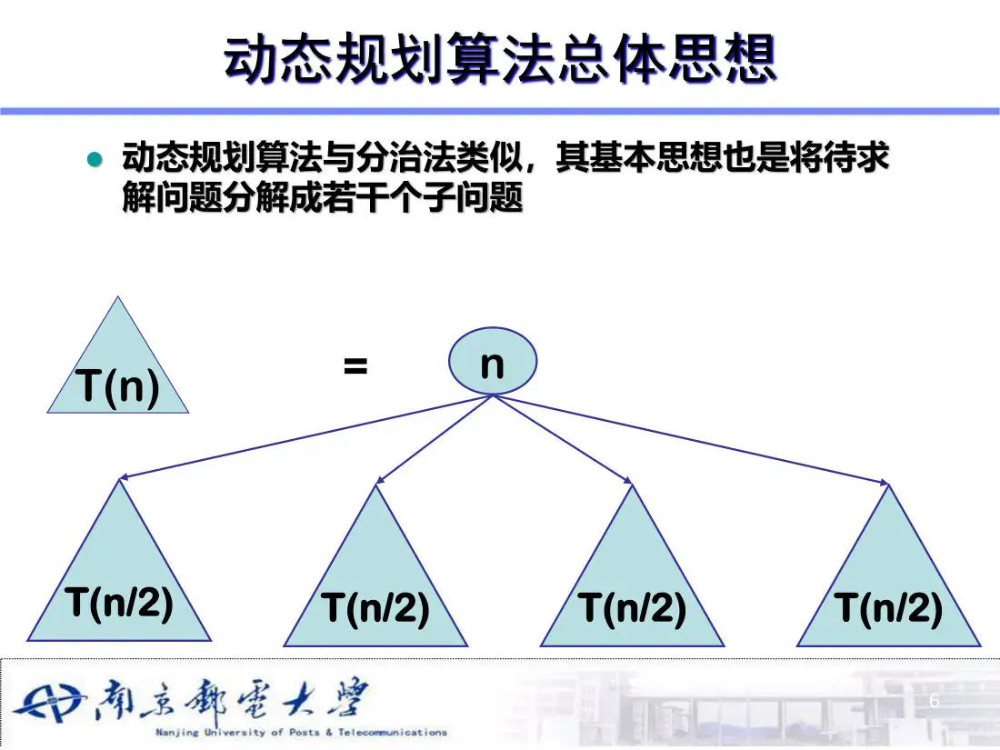

原文：

动态规划算法总体思想

⚫ 动态规划算法与分治法类似，其基本思想也是将待求解问题分解成若干个子问题

安南京郵電大学 Nanjing University of Posts & Telecommunications

6

### 动态规划算法总体思想

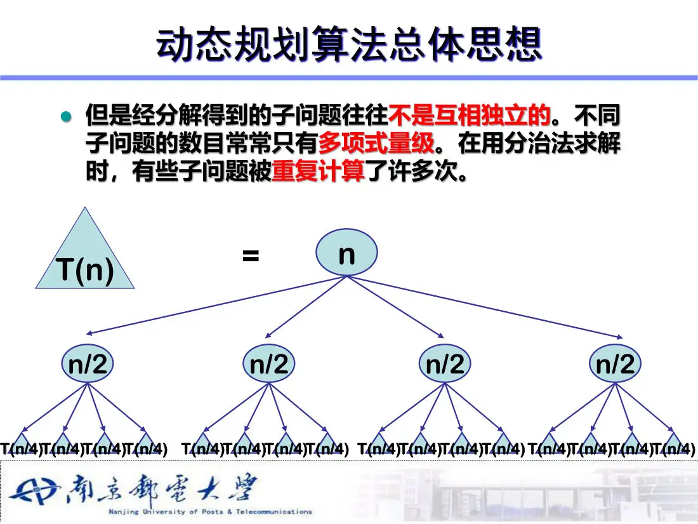

原文：

动态规划算法总体思想

但是经分解得到的子问题往往不是互相独立的。不同子问题的数目常常只有多项式量级。在用分治法求解时，有些子问题被重复计算了许多次。

Nanjing University of Posts & Telecommunications

### 动态规划算法总体思想

原文：

动态规划算法总体思想

⚫ 如果能够保存已解决的子问题的答案，而在需要时再找出已求得的答案，就可以避免大量重复计算，从而得到多项式时间算法。

Those who cannot remember the past T(n)are doomed to repeat it.

-----George Santayana,

n/2The life of Reason,

Book I: Introduction and

Reason in Common

Sense (1905)

安南京郵電大学 Nanjing University of Posts & Telecommunications

### 动态规划算法的基本要素

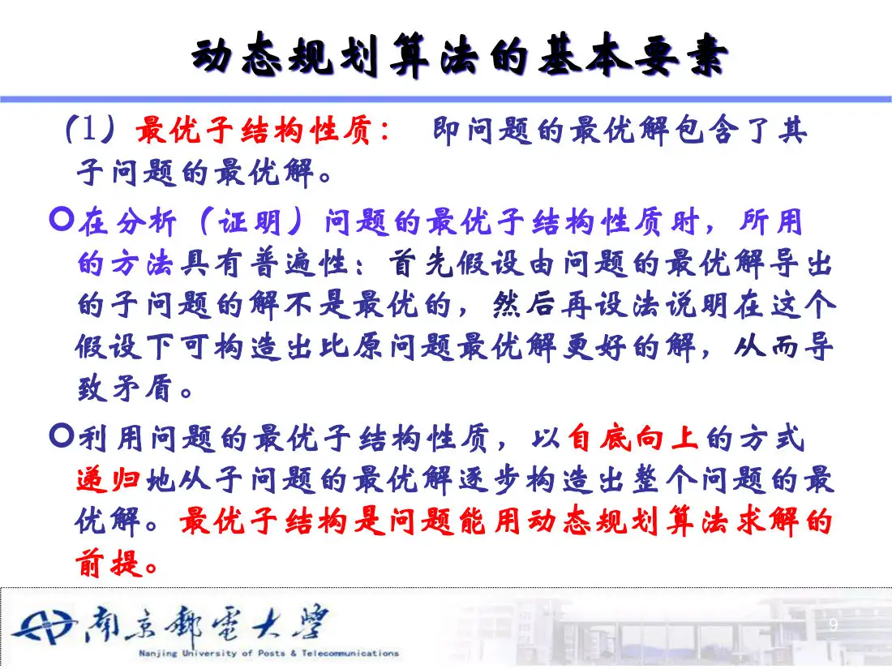

原文：

动态规划算法的基本要素

（1）最优子结构性质: 即问题的最优解包含了其子问题的最优解。

在分析（证明）问题的最优子结构性质时，所用的方法具有普遍性：首先假设由问题的最优解导出的子问题的解不是最优的，然后再设法说明在这个假设下可构造出比原问题最优解更好的解，从而导致矛盾。

利用问题的最优子结构性质，以自底向上的方式递归地从子问题的最优解逐步构造出整个问题的最优解。最优子结构是问题能用动态规划算法求解的前提。

安南京郵電大学 Nanjing University of Posts & Telecommunications

### 动态规划算法的基本要素

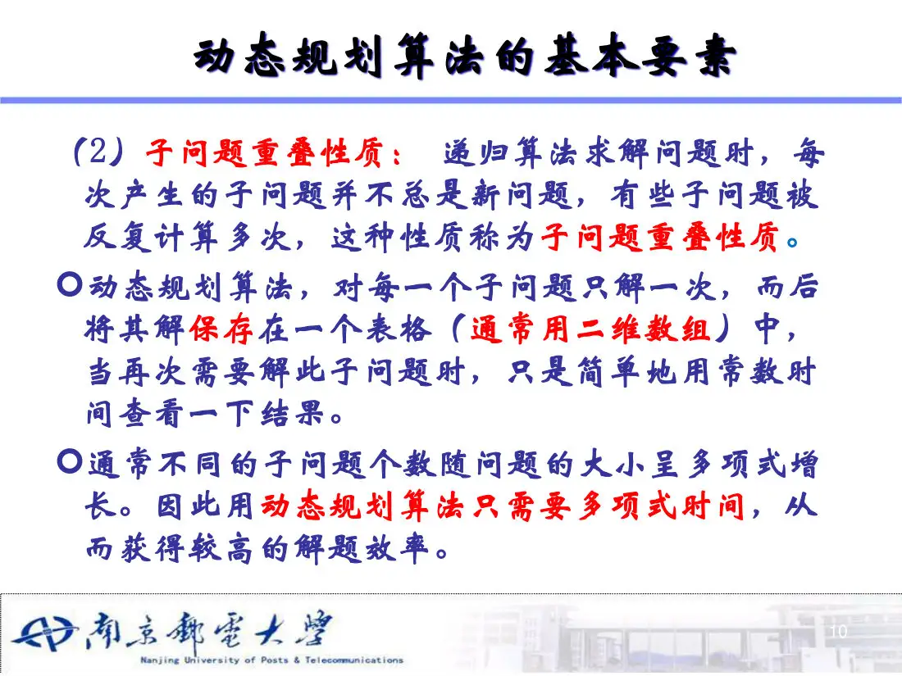

原文：

动态规划算法的基本要素

（2）子问题重叠性质： 递归算法求解问题时，每次产生的子问题并不总是新问题，有些子问题被反复计算多次，这种性质称为子问题重叠性质。

动态规划算法，对每一个子问题只解一次，而后将其解保存在一个表格（通常用二维数组）中，当再次需要解此子问题时，只是简单地用常数时间查看一下结果。

通常不同的子问题个数随问题的大小呈多项式增长。因此用动态规划算法只需要多项式时间，从而获得较高的解题效率。

安南京郵電大学 Nanjing University of Posts & Telecommunications

10

### 设计动态规划算法的步骤

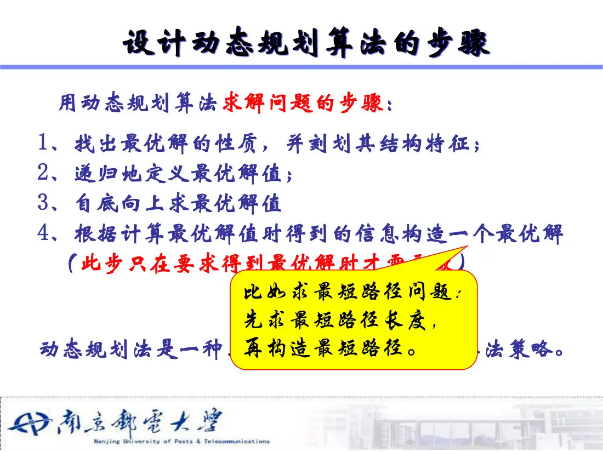

原文：

设计动态规划算法的步骤

用动态规划算法求解问题的步骤：

1、找出最优解的性质，并刻划其结构特征；

2、递归地定义最优解值；

3、自底向上求最优解值

4、根据计算最优解值时得到的信息构造一个最优解（此步只在要求得到最优解时才需要做）

比如求最短路径问题：

动态规划法是一种

先求最短路径长度，

解最优化问题的再构造最短路径。

法策略。

分南京郵電大学

Nanjing University of Posts & Telecommunications

### 动态规划法与分治法

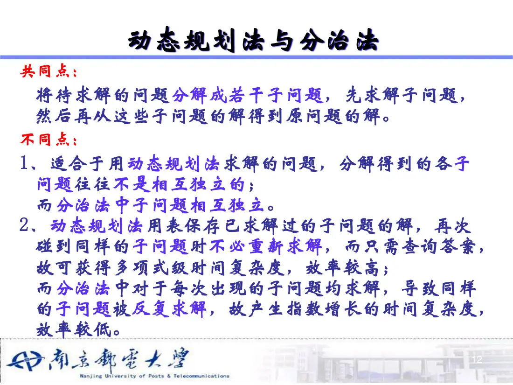

原文：

动态规划法与分治法

共同点：

将待求解的问题分解成若干子问题，先求解子问题，然后再从这些子问题的解得到原问题的解。

不同点：

1、适合于用动态规划法求解的问题，分解得到的各子问题往往不是相互独立的；而分治法中子问题相互独立。

2、动态规划法用表保存已求解过的子问题的解，再次碰到同样的子问题时不必重新求解，而只需查询答案，故可获得多项式级时间复杂度，效率较高；而分治法中对于每次出现的子问题均求解，导致同样的子问题被反复求解，故产生指数增长的时间复杂度，效率较低。

Nanjing University of Posts & Telecommunications

### 动态规划法与贪心法

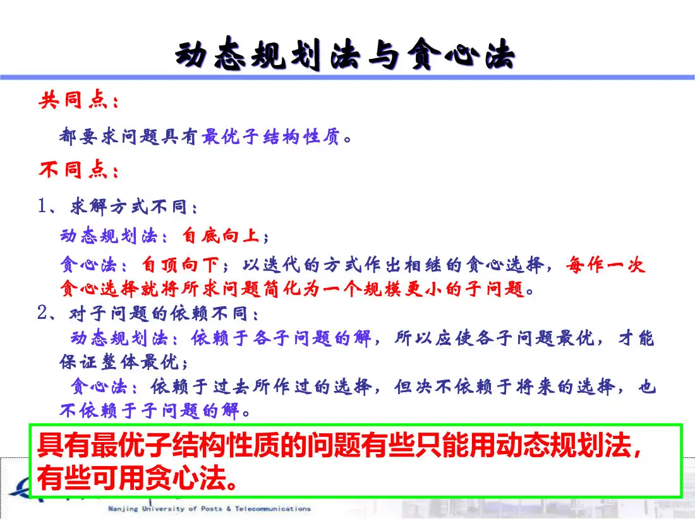

原文：

动态规划法与贪心法

共同点：

都要求问题具有最优子结构性质。

不同点：

1、求解方式不同：

动态规划法：自底向上；

贪心法：自顶向下；以迭代的方式作出相继的贪心选择，每作一次贪心选择就将所求问题简化为一个规模更小的子问题。

2、对子问题的依赖不同：

动态规划法：依赖于各子问题的解，所以应使各子问题最优，才能保证整体最优；

贪心法：依赖于过去所作过的选择，但决不依赖于将来的选择，也不依赖于子问题的解。

具有最优子结构性质的问题有些只能用动态规划法，有些可用贪心法。

Nanjing University of Posts & Telecommunications

### 多段图问题

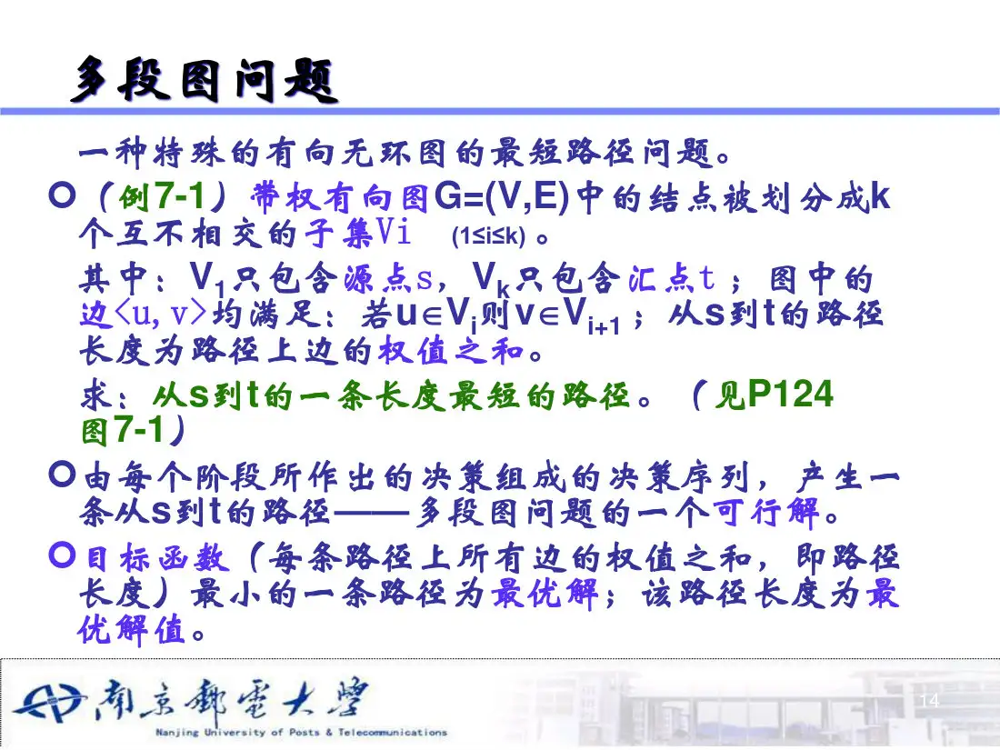

原文：

多段图问题

一种特殊的有向无环图的最短路径问题。

（例7-1）带权有向图 $\scriptstyle \mathbf { G } = ( \lor , \mathbf { E } )$ 中的结点被划分成k个互不相交的子集Vi (1≤i≤k) 。

其中： $v _ { 1 } \cdot$ 包含源点s， $v _ { k } \cdot \frac { a } { 2 }$ 包含汇点t ；图中的边<u,v>均满足：若 $\mathbf { u } \in \mathbb { V } _ { \mathrm { i } }$ i则 $\mathsf { v } \in \mathsf { V } _ { \mathsf { i } + 1 }$ ；从s到t的路径长度为路径上边的权值之和。

求：从s到t的一条长度最短的路径。（见P124图7-1）

由每个阶段所作出的决策组成的决策序列，产生一条从s到t的路径——多段图问题的一个可行解。

目标函数（每条路径上所有边的权值之和，即路径长度）最小的一条路径为最优解；该路径长度为最优解值。

安南京郵電大学

Nanjing University of Posts & Telecommunications

### 15

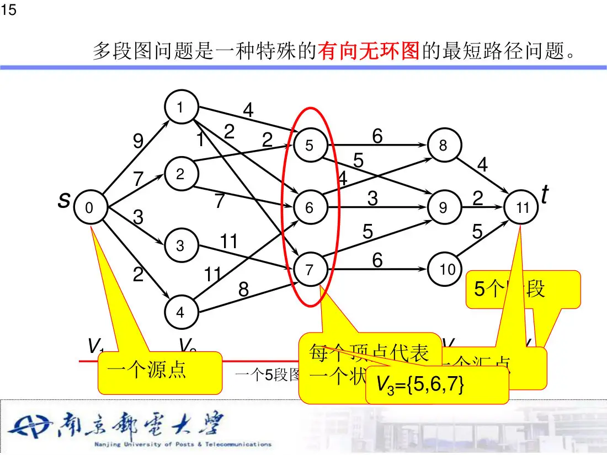

原文：

15

多段图问题是一种特殊的有向无环图的最短路径问题。

安南京郵電大学 Nanjing University of Posts & Telecommunications

### 多段图的最优子结构证明

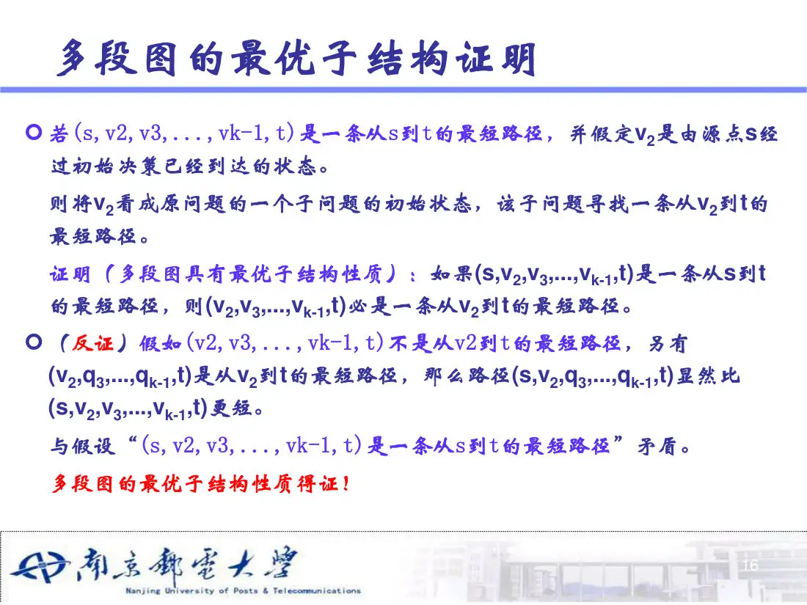

原文：

多段图的最优子结构证明

 若 $( \mathrm { s } , \mathrm { v } 2 , \mathrm { v } 3 , \ldots , \mathrm { v } \mathrm { k } - 1$ ,t)是一条从s到t的最短路径，并假定 $\mathbf { v } _ { 2 }$ 是由源点s经过初始决策已经到达的状态。

则将 $\mathbf { v } _ { 2 }$ 看成原问题的一个子问题的初始状态，该子问题寻找一条从 $\mathbf { { \nabla } } \cdot \mathbf { { \vec { v } } } _ { 2 }$ 到t的最短路径。

证明（多段图具有最优子结构性质）：如果 $( s , v _ { 2 } , v _ { 3 } , \ldots , v _ { k - 1 }$ ,t)是一条从s到t的最短路径，则 $( \mathsf { v } _ { 2 } , \mathsf { v } _ { 3 } , \ldots , \mathsf { v } _ { \mathbf { k } - 1 } , \mathsf { t } )$ 必是一条从 $\mathbf { { \boldsymbol { v } } } _ { 2 }$ 到t的最短路径。

 （反证）假如 $( \mathrm { v } 2 , \mathrm { v } 3 , \dots , \mathrm { v } \mathrm { k } - 1$ ,t)不是从v2到t的最短路径，另有$( \mathsf { v } _ { 2 } , \mathsf { q } _ { 3 } , \hdots , \mathsf { q } _ { \mathrm { k } - 1 } , \mathsf { t } )$ 是从 $\mathbf { { \boldsymbol { v } } } _ { 2 }$ 到t的最短路径，那么路径 $( s , v _ { 2 } , q _ { 3 } , \ldots , q _ { k - 1 } , t )$ 显然比$( s , v _ { 2 } , v _ { 3 } , \ldots , v _ { k - 1 } )$ t)更短。

与假设 ${ } ^ { \mathfrak { a } } ( \mathrm { s } , \mathrm { v } 2 , \mathrm { v } 3 , \ldots , \mathrm { v } \mathrm { k } { - } 1$ ,t)是一条从s到t的最短路径”矛盾。

多段图的最优子结构性质得证！

16

安南京郵電大学 Nanjing University of Posts & Telecommunications

### 多段图问题的递推式（向前递推）

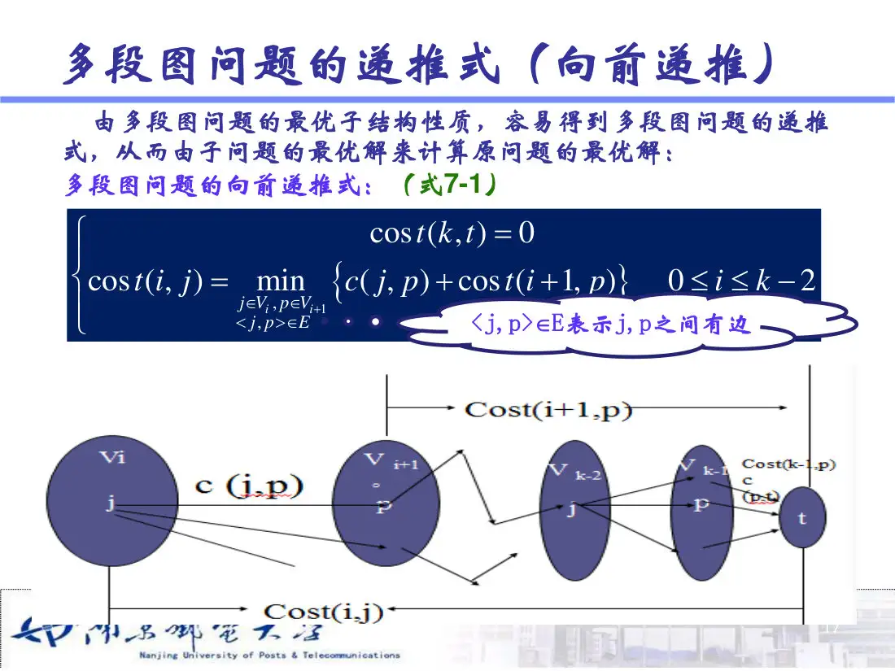

原文：

多段图问题的递推式（向前递推）

由多段图问题的最优子结构性质，容易得到多段图问题的递推式，从而由子问题的最优解来计算原问题的最优解：

多段图问题的向前递推式：（式7-1）

$$
\cos t (k, t) = 0
$$

cos ( , ) mint i j = {c( j, p) + cos t(i + 1, p)} \_0 ≤ i ≤ k − 2 j∈V ,p∈V <j,p>∈E <j,p>E表示j,p之间有边

$$
\operatorname{Cost} (\mathrm{i} + 1, \mathrm{p}) -
$$

最短路径的

$$
\operatorname{Cost} (i, j)
$$

印閘京哪電不學

Nanjing University of Posts & Telecommunications

### 第 18 页

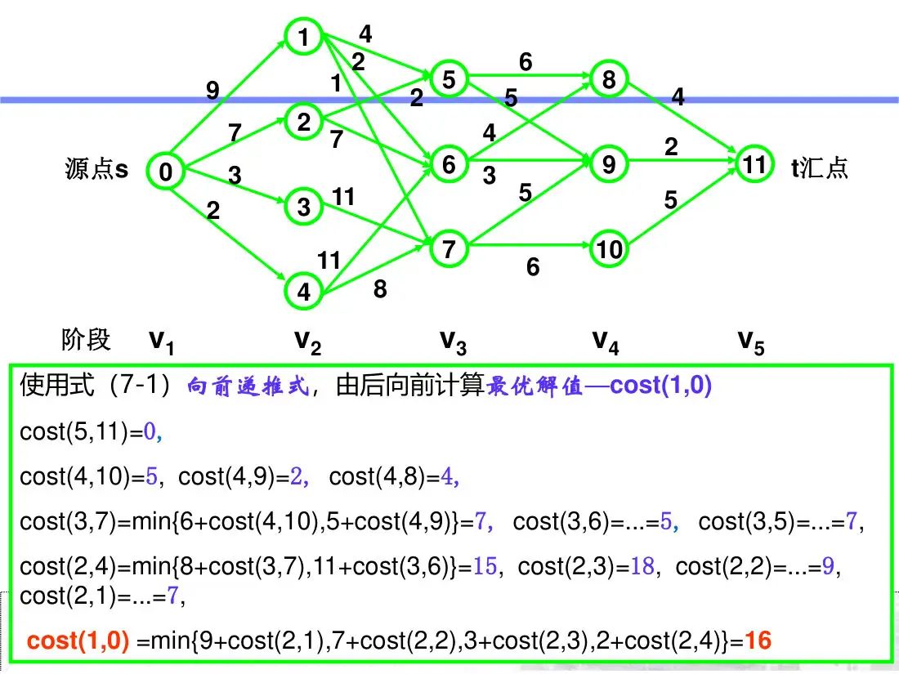

### 若想求最优解，必须在计算最优解值的过程中保存一些必要信息。

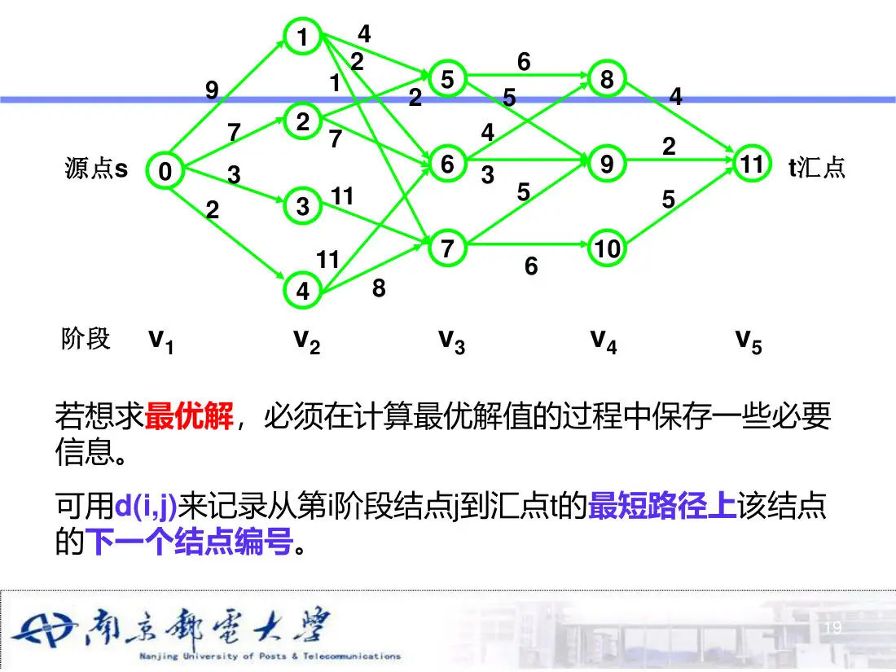

原文：

若想求最优解，必须在计算最优解值的过程中保存一些必要信息。

可用d(i,j)来记录从第i阶段结点j到汇点t的最短路径上该结点的下一个结点编号。

安南京郵電大学 Nanjing University of Posts & Telecommunications

### 很容易从d的值确定最短路径上的结点，可得两条最短路径：

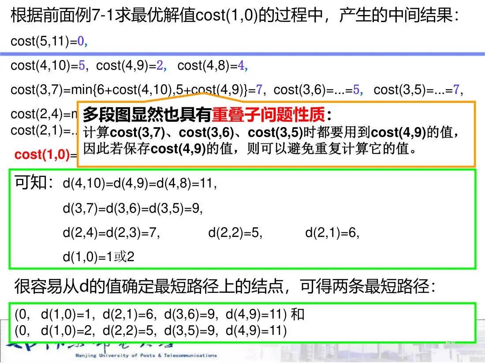

原文：

很容易从d的值确定最短路径上的结点，可得两条最短路径：

### 程序7-1：多段图的向前递推动态规划算法

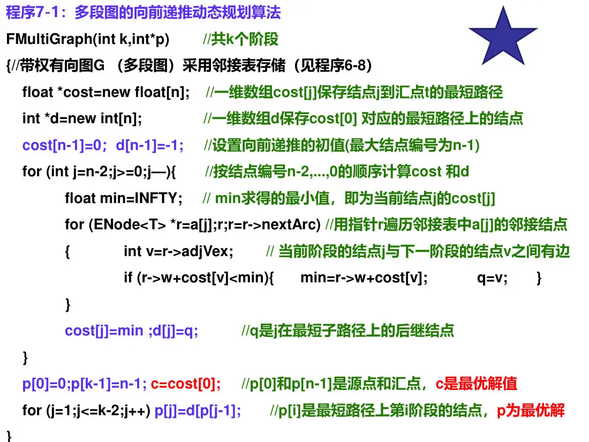

原文：

程序7-1：多段图的向前递推动态规划算法

### $$

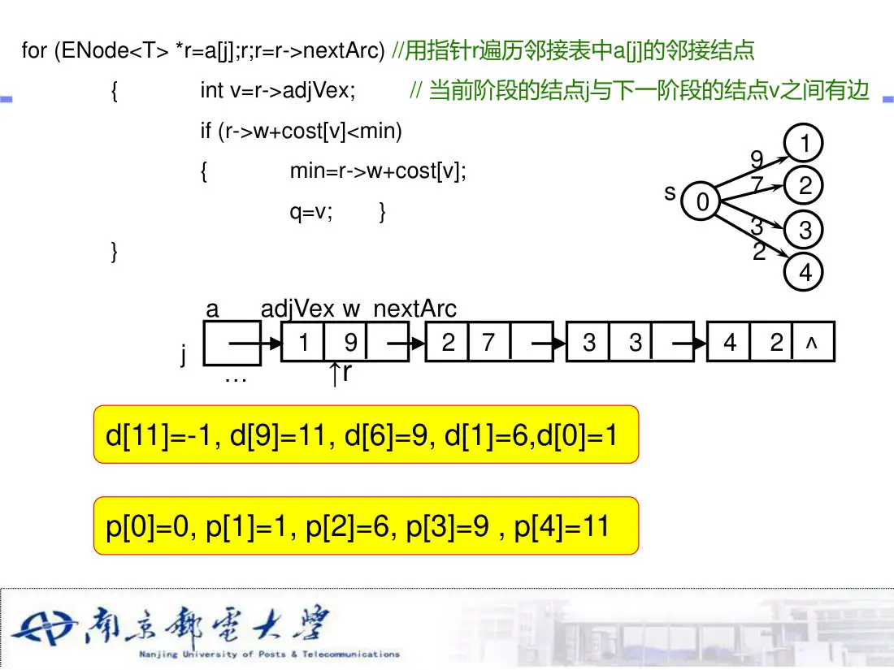

原文：

$$
\mathrm{d} [ 1 1 ] = - 1, \mathrm{d} [ 9 ] = 1 1, \mathrm{d} [ 6 ] = 9, \mathrm{d} [ 1 ] = 6, \mathrm{d} [ 0 ] = 1
$$

$$
p [ 0 ] = 0, p [ 1 ] = 1, p [ 2 ] = 6, p [ 3 ] = 9, p [ 4 ] = 1 1
$$

安南京郵電大学 Nanjing University of Posts & Telecommunications

### 23

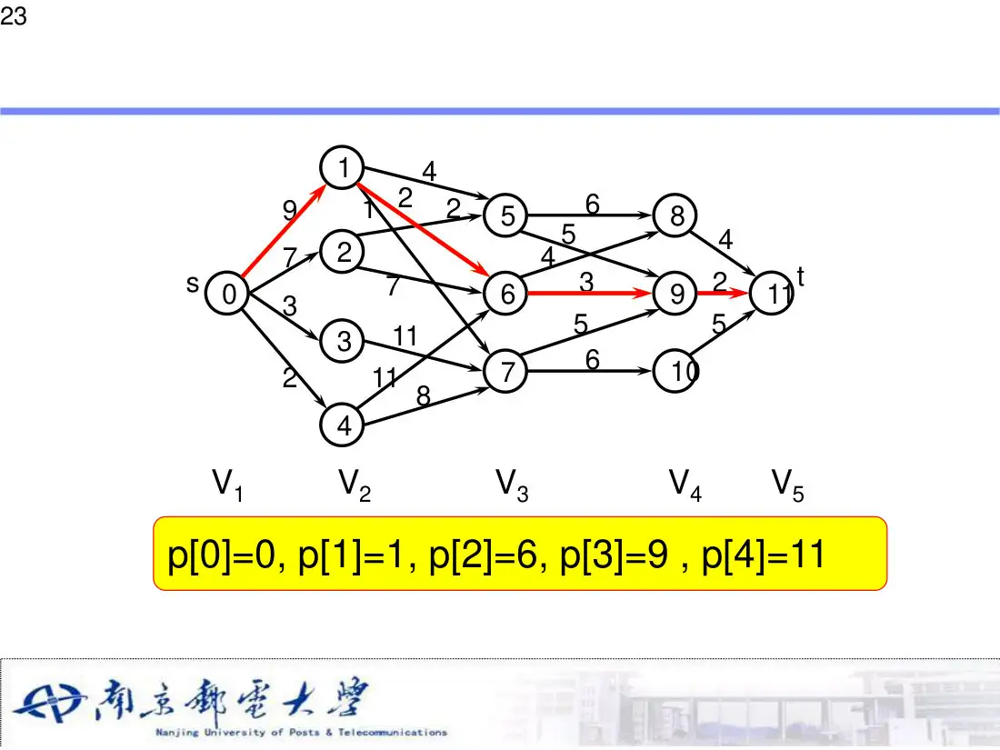

原文：

23

安南京郵電大学 Nanjing University of Posts & Telecommunications

### 多段图问题的递推式（向后递推）

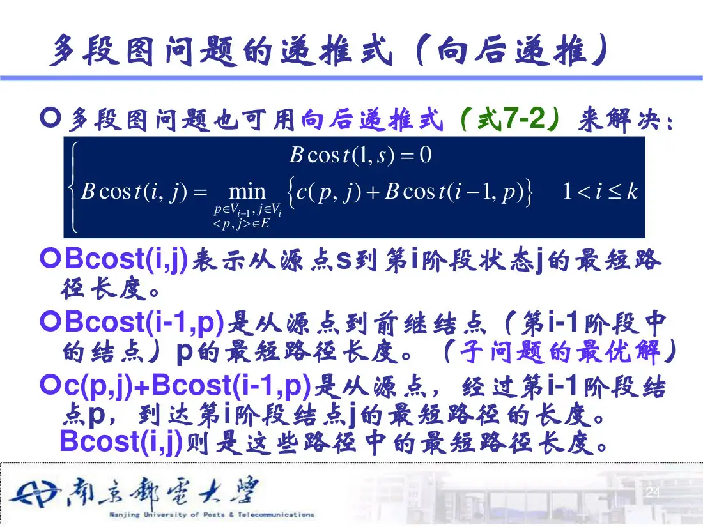

原文：

多段图问题的递推式（向后递推）

多段图问题也可用向后递推式（式7-2）来解决：

$$
\left\{ \begin{array}{c}B\cos t(1,s) = 0\\ B\cos t(i,j) = \min_{\substack{p\in V_{i - 1},j\in V_{i}\\ <  p,j > \in E}}\left\{c(p,j) + B\cos t(i - 1,p)\right\} \quad 1 <   i\leq k \end{array} \right.
$$

Bcost(i,j)表示从源点s到第i阶段状态j的最短路径长度。

Bcost(i-1,p)是从源点到前继结点（第i-1阶段中的结点）p的最短路径长度。（子问题的最优解）

c(p,j)+Bcost(i-1,p)是从源点，经过第i-1阶段结点p，到达第i阶段结点j的最短路径的长度。Bcost(i,j)则是这些路径中的最短路径长度。

分南京郵電大学

Nanjing University of Posts & Telecommunications

### 多段图问题的应用——资源分配问题

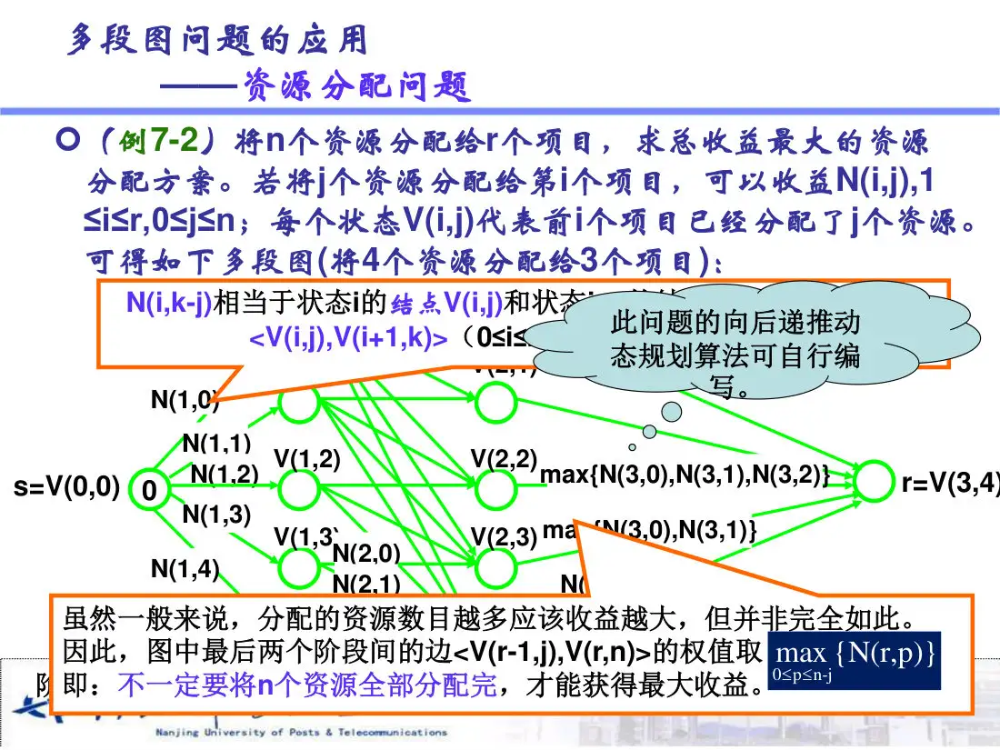

原文：

多段图问题的应用——资源分配问题

（例7-2）将n个资源分配给r个项目，求总收益最大的资源分配方案。若将j个资源分配给第i个项目，可以收益N(i,j),1≤i≤r,0≤j≤n；每个状态V(i,j)代表前i个项目已经分配了j个资源。可得如下多段图(将4个资源分配给3个项目)：

此问题的向后递推动 态规划算法可自行编

V(1,4) V(2,4)虽然一般来说，分配的资源数目越多应该收益越大，但并非完全如此。N(2,0)因此，图中最后两个阶段间的边<V(r-1,j),V(r,n)>的权值取 max {N(r,p)}段 v v v即：不一定要将n个资源全部分配完，才能获得最大收益。 0≤p≤n-j

Nanjing University of Posts & Telecommunications

### 多段图问题的应用——关键路径问题

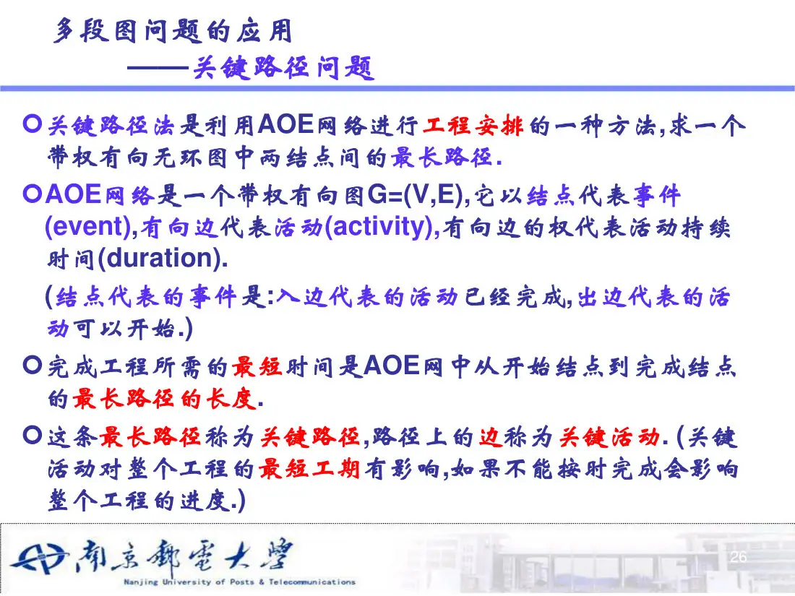

原文：

多段图问题的应用——关键路径问题

关键路径法是利用AOE网络进行工程安排的一种方法,求一个带权有向无环图中两结点间的最长路径.

AOE网络是一个带权有向图G=(V,E),它以结点代表事件(event),有向边代表活动(activity),有向边的权代表活动持续时间(duration).

(结点代表的事件是:入边代表的活动已经完成,出边代表的活动可以开始.)

完成工程所需的最短时间是AOE网中从开始结点到完成结点的最长路径的长度.

这条最长路径称为关键路径,路径上的边称为关键活动. (关键活动对整个工程的最短工期有影响,如果不能按时完成会影响整个工程的进度.)

安南京郵電大学 Nanjing University of Posts & Telecommunications

26

### 个工程结束.)

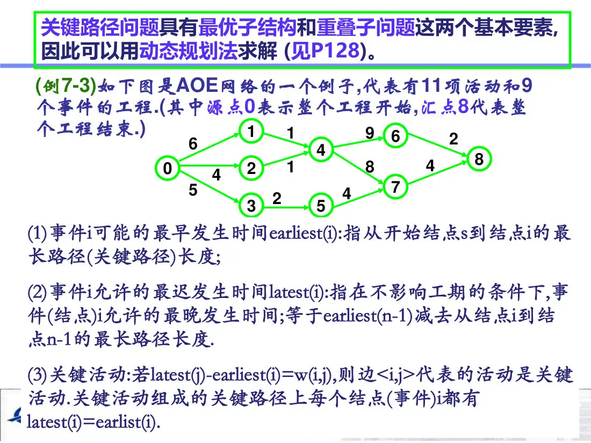

原文：

关键路径问题具有最优子结构和重叠子问题这两个基本要素,因此可以用动态规划法求解 (见P128)。

(例7-3)如下图是AOE网络的一个例子,代表有11项活动和9个事件的工程.(其中源点0表示整个工程开始,汇点8代表整

个工程结束.)

(1)事件i可能的最早发生时间earliest(i):指从开始结点s到结点i的最长路径(关键路径)长度;

(2)事件i允许的最迟发生时间latest(i):指在不影响工期的条件下,事件(结点)i允许的最晚发生时间;等于earliest(n-1)减去从结点i到结点n-1的最长路径长度.

(3)关键活动:若latest(j)-earliest(i)=w(i,j),则边<i,j>代表的活动是关键活动.关键活动组成的关键路径上每个结点(事件)i都有$\mathrm { l a t e s t ( i ) { = } e a r l i s t ( i ) }$

### 关键路径算法的基本步骤:

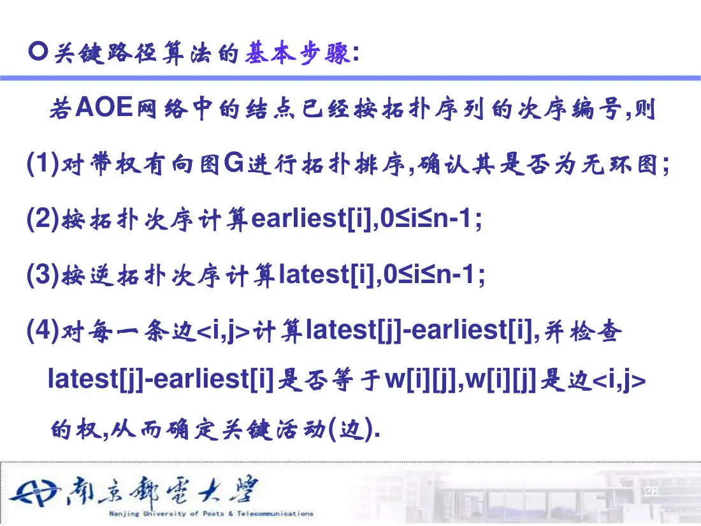

原文：

关键路径算法的基本步骤:

若AOE网络中的结点已经按拓扑序列的次序编号,则

(1)对带权有向图G进行拓扑排序,确认其是否为无环图;

(2)按拓扑次序计算earliest[i],0≤i≤n-1;

(3)按逆拓扑次序计算latest[i],0≤i≤n-1;

(4)对每一条边<i,j>计算latest[j]-earliest[i],并检查latest[j]-earliest[i]是否等于w[i][j],w[i][j]是边<i,j>的权,从而确定关键活动(边).

安南京郵電大学 Nanjing University of Posts & Telecommunications

28

### ◆从前向后递推求earliest(j):

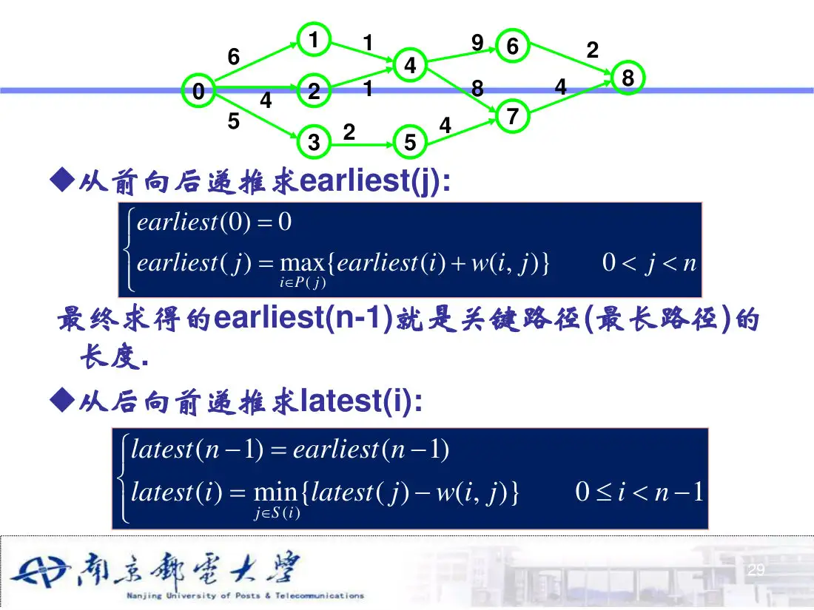

原文：

◆从前向后递推求earliest(j):

$$
e a r l i e s t (0) = 0
$$

$$
\operatorname{earliest} (j) = \max _ {i \in P (j)} \left\{\operatorname{earliest} (i) + w (i, j) \right\}
$$

$$
0 <   j <   n
$$

最终求得的earliest(n-1)就是关键路径(最长路径)的长度.

◆从后向前递推求latest(i):

$$
l a t e s t (n - 1) = e a r l i e s t (n - 1)
$$

$$
\operatorname{latest} (i) = \min _ {j \in S (i)} \left\{\operatorname{latest} (j) - w (i, j) \right\}
$$

$$
0 \leq i <   n - 1
$$

安南京郵電大学 Nanjing University of Posts & Telecommunications

29

### 如 $\lvert :  ,  ,  ,$ 就是关键活动.

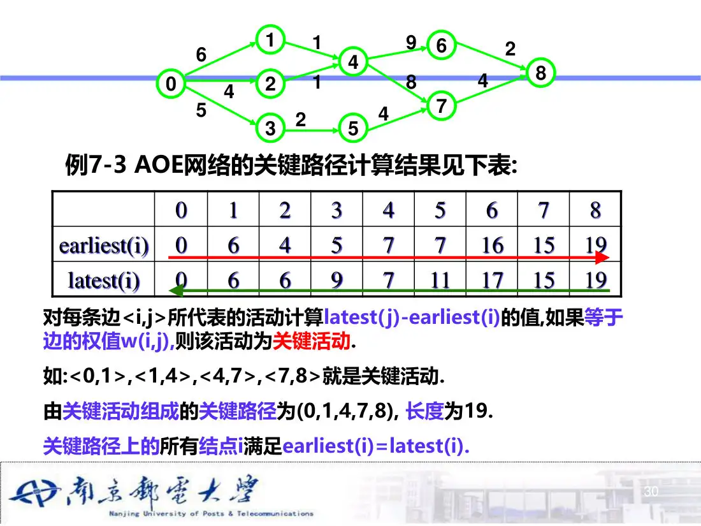

原文：

<table><tr><td></td><td>0</td><td>1</td><td>2</td><td>3</td><td>4</td><td>5</td><td>6</td><td>7</td><td>8</td></tr><tr><td>earliest(i)</td><td>0</td><td>6</td><td>4</td><td>5</td><td>7</td><td>7</td><td>16</td><td>15</td><td>19</td></tr><tr><td>latest(i)</td><td>0</td><td>6</td><td>6</td><td>9</td><td>7</td><td>11</td><td>17</td><td>15</td><td>19</td></tr></table>

对每条边 $< \dot { \bf l } _ { I } \dot { \bf l } >$ 所代表的活动计算latest(j)-earliest(i)的值,如果等于边的权值w(i,j),则该活动为关键活动.

如 $\lvert : < 0 , 1 > , < 1 , 4 > , < 4 , 7 > , < 7 , 8 >$ 就是关键活动.

由关键活动组成的关键路径为(0,1,4,7,8), 长度为19.

关键路径上的所有结点i满足 $\mathsf { e a r l i e s t ( i ) } = \mathsf { a t e s t ( i ) }$

30

Nanjing University of Posts & Telecommunications

### $,  ,  ,  ,  ,  ,$ 是关键活动.

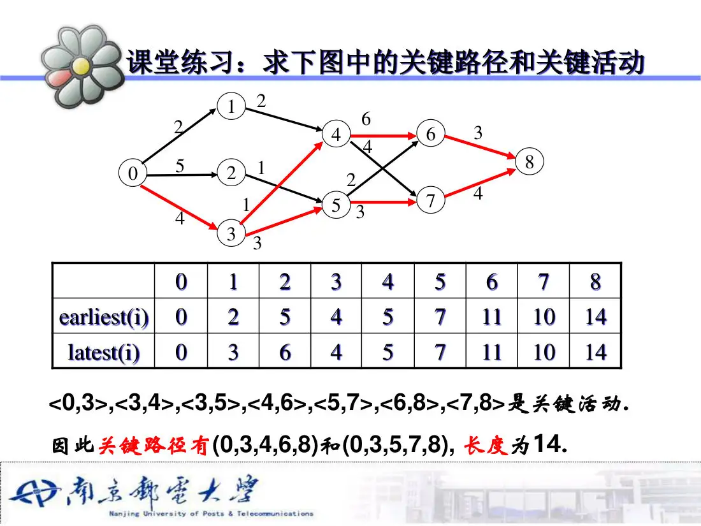

原文：

<table><tr><td></td><td>0</td><td>1</td><td>2</td><td>3</td><td>4</td><td>5</td><td>6</td><td>7</td><td>8</td></tr><tr><td>earliest(i)</td><td>0</td><td>2</td><td>5</td><td>4</td><td>5</td><td>7</td><td>11</td><td>10</td><td>14</td></tr><tr><td>latest(i)</td><td>0</td><td>3</td><td>6</td><td>4</td><td>5</td><td>7</td><td>11</td><td>10</td><td>14</td></tr></table>

$< 0 , 3 > , < 3 , 4 > , < 3 , 5 > , < 4 , 6 > , < 5 , 7 > , < 6 , 8 > , < 7 , 8 >$ 是关键活动.

因此关键路径有(0,3,4,6,8)和(0,3,5,7,8), 长度为14.

课堂练习：求下图中的关键路径和关键活动

安南京郵電大學

Nanjing University of Posts & Telecommunications

### 7.2 每对结点间的最短路径

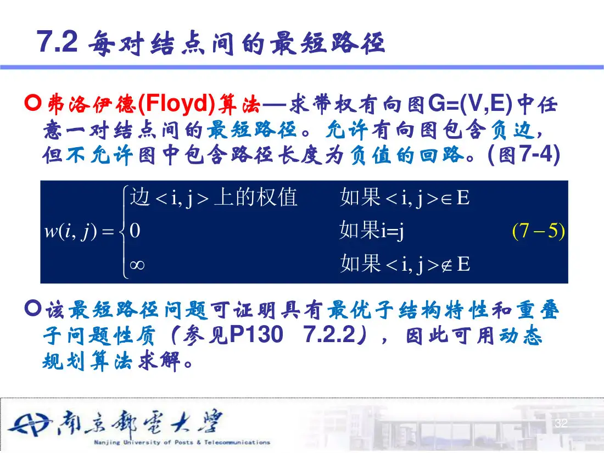

原文：

7.2 每对结点间的最短路径

弗洛伊德(Floyd)算法—求带权有向图G=(V,E)中任意一对结点间的最短路径。允许有向图包含负边，但不允许图中包含路径长度为负值的回路。(图7-4)

边 <i, j> 上的权值

$$
w (i, j) = \left\{0 \right.
$$

如果<i,j>∈E

i=j如果

(7 5)−

如果<i,j>∉E

该最短路径问题可证明具有最优子结构特性和重叠子问题性质（参见P130 7.2.2），因此可用动态规划算法求解。

安南京郵電大学 Nanjing University of Posts & Telecommunications

32

### 最优子结构特性: 即问题的最优解包含了其子问题的最优解。

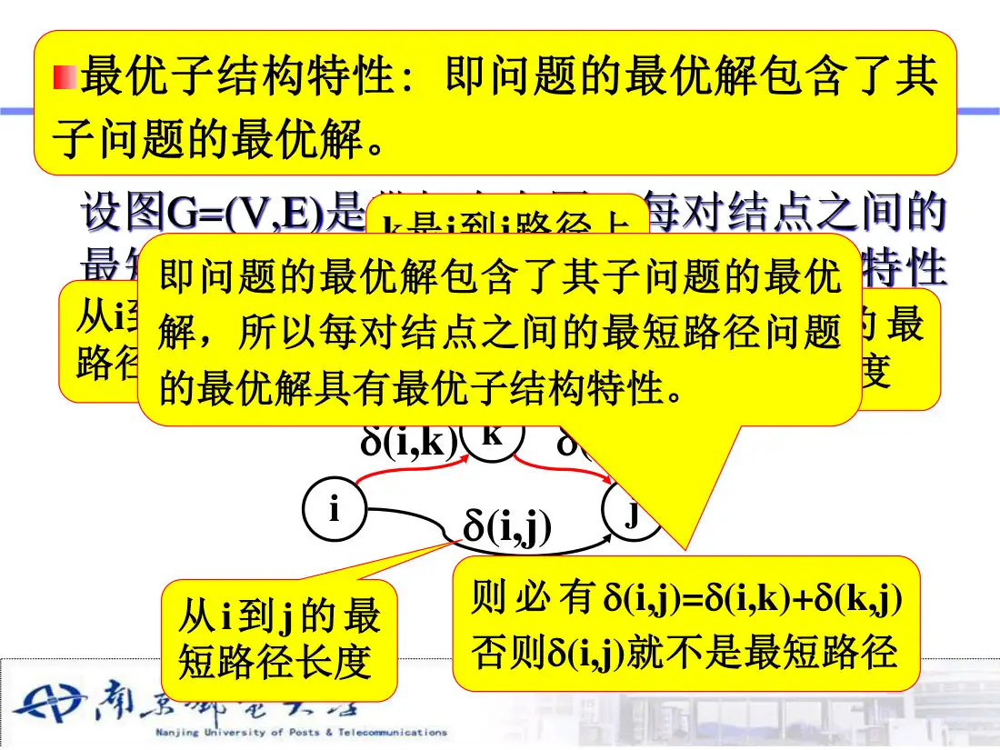

原文：

最优子结构特性: 即问题的最优解包含了其子问题的最优解。

设图G=(V,E)是带权有向图。每对结点之间的最 路径问题的最优解具有最优子结构特性的一个结点即问题的最优解包含了其子问题的最优。从i到 k的最短 从 k 到 j 的最解，所以每对结点之间的最短路径问题路径 的最优解具有最优子结构特性。 度

从i到j的最 短路径长度 (i,j)

则必有 $\delta ( \mathrm { i } , \mathrm { j } ) { = } \delta ( \mathrm { i } , \mathrm { k } ) { + } \delta ( \mathrm { k } , \mathrm { j } )$ 否则(i,j)就不是最短路径最优解（两结点间最短路径）的递推关系为：

华南京哪屯大は

Nanjing University of Posts & Telecommunications

### $$

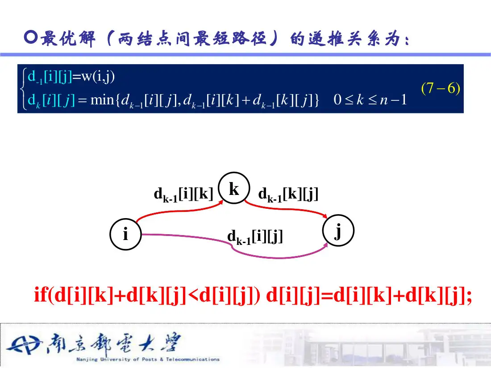

原文：

$$
\left\{ \begin{array}{l} \mathrm{d} _ {- 1} [ \mathrm{i} ] [ \mathrm{j} ] = \mathrm{w} (\mathrm{i}, \mathrm{j}) \\ \mathrm{d} _ {k} [ i ] [ j ] = \min \left\{d _ {k - 1} [ i ] [ j ], d _ {k - 1} [ i ] [ k ] + d _ {k - 1} [ k ] [ j ] \right\} \quad 0 \leq k \leq n - 1 \end{array} \right. \tag {7-6}
$$

if(d[i][k]+d[k][j]<d[i][j]) d[i][j]=d[i][k]+d[k][j];

安南京郵電大学 Nanjing University of Posts & Telecommunications

### 最优解（两结点间最短路径）的递推关系为：

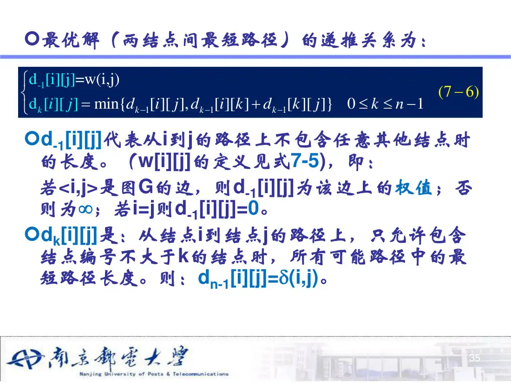

原文：

最优解（两结点间最短路径）的递推关系为：

(7 6)−

d [i][j]代表从i到j的路径上不包含任意其他结点时的长度。（w[i][j]的定义见式7-5)，即：若<i,j>是图G的边，则d [i][j]为该边上的权值；否则为；若i=j则 ${ \bf d } _ { - 1 } [ \bar { \bf { l } } ] [ \bar { \bf { l } } ] = 0$

d [i][j]是：从结点i到结点j的路径上，只允许包含结点编号不大于k的结点时，所有可能路径中的最短路径长度。则： $\mathbf { d } _ { \mathfrak { n } - 1 } [ \bar { \mathbf { l } } ] [ \bar { \mathbf { l } } ] = \delta ( \bar { \mathbf { l } } , \bar { \mathbf { l } } )$

35

安南京郵電大学 Nanjing University of Posts & Telecommunications

### 初始情况下的距离数组d：

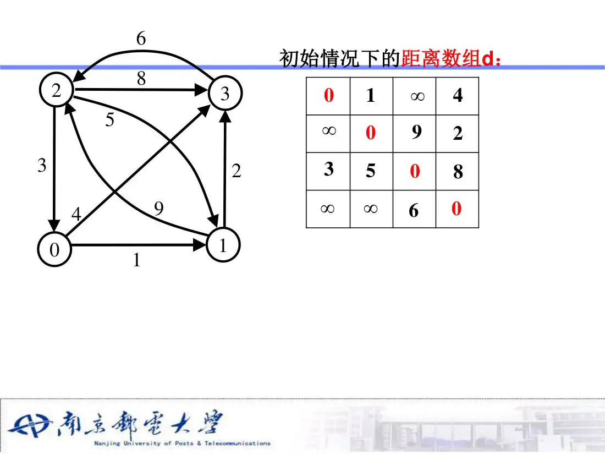

原文：

初始情况下的距离数组d：

<table><tr><td>0</td><td>1</td><td>∞</td><td>4</td></tr><tr><td>∞</td><td>0</td><td>9</td><td>2</td></tr><tr><td>3</td><td>5</td><td>0</td><td>8</td></tr><tr><td>∞</td><td>∞</td><td>6</td><td>0</td></tr></table>

安南京郵電大学 Nanjing University of Posts & Telecommunications

### 距离数组 $\mathbf { d _ { 0 } } [ ] [ ] :$ ：

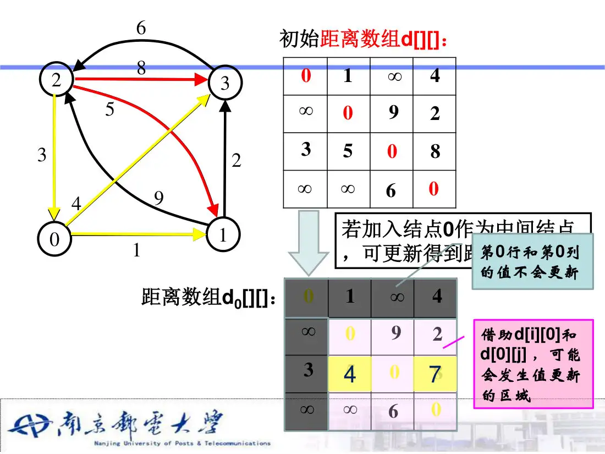

原文：

距离数组 $\mathbf { d _ { 0 } } [ ] [ ] :$ ：

初始距离数组d[][]：

<table><tr><td></td><td></td><td></td><td></td></tr><tr><td>0</td><td>1</td><td>∞</td><td>4</td></tr><tr><td>∞</td><td>0</td><td>9</td><td>2</td></tr><tr><td>3</td><td>5</td><td>0</td><td>8</td></tr><tr><td>∞</td><td>∞</td><td>6</td><td>0</td></tr></table>

若加入结点0作为中间结点，可更新得到距 离数组d ：第0行和第0列的值不会更新

<table><tr><td>0</td><td>1</td><td>∞</td><td>4</td></tr><tr><td>∞</td><td>0</td><td>9</td><td>2</td></tr><tr><td>3</td><td>4</td><td>0</td><td>7</td></tr><tr><td>∞</td><td>∞</td><td>6</td><td>0</td></tr></table>

借助d[i][0]和d[0][j] ，可能会发生值更新的区域

安南京郵電大学

Nanjing University of Posts & Telecommunications

### 01∞4∞0923407∞∞60

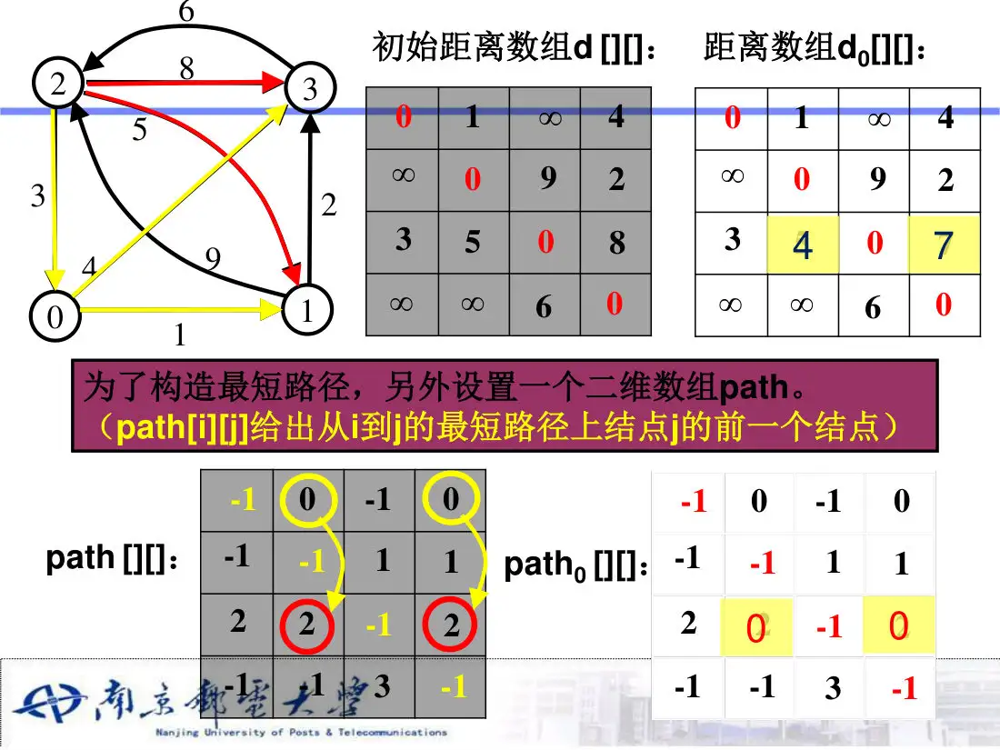

原文：

初始距离数组d [][]： 距离数组 $\mathbf { d _ { 0 } } [ ] [ ]$

<table><tr><td>0</td><td>1</td><td> $\infty$ </td><td>4</td></tr><tr><td> $\infty$ </td><td>0</td><td>9</td><td>2</td></tr><tr><td>3</td><td>5</td><td>0</td><td>8</td></tr><tr><td> $\infty$ </td><td> $\infty$ </td><td>6</td><td>0</td></tr></table>

<table><tr><td>0</td><td>1</td><td>∞</td><td>4</td></tr><tr><td>∞</td><td>0</td><td>9</td><td>2</td></tr><tr><td>3</td><td>4</td><td>0</td><td>7</td></tr><tr><td>∞</td><td>∞</td><td>6</td><td>0</td></tr></table>

为了构造最短路径，另外设置一个二维数组path。（path[i][j]给出从i到j的最短路径上结点j的前一个结点）

path [][]：

$$
\mathsf {p a t h} _ {0} [ ] [ ]:
$$

Nanjing University of Posts & Telecommunications

### 第 39 页

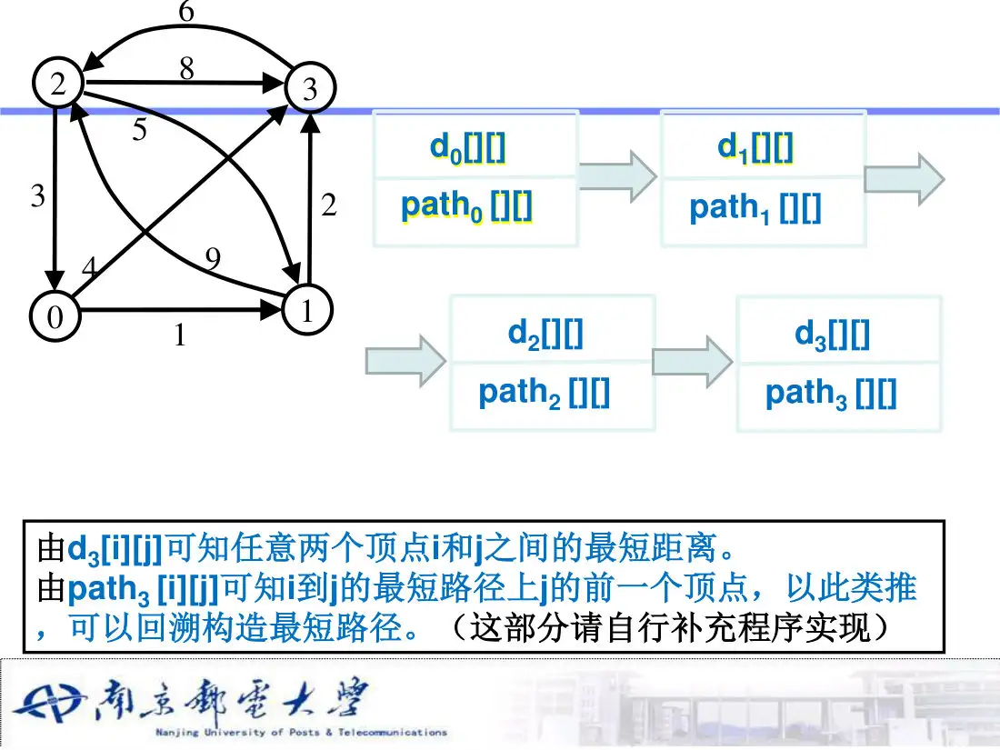

原文：

由d [i][j]可知任意两个顶点i和j之间的最短距离。由path [i][j]可知i到j的最短路径上j的前一个顶点，以此类推，可以回溯构造最短路径。（这部分请自行补充程序实现）

安南京郵電大学 Nanjing University of Posts & Telecommunications

### 第 40 页

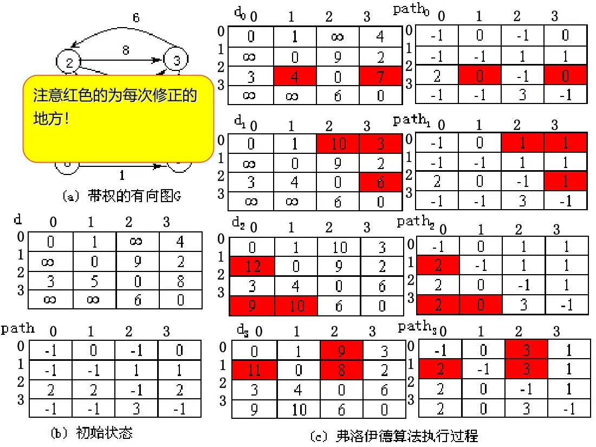

### 程序7-2 弗洛伊德算法解两结点间最短路径问题

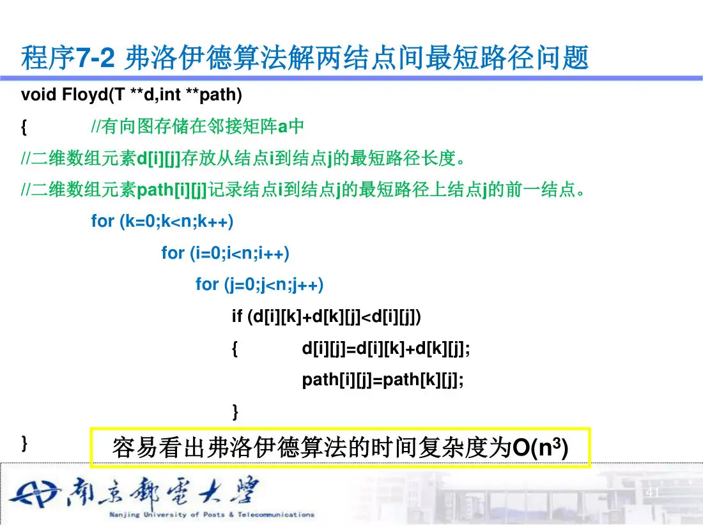

原文：

程序7-2 弗洛伊德算法解两结点间最短路径问题

### 弗洛伊德算法的正确性证明

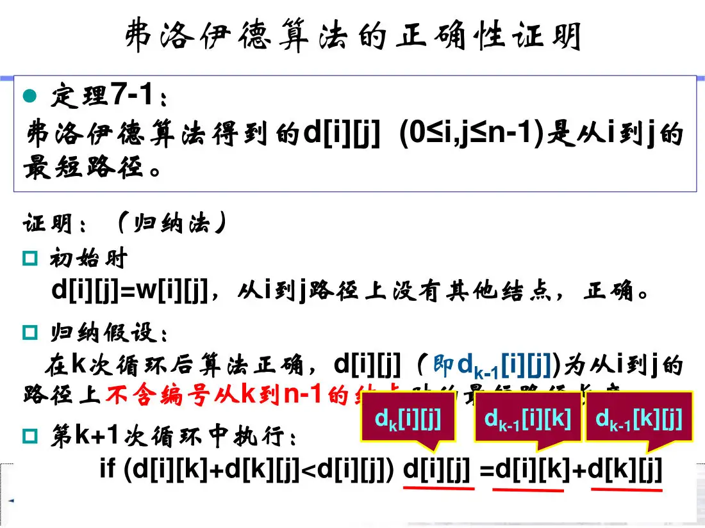

原文：

弗洛伊德算法的正确性证明

⚫ 定理7-1：

弗洛伊德算法得到的d[i][j] (0≤i,j≤n-1)是从i到j的最短路径。

证明：（归纳法）

 初始时$\mathsf { d } [ \bar { \mathsf { I } } ] [ \bar { \mathsf { J } } ] = \mathsf { w } [ \bar { \mathsf { I } } ] [ \bar { \mathsf { J } } ]$ ，从i到j路径上没有其他结点，正确。

 归纳假设：

在k次循环后算法正确，d[i][j]（ ${ \bf d } _ { { \bf k } - 1 } [ [ \bar { \bf l } ] [ \bar { \bf l } ] )$ 为从i到j的路径上不含编号从k到n-1的结点时的 日

 第k+1次循环中执行：

$$
\mathsf {d} _ {\mathsf {k - 1}} [ \mathsf {i} ] [ \mathsf {k} ]
$$

$$
\mathsf {d} _ {\mathsf {k - 1}} [ \mathsf {k} ] [ \mathsf {j} ]
$$

if (d[i][k]+d[k][j]<d[i][j]) d[i][j] =d[i][k]+d[k][j]

### 弗洛伊德算法的正确性证明

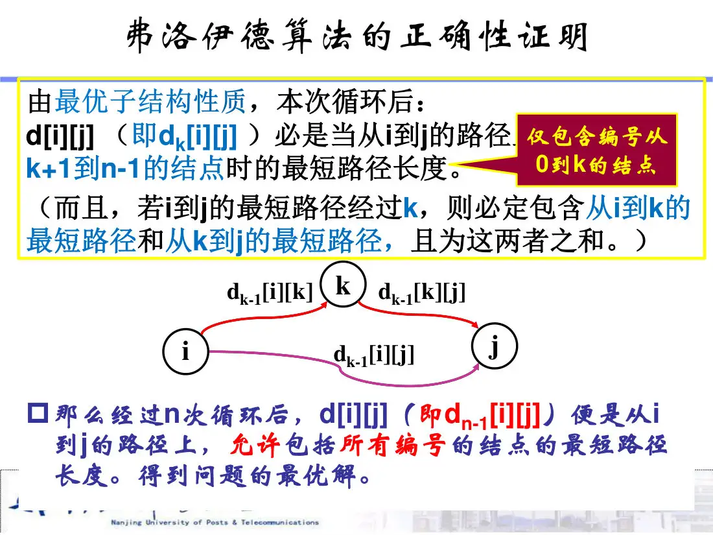

原文：

弗洛伊德算法的正确性证明

由 ，本次循环后：

d[i][j] （即 ${ \bf d } _ { \bf k } [ \bar { \bf l } ] [ \bar { \bf l } ]$ ）必是当从i到j的路径 上不含编号为仅包含编号从k+1到n-1的结点时的最短路径长度。 0到k的结点

（而且，若i到j的最短路径经过k，则必定包含从i到k的最短路径和从k到j的最短路径，且为这两者之和。）

那么经过n次循环后，d[i][j] $( \beta \ p \mathsf { d } _ { \mathsf { n } - 1 } [ \bar { \mathsf { u } } ] [ \bar { \mathsf { u } } ] )$ 便是从i到j的路径上，允许包括所有编号的结点的最短路径长度。得到问题的最优解。

Nanjing University of Posts & Telecommunications

### 7.3 矩阵连乘

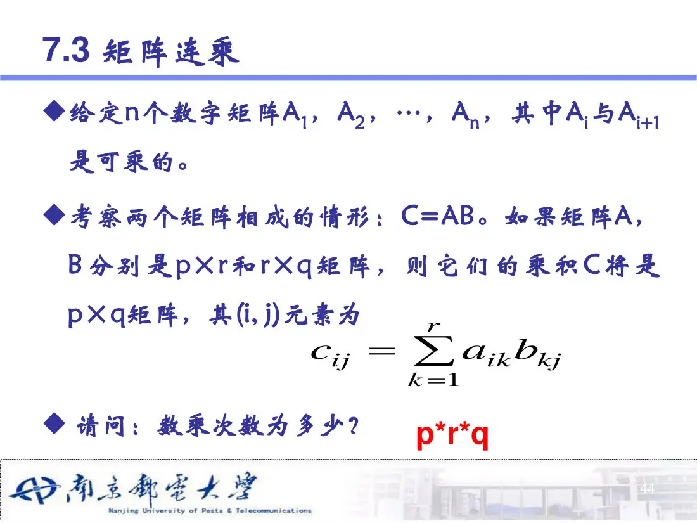

原文：

7.3 矩阵连乘

◆给定n个数字矩阵 $\mathsf { A } _ { 1 }$ ， $\mathsf { A } _ { 2 }$ ，…， $A _ { n }$ ，其中 $A _ { i }$ 与 $A _ { i + 1 }$ 是可乘的。

◆考察两个矩阵相成的情形： $C = A B$ 。如果矩阵A，

B分别是p×r和r×q矩阵，则它们的乘积C将是

p×q矩阵，其(i, j)元素为

$$
c _ {i j} = \sum_ {k = 1} ^ {r} a _ {i k} b _ {k j}
$$

◆ 请问：数乘次数为多少？ p\*r\*q◆如果有至少3个以上的矩阵连乘则涉及到乘积次序问题，即加括号方法。

安南京郵電大学 Nanjing University of Posts & Telecommunications

### 第 45 页

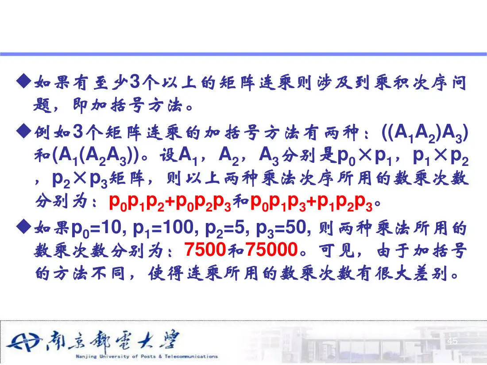

原文：

◆例如3个矩阵连乘的加括号方法有两种： $( ( \mathsf { A } _ { 1 } \mathsf { A } _ { 2 } ) \mathsf { A } _ { 3 } )$ 和 $( \mathsf { A } _ { 1 } ( \mathsf { A } _ { 2 } \mathsf { A } _ { 3 } ) )$ 。设 $\mathbf { A } _ { 1 } , \mathbf { A } _ { 2 } , \mathbf { A } _ { 3 }$ 分别是 $\mathsf { p } _ { 0 } \times \mathsf { p } _ { 1 } , \mathsf { p } _ { 1 } \times \mathsf { p } _ { 2 }$ ${ \mathsf p } _ { 2 } \times { \mathsf p } _ { 3 }$ 矩阵，则以上两种乘法次序所用的数乘次数分别为： $p _ { 0 } p _ { 1 } p _ { 2 } + p _ { 0 } p _ { 2 } p _ { 3 } \not = 0 , p _ { 0 } p _ { 1 } p _ { 3 } + p _ { 1 } p _ { 2 } p _ { 3 } \circ$

◆如果 $p _ { 0 } = 1 0 , p _ { 1 } = 1 0 0 , p _ { 2 } = 5 , p _ { 3 } = 5 0$ , 则两种乘法所用的数乘次数分别为：7500和75000。可见，由于加括号的方法不同，使得连乘所用的数乘次数有很大差别。

安南京郵電大学 Nanjing University of Posts & Telecommunications

### ◆ 完全加括号的矩阵连乘积可递归地定义为：

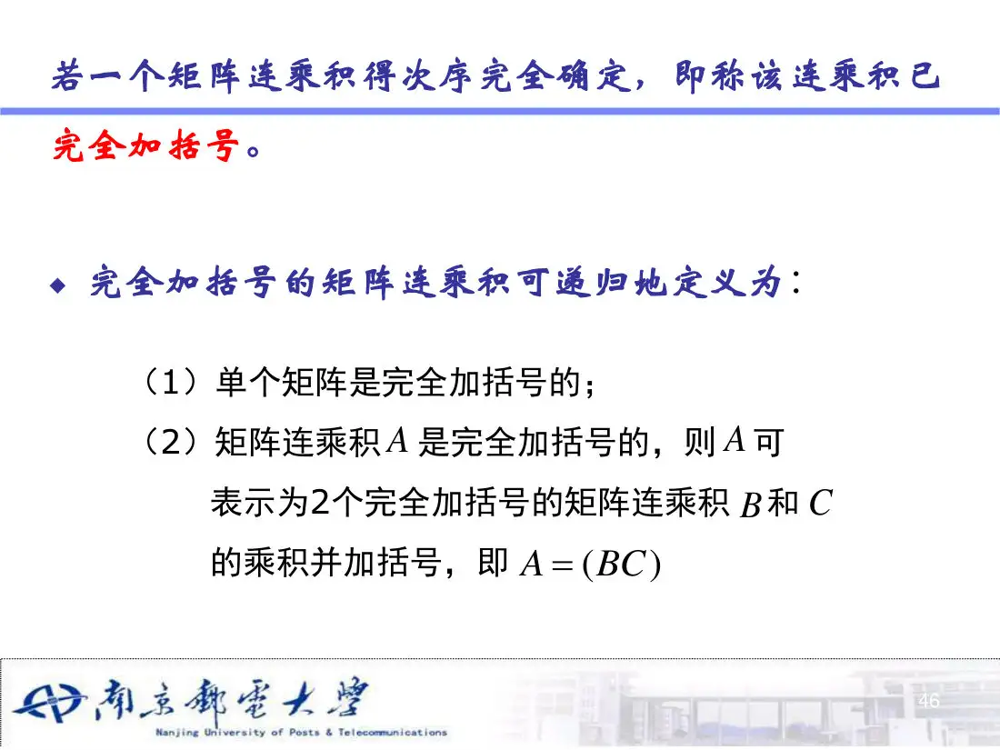

原文：

◆ 完全加括号的矩阵连乘积可递归地定义为：

（1）单个矩阵是完全加括号的；

（2）矩阵连乘积 是完全加括号的，则 可A A表示为2个完全加括号的矩阵连乘积 和B C的乘积并加括号，即 $A = ( B C )$

若一个矩阵连乘积得次序完全确定，即称该连乘积已

安南京郵電大学 Nanjing University of Posts & Telecommunications

46

### 矩阵连乘问题

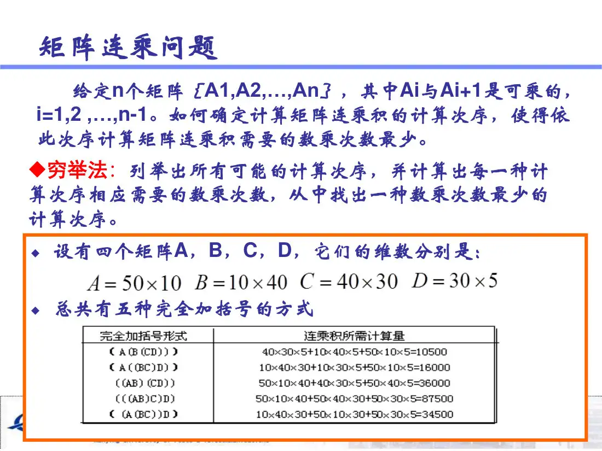

原文：

矩阵连乘问题

给定n个矩阵 $\{ \mathsf { A } 1 , \mathsf { A } 2 , \hdots , \mathsf { A } \mathsf { n } 3$ ，其中Ai与Ai+1是可乘的，$i = 1 , 2 , \ldots , n - 1$ 。如何确定计算矩阵连乘积的计算次序，使得依此次序计算矩阵连乘积需要的数乘次数最少。

◆穷举法：列举出所有可能的计算次序，并计算出每一种计算次序相应需要的数乘次数，从中找出一种数乘次数最少的计算次序。

◆ 设有四个矩阵A，B，C，D，它们的维数分别是：

$$
A = 5 0 \times 1 0 B = 1 0 \times 4 0 C = 4 0 \times 3 0 D = 3 0 \times 5
$$

◆ 总共有五种完全加括号的方式

<table><tr><td>完全加括号形式</td><td>连乘积所需计算量</td></tr><tr><td>(A(B(CD)))</td><td>40×30×5+10×40×5+50×10×5=10500</td></tr><tr><td>(A(BC)D))</td><td>10×40×30+10×30×5+50×10×5=16000</td></tr><tr><td>((AB)(CD))</td><td>50×10×40+40×30×5+50×40×5=36000</td></tr><tr><td>((AB)C)D)</td><td>50×10×40+50×40×30+50×30×5=87500</td></tr><tr><td>((A(BC))D)</td><td>10×40×30+50×10×30+50×30×5=34500</td></tr></table>

### ◆穷举法

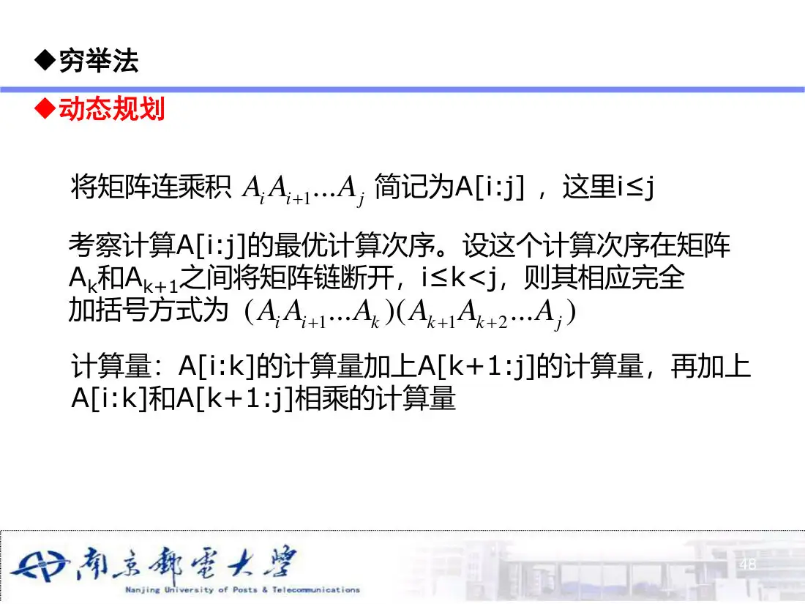

原文：

◆穷举法

动态规划

将矩阵连乘积 $A _ { i } A _ { i + 1 } . . . A _ { j }$ 简记为A[i:j] ，这里i≤j

考察计算A[i:j]的最优计算次序。设这个计算次序在矩阵$\mathsf { A } _ { \mathsf { k } }$ 和 $\mathsf { A } _ { \mathsf { k } + 1 }$ 之间将矩阵链断开， ${ \mathrm { i } } \leq k < { \mathrm { j } }$ ，则其相应完全加括号方式为 $( A _ { i } A _ { i + 1 } . . . A _ { k } ) ( A _ { k + 1 } A _ { k + 2 } . . . A _ { j } )$

计算量：A[i:k]的计算量加上A[k+1:j]的计算量，再加上A[i:k]和A[k+1:j]相乘的计算量

48

安南京郵電大学 Nanjing University of Posts & Telecommunications

### 分析最优解的结构

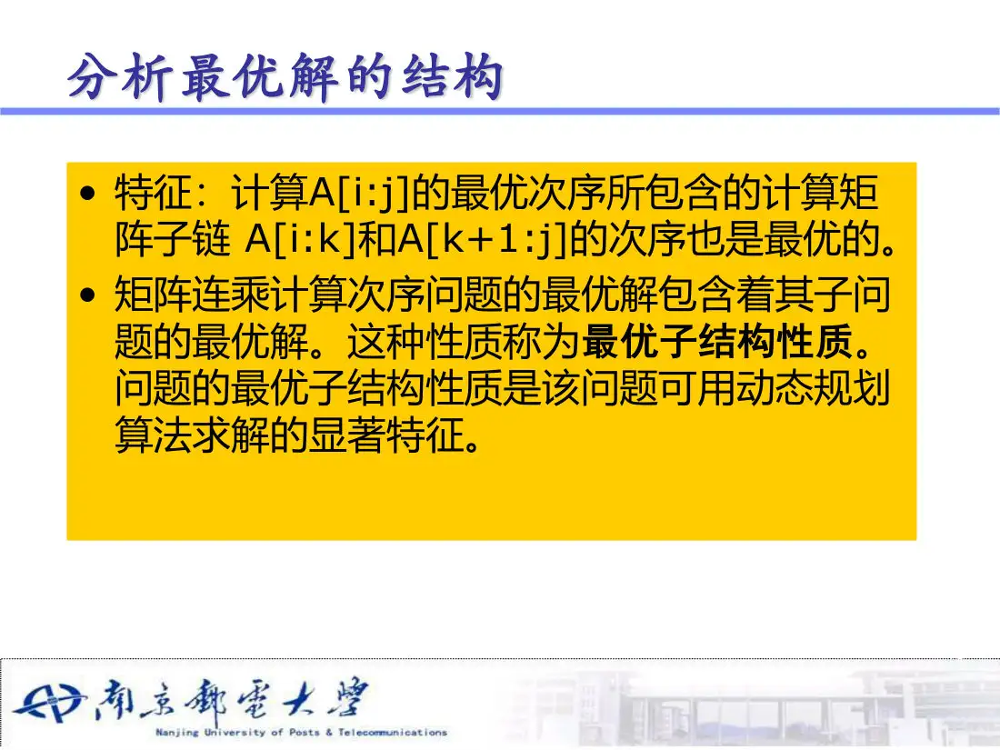

原文：

分析最优解的结构

特征：计算A[i:j]的最优次序所包含的计算矩阵子链 A[i:k]和A[k+1:j]的次序也是最优的。

矩阵连乘计算次序问题的最优解包含着其子问题的最优解。这种性质称为最优子结构性质。问题的最优子结构性质是该问题可用动态规划算法求解的显著特征。

安南京郵電大学 Nanjing University of Posts & Telecommunications

### 建立递归关系

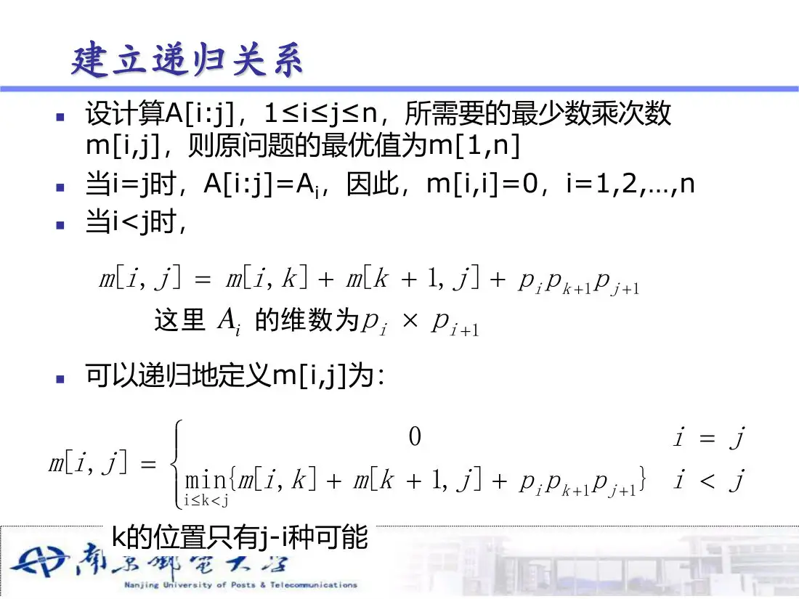

原文：

建立递归关系

◼ 设计算A[i:j]， $1 \leq i \leq j \leq n$ ，所需要的最少数乘次数$\mathsf { m } [ { \mathsf { i } } , { \mathsf { j } } ]$ ，则原问题的最优值为 $m [ 1 , n ]$

◼ 当i=j时， $A [ i ; j ] = A _ { i }$ ，因此， $\mathfrak { m } [ \mathfrak { i } , \mathfrak { i } ] = 0 , \ \mathfrak { i } = 1 , 2 , \ldots , \mathfrak { n }$

◼ 当i<j时，

$$
m [ i, j ] = m [ i, k ] + m [ k + 1, j ] + p _ {i} p _ {k + 1} p _ {j + 1}
$$

这里 $A _ { i }$ 的维数为 $p _ { i } \times p _ { i + 1 }$

◼ 可以递归地定义 $| \boldsymbol { \mathsf { m } } [ \mathsf { i } , \mathsf { j } ]$ 为：

$$
m [ i, j ] = \left\{ \begin{array}{c c} 0 & i = j \\ \min _ {i \leq k <   j} \{m [ i, k ] + m [ k + 1, j ] + p _ {i} p _ {k + 1} p _ {j + 1} \} & i <   j \end{array} \right.
$$

k的位置只有j-i种可能

Nanjing University of Posts & Telecommunications

### 计算最优值

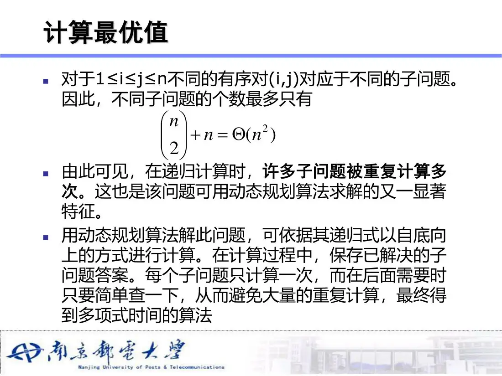

原文：

计算最优值

◼ 对于 $1 \leq i \leq j \leq n$ 不同的有序对(i,j)对应于不同的子问题。因此，不同子问题的个数最多只有

$$
\binom{n}{2} + n = \Theta (n ^ {2})
$$

◼ 由此可见，在递归计算时，许多子问题被重复计算多次。这也是该问题可用动态规划算法求解的又一显著特征。

◼ 用动态规划算法解此问题，可依据其递归式以自底向上的方式进行计算。在计算过程中，保存已解决的子问题答案。每个子问题只计算一次，而在后面需要时只要简单查一下，从而避免大量的重复计算，最终得到多项式时间的算法

安南京郵電大学 Nanjing University of Posts & Telecommunications

### 用动态规划法求最优解

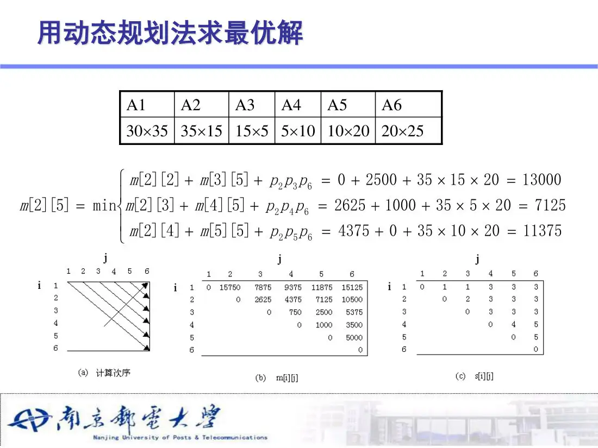

原文：

用动态规划法求最优解

<table><tr><td>A1</td><td>A2</td><td>A3</td><td>A4</td><td>A5</td><td>A6</td></tr><tr><td>30×35</td><td>35×15</td><td>15×5</td><td>5×10</td><td>10×20</td><td>20×25</td></tr></table>

$$
m [ 2 ] [ 5 ] = \min \left\{ \begin{array}{l} m [ 2 ] [ 2 ] + m [ 3 ] [ 5 ] + p _ {2} p _ {3} p _ {6} = 0 + 2 5 0 0 + 3 5 \times 1 5 \times 2 0 = 1 3 0 0 0 \\ m [ 2 ] [ 3 ] + m [ 4 ] [ 5 ] + p _ {2} p _ {4} p _ {6} = 2 6 2 5 + 1 0 0 0 + 3 5 \times 5 \times 2 0 = 7 1 2 5 \\ m [ 2 ] [ 4 ] + m [ 5 ] [ 5 ] + p _ {2} p _ {5} p _ {6} = 4 3 7 5 + 0 + 3 5 \times 1 0 \times 2 0 = 1 1 3 7 5 \end{array} \right.
$$

(b) m[i][i] (c) s[i][]
<table><tr><td></td><td>1</td><td>2</td><td>3</td><td>4</td><td>5</td><td>6</td></tr><tr><td>1</td><td>0</td><td>15750</td><td>7875</td><td>9375</td><td>11875</td><td>15125</td></tr><tr><td>2</td><td></td><td>0</td><td>2625</td><td>4375</td><td>7125</td><td>10500</td></tr><tr><td>3</td><td></td><td></td><td>0</td><td>750</td><td>2500</td><td>5375</td></tr><tr><td>4</td><td></td><td></td><td></td><td>0</td><td>1000</td><td>3500</td></tr><tr><td>5</td><td></td><td></td><td></td><td></td><td>0</td><td>5000</td></tr><tr><td>6</td><td></td><td></td><td></td><td></td><td></td><td>0</td></tr></table>

$$
\begin{array}{c c c c c c c c} & & \text {j} \\ & & 1 & 2 & 3 & 4 & 5 & 6 \\ \text {i} & 1 & 0 & 1 & 1 & 3 & 3 & 3 \\ & 2 & & 0 & 2 & 3 & 3 & 3 \\ & 3 & & & 0 & 3 & 3 & 3 \\ & 4 & & & & 0 & 4 & 5 \\ & 5 & & & & & 0 & 5 \\ & 6 & & & & & & 0 \end{array}
$$

Nanjing University of Posts & Telecommunications

分南京郵電大学

### 7.4最长公共子序列

原文：

7.4最长公共子序列

◆子序列

对给定序列 $\scriptstyle \mathbf { X } = ( x _ { I } , x _ { 2 } , \dotsc , x _ { m } )$ ，和序列 $\scriptstyle { Z = ( z _ { I } , z _ { 2 } , \ldots , z _ { k } ) }$ 存在一个严格递增下标序列 $( \mathbf { i } _ { I } , \mathbf { i } _ { 2 } , \mathbf { \ldots } , \mathbf { i } _ { k } )$ 使得对所有 $j { \equiv } 1 , \ldots , k$

有 $z _ { j } = x _ { i _ { j } }$ (起始下标为1) .

如：序列 $\scriptstyle \mathbf { \| X = ( A , B , C , B , D , A , B ) }$

◆公共子序列

序列 $\scriptstyle \mathbf { | Z = ( B , C , D , B ) }$ 是X的子序列，递增下标序列为(2,3,5,7)--不一定连续

给定两个序列X和Y，当另一个序列Z既是X的序列，也是Y的序列，则Z是公共子序列.

◆最长公共子序列问题

求两个序列X和Y的最长公共子序列

安南京郵電大学 Nanjing University of Posts & Telecommunications

### 最优子结构证明

原文：

最优子结构证明

◆ 定理7-2: 设 $X { = } ( x _ { I } , x _ { 2 } { \mathrm { , } } . . . , x _ { m } )$ 和 $\gamma { = } ( \gamma$ $\scriptstyle { { \mathbf { Z } } = ( { \mathbf { Z } } _ { I } , { \mathbf { Z } } _ { 2 } , \ldots , { \mathbf { Z } } _ { k } ) }$ 是他们的最长公共

◆如果 $x _ { m } { = } y _ { n }$ 则 $z _ { k } = x _ { m } = y _ { n }$ $\mathbf { \Delta } \mathbf { \underline { { E 1 } } } \mathbf { Z } _ { k - 1 }$ 子序列；

$$
\begin{array}{l} \mathbf {X} = (\mathbf {a}, \mathbf {b}, \mathbf {c}, \mathbf {b}, \mathbf {d}, \mathbf {a}) \\ \mathbf {Y} = (\mathbf {b}, \mathbf {d}, \mathbf {c}, \mathbf {a}, \mathbf {b}, \mathbf {a}) \\ \mathbf {Z} = (\mathbf {b}, \mathbf {c}, \mathbf {b}, \mathbf {a}) \end{array}
$$

如果xm≠yn且zk ≠ xm，则（1）若xi=yj，则先求 $X _ { i = 1 }$ m和 $Y _ { j - 1 }$ Y的最长公共子序列，◆如果x ≠y 且z ≠ 并在其尾部加上 $\mathsf { X } _ { \mathrm { i } }$ ，则z 是X和Y便得到了Xi和 $Y _ { j }$ 最长公共子序列；的最长公共子序列；

安南京郵電大学 Nanjing University of Posts & Telecommunications

55

### 最优子结构证明

原文：

最优子结构证明

◆ 定理7-2: 设 $X { = } ( x _ { I } , x _ { 2 } { \mathrm { , } } . . . , x _ { m } )$ 和 $\mathsf { Y } { = } ( \boldsymbol { \mathfrak { y } } _ { I } \boldsymbol { \mathsf { y } } _ { 2 } , . . . , \boldsymbol { \mathfrak { y } } _ { n } )$ 为两个序列，$\scriptstyle { { \mathbf { Z } } = ( { \mathbf { Z } } _ { I } , { \mathbf { Z } } _ { 2 } , \ldots , { \mathbf { Z } } _ { k } ) }$ 是他们的最长公共子序列，则

◆如果x =y 则z =x =y ，且z 是X 和Y（2）若xi≠yj，则必须分别求解两个子问题 $X _ { i - 1 }$ 长和 $Y _ { j } \nu _ { k }$ 及X和 $Y _ { j - 1 }$ 的最长公共子序列，这两个公共子序列中的较长者就是 $X _ { i }$ 和Y的最长公共子序列。

◆如果 $x _ { m }$ ≠yn且 $z _ { k } \neq x _ { m }$ ，则 $\mathbf { z } _ { k }$ 是 $\overline { { \mathbf { X } _ { m } } }$

◆如果 $x _ { m }$ ≠yn且 $z _ { k } \neq y _ { n }$ ，则 $z _ { k }$ 是X和

$$
\mathbf {X} = (\mathbf {a}, \mathbf {b}, \mathbf {c}, \mathbf {b}, \mathbf {d},)
$$

$$
\mathbf {Y} = (\mathrm{b}, \mathbf {d}, \mathrm{c}, \mathbf {a}, \mathrm{b})
$$

安南京郵電大學

$$
\mathbf {Z} = (\mathbf {b}, \mathbf {c}, \mathbf {b})
$$

56

Nanjing University of Posts & Telecommunications

### 最优解递推公式

原文：

最优解递推公式

◆ ${ \sf X } { = } ( x _ { I } , x _ { 2 } , { \ldots } , x _ { m } )$ 和Y=(y1,y2,…,yn)

◆C[i][j]为 ${ \sf X } { = } ( x _ { I } , x _ { 2 } , . . . , x _ { i } )$ 和 $\mathbf { Y } { = } ( y _ { I } , y _ { 2 } { , \ldots } , y _ { j } )$ 的最长公共子序列的长度

$$
c [ i ] [ j ] = \left\{ \begin{array}{c c} 0 & i = 0, j = 0 \\ c [ i - 1 ] [ j - 1 ] + 1 & i, j > 0, x _ {i} = y _ {j} \\ \max \{c [ i ] [ j - 1 ], c [ i - 1 ] [ j ] \} & i, j > 0, x _ {i} \neq y _ {j} \end{array} \right.
$$

安南京郵電大学 Nanjing University of Posts & Telecommunications

57

### 计算最优值

原文：

计算最优值

由于在所考虑的子问题空间中，总共有θ(mn)个不同的子问题，因此，用动态规划算法自底向上地计算最优值能提高算法的效率。

58

### c[i][j]

原文：

c[i][j]

Nanjing University of Posts & Telecommunications

### Y=(y ,y ,…,y )由s的值追溯构造c a b a最长公共子序列

原文：

Y=(y ,y ,…,y )由s的值追溯构造c a b a最长公共子序列

0 0 0 0 0 0 0因此最长公共子序列为 $\frac { 1 } { 2 } \times ( \frac { 1 } { 2 } + \frac { 1 } { 2 } + \frac { 1 } { 2 } + \frac { 1 } { 2 } ) = ( \frac { 1 } { 2 } + \frac { 1 } { 2 } + \frac { 1 } { 2 } ) = ( \frac { 1 } { 2 } + \frac { 1 } { 2 } + \frac { 1 } { 2 } )$

2 0b 1 1 1 1 2 2s[2][1]=1，因此取X[2]=b=Y[1]

3 0c 1 1 2 2 2 2s[3][3]=1，因此取X[3]=c=Y[3]

4 0b 1 1 2 2 3 3s[4][5]=1，因此取X[4]=b=Y[5]

最长公共子序列由所有为1的s[i][j]项对应的x组成。6 0a 1 2 2 3此处s[6][6]=1，因此取$\mathsf { X } [ 6 ] = \mathsf { a } = \mathsf { Y } [ 6 ]$

<table><tr><td>Y</td><td>b</td><td>d</td><td>c</td><td>a</td><td>b</td><td>a</td></tr><tr><td>0</td><td>1</td><td>2</td><td>3</td><td>4</td><td>5</td><td>6</td></tr><tr><td>0</td><td>0</td><td>0</td><td>0</td><td>0</td><td>0</td><td>0</td></tr><tr><td>0</td><td>2</td><td>2</td><td>2</td><td>1</td><td>3</td><td>1</td></tr><tr><td>0</td><td>1</td><td>3</td><td>3</td><td>2</td><td>1</td><td>3</td></tr><tr><td>0</td><td>2</td><td>2</td><td>1</td><td>3</td><td>2</td><td>2</td></tr><tr><td>0</td><td>1</td><td>2</td><td>2</td><td>2</td><td>1</td><td>3</td></tr><tr><td>0</td><td>2</td><td>1</td><td>2</td><td>2</td><td>2</td><td>2</td></tr><tr><td>0</td><td>2</td><td>2</td><td>2</td><td>1</td><td>2</td><td>1</td></tr><tr><td>0</td><td>1</td><td>2</td><td>2</td><td>2</td><td>1</td><td>2</td></tr></table>

谷南京 c[i][j] eleco

s[i][j]

### 算法的改进

原文：

算法的改进

1、数组s可以省去

c[i][j]是由c[i][j]=c[i-1][j-1]+1，c[i][j]=c[i-1][j]或c[i][j]=c[i][j-1]计算得来的，要确定c[i][j]是从这三者中哪一个计算得来的，可以直接由c的值确定，而不必借助s。

因此可以写一个类似的CLCS算法在O(m+n)时间内构造最长公共子序列。

安南京郵電大学 Nanjing University of Posts & Telecommunications

### 改进方法一

原文：

改进方法一

即 LCS为：

$$
\begin{array}{l} \left(\mathbf {x} _ {2}, \mathbf {x} _ {3}, \mathbf {x} _ {4}, \mathbf {x} _ {6}\right) \\ = (\mathbf {b}, \mathbf {c}, \mathbf {b}, \mathbf {a}) \end{array}
$$

$$
\begin{array}{c c c c c c c c} & 0 & b & d & c & a & b & a \\ & 0 & 1 & 2 & 3 & 4 & 5 & 6 \\ \hline 0 & 0 & 0 & 0 & 0 & 0 & 0 & 0 \\ a & 1 & 0 & 0 & 0 & 1 & 1 & 1 \\ b & 2 & 0 & 1 & 1 & 1 & 2 & 2 \\ c & 3 & 0 & 1 & 1 & 2 & 2 & 2 \\ b & 4 & 0 & 1 & 2 & 2 & 3 & 3 \end{array}
$$

从右下角出发由 于 b≠a,且 上c≠a,格  下 格 ， 故a=a,< 左a往上走。左

b70 1 3 44

c[i][j]

思考：是否可能得到多组最长公共子序列？

Nanjing University of Posts & Telecommunications

### 算法的改进

原文：

算法的改进

2、如果只需计算最长公共子序列的长度（而不用构造最优解），那么算法的空间需求还可以大大减少。

原因：式(7-12)中，计算c[i][j]仅用到第i行和第i-1行元素。因此只需两行元素空间就可以计算最长公共子序列的长度。

因此算法

间复杂度为O(n)。进一步分析可知其为O(min{m,n})

$$
i = 0 \text {或} j = 0
$$

$$
i, j > 0 \text {且} x _ {i} = y _ {j}
$$

(7 12) −

max{c[i][j−1], c[i−1][j]} i, j > 0且x, ≠ yj

Manjing University of Posts & Telecoomunications

### 7.6 0/1背包

原文：

7.6 0/1背包

安南京郵電大学 Nanjing University of Posts & Telecommunications

### 7.6.1 问题描述

原文：

7.6.1 问题描述

问题

已知一个载重为M的背包和n件物品，物品编号从0到n-1。第i件物品的重量为 w ，如果将第i种物 $\mathbf { w _ { i } }$ 品装入背包将获益p ，这里， $\mathbf { p _ { i } }$ $\mathtt { w _ { i } } \mathtt { > 0 }$ ${ \tt p } _ { \mathrm { i } } { > } 0$ $0 { \leq } \mathrm { i } \langle \mathrm { n }$ 所谓0/1背包问题是指在物品不能分割，只能整件装入背包或不装入的情况下，求一种最佳装载方案使得总收益最大。

安南京郵電大学 Nanjing University of Posts & Telecommunications

65

### 7.6.2 动态规划法求解

原文：

7.6.2 动态规划法求解

最优子结构

0/1背包的最优解具有最优子结构特性。设 $( \mathsf { X } _ { 0 } , \mathsf { \Omega }$ $\mathbf { x } _ { 1 } , \ldots , \mathbf { x } _ { n - 1 } ) , \mathbf { x } _ { \mathrm { i } } { \in } \{ 0 , 1 \}$ 是0/1背包的最优解，那么，$( \mathsf { x } _ { 0 } , \mathsf { x } _ { 2 } , \ldots , \mathsf { x } _ { \mathsf { n } - 2 } )$ 必然是0/1背包子问题的最优解：背包载重 $\mathsf { M } - \mathsf { w } _ { \mathsf { n } - 1 } \mathsf { X } _ { \mathsf { n } - 1 }$ ，共有n-1件物品，第i件物品的重量为 $\mathsf { w } _ { \mathrm { i } }$ ，效益 $p _ { \mathrm { i } }$ ， $w _ { i } > 0$ $p _ { \mathrm { i } } { > } 0$ $1 { \le } 1 { < } \mathsf { n }$ 。

安南京郵電大学 Nanjing University of Posts & Telecommunications

66

### 证明： （反证法）

原文：

⚫ 0/1背包问题具有最优子结构特性：设 $( \mathbf { x } _ { 0 } , \mathbf { x } _ { 1 } , \ldots , \mathbf { x } _ { n - 1 } )$ $\mathbf { x _ { i } } \in \{ 0 , 1 \}$ 是0/1背包的最优解。那 $\mathbf { \lambda } _ { 4 } ( \mathbf { x } _ { 0 } , \mathbf { x } _ { 1 } , \ldots , \mathbf { x } _ { n - 2 } )$ 必然是0/1背包子问题的最优解。

证明： （反证法）

若 $( \mathbf { x _ { 0 } } , \mathbf { x _ { 1 } } , \ldots , \mathbf { x _ { n - 2 } } )$ 不是子问题的最优解， $\mathfrak { M } ( z _ { 0 } , z _ { 1 } , \ldots , z _ { n - 2 } )$ 是该子问题的最优解。则有：

且

$$
\sum_ {0 \leq i \leq n - 2} w _ {i} z _ {i} \leq M - w _ {n - 1} x _ {n - 1}
$$

因此：

$$
\sum_ {0 \leq i \leq n - 2} p _ {i} z _ {i} + p _ {n - 1} x _ {n - 1} > \sum_ {0 \leq i \leq n - 1} p _ {i} x _ {i}
$$

且

$$
\sum_ {0 \leq i \leq n - 2} w _ {i} z _ {i} + w _ {n - 1} x _ {n - 1} \leq M
$$

显然 $( z _ { 0 } , z _ { 1 } , \ldots , x _ { n - 1 } )$ 是比 $( \mathbf { x } _ { 0 } , \mathbf { x } _ { 1 } , \ldots , \mathbf { x } _ { n - 1 } )$ 收益更高的最优解，则 $( \mathbf { x } _ { 0 } , \mathbf { x } _ { 1 } , \ldots , \mathbf { x } _ { n - 1 } )$ 必不是背包问题的最优解。与假设矛盾！——因此 $( \mathbf { x } _ { 0 } , \mathbf { x } _ { 1 } , \ldots , \mathbf { x } _ { n - 2 } )$ 就是子问题的最优解。

### ◆ 0/1背包问题存在重叠子问题现象。

原文：

◆ 0/1背包问题存在重叠子问题现象。

实例KNAP(0,n-1,M)通过对n个物品是否加入背包作出一系列决策进行求解，决策次序是 $( \mathbf { x } _ { n - 1 } , \mathbf { x } _ { n - 2 } , \ldots , \mathbf { x } _ { 0 } )$ 。在对 ${ \tt X } _ { { \tt n } = 1 }$ 做出决策后，存在两种情况：

（1） $X _ { n - 1 } = 1$ ，将编号为n-1的物品加入背包，接着求解子问题 $\mathsf { K N A P } ( 0 , \mathsf { n } { - } 2 , \mathsf { M } { - } \mathsf { W } _ { \mathsf { n } - 1 } )$ ；

（2） $\mathbf { X } _ { n - 1 } = 0$ ，编号为n-1的物品不加入背包，接着求解子问题 $\mathsf { K N A P } ( 0 , \mathsf { n { - } } 2 , \mathsf { M } )$ 。

令f(j,X)表 背包载重为X，可供选择的编号为j的物品不加入背包 编号为j的 品为0,1,…品加入背包时的最优 值(最 益)， 丁付 ：$( 1 0 0 0 - 1 0 0 0 0 ) \times ( 1 0 0 0 0 ) \times ( 1 0 0 0 0 - 1 0 0 0 0 ) \times ( 1 0 0 0 0 - 1 0 0 0 0 ) \times ( 1 0 0 0 0 - 1 0 0 0 0 )$ $\frac { 1 } { 1 6 } ( - 1 1 0 0 0 - 9 ) = \frac { 1 } { 1 6 } ( - 1 1 0 0 )$ 非法情况，背包载重<0。

nanjing university of Posts & Telecommunications

### ◆ 0/1背包问题存在重叠子问题现象。

原文：

◆ 0/1背包问题存在重叠子问题现象。

实例KNAP(0,n-1,M)通过对n个物品是否加入背包作出一系列决策进行求解，决策次序是 $( \mathbf { x } _ { n - 1 } , \mathbf { x } _ { n - 2 } , \ldots , \mathbf { x } _ { 0 } )$ 。在对 ${ \tt X } _ { { \tt n } = 1 }$ 做出决策后，存在两种情况：

（1） $X _ { n - 1 } = 1$ ，将编号为n-1的物品加入背包，接着求解子问题 $\mathsf { K N A P } ( 0 , \mathsf { n } { - } 2 , \mathsf { M } { - } \mathsf { W } _ { \mathsf { n } - 1 } )$ ；

解子问题 （2） ${ \tt X } _ { { \tt n } - { \tt + \tt } }$ 当 $\therefore \angle A P F$ 时只有 $1 0 0 - 3 = 1 1 0 ( c m ^ { 3 } )$ 一种选择， 求令f(j,X)表示背包载重为也就是：物品 $w _ { j }$ ，可供选择的不加入背包。时的最优解值(最 可得递归式：$( 1 0 0 0 0 - 1 0 0 0 0 0 0 0 0 0 0 0 0 0 0 0 0 0 0 0 0 0 0 0 0 0 0 0 0 0 0 0 0 0 0 0 0 0 0 0 0 0 0 0 0 0 0 0 0 0 0 0 0 0 0 0 0 0 0 0 0 0 0 0 0 0 0 0 0 0 0 0 0 0 0 0 0 0 0 0 0 0 0 0 0 0 0 0 0 0 0 0 0 0 0 0 0 0 0 0 0 0 0 0 0 0 0 0 0 0 0 0 0 0 0 0 0 0 0 0 0 0 0 0 0 0 0 0 0 0 0 0 0 0 0 0 0 0 0 0 0 0 0 0 0 0 0 0 0 0 0 0 0 0 0 0 0 0 0 0 0 0 0 0 0 0 0 0 0 0 0 0 0 0 0 0 0 0 0 0 0 0 0 0 0 0 0 0 0 0 0 0 0 0 0 0 0 0 0 0 0 0 0 0 0 0 0 0 0 0 0 0 0 0 0 0 0 0 0 0 0 0 0 0 0 0 0 0 0 0 0 0 0 0 0 0 0 0 0 0 0 0 0 0 0 0 0 0 0 0 0 0 0 0 0 0 0 0 0 0 0 0 0 0 0 0 0 0 0 0 0 0 0 0 0 0 0 0 0 0 0 0 0 0 0 0 0 0 0 0 0 0 0 0 0 0 0 0 0 0 0 0 0 0 0 0 0 0 0 0 0 0 0 0 0 0 0 0 0 0 0 0 0 0 0 0 0 0 0 0 0 0 0 0 0 0 0 0 0 0 0 0 0 0 0 0 0 0 0 0 0 0 0 0 0 0 0 0 0 0 0 0 0 0 0 0 0 0 0 0 0 0 0 0 0 0 0 0 0 0 0 0 0 0 0 0 0 0 0 0 0 0 0 0 0 0 0 0 0 0 0 0 0 0 0 0 0 0 0 0 0 0 0 0 0 0 0 0 0 0 0 0 0 0 0 0 0 0 0 0 0 0 0 0 0 0 0 0 0 0 0 0 0 0 0 0 0 0 0 0 0 0 0 0 0 0 0 0 0 0 0 0 0 0 0 0 0 0 0 0 0 0 0 0 0 0 0 0 0 0 0 0 0 0 0 0 0 0 0 0 0 0 0 0 0 0 0 0 0 0 0 0 0 0 0 0 0 0 0 0 0 0 0 0 0 0 0 0 0 0 0 0 0 0 0 0 0 0 0 0 0 0 0 0 0 0 0 0 0 0 0 0 0 0 0 0 0 0 0 0 0 0 0 0 0 0 0 0 0 0 0 0 0 0 0 0 0 0 0$ $1 \times ( - 1 0 0 \div 0 ) = 1 \times ( - 1 0 ) = 1 0 ( c m )$

Nanjing University of Posts & Telecommunications

### $$

原文：

令f(j,X)表示背包载重为X，可供选择的物品为0,1,…,j时的最优解值(最大收益)，可得递归式：

$$
f (- 1, X) = \left\{ \begin{array}{l l} - \infty & X <   0 \\ 0 & X \geq 0 \end{array} \right. f (0, X) = \left\{ \begin{array}{l l} 0 & 0 \leq x <   w _ {0} \\ p _ {0} & x \geq w _ {0} \end{array} \right.
$$

$$
f (j, X) = \max \{f (j - 1, X), f (j - 1, X - w _ {j}) + p _ {j} \} \quad 0 \leq j <   n
$$

安南京郵電大学 Nanjing University of Posts & Telecommunications

### 递归求解过程：

原文：

◆例7-8 有0/1背包问题n=3， $( \mathsf { w } _ { 0 } , \mathsf { w } _ { 1 } , \mathsf { w } _ { 2 } ) { = } ( 2 , 3 , 4 )$ $( \mathsf { p } _ { 0 } , \mathsf { p } _ { 1 } , \mathsf { p } _ { 2 } ) { = } ( 1 , 2 , 4 )$ ，M=6，求最优解值f(2,6)。

递归求解过程：

$$
f (2, 6) = \max \{f (1, 6), f (1, 6 - 4) + 4 \} = 5
$$

$$
f (1, 6) = \max \{f (0, 6), f (0, 6 - 3) + 2 \} = 3
$$

$$
f (1, 2) = f (0, 2) = 1
$$

$$
f (0, 6) = \max \{f (- 1, 6), f (- 1, 6 - 2) + 1 \} = 1
$$

$$
f (0, 3) = \max \{f (- 1, 3), f (- 1, 3 - 2) + 1 \} = 1
$$

$$
f (0, 2) = \max \{f (- 1, 2), f (- 1, 2 - 2) + 1 \} = 1
$$

$$
\because f (- 1, y) = 0, y \geq 0
$$

安南京郵電大学

Nanjing University of Posts & Telecommunications

### 第 71 页

原文：

安南京郵電大学 Nanjing University of Posts & Telecommunications

### 0/1背包问题的动态规划算法

原文：

0/1背包问题的动态规划算法

0/1背包问题具有最优子结构特性，可以用动态规划法自底向上求解。

可以用f[j][k](0≤j<n, 0≤k≤M )保存已经计算过的子问题的最优解值。递归算法是自顶向下求解

下面介绍物品重量为实数的0/1背包问题的动态规划算法。

安南京郵電大学 Nanjing University of Posts & Telecommunications

### $$

原文：

$$
(1) f (- 1, X) = \left\{ \begin{array}{l l} - \infty & X <   0 \\ 0 & X \geq 0 \end{array} \right.
$$

$$
n = 3, M = 6
$$

$$
\begin{array}{r l} (2) f (0, X) = & \max \{f (- 1, X), f (- 1, X - w _ {0}) + p _ {0} \} \\ & = \max \{f (- 1, X), f (- 1, X - 2) + 1 \} \end{array} \begin{array}{l} W = (2, 3, 4) \\ P = (1, 2, 4) \end{array}
$$

分 X<0 和 $X { \geqslant } 0$ 两种情况讨论分即 $0 \leq X < 2$ 和X-和 $X \geq 2$ 两种情况讨论

综合起来，分 $x < 0 , 0 { \le } x < 2$ 和X≥2三种情况讨论：

$$
f (0, X) = \left\{ \begin{array}{l l} - \infty & X <   0 \\ \max \{0, - \infty + 1 \} = 0 & 0 \leq X <   2 \\ \max \{0, 0 + 1 \} = 1 & X \geq 2 \end{array} \right.
$$

74

今南京郵電大學

Nanjing University of Posts & Telecommunications

### $$

原文：

$$
X <   0
$$

$$
0 \leq X <   2
$$

$$
X \geq 2
$$

$$
\begin{array}{r l} (3) f (1, X) = & \max \{f (0, X), f (0, X - w _ {1}) + p _ {1} \} \\ & = \max \{f (0, X), f (0, X - 3) + 2 \} \end{array}
$$

$$
P = (1, 2, 4)
$$

分X<0和0≤X<2两种情况讨论分2≤X<3、3≤X<5和X≥5三种情况讨论

综合起来，分X<0, 0≤X<2, 2≤X<3、3≤X<5和X≥5五种情况讨论：

75

Nanjing University of Posts & Telecommunications

安南京郵電大学

### $$

原文：

−  X 0 (2)f(0,X)= max{0,-∞+1} =0 0≤X < 2 + = max{0,0 1} 1 X 2

$$
\begin{array}{l} n = 3, M = 6 \\ W = (2, 3, 4) \\ P = (1, 2, 4) \end{array}
$$

(3) ${ \scriptstyle f ( 1 , X ) = \mathsf { m a x } \{ f ( 0 , X ) , f ( 0 , X { - } 3 ) + 2 \} }$ 综合起来，分X<0, 0≤X<2, 2≤X<3、3≤X<5和X≥5五种情况讨论：

当0≤X<2时，X≥5时，

$$
f (0, X - 3) = 0
$$

0 当X≥2时，

$$
f (0, X) f (0, X - 3) = 1
$$

$$
f (0, X) = 1
$$

$$
2 \leq X <   3
$$

ma要用到f(0,X-3)重叠子问题

$$
3 \leq X <   5
$$

1 1 2 3 X 5 max{ , }+ = 

76

Nanjing University of Posts & Telecommunications

### $$

原文：

$$
\begin{array}{r l} {(4) f (2, X) =} & {\max \{f (1, X), f (1, X - w _ {2}) + p _ {2} \}} \\ & {= \max \{f (1, X), f (1, X - 4) + 4 \}} \end{array}
$$

$$
\begin{array}{l} n = 3, M = 6 \\ W = (2, 3, 4) \\ P = (1, 2, 4) \end{array}
$$

$$
X <   2
$$

$$
2 \leq X <   3
$$

$$
3 \leq X <   4
$$

$$
f (2, X) = \left\{\max \{2, 0 + 4 \} = 4 \right.
$$

$$
4 \leq X <   6
$$

最优解值f(2,6)！1+4}=⑤6≤X<7

max{3,2 4} 6 + =

$$
7 \leq X <   9
$$

$$
\max \{3, 3 + 4 \} = 7 \quad X \geq 9
$$

77

今南京郵電大学

Nanjing University of Posts & Telecommunications

### 7.6.3 0/1背包算法框架

原文：

7.6.3 0/1背包算法框架

由f(j,X)的计算过程容易证明，在一般情况下，对每一个确定的i(1≤i≤n)，函数f(j,X)是关于变量j的阶梯状单调不减函数。阶跃点是这一类函数的描述特征。在一般情况下，函数f(j,X)由其全部阶跃点惟一确定。如图所示。

78

安南京郵電大学

Nanjing University of Posts & Telecommunications

### 第 78 页

原文：

由于 $( 1 0 0 0 0 - 1 0 0 0 0 0 0 0 0 0 0 0 0 0 0 0 0 0 0 0 0 0 0 0 0 0 0 0 0 0 0 0 0 0 0 0 0 0 0 0 0 0 0 0 0 0 0 0 0 0 0 0 0 0 0 0 0 0 0 0 0 0 0 0 0 0 0 0 0 0 0 0 0 0 0 0 0 0 0 0 0 0 0 0 0 0 0 0 0 0 0 0 0 0 0 0 0 0 0 0 0 0 0 0 0 0 0 0 0 0 0 0 0 0 0 0 0 0 0 0 0 0 0 0 0 0 0 0 0 0 0 0 0 0 0 0 0 0 0 0 0 0 0 0 0 0 0 0 0 0 0 0 0 0 0 0 0 0 0 0 0 0 0 0 0 0 0 0 0 0 0 0 0 0 0 0 0 0 0 0 0 0 0 0 0 0 0 0 0 0 0 0 0 0 0 0 0 0 0 0 0 0 0 0 0 0 0 0 0 0 0 0 0 0 0 0 0 0 0 0 0 0 0 0 0 0 0 0 0 0 0 0 0 0 0 0 0 0 0 0 0 0 0 0 0 0 0 0 0 0 0 0 0 0 0 0 0 0 0 0 0 0 0 0 0 0 0 0 0 0 0 0 0 0 0 0 0 0 0 0 0 0 0 0 0 0 0 0 0 0 0 0 0 0 0 0 0 0 0 0 0 0 0 0 0 0 0 0 0 0 0 0 0 0 0 0 0 0 0 0 0 0 0 0 0 0 0 0 0 0 0 0 0 0 0 0 0 0 0 0 0 0 0 0 0 0 0 0 0 0 0 0 0 0 0 0 0 0 0 0 0 0 0 0 0 0 0 0 0 0 0 0 0 0 0 0 0 0 0 0 0 0 0 0 0 0 0 0 0 0 0 0 0 0 0 0 0 0 0 0 0 0 0 0 0 0 0 0 0 0 0 0 0 0 0 0 0 0 0 0 0 0 0 0 0 0 0 0 0 0 0 0 0 0 0 0 0 0 0 0 0 0 0 0 0 0 0 0 0 0 0 0 0 0 0 0 0 0 0 0 0 0 0 0 0 0 0 0 0 0 0 0 0 0 0 0 0 0 0 0 0 0 0 0 0 0 0 0 0 0 0 0 0 0 0 0 0 0 0 0 0 0 0 0 0 0 0 0 0 0 0 0 0 0 0 0 0 0 0 0 0 0 0 0 0 0 0 0 0 0 0 0 0 0 0 0 0 0 0 0 0 0 0 0 0 0 0 0 0 0 0 0 0 0 0 0 0 0 0 0 0 0 0 0 0 0 0 0 0$

将f(j-1,X)在X轴上右移 ${ \mathsf { w } } _ { \mathrm { j } }$ 个单位，然后上移 $\rho _ { \mathrm { j } }$ 个单位，就可得到 $\mathsf { f } ( \mathsf { j } - 1 , \mathsf { X } - \mathsf { W } _ { \mathrm { j } } ) + \mathsf { p } _ { \mathrm { j } }$ 的图像。

函数f(j,X)是由f(j-1,X)和f(j-1,X-wj)+pj的函数曲线，按X相同时取大值的方式生成的。

将该图右移w (=2)两图像叠加取大值 再上移 $\bf p _ { 0 } ( = 1 )$

Nanjing University of Posts & Telecommunications

### 用Sj表示函数曲线f(j,X)的全部阶跃点的集合。

原文：

用Sj表示函数曲线f(j,X)的全部阶跃点的集合。

用 表示 的平移曲线——函数曲线f(j-1,X-wj)+pj的全jS j-1 S部阶跃点的集合。

守南京郵電大学

Nanjing University of Posts & Telecommunications

### 第 80 页

原文：

将该图右移w (=3)两图像叠加取大值 再上移 $\bf \dot { \rho } _ { 1 } ( = 2 )$

安南京郵電大学 Nanjing University of Posts & Telecommunications

### 第 81 页

原文：

Nanjing University of Posts & Telecommunications

### 第 82 页

### 计算所有Sj和 ${ \bf S _ { 1 } j }$ 的步骤如下：

原文：

计算所有Sj和 ${ \bf S _ { 1 } j }$ 的步骤如下：

$\bf \Pi _ { 0 } S ^ { - 1 } { = } \{ ( 0 , 0 ) \}$ ，函数 $\mathbf { \widehat { f } } ( - 1 , \mathbf { X } )$ 只有一个阶跃点；

$\scriptstyle \circ \mathrm { S } _ { 1 } ^ { , \mathrm { j } = \{ ( X , P ) | ( X - w _ { j } , P - p _ { j } ) \in S ^ { j - 1 } } $ ，也就是说，由集合 $\mathbf { S ^ { j = 1 } }$ 中的每个阶跃点（X,P），得到集合 ${ \bf \delta S _ { 1 } j }$ 中的一个阶跃点 $( \mathbf { X } \mathbf { + w _ { j } } \mathbf { , p } \mathbf { + p _ { j } } )$

$\mathrm { \bar { \ g } \mathbf { S } ^ { j } }$ 是合并集合 $\mathbf { S ^ { j = 1 } } \cup \mathbf { S } _ { 1 } \mathbf { j }$ ，舍弃其中被支配的阶跃点和所有 $\mathbf { X } { \mathbf { > M } }$ 的阶跃点得到。

注：设(a，b)和(c，d)是2个阶跃点，则当ca且$\mathsf { d } < \mathsf { b }$ 时，(c，d)被支配于(a，b)，从而舍弃(c，d) 。

安南京郵電大学 Nanjing University of Posts & Telecommunications

### 2S = {(0,0),(2,1),(3, 2),(4, 4),(6,5)}

原文：

2S = {(0,0),(2,1),(3, 2),(4, 4),(6,5)}

（例7-8中）从最优解值回溯得到最优解：

●从 $\tt E I I$ (即S2)中最后一个阶跃点(X,P)=(6,5)开始，其中P=5是最优解值。

● 判断(6,5)是 $\pmb { \triangleright }$ 和 $\frac { 5 } { 6 }$ 中哪个集合的阶跃点：若属于 $\pmb { \triangleright }$ ，则$\therefore S _ { 2 } = \textcircled { 1 }$ ；否则 $\pmb { \Sigma } \pmb { \Sigma } \pmb { \Sigma } \pmb { \Sigma }$ 。本例中该阶跃点在 $\frac { \sqrt { 3 } } { 2 }$ 中，因此 $\pmb { x } \pmb { \mathscr { G } } \equiv \pmb { \mathscr { G } }$ 0

·由于 $x \leq 1$ ，推得 $( 2 \div \frac { 1 } { 2 } \times \frac { 1 } { 2 } = 2 \div \frac { 1 } { 2 } ) = ( 2 \div 1 )$ 属于 $\bigcirc$ ，因此x₁=0。

● 由于 $\mathbf { z } \mathbf { \in } \mathbf { \mathbb { 0 } }$ ，推得(X,P)=(2,1)属于 $\frac { 5 0 } { 6 }$ ，因 $1 3 \times 5 = 1 1$ 对于例7－8， $( \mathrm { w } _ { \bf 0 } , \mathrm { w } _ { \bf 1 } , \mathrm { w } _ { 2 } ) = ( 2 , 3 , 4 )$ $( \mathbf { p _ { 0 } } \mathbf { , p _ { 1 } } \mathbf { , p _ { 2 } } )$ $= \ ( 1 , 2 , 4 )$ 和 $\mathbf { M } { = } 6$ o S－1={(0,0)}，S 0={(2,1) }} S0={(0,0),(2,1)}，S 1={(3,2),(5,3)} S1={(0,0),(2,1),(3,2),(5,3)}， T f(2.0) S 2={(4,4),(6,5)，(7,6),(9,7)} 6 5 4 S2={(0,0),(2,1),(3,2),(4,4),(6,5)} 3 2 1 0 1 2 3 4 5 6 7 8

Nanjing University of Posts & Telecommunications

### 86

原文：

安南京郵電大学 Nanjing University of Posts & Telecommunications

86

### 【程序7－9】0/1背包算法的粗略描述

原文：

【程序7－9】0/1背包算法的粗略描述

安南京郵電大学 Nanjing University of Posts & Telecommunications

87

### $$

原文：

$( \mathbf { X _ { 1 } } , \mathbf { P _ { 1 } } ) { = } \mathbf { S ^ { n - 2 } }$ 中最后一个阶跃点;

$( \mathbf { X } _ { 2 } , \mathbf { P } _ { 2 } ) { = } ( \mathbf { X } { + } \mathbf { w } _ { \mathrm { n - 1 } } , \mathbf { P } { + } \mathbf { p } _ { \mathrm { n - 1 } } )$ ，其中(X,P)是 $\mathbf { S } ^ { \mathbf { n } = 1 }$ 中

使得 $\mathbf { X } { + } \mathbf { w } _ { \mathrm { n - 1 } } { \leq } \mathbf { M }$ 的最大的阶跃点;

$$
\mathrm{P} = \max \left\{\mathrm{P} _ {1}, \mathrm{P} _ {2} \right\};
$$

If (P2>P1) xn－1=1;

else ${ \bf x _ { n - 1 } = 0 }$ ;

回溯确定 $\mathbf { X _ { n - 2 } } \mathbf { , X _ { n - 3 } } \mathbf { , \Phi } \cdots \mathbf { , X _ { 0 } } \mathbf { , }$

安南京郵電大学 Nanjing University of Posts & Telecommunications

88

### 7.6.5 性能分析

原文：

7.6.5 性能分析

0

$$
\sum_ {i = 0} ^ {n - 1} \mid S ^ {\mathrm{i}} \mid = \sum_ {i = 1} ^ {n} 2 ^ {i} = O (2 ^ {n})
$$

在最坏情况下，算法的空间复杂度是O(2n)。

在最坏情况下，算法的时间复杂度是O(2n)。

安南京郵電大学 Nanjing University of Posts & Telecommunications

89

### 启发式方法求解

原文：

启发式方法求解

使用启发式方法可加速算法求解：

最优解

设L是最优解的下界估计值，则一定有 ${ \underline { { \mathrm { f } } } } ( \mathrm { n - 1 } , \mathrm { M } ) \geq \lfloor$ O

n 1− 设剩余物品的总收益ProfLeft(i)=  jp j i=

则如果 $\mathrm { S ^ { i } }$ 中的序偶(X,P)有P+ProfLeft(i+1)<L，则序偶(X,P)可以从Si中清除，因为它不可能导致最优解f(n-1,M)。

例7-9 设有0/1背包问题 n=6，M=165,

$$
(w _ {0}, w _ {1}, \dots , w _ {5}) = (p _ {0}, p _ {1}, \dots , p _ {5}) = (1 0 0, 5 0, 2 0, 1 0, 7, 3)
$$

安南京郵電大学 Nanjing University of Posts & Telecommunications

### 课堂练习

原文：

课堂练习

有0/1背包问题 $\mathsf { n } \equiv 3$ ， 背包载重 $M = 6$ $( \mathsf { w } _ { 0 } , \mathsf { w } _ { 1 } , \mathsf { w } _ { 2 } ) = ( 1 . 8 , \mathsf { 3 . 2 } , \mathsf { 2 . 5 } )$ $( \mathfrak { p } _ { 0 } , \ \mathfrak { p } _ { 1 } , \ \mathfrak { p } _ { 2 } ) { = } ( 2 , \ 3 , \ 5 )$

（1）请写出动态规划法求解过程中的所有阶跃点集合S0，S1，S2；

注：请舍弃被支配的阶跃点和X>M的阶跃点。

（2）求最优解值（背包最大收益）；

（3）构造最优解。

安南京郵電大学 Nanjing University of Posts & Telecommunications

### 解：

原文：

解：

$$
(1)
$$

$$
\mathsf {S} _ {0} = \{(0, 0), (1. 8, 2) \}
$$

$$
x _ {0} = 0
$$

$$
S _ {1} = \{(0, 0), (1. 8, 2), (3. 2, 3), (5, 5) \}
$$

$$
x _ {1} = 1
$$

$$
\mathsf {S} _ {2} = \{(0, 0), (1. 8, 2), (2. 5, 5), (4. 3, 7), (5. 7, 8) \}
$$

$$
x _ {2} = 1
$$

（2）最优解值为8。

（3）最优解为（0，1，1）。

安南京郵電大学 Nanjing University of Posts & Telecommunications

### 有向图的邻接矩阵

原文：

有向图的邻接矩阵

$$
\left( \begin{array}{c c c} 0 & 4 & 1 1 \\ 6 & 0 & 2 \\ 3 & \infty & 0 \end{array} \right)
$$

安南京郵電大学 Nanjing University of Posts & Telecommunications

107

### 有向图的邻接表

原文：

有向图的邻接表

分南京郵電大学

108

Nanjing University of Posts & Telecommunications

### 作业

原文：

作业

7-2 ( 写出求解过程 )

7-9 ( 写出求解过程 )

7-15( 非启发式 )

选做：7-5、7-15( 启发式两种方法 )

安南京郵電大学 Nanjing University of Posts & Telecommunications
