# 《算法分析与设计》第8章 回溯法（课件）

原件的每一页，下面附识别出的文字。

### 算法设计与分析

原文：

Nanjing University of Posts & Telecommunications

算法设计与分析

1

### 第8章 回溯法

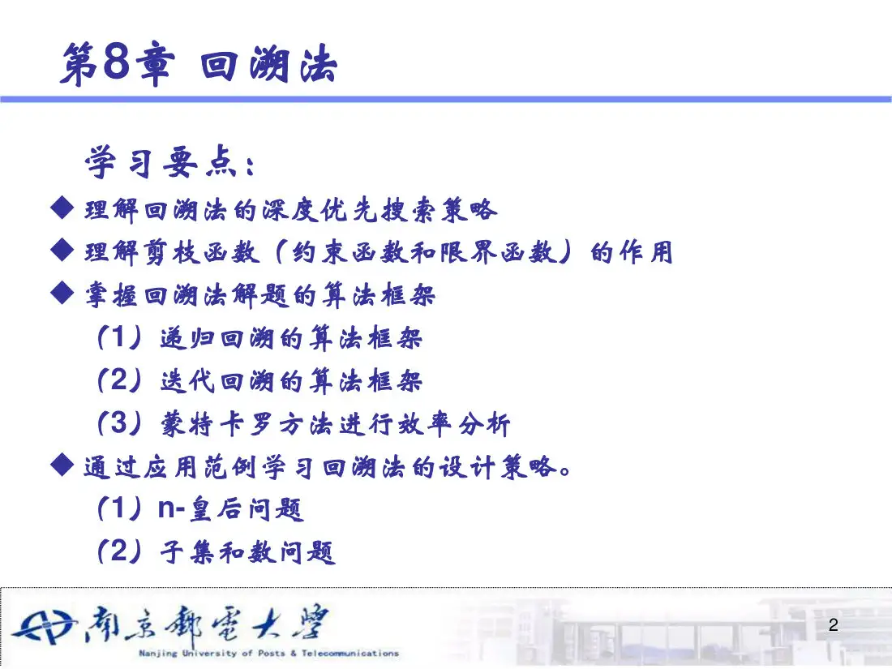

原文：

第8章 回溯法

学习要点：

◆理解回溯法的深度优先搜索策略

◆理解剪枝函数（约束函数和限界函数）的作用

◆掌握回溯法解题的算法框架

（1）递归回溯的算法框架

（2）迭代回溯的算法框架

（3）蒙特卡罗方法进行效率分析

◆通过应用范例学习回溯法的设计策略。

（1）n-皇后问题

（2）子集和数问题

分南京郵電大学

2

Nanjing University of Posts & Telecommunications

### ◆章节内容：

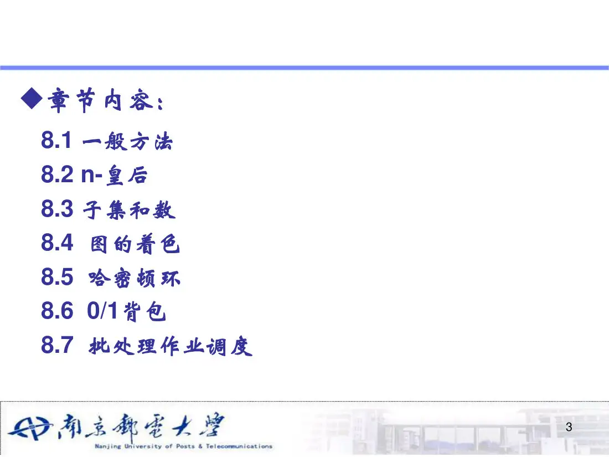

原文：

◆章节内容：
8.1 一般方法
8.2 n-皇后
8.3 子集和数
8.4 图的着色
8.5 哈密顿环
8.6 0/1背包
8.7 批处理作业调度

### 8.1 回溯法的一般方法

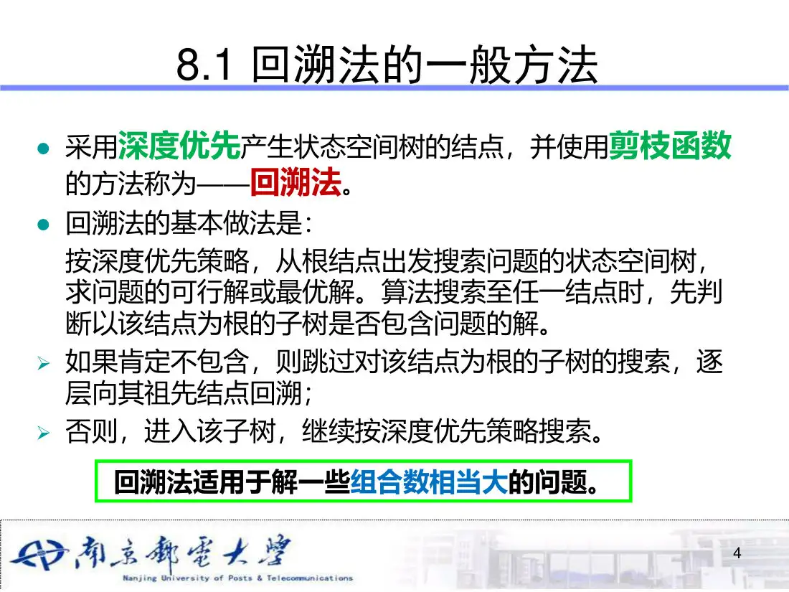

原文：

8.1 回溯法的一般方法

⚫ 采用深度优先产生状态空间树的结点，并使用剪枝函数的方法称为——回溯法。

⚫ 回溯法的基本做法是：

按深度优先策略，从根结点出发搜索问题的状态空间树，求问题的可行解或最优解。算法搜索至任一结点时，先判断以该结点为根的子树是否包含问题的解。

➢ 如果肯定不包含，则跳过对该结点为根的子树的搜索，逐层向其祖先结点回溯；

否则，进入该子树，继续按深度优先策略搜索。

回溯法适用于解一些组合数相当大的问题。

安南京郵電大学 Nanjing University of Posts & Telecommunications

4

### 问题的解空间

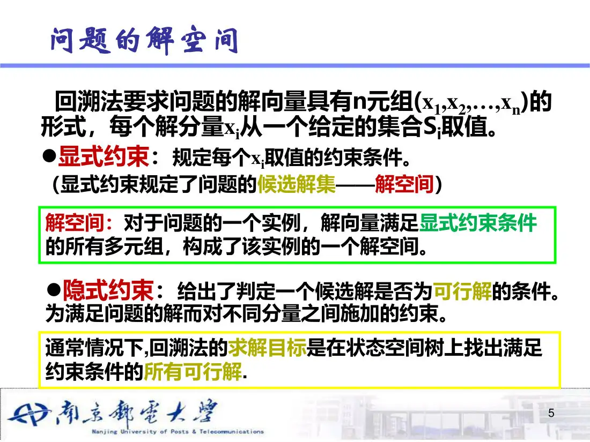

原文：

问题的解空间

回溯法要求问题的解向量具有n元组 $( \mathbf { x _ { 1 } } , \mathbf { x _ { 2 } } , . . . , \mathbf { x _ { n } } )$ 的形式，每个解分量 $x _ { i } \not \ J _ { i }$ 一个给定的集合 $S _ { \mathrm { i } }$ 取值。

⚫显式约束：规定每个 $\mathbf { \hat { X } _ { i } }$ 取值的约束条件。

（显式约束规定了问题的候选解集——解空间）

解空间：对于问题的一个实例，解向量满足显式约束条件的所有多元组，构成了该实例的一个解空间。

⚫隐式约束：给出了判定一个候选解是否为可行解的条件。为满足问题的解而对不同分量之间施加的约束。

通常情况下,回溯法的求解目标是在状态空间树上找出满足约束条件的所有可行解.

A南京郵電大学

5

Nanjing University of Posts & Telecommunications

### 一种方法：

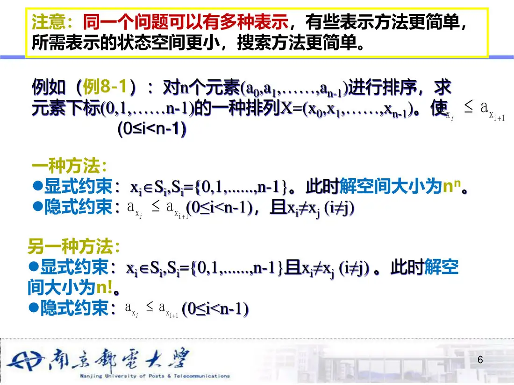

原文：

注意：同一个问题可以有多种表示，有些表示方法更简单，所需表示的状态空间更小，搜索方法更简单。

例如（例8-1）：对n个元素 $( \mathbf { a _ { 0 } , } \mathbf { a _ { 1 } , \ldots , } \mathbf { a _ { n - 1 } }$ )进行排序，求元素下标 $( \mathbf { 0 } , 1 , \ldots . . . 1 , - 1 ,$ )的一种排列 $\mathbf { X } { = } ( \mathbf { x _ { 0 } } , \mathbf { x _ { 1 } } , \ldots . . . . , \mathbf { x _ { n - 1 } } )$ 。使x a $\leq \mathrm { a } _ { \mathrm { x } _ { \mathrm { i } + 1 } }$ $( 0 \leq i < n - 1 )$

一种方法：

⚫显式约束： $\mathbf { \boldsymbol { x } _ { i } } { \in } \mathbf { \boldsymbol { S } _ { i } } , \mathbf { \boldsymbol { S } _ { i } } { = } \{ 0 , 1 , { \ldots } { \ldots } , \mathbf { \boldsymbol { n } - 1 } \}$ 。此时解空间大小为 $\mathsf { n } ^ { \mathsf { n } }$

⚫隐式约束： $\mathtt { a } _ { \mathtt { x } _ { i } } \le \mathtt { a } _ { \mathtt { x } _ { \mathtt { i } + } } ( \mathbf { 0 } { \le } \mathrm { i } { < } \mathbf { n } { - } 1 )$ ，且 $\mathbf { X _ { i } } \neq \mathbf { X _ { j } } \ ( \mathbf { i } \neq \mathbf { j } )$

另一种方法：

⚫显式约束： $\mathbf { \boldsymbol { x } _ { i } } { \in } \mathbf { \boldsymbol { S } _ { i } } , \mathbf { \boldsymbol { S } _ { i } } { = } \{ 0 , 1 , . . . . . , \mathbf { \boldsymbol { n } - 1 } \}$ 且 $\mathbf { X _ { i } } \mathbf { \neq x _ { j } } ( \mathbf { i \neq j } )$ 。此时解空间大小为n!。

⚫隐式约束： $\mathtt { a } _ { \mathtt { x } _ { i } } \le \mathtt { a } _ { \mathtt { x } _ { \mathtt { i + 1 } } } ( \mathbf { 0 } { \le } \mathrm { i } { < } \mathbf { n } { - } 1 )$

安南京郵電大学 Nanjing University of Posts & Telecommunications

6

### 状态空间树

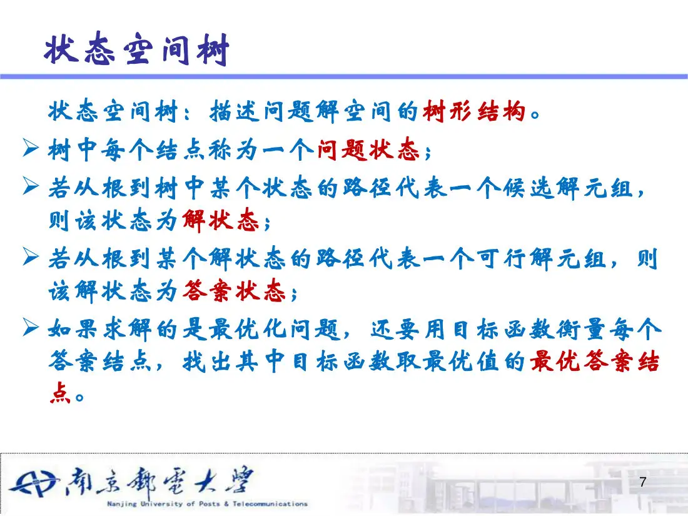

原文：

状态空间树

状态空间树：描述问题解空间的树形结构。

➢ 树中每个结点称为一个问题状态；

➢ 若从根到树中某个状态的路径代表一个候选解元组，则该状态为解状态；

➢ 若从根到某个解状态的路径代表一个可行解元组，则该解状态为答案状态；

➢ 如果求解的是最优化问题，还要用目标函数衡量每个答案结点，找出其中目标函数取最优值的最优答案结点。

安南京郵電大学 Nanjing University of Posts & Telecommunications

7

### 如：（例8-1）n个元素排序问题。若n=3则状态空间树为：

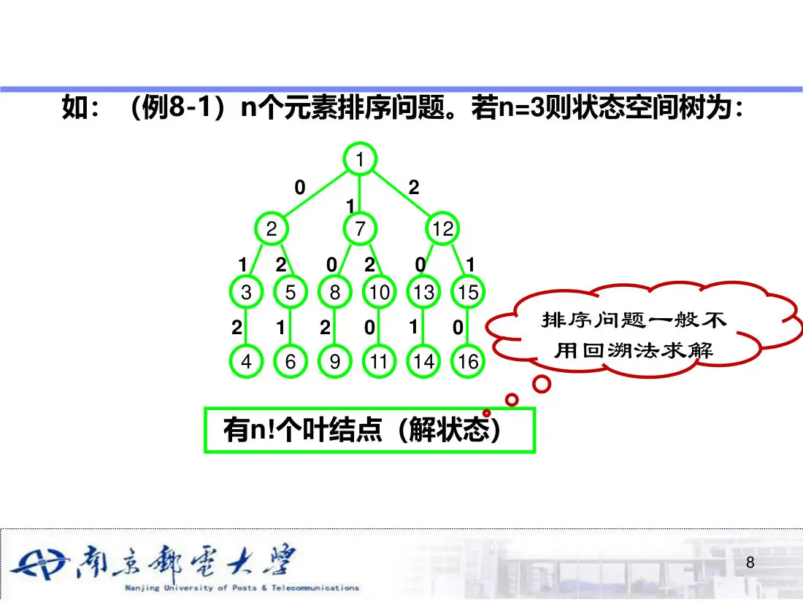

原文：

如：（例8-1）n个元素排序问题。若n=3则状态空间树为：

排序问题一般不用回溯法求解

有n!个叶结点（解状态）

安南京郵電大学 Nanjing University of Posts & Telecommunications

8

### 旅行商问题

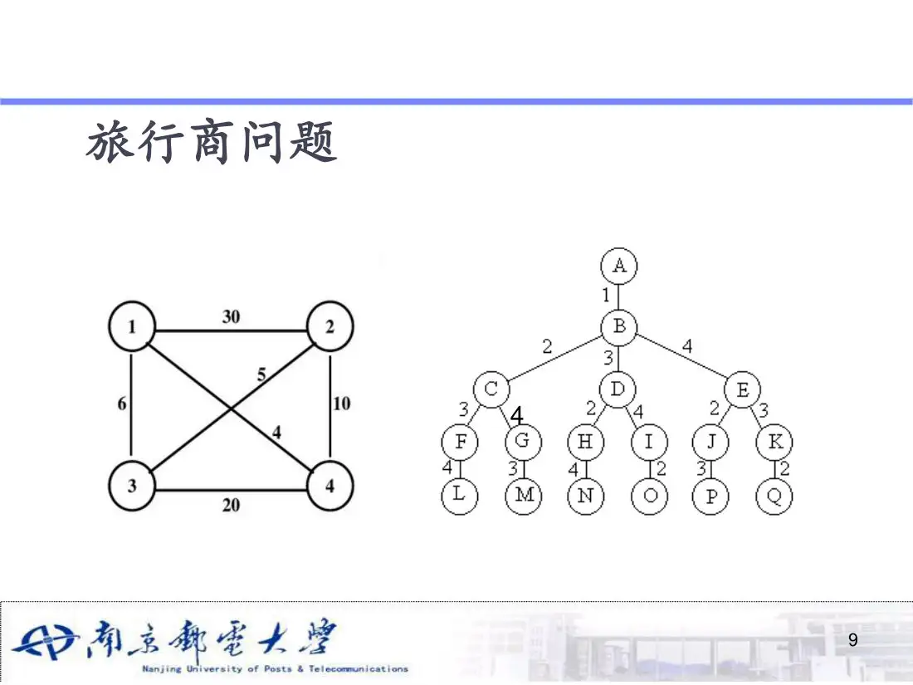

原文：

旅行商问题

安南京郵電大学 Nanjing University of Posts & Telecommunications

9

### 又如：0-1背包问题。若n=3则状态空间树为一个完全二叉树：

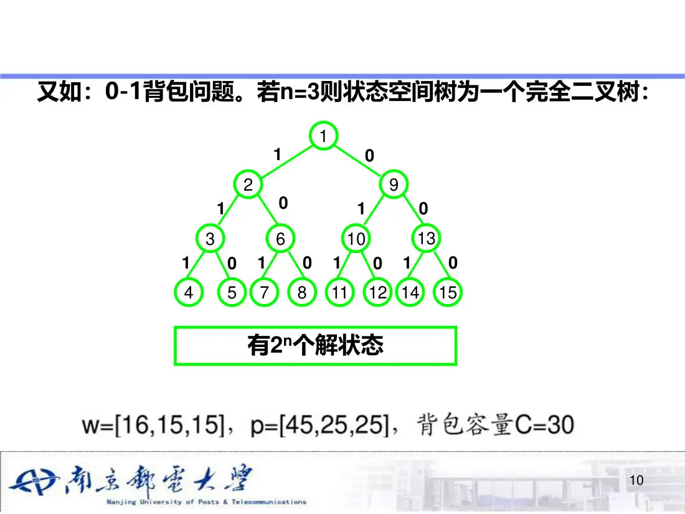

原文：

又如：0-1背包问题。若n=3则状态空间树为一个完全二叉树：

有2n个解状态

w=[16,15,15]，p=[45,25,25]，背包容量C=30

安南京郵電大学 Nanjing University of Posts & Telecommunications

10

### 回溯法的基本思想

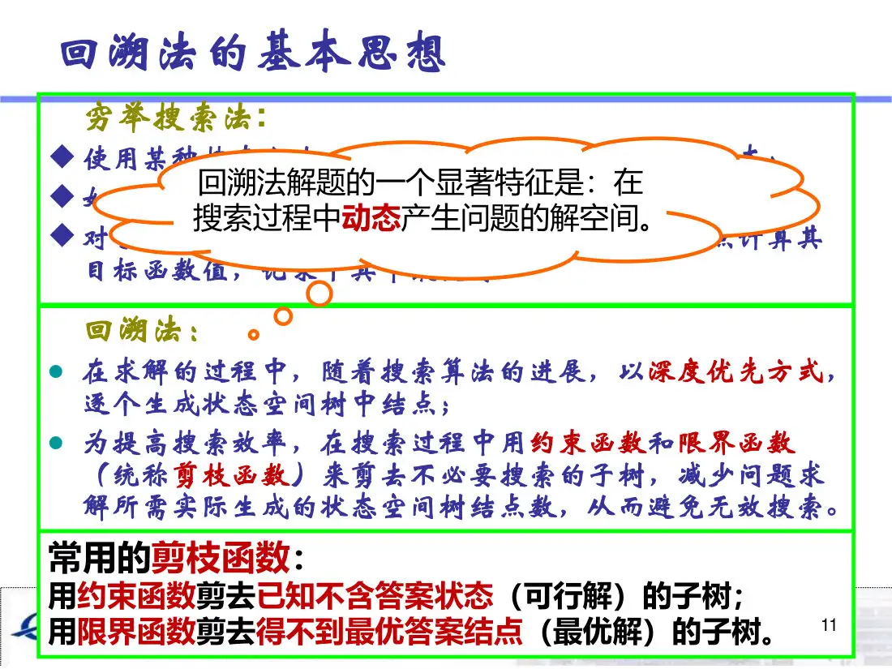

原文：

回溯法的基本思想

穷举搜索法:

◆使用某种

◆如

◆对

回溯法解题的一个显著特征是：在搜索过程中动态产生问题的解空间。

目标函数值，

点计算其

回溯法：

⚫ 在求解的过程中，随着搜索算法的进展，以深度优先方式，逐个生成状态空间树中结点；

为提高搜索效率，在搜索过程中用约束函数和限界函数（统称剪枝函数）来剪去不必要搜索的子树，减少问题求解所需实际生成的状态空间树结点数，从而避免无效搜索。

常用的剪枝函数：

用约束函数剪去已知不含答案状态（可行解）的子树；用限界函数剪去得不到最优答案结点（最优解）的子树。

### 递归回溯

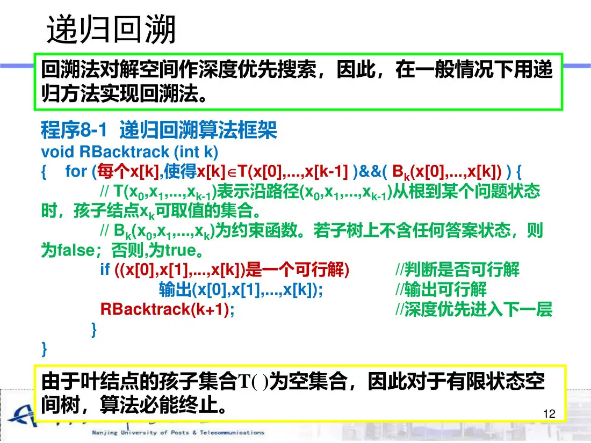

原文：

递归回溯

回溯法对解空间作深度优先搜索，因此，在一般情况下用递归方法实现回溯法。

程序8-1 递归回溯算法框架

由于叶结点的孩子集合T( )为空集合，因此对于有限状态空间树，算法必能终止。 1

A

2

Nanjing University of Posts & Telecommunications

### 迭代回溯

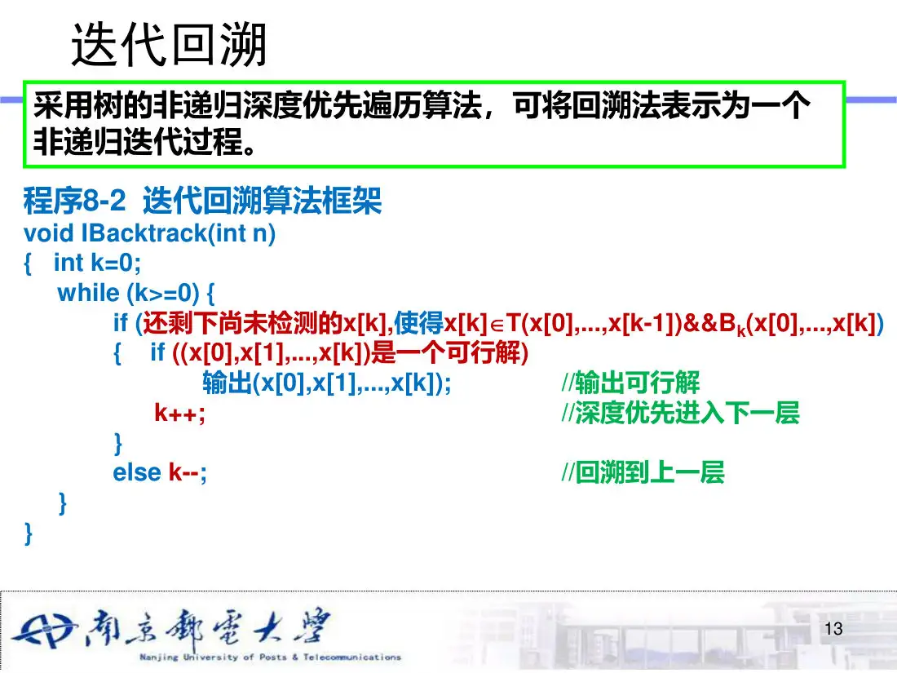

原文：

迭代回溯

采用树的非递归深度优先遍历算法，可将回溯法表示为一个非递归迭代过程。

程序8-2 迭代回溯算法框架

安南京郵電大学 Nanjing University of Posts & Telecommunications

13

### 子集树与排列树

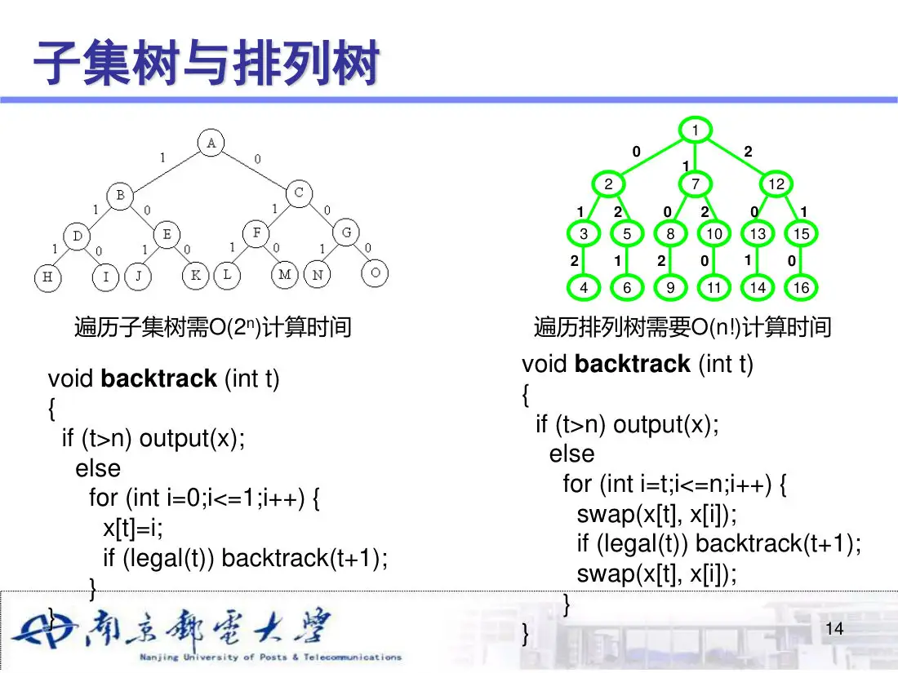

原文：

子集树与排列树

分南京郵電大学Nanjing University of Posts & Telecommunications

14

### 回溯法的效率分析

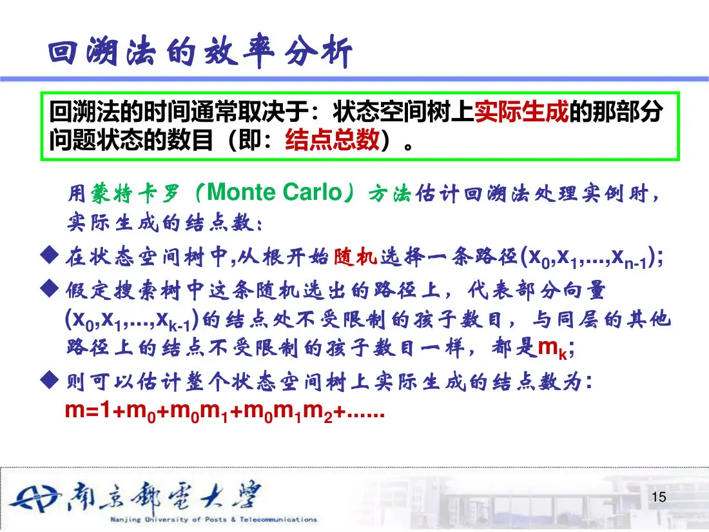

原文：

回溯法的效率分析

回溯法的时间通常取决于：状态空间树上实际生成的那部分问题状态的数目（即：结点总数）。

用蒙特卡罗（Monte Carlo）方法估计回溯法处理实例时，实际生成的结点数：

◆在状态空间树中,从根开始随机选择一条路径 $( \mathsf { x } _ { 0 } , \mathsf { x } _ { 1 } , \ldots , \mathsf { x } _ { n - 1 } )$

◆ 假定搜索树中这条随机选出的路径上，代表部分向量$( x _ { 0 } , x _ { 1 } , \ldots , x _ { k - 1 } )$ 的结点处不受限制的孩子数目，与同层的其他路径上的结点不受限制的孩子数目一样，都是 $\boldsymbol { \mathbf { \mathit { m } _ { k } } }$ ;

◆则可以估计整个状态空间树上实际生成的结点数为:

$$
m = 1 + m _ {0} + m _ {0} m _ {1} + m _ {0} m _ {1} m _ {2} + \dots .
$$

安南京郵電大学 Nanjing University of Posts & Telecommunications

15

### 程序8-3 蒙特卡罗算法

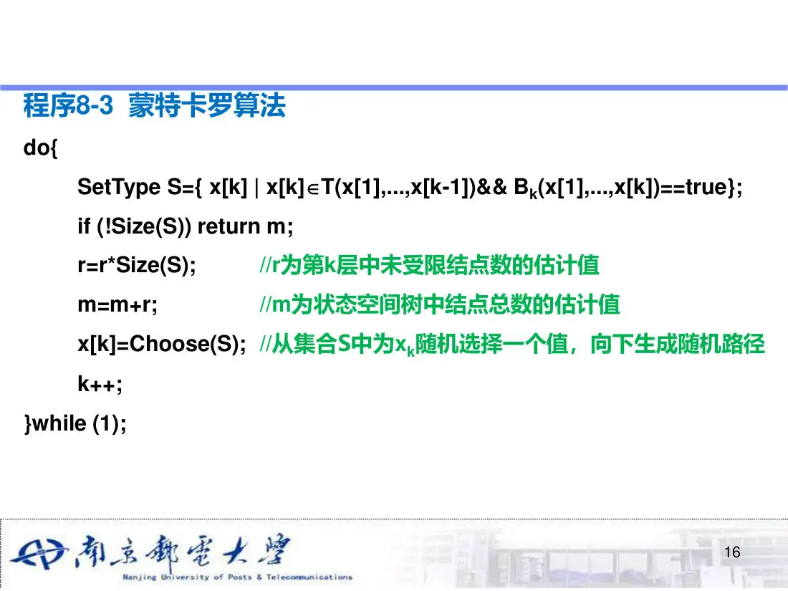

原文：

程序8-3 蒙特卡罗算法

安南京郵電大学 Nanjing University of Posts & Telecommunications

16

### 8.2 n-皇后问题

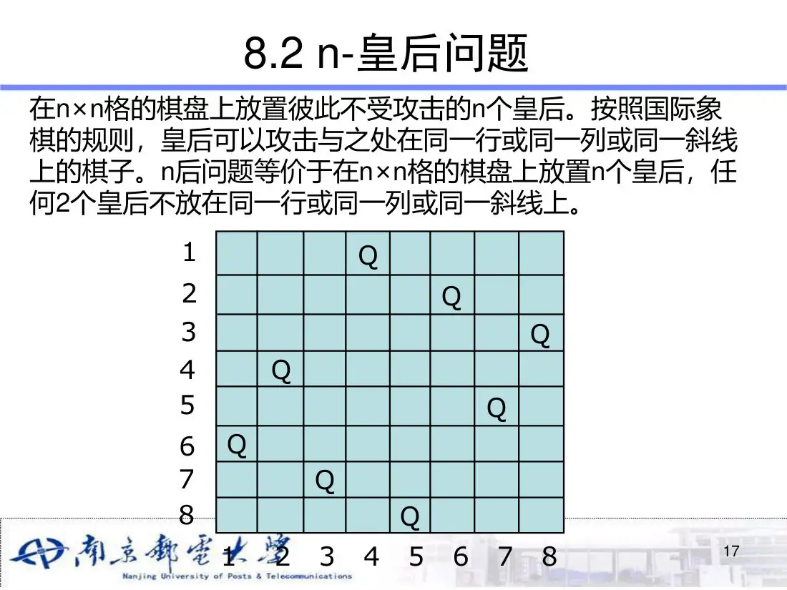

原文：

8.2 n-皇后问题

在n×n格的棋盘上放置彼此不受攻击的n个皇后。按照国际象棋的规则，皇后可以攻击与之处在同一行或同一列或同一斜线上的棋子。n后问题等价于在n×n格的棋盘上放置n个皇后，任何2个皇后不放在同一行或同一列或同一斜线上。

17

Nanjing University of Posts & Telecommunications

### 安南京郵電大学

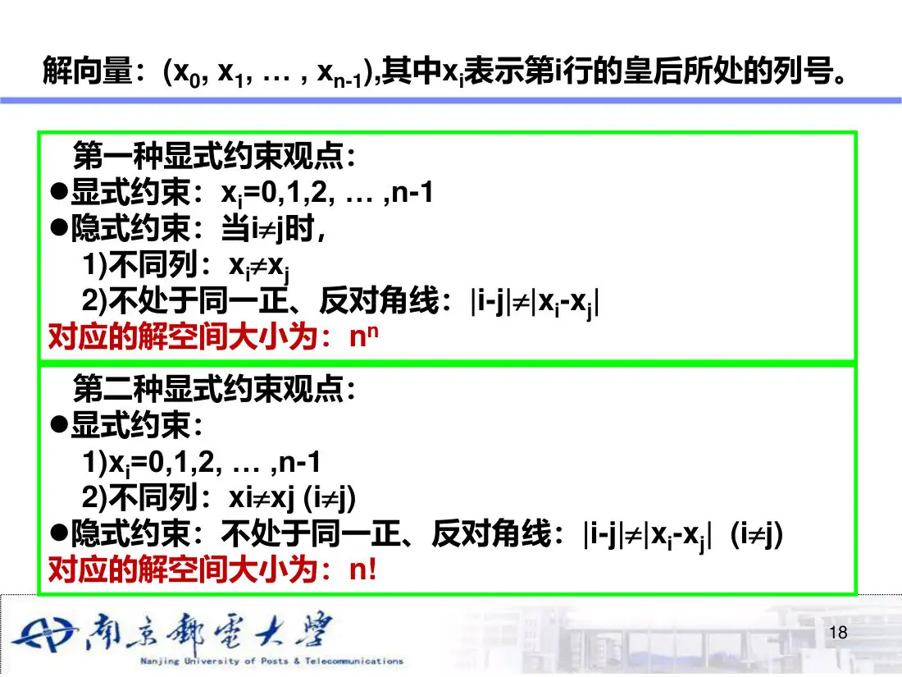

原文：

解向量： $( \mathbf { x _ { 0 } } , \mathbf { x } _ { 1 } , \ldots , \mathbf { x } _ { n - 1 } )$ ,其中x表示第i行的皇后所处的列号。

安南京郵電大学

18

Nanjing University of Posts & Telecommunications

### （采用第二种显式约束观点的）4-皇后问题状态空间树

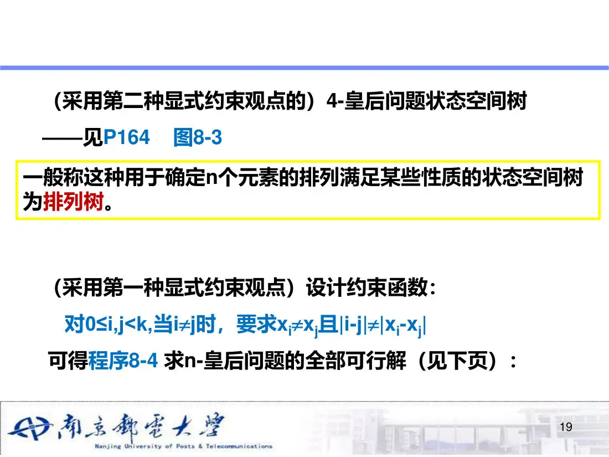

原文：

（采用第二种显式约束观点的）4-皇后问题状态空间树

——见P164 图8-3

一般称这种用于确定n个元素的排列满足某些性质的状态空间树为排列树。

（采用第一种显式约束观点）设计约束函数：

对 $\lvert 0 { \le } \rvert , \lvert < \rvert \kappa$ ,当ij时，要求 $x _ { i } \neq x _ { j } \equiv | | \mathbf { \bar { l } } - \mathbf { j } | \neq | \mathbf { x } _ { i } - \mathbf { x } _ { j } |$

可得程序8-4 求n-皇后问题的全部可行解（见下页）：

安南京郵電大學

19

Nanjing University of Posts & Telecommunications

### 第 20 页

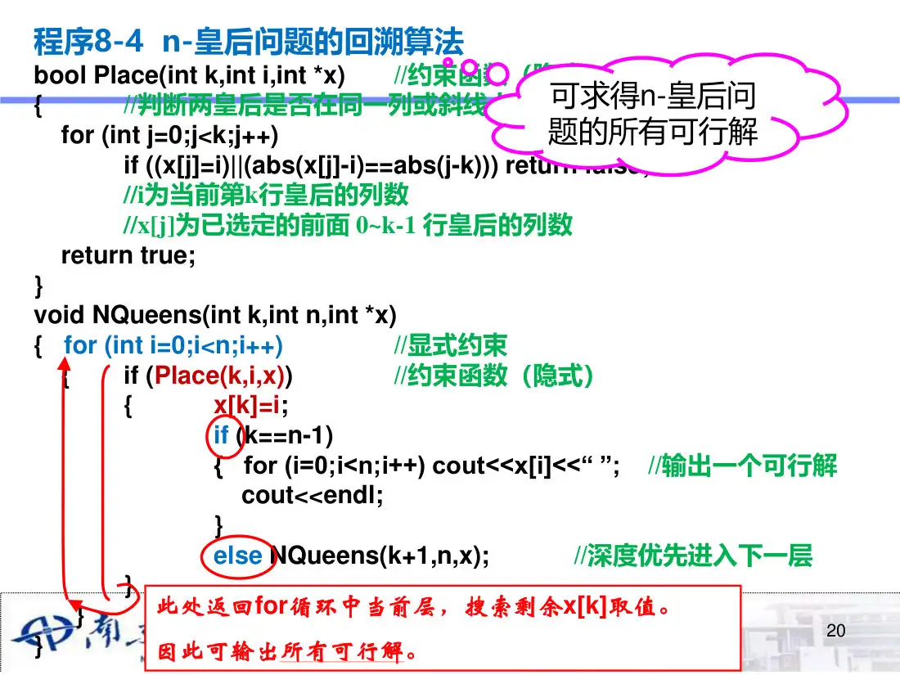

### 程序8-4 n-皇后问题的回溯算法

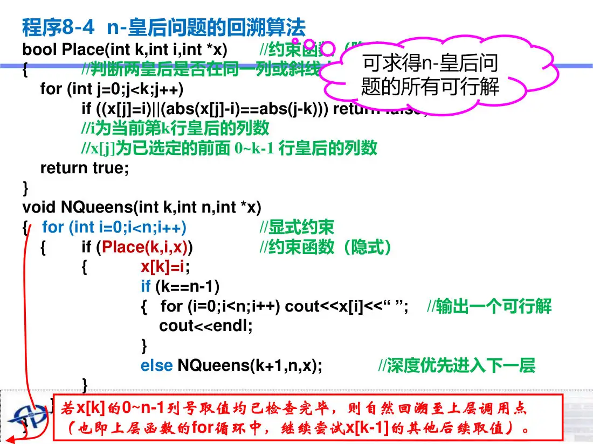

原文：

程序8-4 n-皇后问题的回溯算法

### 22

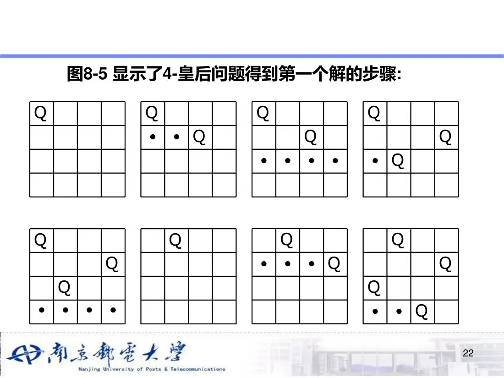

原文：

安南京郵電大学 Nanjing University of Posts & Telecommunications

22

### 安南京郵電大学

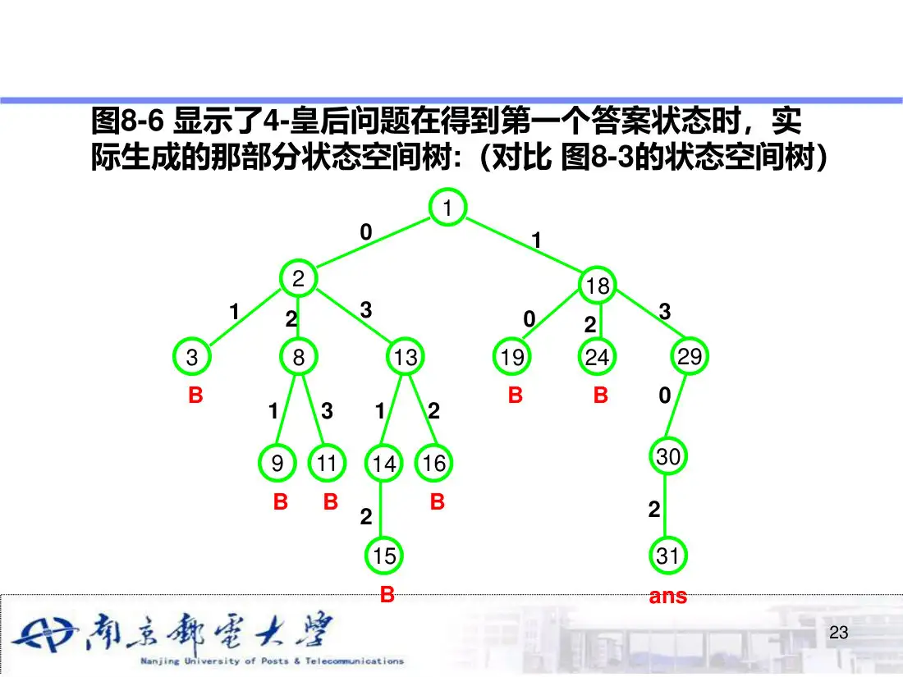

原文：

图8-6 显示了4-皇后问题在得到第一个答案状态时，实际生成的那部分状态空间树:（对比 图8-3的状态空间树）

安南京郵電大学

Nanjing University of Posts & Telecommunications

23

### 回溯法求4-皇后问题一个可行解的演示

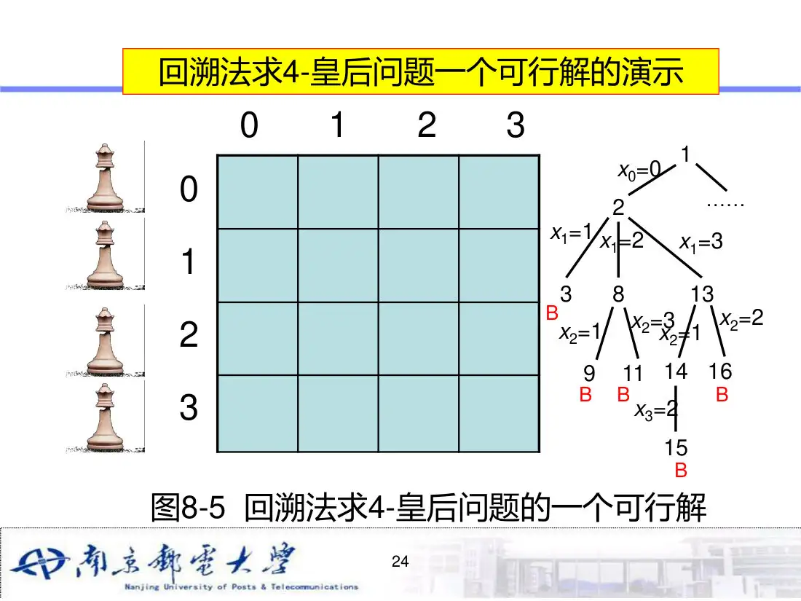

原文：

回溯法求4-皇后问题一个可行解的演示

安南京郵電大学 Nanjing University of Posts & Telecommunications

24

### 回溯法求4-皇后问题一个可行解的演示

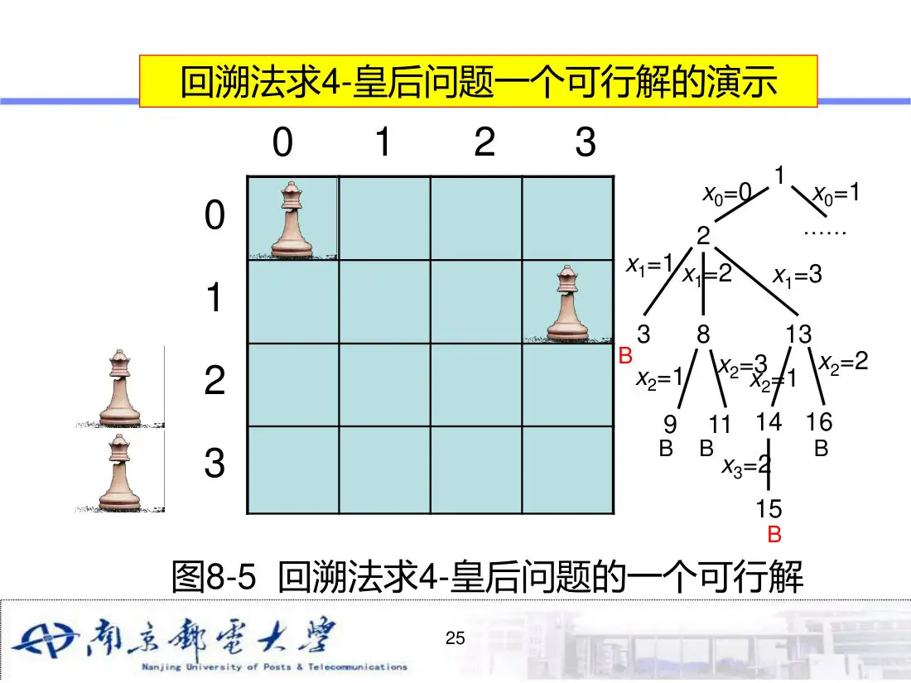

原文：

回溯法求4-皇后问题一个可行解的演示

安南京郵電大学 Nanjing University of Posts & Telecommunications

25

### 回溯法求4-皇后问题一个可行解的演示

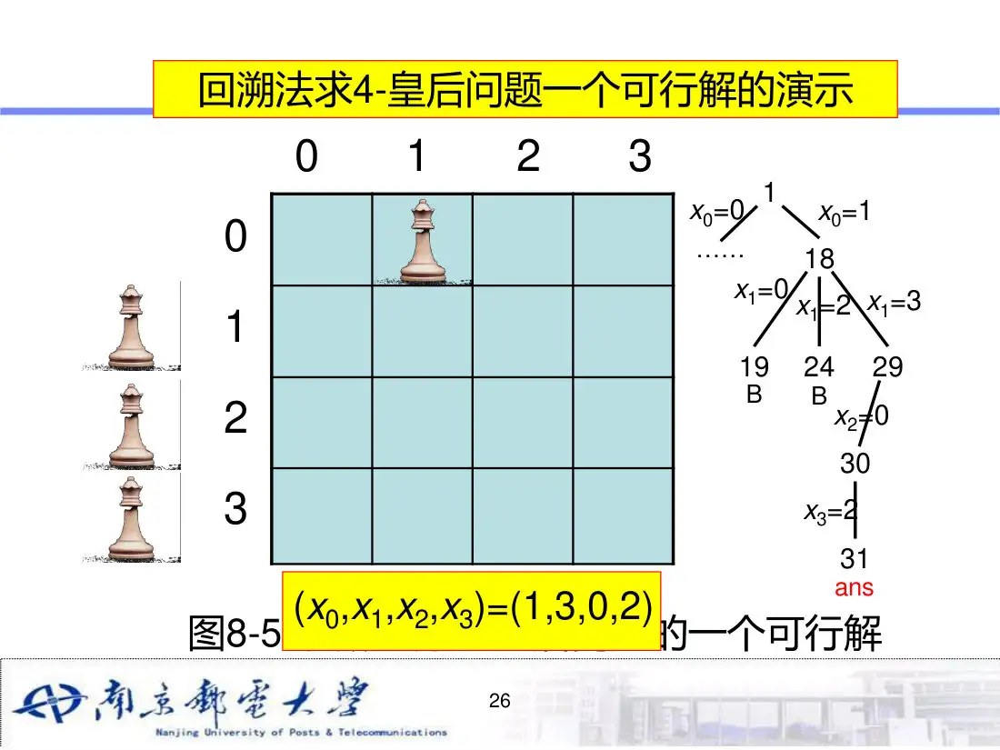

原文：

回溯法求4-皇后问题一个可行解的演示

0 1 2 3

$$
(x _ {0}, x _ {1}, x _ {2}, x _ {3}) = (1, 3, 0, 2)
$$

的一个可行解

安南京郵電大学

26

Nanjing University of Posts & Telecommunications

### 时间分析

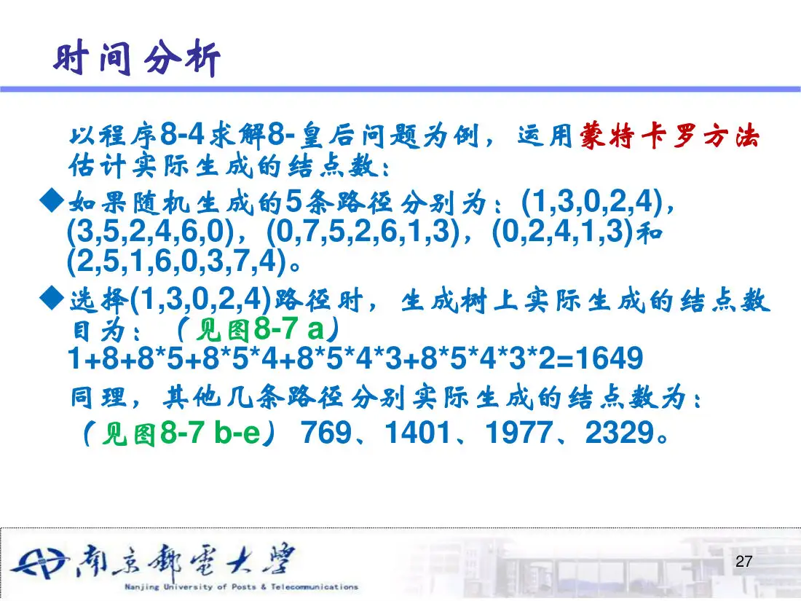

原文：

时间分析

以程序8-4求解8-皇后问题为例，运用蒙特卡罗方法估计实际生成的结点数：

如果随机生成的5条路径分别为：(1,3,0,2,4)，(3,5,2,4,6,0)，(0,7,5,2,6,1,3)，(0,2,4,1,3)和(2,5,1,6,0,3,7,4)。

◆选择(1,3,0,2,4)路径时，生成树上实际生成的结点数目为：（见图8-7 a）1+8+8\*5+8\*5\*4+8\*5\*4\*3+8\*5\*4\*3\*2=1649同理，其他几条路径分别实际生成的结点数为：（见图8-7 b-e） 769、1401、1977、2329。

安南京郵電大学 Nanjing University of Posts & Telecommunications

27

### 随机路径: (1,3,0,2,4)

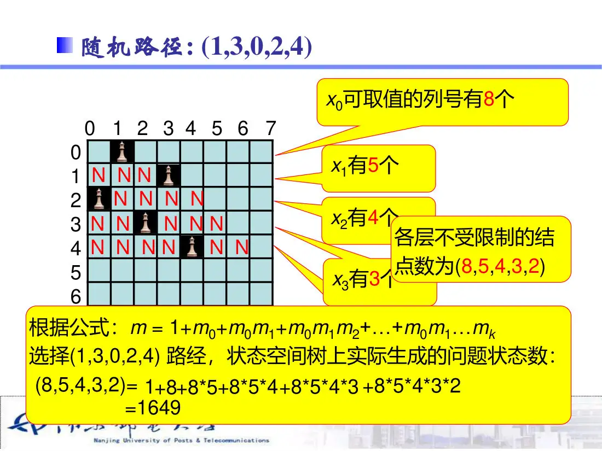

原文：

随机路径: (1,3,0,2,4)

0 2 3 4 5 6 7 0 1 N N N 1 2 N N N N 3 N N N N N \_ 4 N N N N N N 5 6

$x _ { 0 }$ 可取值的列号有8个

x1有5个

x2有4个

各层不受限制的结点数为(8,5,4,3,2)

$x _ { 3 }$ 有3个

7根据公式： $m = 1 + m _ { 0 } + m _ { 0 } m _ { 1 } + m _ { 0 } m _ { 1 } m _ { 2 } + \ldots + m _ { 0 } m _ { 1 } \ldots m _ { k }$ 选择(1,3,0,2,4) 路经，状态空间树上实际生成的问题状态数：$\begin{array} { c } { { ( 8 , 5 , 4 , 3 , 2 ) { = } ~ 1 + 8 + 8 ^ { \star } 5 + 8 ^ { \star } 5 ^ { \star } 4 + 8 ^ { \star } 5 ^ { \star } 4 ^ { \star } 3 + 8 ^ { \star } 5 ^ { \star } 4 ^ { \star } 3 ^ { \star } 2 } } \\ { { { = } 1 6 4 9 } } \end{array}$

Nanjing University of Posts & Telecommunications

### $$

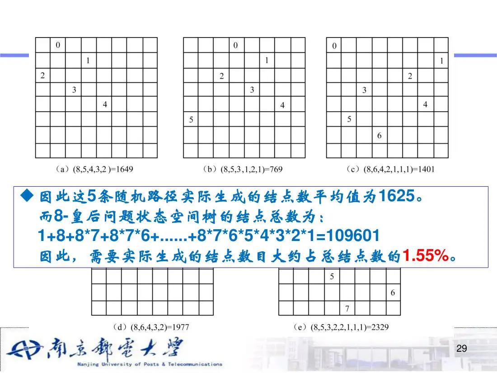

原文：

$$
1 + 8 + 8 ^ {*} 7 + 8 ^ {*} 7 ^ {*} 6 + \dots + 8 ^ {*} 7 ^ {*} 6 ^ {*} 5 ^ {*} 4 ^ {*} 3 ^ {*} 2 ^ {*} 1 = 1 0 9 6 0 1
$$

(e)(8,5,3,2,2,1,1,1)=2329
<table><tr><td></td><td></td><td></td><td>5</td><td></td><td></td><td></td><td></td></tr><tr><td></td><td></td><td></td><td></td><td></td><td></td><td></td><td>6</td></tr><tr><td></td><td></td><td></td><td></td><td>7</td><td></td><td></td><td></td></tr></table>

29

Nanjing University of Posts & Telecommunications

### 8.3 子集和数

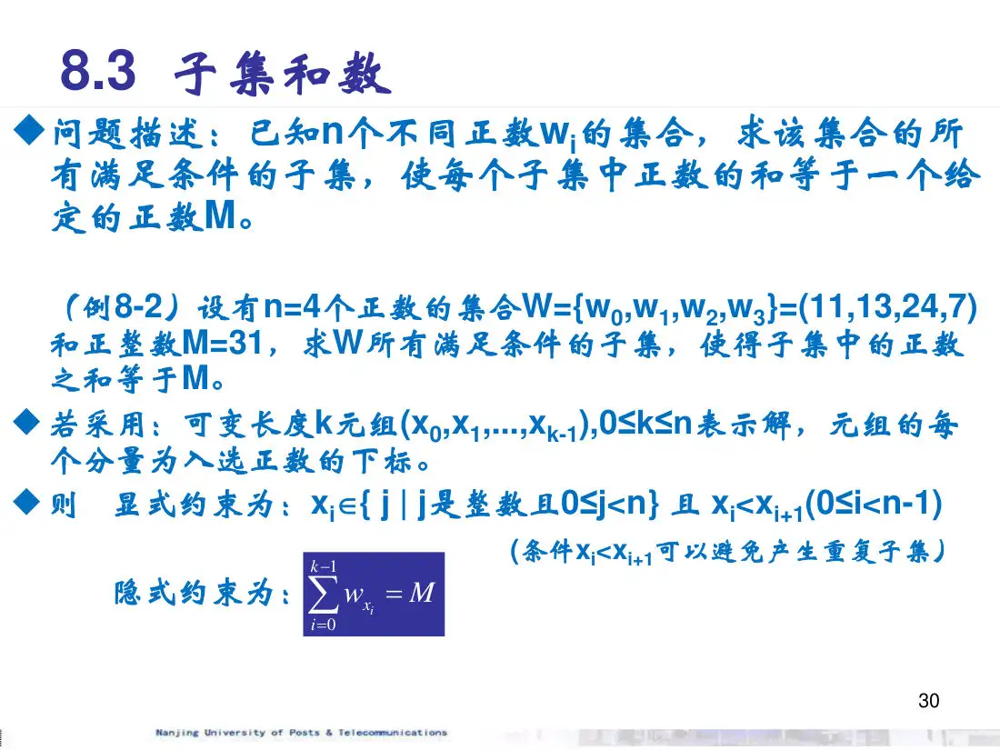

原文：

8.3 子集和数

◆问题描述：已知n个不同正数 $. W _ { \mathrm { i } }$ 的集合，求该集合的所有满足条件的子集，使每个子集中正数的和等于一个给定的正数M。

（例8-2）设有n=4个正数的集合 $\mathsf { W } = \{ \mathsf { W } _ { 0 } , \mathsf { W } _ { 1 } , \mathsf { W } _ { 2 } , \mathsf { W } _ { 3 } \} = ( 1 \uparrow 1 , 1 3 , 2 4 , 7 )$ 和正整数 $\scriptstyle { \mathbb { M } } = 3 1$ ，求W所有满足条件的子集，使得子集中的正数之和等于M。

◆若采用：可变长度k元组 $( \mathsf { x } _ { 0 } , \mathsf { x } _ { 1 } , \ldots , \mathsf { x } _ { | \mathsf { x } - 1 } ) , 0 { \le } \mathsf { k } { \le } \mathsf { n }$ 表示解，元组的每个分量为入选正数的下标。

◆则 显式约束为： $\mathbf { X _ { i } } \in \left\{ \begin{array} { l l } { \mathbf { | \sigma | } } \end{array} \right\}$ 是整数且 $0 { \leq } \mathbf { j } { < } \mathbf { n } \mathbf  \}$ 且 $x _ { i } < x _ { i + 1 } ( 0 \leq i < n - 1 )$

隐式约束为： $1 2 - 2 = 1 4$

(条件 ${ \tt X } _ { \mathrm { i } } { < } { \tt X } _ { \mathrm { i } + 1 }$ 可以避免产生重复子集）

30

Nanjing University of Posts & Telecommunications

### 31

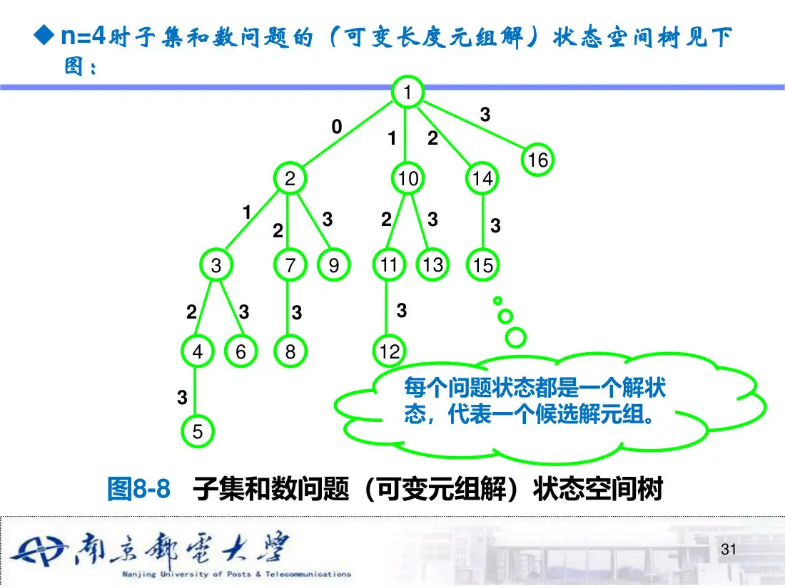

原文：

安南京郵電大学 Nanjing University of Posts & Telecommunications

31

### （例8-2）设有 $\mathsf { n } \equiv 4$ 个正数的集合

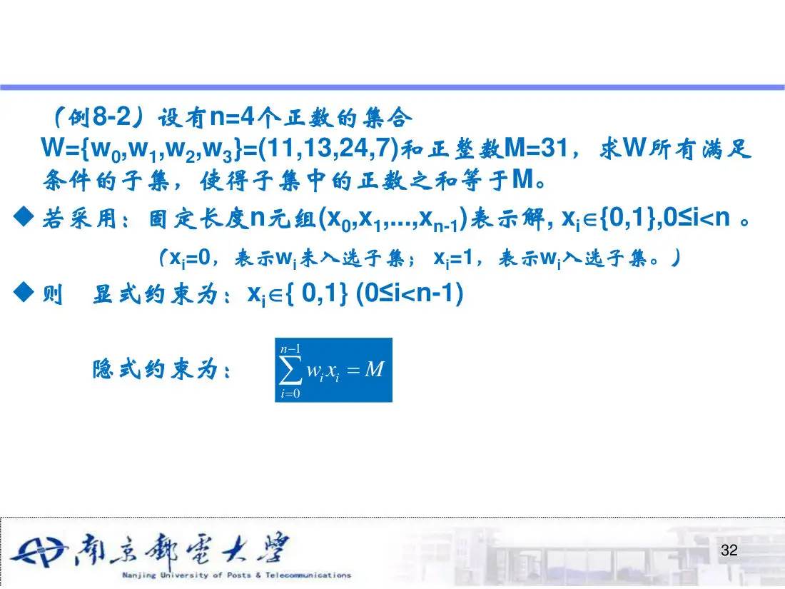

原文：

（例8-2）设有 $\mathsf { n } \equiv 4$ 个正数的集合

$W { = } \{ \mathsf { W } _ { 0 } , \mathsf { W } _ { 1 } , \mathsf { W } _ { 2 } , \mathsf { W } _ { 3 } \} { = } ( 1 1 , 1 3 , 2 4 , 7 )$ 和正整数 $\mathbb { M } { = } 3 1$ ，求W所有满足条件的子集，使得子集中的正数之和等于M。

◆若采用：固定长度n元组 $( \mathsf { x } _ { 0 } , \mathsf { x } _ { 1 } , \ldots , \mathsf { x } _ { n - 1 } )$ 表示解, $\mathtt { X _ { i } } \in \{ 0 , 1 \} , 0 \leq \mathrm { i } < \mathrm { n }$

$( x _ { i } = 0$ ，表示 $\mathbf { \nabla } \cdot \mathbf { w } _ { \mathrm { i } }$ 未入选子集； $\mathbf { X _ { i } } = 1$ ，表示 $w _ { \mathrm { i } } \wedge$ 选子集。）

◆则 显式约束为： $\mathbf { \boldsymbol { x } } _ { \mathrm { i } } \in \{ \textbf { 0 } , 1 \} \ ( 0 \leq 1 < n - 1 )$

隐式约束为：

$$
\sum_ {i = 0} ^ {n - 1} w _ {i} x _ {i} = M
$$

安南京郵電大学 Nanjing University of Posts & Telecommunications

32

### 图8-9 子集和数问题（固定长度元组解）状态空间树

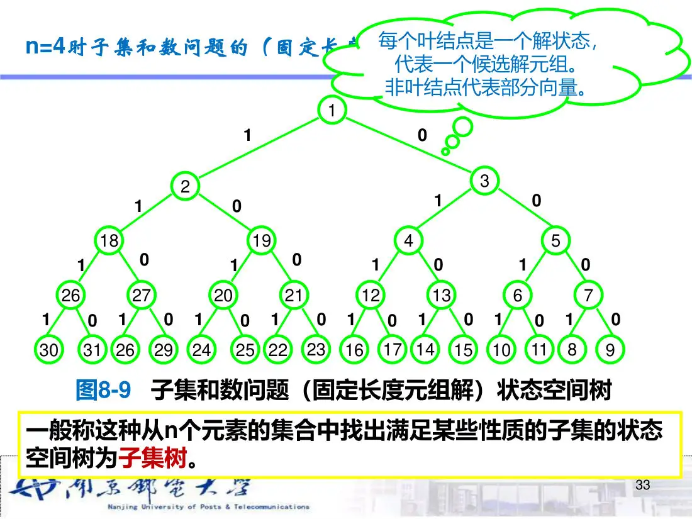

原文：

n=4时子集和数问题的（固定每个叶结点是一个解状态，代表一个候选解元组。非叶结点代表部分向量。

图8-9 子集和数问题（固定长度元组解）状态空间树

一般称这种从n个元素的集合中找出满足某些性质的子集的状态 空间树为子集树。

佩原邨電大學 Nanjing University of Posts & Telecommunications

33

### $$

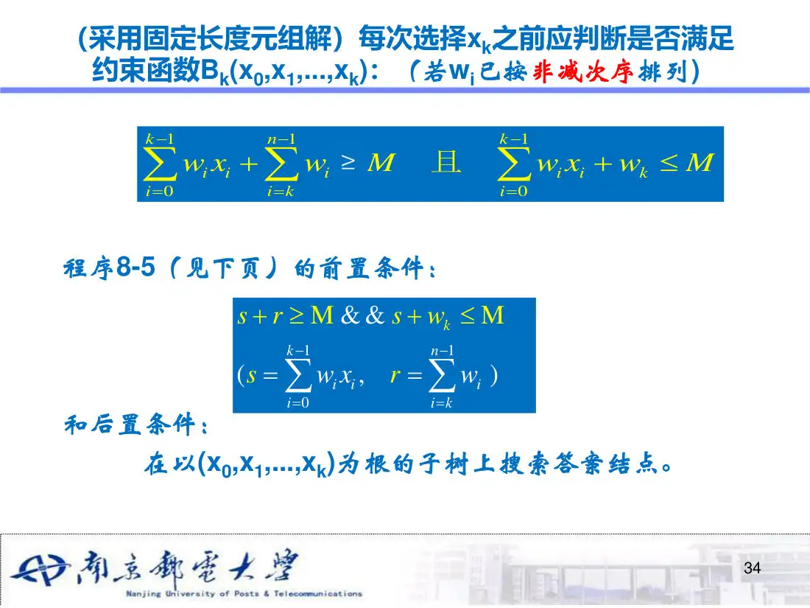

原文：

（采用固定长度元组解）每次选择 ${ \bf { X } } _ { \bf { k } }$ 之前应判断是否满足约束函数B $\bf \Pi _ { \mathrm { k } } ( x _ { 0 } , x _ { 1 } , \ldots , x _ { k } )$ ：（若 $w _ { \mathrm { i } } z _ { \mathrm { \ell } }$ 按非减次序排列)

$$
\sum_ {i = 0} ^ {k - 1} w _ {i} x _ {i} + \sum_ {i = k} ^ {n - 1} w _ {i} \geq M \quad \text {且} \quad \sum_ {i = 0} ^ {k - 1} w _ {i} x _ {i} + w _ {k} \leq M
$$

程序8-5（见下页）的前置条件：

$$
s + r \geq M \& \& s + w _ {k} \leq M
$$

$$
(s = \sum_ {i = 0} ^ {k - 1} w _ {i} x _ {i}, r = \sum_ {i = k} ^ {n - 1} w _ {i})
$$

和后置条件：

在 $\therefore ( x _ { 0 } , x _ { 1 } , \ldots , x _ { k } )$ 为根的子树上搜索答案结点。

安南京郵電大学 Nanjing University of Posts & Telecommunications

34

### 程序8-5 子集和数的回溯算法

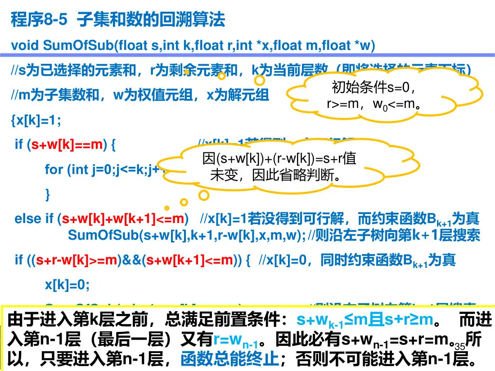

原文：

程序8-5 子集和数的回溯算法

void SumOfSub(float s,int k,float r,int \*x,float m,float \*w)

//s为已选择的元素和，r为剩余元素和，k为当前层数（即将选择的元素下标）

//m为子集数和，w为权值元组，x为解元组

初始条件 $\therefore s = 0$ $\Gamma > = \mathsf { m } , \mathsf { w } _ { 0 } < = \mathsf { m } _ { \circ }$

$$
\{x [ k ] = 1;
$$

因 $( 5 + w [ k ] ) + ( r - w [ k ] ) = s + r 1$ 值<<x[j]<<‘ ’; cout未变，因此省略判断。

else if (s+w[k]+w[k+1]<=m) //x[k]=1若没得到可行解，而约束函数B $k { + 1 }$ 为真 $\mathbb { S } \ u \ m { \sf O } \dag \mathbb { S } \ u \mathrm { b } \big ( \mathbb { s } + \mathbb { W } [ \ k ] , \ k + 1 , \mathtt { r } - \mathbb { W } [ \ k ] , \mathbb { x } , \ m , \mathbb { W } \big )$ ;//则沿左子树向第k+1层搜索

${ \mathrm { i f ~ } } ( ( \mathbb { S } + \Gamma { \mathrm { - } } \mathbb { W } [ { \mathrm { k } } ] { \mathrm { > } } { \mathrm { = } } { \mathrm { I } \mathrm { ) } } ) \& \delta ( \mathbb { S } + \mathbb { W } [ { \mathrm { k } } + 1 ] < { \mathrm { = } } { \mathrm { I } \mathrm { \Omega } } ) ) \ \{ \ / J \times [ { \mathrm { k } } ] = 0 $ ，同时约束函数 $\mathbf { \mathbf { B } } _ { \mathbf { \mathbf { k } } + 1 }$ 为真x[k]=0;

由于进入第k层之前，总满足前置条件： $\mathbf { s } + \mathbf { W } _ { \mathbf { k } = 1 }$ ≤m且s+r≥m。 而进}入第n-1层（最后一层）又有 $\mathrm { r } { = } \mathsf { W } _ { \mathsf { n } { = } 1 }$ 。因此必有 $S + W _ { n - 1 } = S + r = m _ { \circ _ { 3 5 } }$ 所}以，只要进入第n-1层，函数总能终止；否则不可能进入第n-1层。

### 36

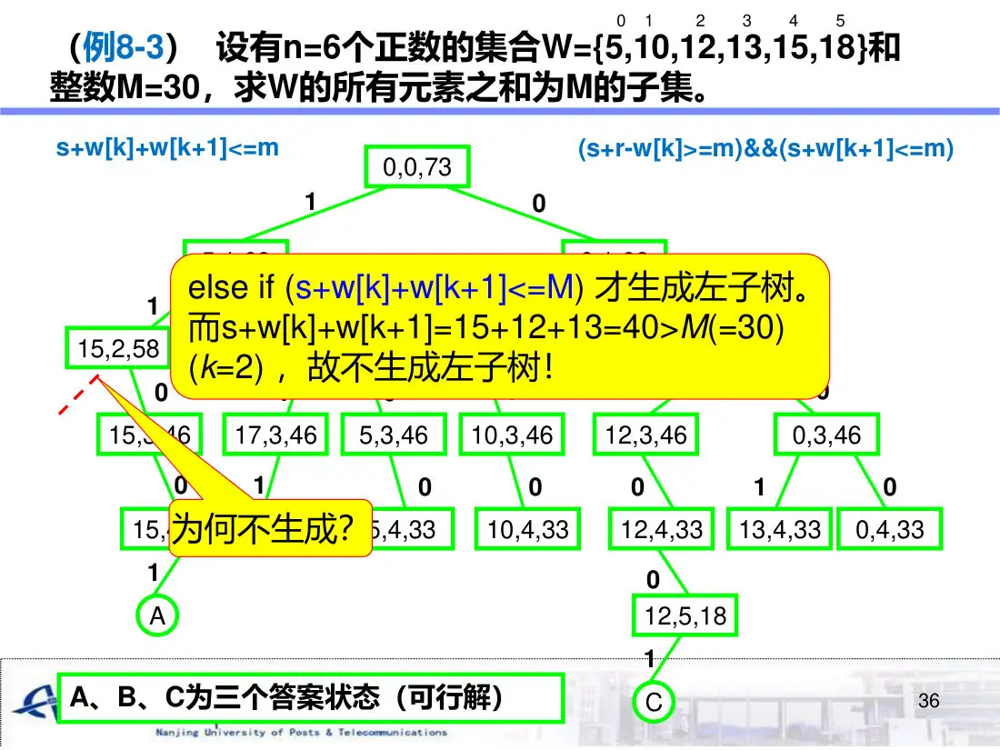

原文：

（例8-3） 设有n=6个正数的集合W={5,10,12,13,15,18}和整数M=30，求W的所有元素之和为M的子集。

36

Nanjing University of Posts & Telecommunications

### 37

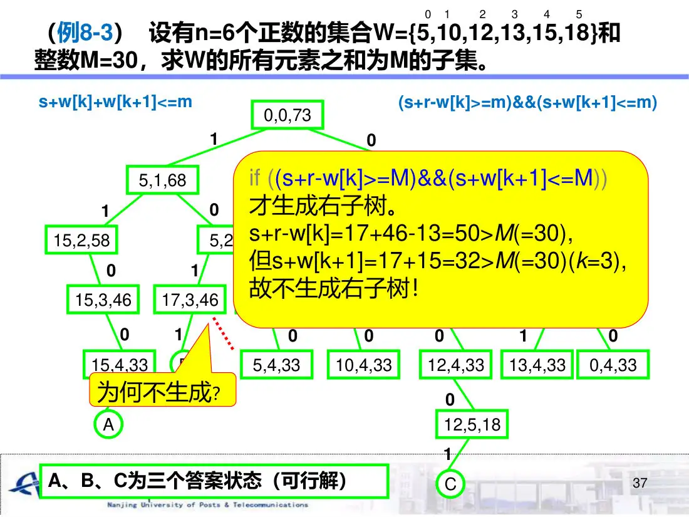

原文：

（例8-3） 设有n=6个正数的集合W={5,10,12,13,15,18}和整数M=30，求W的所有元素之和为M的子集。

37

Nanjing University of Posts & Telecommunications

### 38

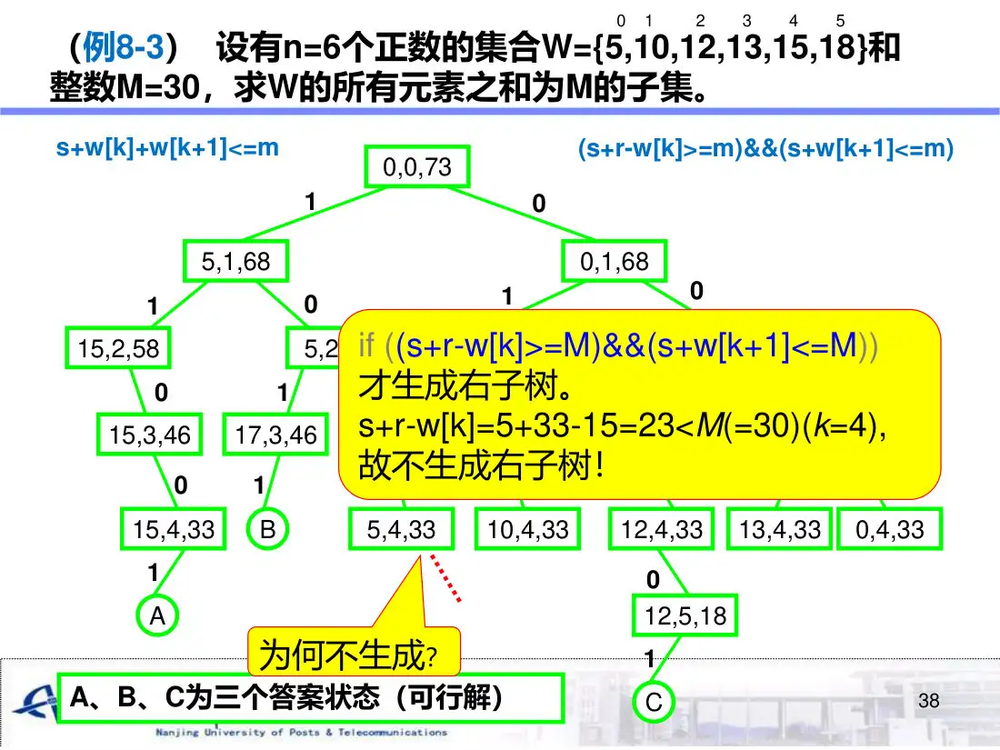

原文：

（例8-3） 设有n=6个正数的集合W={5,10,12,13,15,18}和整数M=30，求W的所有元素之和为M的子集。

38

Nanjing University of Posts & Telecommunications

### 8.4 图的着色

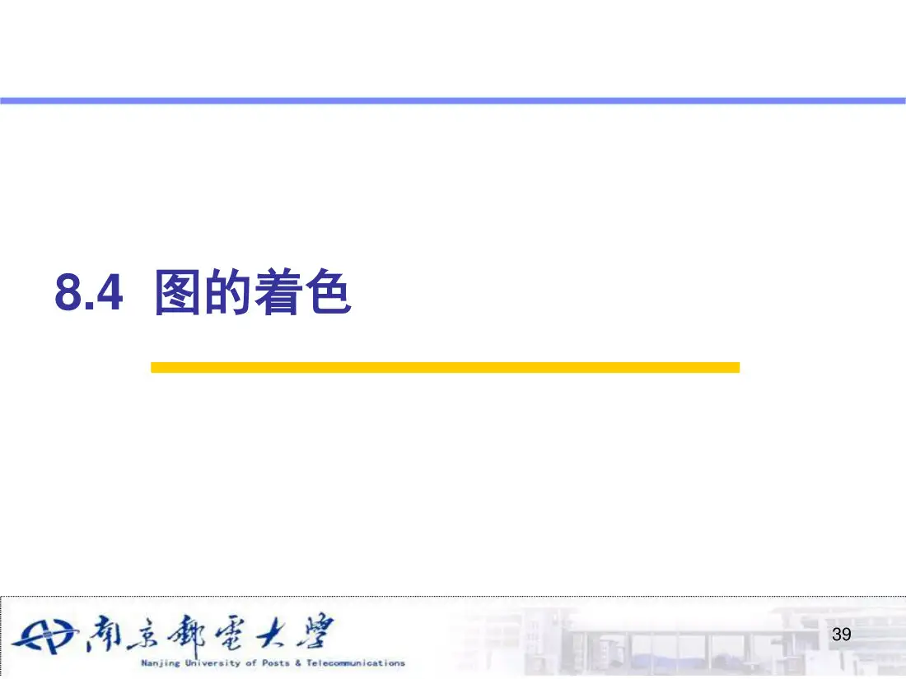

原文：

8.4 图的着色

安南京郵電大学 Nanjing University of Posts & Telecommunications

39

### 8.4.1 问题描述

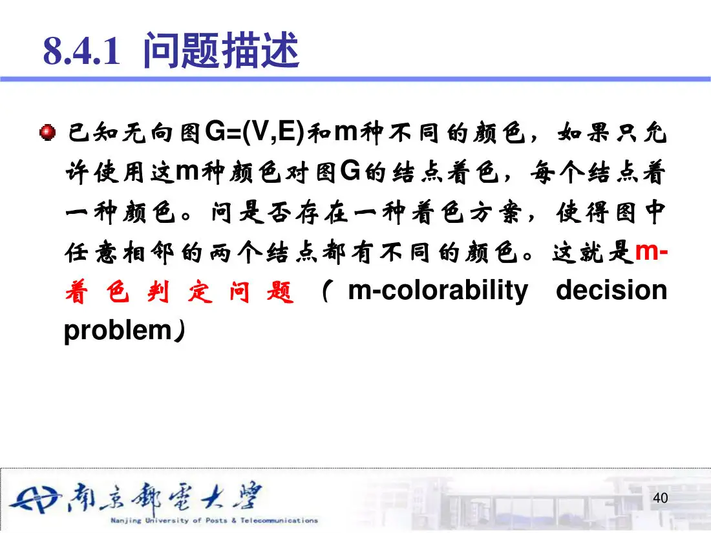

原文：

8.4.1 问题描述

已知无向图G=(V,E)和m种不同的颜色，如果只允许使用这m种颜色对图G的结点着色，每个结点着一种颜色。问是否存在一种着色方案，使得图中任意相邻的两个结点都有不同的颜色。这就是m-着 色 判 定 问 题 （ m-colorability decisionproblem）

安南京郵電大学 Nanjing University of Posts & Telecommunications

40

### 可用三种颜色着色，结点边上的数字代表颜色编号。

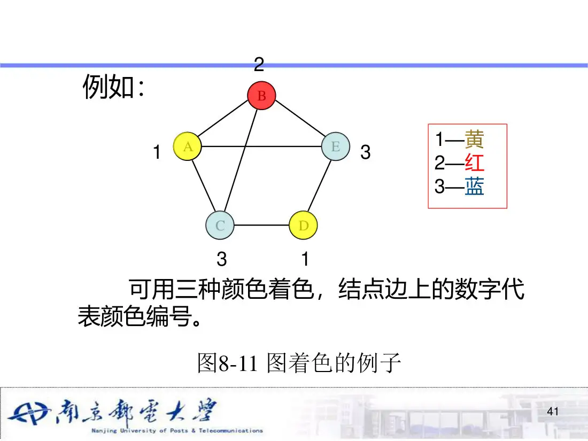

原文：

可用三种颜色着色，结点边上的数字代表颜色编号。

图8-11 图着色的例子

安南京郵電大学 Nanjing University of Posts & Telecommunications

41

### 四色定理

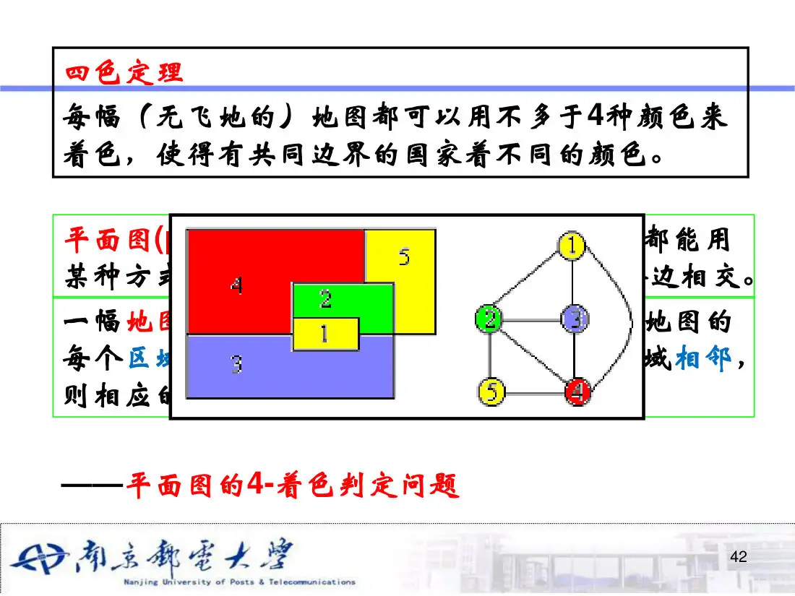

原文：

四色定理

每幅（无飞地的）地图都可以用不多于4种颜色来着色，使得有共同边界的国家着不同的颜色。

平面图(p某种方式一幅地图每个区域则相应的

——平面图的4-着色判定问题

都能用边相交。

地图的域相邻，

安南京郵電大学 Nanjing University of Posts & Telecommunications

42

### 8.4.2 回溯法求解

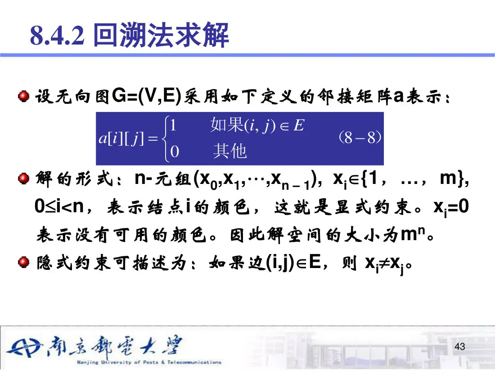

原文：

8.4.2 回溯法求解

设无向图 $\mathsf { G } \mathrm { = } \mathsf { ( V }$ ,E)采用如下定义的邻接矩阵a表示：

$$
a [ i ] [ j ] = \left\{ \begin{array}{l l} 1 & \text {如果} (i, j) \in E \\ 0 & \text {其他} \end{array} \right. \tag {8-8}
$$

解的形式：n-元组 $( \mathbf { x } _ { 0 } , \mathbf { x } _ { 1 } , \cdots , \mathbf { x } _ { n - 1 } ) , \ \mathbf { x } _ { 1 } \in \{ 1 , \cdots , \ m \}$ $0 { \leq } 1 { < } \mathsf { n }$ ，表示结点i的颜色，这就是显式约束。 $\mathbf { x } _ { \mathrm { _ i = 0 } }$ 表示没有可用的颜色。因此解空间的大小为 $\mathsf { m } ^ { \mathsf { n } }$ 。

隐式约束可描述为：如果边 $( { \bar { \mathbf { l } } } , { \bar { \mathbf { J } } } ) \in { \bar { \mathbf { E } } }$ ，则 $x _ { i } \neq x _ { j }$ o

安南京郵電大学 Nanjing University of Posts & Telecommunications

43

### 44

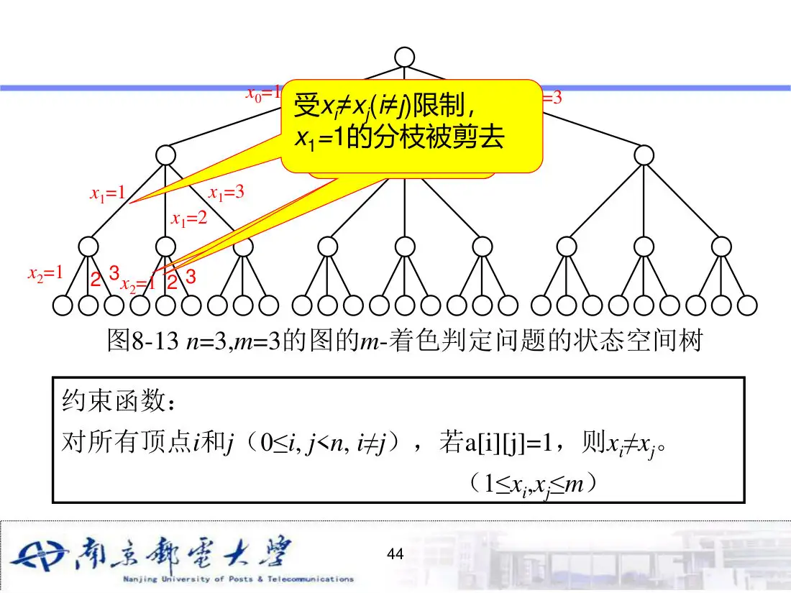

原文：

<table><tr><td>约束函数:对所有顶点i和j(0≤i,j&lt;n,i≠j),若a[i][j]=1,则xi≠xj。(1≤xi,xj≤m)</td></tr></table>

安南京郵電大学 Nanjing University of Posts & Telecommunications

44

### 45

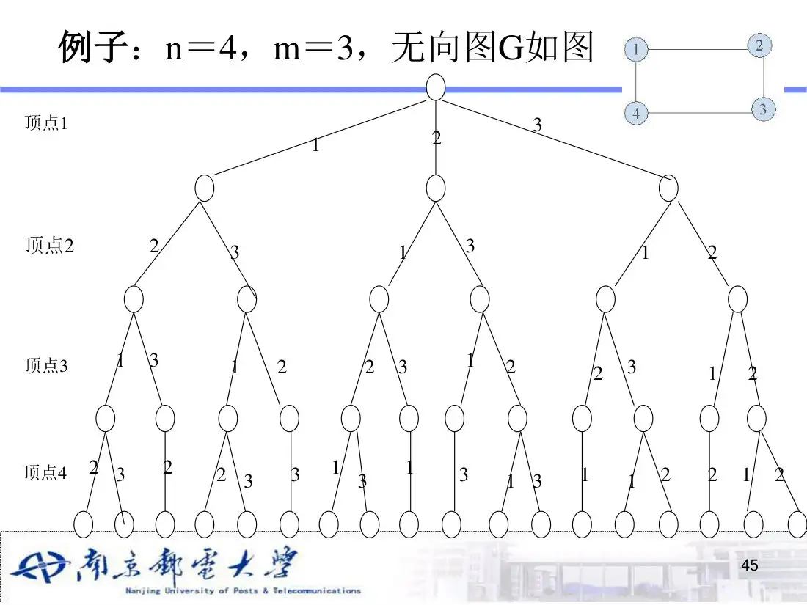

原文：

例子： $\mathrm { n } { = } 4 , \mathrm { m } { = } 3$ ，无向图G如图

45

Nanjing University of Posts & Telecommunications

### 第 46 页

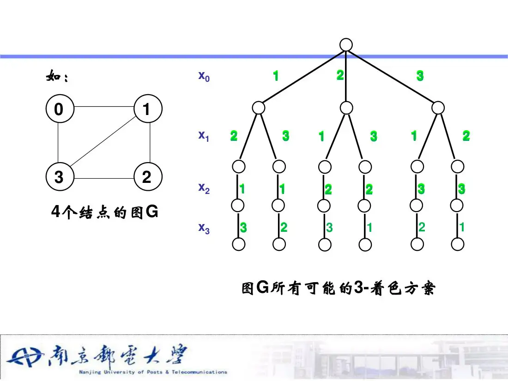

原文：

安南京郵電大学 Nanjing University of Posts & Telecommunications

### m-着色算法实现

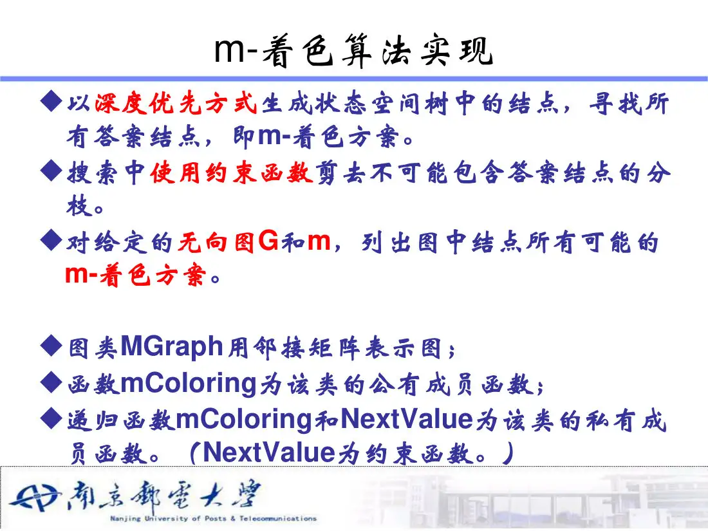

原文：

m-着色算法实现

◆以深度优先方式生成状态空间树中的结点，寻找所有答案结点，即m-着色方案。

◆搜索中使用约束函数剪去不可能包含答案结点的分枝。

◆对给定的无向图G和m，列出图中结点所有可能的m-着色方案。

◆图类MGraph用邻接矩阵表示图；

◆函数mColoring为该类的公有成员函数；

递归函数mColoring和NextValue为该类的私有成员函数。（NextValue为约束函数。）

分南京郵電大学

Nanjing University of Posts & Telecommunications

### 第 48 页

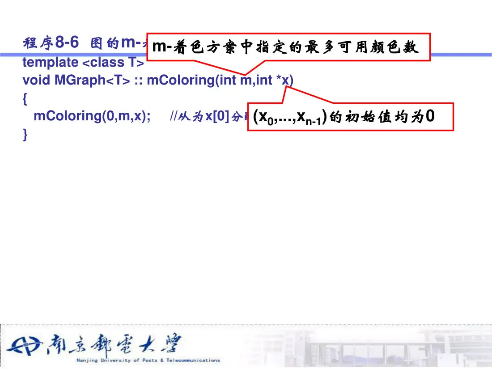

原文：

安南京郵電大学 Nanjing University of Posts & Telecommunications

### 第 49 页

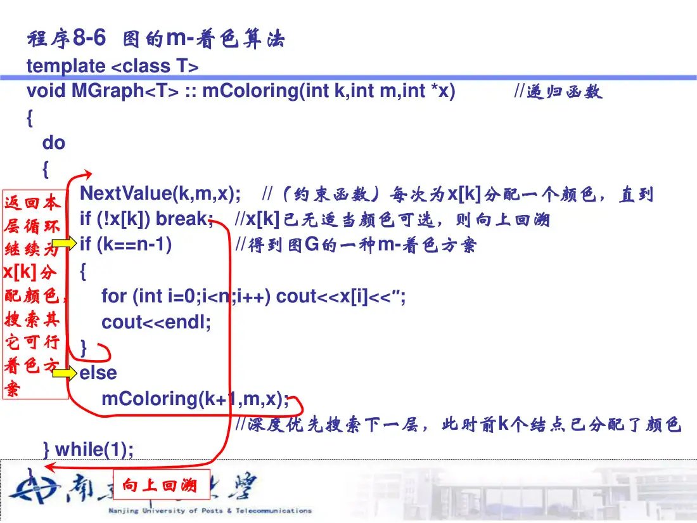

### 程序8-6 图的m-着色算法

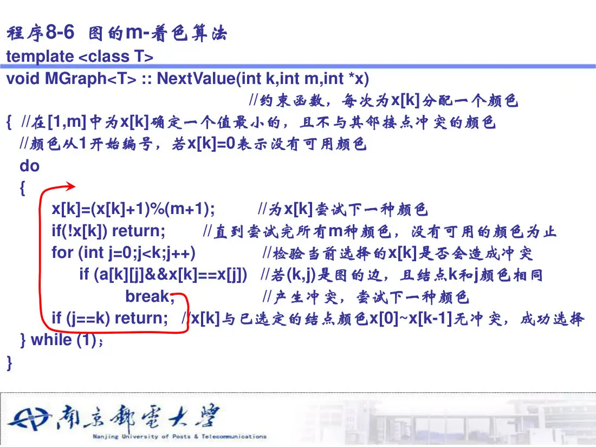

原文：

程序8-6 图的m-着色算法

### 算法的计算时间上界，由状态空间树的结点数

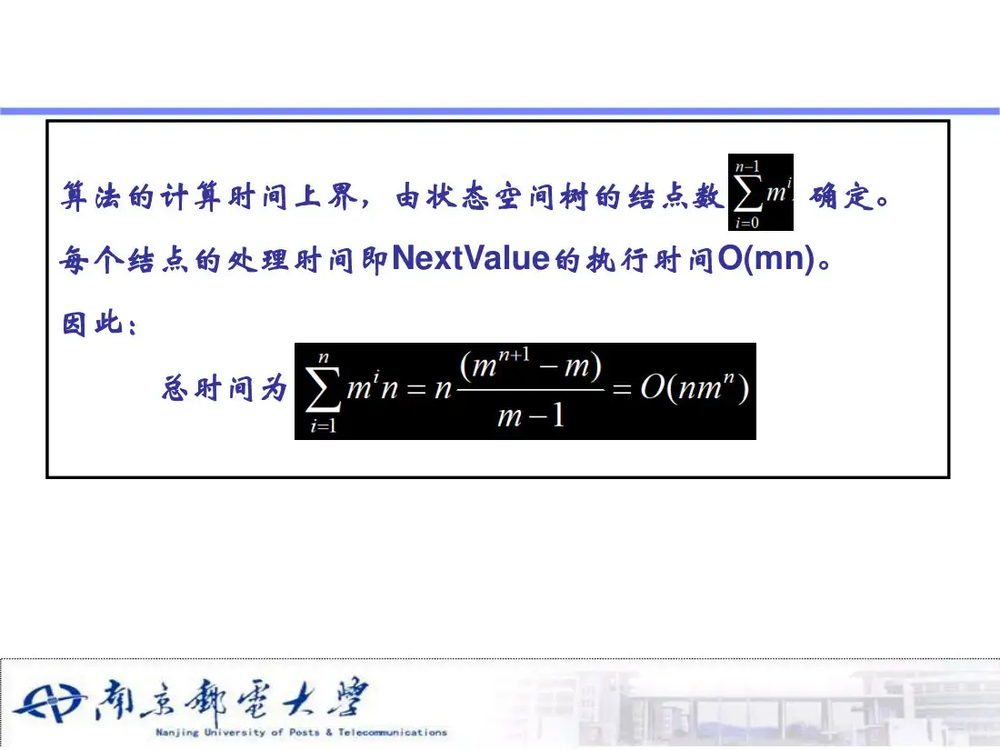

原文：

算法的计算时间上界，由状态空间树的结点数

确定。

每个结点的处理时间即NextValue的执行时间O(mn)。

因此：

总时间为

$$
\sum_ {i = 1} ^ {n} m ^ {i} n = n \frac {(m ^ {n + 1} - m)}{m - 1} = O (n m ^ {n})
$$

安南京郵電大学 Nanjing University of Posts & Telecommunications

### 8.5 哈密顿环

原文：

8.5 哈密顿环

◆哈密顿环（Hamiltonlan cycle）：

连通图G=(V,E)中的一个回路，经过图中每个顶点，且只经过一次。

一个哈密顿环就是从某个结点 $\mathbf { v _ { 0 } }$ 开始，沿着图G的n条边环行的一条路径 $( \mathsf { v } _ { 0 } , \mathsf { v } _ { 1 } , \ldots , \mathsf { v } _ { n - 1 } , \mathsf { v } _ { \mathrm { n } } )$ 0

➢除 $\mathbf { \boldsymbol { v } } _ { 0 } { = } \mathbf { \boldsymbol { v } } _ { \mathrm { { n } } }$ 外，路径上其余结点各不相同。

$> ( \mathsf { v _ { i } } , \mathsf { v _ { i + 1 } } ) \in \mathsf { E } ( 0 \leq \mathsf { i } < \mathsf { n } )$ 1 0

➢它访问图中每个结点且仅访问一次，最后返回开始结点。

安南京郵電大学 Nanjing University of Posts & Telecommunications

### 并不是每个连通图都存在哈密顿环!

原文：

并不是每个连通图都存在哈密顿环!

(0,1,7,6,5,4,3,2,0)

要确定一个连通图是否存在哈密顿环也没有容易的办法。

安南京郵電大学 Nanjing University of Posts & Telecommunications

### 第 54 页

原文：

采用n-元组 $( \mathbf { x } _ { 0 } , \mathbf { x } _ { 1 } , \ldots , \mathbf { x } _ { n - 1 } )$ 表示哈密顿环问题的解。

安南京郵電大学 Nanjing University of Posts & Telecommunications

### 哈密顿环算法实现

原文：

哈密顿环算法实现

◆求一个无向图或有向图的所有哈密顿环，并输出所有不相同的环。

◆图类MGraph用邻接矩阵表示图；

◆指定 $\scriptstyle x _ { 0 } = 0$ ，即哈密顿环始终从顶点0开始，避免同一环被重复多次输出。

◆因此公有成员函数Hamiltonian中以Hamiltonian(1,x)调用Hamiltonian私有递归函数；

◆NextValue为约束函数。

◆对最后一个结点 ${ \tt X } _ { { \tt n } = 1 }$ ，还需进一步要求 $( \mathbf { x } _ { \mathrm { n - 1 } } , \mathbf { x } _ { 0 } ) \in \mathsf { E }$ 才能形成哈密顿环。

分南京郵電大学

Nanjing University of Posts & Telecommunications

### 程序8-7 哈密顿环算法

原文：

程序8-7 哈密顿环算法

$$
(\mathbf {x} _ {0}, \dots , \mathbf {x} _ {n - 1})
$$

分南京郵電大学Nanjing University of Posts & Telecommunications

### 第 57 页

### 第 58 页

### 算法的计算时间上界估算，请参照图的着色问题!

原文：

算法的计算时间上界估算，请参照图的着色问题!

安南京郵電大學 Nanjing University of Posts & Telecommunications

### 8.6 0/1背包

原文：

8.6 0/1背包

0/1背包问题是一个困难问题（难以设计最坏情况下可多项式时间求解的算法）。

◆n-皇后问题、子集和数问题、m-图着色问题、哈密顿环问题的求解目标都是求满足约束条件的全部可行解。

◆0/1背包问题是最优化问题。

回溯法本质上是一种深度优先搜索状态空间树的算法。

⚫如果不引入剪枝函数(约束函数+限界函数)，则是穷举算法。

⚫引入适当的限界函数，剪去已能确信不含最优答案结点的子树，使其成为一种启发式算法。

,2用原腳電大學

Nanjing University of Posts & Telecommunications

### ⚫本节讨论采用固定长度元组解结构的 0/1背包问题的回溯算法。

原文：

⚫本节讨论采用固定长度元组解结构的 0/1背包问题的回溯算法。

⚫0/1背包问题的解用n-元组表示： $x = ( x _ { 0 } , x _ { 1 } , \ldots , x _ { n - 1 } )$ $x _ { \mathrm { i } } = 0$ 或1 $( 0 \leq i < n )$

显示约束： $x _ { i } = 1$ 表示将第i件物品装入背包, $\mathbf { x } _ { \mathrm { i } } { = } \mathbf { 0 }$ 表示第i件物品不装入背包。

隐式约束： $\frac { 1 } { 2 } \times ( - \frac { 1 } { 2 } ) = \frac { 1 } { 2 } ( - \frac { 1 } { 2 } )$ 解空间大小为 $2 ^ { \mathfrak { n } }$ 。解对左孩子 $( x _ { k } = 1 )$ 起约束函数作用，可剪去不含可行解的分枝；空间树对右孩子 $( \mathbf { x _ { k } } \mathbf { = } \mathbf { 0 } )$ 为n+1的满二叉树。不需用约束函数判断，一定可行。

约束函数：

$1 2 \times ( 1 2 \times 2 \times 2 \times 2 \times 2 \times 2 \times 2 \times 2 \times 2 \times 2 \times 2 \times 2 \times 2 \times 2 \times 2 \times 2 \times 2 \times 2 \times 2 \times 2 \times 2 \times 2 \times 2 \times 2 \times 2 \times 2 \times 2 \times 2 \times 2 \times 2 \times 2 \times 2 \times 2 \times 2 \times 2 \times 2 \times 2 \times 2 \times 2 \times 2 \times 2 \times 2 \times 2 \times 2 \times 2 \times 2 \times 2 \times 2 \times 2 \times 2 \times 2 \times 2 \times 2 \times 2 \times 2 \times 2 \times 2 \times 2 \times 2 \times 2 \times 2 \times 2 \times 2 \times 2 \times 2 \times 2 \times 2 \times 2 \times 2 \times 2 \times 2 \times 2 \times 2 \times 2 \times 2 \times 2 \times 2 \times 2 \times 2 \times 2 \times 2 \times 2 \times 2 \times 2 \times 2 \times 2 \times 2 \times 2 \times 2 \times 2 \times 2 \times 2 \times 2 \times 2 \times 2 \times 2 \times 2 \times 2 \times 2 \times 2 \times 2 \times 2 \times 2 \times 2 \times 2 \times 2 \times 2 \times 2 \times 2 \times \times 2 \times 2 \times 2 \times 2 \times 2 \times 2 \times \times 2 \times 2 \times 2 \times 2 \times \times 2 \times 2 \times 2 \times \times 2 \times 2 \times \times 2 \times 2 \times \times 2 \times 2 \times \times 2 \times 2 \times \times 2 \times \times 2 \times 2 \times \times 2 \times \times 2 \times 2 \times \times 2 \times \times 2 \times \times 2 \times 2 \times \times 2 \times \times 2 \times \times 2 \times \times \times 2 \times 2 \times \times \times 2 \times \times 2 \times \times 2 \times \times 2 \times \times 2 \times \times \times 2 \times \times 2 \times \times \times 2 \times \times \times 2 \times \times \times 2 \times \times \times 2 \times \times \times 2 \times \times \times 2 \times \times \times \times 2 \times \times \times 2 \times \times \times \times 2 \times \times \times 2 \times \times \times \times 2 \times \times \times \ c o \ c o r e r e r e r e r e r e r e r e r e r e r e r e r m \ c o r m \ c o r m \ c o r m p r m \ c o r m \ c o r m p r m \ a r m \ c o r m p r m \ a r m p r m p r m \ a r m p r m \ c o r m p r m a r m a r m a r m a r m a r m a r m a r m a r m a r m a r m a r m a r m a r m a r m a n d \ c o$ 当且仅当 $2 \sqrt { 2 } < 2 \sqrt { 2 } < \sqrt { 2 }$

剪去不含可行解的分枝

Nanjing University of Posts & Telecommunications

### 第 62 页

原文：

下界函数：变量L初值为0，遇到一个答案结点便计算该答案结点的收益值fp,且令L=max{L,fp}。则L中始终保存迄今为止已经搜索到的答案结点中收益的最大值，0/1背包的最优解值必定大于等于L，因此最优解值的下界估计值为L。

限界函数：状态空间树中任一结点 若其上界函数值bp<最优解值的下界估计值变量L，则可断定X子树上不含最 答案结点，可以剪去以X为根的子树。

上界函数：当前位于状态空间树的结点X处，cw为背包当前重量，cp为当前已装入背包物品的总收益，则贪心法求解剩余载重和剩余物品构成的一般背包问题（物品编号k+1,k+2,...,n-1,载重M-cw）最大收益为rp。则以X为根的子树上所有可能答案结点的目标函数值 不可能超过bp=cp+rp，因此i icp p x+ k+1≤i<n结点X的上界函数值为bp。

Nanjing University of Posts & Telecommunications

### 第 63 页

原文：

<table><tr><td>例8-4 设有0/1背包n=8, M=110,(w0,w1,...,w7)=(1,11,21,23,33,43,45,55),(p0,p1,...,p7)=(11,21,31,33,43,53,55,65)。——按pi/wi非增排列,即pi/wi≥pi+1/wi+1</td></tr></table>

安南京郵電大学 Nanjing University of Posts & Telecommunications

### $$

原文：

$$
(\mathsf {w} _ {0}, \mathsf {w} _ {1}, \dots , \mathsf {w} _ {7}) = (1, 1 1, 2 1, 2 3, 3 3, 4 3, 4 5, 5 5),
$$

(p ,p ,...,p )=(11,21,31,33,43,53,55,65), M=110。

被剪枝。因为w5=1时，

不满足约束函数。

Nanjing University of Posts & Telecommunications

### 第 65 页

原文：

(w0,w1,...,w7)=(1,11,21,23,33,43,45,55), bp=cp+rp =p \*1+p \*1+p \*1+p \*1+p \*1+p \*0+p /w \*(110-89) (p0,p1,...,p7)=(11,21,31,33,43,53,55,65), M=110=(11+21+31+33+43)+55/45\*21 =139+25.67 =164.67 为当前结点X的上界函数值。若bp<当前最优解值下界估计值L， 则可断定X子树上不含最优答案结点，可以剪去以X为根的子树。

Nanjing University of Posts & Telecommunications

### $$

原文：

$$
\begin{array}{l} \text {bp = cp + rp} \\ = p _ {0} * 1 + p _ {1} * 1 + p _ {2} * 1 + p _ {3} * 1 + p _ {4} * 1 + p _ {5} * 0 + p _ {6} * 0 + p _ {7} / w _ {7} * (1 1 0 - 8 9) \\ = (1 1 + 2 1 + 3 1 + 3 3 + 4 3) + 6 5 / 5 5 * 2 1 = 1 3 9 + 2 4. 8 1 = 1 6 3. 8 1 \end{array}
$$

为当前结点X的上界函数值。若bp<当前最优解值下界估计值L，则可断定X子树上不含最优答案结点，可以剪去以X为根的子树。

### 若得到最新可行解（到达状态空间树的第n+1层），则更新当前最优解下界值L。

原文：

若得到最新可行解（到达状态空间树的第n+1层），则更新当前最优解下界值L。

Nanjing University of Posts & Telecommunications

### 第 68 页

原文：

<table><tr><td>向左走:更新 $\sum_{i=0}^{k-1} w_i x_i + w_k$ 值,bp值不变。用约束函数 $\sum_{i=0}^{k-1} w_i x_i + w_k \leq M$ 剪去不含可行解的分枝;向右走:更新bp的值, $\sum_{i=0}^{k} w_i x_i$ 值不变。用限界函数bp≤L剪去不含最优解的分枝。</td></tr></table>

### 8.7 批处理作业调度

原文：

8.7 批处理作业调度

安南京郵電大学 Nanjing University of Posts & Telecommunications

69

### 8.7.1 问题描述

原文：

8.7.1 问题描述

◆设有n个作业的集合 $\{ 0 , 1 , . . . , \mathrm { n } ^ { - 1 } \}$ ，每个作业有两项任务要求分别在2台设备 ${ \bf P } _ { 1 }$ 和 $\mathrm { P _ { 2 } }$ 上完成。每个作业必须先在 $\mathrm { { P _ { 1 } } }$ 上加工，然后在 $\mathrm { P _ { 2 } }$ 上加工。 $\mathrm { { P _ { 1 } } }$ 和 $\mathrm { P _ { 2 } }$ 加工作业i所需的时间分别为 ${ \bf a _ { i } }$ 和 $\mathbf { b _ { i } } \circ$ 。作业i的完成时间 $\mathbf { f _ { i } }$ (S)是指在调度方案S下，该作业的所有任务得以完成的时间，则

$$
M F T (S) = \frac {1}{n} \sum_ {i = 0} ^ {n - 1} f _ {i} (S)
$$

是采用调度方案S的平均完成时间。

安南京郵電大学 Nanjing University of Posts & Telecommunications

70

### $$

原文：

批处理作业调度(batch job schedule)问题要求确定这n个作业的最优作业调度方案使其MFT最小。这等价于求使得所有作业的完成时间之和

$$
F T (S) = \sum_ {i = 0} ^ {n - 1} f _ {i} (S)
$$

最小的调度方案。

安南京郵電大学 Nanjing University of Posts & Telecommunications

71

### 例8－5

原文：

设有三个作业和两台设备，作业任务的处理时间为$( \mathsf { a } _ { 0 } , \mathsf { a } _ { 1 } , \mathsf { a } _ { 2 } ) \ = ( 2 , 3 , 2 )$ 和 $( \mathsf { b } _ { 0 } , \mathsf { b } _ { 1 } , \mathsf { b } _ { 2 } ) \ = ( 1 , 1 , 3 )$ 。这三个作业有6种可能的调度方案：(0,1,2),(0,2,1),(1,0,2),(1,2,0),(2,0,1),(2,1,0),它们相应的完成时间之和分别是19,18,20,21,19,19。其中，最佳调度方案S=(0,2,1)。在这一调度方案下， $\mathrm { f _ { 0 } ( S ) = 3 , ~ f _ { 1 } ( S ) = 7 , ~ f _ { 2 } ( S ) = 8 , }$ $\mathrm { F T } { = } 3 { + } 7 { + } 8 { = } 1 8$ o

例8－5

安南京郵電大学 Nanjing University of Posts & Telecommunications

72

### 8.7.2 回溯法求解

原文：

8.7.2 回溯法求解

对于双机批处理作业调度问题，其可行解是n个作业所有可能的排列，每一种排列代表一种作业调度方案S，其目标函数是 $F T ( S ) = \sum _ { i = 0 } ^ { n - 1 } f _ { i } ( S )$

使FT(S)具有最小值的调度方案或作业排列是问题的最优解。

对于双机作业调度，存在一个最优非抢先调度方案，使得在 $\mathsf { P } _ { 1 } \hbar \circ \mathsf { P } _ { 2 } \bot$ 的作业完全以相同次序处理。 批处理作业调度问题的状态空间树解空间的大小为 n！。

安南京郵電大学 Nanjing University of Posts & Telecommunications

73

### 74

原文：

求解这一问题没有有效的约束函数，但可以使用最优解的上界值U进行剪枝。如果对于已经调度的作业子集的某种排列，所需的完成时间和已经大于迄今为止所记录下的关于最优调度方案的完成时间和的上界值U,则该分枝可以剪去。 ①

安南京郵電大学 Nanjing University of Posts & Telecommunications

74

### 8.7.3 批处理作业调度算法

原文：

8.7.3 批处理作业调度算法

75

### 76

原文：

安南京郵電大学 Nanjing University of Posts & Telecommunications

76

### 第 77 页

### 78

原文：

78

### 79

原文：

安南京郵電大学 Nanjing University of Posts & Telecommunications

79

### 作业

原文：

作业

P180 8-6

补充题：用回溯法求解4-皇后问题的所有可行解。若随机选择的路径为(0,2)和（1,3,0,2），请用蒙特卡罗方法估计实际生成的状态空间树结点数。

安南京郵電大学 Nanjing University of Posts & Telecommunications
